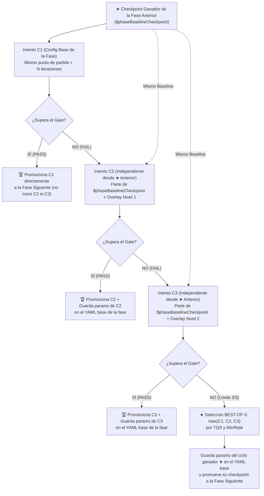

# Motor de Currículums Dinámicos con Puertas de Calidad (Dynamic Gated Curriculums)

> **Estado**: Canónico y Activo (`EfficientZeroV2`)  
> **Orquestador Principal**: [`curriculums/common/run_dynamic_gated_curriculum.ps1`](file:///c:/repos/python/assault/curriculums/common/run_dynamic_gated_curriculum.ps1)

---

## 1. Arquitectura General del Currículum

El sistema de currículum entrena progresivamente a **EfficientZero V2** a través de fases secuenciales de dificultad creciente (desde *bootstrap* contra oponente aleatorio hasta maestría multi-escenario en *self-play*).

### Estructura de Directorios
- `curriculums/common/run_dynamic_gated_curriculum.ps1`: Motor orquestador de fases, evaluación de Gates, generación de *overlays* adaptativos, selección `BEST-OF-3` (`★`) y auto-persistencia de hiperparámetros ganadores.
- `curriculums/<curriculum_name>/curriculum.yaml`: Definición declarativa de las fases, escenarios, número máximo de ciclos por fase (`max_reinforcement_cycles`) y umbrales de la puerta de calidad (`gate`).
- `curriculums/<curriculum_name>/configs/*.yaml`: Configuraciones de entrenamiento e inferencia de cada fase.
- `curriculums/<curriculum_name>/cycles/*.cycle.json`: Manifiestos de ejecución por fase consumidos por `scripts/run_curriculum_cycle.ps1`.

---

## 2. Paradigma de Depuración por Fase: Ciclos Independientes (`C1`, `C2`, `C3`) + Selección `BEST-OF-3` (`★`)

Cada fase del currículum dispone de hasta **`max_reinforcement_cycles` intentos independientes (por defecto 3: `C1`, `C2`, `C3`)** para superar su Puerta de Calidad (*Quality Gate*).



### ¿Por qué los intentos `C1`, `C2` y `C3` son independientes y parten todos del Baseline Anterior (`★`)?
1. **Cero contaminación de pesos (*No Catastrophic Drift*):** Si el intento `C2` prueba hiperparámetros más agresivos que inestabilizan la política, `C3` **no hereda el modelo degradado de `C2`**, sino que vuelve a partir limpio desde el checkpoint ganador (`★`) de la fase anterior (`$phaseBaselineCheckpoint`).
2. **Comparación 100% justa (`A vs B vs C`):** Los tres intentos (`C1`, `C2`, `C3`) parten exactamente del mismo checkpoint inicial y ejecutan el mismo número de iteraciones (`total_iterations`). La única variable entre ellos es el ajuste de hiperparámetros (`Overlay`).
3. **Transferencia directa al próximo currículum desde 0:** Como el ciclo ganador (`★`) demostró su superioridad en igualdad de condiciones (sin depender de acumular el doble o triple de iteraciones), sus hiperparámetros pueden persistirse directamente en el YAML base de la fase sabiendo que reproducirán ese rendimiento en `C1` en futuras ejecuciones desde cero.

---

## 3. Hiperparámetros Adaptativos por Ciclo (`Build-ResumeOverlayConfig`)

Cuando `C1` no supera la Puerta de Calidad, el orquestador inspecciona los motivos exactos de fallo (`$lastGateFailReasons`) del mejor candidato hasta el momento y construye dinámicamente un archivo *overlay* para `C2` (`tier = 1`) y `C3` (`tier = 2`):

| Motivo de Fallo del Gate | Parámetros Ajustados en `C2` (`tier = 1`) | Parámetros Ajustados en `C3` (`tier = 2`) |
| :--- | :--- | :--- |
| **Falta de Captura / Objetivos (`vp_unmet`)**<br>(`captured_avg`, `vp_capture`, `vp_net`) | • `vp_capture_bonus_per_hex`: **`+12%`**<br>• `objective_progress_bonus_per_hex`: **`+12%`**<br>• `capture_bonus`: **`+10%`**<br>• `objective_loss_weight`: **`+0.03`** | • `vp_capture_bonus_per_hex`: **`+24%`**<br>• `objective_progress_bonus_per_hex`: **`+24%`**<br>• `capture_bonus`: **`+20%`**<br>• `objective_loss_weight`: **`+0.06`**<br>• `mcts_temperature`: **`+0.05`** (mayor exploración) |
| **Falta de WinRate / Combate (`score_unmet`)**<br>(`score`, `loss_rate`, `tqs`) | • `kill_weight`: **`+8%`**<br>• `reanalysis_ratio`: **`+0.05`** (tope `0.60`) | • `kill_weight`: **`+16%`**<br>• `reanalysis_ratio`: **`+0.10`** (tope `0.60`) |
| **Refuerzo de Gradiente (General)** | • `train_updates_per_iter`: **`+1`** | • `train_updates_per_iter`: **`+2`** |

---

## 4. Selección del Ganador (`★ BEST-OF-3`) y Auto-Persistencia (`Save-WinningCycleParamsToPhaseConfig`)

1. **Criterio de Selección (`★`):**
   - En cada ciclo evaluado se calcula su `TQS` (*Tactical Quality Score*, compuesto por un 40% de WinRate, 35% de Supervivencia/No-Derrota y 25% de Captura de Objetivos) y su `WinRate` (`score`).
   - El orquestador actualiza `$bestPhaseCheckpoint`, `$bestPhaseCycle` y `$bestPhaseOverlayPath` siempre que un ciclo supere el mejor `TQS` de la fase (con desempate por `WinRate`).
2. **Auto-Persistencia en el YAML Base:**
   - Si la fase se resuelve (ya sea por `PASS` directo o por `BEST-OF-3` al agotar los 3 intentos) y el ciclo ganador es **`C2` o `C3`**, la función `Save-WinningCycleParamsToPhaseConfig` fusiona automáticamente los hiperparámetros ganadores (`reward_shaping`, `objective_loss_weight`, `reanalysis_ratio`, `train_updates_per_iter`, etc.) dentro del archivo `curriculums/<name>/configs/train_phaseX_*.yaml` correspondiente (excluyendo `resume_checkpoint`).
   - De este modo, **la siguiente ejecución del currículum desde 0 ya arranca cada fase con los mejores hiperparámetros descubiertos**.

---

## 5. Paralelismo de Self-Play y Calibración Base (`self_vs_self_vs_random_2scenarios_v1`)

Todas las fases del currículum están calibradas para maximizar el throughput en CPU multicore sin cuellos de botella de cola final (*tail latency*):
- **`num_workers: 20`** y **`episodes_per_iter: 20`** (ratio **1:1**, una única oleada exacta de 20 procesos en paralelo por iteración).
- **Continuidad de incentivos de objetivos (`phase1` a `phase6`):** Todas las fases mantienen una presión constante sobre los hexágonos de victoria (`vp_capture_bonus_per_hex >= 2.35`, `objective_progress_bonus_per_hex >= 1.80`, `capture_bonus >= 0.80`, `objective_loss_weight >= 0.16`) para evitar regresiones de captura al pasar de bootstrap a escenarios mixtos.

---

## 6. Visualización en el Dashboard MLOps (`http://127.0.0.1:8778`)

En la vista **Catalog & Curriculum Progression (`CatalogPage.tsx`)**:
- **Gráfica `📈 Curva de Progresión de ELO por Fase del Currículum`:**
  - Agrupa visualmente los ciclos (`C1`, `C2`, `C3`) de cada fase mediante bandas verticales alternadas.
  - Marca el ciclo elegido de cada fase con una **estrella dorada (`★`)**, anillo exterior resaltado, etiqueta superior dorada (`★ ELO`) y una **línea de tendencia dorada discontinua** que conecta exclusivamente los checkpoints elegidos (`★`) de fase en fase.
- **Tabla `Training Runs & Progreso del Currículum`:**
  - Muestra el índice de ciclo `(C1/3, C2/3, C3/3)` junto al nombre de la fase y destaca la fila ganadora con borde dorado y el badge **`★ ELEGIDO`**.

---

## 7. Comandos de Ejecución

### Ejecutar un Currículum Completo desde 0
```powershell
powershell -ExecutionPolicy Bypass -File .\curriculums\self_vs_self_vs_random_2scenarios_v1\run_curriculum.ps1
```

### Reanudar un Currículum desde una Fase Específica y un Checkpoint Concreto
```powershell
powershell -ExecutionPolicy Bypass -File .\curriculums\common\run_dynamic_gated_curriculum.ps1 `
  -CurriculumYaml .\curriculums\self_vs_self_vs_random_2scenarios_v1\curriculum.yaml `
  -StartPhase phase1_channel_adapt `
  -ExplicitStartCheckpoint "C:\repos\python\assault\runs_curriculum\...\checkpoints\final.pt"
```
