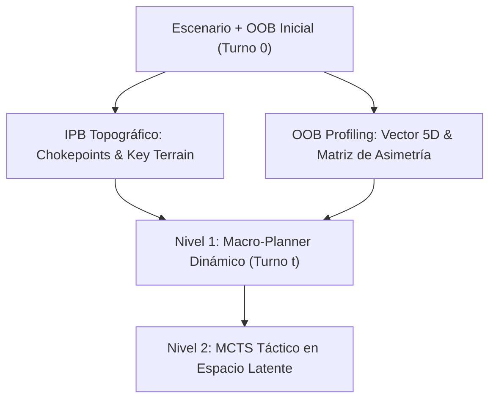

# 00. Premisas del Proyecto: Diseño, Arquitectura, Doctrinas de Calidad y Gobernanza Conceptual
**Proyecto: Assault Tactical AI Engine (EfficientZero V2)**  
*Documento Canónico de Diseño Conceptual y Especificación de Ingeniería del Sistema*

---

## Índice General

1. [Gobernanza, Fuente Única de Verdad (SSoT) y Estado del Arte](#1-gobernanza-fuente-única-de-verdad-ssot-y-estado-del-arte)
2. [Premisas de Diseño e Inteligencia Artificial (EfficientZero V2)](#2-premisas-de-diseño-e-inteligencia-artificial-efficientzero-v2)
3. [Premisas del Motor de Juego, Geometría y Reglas Tácticas](#3-premisas-del-motor-de-juego-geometría-y-reglas-tácticas)
4. [Premisas de Código, Contratos de Módulos e Invariantes](#4-premisas-de-código-contratos-de-módulos-e-invariantes)
5. [Premisas de Documentación y Sincronización Canónica](#5-premisas-de-documentación-y-sincronización-canónica)
6. [Viabilidad en Hardware Restringido y Economía de Cómputo](#6-viabilidad-en-hardware-restringido-y-economía-de-cómputo)
7. [Teoría de Palancas (Nudges), Andamiaje y Emergencia Creativa](#7-teoría-de-palancas-nudges-andamiaje-y-emergencia-creativa)
8. [Nivel 0: Análisis Estratégico Pre-Batalla y Perfilado de Tropas](#8-nivel-0-análisis-estratégico-pre-batalla-y-perfilado-de-tropas)
9. [Manifiesto de Instrumentación Experimental Fiel](#9-manifiesto-de-instrumentación-experimental-fiel)
10. [Rendimiento Asintótico sin Pérdida de Fidelidad](#10-rendimiento-asintótico-sin-pérdida-de-fidelidad)
11. [La Biblia Normativa y Protocolo de Pendientes de Revisión](#11-la-biblia-normativa-y-protocolo-de-pendientes-de-revisión)
12. [Auditorías Continuas, Prevención de Regresiones y Arquitectura](#12-auditorías-continuas-prevención-de-regresiones-y-arquitectura)

---

## 1. Gobernanza, Fuente Única de Verdad (SSoT) y Estado del Arte

1. **Decomisión Inquebrantable de MuZero (v1 / Clásico)**:
   - MuZero clásico está 100% obsoleto y formalmente decomisionado. No se utiliza para entrenar, ni evaluar, ni correr benchmarks.
   - Cualquier intento de reintroducir o basar desarrollos en el stack heredado de MuZero se considera un error crítico de arquitectura.
2. **Agente Estándar Exclusivo: EfficientZero V2**:
   - Todo entrenamiento (`trainer.py`), evaluación, simulación, self-play, inferencia y MCTS opera única y exclusivamente sobre `EfficientZeroV2` (`agents/efficientzero_v2/`).
3. **Validación Doctrinal y Científica**:
   - Cada decisión técnica se apoya en literatura contrastada: Model-Based RL (Schrittwieser et al., Hafner et al. / DreamerV3), transferencias de Palma et al. (2025), mitigación ortogonal de gradientes PCGrad (Yu et al., 2020), y doctrina militar clásica (Dunnigan, Sun Tzu, Hyde).
4. **Unificación Canónica del Trabajo Pendiente**:
   - Existe un único punto centralizado y canónico para la hoja de ruta y la deuda técnica: el documento `05_ROADMAP_EVOLUTIVO.md` (presentado como punto final #10 de la documentación).

---

## 2. Premisas de Diseño e Inteligencia Artificial (EfficientZero V2)

1. **Modelo de Mundo Diferenciable en Espacio Latente**:
   - La red planifica en un espacio latente abstracto compacto $s \in \mathbb{R}^{48 \times H \times W}$ mediante una red de dinámica recurrente ($g_\theta$), sin realizar rollouts en el simulador físico durante la búsqueda MCTS.
2. **Topología de Entrada Axial (32 Canales)**:
   - La entrada al modelo consta de exactamente 32 canales axiales fijos con semántica estandarizada (terreno, elevación, LOS, niebla, control territorial, posturas, armas pesadas y gradientes de distancia a VPs).
3. **Convolución Nativa con Máscara Hexagonal (`HexagonalMaskConv2d`)**:
   - En una cuadrícula axial $(q, r)$, un kernel cartesiano $3 \times 3$ introduce dos vecinos falsos (diagonales inexistentes). La convolución hexagonal enmascara activamente esas dos esquinas a cero con `persistent=False`, garantizando simetría perfecta de 6 vecinos.
4. **Representación Distribucional de Valor y Recompensa**:
   - Se prohíbe la regresión escalar MSE directa para retornos. Se utiliza una representación distribucional Two-Hot / HL-Gauss sobre un soporte discreto simétrico $[-30, +30]$ (61 átomos) con transformación contractiva symlog/symexp.
5. **Mitigación de Conflicto de Gradientes (PCGrad)**:
   - Para coentrenar la política, el valor, la consistencia temporal SimSiam y las 6 cabezas tácticas auxiliares sin interferencia destructiva, los gradientes en conflicto ($\langle g_i, g_j \rangle < 0$) se proyectan sobre el hiperplano ortogonal al de la tarea primaria.

---

## 3. Premisas del Motor de Juego, Geometría y Reglas Tácticas

1. **Topología Hexagonal Pura**:
   - Coordenadas axiales $(q, r)$ con correspondencia cúbica ($x + y + z = 0$). Distancia canónica:
     $$\text{dist} = \frac{|\Delta q| + |\Delta(q+r)| + |\Delta r|}{2}$$
   - No existen diagonales. Cada hexágono tiene exactamente 6 vecinos equidistantes.
2. **Línea de Visión (LOS) y Detección 3D**:
   - Ray-casting de centro a centro. El bloqueo se rige por elevación y obstáculos intermedios (edificios, bosques, humo), respetando la cresta de colina y ángulos muertos. Las unidades en cobertura sin disparar permanecen ocultas (*Hidden*).
3. **Sistema Balístico y Fuego de Combate**:
   - Resolución de dados oficiales en 4 colores (Rojo, Azul, Verde, Amarillo) con caras de Impacto, Impacto Doble, Supresión, Crítico y Bloqueo (Save).
   - El daño neto resta puntos de vida (HP). Al llegar a 0 HP la unidad es eliminada.
4. **Estados de Moral y Cohesión**:
   - 4 estados canónicos: `NORMAL`, `PINNED` (-50% movilidad, -1 dado de defensa), `SUPPRESSED` (incapacitado para moverse/disparar voluntariamente), y `ROUTED` (retirada forzada; si es atacada es destruida o capturada).
5. **Fuego de Reacción (*Opportunity Fire*)**:
   - Las unidades en estado `NORMAL` con línea de visión y capacidad de reacción disponible pueden interrumpir el movimiento enemigo que cruza terreno expuesto.

---

## 4. Premisas de Código, Contratos de Módulos e Invariantes

1. **Clean Architecture y Agnosticismo Radical de `assault_model/`**:
   - `assault_model/` es el motor de reglas puras. Tiene terminantemente prohibido importar librerías de Machine Learning (`torch`) o librerías web (`fastapi`).
2. **El Puente Único: `voec_sim/`**:
   - Es el único adaptador autorizado para traducir las estructuras de `assault_model/` al tensor de 32 canales y generar la máscara de acciones legales.
3. **Contrato de Inmutabilidad de Modelos de Checkpoints**:
   - Cualquier mejora de arquitectura en la red debe mantener la compatibilidad con el cargador de pesos (`strict=True`, buffers `persistent=False`, sin adición arbitraria de pesos que rompa checkpoints históricos).
4. **Identificadores Canónicos de Acciones**:
   - Todas las acciones del motor se serializan en formato delimitado por dos puntos:
     `TIPO:UNIDAD:DESTINO_Q:DESTINO_R` (ej. `MOVE:US_1:2:8`, `ATTACK:GE_1:US_1:3:4`).

---

## 5. Premisas de Documentación y Sincronización Canónica

1. **Los `.md` de `docs/` son la Fuente Única de Verdad (SSoT)**:
   - Queda terminantemente prohibido editar manualmente el HTML de documentación (`docs/index.html` o `site/`).
2. **Sincronización Bit a Bit Obligatoria (Regla a Fuego)**:
   - Tras cualquier cambio en `docs/*.md`, es mandatorio ejecutar:
     `python scripts/sync_docs_html.py`
     Este script inyecta el 100% íntegro de los `.md` en `embeddedDocsData` y recompila el sitio estático mediante `mkdocs build`.
3. **Posición Sagrada del Roadmap**:
   - El archivo `05_ROADMAP_EVOLUTIVO.md` debe figurar siempre en la última posición del índice de documentación.

---

## 6. Viabilidad en Hardware Restringido y Economía de Cómputo

### 6.1. La Paradoja del Hardware en RL
Entrenar agentes complejos en wargames suele requerir granjas de servidores masivas si se utiliza RL libre de modelo (PPO/DQN), ya que necesitan entre $10^7$ y $10^9$ pasos de interacción ciega con el entorno.

### 6.2. Por qué EfficientZero V2 es Viable en un PC Doméstico
EfficientZero V2 fue diseñado para resolver el reto de *Atari 100k* (aprender con solo 100.000 pasos de entorno, equivalentes a ~2 horas de experiencia humana). Esto es viable en local gracias a:
1. **MCTS en la Imaginación Latente**: El simulador físico corre solo 1 vez por paso real. Las ramas del árbol MCTS no ejecutan el motor de reglas en CPU; corren en GPU evaluando la pequeña red recurrente de dinámica ($g_\theta$).
2. **Reanálisis Off-Policy Intenso**: Los episodios almacenados en el Replay Buffer se reutilizan entre 10 y 20 veces re-analizando sus árboles de búsqueda con la red más moderna sin necesidad de jugar partidas nuevas.
3. **Presupuesto Fijo de Memoria**:
   - La red completa con sus 10 cabezas ocupa únicamente **~42 MB** en memoria VRAM.
   - En precisión mixta (**AMP FP16**), el paso de inferencia y MCTS consume **< 3.5 GB VRAM**, permitiendo entrenar en GPUs convencionales de 8 GB sin saturar el sistema.

---

## 7. Teoría de Palancas (Nudges), Andamiaje y Emergencia Creativa

### 7.1. Definición Psicológica y Matemática de "Palanca" (*Nudge*)
En ciencias conductuales (Thaler & Sunstein), una palanca altera la arquitectura de decisión facilitando el camino óptimo sin prohibir ninguna opción.
* **Prohibido**: Enmascarar acciones legales como ilegales por criterios doctrinales.
* **Canónico**: Modular suavemente los *priors* de la raíz MCTS:
  $$P_{\text{mod}}(a) = \frac{P_\theta(a) \cdot \exp\big(\lambda(t) \cdot B(a)\big)}{\sum_{a'} P_\theta(a') \cdot \exp\big(\lambda(t) \cdot B(a')\big)}$$
  Donde $B(a)$ es el sesgo doctrinal y $\lambda(t) \in [0, 1]$ es el coeficiente de andamiaje.

### 7.2. La Garantía de Emergencia Creativa
Bajo la fórmula de selección PUCT:
$$a^* = \arg\max_a \left[ Q(s, a) + c_{\text{puct}} \cdot P_{\text{mod}}(a) \cdot \frac{\sqrt{\sum N}}{1 + N(s, a)} \right]$$
A medida que el número de visitas en un nodo $N(s, a) \to \infty$, el término del prior decae asintóticamente hacia 0. **El valor real $Q(s, a)$ domina absolutamente**. Si la IA descubre una maniobra heterodoxa (retirada táctica, emboscada, sacrificio) con mayor valor empírico que la doctrina humana, MCTS seleccionará la jugada creativa sin restricción.

### 7.3. Andamiaje de Vygotsky (*Scaffolding*) y Decaimiento (*Annealing*)
* **Fase 1 (Bootstrap, $\lambda = 1.0$)**: Palanca fuerte. El agente aprende "motricidad táctica" en pocas horas, evitando la parálisis por miedo al fuego.
* **Fase 2 (Refinamiento, $\lambda = 0.35$)**: El MCTS empieza a desafiar los priors cuando encuentra jugadas superiores.
* **Fase 3 (Maestría y Super-humano, $\lambda \to 0.02$)**: La palanca queda prácticamente apagada; el juego emergente de la red gobierna el tablero.

---

## 8. Nivel 0: Análisis Estratégico Pre-Batalla y Perfilado de Tropas

### 8.1. Perfilado Vectorial 5D de Tropas (*OOB Profiling*)
Cada unidad se caracteriza en $t=0$ mediante su vector normalizado:
$$\vec{F}_u = \big[ F_{\text{range}}, \; F_{\text{shock}}, \; F_{\text{armor}}, \; F_{\text{mobility}}, \; F_{\text{at}} \big] \in [0, 1]^5$$
A partir del balance de ambos bandos, se calcula la **Matriz de Asimetría Relativa** ($\Delta_{\text{Shock}}, \Delta_{\text{Range}}, \Delta_{\text{Armor}}$), dictando si la doctrina de partida debe ser de **cierre rápido de distancia bajo cobertura** o de **fijación y desgaste a largo alcance**.

### 8.2. Inteligencia Topográfica del Terreno (*IPB*)
En menos de $3\text{ ms}$ en CPU (Turno 0):
* **Cuellos de Botella (*Chokepoints*)**: Hexágonos críticos calculados por centralidad de caminos mínimos (Dijkstra) hacia los VPs.
* **Terreno Clave (*Key Terrain*)**: Posiciones elevadas o edificios con arcos de tiro dominantes sobre los accesos principales.
* **Presupuesto Temporal (*Tempo Index*)**: $\frac{d_{\text{min}}}{T_{\text{max}} \times V_{\text{media}}}$. Si es $> 0.6$, el escenario impone urgencia máxima de aproximación para no perder por tiempo.

---

## 9. Manifiesto de Instrumentación Experimental Fiel

> **Principio de Cero Invención**: El panel de evaluación (Dashboard MLOps) es un aparato de medición física. No opina, no maquilla y no inventa datos. Si un valor no se puede medir, se muestra como `NO_DISPONIBLE`.

### 9.1. Los Cuatro Instrumentos de Laboratorio
1. **Dinamómetro de Valor y ELO**: Win Rate estricto según condiciones del escenario y curva ELO ($K=32$) con semillas registradas. Prohibido computar empates como victorias aproximadas.
2. **Tomógrafo de Búsqueda MCTS**: Muestra los tensores crudos del árbol de decisión: visitas $N(a)$, valor des-simlogueado $Q(a)$, prior de la red $P_\theta(a)$ y prior modulado $P_{\text{mod}}(a)$.
3. **Microscopio Balístico y de Reglas**: Registro exacto de cada tirada de dados por color y cara (`RED:HIT`, `BLUE:BLOCK`). Alerta automática si el generador PRNG desvía la media teórica más de un $1.5\%$.
4. **Osciloscopio de Gradientes y Atribución**: Mide el coseno real de conflicto de gradientes de PCGrad y la atribución de los 32 canales axiales mediante Integrated Gradients (IGNH).

---

## 10. Rendimiento Asintótico sin Pérdida de Fidelidad

1. **Clonado Inmutable Copy-on-Write (CoW)**:
   - El estado del juego no se duplica con `deepcopy`. Estructuras inmutables con CoW permiten **>109.000 clones por segundo** en CPU con 0 copias de memoria en ramas no alteradas.
2. **Línea de Visión (LOS) Vectorizada**:
   - Matrices de adyacencia y visibilidad pre-calculadas en NumPy/Numba. Consultas de LOS resueltas en **$< 30\text{ nanosegundos}$**.
3. **Control Territorial Incremental**:
   - Coste independiente del tamaño del mapa: al mover una unidad, solo se actualiza el anillo local de radio 3 ($O(k \cdot R^2)$ amortizado).
4. **Cómputo Adaptativo (ACT)**:
   - El MCTS modula sus simulaciones según la entropía táctica $H(\pi)$ (64 simulaciones en turnos de transición; 256–384 en contacto directo o asalto a VPs), ahorrando un 50% de tiempo de GPU sin pérdida de calidad.

---

## 11. La Biblia Normativa y Protocolo de Pendientes de Revisión

> **Regla de Oro**: El reglamento oficial (*Rulebook rev6* de 52 páginas y el *Libro de Escenarios*) es la máxima e indiscutible autoridad. Se prohíbe inventar reglas ad-hoc para salir del paso.

### Protocolo de Dudas y Ambigüedades:
Ante cualquier contradicción en las cartas, caso borde no tipificado o ambigüedad:
1. **JAMÁS se inventa una regla en código.**
2. La mecánica se etiqueta de inmediato como **`[PENDIENTE DE REVISIÓN / AMBIGÜEDAD NORMATIVA]`**.
3. Se documenta la página exacta, el párrafo literal y los argumentos en juego en el registro de auditoría.
4. El motor ejecuta la alternativa más conservadora y neutra, emitiendo un warning experimental auditable.

---

## 12. Auditorías Continuas, Prevención de Regresiones y Arquitectura

### 12.1. Arquitectura Limpia en 5 Capas (Dependencia Unidireccional)
* **Capa 1: `assault_model/` (Reglas)**: Agnóstica de ML y Web (cero imports de `torch` o `fastapi`).
* **Capa 2: `voec_sim/` (Adaptador)**: Único traductor de reglas a tensores de 32 canales y acciones legales.
* **Capa 3: `agents/efficientzero_v2/` (IA)**: Red neuronal, MCTS latente y Macro-Planner.
* **Capa 4: `mlops/` (Instrumentación)**: Observador pasivo. Persiste en Parquet y consulta con DuckDB en <10 ms.
* **Capa 5: `fastapi` & `viewer_frontend` (Servicios)**: Consumen contratos de API desacoplados por HTTP/WebSocket MessagePack.

### 12.2. Protocolo de Auditorías Continuas (Tolerancia Cero a Regresiones)
1. **Invariantes Físicos del Motor**: Conservación estricta de puntos de vida ($\sum \text{HP}_{\text{actuales}} + \sum \text{HP}_{\text{bajas}} = \text{HP}_{\text{iniciales}}$) y apilamiento máximo de 1 unidad por hexágono.
2. **Suite de Regresión del Manual**: Cada test valida un ejemplo gráfico oficial del libro (ej. arcos de fuego en p. 27, asaltos combinados en p. 33).
3. **Canary Check Pre-Entrenamiento**: Test de 100 pasos en un micro-lote sintético antes de cada sesión larga para comprobar descenso de pérdidas Two-Hot, estabilidad de norma de gradientes ($\|g\| \in [0.1, 5.0]$) y no-colapso en SimSiam.
4. **Promotion Gates**: Promoción de checkpoints solo si superan:
   $$\text{WinRate vs Random} \ge 90\% \quad \wedge \quad \text{TimeoutRate} \le 8\% \quad \wedge \quad \text{WinRate vs Baseline Anterior} \ge 55\%$$
