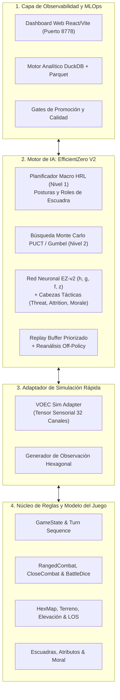
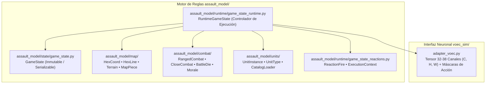
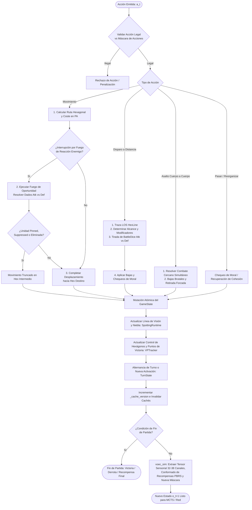
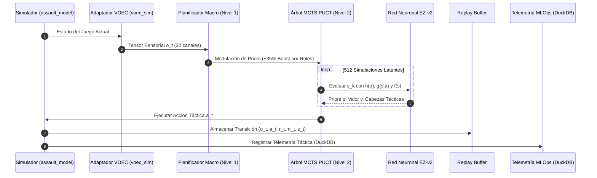
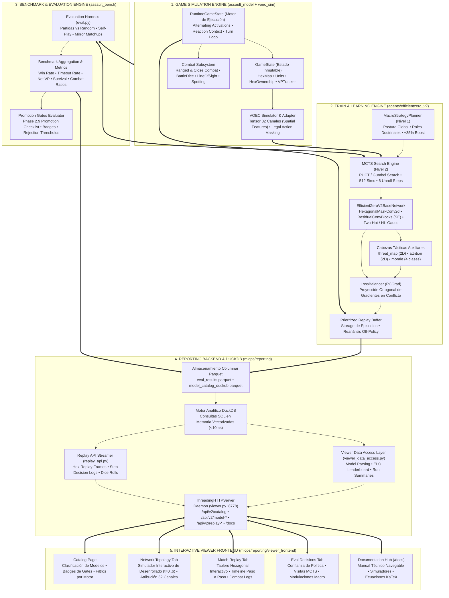
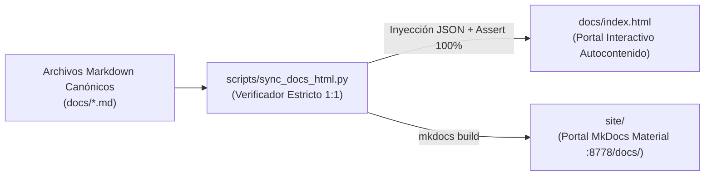

# Arquitectura del Sistema: Assault Wargame AI & Simulation Platform

> **Estado**: Actualizado y Canónico (2026)  
> **Directiva Fundamental**: El motor de aprendizaje está basado exclusivamente en **EfficientZero V2** (`agents/efficientzero_v2/`). Todo el stack heredado de MuZero v1 está completamente decomisionado y obsoleto.

---

## 1. Visión General y Filosofía de Diseño

El proyecto **Assault** es una plataforma integral de simulación táctica militar por turnos sobre tablero hexagonal combinada con inteligencia artificial basada en aprendizaje por refuerzo con modelo de mundo (*Model-Based Reinforcement Learning*).

La arquitectura sigue estrictamente los principios de **Arquitectura Limpia (*Clean Architecture*)**, desacoplando radicalmente cuatro subsistemas autónomos:



---

## 2. Los Cuatro Subsistemas Autónomos

### 2.1. Núcleo del Modelo del Juego (`assault_model/`)
* **Propósito**: Encapsula las reglas tácticas del juego de guerra sin ninguna dependencia externa de librerías de Machine Learning (sin PyTorch) ni de interfaces gráficas.
* **Patrón de Diseño**: Sigue estrictamente el patrón **Estado Inmutable / Runtime de Mutación**:



#### Responsabilidades de los Paquetes Internos
1. **`assault_model/state/` (`GameState`, `TurnState`)**:
   - Contenedor puro de datos serializable en disco o memoria.
   - Almacena el estado de cada celda (`HexState`), el inventario y posición de cada unidad (`UnitInstance`), el marcador de control (`HexOwnership`, `VPTracker`) y el registro de activación por bando.
   - **No contiene lógica de cálculo de combate ni reglas de movimiento**.

2. **`assault_model/runtime/` (`RuntimeGameState`, `ExecutionContext`)**:
   - Orquestador autoritativo del ciclo de simulación.
   - Gestiona el sistema de activación alternada (I-Go-U-Go o impulso táctico).
   - Invalida cachés espaciales mediante `_cache_version` tras cualquier mutación del tablero.
   - Supervisa las interrupciones por fuego de oportunidad (`game_state_reactions.py`).

3. **`assault_model/map/` (`HexCoord`, `HexLine`, `TerrainConfig`)**:
   - Aritmética hexagonal axial $(q, r)$ y cúbica $(x, y, z)$.
   - Algoritmo de ray-casting hexagonal para trazado de Línea de Visión (LOS) y detección de obstáculos.
   - Definición de costes de paso por tipo de terreno y elevación.

4. **`assault_model/combat/` (`RangedCombatResolver`, `CloseCombatResolver`, `BattleDie`, `MoraleState`)**:
   - Cálculo estocástico de dados de combate (`attack_dice_pool.py`, `defense_dice_pool.py`).
   - Resolución de impactos directos, impactos morales de supresión y tablas de efectos críticos.
   - Transiciones de estado de cohesión de tropas (`NORMAL` $\to$ `PINNED` $\to$ `SUPPRESSED` $\to$ `ROUTED`).

#### Ciclo Autoritativo de Mantenimiento del Estado (*State Loop*)

El motor procesa cada acción individual de un agente o jugador humano mediante un ciclo estricto de validación, interrupción y mutación atómica:



### 2.2. Adaptador de Simulación Rápida (`voec_sim/`)
* **Propósito**: Actúa como puente de alto rendimiento entre las estructuras de datos de `assault_model` y los tensores requeridos por PyTorch para el entrenamiento.
* **Funciones Clave**:
  * Proyecta el estado completo a un **tensor espacial 32 canales $\times H \times W$** (unidades amigas/enemigas, HP normalizado, cobertura, costes de movimiento, LOS, estado de supresión y banderas VP).
  * Vectoriza y filtra las acciones legales candidatas (movimiento, disparo, asalto, preparación de fuego de reacción).

### 2.3. Motor de Inteligencia Artificial (`agents/efficientzero_v2/`)
* **Propósito**: Ejecución de auto-juego (*self-play*), planificación MCTS guiada por modelo de mundo y entrenamiento distribuido.
* **Innovaciones Implementadas**:
  * **Planificador Macro Jerárquico (Nivel 1)**: Evalúa el estado global y asigna postura operativa (`ASSAULT_VP`, `DEFENSIVE_HOLD`, `ZONE_SUPPRESS`) y roles tácticos a cada unidad (`SPEARHEAD`, `FIRE_SUPPORT`, `DEFENDER`, `SCREEN`), modulando los priors de búsqueda MCTS en $+35\%$.
  * **Búsqueda MCTS guiada por Modelo de Mundo (Nivel 2)**: 512 simulaciones en espacio latente continuo sin tocar el simulador físico.
  * **Representación Discreta Two-Hot y HL-Gauss**: Estabilidad garantizada en predicción de valor y recompensas sin colapso de gradiente.
  * **Convoluciones con Máscara Hexagonal (`HexagonalMaskConv2d`)**: Preservación estricta de la vecindad de 6 hexágonos en kernels $3\times 3$.
  * **Cabezas Tácticas Auxiliares**: `threat_map` (2D LOS/fuego enemigo), `attrition` (balance de bajas), `morale` (supresión).
  * **Balanceador de Gradientes PCGrad**: Ortogonalización de gradientes conflictivos entre pérdidas primarias y secundarias.

### 2.4. Plataforma MLOps y Telemetría (`mlops/`)
* **Propósito**: Registro, almacenamiento columnar, validación de gates de calidad y visualización interactiva.
* **Componentes Principales**:
  * **Backend Analítico**: Almacenamiento en Parquet y base de datos analítica integrada **DuckDB** para consultas agregadas instantáneas.
  * **Servidor Daemon**: Daemon local en puerto `8778` sirviendo APIs REST y la aplicación web React/Vite.
  * **Frontend SPA**: Visualización de catálogo, métricas de currículum, topología interactiva de la red, visor hexagonal de partidas paso a paso (*Match Replay*) y atribución de canales.

### 2.5. Simulador Táctico Interactivo y Partidas en Vivo (`assault_backend/` y `assault_ai_ui/`)
* **Propósito**: Proporciona un entorno interactivo completo para **jugar contra la IA** o presenciar partidas autónomas en tiempo real (**Self-Play**) con renderizado por GPU mediante **Pixi.js**, animaciones fluidas, partículas de combate y efectos de sonido espaciales (`SoundService.ts`).
* **Componentes Principales**:
  * **Backend de Juego FastAPI (`assault_backend/` en Puerto 8001)**:
    * Sesión autoritativa de juego en memoria (`GameSession`) que conecta las acciones de la UI directamente con `RuntimeGameState`.
    * Canal WebSocket bidireccional (`/ws/game`) para la transmisión instantánea de estados, tiradas de dados, disparos de reacción y bajas.
    * Módulo **RAG Copilot** (`assault_rag/`): Asistente en vivo que explica las reglas del juego, justifica decisiones de la IA y recomienda jugadas óptimas basándose en el manual de reglas y el contexto actual.
  * **Frontend del Simulador (`assault_ai_ui/` en Puerto 5173)**:
    * **Modo Humano vs IA**: El usuario selecciona unidades, visualiza rangos de movimiento y disparo en el lienzo hexagonal Pixi.js, y ejecuta órdenes contra el agente neuronal.
    * **Modo Auto-Play / Espectador**: Ejecuta la IA de forma autónoma en bucle continuo (`aiTurnRunner.ts`), mostrando el avance táctico de ambos bandos.
    * **Panel de Combate y Cohesión**: Animación visual de tiradas de dados de ataque/defensa, chequeos de moral en vivo y registro detallado de combate (`CombatPanel.tsx`).
    * **Control de Capas**: Activación/desactivación de niebla de guerra, conos de visión (LOS), elevaciones y vectores de depuración (`LayerControls.tsx`).
    * **Audio Espacial Táctico**: Efectos de pasos sobre tierra (`stepdirt`) y disparos de fusilería (`rifle-gunshot`) orquestados por `SoundService.ts`.

---

## 3. Flujo de Datos y Ciclo de Vida Operativo



1. **Extracción Sensorial**: `voec_sim` construye la observación $o_t \in \mathbb{R}^{32 \times 16 \times 16}$.
2. **Estrategia Macro (N1)**: El planificador macro determina la postura doctrinal y los roles asignados a cada escuadra.
3. **Exploración PUCT (N2)**: El árbol MCTS desenrolla hasta $k=6$ pasos recursivos en la red de dinámica $g_\theta(s, a)$.
4. **Ejecución y Almacenamiento**: La acción óptima $a_t$ se ejecuta en el entorno real y se guarda en el buffer de repetición con índices de consistencia SimSiam.
5. **Auditoría MLOps**: Cada decisión, probabilidad de política y resultado de combate se persiste en DuckDB para su inspección inmediata en el visor.

---

## 3. Visión Completa de Arquitectura de Extremo a Extremo

A continuación se detalla la arquitectura global de 5 capas que conecta el motor de simulación, el pipeline de entrenamiento de IA, el subsistema de benchmarking, el backend de analítica MLOps y el visualizador web interactivo:



### 3.1. Detalle de las 5 Capas y su Interconexión

1. **Capa de Simulación (Tier 1)**: El motor de simulación (`assault_model`) ejecuta las reglas tácticas de forma determinista y sin sobrecarga de IA. El adaptador `voec_sim` captura instantáneas del estado y las serializa en tensores normalizados de 32 canales espaciales sobre la cuadrícula hexagonal.
2. **Capa de Entrenamiento y Búsqueda (Tier 2)**: Durante el autojuego (*self-play*), el Planificador Macro de Nivel 1 evalúa el tensor y establece la doctrina (postura y roles). El árbol MCTS de Nivel 2 realiza 512 simulaciones en el espacio latente de `EfficientZeroV2BaseNetwork`, evaluando política, valor y cabezas tácticas (`threat_map`, `attrition`, `morale`). Las transiciones se guardan en el *Replay Buffer Priorizado*, y el entrenamiento unifica las pérdidas con balanceo ortogonal **PCGrad**.
3. **Capa de Evaluación y Benchmarking (Tier 3)**: Los checkpoints generados son evaluados de forma estandarizada en baterías competitivas (self-play y versus oponentes estocásticos). Los resultados se agregan calculando métricas finas de combate y se evalúan frente a los **Promotion Gates**.
4. **Capa de Backend Analítico MLOps (Tier 4)**: Toda la telemetría se almacena en archivos particionados **Apache Parquet**. El motor embebido **DuckDB** ejecuta consultas analíticas vectorizadas instantáneas. El servidor HTTP multi-hilo (`viewer.py` en puerto 8778) expone endpoints REST optimizados para streaming de partidas y análisis de catálogo.
5. **Capa de Frontend Visualizador (Tier 5)**: Aplicación SPA moderna en React y Vite. Presenta el catálogo de modelos, el inspector interactivo de topología de red con simulador de desenrollado temporal, la matriz de atribución de canales, el visor hexagonal de partidas paso a paso con registros de combate y el nuevo portal de documentación técnica navegable.

---

---

## 5. Arquitectura de Documentación Canónica y Pipeline de Compilación HTML

La documentación técnica del proyecto se rige por el principio de **Fuente Única de Verdad (Single Source of Truth - SSoT)** en Markdown (`docs/*.md`) con compilación automatizada al 100% hacia los portales HTML:



### 5.1. Reglas Estrictas de la Documentación:
1. **Markdown como Fuente de Verdad**: Todo contenido normativo, científico, arquitectónico y operativo se redacta en `docs/*.md`. Nunca se edita HTML de documentación directamente a mano.
2. **Posición del Roadmap**: La **Hoja de Ruta Evolutiva (`05_ROADMAP_EVOLUTIVO.md`)** debe figurar **SIEMPRE como el último punto (`09. Hoja de Ruta Evolutiva (Roadmap)`)**, unificando todos los planes y deudas técnicas del sistema.
3. **Sincronización Automática Obligatoria**: Tras modificar cualquier archivo en `docs/`, se ejecuta:
   ```bash
   python scripts/sync_docs_html.py
   ```
   El script inyecta el 100% del texto íntegro en `docs/index.html`, verifica mediante aserciones carácter por carácter que no haya discrepancias, y compila el árbol estático completo en `site/`.


