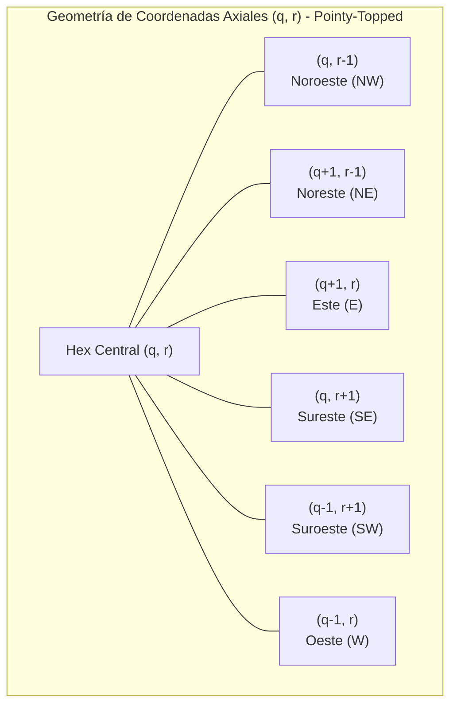
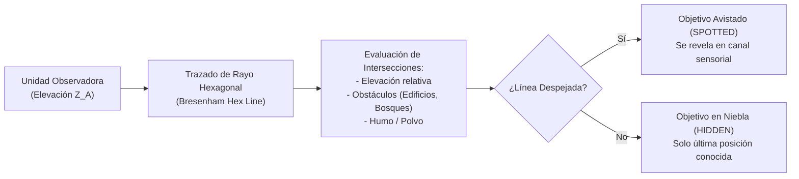
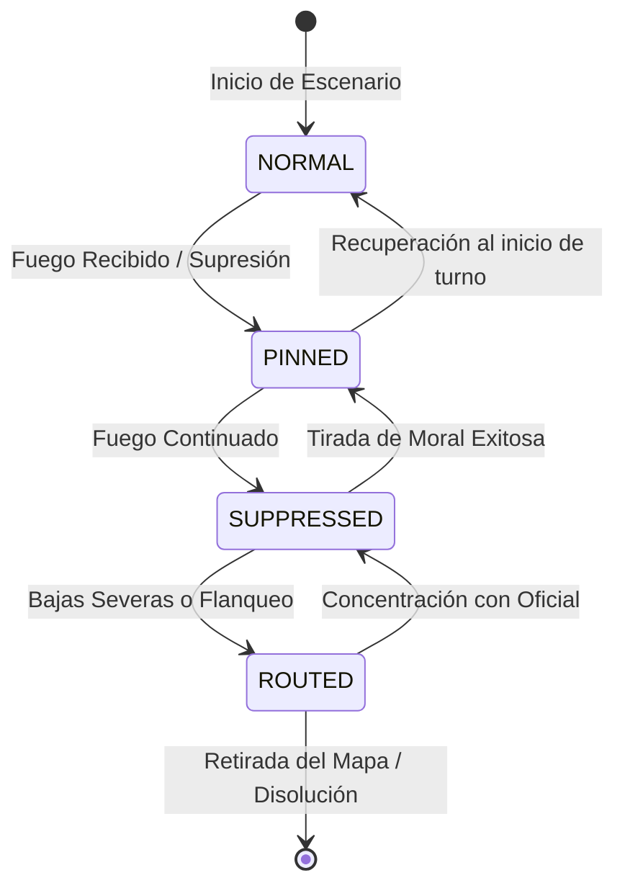
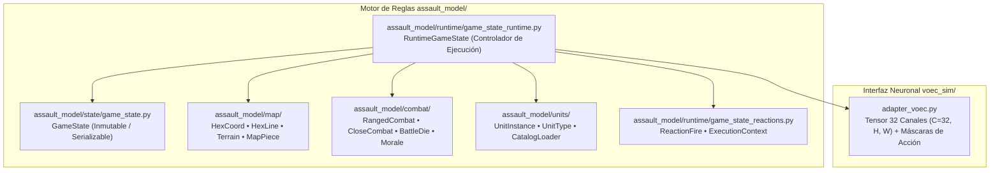
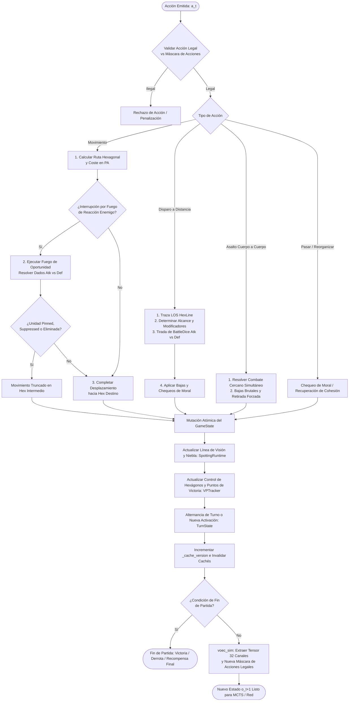

# Modelo del Juego y Reglas Tácticas: Assault Tactical Engine

> **Estado**: Canónico y Exhaustivo  
> **Ámbito**: Motor de reglas `assault_model/` y su representación matemática en `voec_sim/`.

---

## 1. Topología Hexagonal y Geometría del Tablero

El campo de batalla de *Assault* se modela como una cuadrícula hexagonal regular orientada (*pointy-topped* o *flat-topped*). A diferencia de las cuadrículas cartesianas rectangulares (donde cada celda tiene 4 vecinos ortogonales y 4 diagonales dispares), **cada hexágono posee exactamente 6 vecinos equidistantes**.

### 1.1. Sistema de Coordenadas Axiales y Cúbicas
Cada hexágono se indexa mediante un par axial $(q, r)$ o un trío cúbico balanceado $(x, y, z)$ donde:
$$x = q, \quad z = r, \quad y = -x - z \iff x + y + z = 0$$

* **Distancia Hexagonal Exacta**:
  $$\text{dist}(h_1, h_2) = \frac{|q_1 - q_2| + |(q_1 + r_1) - (q_2 + r_2)| + |r_1 - r_2|}{2}$$
* **Adyacencia Estricta**: Dos hexágonos son adyacentes si y sólo si $\text{dist}(h_1, h_2) = 1$. No existen "esquinas diagonales".

---

## 2. Tipos de Terreno, Elevación y Cobertura

Cada hexágono posee propiedades físicas que condicionan el coste de movimiento en Puntos de Acción (PA) y proporcionan modificadores de dados a la tirada defensiva:

| Tipo de Terreno | Coste de Entrada (Inf.) | Coste de Entrada (Veh.) | Modificador Cobertura | Bloqueo de LOS | Efectos Especiales |
| :--- | :---: | :---: | :---: | :---: | :--- |
| **Despejado (Clear)** | 1 PA | 1 PA | 0 dados extra | No | Campo abierto; máxima vulnerabilidad a fuego cruzado. |
| **Bosque (Woods)** | 2 PA | 3 PA | +1 Dado de Defensa | Sí (a >1 hex) | Ocultamiento visual; limita el alcance efectivo de combate a 2 hexágonos. |
| **Urbano / Edificios** | 2 PA | Impracticable | +2 Dados de Defensa | Sí | Cobertura pesada; inmune a fuego directo de largo alcance salvo demolición. |
| **Colina / Elevación** | +1 PA adicional | +2 PA adicional | +1 Dado (si ventaja) | Condicional | Ventaja de cresta: domina hexágonos inferiores y extiende el spotting. |
| **Bocage / Setos** | 2 PA | 2 PA | +1 Dado de Defensa | Sí (en borde) | Límite visual en la arista de la celda. |
| **Río / Vado** | 3 PA | 4 PA | 0 dados extra | No | Expone a las unidades durante el cruce; penaliza el repliegue. |

---

## 3. Línea de Visión (LOS), Detección (*Spotting*) y Niebla de Guerra

1. **Trazado de Rayo Hexagonal**: Se calcula la línea de hexágonos interceptada entre el centro del hexágono observador y el centro del objetivo.
2. **Elevación y Puntos Ciegos**: Si un hexágono intermedio posee una elevación $Z_{obs} \ge \min(Z_A, Z_B)$, la LOS se bloquea inmediatamente salvo que la diferencia de altura del observador genere una parábola de visión sobre la cresta.
3. **Parcialidad de la Información (POMDP)**: Las unidades enemigas que no han disparado y se encuentran en terreno cubierto permanecen no detectadas (*unspotted*), lo que obliga a la IA a gestionar la incertidumbre mediante la cabeza táctica `threat_map` y el contexto temporal de la red.

---

## 4. Sistema de Combate: Dados de Batalla, Daño y Supresión

El combate táctico no es un mero cálculo numérico determinista; refleja la letalidad y el caos del combate de infantería a corta y media distancia.

### 4.1. Dados de Batalla (`BattleDie`)
El motor utiliza dados tácticos con caras personalizadas:
* **Dados Blancos**: Representan armamento ligero estándar (fusiles de cerrojo, subfusiles).
* **Dados Negros**: Armamento pesado, ametralladoras coaxiales o fuego concentrado con alta probabilidad de impacto crítico.
* **Caras Posibles**:
  * `MISS` (Fallo): 0 impactos.
  * `HIT` (Impacto): 1 impacto potencial.
  * `DOUBLE_HIT`: 2 impactos directos.
  * `SUPPRESSION`: Impacto moral; induce caída de cohesión sin causar necesariamente bajas físicas.
  * `CRITICAL`: Fuerza una tirada en la tabla de impactos críticos (rotura de arma, baja de oficial, pánico).

### 4.2. Resolución de Combate a Distancia (*Ranged Combat*)

$$\text{Impactos Netos} = \max\left(0, \sum \text{Hits}_{\text{Ataque}} - \sum \text{Saves}_{\text{Defensa}}\right)$$

1. **Composición del Pool Atacante**:
   $$\text{Pool}_{\text{atk}} = \text{ArmaBase} + \text{ModificadorRango} + \text{ModificadorFlanco}$$
2. **Composición del Pool Defensor**:
   $$\text{Pool}_{\text{def}} = \text{DefensaUnidad} + \text{CoberturaTerreno} + \text{Trinchera/Fortificación}$$
3. **Asignación de Bajas**: Cada impacto neto reduce los Puntos de Vida (HP) de la escuadra. Al llegar a 0 HP, la unidad es eliminada del tablero.

---

## 5. Estados de Cohesión y Moral de la Escuadra

Las escuadras transitan dinámicamente entre 4 estados de moral que restringen severamente su capacidad operativa:

* **NORMAL**: Operatividad al 100%. Todos los puntos de acción y capacidad de fuego defensivo disponibles.
* **PINNED (Clavada)**: La escuadra busca cobertura inmediata. Pierde el 50% de sus puntos de movimiento; el fuego defensivo sufre una penalización de $-1$ dado.
* **SUPPRESSED (Suprimida)**: Incapaz de moverse o disparar voluntariamente. Solo puede buscar refugio o intentar reorganizarse.
* **ROUTED (En Desbandada)**: Ruptura de la cohesión. La escuadra huye en dirección opuesta al enemigo hacia el borde del mapa. Si recibe combate en este estado, es capturada o destruida.

---

## 6. Fuego de Reacción (*Opportunity Fire*)

Cualquier unidad en estado `NORMAL` con línea de visión despejada que no haya agotado su capacidad de reacción puede interrumpir el movimiento de una unidad enemiga en el momento en que ésta penetra en su arco de fuego:
* **Disparador**: Entrada en un hexágono con menor cobertura o desplazamiento a campo abierto.
* **Consecuencia para la IA**: El agente no puede realizar movimientos lineales despreocupados; cruzar una calle o un campo abierto frente a una ametralladora enemiga (`HMG`) desencadena una ráfaga inmediata que puede clavar (`PINNED`) o destruir la unidad antes de completar su destino.

---

## 7. Asaltos Cuerpo a Cuerpo (*Close Combat / Melee*)

Cuando una escuadra entra físicamente en el mismo hexágono ocupado por tropas enemigas, se produce un **Asalto Inmediato**:
* No se aplican modificadores de distancia (alcance 0).
* Se calcula el ratio de combate cuerpo a cuerpo relativo.
* Es una resolución simultánea y letal: el perdedor es aniquilado o forzado a una retirada desesperada, sufriendo chequeos de moral inmediatos.

---

## 8. Condiciones de Victoria y Puntos de Victoria (VP)

El desenlace de una partida se rige por una combinación de **control territorial** y **desgaste**:
1. **Control de Puntos de Victoria (VP)**: Hexágonos estratégicos designados (cruces de carreteras, puentes, colinas clave) que otorgan puntos por turno y bonificaciones al final de la partida.
2. **Balance de Bajas (Ratio de Desgaste)**: Puntos otorgados por la eliminación de escuadras enemigas versus penalización por bajas propias.
3. **Límite de Turnos**: Si ningún bando alcanza la victoria por aniquilación antes del límite temporal, el ganador se decide por el diferencial neto de VP.

---

## 9. Arquitectura Modular del Motor `assault_model/`

El motor de reglas está desacoplado siguiendo el patrón de **Estado Inmutable / Runtime de Mutación**:

### 9.1. Responsabilidades de los Paquetes Internos

1. **`assault_model/state/` (`GameState`, `TurnState`)**:
   - Contenedor puro de datos serializable en disco o memoria.
   - Almacena el estado de cada celda (`HexState`), el inventario y posición de cada unidad (`UnitInstance`), el marcador de control (`HexOwnership`, `VPTracker`) y el registro de activación por bando.
   - **No contiene lógica de cálculo de combate ni reglas de movimiento**.

2. **`assault_model/runtime/` (`RuntimeGameState`, `ExecutionContext`)**:
   - Orquestador autoritativo del ciclo de simulación.
   - Gestiona el sistema de activación alternada (I-Go-U-Go o impulso táctico).
   - Invalida cachés espaciales mediante `_cache_version` tras cualquier mutación del tablero.
   - Supervisa las interrupciones por fuego de oportunidad (`game_state_reactions.py`).

3. **`assault_model/map/` (`HexCoord`, `HexLine`, `TerrainConfig`)**:
   - Aritmética hexagonal axial $(q, r)$ y cúbica $(x, y, z)$.
   - Algoritmo de ray-casting hexagonal para trazado de Línea de Visión (LOS) y detección de obstáculos.
   - Definición de costes de paso por tipo de terreno y elevación.

4. **`assault_model/combat/` (`RangedCombatResolver`, `CloseCombatResolver`, `BattleDie`, `MoraleState`)**:
   - Cálculo estocástico de dados de combate (`attack_dice_pool.py`, `defense_dice_pool.py`).
   - Resolución de impactos directos, impactos morales de supresión y tablas de efectos críticos.
   - Transiciones de estado de cohesión de tropas (`NORMAL` $\to$ `PINNED` $\to$ `SUPPRESSED` $\to$ `ROUTED`).

---

## 10. Ciclo Autoritativo de Mantenimiento del Estado (*State Loop*)

El siguiente diagrama detalla cómo el motor procesa cada acción individual de un agente o jugador humano, garantizando la consistencia absoluta de las reglas antes de devolver el nuevo estado y la recompensa asociada:

