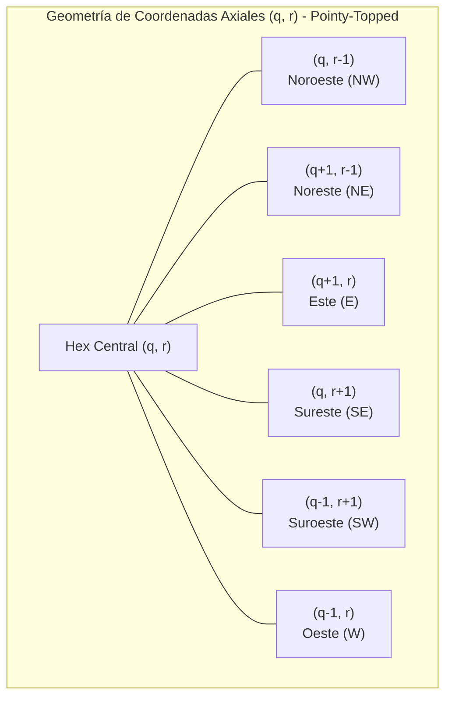
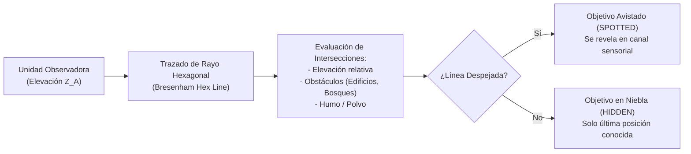
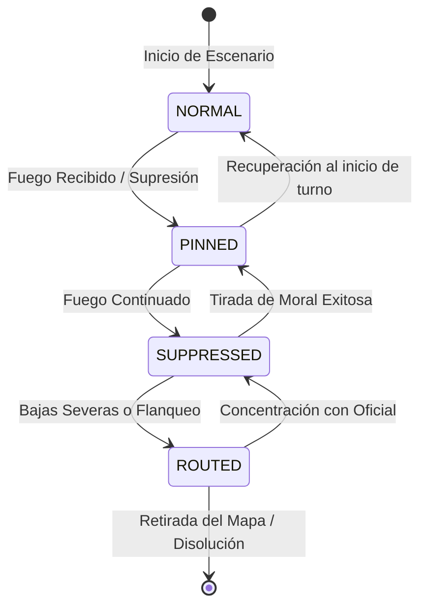
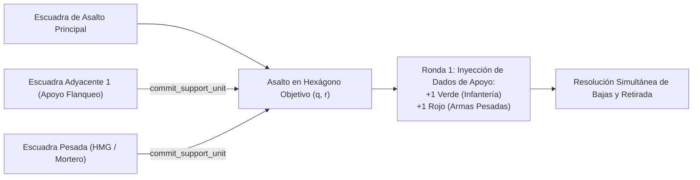
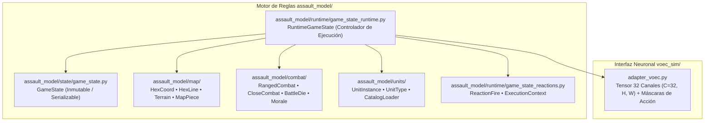
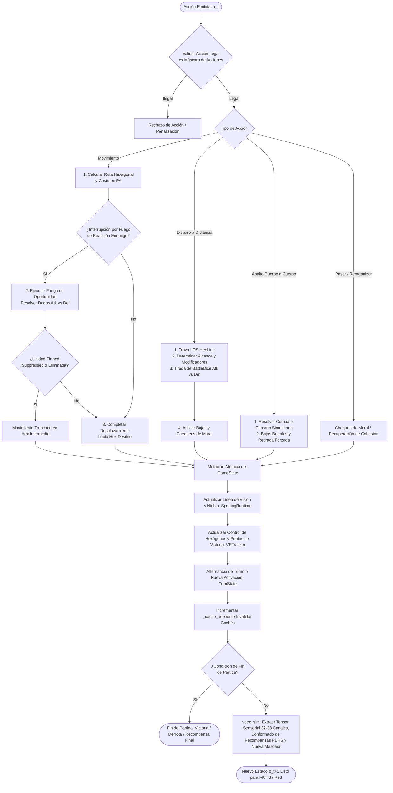
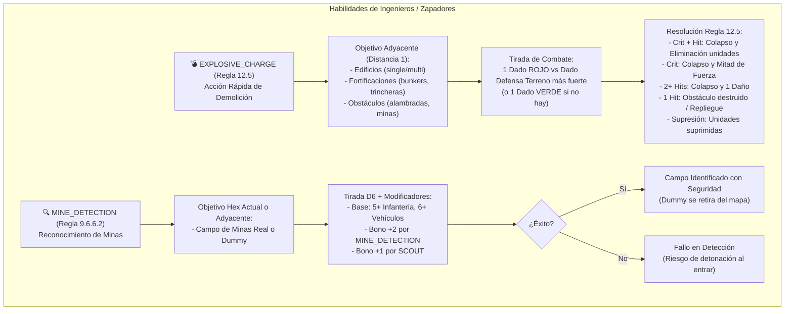

# Modelo del Juego y Reglas Tácticas: Assault Tactical Engine

> **Estado**: Canónico y Exhaustivo  
> **Ámbito**: Motor de reglas `assault_model/` y su representación matemática en `voec_sim/`.

---

## 1. Topología Hexagonal y Geometría del Tablero

El campo de batalla de *Assault* se modela como una cuadrícula hexagonal regular orientada (*pointy-topped* o *flat-topped*). A diferencia de las cuadrículas cartesianas rectangulares (donde cada celda tiene 4 vecinos ortogonales y 4 diagonales dispares), **cada hexágono posee exactamente 6 vecinos equidistantes**.

### 1.1. Sistema de Coordenadas Axiales y Cúbicas
Cada hexágono se indexa mediante un par axial $(q, r)$ o un trío cúbico balanceado $(x, y, z)$ donde:
$$x = q, \quad z = r, \quad y = -x - z \iff x + y + z = 0$$

* **Distancia Hexagonal Exacta**:
  $$\text{dist}(h_1, h_2) = \frac{|q_1 - q_2| + |(q_1 + r_1) - (q_2 + r_2)| + |r_1 - r_2|}{2}$$
* **Adyacencia Estricta**: Dos hexágonos son adyacentes si y sólo si $\text{dist}(h_1, h_2) = 1$. No existen "esquinas diagonales".

---

## 2. Tipos de Terreno, Elevación y Cobertura

Cada hexágono posee propiedades físicas que condicionan el coste de movimiento en Puntos de Acción (PA) y proporcionan modificadores de dados a la tirada defensiva:

| Tipo de Terreno | Coste de Entrada (Inf.) | Coste de Entrada (Veh.) | Modificador Cobertura | Bloqueo de LOS | Efectos Especiales |
| :--- | :---: | :---: | :---: | :---: | :--- |
| **Despejado (Clear)** | 1 PA | 1 PA | 0 dados extra | No | Campo abierto; máxima vulnerabilidad a fuego cruzado. |
| **Bosque (Woods)** | 2 PA | 3 PA | +1 Dado de Defensa | Sí (a >1 hex) | Ocultamiento visual; limita el alcance efectivo de combate a 2 hexágonos. |
| **Urbano / Edificios** | 2 PA | Impracticable | +2 Dados de Defensa | Sí | Cobertura pesada; inmune a fuego directo de largo alcance salvo demolición. |
| **Colina / Elevación** | +1 PA adicional | +2 PA adicional | +1 Dado (si ventaja) | Condicional | Ventaja de cresta: domina hexágonos inferiores y extiende el spotting. |
| **Bocage / Setos** | 2 PA | 2 PA | +1 Dado de Defensa | Sí (en borde) | Límite visual en la arista de la celda. |
| **Río / Vado** | 3 PA | 4 PA | 0 dados extra | No | Expone a las unidades durante el cruce; penaliza el repliegue. |

---

## 3. Línea de Visión (LOS), Detección (*Spotting*) y Niebla de Guerra

1. **Trazado de Rayo Hexagonal**: Se calcula la línea de hexágonos interceptada entre el centro del hexágono observador y el centro del objetivo.
2. **Elevación y Puntos Ciegos**: Si un hexágono intermedio posee una elevación $Z_{obs} \ge \min(Z_A, Z_B)$, la LOS se bloquea inmediatamente salvo que la diferencia de altura del observador genere una parábola de visión sobre la cresta.
3. **Parcialidad de la Información (POMDP)**: Las unidades enemigas que no han disparado y se encuentran en terreno cubierto permanecen no detectadas (*unspotted*), lo que obliga a la IA a gestionar la incertidumbre mediante la cabeza táctica `threat_map` y el contexto temporal de la red.

---

## 4. Sistema de Combate: Dados de Batalla, Daño y Supresión

El combate táctico no es un mero cálculo numérico determinista; refleja la letalidad y el caos del combate de infantería a corta y media distancia.

### 4.1. Dados de Batalla (`BattleDie`)
El motor utiliza dados tácticos con caras personalizadas:
* **Dados Blancos**: Representan armamento ligero estándar (fusiles de cerrojo, subfusiles).
* **Dados Negros**: Armamento pesado, ametralladoras coaxiales o fuego concentrado con alta probabilidad de impacto crítico.
* **Caras Posibles**:
  * `MISS` (Fallo): 0 impactos.
  * `HIT` (Impacto): 1 impacto potencial.
  * `DOUBLE_HIT`: 2 impactos directos.
  * `SUPPRESSION`: Impacto moral; induce caída de cohesión sin causar necesariamente bajas físicas.
  * `CRITICAL`: Fuerza una tirada en la tabla de impactos críticos (rotura de arma, baja de oficial, pánico).

### 4.2. Resolución de Combate a Distancia (*Ranged Combat*)

$$\text{Impactos Netos} = \max\left(0, \sum \text{Hits}_{\text{Ataque}} - \sum \text{Saves}_{\text{Defensa}}\right)$$

1. **Composición del Pool Atacante**:
   $$\text{Pool}_{\text{atk}} = \text{ArmaBase} + \text{ModificadorRango} + \text{ModificadorFlanco}$$
2. **Composición del Pool Defensor**:
   $$\text{Pool}_{\text{def}} = \text{DefensaUnidad} + \text{CoberturaTerreno} + \text{Trinchera/Fortificación}$$
3. **Asignación de Bajas**: Cada impacto neto reduce los Puntos de Vida (HP) de la escuadra. Al llegar a 0 HP, la unidad es eliminada del tablero.

---

## 5. Estados de Cohesión y Moral de la Escuadra

Las escuadras transitan dinámicamente entre 4 estados de moral que restringen severamente su capacidad operativa:

* **NORMAL**: Operatividad al 100%. Todos los puntos de acción y capacidad de fuego defensivo disponibles.
* **PINNED (Clavada)**: La escuadra busca cobertura inmediata. Pierde el 50% de sus puntos de movimiento; el fuego defensivo sufre una penalización de $-1$ dado.
* **SUPPRESSED (Suprimida)**: Incapaz de moverse o disparar voluntariamente. Solo puede buscar refugio o intentar reorganizarse.
* **ROUTED (En Desbandada)**: Ruptura de la cohesión. La escuadra huye en dirección opuesta al enemigo hacia el borde del mapa. Si recibe combate en este estado, es capturada o destruida.

---

## 6. Fuego de Reacción (*Opportunity Fire*)

Cualquier unidad en estado `NORMAL` con línea de visión despejada que no haya agotado su capacidad de reacción puede interrumpir el movimiento de una unidad enemiga en el momento en que ésta penetra en su arco de fuego:
* **Disparador**: Entrada en un hexágono con menor cobertura o desplazamiento a campo abierto.
* **Consecuencia para la IA**: El agente no puede realizar movimientos lineales despreocupados; cruzar una calle o un campo abierto frente a una ametralladora enemiga (`HMG`) desencadena una ráfaga inmediata que puede clavar (`PINNED`) o destruir la unidad antes de completar su destino.

---

## 7. Asaltos Cuerpo a Cuerpo (*Close Combat / Melee*)

Cuando una escuadra entra físicamente en el mismo hexágono ocupado por tropas enemigas, se produce un **Asalto Inmediato**:
* No se aplican modificadores de distancia (alcance 0).
* Se calcula el ratio de combate cuerpo a cuerpo relativo.
* Es una resolución simultánea y letal: el perdedor es aniquilado o forzado a una retirada desesperada, sufriendo chequeos de moral inmediatos.

### 7.1. Descomposición Secuencial de Asaltos Combinados Multi-Unidad (Palma et al. 2025, Sec. 3.3)
Para reflejar asaltos combinados doctrinales donde una unidad asalta mientras escuadras adyacentes proporcionan apoyo de supresión y cobertura antes de la melé cuerpo a cuerpo:

1. **Sub-Fase de Compromiso de Apoyo (`commit_support_unit`)**:
   * En [`assault_model/combat/close_combat_context.py`](file:///c:/repos/python/assault/assault_model/combat/close_combat_context.py), el objeto `CombatResolutionContext` permite registrar escuadras adyacentes que apoyan la maniobra tanto en el bando atacante (`supporting_attackers`) como en el defensor (`supporting_defenders`).
2. **Inyección de Dados de Apoyo en Ronda 1**:
   * En [`assault_model/combat/close_combat_resolver.py`](file:///c:/repos/python/assault/assault_model/combat/close_combat_resolver.py), durante la primera ronda del asalto, cada unidad de apoyo viva y no suprimida aporta un dado de ataque adicional:
     * **Infantería Estándar (Fusileros / Asalto)**: $+1$ dado `DiceColor.GREEN`.
     * **Armas Pesadas (`MMG`, `HMG`, `MORTAR`)**: $+1$ dado de alta letalidad `DiceColor.RED`.
3. **Manejo de Bajas y Continuidad**:
   * Si tras la ronda 1 ambos bandos conservan unidades vivas en el hexágono, el combate continúa hasta que un bando es aniquilado o forzado a romper el contacto.

---

## 8. Condiciones de Victoria y Puntos de Victoria (VP)

El desenlace de una partida se rige por una combinación de **control territorial** y **desgaste**:
1. **Control de Puntos de Victoria (VP)**: Hexágonos estratégicos designados (cruces de carreteras, puentes, colinas clave) que otorgan puntos por turno y bonificaciones al final de la partida.
2. **Balance de Bajas (Ratio de Desgaste)**: Puntos otorgados por la eliminación de escuadras enemigas versus penalización por bajas propias.
3. **Límite de Turnos**: Si ningún bando alcanza la victoria por aniquilación antes del límite temporal, el ganador se decide por el diferencial neto de VP.

---

## 9. Arquitectura Modular del Motor `assault_model/`

El motor de reglas está desacoplado siguiendo el patrón de **Estado Inmutable / Runtime de Mutación**:

### 9.1. Responsabilidades de los Paquetes Internos

1. **`assault_model/state/` (`GameState`, `TurnState`)**:
   - Contenedor puro de datos serializable en disco o memoria.
   - Almacena el estado de cada celda (`HexState`), el inventario y posición de cada unidad (`UnitInstance`), el marcador de control (`HexOwnership`, `VPTracker`) y el registro de activación por bando.
   - **No contiene lógica de cálculo de combate ni reglas de movimiento**.

2. **`assault_model/runtime/` (`RuntimeGameState`, `ExecutionContext`)**:
   - Orquestador autoritativo del ciclo de simulación.
   - Gestiona el sistema de activación alternada (I-Go-U-Go o impulso táctico).
   - Invalida cachés espaciales mediante `_cache_version` tras cualquier mutación del tablero.
   - Supervisa las interrupciones por fuego de oportunidad (`game_state_reactions.py`).

3. **`assault_model/map/` (`HexCoord`, `HexLine`, `TerrainConfig`)**:
   - Aritmética hexagonal axial $(q, r)$ y cúbica $(x, y, z)$.
   - Algoritmo de ray-casting hexagonal para trazado de Línea de Visión (LOS) y detección de obstáculos.
   - Definición de costes de paso por tipo de terreno y elevación.

4. **`assault_model/combat/` (`RangedCombatResolver`, `CloseCombatResolver`, `BattleDie`, `MoraleState`)**:
   - Cálculo estocástico de dados de combate (`attack_dice_pool.py`, `defense_dice_pool.py`).
   - Resolución de impactos directos, impactos morales de supresión y tablas de efectos críticos.
   - Transiciones de estado de cohesión de tropas (`NORMAL` $\to$ `PINNED` $\to$ `SUPPRESSED` $\to$ `ROUTED`).

---

## 10. Ciclo Autoritativo de Mantenimiento del Estado (*State Loop*)

El siguiente diagrama detalla cómo el motor procesa cada acción individual de un agente o jugador humano, garantizando la consistencia absoluta de las reglas antes de devolver el nuevo estado y la recompensa asociada:

---

## 11. Marco de Conformado de Recompensas Invariante (PBRS, Urgencia y Parálisis)

Para resolver el problema del aprendizaje con recompensas dispersas sin alterar el conjunto de políticas óptimas del wargame (teorema de Ng et al., 1999), la capa `voec_sim/core/reward_calculator.py` implementa un andamiaje matemático estricto:

### 11.1. Potencial Radial a VPs ($\Phi$) e Invariancia Telescópica
El potencial del estado respecto a los Puntos de Victoria se define como:
$$\Phi(s) = \sum_{u \in \text{Amigos}} \frac{w_u}{1 + \min_{\text{VP}} d(u, \text{VP})} + B_{\text{ctrl}} \cdot N_{\text{VP\_Controlados}}$$
donde $w_u$ pondera el rol táctico de la unidad (ej. $+25\%$ para unidades de choque `SPEARHEAD`) y $B_{\text{ctrl}} = 2.0$ bonifica el control efectivo.

La función de recompensa adicional por paso satisface:
$$F(s, a, s') = \gamma \Phi(s') - \Phi(s)$$
Garantizando que al final del episodio la suma acumulada sea telescópica $\sum_{t=0}^T \gamma^t F(s_t, a_t, s_{t+1}) = -\Phi(s_0)$ (ya que en estado terminal $\Phi(s_T) \equiv 0.0$), preservando al 100% las garantías de convergencia óptima.

### 11.2. Factor de Presión Temporal Dinámica ($\Psi_{\text{urgency}}$)
Siguiendo la extensión de PBRS para MDPs dependientes del tiempo (Devlin & Kudenko, 2012), cuando el bando amigo controla $0$ VPs, el potencial de distancia se atenúa exponencialmente conforme avanza el horizonte de la batalla ($\tau = t / T_{\text{max}}$):
$$\Phi(s, t) = \Phi_{\text{dist}}(s) \cdot \exp\left(-\lambda \cdot \frac{t}{T_{\text{max}}}\right)$$
con $\lambda = 1.2$. Esto introduce una severa degradación en el valor del estado si la fuerza amiga deambula o se retrasa, incentivando una agresión inmediata y decisiva hacia los objetivos.

### 11.3. Penalización Acumulativa por Parálisis de Unidades Expuestas
Cualquier unidad que permanezca en terreno desprovisto de cobertura defensiva (`cover < 0.35`) fuera del perímetro de un VP controlado, y que pase el turno sin avanzar hacia un objetivo ni abrir fuego, incurre en una penalización por parálisis:
$$\text{Penalty}_{\text{paralysis}} = -w_{\text{paralysis}} \cdot \left(1.0 + 0.5 \cdot \min(4, \text{streak} - 1)\right)$$
* La racha acumula un $+50\%$ adicional por cada turno de pasividad consecutiva (hasta $4\times$).
* Se resetea de forma inmediata a cero en cuanto la unidad realiza una maniobra de aproximación a un VP, abre fuego o entra en una posición con cobertura defensiva adecuada.

---

## 12. Habilidades Especiales de Ingenieros y Zapadores: Carga Explosiva y Detección de Minas

Siguiendo las reglas canónicas del wargame (*Assault Rulebook* §9.6.6.2 y §12.5) y las especificaciones de las cartas de unidades especializadas (ej. *Combat Engineers 43 / US_COMBAT_ENGINEERS_43*), el motor integra dos acciones tácticas dedicadas:

### 12.1. Carga Explosiva (`EXPLOSIVE_CHARGE` - Regla 12.5)
* **Tipo de Acción**: `ActionType.EXPLOSIVE_CHARGE`, `CombatMode.EXPLOSIVE_CHARGE` (`ExplosiveChargeAction`).
* **Condición de Generación**: Unidad activa viva que posee el rasgo `EXPLOSIVE_CHARGE` adyacente a un hexágono con edificios, fortificaciones (`bunker`, `casemate`, `pillbox`, `gun_emplacement`, `trench`, `sandbag`) u obstáculos (`barbed_wire`, `minefield`, `tank_barricade`).
* **Procedimiento de Resolución**:
  1. El atacante tira **1 dado ROJO de combate** (`BattleDie(DiceColor.RED)`).
  2. El defensor tira el **dado de defensa de terreno más fuerte** disponible en el hexágono objetivo. Si no dispone de ningún dado de defensa de terreno (ej. campo de minas en terreno abierto o alambrada), tira **1 dado VERDE por defecto** (`BattleDie(DiceColor.GREEN)`).
  3. Se comparan los resultados mediante `compare_dice()`.
  4. Los impactos y críticos no cancelados dictan el colapso de la estructura y el daño colateral a las unidades en su interior:
     * `CRITICAL + HIT`: Estructura colapsa/destruida; todas las unidades en el hex son **eliminadas**.
     * `CRITICAL`: Estructura colapsa/destruida; todas las unidades quedan reducidas a **media fuerza**.
     * `2+ HITS`: Estructura colapsa/destruida; todas las unidades reciben **1 punto de daño**.
     * `1 HIT`: Los obstáculos lineales (alambradas, campos de minas) son **destruidos y retirados del mapa**. Los edificios y fortificaciones resisten el colapso pero las unidades interiores sufren **repliegue forzado** (*fallback*).
     * `SUPPRESSION`: Estructura no colapsa; unidades interiores quedan **suprimidas**.
  5. **Transformación Física del Terreno**:
     * Los edificios colapsados se transforman en **ruinas** (`Terrain.RUINS`).
     * Los búnkers y posiciones blindadas colapsan al estado de trinchera (`trench`).
     * Las trincheras, pozos de tirador, alambradas y minas se eliminan del tablero.

### 12.2. Detección y Reconocimiento de Minas (`MINE_DETECTION` - Regla 9.6.6.2)
* **Tipo de Acción**: `ActionType.MINE_DETECTION` (`MineDetectionAction`) y bonificador pasivo en movimiento.
* **Condición de Generación**: Unidad con el rasgo `MINE_DETECTION` que se encuentre en el mismo hexágono o adyacente a un marcador de campo de minas no identificado.
* **Mecánica del Bono**:
  * Tirada básica en D6: Requiere un resultado de $5+$ para Infantería y $6+$ para Vehículos/Artillería.
  * El rasgo `MINE_DETECTION` aplica un modificador directo de **$+2$ al dado D6** (acumulable con $+1$ de `SCOUT` o $+1$ de mina no oculta).
  * En caso de éxito, si el marcador es un señuelo (*dummy minefield*), es retirado del tablero inmediatamente; si es un campo de minas real, queda marcado como **identificado** (*identified*), permitiendo al zapador y a las unidades aliadas planificar su cruce o demolición con carga explosiva de manera segura.

### 12.3. Configuración e Inspección en la Interfaz del Editor de Unidades (Puerto 8780)
Ambas habilidades están plenamente expuestas en el servidor visual de catálogo (`tools/unit_editor_server.py`):
* Chips interactivos con estado activo, iconos visuales y tooltips reglamentarios detallados (`TRAIT_HELP`).
* Compatibilidad con importación/exportación de perfiles estándar, inventario de cartas y propuestas de unidades en `assets/catalogs/unit_catalog.json` y `assets/catalogs/unit_staging_proposals.json`.

### 12.4. Rebalanceo de OOB y Despliegue Dinámico de Humo en Escenarios Canónicos (Subtarea 3.5.4)
Para garantizar la viabilidad táctica y el equilibrio competitivo en los escenarios históricos de asalto urbano y desembarco anfibio de Gela, manteniendo estricta fidelidad al manual oficial (Regla 7.2, donde el humo es una acción de combate generada dinámicamente y nunca un obstáculo pre-ubicado estático):
* **Battaglia Cittadina (`assets/scenarios/battaglia_cittadina_2_1.json`)**:
  * Sustitución del equipo `US_BAZOOKA_TEAM` (ineficaz ante fortificaciones y casamatas sin blindados) por **1x `US_COMBAT_ENGINEERS_43`** en la columna de aproximación (`[7, 9]`).
  * **Humo Táctico Dinámico (Regla 7.2)**: Dotación de granadas de humo tácticas (`SMOKE_GRENADES` y modo de ataque `SMOKE` con dados `GREEN, GREEN, BLUE, BLUE`) a los zapadores, coordinados con el fuego indirecto del mortero de 81mm (`US_81MM_MORTAR`). Esto permite generar cortinas de humo en la calle mayor (`q=7, r=6`), cegando las líneas de visión directa de la casamata italiana (`IT_6` en `[3, 4]`) y del francotirador (`IT_7`), permitiendo el avance cubierto sin recurrir a marcadores estáticos artificiales.
* **Mettete i Piedi a Terra (`assets/scenarios/mettete_i_piedi_terra_1.json`)**:
  * Incorporación de **1x `US_COMBAT_ENGINEERS_43`** en el sector central de desembarco (`[4, 12]`), encarado frontalmente a la red de alambradas alemana (`q=4, r=9`).
  * **Capacidad de Brecha y Cegado Táctico**: Empleo de torpedos Bangalore (`BANGALORE_TORPEDO`) y cargas explosivas (`EXPLOSIVE_CHARGE`) para neutralizar la alambrada y campos de minas en los primeros 3 turnos, apoyados por fumígenos dinámicos de ingenieros y mortero para aproximarse bajo fuego de la MG42 alemana.
* **Efectividad Táctica Garantizada**: Con un perfil de asalto de 3 dados a bocajarro (`RED + RED + YELLOW`, 8 puntos de potencia de asalto) frente a defensas fijas de infantería regular (2 puntos), el ratio de asalto alcanza **4.0 $\ge 1.0$**, certificando la capacidad de ruptura y asalto coordinado.

