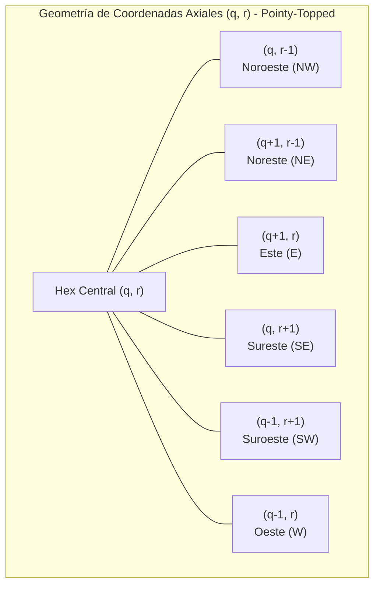
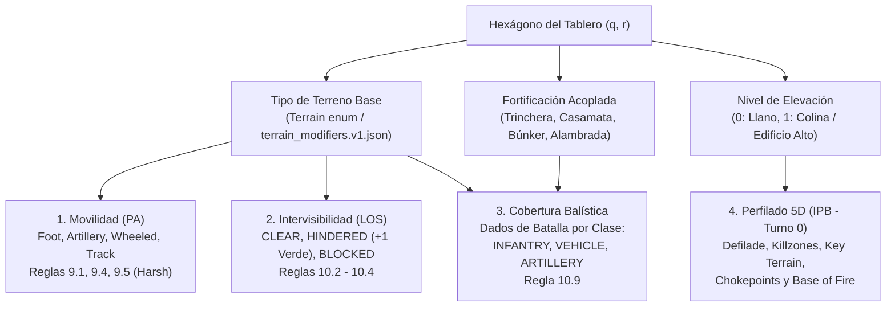
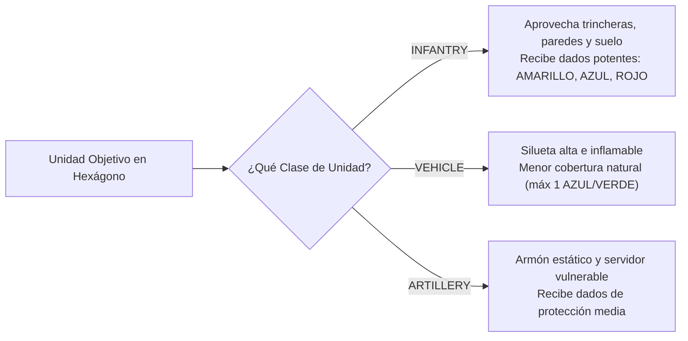
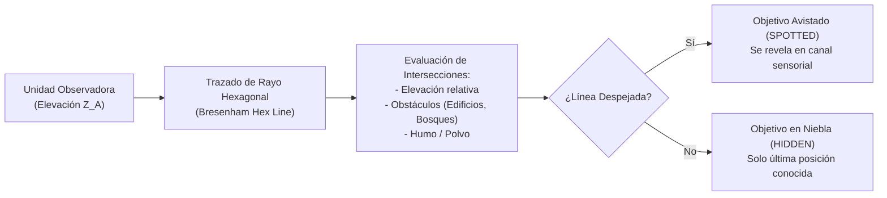
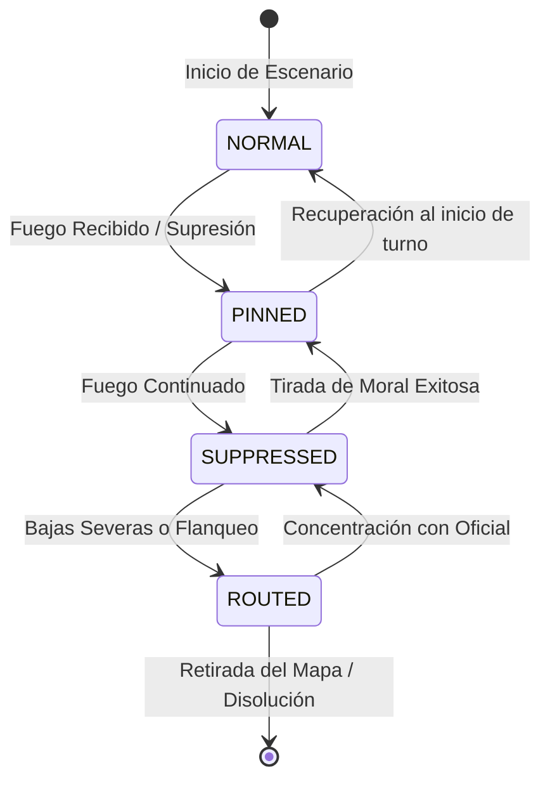
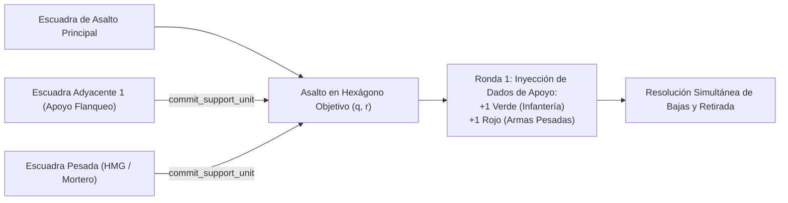
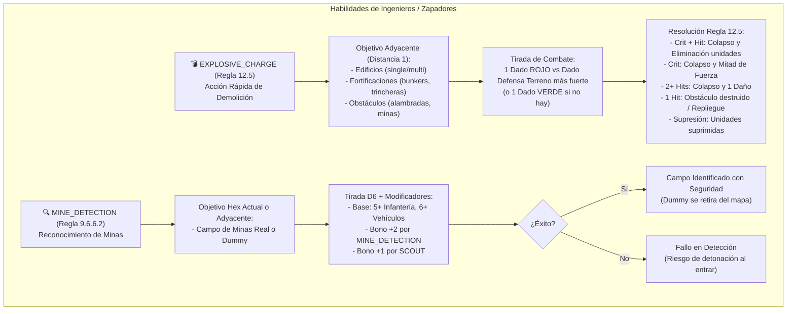
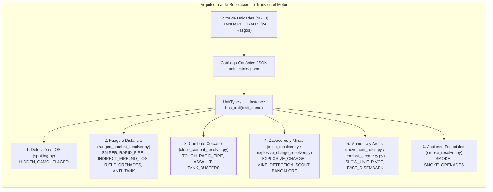
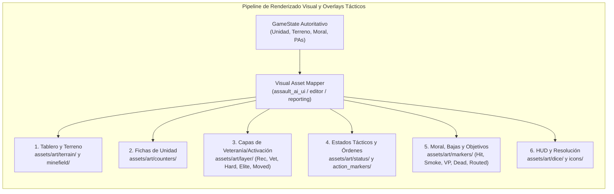
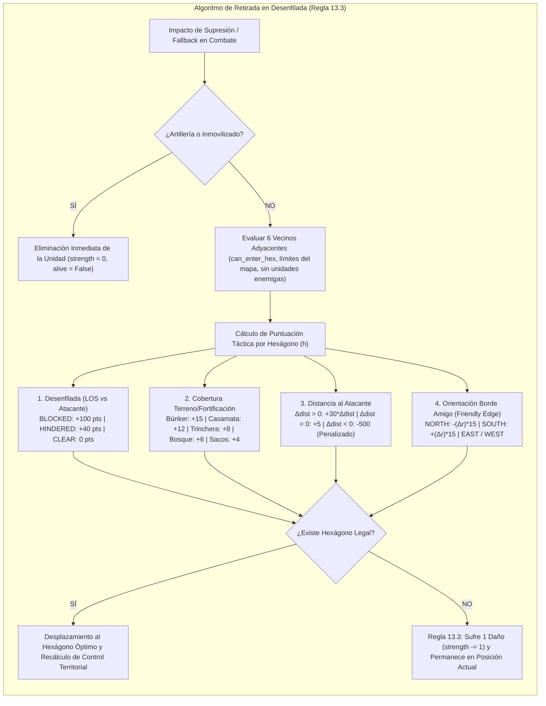

# Manual de Reglas Oficiales y Dinámica de Combate: Assault Sicily 43

> **Estado**: Canónico y Exhaustivo (*Sound of Drums Rulebook rev6*)  
> **Ámbito**: Reglamento oficial del wargame físico, topología de tablero, balística, moral, combate y catálogo táctico.

---

## 1. Topología Hexagonal y Geometría del Tablero

El campo de batalla de *Assault* se modela como una cuadrícula hexagonal regular orientada (*pointy-topped* o *flat-topped*). A diferencia de las cuadrículas cartesianas rectangulares (donde cada celda tiene 4 vecinos ortogonales y 4 diagonales dispares), **cada hexágono posee exactamente 6 vecinos equidistantes**.



### 1.1. Sistema de Coordenadas Axiales y Cúbicas
Cada hexágono se indexa mediante un par axial $(q, r)$ o un trío cúbico balanceado $(x, y, z)$ donde:
$$x = q, \quad z = r, \quad y = -x - z \iff x + y + z = 0$$

* **Distancia Hexagonal Exacta**:
  $$\text{dist}(h_1, h_2) = \frac{|q_1 - q_2| + |(q_1 + r_1) - (q_2 + r_2)| + |r_1 - r_2|}{2}$$
* **Adyacencia Estricta**: Dos hexágonos son adyacentes si y sólo si $\text{dist}(h_1, h_2) = 1$. No existen "esquinas diagonales".

---

## 2. Tipos de Terreno, Elevación, Cobertura y Topografía (IPB)

El terreno en el motor táctico *Assault* no es un mero fondo estético, sino un componente físico y geométrico autoritativo que condiciona el movimiento en Puntos de Acción (PA), la Línea de Visión (LOS), la cobertura balística de defensa y la planificación doctrinal de la IA.



---

### 2.1. Taxonomía Canónica de Terrenos del Motor

El motor implementa 11 tipos de terreno canónicos formalizados en el enum `Terrain` (`assault_model/map/terrain.py`) y gobernados por la tabla canónica `assets/rules_tables/terrain/terrain_modifiers.v1.json`:

| Tipo de Terreno | Clave Técnica | Estado LOS | Defensa Infantería | Defensa Blindados | Defensa Artillería | Coste Movimiento (PA) | Restricciones y Reglas Especiales |
| :--- | :---: | :---: | :---: | :---: | :---: | :---: | :--- |
| **Campo Despejado** | `clear` | `CLEAR` | 1 VERDE | Ninguno | Ninguno | Pie: 1, Art: 1, Ruedas: 1, Cadenas: 1 | Terreno llano abierto; máxima exposición a fuego cruzado directo. |
| **Agua / Mar / Río** | `water` | `CLEAR` | Ninguno | Ninguno | Ninguno | **Impasable** (None) | Barrera infranqueable sin pontones o capacidad anfibia (Regla TM-R02). |
| **Terreno Pedregoso** | `rocky` | `CLEAR` | 1 AZUL + 1 AMARILLO | 1 VERDE | 1 VERDE | Pie: 1, Art: 2, Ruedas: 2, Cadenas: 1 | Cobertura natural sólida para infantería sin obstaculizar la visión. |
| **Olivares / Viñedos** | `olive_vine_grove` | `HINDERED` | 2 VERDES | 1 AZUL | 1 AZUL | Pie: 1, Art: 2, Ruedas: 2, Cadenas: 2 | Vegetación cultivada; estorba la visión directa (+1 Verde a quien defiende). |
| **Bosque Ligero** | `light_forest` | `HINDERED` | 1 AMARILLO + 1 VERDE | 1 VERDE | 1 AZUL | Pie: 2, Art: 2, Ruedas: 3, Cadenas: 2 | Arboleda dispersa; estorbo visual y buena protección balística para infantería. |
| **Bosque Denso** | `heavy_forest` | `BLOCKED` | 2 AMARILLOS + 1 VERDE | 1 VERDE | 1 VERDE | Pie: 2, Art: 3, Ruedas: Impasable, Cadenas: 3 | Bloquea totalmente la LOS; `no_indirect_from: true` (prohibido fuego indirecto interior). |
| **Matorral / Maleza** | `brush` | `HINDERED` | 1 VERDE + 1 AZUL | 1 VERDE | 1 VERDE | Pie: 1, Art: 1, Ruedas: 2, Cadenas: 1 | Vegetación baja típica mediterránea; ocultamiento parcial y avance rápido a pie. |
| **Edificio Simple** | `building_single` | `BLOCKED` | 2 AMARILLOS + 1 AZUL | 1 AZUL | 1 VERDE | Pie: 2, Art: Impasable, Ruedas: Impasable, Cadenas: Impasable | Estructura rural/urbana de 1 planta (Elevación 0); `no_indirect_from: true`; colapsable a ruinas. |
| **Edificio Multi-Planta** | `building_multi` | `BLOCKED` | 1 ROJO + 2 VERDES | 1 AZUL | 1 VERDE | Pie: 2, Art: Impasable, Ruedas: Impasable, Cadenas: Impasable | Estructura pesada de mampostería (Elevación 1); torre de observación; protección superior. |
| **Colina / Elevación** | `hill` | `CLEAR` | 1 VERDE (Cresta) | 1 VERDE | 1 VERDE | +1 PA adicional al subir nivel | Cota dominante (Elevación 1); genera zonas ciegas tras la cresta. |
| **Ruinas Urbanas** | `ruins` | `BLOCKED` | 2 AMARILLOS + 1 AZUL | 1 VERDE | 1 VERDE | Pie: 2, Art: Impasable, Ruedas: Impasable, Cadenas: 3 | Restos de edificios colapsados tras detonación de zapadores o bombardeo pesado. |

---

### 2.2. Mecánicas de Movimiento y Costes de Paso en PAs (Reglas 9.1, 9.4, 9.5)

El motor de movimiento (`assault_model/rules/movement_rules.py` y `movement_terrain_rules.py`) evalúa el coste en PAs para acceder a cada celda contigua según el sistema de tracción de la unidad:

1. **Categorías de Locomoción**:
   - **Infantería a pie (`foot`)**: Gran agilidad táctica; puede penetrar en bosques densos y edificios donde los vehículos quedan bloqueados.
   - **Artillería remolcada / arrastrada (`artillery`)**: Severamente penalizada en bosques y pedregales; incapaz de entrar en edificios cerrados.
   - **Vehículos de Ruedas (`wheeled`)**: Movilidad máxima en campo despejado y carreteras (1 PA); bloqueados en edificios y bosques densos.
   - **Vehículos de Cadenas (`track`)**: Tracción oruga todoterreno; pueden abrirse paso a través de ruinas y bosques densos a coste elevado (3 PA), pero no en edificios intactos.

2. **Regla de Terreno Difícil (*Harsh Terrain* - Regla 9.5)**:
   - Si una unidad dispone de menos PAs restantes que el coste estricto exigido para entrar en un hexágono vecino, pero dicho coste es menor o igual que su capacidad total de movimiento del turno ($	ext{CosteEntrada} \le 	ext{MaxMP}$), la unidad puede **consumir la totalidad de sus PAs restantes** para ejecutar el avance y ocupar el hexágono.
   - Esto evita que unidades lentas queden bloqueadas por falta de 1 PA fraccionario en terreno accidentado.

3. **Restricción de Terreno Impasable (`water` - Regla TM-R02)**:
   - Los hexágonos de agua profunda o mar son físicamente infranqueables para infantería regular y blindados estándar. El pathfinder vectorial descarta cualquier arista que conduzca a estas celdas.

---

### 2.3. Intervisibilidad, Línea de Visión (LOS) y Niebla de Guerra (Reglas 10.2 a 10.4)

El motor balístico y de visibilidad (`assault_model/combat/line_of_sight.py`) proyecta un rayo analítico continuo centro-a-centro entre el atacante y el defensor en coordenadas de pantalla hexagonal (*odd-r pointy-top*):

1. **Estados de Visibilidad**:
   - **`CLEAR` (Despejado)**: El rayo no intersecta ningún obstáculo visual. La línea de tiro es diáfana y directa.
   - **`HINDERED` (Obstaculizado / Estorbo Visual)**:
     - El rayo atraviesa vegetación, olivares o matorrales (`brush`, `light_forest`, `olive_vine_grove`).
     - **Efecto Balístico (Regla 10.9.2)**: El estorbo dispersa la trayectoria de los proyectiles y otorga al defensor **+1 Dado VERDE de defensa adicional** por cada línea de fuego obstaculizada.
   - **Regla de Acumulación de Estorbos (Regla 10.3)**:
     - Cuando el rayo de visión atraviesa **3 o más hexágonos de estorbo** ($	ext{hindrance} \ge 3$), la acumulación de masa vegetal o humo absorbe completamente la visibilidad y la línea de visión pasa a considerarse **`BLOCKED` (Bloqueada)**.
   - **`BLOCKED` (Bloqueo Total)**:
     - El rayo intersecta un bosque denso (`heavy_forest`), una estructura urbana (`building_single`, `building_multi`, `ruins`) o una colina interpuesta.
     - Queda terminantemente prohibido el fuego directo. Solo el fuego indirecto parabólico (morteros, artillería) o el asalto cuerpo a cuerpo pueden resolver objetivos en este estado.
   - **Raycasting Canónico en Coordenadas Cúbicas y Resolución de Costuras / Aristas (Reglas 10.2 y 10.3) [CONSOLIDADO 🟢 v2.5.31]**:
     - El cálculo de intervisibilidad opera sobre coordenadas cúbicas exactas $(x, y, z)$ donde $x + y + z = 0$, prescindiendo de aproximaciones basadas en píxeles gráficos 2D.
     - **Resolución Normativa de Aristas Compartidas (*Hex Spines*)**:
       Cuando el rayo balístico discurre exactamente sobre la arista divisoria entre dos hexágonos adyacentes $H_A$ y $H_B$, el reglamento oficial estipula:
       * **Ambos Bloqueantes**: Si $H_A$ y $H_B$ son `BLOCKED` $	o$ La LOS queda **`BLOCKED`**.
       * **Bloqueante + Estorbo**: Si uno es `BLOCKED` y el otro `HINDERED` $	o$ La LOS queda **`HINDERED`** (+1 Dado Verde).
       * **Ambos Estorbo**: Si ambos son `HINDERED` $	o$ La LOS queda **`HINDERED`** (+1 Dado Verde).
       * **Un Lado Despejado**: Si cualquiera de los dos lados es `CLEAR` $	o$ La LOS queda **`CLEAR`** (principio de "el tirador apunta a lo largo de la costura despejada").
     - **Reversibilidad y Determinismo Topológico**: Mediante la evaluación geométrica canónica canónica $\min(A, B) 	o \max(A, B)$, se asegura que el rayo de $A 	o B$ y de $B 	o A$ recorre exactamente los mismos hexágonos sin ambigüedad flotante en vértices triples.

2. **Prohibición de Fuego Indirecto desde Terreno Cubierto (`no_indirect_from: true`)**:
   - Las unidades situadas físicamente dentro de edificios o bajo la bóveda de bosques densos tienen prohibido disparar armas indirectas (morteros de 50mm/81mm) hacia el exterior debido a la imposibilidad física de elevar tubos con ángulos parabólicos elevados bajo techumbres o masa de copas arbóreas.

---

### 2.4. Modificadores Defensivos por Clase de Unidad y Dados de Batalla (Regla 10.9)

La cobertura del terreno no otorga un bono plano idéntico a todas las tropas, sino que discrimina según la silueta y vulnerabilidad del blanco (`INFANTRY`, `VEHICLE`, `ARTILLERY`):

$$	ext{Pool}_{	ext{DefensaTotal}} = 	ext{DefensaBase}_{	ext{Unidad}}(	ext{Sector}) + 	ext{Dados}_{	ext{Terreno}}(	ext{Clase}) + 	ext{Dados}_{	ext{Fortificación}} + 	ext{Estorbo}_{	ext{HINDERED}} (+1 	ext{ VERDE})$$



* **Infantería en Edificios Urbanos**: Recibe la protección más formidable del wargame (`RED + GREEN + GREEN` en multi-planta, `BLUE + YELLOW + YELLOW` en planta simple), haciendo casi imposible su neutralización por fuego directo de fusilería sin apoyo de zapadores o cañones de demolición.
* **Despojo de Dados de Terreno por Habilidades Especiales**:
  * **Francotirador (`SNIPER` - Regla 10.9)**: Elimina el dado de terreno más potente del defensor.
  * **Lanzallamas (`FLAMETHROWER` - Regla 11.0)**: Despoja el dado defensivo más fuerte del terreno y causa supresión automática inmediata al arder la cobertura.
  * **Dispersión de Artillería (`REMOVE_WEAKEST_TERRAIN_DEFENSE`)**: Munición pesada que neutraliza la cobertura ligera.

---

### 2.5. Elevación, Crestas y Geometría Vertical (Reglas 9.6.1, 10.4)

1. **Niveles de Altitud Relativa**:
   - **Nivel 0**: Superficie estándar del tablero (campo abierto, matorral, bosques, olivares).
   - **Nivel 1**: Colinas (`hill`) y azoteas de edificios multi-planta (`building_multi`).
2. **Ventaja Táctica de Cresta (*Commanding Height*)**:
   - Una unidad en Nivel 1 que dispara sobre Nivel 0 domina el terreno circundante, ignora obstáculos intermedios de Nivel 0 si el ángulo cenital lo permite, y obtiene un bono de $+1$ en tiradas de detección (*spotting*).
3. **Zonas Ciegas en Desenfilada (*Dead Ground*)**:
   - Los hexágonos situados inmediatamente detrás de una colina o edificio elevado respecto al ángulo del observador quedan en sombra visual (*desenfilada*), impidiendo el fuego directo y sirviendo de corredores de infiltración protegida.
4. **Restricción de Unidades Pesadas (`HEAVY_WEIGHT`)**:
   - Piezas pesadas de artillería o anticarro con el rasgo `HEAVY_WEIGHT` (como el PaK 40 o cañones de 88mm) tienen terminantemente prohibido ascender o descender desniveles de colina de forma autónoma sin transporte mecanizado.

---

### 2.6. Fortificaciones Acopladas al Terreno (Reglas 9.6.4, 10.9.4)

Sobre cualquier hexágono de terreno pueden emplazarse obras defensivas canónicas (`assets/rules_tables/fortification/fortification_modifiers.v1.json`), cuyas ventajas se suman a las del terreno base:

| Fortificación | Clave Técnica | Bono Defensivo Infantería (Frontal / Flancos) | Penalización Movimiento | Vulnerabilidad / Anti-Fortificación |
| :--- | :---: | :---: | :---: | :--- |
| **Trinchera** | `trench` | +1 AMARILLO (Frontal y Flancos) | +1 PA a pie y artillería | Protección sólida contra esquirlas y morteros; vulnerable a asalto. |
| **Casamata** | `casemate` | +1 ROJO + 1 AMARILLO (Todos los sectores) | +1 PA a pie; ruedas/cadenas 1 | Troneras reforzadas de hormigón; vulnerable a cargas de demolición adyacentes. |
| **Búnker** | `bunker` | +2 ROJOS + 1 AMARILLO (Frontal) | +1 PA a pie; ruedas/cadenas 1 | Fortaleza acorazada con protección superior; exige zapadores con satchels. |
| **Pozo / Emplazamiento** | `gun_emplacement` | +1 AMARILLO + 1 VERDE (Todos sectores) | 0 PA a pie; +1 ruedas/cadenas | Parapeto de sacos terreros óptimo para HMGs y cañones de apoyo. |
| **Alambrada** | `barbed_wire` | Ninguno (Obstáculo lineal) | +1 PA a pie; ruedas bloqueadas | Frena el asalto de infantería; destruible con torpedos Bangalore. |
| **Campo de Minas** | `minefield` | Ninguno (Trampa explosiva) | Detonación al entrar (D6) | Ataque automático en bajos; neutralizable con acción `MINE_DETECTION`. |

---

### 2.7. Mutabilidad del Terreno y Demolición Estructural (Regla 12.5)

El terreno no es inmutable durante la partida:
1. **Colapso Estructural por Zapadores (`EXPLOSIVE_CHARGE`)**:
   - Cuando una escuadra de ingenieros detona una carga satchel sobre un edificio (`building_single` o `building_multi`), el atacante tira 1 dado ROJO contra el dado de defensa más fuerte de la estructura.
   - Si se consiguen 2 o más impactos o un impacto crítico, **el edificio colapsa físicamente y muta su tipo de terreno a ruinas urbanas (`ruins`)**, eliminando la elevación vertical y sepultando o expulsando a sus ocupantes.
2. **Cráteres de Bombardeo**:
   - El fuego masivo de artillería transforma los hexágonos despejados en cráteres de metralla (`Terrain Crater Clear`), otorgando a la infantería que avance a posteriori un refugio improvisado (+1 dado de defensa).

---

### 2.8. Perfilado Topográfico Automatizado 5D (IPB - Turno 0)

Para dotar a la red neuronal `EfficientZeroV2` y a los planificadores doctrinales (`MacroStrategyPlanner`) de comprensión geométrica antes de mover la primera ficha, el analizador topográfico (`assault_model/map/topography_analyzer.py`) calcula un vector 5D estático por cada hexágono:

$$\mathbf{v}_{5D}(q, r) = ig[	ext{CoverRating}, 	ext{ElevationDominance}, 	ext{LOSExposure}, 	ext{ChokepointBottleneck}, 	ext{VPUtiility}ig]$$

A partir de esta evaluación, el simulador y el MLOps Dashboard (Puerto 8778) clasifican automáticamente el mapa en 5 categorías tácticas operativas:
* **Pasillos de Desenfilada (*Defilade Corridors*)**: Hexágonos con $	ext{Cover} \ge 0.70$ y $	ext{LOSExposure} \le 0.35$. La IA los prioriza para la aproximación segura hacia los objetivos (+25% de peso doctrinal).
* **Zonas de Muerte (*Killzones*)**: Hexágonos llanos abiertos con $	ext{LOSExposure} \ge 0.65$ batidos por múltiples líneas de fuego. El planner penaliza su tránsito (factor 0.55x-0.65x) salvo que cuente con pantalla de humo táctico.
* **Terreno Clave (*Key Terrain*)**: Alturas y crestas con visual directa y control sobre hexágonos de VPs.
* **Cuellos de Botella (*Chokepoints*)**: Pasos estrechos entre agua o edificios que canalizan el movimiento forzando emboscadas.
* **Base de Fuego (*Base of Fire*)**: Posiciones con alta cobertura ($\ge 0.70$) y amplio campo de tiro sobre el terreno clave; asignadas preferentemente a ametralladoras pesadas HMG y armas de apoyo.

---

## 3. Línea de Visión (LOS), Detección (*Spotting*) y Niebla de Guerra



1. **Trazado de Rayo Hexagonal**: Se calcula la línea de hexágonos interceptada entre el centro del hexágono observador y el centro del objetivo.
2. **Elevación y Puntos Ciegos**: Si un hexágono intermedio posee una elevación $Z_{obs} \ge \min(Z_A, Z_B)$, la LOS se bloquea inmediatamente salvo que la diferencia de altura del observador genere una parábola de visión sobre la cresta.
3. **Parcialidad de la Información (POMDP)**: Las unidades enemigas que no han disparado y se encuentran en terreno cubierto permanecen no detectadas (*unspotted*), lo que obliga a la IA a gestionar la incertidumbre mediante la cabeza táctica `threat_map` y el contexto temporal de la red.

---

## 4. Sistema de Combate: Dados de Batalla, Daño y Supresión

El combate táctico no es un mero cálculo numérico determinista; refleja la letalidad y el caos del combate de infantería a corta y media distancia.

### 4.1. Dados de Batalla (`BattleDie`)

El motor utiliza dados tácticos con caras personalizadas según el calibre, doctrina y tipo de munición del juego de mesa original:

<div class="img-gallery">
  <div class="img-card" style="max-width: 140px;">
    
    <div class="img-caption">🔴 Dado Rojo<br>Proyectil Pesado / HE / AT</div>
  </div>
  <div class="img-card" style="max-width: 140px;">
    
    <div class="img-caption">🟢 Dado Verde<br>Fusilería e Infantería</div>
  </div>
  <div class="img-card" style="max-width: 140px;">
    
    <div class="img-caption">🔵 Dado Azul<br>Defensa y Apoyo Ligero</div>
  </div>
  <div class="img-card" style="max-width: 140px;">
    
    <div class="img-caption">🟡 Dado Amarillo<br>Morteros y Metralla</div>
  </div>
  <div class="img-card" style="max-width: 140px;">
    
    <div class="img-caption">🎲 D6 Numérico Negro<br>Moral, Eventos y Chequeos</div>
  </div>
</div>

* **Dados Blancos y Verdes**: Representan armamento ligero estándar (fusiles Garand M1, Kar98k, Carcano M91).
* **Dados Negros y Rojos**: Armamento pesado, ametralladoras pesadas colectivas (MG42, Breda 37, Browning M2) o proyectiles anticarro de alta velocidad.
* **Caras Posibles**:
  * `MISS` (Fallo): 0 impactos.
  * `HIT` (Impacto): 1 impacto potencial.
  * `DOUBLE_HIT`: 2 impactos directos.
  * `SUPPRESSION`: Impacto moral; induce caída de cohesión sin causar necesariamente bajas físicas.
  * `CRITICAL`: Fuerza una tirada en la tabla de impactos críticos (rotura de arma, baja de oficial, pánico).

### 4.2. Resolución de Combate a Distancia (*Ranged Combat*)

$$\text{Impactos Netos} = \max\left(0, \sum \text{Hits}_{\text{Ataque}} - \sum \text{Saves}_{\text{Defensa}}\right)$$

1. **Composición del Pool Atacante**:
   $$\text{Pool}_{\text{atk}} = \text{ArmaBase} + \text{ModificadorRango} + \text{ModificadorFlanco}$$
2. **Composición del Pool Defensor**:
   $$\text{Pool}_{\text{def}} = \text{DefensaUnidad} + \text{CoberturaTerreno} + \text{Trinchera/Fortificación}$$
3. **Asignación de Bajas**: Cada impacto neto reduce los Puntos de Vida (HP) de la escuadra. Al llegar a 0 HP, la unidad es eliminada del tablero.

---

## 5. Estados de Cohesión y Moral de la Escuadra

Las escuadras transitan dinámicamente entre 4 estados de moral que restringen severamente su capacidad operativa:



* **NORMAL**: Operatividad al 100%. Todos los puntos de acción y capacidad de fuego defensivo disponibles.
* **PINNED (Clavada)**: La escuadra busca cobertura inmediata. Pierde el 50% de sus puntos de movimiento; el fuego defensivo sufre una penalización de $-1$ dado.
* **SUPPRESSED (Suprimida)**: Incapaz de moverse o disparar voluntariamente. Solo puede buscar refugio o intentar reorganizarse.
* **ROUTED (En Desbandada)**: Ruptura de la cohesión. La escuadra huye en dirección opuesta al enemigo hacia el borde del mapa. Si recibe combate en este estado, es capturada o destruida.

<div class="img-gallery">
  <div class="img-card" style="max-width: 160px;">
    
    <div class="img-caption">⚠️ Escuadra Suprimida<br>(Status Suppressed)</div>
  </div>
  <div class="img-card" style="max-width: 160px;">
    
    <div class="img-caption">🏃 Repliegue Forzoso<br>(Status Fallback)</div>
  </div>
  <div class="img-card" style="max-width: 160px;">
    
    <div class="img-caption">🎯 Emboscada Oculta<br>(Status Ambush)</div>
  </div>
  <div class="img-card" style="max-width: 160px;">
    
    <div class="img-caption">🛡️ Atrincheramiento<br>(Status Dig In)</div>
  </div>
  <div class="img-card" style="max-width: 160px;">
    
    <div class="img-caption">💥 Marcador de Impacto<br>(Marker Hit)</div>
  </div>
</div>

---

## 6. Fuego de Reacción (*Opportunity Fire*)

Cualquier unidad en estado `NORMAL` con línea de visión despejada que no haya agotado su capacidad de reacción puede interrumpir el movimiento de una unidad enemiga en el momento en que ésta penetra en su arco de fuego:
* **Disparador**: Entrada en un hexágono con menor cobertura o desplazamiento a campo abierto.
* **Consecuencia para la IA**: El agente no puede realizar movimientos lineales despreocupados; cruzar una calle o un campo abierto frente a una ametralladora enemiga (`HMG`) desencadena una ráfaga inmediata que puede clavar (`PINNED`) o destruir la unidad antes de completar su destino.

---

## 7. Asaltos Cuerpo a Cuerpo (*Close Combat / Melee*)

Cuando una escuadra entra físicamente en el mismo hexágono ocupado por tropas enemigas, se produce un **Asalto Inmediato**:
* No se aplican modificadores de distancia (alcance 0).
* Se calcula el ratio de combate cuerpo a cuerpo relativo.
* Es una resolución simultánea y letal: el perdedor es aniquilado o forzado a una retirada desesperada, sufriendo chequeos de moral inmediatos.

### 7.1. Descomposición Secuencial de Asaltos Combinados Multi-Unidad (Palma et al. 2025, Sec. 3.3)
Para reflejar asaltos combinados doctrinales donde una unidad asalta mientras escuadras adyacentes proporcionan apoyo de supresión y cobertura antes de la melé cuerpo a cuerpo:



1. **Sub-Fase de Compromiso de Apoyo (`commit_support_unit`)**:
   * En [`assault_model/combat/close_combat_context.py`](file:///c:/repos/python/assault/assault_model/combat/close_combat_context.py), el objeto `CombatResolutionContext` permite registrar escuadras adyacentes que apoyan la maniobra tanto en el bando atacante (`supporting_attackers`) como en el defensor (`supporting_defenders`).
2. **Inyección de Dados de Apoyo en Ronda 1**:
   * En [`assault_model/combat/close_combat_resolver.py`](file:///c:/repos/python/assault/assault_model/combat/close_combat_resolver.py), durante la primera ronda del asalto, cada unidad de apoyo viva y no suprimida aporta un dado de ataque adicional:
     * **Infantería Estándar (Fusileros / Asalto)**: $+1$ dado `DiceColor.GREEN`.
     * **Armas Pesadas (`MMG`, `HMG`, `MORTAR`)**: $+1$ dado de alta letalidad `DiceColor.RED`.
3. **Manejo de Bajas y Continuidad**:
   * Si tras la ronda 1 ambos bandos conservan unidades vivas en el hexágono, el combate continúa hasta que un bando es aniquilado o forzado a romper el contacto.

---

## 8. Condiciones de Victoria y Puntos de Victoria (VP)

El desenlace de una partida se rige por una combinación de **control territorial** y **desgaste**:
1. **Control de Puntos de Victoria (VP)**: Hexágonos estratégicos designados (cruces de carreteras, puentes, colinas clave) que otorgan puntos por turno y bonificaciones al final de la partida.
2. **Balance de Bajas (Ratio de Desgaste)**: Puntos otorgados por la eliminación de escuadras enemigas versus penalización por bajas propias.
3. **Límite de Turnos**: Si ningún bando alcanza la victoria por aniquilación antes del límite temporal, el ganador se decide por el diferencial neto de VP.

---

## 9. Habilidades Especiales de Ingenieros y Zapadores: Carga Explosiva y Detección de Minas

> [!NOTE] Arquitectura de Software y Conformado de Recompensas RL
> Los detalles de arquitectura de clases del motor y el State Loop se documentan en [03. Arquitectura del Sistema (5-Tier)](01_ARQUITECTURA_DEL_SISTEMA.md#21-nucleo-del-modelo-del-juego-assault_model), mientras que el marco de conformado de recompensas invariante (PBRS) y presupuesto de simulación residen en [09. Currículums y Entrenamiento Progresivo](15_CURRICULUMS_Y_ENTRENAMIENTO_PROGRESSIVO.md#12-marco-matematico-de-conformado-de-recompensas-pbrs-y-gobernanza-por-turnos).


Siguiendo las reglas canónicas del wargame (*Assault Rulebook* §9.6.6.2 y §12.5) y las especificaciones de las cartas de unidades especializadas (ej. *Combat Engineers 43 / US_COMBAT_ENGINEERS_43*), el motor integra dos acciones tácticas dedicadas:



### 12.1. Carga Explosiva (`EXPLOSIVE_CHARGE` - Regla 12.5)
* **Tipo de Acción**: `ActionType.EXPLOSIVE_CHARGE`, `CombatMode.EXPLOSIVE_CHARGE` (`ExplosiveChargeAction`).
* **Condición de Generación**: Unidad activa viva que posee el rasgo `EXPLOSIVE_CHARGE` adyacente a un hexágono con edificios, fortificaciones (`bunker`, `casemate`, `pillbox`, `gun_emplacement`, `trench`, `sandbag`) u obstáculos (`barbed_wire`, `minefield`, `tank_barricade`).
* **Procedimiento de Resolución**:
  1. El atacante tira **1 dado ROJO de combate** (`BattleDie(DiceColor.RED)`).
  2. El defensor tira el **dado de defensa de terreno más fuerte** disponible en el hexágono objetivo. Si no dispone de ningún dado de defensa de terreno (ej. campo de minas en terreno abierto o alambrada), tira **1 dado VERDE por defecto** (`BattleDie(DiceColor.GREEN)`).
  3. Se comparan los resultados mediante `compare_dice()`.
  4. Los impactos y críticos no cancelados dictan el colapso de la estructura y el daño colateral a las unidades en su interior:
     * `CRITICAL + HIT`: Estructura colapsa/destruida; todas las unidades en el hex son **eliminadas**.
     * `CRITICAL`: Estructura colapsa/destruida; todas las unidades quedan reducidas a **media fuerza**.
     * `2+ HITS`: Estructura colapsa/destruida; todas las unidades reciben **1 punto de daño**.
     * `1 HIT`: Los obstáculos lineales (alambradas, campos de minas) son **destruidos y retirados del mapa**. Los edificios y fortificaciones resisten el colapso pero las unidades interiores sufren **repliegue forzado** (*fallback*).
     * `SUPPRESSION`: Estructura no colapsa; unidades interiores quedan **suprimidas**.
  5. **Transformación Física del Terreno**:
     * Los edificios colapsados se transforman en **ruinas** (`Terrain.RUINS`).
     * Los búnkers y posiciones blindadas colapsan al estado de trinchera (`trench`).
     * Las trincheras, pozos de tirador, alambradas y minas se eliminan del tablero.

### 12.2. Detección y Reconocimiento de Minas (`MINE_DETECTION` - Regla 9.6.6.2)
* **Tipo de Acción**: `ActionType.MINE_DETECTION` (`MineDetectionAction`) y bonificador pasivo en movimiento.
* **Condición de Generación**: Unidad con el rasgo `MINE_DETECTION` que se encuentre en el mismo hexágono o adyacente a un marcador de campo de minas no identificado.
* **Mecánica del Bono**:
  * Tirada básica en D6: Requiere un resultado de $5+$ para Infantería y $6+$ para Vehículos/Artillería.
  * El rasgo `MINE_DETECTION` aplica un modificador directo de **$+2$ al dado D6** (acumulable con $+1$ de `SCOUT` o $+1$ de mina no oculta).
  * En caso de éxito, si el marcador es un señuelo (*dummy minefield*), es retirado del tablero inmediatamente; si es un campo de minas real, queda marcado como **identificado** (*identified*), permitiendo al zapador y a las unidades aliadas planificar su cruce o demolición con carga explosiva de manera segura.

### 12.3. Configuración e Inspección en la Interfaz del Editor de Unidades (Puerto 8780)
Ambas habilidades están plenamente expuestas en el servidor visual de catálogo (`tools/unit_editor_server.py`):
* Chips interactivos con estado activo, iconos visuales y tooltips reglamentarios detallados (`TRAIT_HELP`).
* Compatibilidad con importación/exportación de perfiles estándar, inventario de cartas y propuestas de unidades en `assets/catalogs/unit_catalog.json` y `assets/catalogs/unit_staging_proposals.json`.

### 12.4. Rebalanceo de OOB y Despliegue Dinámico de Humo en Escenarios Canónicos (Subtarea 3.5.4)
Para garantizar la viabilidad táctica y el equilibrio competitivo en los escenarios históricos de asalto urbano y desembarco anfibio de Gela, manteniendo estricta fidelidad al manual oficial (Regla 7.2, donde el humo es una acción de combate generada dinámicamente y nunca un obstáculo pre-ubicado estático):
* **Battaglia Cittadina (`assets/scenarios/battaglia_cittadina_2_1.json`)**:
  * Sustitución del equipo `US_BAZOOKA_TEAM` (ineficaz ante fortificaciones y casamatas sin blindados) por **1x `US_COMBAT_ENGINEERS_43`** en la columna de aproximación (`[7, 9]`).
  * **Humo Táctico Dinámico (Regla 7.2)**: Dotación de granadas de humo tácticas (`SMOKE_GRENADES` y modo de ataque `SMOKE` con dados `GREEN, GREEN, BLUE, BLUE`) a los zapadores, coordinados con el fuego indirecto del mortero de 81mm (`US_81MM_MORTAR`). Esto permite generar cortinas de humo en la calle mayor (`q=7, r=6`), cegando las líneas de visión directa de la casamata italiana (`IT_6` en `[3, 4]`) y del francotirador (`IT_7`), permitiendo el avance cubierto sin recurrir a marcadores estáticos artificiales.
* **Mettete i Piedi a Terra (`assets/scenarios/mettete_i_piedi_terra_1.json`)**:
  * Incorporación de **1x `US_COMBAT_ENGINEERS_43`** en el sector central de desembarco (`[4, 12]`), encarado frontalmente a la red de alambradas alemana (`q=4, r=9`).
  * **Capacidad de Brecha y Cegado Táctico**: Empleo de torpedos Bangalore (`BANGALORE_TORPEDO`) y cargas explosivas (`EXPLOSIVE_CHARGE`) para neutralizar la alambrada y campos de minas en los primeros 3 turnos, apoyados por fumígenos dinámicos de ingenieros y mortero para aproximarse bajo fuego de la MG42 alemana.
* **Efectividad Táctica Garantizada**: Con un perfil de asalto de 3 dados a bocajarro (`RED + RED + YELLOW`, 8 puntos de potencia de asalto) frente a defensas fijas de infantería regular (2 puntos), el ratio de asalto alcanza **4.0 $\ge 1.0$**, certificando la capacidad de ruptura y asalto coordinado.


---

<span id="13-catalogo-exhaustivo-de-habilidades-de-unidades-traits-del-editor-y-estado-de-implementacion"></span>
## 10. Catálogo Exhaustivo de Habilidades de Unidades (Traits del Editor) y Estado de Implementación

El Editor Táctico de Tropas (`tools/unit_editor_server.py`) y el catálogo maestro (`assets/catalogs/unit_catalog.json`) gestionan **24 habilidades y rasgos doctrinales (`STANDARD_TRAITS`)**. Esta sección audita su formulación matemática, mecánica autoritativa en el motor (`assault_model/`), archivos de resolución y estado exacto de desarrollo.



### 10.1. Matriz Canónica de las 24 Habilidades del Editor

| # | Habilidad (`Trait`) | Categoría Operativa | Efecto en Reglamento Oficial (*Assault: Sicily 43*) | Mecánica en Engine (`assault_model/`) | Módulos Responsables | Estado | Unidades en Catálogo |
| :-: | :--- | :--- | :--- | :--- | :--- | :-: | :--- |
| **1** | **`SNIPER`** | Combate Fuego | El defensor pierde el dado de terreno más potente al ser atacado a distancia (solo infantería/artillería). | `_remove_strongest_die(terrain_bonus)` elimina el dado de mayor valor numérico del pool de defensa. | `ranged_combat_resolver.py`<br>`targeting_service.py` | 🟢 **100% Implementado** | `IT_SNIPER_43`<br>`US_SNIPER_43` |
| **2** | **`HIDDEN`** | Detección / LOS | No puede ser avistado automáticamente por proximidad. Solo se revela al disparar o hacer acción rápida. | `can_spot()` retorna `False` salvo que `has_fired_this_turn` o `has_fast_action_this_turn` sean verdaderos. | `spotting.py`<br>`game_state_runtime.py` | 🟢 **100% Implementado** | `IT_SNIPER_43`<br>`US_SNIPER_43` |
| **3** | **`TOUGH`** | Combate Cercano | Ignora 1 punto de daño en la primera ronda de asalto cuerpo a cuerpo. | `attacker_damage = max(0, damage - 1)` aplicado en `ctx.round_number == 1` tanto en ataque como defensa. | `close_combat_resolver.py` | 🟢 **100% Implementado** | `GE_FJ_RIFLES_43`<br>`US_AIRBORNE_RIFLES_43`<br>`UK_PARACHUTE_RIFLES` |
| **4** | **`RAPID_FIRE`** | Combate General | Permite relanzar 1 dado de ataque que resulte fallido en fuego directo o asalto cuerpo a cuerpo. | Relanza dados blancos/amarillos desfavorables vía `_apply_cc002_outflank_reroll()` en asalto y re-roll en ranged. | `close_combat_resolver.py`<br>`ranged_combat_resolver.py` | 🟢 **100% Implementado** | `GE_HEAVY_MG_42`<br>`IT_20MM_BREDA_AA_43` |
| **5** | **`EXPLOSIVE_CHARGE`** | Zapadores / Demolición | Detona cargas de demolición (Regla 12.5) contra edificios, búnkers o campos de minas adyacentes. | Acción rápida `ExplosiveChargeAction`. Tira 1 dado Rojo vs mejor dado de terreno; colapsa estructura y causa daño masivo interior. | `explosive_charge_resolver.py`<br>`action_catalog.py` | 🟢 **100% Implementado** | `US_COMBAT_ENGINEERS_43`<br>`UK_ROYAL_ENGINEERS` |
| **6** | **`MINE_DETECTION`** | Zapadores / Minas | Capacidad especializada de detección y sondeo de campos de minas (Regla 9.6.6.2). | Modificador $+2$ en tirada D6 de detección (`calculate_detection_modifiers`). Si supera umbral, identifica mina o retira dummy. | `mine_resolver.py`<br>`action_catalog.py` | 🟢 **100% Implementado** | `US_COMBAT_ENGINEERS_43`<br>`UK_ROYAL_ENGINEERS` |
| **7** | **`SCOUT`** | Reconocimiento | Reconocimiento de trampas y vanguardia en terreno inexplorado. | Modificador $+1$ en tirada D6 de detección de minas. Asigna automáticamente rol doctrinal `RECON` en MacroPlanner EZv2. | `mine_resolver.py`<br>`macro_planner.py` | 🟢 **100% Implementado** | `US_RANGERS_43` |
| **8** | **`INDIRECT_FIRE`** | Artillería / Morteros | Fuego parabólico sobre obstáculos de terreno sin requerir trazado de LOS directa libre. | Compila tablas `INDIRECT_FIRE` en `UnitType`. Resuelve fuego ignorando penalizaciones de obstáculos intermedios de LOS. | `unit_type.py`<br>`ranged_combat_resolver.py` | 🟢 **100% Implementado** | `GE_50MM_MORTAR`<br>`IT_45MM_BRIXIA`<br>`US_81MM_MORTAR`<br>`GE_FJ_RIFLES_43` |
| **9** | **`NO_LINE_OF_SIGHT`** | Artillería Ligera | El arma está diseñada intrínsecamente para tiro curvo sin visión directa del servidor. | `_resolve_attack_mode()` fuerza automáticamente el modo `INDIRECT_FIRE` ante objetivos en rango sobre colinas o tras bosques. | `unit_type.py` | 🟢 **100% Implementado** | `IT_45MM_BRIXIA` |
| **10** | **`SMOKE`** | Apoyo Táctico | Despliegue de cortinas de humo balísticas (Regla 7.2) en hexágono blanco y hasta 2 adyacentes. | Genera `SmokeAction`. Coloca marcadores que degradan LOS a `HINDERED`/`BLOCKED` y otorgan dados de cobertura defensiva. | `smoke_resolver.py`<br>`action_catalog.py` | 🟢 **100% Implementado** | `GE_50MM_MORTAR`<br>`US_81MM_MORTAR` |
| **11** | **`SMOKE_GRENADES`** | Apoyo Táctico | Granadas de humo manuales de corto alcance para asalto cubierto de infantería. | Subtipo táctico de `SMOKE` asignado a zapadores e infantería de choque (`GREEN, GREEN, BLUE, BLUE`). | `smoke_resolver.py`<br>`unit_type.py` | 🟢 **100% Implementado** | `US_COMBAT_ENGINEERS_43` |
| **12** | **`ASSAULT`** | Choque / Melee | Unidad de choque frontal entrenada para asalto cuerpo a cuerpo agresivo a distancia 0. | Protocolo de asalto coordinado (*Base of Fire* + *Spearhead* con boost $1.40\times$). En editor actúa como etiqueta de doctrina. | `close_combat_resolver.py`<br>`macro_planner.py` | 🟢 **100% Implementado** | Todas las infanterías en rango 0 |
| **13** | **`ANTI_TANK`** | Armas Pesadas | Armamento especializado para penetración balística contra blindados (ATR, Bazooka, Panzerschreck). | Tablas duales de ataque (`INFANTRY` vs `VEHICLE`): dados masivos (`RED + RED + YELLOW`) contra blindados en catálogo JSON. | `unit_type.py`<br>`unit_catalog.json` | 🟡 **Implementado en Tablas** | `IT_SOLOTHURN_ATR_43`<br>`US_BAZOOKA_TEAM`<br>`GE_TANK_HUNTERS_43` |
| **14** | **`RIFLE_GRENADES`** | Infantería | Bocachas lanzagranadas de fusil para fuego curvo a media distancia (1-3 hexágonos). | Integrado en las tablas de ataque de fusileros: rango 1-3 con 2 dados verdes, relanzamiento y remoción de terreno débil. | `unit_catalog.json`<br>`unit_type.py` | 🟡 **Implementado en Tablas** | `GE_RIFLES_43`<br>`GE_FJ_RIFLES_43`<br>`US_RIFLES_43`<br>`US_AIRBORNE_RIFLES_43` |
| **15** | **`SLOW_UNIT` / `SLOW`** | Movilidad | Unidad pesada o de armas colectivas que no puede realizar acciones rápidas de movimiento (Regla 9.2). | Prohibición en `MovementRules.can_use_fast_action()`, descarte en `_move_fire_actions` de `action_catalog.py` y validación estricta en `FastMoveAction.is_valid_for_unit()`. Soporte de alias transparente. | `movement_rules.py`<br>`action_catalog.py`<br>`movement.py` | 🟢 **100% Implementado** | `GE_3_7CM_FLAK_37`<br>`GE_HEAVY_MG_42`<br>`IT_BREDA_MMG`<br>`IT_SOLOTHURN_ATR_43`<br>`US_81MM_MORTAR` |
| **16** | **`PIVOT`** | Encaramiento / Arcos | Arco de fuego libre de 360 grados sin penalizaciones ni restricciones angulares (Regla 10.6). | Función `is_in_arc_of_fire()` omnidireccional en `combat_geometry.py`. Permite tiro a cualquier sector relativo sin girar chasis ni penalizar dados. | `combat_geometry.py`<br>`unit_type.py` | 🟢 **100% Implementado** | `GE_3_7CM_FLAK_37`<br>`IT_20MM_BREDA_AA_43` |
| **16.1** | **`SHIELD`** | Blindaje y Orientación | La unidad orienta automáticamente su blindaje frontal hacia el hexágono al que dispara (Carta S43). | Al ejecutar fuego directo o indirecto en `ranged_combat_resolver.py`, `attacker.facing` muta hacia `calculate_facing_towards(target)`. El contragolpe enemigo impacta en el sector `FRONT` (escudo con dado amarillo). | `ranged_combat_resolver.py`<br>`combat_geometry.py` | 🟢 **100% Implementado** | `GE_3_7CM_FLAK_37` |
| **17** | **`FRAGILE_UNIT`** | Resistencia | Equipos reducidos de 1-2 servidores vulnerables a eliminación por fuego concentrado. | Fuerza máxima reducida (`max_strength = 2` en Bazooka team), provocando chequeos de repliegue moral más rápidos. | `unit_instance.py`<br>`unit_catalog.json` | 🟡 **Implementado en Atributos** | `US_BAZOOKA_TEAM` |
| **18** | **`BANGALORE_TORPEDO`** | Zapadores | Cargas alargadas para volar alambradas y campos de minas en el asalto a playas. | Resuelto a través de `ExplosiveChargeAction` contra obstáculos lineales (`barbed_wire`, `minefield`) a distancia 1. | `explosive_charge_resolver.py` | 🟠 **Resuelto vía Demolición** | `US_COMBAT_ENGINEERS_43` |
| **19** | **`TANK_BUSTERS`** | Asalto Especial | Escuadras cazacarros a pie con minas lapa magnéticas y cócteles Molotov. | En combate cuerpo a cuerpo aplican dados de penetración pesada a distancia cero contra vehículos en el catálogo. | `close_combat_resolver.py`<br>`unit_catalog.json` | 🟠 **Resuelto en Asalto** | `GE_TANK_HUNTERS_43` |
| **20** | **`RECON_PATROL`** | Reconocimiento | Patrulla de choque en vanguardia para reconocimiento agresivo del frente. | Opera en sinergia con `SCOUT` y modula el perfil doctrinal hacia avance rápido por flancos en el MacroPlanner. | `macro_planner.py`<br>`mine_resolver.py` | 🟠 **Resuelto vía Scout/Rol** | `US_RANGERS_43` |
| **21** | **`CAMOUFLAGED`** | Detección / Terreno | Ocultamiento táctico pasivo en cobertura vegetal o edificada. | En terreno con cobertura (`HINDERED` o superior), no puede ser avistada a distancia (>1 hex) a menos que dispare o haga acción rápida. Detección a quemarropa ($\le 1$ hex) operativa. | `spotting.py`<br>`unit_catalog.json` | 🟢 **100% Implementado** | `GE_50MM_MORTAR`<br>`IT_SOLOTHURN_ATR_43`<br>`IT_45MM_BRIXIA`<br>`GE_TANK_HUNTERS_43` |
| **22** | **`CONCEALED`** | Detección / Terreno | Sigilo e infiltración pasiva en matorral, terreno quebrado y zonas cubiertas. | En terreno con cobertura (`HINDERED` o superior), permanece oculta a distancia (>1 hex) sin ser avistada por LOS despejada hasta que abra fuego o realice acción rápida. | `spotting.py`<br>`unit_staging_proposals.json` | 🟢 **100% Implementado** | `UK_COMMANDOS` |
| **23** | **`FAST_DISEMBARK`** | Transporte Mecanizado | Desembarco rápido de vehículos semiorugas Sd.Kfz consumiendo solo 1 MP en vez del turno completo. | Programado para la fase de transporte mecanizado de la Línea 3 del Roadmap (§8.3 del reglamento). | `unit_editor_server.py`<br>`roadmap/03_LINEA_3` | ⚪ **Declarativo / Roadmap L3** | `GE_GRENADIERS_43` |
| **24** | **`PARATROOPS`** | Despliegue Aerotransportado | Inserción aérea y alta cohesión moral en aislamiento tras las líneas defensivas. | En combate cuerpo a cuerpo cuentan con `TOUGH` y máxima cohesión (HP 4). La inserción se modela en escenarios. | `unit_catalog.json`<br>`scenarios/` | ⚪ **Declarativo / Escenario** | `US_AIRBORNE_RIFLES_43`<br>`UK_PARACHUTE_RIFLES` |
| **25** | **`LOW_SILHOUETTE`** | Detección / Perfil Bajo | Perfil bajo y silueta reducida que dificulta el avistamiento enemigo al defender. | Aplica penalización de $-1$ en tiradas D6 de avistamiento del atacante (`calculate_spotting_modifier` en §10.5, TAS §12.3, OAS §12.4). En cobertura defensiva resiste detección a distancia (>1 hex) hasta disparar o correr. | `spotting.py`<br>`unit_editor_server.py` | 🟢 **100% Implementado** | Unidades alemanas S43 (Antitanque/Mortero/Cañón) |
| **26** | **`TALL_SILHOUETTE` / `SILHOUETTE`** | Detección / Silueta Alta | Silueta masiva o emplazamiento elevado que facilita enormemente el avistamiento por parte del enemigo. | Aplica bonificación de $+1$ a las tiradas D6 de avistamiento del atacante en fuego directo (§10.5), TAS (§12.3) y OAS (§12.4). | `spotting.py`<br>`unit_editor_server.py` | 🟢 **100% Implementado** | `IT_90MM_AA_GUN`<br>`GE_8_8CM_FLAK_36`<br>`GE_TIGER_E`<br>`IT_LANCIA_90MM` |
| **27** | **`BACK_BLAST`** | Artillería Cohete / Rebufo | Fogonazo y llamarada trasera al disparar cohetes o proyectiles sin retroceso. | Si la unidad tiene marcador de fuego y es atacada a distancia, un dado amarillo de defensa se degrada a verde. Si dispara dentro de edificio, sufre chequeo de supresión. | `ranged_combat_resolver.py`<br>`unit_catalog.json` | 🟢 **100% Implementado** | `GE_8_8CM_RW43_PUPPCHEN`<br>`GE_7_5CM_LG40` |
| **28** | **`IMMOBILE`** | Artillería Pesada | Emplazamiento estático sin tren de tracción propio (0 MP de chasis). | No puede generar acciones de movimiento autónomo ni acciones rápidas. Requiere transporte para cambiar de posición. | `movement_rules.py`<br>`action_catalog.py` | 🟢 **100% Implementado** | `GE_8_8CM_FLAK_36`<br>`IT_90MM_AA_GUN` |
| **29** | **`SET_UP_TIME`** | Artillería / Emplazamiento | Tiempo prolongado requerido para desplegar apoyos estabilizadores y apuntar. | Prohíbe formalmente la ejecución de acciones compuestas de maniobra con fuego (`MoveThenFireAction` y `FireThenMoveAction`) y acciones rápidas. | `movement_rules.py`<br>`action_catalog.py` | 🟢 **100% Implementado** | `IT_LANCIA_90MM` |
| **30** | **`LIMITED_PIVOT`** | Arcos de Fuego | Arco de tiro restringido exclusivamente a sectores laterales y posteriores (ej. montaje en plataforma de camión sin tiro frontal sobre cabina). | El arco de fuego se limita a 240° (flancos y retaguardia). Fuego hacia el sector frontal bloqueado (`is_in_arc_of_fire`). | `combat_geometry.py`<br>`unit_type.py` | 🟢 **100% Implementado** | `IT_LANCIA_90MM` |
| **31** | **`REAR_ECHELON`** | Servicios / Retaguardia | Tropas de intendencia, logística o servicio técnico con entrenamiento táctico reducido. | Si no cuenta con una unidad amiga en un hexágono adyacente, el atacante recibe automáticamente un resultado de impacto/supresión ('X') al atacarla. | `ranged_combat_resolver.py`<br>`close_combat_resolver.py` | 🟢 **100% Implementado** | `GE_SERVICE_TROOPS`<br>`UK_SERVICE_TROOPS` |
| **32** | **`FLAMETHROWER`** | Armas Especiales / Fuego | Chorro incendiario continuo que arrasa posiciones cubiertas y provoca pánico inmediato. | Los ataques ignoran el dado de defensa más potente del defensor y causan automáticamente 1 resultado de supresión ('X'). | `ranged_combat_resolver.py`<br>`close_combat_resolver.py` | 🟢 **100% Implementado** | `IT_L3_35_FLAME` |
| **33** | **`SMALL`** | Blindados Ligeros / Tamaño | Chasis diminuto o tanqueta de silueta mínima que elude proyectiles balísticos. | Al defender contra fuego a distancia, la unidad puede relanzar 1 dado de defensa desfavorable una vez por ataque. | `ranged_combat_resolver.py` | 🔵 **Fase Vehículos (Siguiente)** | `IT_L3_35`<br>`UK_AT_CARRIER`<br>`UK_BREN_CARRIER`<br>`GE_KETTENKRADS` |
| **34** | **`MANEUVERABLE`** | Blindados / Maniobra | Alta agilidad de orugas o chasis que permite rotar sin fricción motriz. | La unidad no paga puntos de movimiento (0 MP) al cambiar de encaramiento durante su desplazamiento. | `movement_rules.py`<br>`movement.py` | 🔵 **Fase Vehículos (Siguiente)** | `GE_SDKFZ_251_1`<br>`UK_VALENTINE_X`<br>`US_M8_GREYHOUND`<br>`UK_DAIMLER_AC` |
| **35** | **`SLOW_TURRET`** | Blindados / Torreta | Torreta pesada de giro lento gobernada por manivela manual o hidráulica lenta. | La unidad pierde su dado de defensa más débil al realizar fuego de torreta fuera de su arco frontal de chasis. | `ranged_combat_resolver.py`<br>`combat_geometry.py` | 🔵 **Fase Vehículos (Siguiente)** | `GE_TIGER_E` |
| **36** | **`GUN_STABILISATION`** | Blindados / Balística | Giroestabilizador vertical en elevación de cañón principal. | Al realizar fuego en movimiento (`MoveThenFire` / `FireThenMove`), el defensor no recibe el dado de defensa adicional por tiro en movimiento. | `ranged_combat_resolver.py` | 🔵 **Fase Vehículos (Siguiente)** | `US_M5_STUART`<br>`US_M4_SHERMAN` |
| **37** | **`REAR_DRIVER`** | Blindados / Retirada | Puesto de conducción dual gemelo en retaguardia para escape rápido sin virar chasis. | Al moverse marcha atrás, la unidad no divide sus puntos de movimiento a la mitad (§9.3). | `movement_rules.py` | 🔵 **Fase Vehículos (Siguiente)** | `GE_SDKFZ_231`<br>`GE_SDKFZ_233`<br>`IT_AUTOBLINDA_41` |
| **38** | **`QUICK`** | Blindados / Aceleración | Motor de alta aceleración en marchas cortas. | Recibe +1 MP adicional al realizar una maniobra rápida de avance (*fast action*), sumándose a la bonificación base. | `movement_rules.py` | 🔵 **Fase Vehículos (Siguiente)** | `IT_L6_40` |
| **39** | **`AA_MG`** | Apoyo Aéreo / Defensa | Ametralladora de afuste exterior montada en cúpula o afuste antiaéreo. | Capacidad de fuego defensivo reactivo contra unidades de apoyo aéreo táctico (TAS, Regla 12.3.4) con valor balístico azul. | `support_resolver.py` | 🔵 **Fase Vehículos (Siguiente)** | `US_M7_PRIEST`<br>`UK_M7_PRIEST` |
| **40** | **`TRANSPORT (N)`** | Transporte Mecanizado | Capacidad interna de carga y protección balística para pelotones de infantería o piezas ligeras. | Permite embarcar hasta $N$ puntos de fuerza o 1 cañón ligero, desplazarlos y protegerlos de fuegos ligeros. | `transport_rules.py`<br>`roadmap/03_LINEA_3` | 🔵 **Fase Vehículos (Siguiente)** | `GE_SDKFZ_251_1`<br>`US_M3_HALFTRACK`<br>`UK_BREN_CARRIER` |
| **41** | **HEAVY_WEIGHT** | Artillería Pesada / Movilidad | Piezas anticarro o artillería de gran masa y afuste pesado ('This unit must be transported to move up or down an elevation level'). | La unidad no puede cambiar de nivel de elevación (subir o bajar de colina / terreno elevado) por sus propios medios; requiere ser transportada / remolcada por un vehículo. Además, no puede realizar acciones rápidas (*fast action*). | movement_rules.py<br>unit_editor_server.py | 🟢 **100% Implementado** | GE_75MM_ATG_40<br>UK_17_POUNDER_ATG |

---

### 10.1.1. Plan de Implementación Dividido por Fases

A raíz de la auditoría exhaustiva OCR de las 95 cartas físicas, el catálogo de habilidades pendientes se divide formalmente en dos fases de desarrollo desacopladas:

1. **Fase A: Infantería, Artillería y Emplazamientos Pesados (Fase Actual)**:
   - Centrada en el combate a pie, piezas anticarro estáticas, cañones antiaéreos pesados y tropas de servicio:
     - `TALL_SILHOUETTE`: Modificador $+1$ en tiradas D6 de avistamiento enemigo.
     - `BACK_BLAST`: Penalización de defensa por rebufo de cohetes.
     - `IMMOBILE`: Dependencia de transporte/remolque.
     - `SET_UP_TIME`: Incompatibilidad con fuego en movimiento.
     - `LIMITED_PIVOT (240°)`: Restricción angular sobre chasis no blindado.
     - `REAR_ECHELON`: Vulnerabilidad aislada de unidades de servicio.
     - `FLAMETHROWER`: Daño térmico directo y supresión garantizada.

2. **Fase B: Vehículos Blindados, Carros y Transporte Mecanizado (Siguiente Fase)**:
   - Reservada exclusivamente para la fase de mecanización de la Línea 3:
     - `SMALL`: Relanzamiento defensivo en tanquetas y carriers.
     - `MANEUVERABLE`: Rotación a 0 MP de coste.
     - `SLOW_TURRET`: Penalización a fuego de torreta lenta (Tiger I).
     - `GUN_STABILISATION`: Cancelación de bonificación defensiva enemiga en movimiento (Sherman/Stuart).
     - `REAR_DRIVER`: Reversa al 100% de velocidad.
     - `QUICK`: Bono de MP en acciones rápidas.
     - `TRANSPORT (N)` & `FAST_DISEMBARK`: Sistema de embarque/desembarco y semiorugas.
     - `AA_MG`: Fuego antiaéreo de cúpula frente a TAS.

---

### 10.2. Mecánicas Detalladas de Resolución en los Algoritmos del Motor

#### 1. Mecánica de Francotirador (`SNIPER`) en Fuego a Distancia
Cuando una unidad con `SNIPER` (`US_SNIPER_43` o `IT_SNIPER_43`) ejecuta un disparo a distancia contra infantería o artillería:
1. El motor calcula el dado de defensa del hexágono objetivo mediante `TerrainModifier.from_hex()`.
2. Si el terreno otorga múltiples dados de defensa (ej. un bosque con dados `GREEN` y `BLUE`), la función `_remove_strongest_die(terrain_bonus)` identifica el dado de mayor orden jerárquico (`GREEN > BLUE > YELLOW > WHITE`) y lo suprime del pool defensivo.
3. El defensor se ve privado de su mejor bonificación ambiental, simulando el tiro selectivo y la eliminación de tiradores protegidos.

#### 2. Protocolo de Inmunidad a Detección (`HIDDEN`)
La función determinista `can_spot()` en `assault_model/combat/spotting.py` evalúa:
```python
traits = getattr(getattr(target, "unit_type", None), "traits", []) or []
if any(str(t).upper() == "HIDDEN" for t in traits):
    has_fired = bool(getattr(target, "has_fired_this_turn", False))
    has_fast = bool(getattr(target, "has_fast_action_this_turn", False))
    if not (has_fired or has_fast):
        return False  # Inmune a avistamiento automático por LOS despejada
```
La unidad permanece invisible en niebla de guerra para la red neuronal y para bots heurísticos hasta que ejecuta un disparo o una maniobra acelerada.

#### 3. Atenuación de Choque en Asalto (`TOUGH`)
En la resolución de asaltos cuerpo a cuerpo (`assault_model/combat/close_combat_resolver.py`):
```python
if ctx.round_number == 1 and _has_trait(unit, "TOUGH") and damage > 0:
    damage = max(0, damage - 1)
```
Tanto si la unidad asalta como si es asaltada, absorbe el primer punto de daño físico recibido en la ronda inicial, permitiendo a unidades como los Fallschirmjäger o Rangers sobrevivir al contraataque defensivo a quemarropa.

#### 4. Demolición Estructural y Despeje de Obstáculos (`EXPLOSIVE_CHARGE`)
Resuelto por `resolve_explosive_charge()` (`assault_model/combat/explosive_charge_resolver.py`):
* El zapador lanza **1 dado ROJO**.
* El defensor tira el dado más fuerte de la fortificación o terreno (o Verde por defecto).
* Tras comparar resultados con `compare_dice()`:
  * Con 2+ impactos o crítico, la estructura colapsa físicamente: un edificio se convierte en `Terrain.RUINS`, un búnker colapsa a `trench`, y un campo de minas o alambrada se elimina del mapa.
  * Todas las unidades guarnecidas sufren daño colateral letal o reducción a media fuerza.

---

## 11. Catálogo Canónico de Arte Visual, Marcadores y Overlays Tácticos (`assets/art/`)

El entorno visual de *Assault* se basa en una jerarquía de activos gráficos 2D (`assets/art/`) que representan de forma biunívoca el estado del motor (`assault_model/state/`), las fichas de unidad, los modificadores de terreno, la niebla de guerra y los marcadores de mando/moral.



### 11.1. Marcadores de Estado de Unidad (`assets/art/status/`)
Colección de **16 archivos PNG (176×154 px, modo RGBA con canal alfa)** diseñados como insignias con geometría de chevron que se acoplan directamente a las fichas de combate o se proyectan en el HUD táctico:

| Insignia Real | Archivo Gráfico | Estado del Motor (`UnitInstance` / `Action`) | Efecto Normativo en Reglas (*Assault: Sicily 43*) |
| :---: | :--- | :--- | :--- |
|  | `Status Fast Action.png` | `has_fast_action_this_turn = True` | Movimiento rápido (Fast Action / Sprint): doble avance pero penaliza el disparo en el mismo turno. |
|  | `Status Fast Actionb.png` | Fast Action (reverso agotado) | Indica que la reserva de sprint ha sido completamente ejecutada este turno. |
|  | `Status Fire and Move.png` | Fuego y Maniobra coordinada | Permite a la escuadra disparar y acto seguido cambiar de posición hacia cobertura. |
|  | `Status Fire and Moveb.png` | Fuego y Maniobra (reverso) | Fase secundaria de fuego y movimiento concluida. |
|  | `Status Firing.png` | `has_fired_this_turn = True` | Unidad empeñada en fuego directo; expone su posición y anula camuflaje. |
|  | `Status Delayed Action.png` | Fuego de reacción (Overwatch) | Acción retenida para interrumpir el movimiento enemigo durante su activación. |
|  | `Status Dig In.png` | Atrincheramiento en curso | Construcción de pozos de tirador (Foxholes) consumiendo 2 PAs defensivos. |
|  | `Status Dig Inb.png` | Posición atrincherada consolidada | Otorga bonificación de cobertura atrincherada permanente contra metralla y HE. |
|  | `Status Ambush.png` | Emboscada preparada | Fuego de reacción sorpresa a quemarropa con bonificación a la penetración/moral. |
|  | `Status Fallback.png` | `is_falling_back = True` | Repliegue forzoso hacia la retaguardia bajo fuego concentrado enemigo. |
|  | `Status Suppressed.png` | `is_suppressed = True` | Unidad suprimida/clavada al suelo: penalización de -1 dado de ataque y prohibición de avance. |

---

### 11.2. Marcadores Generales, Control de Objetivos y Bajas por Facción (`assets/art/markers/`)
Total: **30 archivos PNG (RGBA)** empleados en el track de turnos, puntos de victoria, logística y gestión psicológica de las fuerzas:

#### A. Combate, Turnos y Control de VPs
* **`Marker Hit.png` (161×143 px):** Marcador de impacto y daño acumulado sobre vehículos o formaciones.
* **`Marker Smoke.png` (71×48 px):** Cortina de humo balística/táctica generada según la Regla 7.2 (degrada o bloquea la LOS).
* **`Marker OBJ.png` (92×92 px):** Marcador neutral de Punto de Victoria (VP) en disputa sobre el hexágono.
* **`Markers Objective Allies.png` / `Markers Objective Axis.png` (92×92 px):** Puntos de Victoria controlados y asegurados por los Aliados o el Eje.
* **`Marker Supply.png` / `Marker Supply 2.png` (92×92 px):** Depósitos de pertrechos, munición disponible y niveles de reabastecimiento.
* **`Marker Turn.png` / `Marker Turn End.png` (71×71 px):** Progreso del turno en curso y delimitador de fase final de turno.
* **`Markers Command.png` / `Markers Commandb.png` (82×82 px):** Marcadores de activación de Plana Mayor / HQ (anverso activo y reverso consumido).

#### B. Moral, Ruptura y Bajas por Nación (92×92 px RGBA)
Cada ejército en combate (Alemania, Italia, Reino Unido y Estados Unidos) dispone de su repertorio formal de marcadores psicológicos y de atrición:

| Facción | Ficha Activa | Bajas Mortales (`Dead`) | En Desbandada (`Routed`) | Rendición (`Surrender`) | Retirada (`Withdraw`) |
| :--- | :--- | :--- | :--- | :--- | :--- |
| **Alemania (GE)** | `Markers Germany.png` | `Markers Germany Dead.png` | `Markers Germany Routed.png` | `Markers Germany Surrender.png` | `Markers Germany Withdraw.png` |
| **Italia (IT)** | `Markers Italy.png` | `Markers Italy Dead.png` | `Markers Italy Routed.png` | `Markers Italy Surrender.png` | `Markers Italy Withdraw.png` |
| **Reino Unido (UK)** | `Markers UK.png` | `Markers UK Dead.png` | `Markers UK Routed.png` | *(N/A)* | `Markers UK Withdraw.png` |
| **EE.UU. (USA)** | `Markers USA.png` | `Markers USA Dead.png` | `Markers USA Routed.png` | `Markers USA Surrender.png` | `Markers USA Withdraw.png` |

---

### 11.3. Marcadores de Acción del Tablero (`assets/art/action_markers/`)

Total: **8 archivos PNG (~119×119 px)**. Utilizados por la interfaz táctica y los visualizadores de la IA para proyectar órdenes directas y comprobaciones de visión:

<div class="img-gallery">
  <div class="img-card" style="max-width: 140px;">
    
    <div class="img-caption">🔥 Disparo Directo<br>(firing.png)</div>
  </div>
  <div class="img-card" style="max-width: 140px;">
    
    <div class="img-caption">🏃 Fuego y Maniobra<br>(move_fire.png)</div>
  </div>
  <div class="img-card" style="max-width: 140px;">
    
    <div class="img-caption">⚡ Marcha Forzada<br>(fast_action.png)</div>
  </div>
  <div class="img-card" style="max-width: 140px;">
    
    <div class="img-caption">👁️ Contacto Visual<br>(spotted.png)</div>
  </div>
  <div class="img-card" style="max-width: 140px;">
    
    <div class="img-caption">🌫️ Oculto en Niebla<br>(no_spotted.png)</div>
  </div>
</div>

* **`normal.png` / `fast_action.png`:** Vectores de desplazamiento normal y a la carrera.
* **`firing.png` / `turret_firing.png`:** Designación de hexágonos objetivo de fuego directo y arcos de torreta.
* **`fire_move.png` / `move_fire.png`:** Secuencias combinadas de maniobra y disparo.
* **`spotted.png` / `no_spotted.png`:** Estado de reconocimiento en niebla de guerra: contacto visual confirmado vs. objetivo oculto.

---

### 11.4. Capas de Veteranía y Activación (`assets/art/layer/`)
Total: **5 archivos PNG (161×143 px, RGBA con transparencia)** superpuestos dinámicamente sobre el counter base de la unidad:
* **`Layer_Rec.png` (Recluta - Nivel 1):** Tropas noveles con mayor susceptibilidad al fuego de supresión.
* **`Layer_Vet.png` (Veterano - Nivel 2):** Nivel regular de campaña; cohesión doctrinal estándar.
* **`Layer_Hard.png` (Curtido - Nivel 3):** Tropas fogueadas con bono de resistencia a la desbandada.
* **`Layer_Elite.png` (Élite - Nivel 4):** Unidades de choque (Fallschirmjäger, Rangers, Paracaidistas) con bonificación en combate cercano.
* **`Layer_Moved.png` (Activada):** Máscara oscura semitransparente que atempera el contraste de las unidades que ya finalizaron su turno.

---

### 11.5. Campos de Minas y Trampas Defensivas (`assets/art/minefield/`)
Total: **4 archivos PNG (130×112 px, RGBA)**:
* **`Minefield AP.png`:** Campo de minas antipersonal (amenaza de fragmentación contra infantería a pie).
* **`Minefield AT.png`:** Campo de minas anticarro (detonación balística pesada contra barcazas y trenes de rodaje).
* **`Minefield Dummy.png`:** Falso campo minado colocado para engaño táctico y canalización del atacante.
* **`Minefield Back.png`:** Reverso neutro e inexplorado que oculta la naturaleza del obstáculo hasta que un zapador con `MINE_DETECTION` o `SCOUT` lo sondea con éxito.

---

### 11.6. Fortificaciones y Modificadores de Terreno (`assets/art/terrain/`)

Total: **11 archivos PNG (RGBA)** que modifican dinámicamente las propiedades de cobertura física del hexágono:

<div class="img-gallery">
  <div class="img-card" style="max-width: 160px;">
    
    <div class="img-caption">🏰 Búnker Blindado<br>Cobertura Pesada</div>
  </div>
  <div class="img-card" style="max-width: 160px;">
    
    <div class="img-caption">🕸️ Alambrada de Espino<br>Freno Movimiento</div>
  </div>
  <div class="img-card" style="max-width: 160px;">
    
    <div class="img-caption">🏚️ Ruinas Urbanas<br>Colapso Estructural</div>
  </div>
  <div class="img-card" style="max-width: 160px;">
    
    <div class="img-caption">💨 Pantalla de Humo<br>Bloqueo de LOS</div>
  </div>
  <div class="img-card" style="max-width: 160px;">
    
    <div class="img-caption">🚩 Objetivo Táctico (VP)<br>Hexágono Canónico</div>
  </div>
</div>
* **Fortificaciones de Campaña (155×129 px):**
  * `Terrain Trenches.png`: Red de trincheras reforzadas (+2 dados de defensa frente a fuego directo).
  * `Terrain Sandbag Position.png`: Parapetos de sacos terreros para armas colectivas (MG42, Breda, Morteros).
  * `Terrain Barbed Wire.png`: Alambradas de espino (coste de movimiento × 3 e impedimento de avance rápido).
  * `Terrain Tank Barricades.png`: Erizos checos y dientes de dragón que bloquean el tránsito de vehículos acorazados.
  * `Terrain Bunker.png`: Búnker de hormigón armado (cobertura pesada y protección antibombardeo).
  * `Terrain Pillbox.png`: Casamata de hormigón con troneras protegidas para fuego rasante.
  * `Terrain Gun Emplacement.png`: Emplazamiento atrincherado para piezas de artillería o cañones anticarro PaK.
* **Cráteres de Artillería y Ruinas Urbanas (229×265 px):**
  * `Terrain Crater Clear.png`: Embudo de proyectil en campo abierto (+1 cobertura improvisada).
  * `Terrain Crater Trees.png`: Cráter en bosque que rompe el arbolado creando terreno difícil.
  * `Terrain Crater Building Black.png`: Escombros oscuros de edificio de mampostería colapsado.
  * `Terrain Crater Building Red.png`: Ruinas de ladrillo urbano destruido (impide vehículos, ofrece refugio a infantería).

---

### 11.7. Dados de Combate y Resolución (`assets/art/dice/`)
Total: **24 archivos PNG** que materializan el sistema probabilístico del juego:
* **Dados D6 Numéricos (25×25 px RGBA):** `D6_Black1.png` a `D6_Black6.png`, y `Dice Red 6.png` para chequeos de moral, eventos de escenario y detección de minas.
* **Dados Tácticos de Fuego por Colores (92×92 px RGB):**
  * **Azul (`blue_00.png` a `blue_02.png`):** Armamento ligero secundario y apoyo de fusilería.
  * **Verde (`green_00.png` a `green_03.png`):** Fusiles estándar, ametralladoras ligeras y fuego regular.
  * **Rojo (`red_00.png` a `red_04.png`):** Proyectiles de alto calibre, cargas huecas y armamento pesado anticarro.
  * **Amarillo (`yellow_00.png` a `yellow_04.png`):** Fuego de morteros, fragmentación y metralla de área.

---

### 11.8. Iconografía de Interfaz y Herramientas (`assets/art/icons/`)
Total: **31 archivos PNG (25×25 px)** integrados en la consola de mando, barra de herramientas y paneles MLOps:
* **Control de Simulación:** `Icon_Play`, `Icon_Reset`, `Icon_Undo`, `Icon_Roll Dice`, `Icon_LOS`, `Icon_Tracks`, `Icon_Cleanup`.
* **Herramientas de Visor y Zoom:** `Icon_Zoom-In`, `Icon_Zoom-Out`, `Icon_ZoomSelect`, `Icon_ImageCapture`.
* **Facciones y Filtros Doctrinales:** `Icon_GE`, `Icon_GE Planning`, `Icon_IT`, `Icon_IT Planning`, `Icon_UK`, `Icon_UK Planning`, `Icon_US`, `Icon_US Planning`.
* **Paneles de Tarjetas y Sistema:** `Icon_Command Card`, `Icon_Commmand Cards`, `Icon Tactical Cards`, `Icon_Minefield`, `Icon_Pieces`, `Icon_HidePieces`, `Icon_Server`, `Icon_User`, `Icon_Notepad`.

---

## 12. Catálogo Canónico de Formaciones Tácticas (Combined Arms OOB) y Anatomía de Cartas

En concordancia con la **Sección 4.1, 4.9.2 y 5.0 del Reglamento Oficial de Assault: Sicily 43**, las formaciones representan las unidades militares orgánicas combinadas (compañías y pelotones) que se seleccionan y despliegan en el tablero táctico.

### 12.1. Anatomía Visual y Marcadores de las Cartas de Formación (`assets/art/formations/`, 122 cartas)

<div class="img-gallery">
  <div class="img-card" style="max-width: 280px;">
    
    <div class="img-caption">🇺🇸 US 1st Ranger Platoon<br>Círculo CP: 3 Galones (Élite) • Multiplicador x4 Escuadras</div>
  </div>
  <div class="img-card" style="max-width: 280px;">
    
    <div class="img-caption">🇩🇪 GE 15th PG Division PG Plt II<br>Círculo CP: 2 Galones (Veterano) • Multiplicador x5 Escuadras</div>
  </div>
  <div class="img-card" style="max-width: 280px;">
    
    <div class="img-caption">🇮🇹 IT Divisione Livorno Inf Sup Sec<br>Círculo CP: 1 Galón (Hardened) • Apoyo de Artillería</div>
  </div>
</div>

1. **Círculo Inferior Derecho: Puntos de Mando (*Command Points / CP*) y Nivel Cualitativo:**
   * **Galones / Chevrons Interiores (`v`, `vv`, `vvv`):** Indican la cantidad de **Puntos de Mando (*Command Points*)** que la formación inyecta en el pool de mando de la facción al inicio de cada turno (Regla 4.9.2):
     * **1 Galón (`v`):** 1 Command Point aportado (típico de destacamentos de apoyo menores o de segunda línea).
     * **2 Galones (`vv`):** 2 Command Points aportados (pelotones y compañías de infantería estándar).
     * **3 Galones (`vvv`):** 3 Command Points aportados (unidades de élite, paracaidistas, comandos y tropas de choque).
   * **Color de Fondo del Círculo (Nivel de Experiencia, Regla 4.2.3):**
     * 🔵 **Azul (`RECRUIT`):** Reclutas; el atacante obtiene automáticamente un símbolo de impacto `X` al disparar contra la unidad.
     * 🟢 **Verde (`HARDENED`):** Endurecido / Curtido; añade $+1$ dado de combate azul de defensa adicional a las unidades con experiencia.
     * 🟠 **Naranja (`VETERAN`):** Veterano; añade $+1$ dado de combate azul de ataque adicional a las unidades con experiencia.
     * 🔴 **Rojo (`ELITE`):** Élite; ignora por completo los efectos y penalizaciones por supresión.

2. **Círculo Inferior Izquierdo: Dotación de Unidades con Experiencia Inicial (`xN`):**
   * El icono rojo con el soldado saludando y un multiplicador numérico (ej. `x4`, `x5`, `x8`) define el número exacto de escuadras de la formación que entran en despliegue con el marcador de experiencia correspondiente sobre el mapa.

3. **Código de Módulo y Serie Histórica:**
   * Ubicado bajo el círculo derecho (ej. `S43` = *Sicily 43*, `Pr43` = *Paratroopers 43*).

### 12.2. Modelo de Dominio y Contratos (`assault_model/units/formation.py`)

El motor modela formalmente estos atributos a través de la clase dataclass `Formation` y el catálogo canónico `assets/catalogs/formation_catalog.json`:

```python
@dataclass
class Formation:
    id: str
    name: str
    side: str
    command_rating: int = 8
    command_points: int = 2                       # 1, 2 o 3 según galones
    experience_level: str = "REGULAR"            # RECRUIT, REGULAR, HARDENED, VETERAN, ELITE
    experience_units_count: int = 0              # Cantidad de escuadras con experiencia (xN)
    line_units: List[str] = field(default_factory=list)
    heavy_weapons: List[str] = field(default_factory=list)
    specialists: List[str] = field(default_factory=list)
    units: List[str] = field(default_factory=list)
    card_image: str = ""
    description: str = ""
```

### 12.3. Integración en el Editor Táctico de Unidades y Formaciones (Puerto 8780)

La interfaz web en `tools/unit_editor_server.py` expone:
* Selectores dedicados de **Command Points (`1 CP`, `2 CP`, `3 CP`)**.
* Selectores tipados de **Experience Level** con su color distintivo.
* Contador numérico de **Exp. Units (`xN`)**.
* Badges de cabecera con actualización reactiva en tiempo real sobre el panel de inspección de la formación.

---

### 12.4. Galería Canónica de Tarjetas de Unidad y Fichas de Combate (Unit Cards & Counters)

Las unidades que combaten en los escenarios canónicos de *Assault: Sicily 43* se definen mediante sus tarjetas técnicas de armas (anverso con estadísticas completas y reverso con efectividad reducida tras sufrir bajas) acopladas a las fichas hexagonales (*counters*) que ocupan el mapa táctico:

#### A. Fuerzas Norteamericanas (US Army - Rangers & Blindados)

<div class="img-gallery">
  <div class="img-card" style="max-width: 280px;">
    
    <div class="img-caption">🇺🇸 US Rangers 43 (Plena Fuerza)<br>Armamento: Garand M1 + Thompson + Bazooka<br>Dados: 1 Rojo + 1 Verde | Moral: Élite</div>
  </div>
  <div class="img-card" style="max-width: 280px;">
    
    <div class="img-caption">🇺🇸 US Rangers 43 (Fuerza Reducida)<br>Efectividad mermada tras impacto<br>Dados: 1 Verde + 1 Azul</div>
  </div>
  <div class="img-card" style="max-width: 160px;">
    
    <div class="img-caption">Ficha Hexagonal (Anverso)<br>US Rangers 43</div>
  </div>
  <div class="img-card" style="max-width: 160px;">
    
    <div class="img-caption">Ficha Hexagonal (Reverso)<br>US Rangers 43 (Dañada)</div>
  </div>
  <div class="img-card" style="max-width: 280px;">
    
    <div class="img-caption">🇺🇸 Carro de Combate M4A1 Sherman<br>Cañón M3 75mm + Coaxial Browning .30<br>Blindaje Pesado • 2 Dados Rojos AT</div>
  </div>
  <div class="img-card" style="max-width: 160px;">
    
    <div class="img-caption">Ficha Hexagonal<br>M4A1 Sherman</div>
  </div>
</div>

#### B. Fuerzas Alemanas (Wehrmacht / Luftwaffe Fallschirmjäger)

<div class="img-gallery">
  <div class="img-card" style="max-width: 280px;">
    
    <div class="img-caption">🇩🇪 Fallschirmjäger Rifles 43 (Plena Fuerza)<br>Armamento: Kar98k + FG42 + MG42 Ligera<br>Dados: 1 Rojo + 1 Verde | Trait: TOUGH</div>
  </div>
  <div class="img-card" style="max-width: 280px;">
    
    <div class="img-caption">🇩🇪 Fallschirmjäger Rifles 43 (Reverso)<br>Resistencia tenaz en cobertura urbana<br>Dados: 2 Verdes</div>
  </div>
  <div class="img-card" style="max-width: 280px;">
    
    <div class="img-caption">🇩🇪 Panzerkampfwagen IV Ausf. G<br>Cañón largo 7.5 cm KwK 40 L/48<br>Blindaje frontal 80mm • 2 Dados Rojos AT</div>
  </div>
  <div class="img-card" style="max-width: 160px;">
    
    <div class="img-caption">Ficha Hexagonal<br>Panzer IV Ausf. G</div>
  </div>
</div>

#### C. Fuerzas Italianas (Regio Esercito - Divisione Livorno & Costiera)

<div class="img-gallery">
  <div class="img-card" style="max-width: 280px;">
    
    <div class="img-caption">🇮🇹 Breda Modello 37 HMG (Plena Fuerza)<br>Fuego pesado sostenido de cerrojo rígido<br>Dados: 1 Rojo + 1 Verde | Base de Fuego</div>
  </div>
  <div class="img-card" style="max-width: 280px;">
    
    <div class="img-caption">🇮🇹 Breda Modello 37 HMG (Reverso)<br>Dotación reducida bajo metralla enemiga<br>Dados: 2 Verdes</div>
  </div>
  <div class="img-card" style="max-width: 160px;">
    
    <div class="img-caption">Ficha Hexagonal<br>Breda Modello 37 HMG</div>
  </div>
  <div class="img-card" style="max-width: 280px;">
    
    <div class="img-caption">🇮🇹 Fucilieri Costieri / Livorno 43<br>Fusil Carcano M91/38 • Fuego regular<br>Dados: 1 Verde + 1 Azul</div>
  </div>
  <div class="img-card" style="max-width: 280px;">
    
    <div class="img-caption">🇮🇹 Semovente da 75/34-41 M42<br>Obús de apoyo cercano y proyectiles EP (Carga Hueca)<br>Dados: 1 Rojo + 1 Amarillo</div>
  </div>
</div>

---

### 12.5. Tableros Modulares de Batalla y Cartografía Táctica (Board Maps)

Los escenarios del wargame se componen ensamblando tableros geomórficos modulares de alta resolución (`assets/art/maps/`):

<div class="img-gallery">
  <div class="img-card" style="max-width: 440px;">
    
    <div class="img-caption">🗺️ Tablero Modular P1: Campo Abierto, Olivares y Colinas de Desembarco<br>Escenario de Referencia: <code>mettete_i_piedi_terra_1</code></div>
  </div>
  <div class="img-card" style="max-width: 440px;">
    
    <div class="img-caption">🗺️ Tablero Modular P2: Entorno Urbano Denso y Cruce Estratégico<br>Escenario de Referencia: <code>battaglia_cittadina_2_1</code></div>
  </div>
</div>

---

## 13. Algoritmo Canónico de Retirada a Borde Amigo en Desenfilada (Sección 6.4 / Regla 13.3)

El manual oficial (*Rulebook rev6* §6.4 y §13.3) estipula que una unidad que sufre un estado de retirada (*Fallback*) tras fuego concentrado o acumulación de impactos de supresión debe realizar un repliegue táctico:
> *«The unit is in retreat. It performs a fast action... away from the direction of the attack. Each hex should increase the distance between it and any enemy units. If that isn't possible at any point during the fallback, the unit takes a damage point and remains in the hex it was last able to retreat into. Artillery or immobilised units are eliminated if they are ever in fallback. All units are eliminated if they ever receive a second fallback.»*

Para materializar esta doctrina con fidelidad estricta y desterrar primitivas aleatorias o cableadas, el motor táctico implementa en `MovementRules.calculate_fallback_destination` un algoritmo determinista de selección de hexágono ponderado:



### 13.1. Jerarquía de Evaluación y Ponderaciones
Para cada hexágono legal adyacente $h \in \mathcal{N}(	ext{pos})$:
$$	ext{Score}(h) = 	ext{Score}_{	ext{defilade}}(h) + 	ext{Score}_{	ext{cover}}(h) + 	ext{Score}_{	ext{dist}}(h) + 	ext{Score}_{	ext{edge}}(h)$$

1. **Desenfilada (*Defilade*)**:
   - `LineOfSight.BLOCKED` (+100 pts): Desenfilada total. El atacante pierde la línea de visión directa tras un obstáculo (edificio, colina o arbolado denso).
   - `LineOfSight.HINDERED` (+40 pts): Desenfilada parcial a través de humo, matorral o arbolado ligero.
   - `LineOfSight.CLEAR` (0 pts): Hexágono expuesto al fuego enemigo directo.
2. **Cobertura Defensiva de Terreno**:
   - Ponderación de los dados de defensa otorgados según la categoría de unidad (verde = 6, azul = 4, amarillo = 2).
   - Bonificación de fortificaciones fijas: búnker (+15), casamata/pillbox (+12), trinchera (+8), parapeto de sacos (+4).
3. **Distancia al Atacante (*Away from Attack*)**:
   - Se bonifica alejarse del atacante ($\Delta 	ext{dist} > 0 \implies +30 	imes \Delta 	ext{dist}$).
   - Se penaliza drásticamente (-500 pts) cualquier paso que reduzca la distancia hacia la amenaza que provocó el combate.
4. **Borde Amigo (*Friendly Edge Alignment*)**:
   - Se prioriza la retaguardia de la facción (Norte para IT/GE, Sur para US/UK en el teatro de Sicilia, o vector opuesto al atacante).
5. **Criterio de Desempate Determinista**:
   `key = (total_score, defilade_score, cover_score, cand_dist, -q, -r)`.

### 13.2. Reglas Especiales de la Sección 13.3
* **Artillería e Inmovilizados**: La artillería a pie y los vehículos inmovilizados no pueden ejecutar maniobras de repliegue bajo fuego; son declarados baja inmediatamente (`alive = False`, `strength = 0`).
* **Unidad Atrapada / Rodeada**: Si la unidad se encuentra cercada por tropas enemigas o terreno intransitable sin ningún hexágono legal de retirada, sufre **1 punto de daño** (`strength -= 1`) y permanece en su posición original, simulando el castigo de ser acorralada sin opción de escape.

---

<span id="seccion-17-presupuesto-turnos"></span>
> [!NOTE] Presupuesto de Simulación y Gobernanza por Turnos
> Documentado en [09. Currículums y Entrenamiento Progresivo](15_CURRICULUMS_Y_ENTRENAMIENTO_PROGRESSIVO.md#124-presupuesto-dinamico-de-simulacion-y-horizonte-gobernado-por-turnos-con-refuerzos-turn-authoritative-episode-horizon-v2512).
