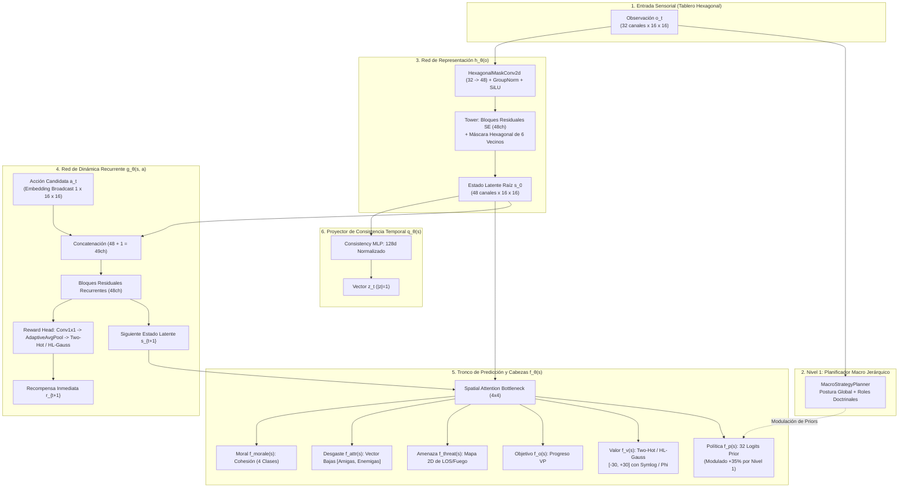
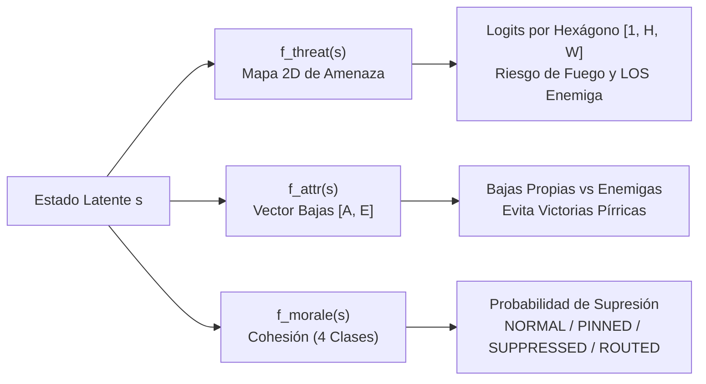
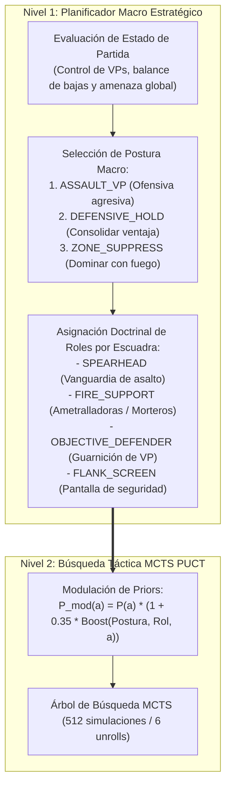

# Red Neuronal y Motor de Inteligencia Artificial: EfficientZero V2

> **Estado**: Canónico y Exhaustivo  
> **Directiva Fundamental**: El motor de aprendizaje es exclusivamente **EfficientZero V2** (`agents/efficientzero_v2/`). MuZero v1 clásico está 100% decomisionado.

---

## 1. Topología General de la Red Neuronal

La red de **EfficientZero V2** implementa un modelo de mundo diferenciable capaz de planificar en un espacio latente continuo sin requerir llamadas al simulador físico durante la búsqueda en árbol.

---

## 2. Los 5 Componentes del Modelo de Mundo

### 2.1. Red de Representación ($h_\theta$)
* **Entrada**: Tensor espacial sensorial $o_t \in \mathbb{R}^{B \times 32 \times H \times W}$ construido por `voec_sim`.
* **Convoluciones con Máscara Hexagonal (`HexagonalMaskConv2d`)**: A diferencia de las convoluciones cartesianas $3\times 3$, anula estáticamente las dos esquinas diagonales que no comparten arista en la cuadrícula hexagonal axial $(q, r)$, eliminando la distorsión anisotrópica.
* **Bloques Residuales con Squeeze-and-Excitation (SE)**: Cada bloque residual cuenta con un cuello de botella SE que recalibra la relevancia de los 48 canales latentes según el contexto táctico.
* **Salida**: Estado latente abstracto inicial $s_0 \in \mathbb{R}^{B \times 48 \times H \times W}$.

### 2.2. Red de Dinámica ($g_\theta$)
* **Entrada**: Estado latente $s_k$ concatenado con el embedding espacial de la acción ejecutada $a_k$.
* **Evolución Temporal Latente**: Predice cómo cambia el estado del campo de batalla sin simular la física:
  $$g_\theta(s_k, a_k) \to (s_{k+1}, \hat{r}_{k+1})$$
* **Escalado Min-Max Latente**: Para evitar que las activaciones exploten o se desvanezcan a lo largo del desenrollado recursivo ($k=1 \dots 6$), cada estado latente recurrente se re-normaliza dinámicamente:
  $$s_{\text{norm}} = \frac{s - \min(s)}{\max(s) - \min(s) + \epsilon}$$

### 2.3. Red de Predicción ($f_\theta$)
Proyecta cualquier estado latente $s_k$ a las variables clave de decisión:
* **Cabezal de Política ($f_p$)**: Vector de logits sobre las 32 acciones candidatas prefiltradas.
* **Cabezal de Valor ($f_v$)**: Distribución sobre el retorno esperado acumulado hasta el fin de la partida.
* **Cabezal de Objetivos Auxiliares ($f_o$)**: Predicción escalar de captura o progreso hacia Puntos de Victoria (VPs).

### 2.4. Proyector de Consistencia Temporal ($q_\theta$) y Pérdida SimSiam
Para evitar el colapso de representación (donde la red de dinámica aprende a predecir un estado latente trivial o constante), el proyector $q_\theta$ alinea el estado imaginado $s_{k}$ con la representación real de la observación futura $h_\theta(o_{t+k})$:
$$\mathcal{L}_{\text{consistency}} = -\frac{1}{2} \left( \frac{q_\theta(s_k)}{\|q_\theta(s_k)\|_2} \cdot \text{stop\_grad}\left(\frac{h_\theta(o_{t+k})}{\|h_\theta(o_{t+k})\|_2}\right) \right)$$

---

## 3. Cabezas Tácticas Auxiliares de Comprensión Profunda

Para dotar al modelo de criterio militar en el wargame, se incorporan tres cabezas auxiliares entrenadas conjuntamente con el tronco principal:

1. **`prediction_threat_map` ($f_{\text{threat}}$)**: Proyecta una matriz bidimensional $H \times W$ con la probabilidad de recibir fuego en cada hexágono, guiando al agente a navegar tras coberturas y fuera de líneas de tiro enemigas.
2. **`prediction_attrition` ($f_{\text{attr}}$)**: Predice el balance neto de desgaste (bajas aliadas esperadas vs. bajas enemigas infligidas). Permite al agente distinguir victorias tácticas limpias de victorias pírricas insostenibles.
3. **`prediction_morale` ($f_{\text{morale}}$)**: Predice la distribución de probabilidad sobre los estados de moral táctica (`NORMAL`, `PINNED`, `SUPPRESSED`, `ROUTED`), fomentando repliegues preventivos antes de que las escuadras entren en pánico.

---

## 4. Representación Discreta de Valor: Two-Hot, HL-Gauss y Symlog

La literatura reciente de Deep Reinforcement Learning (Google DeepMind 2024, DreamerV3) demuestra que la regresión escalar directa mediante error cuadrático medio (MSE) fracasa ante recompensas dispersas y multiescala.

### 4.1. Transformaciones Contractivas: $\phi$-Transform y Symlog
Para comprimir la escala dinámica sin perder resolución en torno a cero:
* **$\phi$-Transform Canónica**:
  $$h(x) = \text{sign}(x)(\sqrt{|x| + 1} - 1) + \epsilon x$$
* **Symlog Transform (DreamerV3)**:
  $$\text{symlog}(x) = \text{sign}(x) \ln(|x| + 1)$$
  $$\text{symexp}(y) = \text{sign}(y) (\exp(|y|) - 1)$$

### 4.2. Discretización de Soporte: Two-Hot vs. HL-Gauss

| Característica | Two-Hot Clásico | HL-Gauss (DeepMind 2024, "Stop Regressing") |
| :--- | :--- | :--- |
| **Mapeo de Probabilidad** | Rígido sobre los 2 átomos vecinos más cercanos. | Distribución Gaussiana continua $\mathcal{N}(y, \sigma^2)$ extendida sobre el histograma. |
| **Función Objetivo** | Cross-Entropy sobre átomos discretos. | Cross-Entropy / Divergencia KL contra la campana gaussiana. |
| **Efecto de Regularización**| Puede sufrir sobreajuste o picos de varianza en horizontes largos. | Actúa como *label smoothing* estocástico natural; gradientes notablemente más suaves y estables. |
| **Recuperación Escalar** | $\hat{v} = h^{-1}\left(\sum_{i=-K}^{K} i \cdot p_i\right)$ | $\hat{v} = \text{symexp}\left(\sum_{i=-K}^{K} z_i \cdot p_i\right)$ |

---

## 5. Planificador Macro Jerárquico HRL (Nivel 1)

El mayor desafío en wargames tácticos es la coordinación simultánea de múltiples escuadras en un espacio de acción combinatorio. *Assault* resuelve esto mediante una jerarquía de toma de decisiones en dos niveles:

* **Desacoplamiento Operativo**: El Nivel 1 no decide cada paso físico de una unidad; define la doctrina.
* **Modulación de Priors**: Durante el paso raíz del MCTS, las acciones tácticas que coinciden con el rol de la unidad y la postura del equipo reciben un bono del $+35\%$ en su probabilidad prior $P(a)$. Esto guía la búsqueda de Monte Carlo hacia rutas coherentes con el plan general sin eliminar la libertad del árbol para encontrar maniobras tácticas imprevistas.

---

## 6. Mitigación de Conflicto de Gradientes: PCGrad

Al entrenar simultáneamente la política, el valor, el objetivo y las tres cabezas tácticas, los gradientes pueden entrar en conflicto destructivo:
$$\langle g_{\text{task}_i}, g_{\text{task}_j} \rangle < 0$$

Para resolverlo, el balanceador de pérdidas utiliza **PCGrad (*Projecting Conflicting Gradients*)**:
Si dos gradientes apuntan en direcciones opuestas, el gradiente de la tarea secundaria se proyecta sobre el hiperplano ortogonal al de la tarea primaria:
$$g_i = g_i - \frac{g_i \cdot g_j}{\|g_j\|^2} g_j$$
Esto garantiza matemáticamente que ninguna cabeza táctica auxiliar degrade la calidad de la política o el valor del modelo.

---

## 7. Matriz de Síntesis y Hoja de Ruta Evolutiva (Roadmap 2024–2026)

A partir de la auditoría de la arquitectura original y los hallazgos recientes en la literatura científica de Model-Based RL (EfficientZero V2 en ICML 2024, Google DeepMind *"Stop Regressing"* 2024, DreamerV3 y Palma et al. Feb 2025 sobre wargames hexagonales con redes recurrentes), se establece la siguiente matriz de síntesis y hoja de ruta evolutiva:

| Área | Estado Assault Original | Estado Actual (EZ-v2) | Recomendación Literatura Reciente (2024–2026) | Impacto Esperado | Estado de Implementación |
| :--- | :--- | :--- | :--- | :--- | :---: |
| **Búsqueda MCTS** | PUCT clásico (512 sims) | PUCT + Modulación Priors N1 | **Gumbel MuZero Search** (muestreo de $k$ acciones candidatas) | Reducción de $\sim 60\%$ en tiempo de self-play sin pérdida táctica | 🟡 En Proceso / Opcional |
| **Distribución de Valor** | Regresión escalar MSE | Two-Hot ($K=30$, 61 átomos) | **HL-Gauss** (discretización con suavizado gaussiano $\mathcal{N}(y, \sigma^2)$) | Menor sobreajuste y curvas de Loss de valor más suaves | 🟢 Implementado en `support.py` |
| **Niebla de Guerra (POMDP)** | Canales de observación $o_t$ | Canales + Cabeza Threat Map | **Capa Recurrente / Memoria de Avistamiento** (`TemporalContextBlock` GRU) | Seguimiento de unidades enemigas ocultas en niebla | 🟢 Implementado en `network_base.py` |
| **Topología Espacial** | Conv2D $3\times 3$ cartesiana | Conv2D + SE + Spatial Attention | **Hexagonal Masking** en kernels $3\times 3$ (`HexagonalMaskConv2d`) | Eliminación de sesgos diagonales inexistentes en el hexágono | 🟢 Implementado en `network_base.py` |
| **Escala de Recompensas** | Escalado lineal manual | Two-Hot contractivo $h(x)$ | **Symlog Transform** ($\text{sign}(x)\ln(\|x\|+1)$) | Robustez universal ante recompensas extremas de victoria/derrota | 🟢 Implementado en `support.py` |
| **Jerarquía Táctica** | Acciones combinatorias planas | Planificador Macro N1 HRL | **Roles Doctrinales + Posturas Operativas** (Spearhead, Fire Support, Defender, Screen) | Eliminación de pasividad y triplicación de captura neta de VPs | 🟢 Implementado en `macro_planner.py` |
| **Balance de Gradientes** | Suma ponderada fija | PCGrad / AdaptiveLossScaler | **Proyección Ortogonal de Gradientes Opuestos** | Coexistencia estable de 6 cabezas sin degradación de política | 🟢 Implementado en `loss_balancer.py` |

