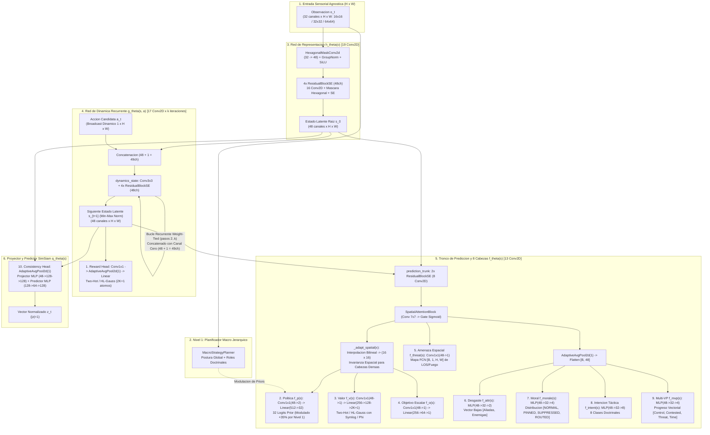
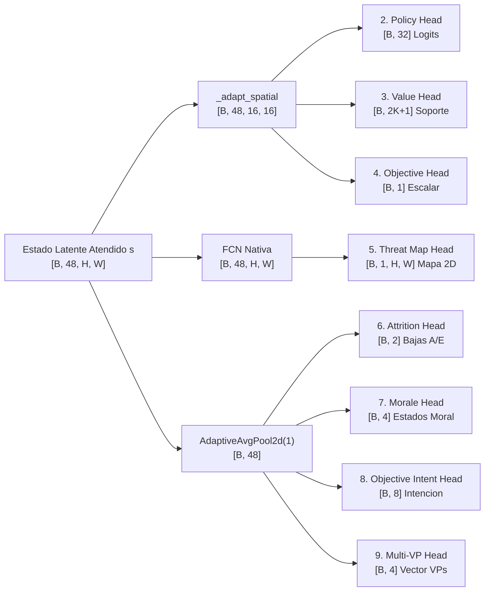
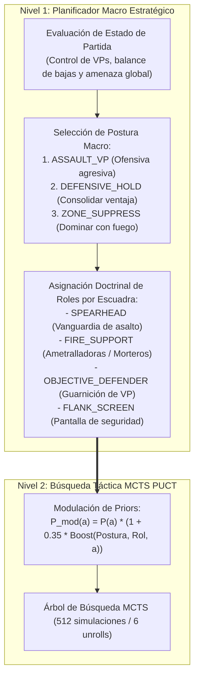

# Red Neuronal y Motor de Inteligencia Artificial: EfficientZero V2

> **Estado**: Canónico y Exhaustivo  
> **Directiva Fundamental**: El motor de aprendizaje es exclusivamente **EfficientZero V2** (`agents/efficientzero_v2/`). MuZero v1 clásico está 100% decomisionado.

---

## 1. Topología General de la Red Neuronal

La red de **EfficientZero V2** implementa un modelo de mundo diferenciable capaz de planificar en un espacio latente continuo sin requerir llamadas al simulador físico durante la búsqueda en árbol.

---

## 2. Los 5 Componentes del Modelo de Mundo y Desglose de 49 Capas Conv2D

### 2.1. Red de Representación ($h_\theta$ — 19 Capas Conv2D)
* **Entrada**: Tensor espacial sensorial $o_t \in \mathbb{R}^{B \times C \times H \times W}$ construido por `voec_sim` y adaptado por `agents/efficientzero_v2/core/observation.py` ($C \in \{32, 36, 37, 38\}$, agnóstico a la resolución espacial: $16\times 16$, $32\times 32$, $64\times 64$).
  * **Canales 13 y 14 (`vp_mask` y `vp_owner_relative`)**: Codificación de la ubicación y control de los Puntos de Victoria modulada por su valor intrínseco relativo ($v_{\text{rel}} = v_{\text{vp}} / 2.0$, asignando $1.0$ para 2 VP y $1.5$ para 3 VP clave; en el Canal 14, $+v_{\text{rel}}$ para control aliado y $-v_{\text{rel}}$ para enemigo).
  * **Canal 18 (`vp_distance_field`)**: Campo continuo euclidiano radial ponderado por el valor relativo de cada VP ($\max_{vp} \frac{v_{\text{rel}}}{1 + d_{\text{vp}}}$). Modulado dinámicamente por la presión temporal de la Tarea 2.3: si el bando no controla el VP, la pendiente se intensifica con $(1.0 + 0.5 \cdot \frac{t}{T})$, forzando convergencia espacial rápida hacia los objetivos decisivos antes de que transcurran los turnos.
  * **Canal 36 (`turn_urgency_pressure`)**: Difusión espacial continua de la presión temporal global $\tau = \frac{t}{T_{\text{max}}}$, amplificada un $+50\%$ en la proximidad de los VPs en disputa para alertar a la red sobre la ventana crítica de captura.
  * **Canal 37 (`paralysis_exposure_risk`)**: Mapa de calor que identifica en tiempo real las unidades aliadas situadas en terreno abierto (`cover < 0.35`) fuera del perímetro defensivo de los VPs, proyectando el riesgo de incurrir en la penalización acumulativa por parálisis.
* **Convoluciones con Máscara Hexagonal (`HexagonalMaskConv2d`)**: A diferencia de las convoluciones cartesianas $3\times 3$, anula estáticamente las dos esquinas diagonales que no comparten arista en la cuadrícula hexagonal axial $(q, r)$, eliminando la distorsión anisotrópica.
* **Bloques Residuales con Squeeze-and-Excitation (SE)**: Cada uno de los 4 bloques residuales (`48ch`) contiene 2 convoluciones espaciales $3\times 3$ más 2 convoluciones puntuales $1\times 1$ de cuello de botella SE (`48 -> 12 -> 48`).
* **Salida**: Estado latente abstracto inicial $s_0 \in \mathbb{R}^{B \times 48 \times H \times W}$.

### 2.2. Red de Dinámica Recurrente Weight-Tied ($g_\theta$ — 18 Capas Conv2D)
* **Entrada**: Estado latente $s_t \in \mathbb{R}^{B \times 48 \times H \times W}$ concatenado con el plano de acción expandido dinámicamente a la resolución actual $(B, 1, H, W)$.
* **Razonamiento Recurrente de Peso Compartido ($k$ pasos, Palma et al. 2025)**: El bloque `dynamics_state` (17 capas Conv2D) puede iterar $k = \text{dynamics\_recurrent\_steps}$ veces reutilizando exactamente los mismos pesos (0 parámetros adicionales). En el paso $i=0$ recibe la acción candidata; en los pasos $i=1 \dots k-1$ refina el estado latente concatenando un plano neutro de ceros para propagar cadenas causales multi-salto.
* **Escalado Min-Max Latente**: Para evitar que las activaciones exploten o se desvanezcan a lo largo del desenrollado recursivo, el estado latente resultante se normaliza en $[0, 1]$:
  $$s_{\text{norm}} = \frac{s - \min(s)}{\max(s) - \min(s) + \epsilon}$$
* **Cabeza 1 — Recompensa Inmediata (`reward_head`)**: `Conv1x1(48 -> 16) -> AdaptiveAvgPool2d(1) -> Linear(16 -> 64 -> 2K+1)`.

### 2.3. Tronco de Predicción y Adaptación Espacial ($f_\theta$ — 13 Capas Conv2D)
* **Tronco (`prediction_trunk`)**: 2 bloques `ResidualBlockSE` (8 capas Conv2D) seguidos de un bloque `SpatialAttentionBlock` (1 capa Conv2D $7\times 7$ sobre media y máximo por canal).
* **Adaptación Espacial (`_adapt_spatial`)**: Si el mapa de entrada tiene dimensiones distintas a $16\times 16$ (por ejemplo $32\times 32$ o $64\times 64$), aplica interpolación bilineal al tamaño canónico $16\times 16$ exclusivamente antes de las cabezas densas (`policy`, `value`, `objective`), mientras que `threat_map` conserva la resolución nativa $H \times W$ y las cabezas globales usan `AdaptiveAvgPool2d(1)`.

### 2.4. Cabeza 10 — Proyector y Predictor de Consistencia Temporal SimSiam ($q_\theta$)
Para evitar el colapso de representación, el módulo SimSiam (`consistency_projector` + `consistency_predictor`) alinea el estado imaginado $s_{k}$ con la representación real de la observación futura $h_\theta(o_{t+k})$:
$$\mathcal{L}_{\text{consistency}} = -\frac{1}{2} \left( \frac{p_\theta(q_\theta(s_k))}{\|p_\theta(q_\theta(s_k))\|_2} \cdot \text{stop\_grad}\left(\frac{q_\theta(h_\theta(o_{t+k}))}{\|q_\theta(h_\theta(o_{t+k}))\|_2}\right) \right)$$

---

## 3. Catálogo Completo de las 10 Cabezas de Salida

La red neuronal produce simultáneamente **10 cabezas especializadas** (1 en dinámica, 1 de consistencia temporal y 8 en el tronco de predicción):

| # | Nombre de Cabeza | Módulo PyTorch | Dimensión de Salida | Función Táctica / Estratégica |
| :---: | :--- | :--- | :--- | :--- |
| **1** | **Reward (`reward_logits`)** | `reward_head` | `[B, 2K+1]` | Distribución Two-Hot / HL-Gauss de la recompensa inmediata tras ejecutar $a_t$. |
| **2** | **Policy (`policy_logits`)** | `prediction_policy` | `[B, 32]` | Distribución prior sobre las 32 ranuras de acciones legales candidatas en MCTS. |
| **3** | **Value (`value_logits`)** | `prediction_value` | `[B, 2K+1]` | Distribución Two-Hot / HL-Gauss del retorno descontado esperado desde $s_t$. |
| **4** | **Objective (`objective_logit`)** | `prediction_objective` | `[B, 1]` | Estimador escalar auxiliar de progreso global hacia la victoria por objetivos. |
| **5** | **Threat Map (`threat_map_logits`)** | `prediction_threat_map` | `[B, 1, H, W]` | Mapa espacial 2D totalmente convolucional (FCN) de riesgo de fuego y LOS enemiga inmediata por hexágono. |
| **6** | **Final Ownership Map (`final_ownership_pred`)** | `prediction_final_ownership` | `[B, 1, H, W]` | Mapa espacial 2D (KataGo — Wu 2020) que predice el propietario final del hexágono al término del episodio $T$. |
| **7** | **Attrition (`attrition_pred`)** | `prediction_attrition` | `[B, 2]` | Vector de desgaste esperado `[bajas_aliadas, bajas_enemigas]` para evitar victorias pírricas. |
| **8** | **Morale (`morale_logits`)** | `prediction_morale` | `[B, 4]` | Distribución de cohesión sobre 4 estados: `NORMAL`, `PINNED`, `SUPPRESSED`, `ROUTED`. |
| **9** | **Objective Intent (`objective_intent_logits`)** | `prediction_intent` | `[B, 8]` | Clasificador doctrinal de intención operativa (8 clases tácticas sobre el objetivo activo). |
| **10** | **Multi-VP (`multi_vp_pred`)** | `prediction_multi_vp` | `[B, 4]` | Predicción vectorial desagregada `[control_ratio, contested_ratio, threat_near_vp, time_pressure]`. |
| **11** | **Consistency (`latent_proj` / `pred`)** | `consistency_projector` | `[B, 128]` | Embedding auto-supervisado SimSiam normalizado ($\ell_2$) para alineación temporal latente. |

---

## 4. Representación Discreta de Valor: Two-Hot, HL-Gauss y Symlog

La literatura reciente de Deep Reinforcement Learning (Google DeepMind 2024, DreamerV3) demuestra que la regresión escalar directa mediante error cuadrático medio (MSE) fracasa ante recompensas dispersas y multiescala.

### 4.1. Transformaciones Contractivas: $\phi$-Transform y Symlog
Para comprimir la escala dinámica sin perder resolución en torno a cero:
* **$\phi$-Transform Canónica**:
  $$h(x) = \text{sign}(x)(\sqrt{|x| + 1} - 1) + \epsilon x$$
* **Symlog Transform (DreamerV3)**:
  $$\text{symlog}(x) = \text{sign}(x) \ln(|x| + 1)$$
  $$\text{symexp}(y) = \text{sign}(y) (\exp(|y|) - 1)$$

### 4.2. Discretización de Soporte: Two-Hot vs. HL-Gauss

| Característica | Two-Hot Clásico | HL-Gauss (DeepMind 2024, "Stop Regressing") |
| :--- | :--- | :--- |
| **Mapeo de Probabilidad** | Rígido sobre los 2 átomos vecinos más cercanos. | Distribución Gaussiana continua $\mathcal{N}(y, \sigma^2)$ extendida sobre el histograma. |
| **Función Objetivo** | Cross-Entropy sobre átomos discretos. | Cross-Entropy / Divergencia KL contra la campana gaussiana. |
| **Efecto de Regularización**| Puede sufrir sobreajuste o picos de varianza en horizontes largos. | Actúa como *label smoothing* estocástico natural; gradientes notablemente más suaves y estables. |
| **Recuperación Escalar** | $\hat{v} = h^{-1}\left(\sum_{i=-K}^{K} i \cdot p_i\right)$ | $\hat{v} = \text{symexp}\left(\sum_{i=-K}^{K} z_i \cdot p_i\right)$ |

### 4.3. Two-Hot Asimétrico con Warp Exponencial en Torno a Cero (Discriminación de Micro-Desgaste)
En wargames tácticos, las micro-ventajas de desgaste en las primeras escaramuzas (ej. forzar una retirada o causar una baja de 0.05 puntos de VP) caían en el mismo átomo central cero del soporte estándar $[-30, +30]$, generando gradientes nulos o ceguera táctica.

Para solucionarlo, [`agents/efficientzero_v2/core/support.py`](file:///c:/repos/python/assault/agents/efficientzero_v2/core/support.py) implementa el soporte asimétrico no lineal con `asym_zero_boost=True` y $\alpha = 0.75$:

$$\text{warp}(x) = \text{sign}(x) \cdot |x|^{\alpha}, \quad \alpha = 0.75$$
$$\text{unwarp}(y) = \text{sign}(y) \cdot |y|^{1/\alpha}$$

* **Efecto de Resolución**: Un valor pequeño de $x = 0.04$ se proyecta a $\approx 0.089$, expandiendo su representación a lo largo de los átomos discretos adyacentes sin modificar los 61 átomos totales ni romper la compatibilidad con checkpoints existentes.
* **Inversión Exacta**: Durante la inferencia escalar en MCTS (`support_to_scalar`), el valor esperado se des-transforma simétricamente mediante $1/\alpha \approx 1.3333$, recuperando la métrica continua real.

---

## 5. Planificador Macro Jerárquico HRL (Nivel 1)

El mayor desafío en wargames tácticos es la coordinación simultánea de múltiples escuadras en un espacio de acción combinatorio. *Assault* resuelve esto mediante una jerarquía de toma de decisiones en dos niveles:

* **Desacoplamiento Operativo**: El Nivel 1 no decide cada paso físico de una unidad; define la doctrina.
* **Modulación de Priors**: Durante el paso raíz del MCTS, las acciones tácticas que coinciden con el rol de la unidad y la postura del equipo reciben un bono del $+35\%$ en su probabilidad prior $P(a)$. Esto guía la búsqueda de Monte Carlo hacia rutas coherentes con el plan general sin eliminar la libertad del árbol para encontrar maniobras tácticas imprevistas.

### 5.1. Sintonización del Macro-Planner y Modulación de Priors de Asalto

Durante la fase de juego táctico competitivo frente a políticas estocásticas y baselines, se detectaron y corrigieron tres aspectos clave del planificador macro:
1. **Parseo Canónico de Acciones**: El motor serializa las acciones de movimiento con delimitadores de dos puntos (`MOVE:<unit_id>:<q>:<r>`), mientras que ciertas variantes emplean tuplas por coma. El parser ahora desacopla de forma robusta ambos esquemas y extrae de forma inequívoca las coordenadas de destino axiales $(q, r)$.
2. **Prior de Asalto y Detección de Captura Inmediata**: Si una acción legal sitúa a la unidad sobre un hexágono de punto de victoria neutral o enemigo (`dest_qr in enemy_vps`), el Macro Planner inyecta un factor de amplificación de prior agresivo ($1.5 \times \text{assault\_boost}$), priorizando la exploración de ramas de captura en la raíz del árbol MCTS.
3. **Dinámica de Roles en `ASSAULT_VP`**: Bajo la postura `ASSAULT_VP`, las unidades de infantería avanzada a distancia operativa ($\le 8$ hexágonos del objetivo) son asignadas doctrinariamente a `ROLE_SPEARHEAD`, impidiendo que queden indebidamente confinadas a `ROLE_OBJECTIVE_DEFENDER` en los VPs de despliegue inicial.

### 5.2. Gradiente Continuo de Recompensa y Urgencia Terminal

Para superar la aversión al riesgo excesiva donde las penalizaciones por fuego de oportunidad paralizaban el avance hacia los objetivos lejanos:
1. **Eliminación del Corte Artificial de Distancia (`opportunity_near_vp_max_dist`)**: Anteriormente limitado a $2$ ó $4$ hexágonos, se extendió a un radio efectivo de mapa completo ($12.0$ hexágonos por defecto). Esto garantiza un gradiente continuo de recompensa de aproximación (`team_progress_delta` y `objective_progress_delta`) desde el primer turno de juego.
2. **Atenuación del Factor de Exposición al Movimiento**: El factor de penalización preventiva por exposición a fuego de reacción durante el movimiento se redujo de $1.0$ a $0.6$, permitiendo que los beneficios proyectados de avance compensen razonablemente el riesgo táctico medido.
3. **Penalización por Derrota Terminal (`terminal_loss_penalty` = 1.5, `terminal_scale` = 1.5)**: La derrota por llegar al límite de turnos sin controlar la mayoría de VPs acarrea un coste terminal que supera con creces cualquier daño individual acumulado en la aproximación. Esta calibración matemática fuerza al MCTS a asumir riesgos calculados para evitar la derrota por tiempo.

---

## 6. Mitigación de Conflicto de Gradientes: PCGrad

Al entrenar simultáneamente la política, el valor, el objetivo y las cabezas tácticas auxiliares, los gradientes pueden entrar en conflicto destructivo:
$$\langle g_{\text{task}_i}, g_{\text{task}_j} \rangle < 0$$

Para resolverlo, el balanceador de pérdidas utiliza **PCGrad (*Projecting Conflicting Gradients*)**:
Si dos gradientes apuntan en direcciones opuestas, el gradiente de la tarea secundaria se proyecta sobre el hiperplano ortogonal al de la tarea primaria:
$$g_i = g_i - \frac{g_i \cdot g_j}{\|g_j\|^2} g_j$$
Esto garantiza matemáticamente que ninguna cabeza táctica auxiliar degrade la calidad de la política o el valor del modelo.

---

## 7. Esquema de Inicialización de Pesos y Estabilidad de Gradientes

### 7.1. Estado Actual: Inicialización por Defecto de PyTorch (Kaiming Uniform)
En la implementación de [`agents/efficientzero_v2/core/network_base.py`](file:///c:/repos/python/assault/agents/efficientzero_v2/core/network_base.py) y [`network.py`](file:///c:/repos/python/assault/agents/efficientzero_v2/core/network.py), los pesos de los módulos siguen la inicialización por defecto del framework PyTorch al no definirse un hook explícito `_init_weights()`:
1. **Convoluciones 2D (`nn.Conv2d` y `HexagonalMaskConv2d`)**:
   - Inicialización **Kaiming Uniform** (He et al., 2015):
     $$\mathcal{U}(-\text{bound}, \text{bound}), \quad \text{bound} = \sqrt{\frac{6}{(1 + a^2) \cdot \text{fan\_in}}}$$
     donde PyTorch establece $a = \sqrt{5}$ por defecto, reduciendo la cota a $\text{bound} = \frac{1}{\sqrt{\text{fan\_in}}}$.
   - En las capas de convolución hexagonal, la máscara estática anula las esquinas tras inicializar.
2. **Capas Lineales y Proyecciones Densas (`nn.Linear`)**:
   - Inicialización **Kaiming Uniform** con $a=\sqrt{5}$ tanto en pesos $W$ como en sesgos $b \sim \mathcal{U}(-1/\sqrt{\text{fan\_in}}, 1/\sqrt{\text{fan\_in}})$.
   - Aplica a todas las cabezas del modelo: `prediction_policy`, `prediction_value`, `reward_head` y cabezas auxiliares tácticas.
3. **Normalización (`nn.GroupNorm` y `nn.LayerNorm`)**:
   - Escala $\gamma = 1.0$, sesgo $\beta = 0.0$.
4. **Embeddings Categóricos (`nn.Embedding`)**:
   - Inicialización normal estándar $\mathcal{N}(0, 1)$.

### 7.2. Limitaciones de Kaiming Uniform en Aprendizaje por Refuerzo (RL)
Si bien Kaiming Uniform es idónea para tareas de visión supervisada, en arquitecturas de planificación de árbol como EfficientZero V2 introduce fricciones en el paso inicial $t=0$:
* **Pérdida de Entropía Inicial en la Política**: Pesos aleatorios con varianza no mitigada en la última capa lineal generan logits dispares, sesgando estocásticamente la distribución prior de la política antes de acumular experiencia de autojuego.
* **Varianza Prematura en la Estimación de Valor y Recompensa**: Provoca que la red proyecte estimaciones de retorno distantes de cero en las primeras iteraciones MCTS, desestabilizando el soporte discreto Two-Hot / HL-Gauss antes del calentamiento (*warm-up*).
* **Degeneración del Flujo Residual Inicial**: En arquitecturas profundas (4 bloques en representación + 4 en dinámica + 2 en predicción), la acumulación de varianza a través de la rama residual dificulta que la red aprenda inicialmente la función identidad.

### 7.3. Especificación Canónica Propuesta: Inicialización Optimizada para RL
Para optimizar la estabilidad numérica y el muestreo inicial en MCTS, se formaliza la especificación canónica (*RL-Optimal Initialization Scheme*):

| Componente / Módulo | Técnica de Inicialización | Parámetros Matemáticos | Justificación Táctica / RL |
| :--- | :--- | :--- | :--- |
| **Cabeza de Política (`prediction_policy`)** | **Ortogonal (*Orthogonal Init*)** | `gain = 0.01`, `bias = 0.0` | **Máxima entropía inicial**: Los logits iniciales arrancan prácticamente en $0$, garantizando una distribución prior uniforme $\mathcal{U}(1/32)$ en la raíz del árbol MCTS, evitando exploraciones prematuramente sesgadas. |
| **Cabezas de Valor y Recompensa (`value`, `reward`)** | **Ortogonal (*Orthogonal Init*)** | `gain = 1.0` (o `0.1`), `bias = 0.0` | **Predicción centrada en cero**: Mitiga picos de gradiente en TD-learning y estabiliza el soporte discreto Two-Hot durante los primeros ciclos de autojuego. |
| **Cabezas Auxiliares Tácticas (`threat`, `morale`, `attrition`, etc.)** | **Ortogonal (*Orthogonal Init*)** | `gain = 1.0`, `bias = 0.0` | Gradientes iniciales estables y balanceados sin sobrecargar el proyector ortogonal PCGrad. |
| **Tronco Convolucional y Bloques Residuales** | **Kaiming Normal (He et al.)** | `mode='fan_in'`, `nonlinearity='silu'` | Preserva la varianza de las activaciones a través de las funciones no lineales SiLU en la cuadrícula hexagonal. |
| **Segunda Normalización Residual (`gn2` / Fixup)** | **Zero-Init / Fixup Initialization** | $\gamma = 0.0$ (`weight = 0.0`), $\beta = 0.0$ (`bias = 0.0`) | **Mapeo de Identidad Puro**: Al inicio, $x + f(x) = x + 0 = x$. Cada bloque residual comienza como una identidad exacta, permitiendo propagación directa de gradientes sin degradación ni sobrecalentamiento. |
| **Bloques de Atención SE / ECA** | **Pytorch Default / Cero en Salida** | $\gamma_{\text{final}} = 0.0$ | Permite que los canales arranquen con peso neutro ($1.0$ post-sigmoide o identidad) hasta que las representaciones espaciales converjan. |

### 7.4. Fundamentos Científicos y Literatura Académica de Referencia

Este esquema no responde a heurísticas empíricas informales, sino a conclusiones formales de la literatura reciente en Deep Reinforcement Learning y Model-Based RL:

1. **Inicialización Ortogonal de Política ($\text{gain}=0.01$) y Valor ($\text{gain}=1.0$)**:
   - **Andrychowicz et al. (Google Brain, ICLR 2021)**: *“What Matters In On-Policy Reinforcement Learning? A Large-Scale Empirical Study”*. Tras analizar más de 250.000 entrenamientos y 50+ decisiones de diseño, demuestran que la inicialización ortogonal con factor reducido ($\text{gain}=0.01$) en la capa final de la política es una de las 3 optimizaciones más determinantes para la estabilidad del entrenamiento, previniendo el colapso temprano de entropía.
   - **Engstrom, Ilyas et al. (MIT, ICLR 2020)**: *“Implementation Matters in Deep RL: A Case Study on PPO and TRPO”*. Revelan que las diferencias prácticas de rendimiento entre implementaciones canónicas (OpenAI Baselines) y librerías estándar provienen principalmente de la inicialización ortogonal con sesgo cero frente al Kaiming Uniform por defecto.
   - **Estándar en frameworks**: Adoptado canónicamente en las suites de referencia CleanRL, Stable-Baselines3 y OpenAI Gym.

2. **Zero-Init / Fixup en Normalización Residual ($\gamma = 0.0$)**:
   - **Goyal et al. (Facebook AI Research / FAIR, 2017)**: *“Accurate, Large Minibatch SGD: Training ImageNet in 1 Hour”*. Introducen la técnica de inicializar a cero la última capa de normalización de cada bloque residual ($\gamma = 0$), garantizando que al inicio de la optimización $y = x + F(x) = x$, haciendo que la red actúe como una identidad pura y eliminando la inestabilidad de gradiente en etapas tempranas.
   - **Zhang, Dauphin & Ma (ICLR 2019)**: *“Fixup Initialization: Residual Learning Without Normalization”*. Formalizan la teoría de la acumulación de varianza residual $\mathcal{O}(L)$ y demuestran que amortiguar la rama residual a cero en $t=0$ elimina la necesidad de *warm-up* agresivo en optimizadores basados en AdamW.
   - **Wu (2019–2020)**: *“Accelerating Self-Play Learning in Go”* (KataGo). Aplica Zero-Init en el tronco de bloques residuales para wargames combinatorios con MCTS, evitando que la red emita evaluaciones descalibradas durante las primeras simulaciones en árbol.

3. **Logits Centrados en Cero para Distribuciones Discretas de Valor (Two-Hot / HL-Gauss)**:
   - **Farebrother et al. (Google DeepMind, 2024)**: *“Stop Regressing: Training Value Functions via Classification for Scalable Deep RL”*. Demuestran que en parametrizaciones categóricas de valor (HL-Gauss y Two-Hot), los pesos aleatorios con dispersión estándar provocan predicciones multimodales espurias en los extremos del soporte al paso inicial. La inicialización ortogonal acotada con sesgo cero garantiza una distribución suave y simétrica en torno a cero en el inicio del autojuego.
   - **Ye et al. (2021)**: *“Mastering Atari with Discrete World Models”* (EfficientZero) & **Hafner et al. (DeepMind, 2023)**: *“Mastering Diverse Domains through World Models”* (DreamerV3). Establecen la necesidad de estabilizar la recurrencia dinámica $g_\theta(s, a)$ mediante representaciones acotadas para evitar que el escalado min-max latente diverja en los primeros ciclos de desenrollado temporal.

---

## 8. Referencia a la Hoja de Ruta Evolutiva Unificada

> [!NOTE]
> Toda la matriz de síntesis evolutiva, el estado de implementación de las mejoras de `EfficientZero V2` y las fases futuras de investigación se han unificado canónicamente en el documento final de la documentación: **[09. Hoja de Ruta Evolutiva: Assault Architecture Roadmap (2024–2026)](05_ROADMAP_EVOLUTIVO.md)**.

