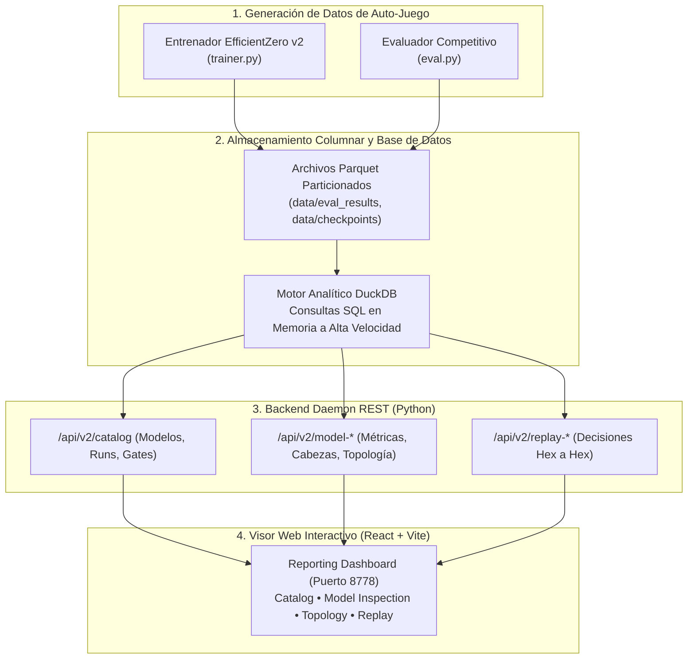
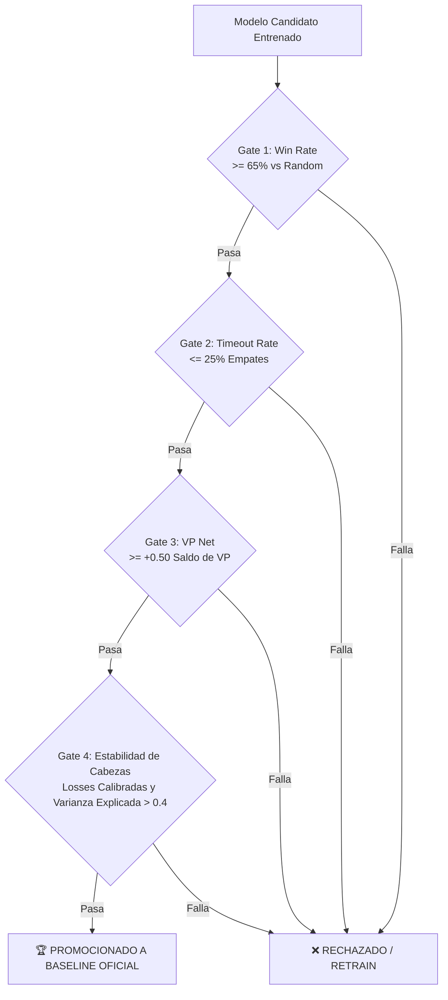
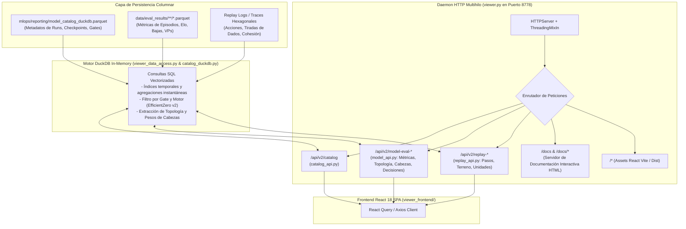
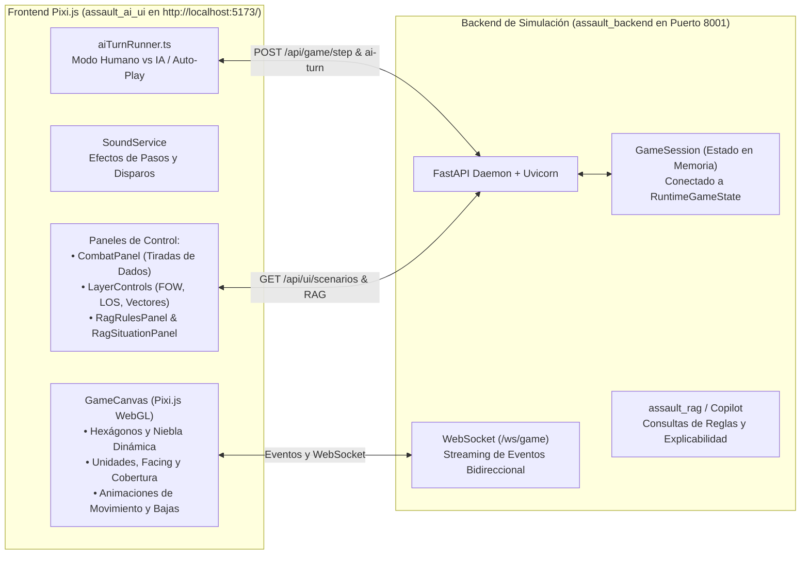

# Plataforma MLOps, Telemetría y Visor de Reporting

> **Estado**: Canónico y Exhaustivo  
> **Ámbito**: Infraestructura de almacenamiento columnar (`DuckDB` + `Parquet`), APIs analíticas y Dashboard Web React/Vite en puerto `8778`.

---

## 1. Arquitectura de la Plataforma MLOps

La plataforma MLOps de *Assault* proporciona observabilidad de extremo a extremo sobre el ciclo de vida de los modelos de aprendizaje por refuerzo, desde la generación de experiencias en auto-juego (*self-play*) hasta la evaluación competitiva, auditoría de gradientes y reproducción interactiva de partidas.



---

## 2. Motor Analítico: DuckDB y Apache Parquet

Para evitar bases de datos pesadas (PostgreSQL/MySQL) o la fragilidad de archivos JSON no indexados:
* **Formato Parquet**: Las partidas de evaluación y los registros de decisión de MCTS se serializan en archivos `.parquet` fuertemente tipados con compresión Snappy/ZSTD.
* **DuckDB Integrado**: Cada consulta del dashboard se ejecuta mediante SQL analítico vectorizado directamente sobre los ficheros Parquet, permitiendo calcular promedios, tasas de conversión de VPs y percentiles de confianza en milisegundos sobre cientos de miles de pasos de decisión.

---

## 3. Puertas de Promoción de Modelos (*Promotion Gates*)

Para que un modelo candidato sea promocionado a baseline oficial del proyecto, debe superar de forma determinista una batería de **Gates de Calidad**:



* **Criterio de Victoria Neta**: Supervivencia superior y capacidad demostrada para tomar la iniciativa.
* **Criterio Anti-Pasividad (Timeouts)**: Penaliza severamente a los modelos que se atrincheran indefinidamente sin avanzar hacia los objetivos designados.
* **Criterio de Captura Territorial (VP Net)**: Mide el saldo neto entre hexágonos de victoria capturados y banderas cedidas al adversario.

---

## 4. Módulos y Pestañas del Visor de Reporting (`http://127.0.0.1:8778`)

### 4.1. Catálogo General de Modelos (`CatalogPage.tsx`)
* Tabla clasificatoria con todos los entrenamientos registrados, filtrado por motor (`efficientzero_v2`), número de episodios, fecha, badges de calidad superados y opción de eliminación limpia de artefactos.

### 4.2. Topología de Red y Desenrollado Interactivo (`NetworkTopologyTab.tsx`)
* **Diagrama SVG Dinámico**: Visualiza las conexiones entre `Observación o_t`, `Planificador Macro (Nivel 1)`, `h(o)`, `s_t`, `Red de Dinámica g(s, a)`, `Acción MCTS a_t` y todas las cabezas de predicción activas.
* **Simulador de Desenrollado Temporal**: Controles interactivos de paso ($t=0 \dots 6$) y botón de reproducción automática que ilustra cómo la red imagina estados futuros sin tocar el simulador físico.
* **Atribución de Canales Sensoriales**: Tabla interactiva con los 32 planos de entrada, estado de efectividad (`HIGH`, `MODERATE`, `LOW`, `DEAD`) y desglose táctico de cada hexágono.
* **Inspector de Componentes**: Formulación matemática en LaTeX, formas tensoriales de entrada/salida y estimación de parámetros calculados en tiempo real para el run activo.

### 4.3. Visor Hexagonal de Partidas Paso a Paso (`MatchReplayTab.tsx` / `ReplayTab.tsx`)
* Renderizado hexagonal completo del tablero de combate con iconos de unidades (infantería, HMG, morteros, blindados), elevaciones, tipos de terreno y banderas VP.
* Barra temporal de reproducción paso a paso con registro de combate: tiradas de dados atacantes/defensores, bajas causadas, cambios de moral (`PINNED`, `SUPPRESSED`) y disparos de reacción interceptados.

### 4.4. Explicabilidad y Toma de Decisiones XAI (`EvalDecisionsTab.tsx`)
* Desglose de cada decisión tomada por la IA:
  * Probabilidad prior asignada por la red ($P(a)$).
  * Distribución de visitas del árbol MCTS ($N(a)$).
  * Margen de confianza de la decisión respecto a la segunda mejor alternativa.
  * Modulaciones aplicadas por el Planificador Macro de Nivel 1.

---

## 5. Arquitectura Interna del Backend del Visor (`mlops/reporting/`)

El backend del visualizador es un servicio desacoplado de alto rendimiento diseñado para servir telemetría en tiempo real sin bloquear los bucles de entrenamiento:



### 5.1. Componentes Clave del Backend

1. **`viewer.py` (Servidor HTTP Asíncrono)**:
   - Implementa `ThreadingMixIn` para permitir concurrencia real entre múltiples clientes sin saturar el hilo principal de Python.
   - Resuelve el soporte de CORS para desarrollo local y sirve estáticos compilados desde `viewer_frontend/dist`.
   - Incorpora el endpoint `/docs` que sirve la suite de documentación técnica interactiva con renderizado LaTeX y visualizador hexagonal.

2. **`catalog_duckdb.py` & `viewer_data_access.py` (Capa de Acceso a Datos)**:
   - Mantiene una conexión compartida con DuckDB sobre archivos Parquet sin necesidad de transformaciones intermedias.
   - Ejecuta proyecciones analíticas con latencias inferiores a **10 milisegundos**, permitiendo que el usuario filtre cientos de modelos o explore árboles MCTS con fluidez total.

3. **`model_api.py` & `replay_api.py` (APIs Especializadas)**:
   - `model_api.py`: Serializa la topología de la red, los mapas de calor de atribución sensorial y los diagnósticos de gradientes de las cabezas tácticas.
   - `replay_api.py`: Decodifica el histórico de la partida hexágono a hexágono, reconstruyendo los dados tirados, los eventos de supresión y el movimiento en el lienzo interactivo HTML5 Canvas.

---

## 6. Módulo de Simulación Táctica Interactiva y Juego en Vivo

Además del Visor de Reporting analítico (puerto `8778`), la plataforma cuenta con un entorno interactivo completo para **jugar partidas en vivo** contra el motor de IA o ver a la IA jugar sola (**Self-Play**):



### 6.1. Capacidades del Simulador
1. **Modo Humano vs Agente Neuronal**:
   - El usuario elige su bando (p. ej. `US` o `GE`) y el escenario (p. ej. `battaglia_cittadina_2_1` o `mettete_i_piedi_terra_1`).
   - Al hacer clic sobre una escuadra propia, el motor consulta las acciones legales (`/api/game/actions`) y resalta los hexágonos accesibles y los objetivos a tiro.
   - Al emitir una orden, se reproducen efectos de sonido tácticos (`stepdirt` al caminar, disparos de fusilería `rifle-gunshot`) y se abren los paneles de combate con las tiradas de dados en tiempo real.
2. **Modo Espectador / Auto-Play (Self-Play)**:
   - Activando el ejecutor continuo (`aiTurnRunner.ts`), ambos bandos juegan automáticamente según las decisiones de la IA, permitiendo observar las doctrinas de asalto y contención en directo sobre el mapa.
3. **Asistente Táctico RAG Copilot Integrado**:
   - Los paneles `RagRulesPanel.tsx` y `RagSituationPanel.tsx` consultan la base de conocimiento vectorial de reglas (`assault_rag/`) para explicar por qué una acción es legal/ilegal o sugerir la mejor maniobra según el manual de operaciones tácticas.
4. **Control Total de Capas (*Layer Controls*)**:
   - Permite activar/desactivar la niebla de guerra (*Fog of War*), la línea de visión (*LOS*), los vectores de depuración de IA, las banderas de puntos de victoria (*VPs*) y las marcas de activación de escuadras.

### 6.2. Cómo Levantar el Entorno de Simulación
Tanto el backend como el frontend interactivo pueden iniciarse con el script orquestador o de forma manual:

* **Opción A (Stack Completo con Script)**:
  ```powershell
  .\scripts\start_all_environments.ps1
  ```
  *(Abre Reporting en 8778, Backend API en 8001 y Simulador en 5173)*.

* **Opción B (Lanzamiento Individual)**:
  * **Backend API (FastAPI)**:
    ```powershell
    .venv\Scripts\python.exe -m uvicorn assault_backend.main:app --host 0.0.0.0 --port 8001 --reload
    ```
  * **Frontend Simulador (Vite / Pixi.js)**:
    ```powershell
    cd assault_ai_ui
    npm run dev -- --host
    ```
  * Acceso directo en el navegador: **`http://localhost:5173/`**.


