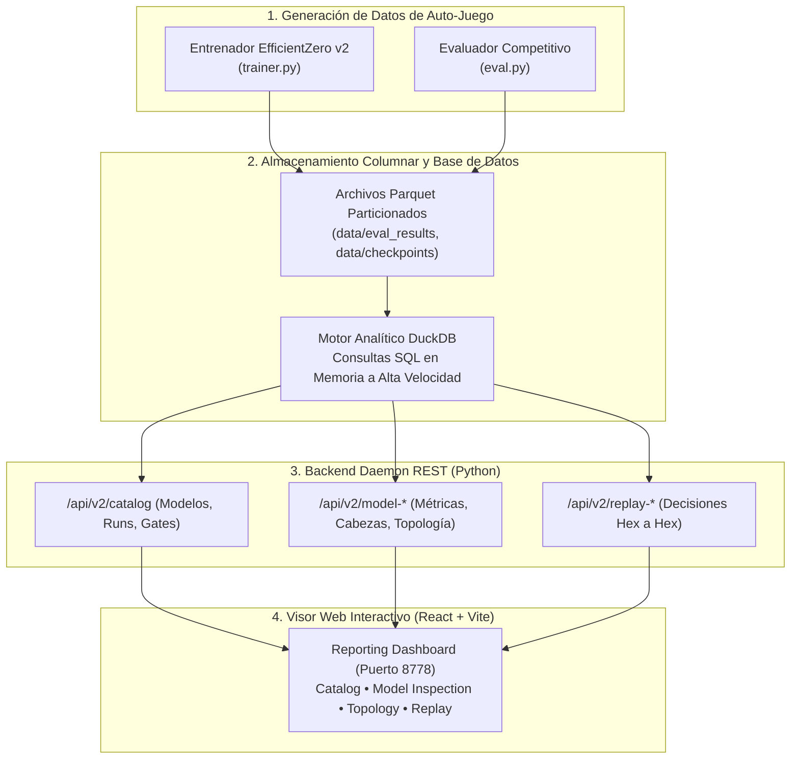
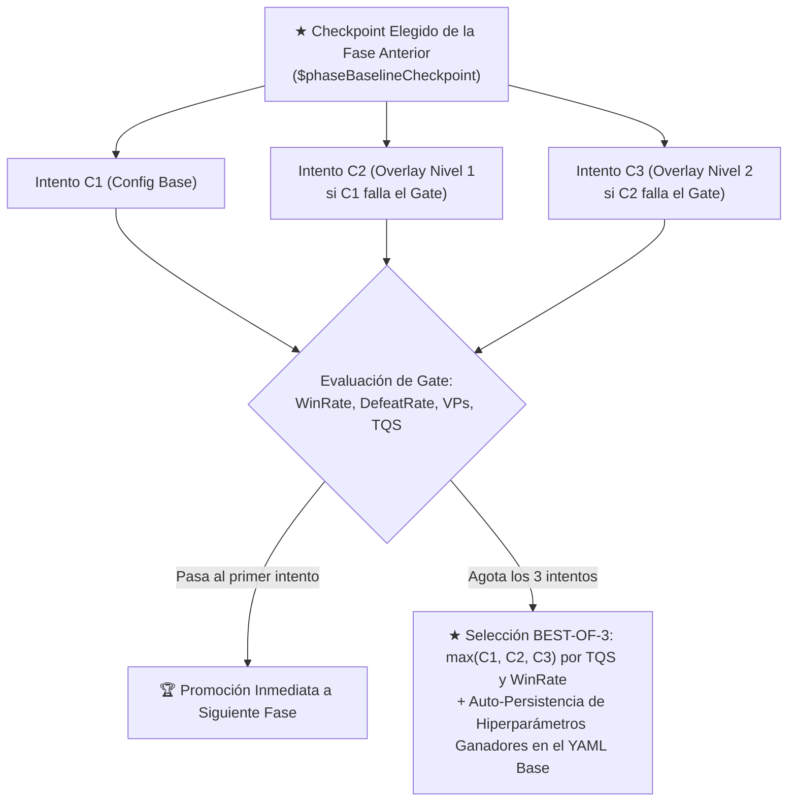
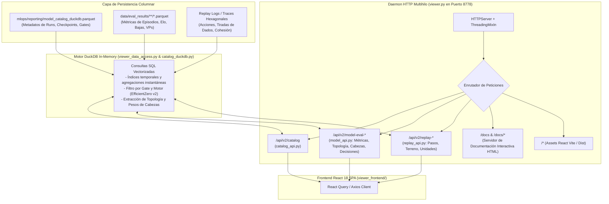
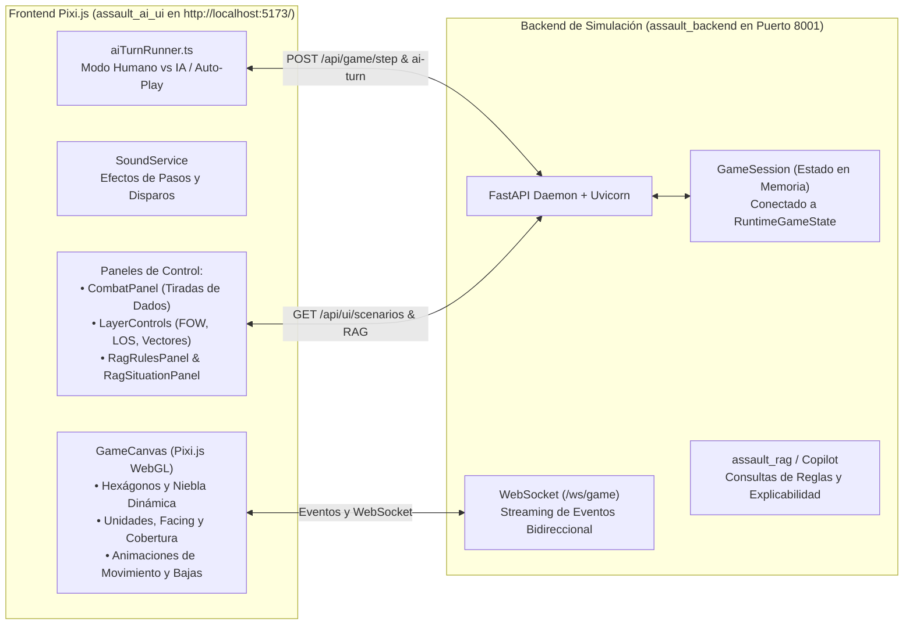

# Plataforma MLOps, Telemetría y Visor de Reporting

> **Estado**: Canónico y Exhaustivo  
> **Ámbito**: Infraestructura de almacenamiento columnar (`DuckDB` + `Parquet`), APIs analíticas y Dashboard Web React/Vite en puerto `8778`.

---

## 1. Arquitectura de la Plataforma MLOps

La plataforma MLOps de *Assault* proporciona observabilidad de extremo a extremo sobre el ciclo de vida de los modelos de aprendizaje por refuerzo, desde la generación de experiencias en auto-juego (*self-play*) hasta la evaluación competitiva, auditoría de gradientes y reproducción interactiva de partidas.



---

## 2. Motor Analítico: DuckDB y Apache Parquet

Para evitar bases de datos pesadas (PostgreSQL/MySQL) o la fragilidad y crecimiento ilimitado de archivos JSON monolíticos:
* **Formato Parquet + DuckDB (`model_catalog.duckdb` y `parquet/*.parquet`)**: Los entrenamientos, partidas de evaluación y registros de decisión de MCTS se almacenan en tablas relacionales de DuckDB (`models`, `train_runs`, `eval_runs`, `eval_results`, `curriculum_trace`) sincronizadas con particiones `.parquet` comprimidas.
* **Desactivación de JSON Monolítico (`include_debug_full_catalog = False`)**: El publicador `mlops/catalog_publisher_v2.py` genera únicamente el resumen ligero (`model_catalog_latest.json`, ~5 KB) y delega todo el histórico detallado en DuckDB/Parquet, evitando archivos `model_catalog_full_*.json` de varios gigabytes.
* **Borrado Instantáneo In-Place (`mlops/reporting/model_deletion.py`)**: La eliminación de un experimento desde la UI borra los directorios físicos de checkpoints/self-play y ejecuta sentencias `DELETE FROM ... WHERE model_id = ?` directamente sobre DuckDB seguidas de `COPY ... TO ... (FORMAT PARQUET)`, completándose en milisegundos sin escanear ni reconstruir todo el árbol de directorios.

---

## 3. Puertas de Promoción (*Promotion Gates*) y Currículum Dinámico (`BEST-OF-3`)

El orquestador [`curriculums/common/run_dynamic_gated_curriculum.ps1`](file:///c:/repos/python/assault/curriculums/common/run_dynamic_gated_curriculum.ps1) ejecuta cada fase del currículum con hasta **3 intentos independientes (`C1`, `C2`, `C3`)** que parten siempre del **mismo checkpoint ganador (`★`) de la fase anterior (`$phaseBaselineCheckpoint`)**:



* **Independencia entre intentos (`C1`, `C2`, `C3`)**: Si `C2` prueba hiperparámetros más agresivos y degrada la red, `C3` **no hereda el modelo degradado de `C2`**, sino que vuelve a partir limpio desde `$phaseBaselineCheckpoint`.
* **Ajuste Adaptativo de Hiperparámetros (`Build-ResumeOverlayConfig`)**: Según qué criterio del Gate haya quedado pendiente (`vp_unmet` vs `score_unmet`), `C2` y `C3` escalan automáticamente `vp_capture_bonus_per_hex` (`+12%` / `+24%`), `objective_progress_bonus_per_hex`, `capture_bonus`, `objective_loss_weight`, `kill_weight`, `reanalysis_ratio` y `train_updates_per_iter`.
* **Auto-Persistencia para Futuras Ejecuciones desde 0 (`Save-WinningCycleParamsToPhaseConfig`)**: Cuando el ciclo ganador (`★`) de una fase es `C2` o `C3`, sus hiperparámetros se guardan automáticamente en el YAML base de esa fase para que el próximo currículum desde 0 los utilice directamente desde `C1`.

### 3.1. Auto-Calibración de Quality Gates al Escenario y Dominant WinRate Override (Fase 7)
En versiones previas, los Quality Gates empleaban umbrales fijos de captura de banderas (ej. `min_tracked_captured_vps: 2.5`), provocando falsos rechazos en escenarios de 3 VPs o transiciones de escala:

1. **Detección Dinámica de Capacidad de VPs (`$scenarioVpMax`)**:
   * En [`curriculums/common/run_dynamic_gated_curriculum.ps1`](file:///c:/repos/python/assault/curriculums/common/run_dynamic_gated_curriculum.ps1), el evaluador lee la configuración del mapa objetivo (ej. 5.0 VPs en *Battaglia Cittadina*, 3.0 VPs en *Mettete i Piedi a Terra*) y calcula percentiles normalizados:
     $$\text{vp\_ratio} = \frac{\text{VPs Capturados}}{\$scenarioVpMax}$$
2. **Dominant WinRate Override**:
   * Si en el Ciclo 1 la red demuestra una superioridad táctica dominante:
     $$\text{WinRate} \ge 80\%, \quad \text{LossRate} \le 15\%, \quad \text{TimeoutRate} \le 5\%$$
   * Se concede la promoción inmediata a la siguiente fase, eliminando el bloqueo innecesario por tomas lentas de banderas mientras el agente aún optimiza la velocidad de resolución táctica.

### 3.2. Evaluación Rigurosa de Bandos en Benchmarking (`eval_side`)

En el motor de evaluación de episodios ([`assault_bench/episode_runner_impl.py`](file:///c:/repos/python/assault/assault_bench/episode_runner_impl.py)), se corrigió la asignación de bando evaluado:
* **Problema Previo**: La condición de victoria evaluaba el bando activo en el turno inicial (`obs.to_play`). En escenarios asimétricos donde el rival tenía la iniciativa en el turno 0, la victoria del rival era contabilizada erróneamente como victoria del agente bajo test (generando falsos 100% Win Rate).
* **Resolución Canónica**: El evaluador identifica de manera estricta el bando asignado a la política evaluada consultando `policy_by_side` para la clave correspondiente (ej. `"mcts"` o `"efficientzero_v2"`). De este modo, la métrica de victoria refleja con precisión matemática el resultado del agente evaluado con independencia de quién posea el turno inicial.

---

## 4. Módulos y Pestañas del Visor de Reporting (`http://127.0.0.1:8778`)

### 4.1. Catálogo General y Curva de Progresión de ELO (`CatalogPage.tsx`)
* **Tabla Clasificatoria de Modelos**: Filtrado por motor (`efficientzero_v2`), número de episodios, fecha, calidad táctica (`TQS`) y botón de eliminación instantánea en DuckDB/Parquet.
* **Gráfica `📈 Curva de Progresión de ELO por Fase del Currículum` (`CurriculumProgressionChart`)**:
  * Enmarca visualmente los ciclos (`C1`, `C2`, `C3`) de cada fase con bandas verticales alternadas.
  * Destaca el **ciclo elegido (`★`) de cada fase** con un anillo dorado brillante, etiqueta superior dorada (`★ ELO`), indicador inferior (`★ C1/C2/C3`) y una **línea de tendencia dorada discontinua** que une los puntos ganadores (`★`) de fase en fase.
* **Tabla `Training Runs & Progreso del Currículum`**: Muestra el ciclo `(C1/3, C2/3, C3/3)` y resalta el ciclo elegido de cada fase con borde izquierdo dorado y el badge **`★ ELEGIDO`**.

### 4.2. Topología de Red y Desenrollado Interactivo (`NetworkTopologyTab.tsx`)
* **Diagrama SVG Dinámico**: Visualiza las conexiones entre `Observación o_t`, `Planificador Macro (Nivel 1)`, `h(o)`, `s_t`, `Red de Dinámica g(s, a)`, `Acción MCTS a_t` y todas las cabezas de predicción activas.
* **Simulador de Desenrollado Temporal**: Controles interactivos de paso ($t=0 \dots 6$) y botón de reproducción automática que ilustra cómo la red imagina estados futuros sin tocar el simulador físico.
* **Atribución de Canales Sensoriales**: Tabla interactiva con los 32 planos de entrada, estado de efectividad (`HIGH`, `MODERATE`, `LOW`, `DEAD`) y desglose táctico de cada hexágono.
* **Inspector de Componentes**: Formulación matemática en LaTeX, formas tensoriales de entrada/salida y estimación de parámetros calculados en tiempo real para el run activo.

### 4.3. Visor Hexagonal de Partidas Paso a Paso (`MatchReplayTab.tsx` / `ReplayTab.tsx`)
* Renderizado hexagonal completo del tablero de combate con iconos de unidades (infantería, HMG, morteros, blindados), elevaciones, tipos de terreno y banderas VP.
* Barra temporal de reproducción paso a paso con registro de combate: tiradas de dados atacantes/defensores, bajas causadas, cambios de moral (`PINNED`, `SUPPRESSED`) y disparos de reacción interceptados.

### 4.4. Explicabilidad y Toma de Decisiones XAI (`EvalDecisionsTab.tsx`)
* Desglose de cada decisión tomada por la IA:
  * Probabilidad prior asignada por la red ($P(a)$).
  * Distribución de visitas del árbol MCTS ($N(a)$).
  * Margen de confianza de la decisión respecto a la segunda mejor alternativa.
  * Modulaciones aplicadas por el Planificador Macro de Nivel 1.

---

## 5. Arquitectura Interna del Backend del Visor (`mlops/reporting/`)

El backend del visualizador es un servicio desacoplado de alto rendimiento diseñado para servir telemetría en tiempo real sin bloquear los bucles de entrenamiento:



### 5.1. Componentes Clave del Backend

1. **`viewer.py` (Servidor HTTP Asíncrono)**:
   - Implementa `ThreadingMixIn` para permitir concurrencia real entre múltiples clientes sin saturar el hilo principal de Python.
   - Resuelve el soporte de CORS para desarrollo local y sirve estáticos compilados desde `viewer_frontend/dist`.
   - Incorpora el endpoint `/docs` que sirve la suite de documentación técnica interactiva con renderizado LaTeX y visualizador hexagonal.

2. **`catalog_duckdb.py` & `viewer_data_access.py` (Capa de Acceso a Datos)**:
   - Mantiene una conexión compartida con DuckDB sobre archivos Parquet sin necesidad de transformaciones intermedias.
   - Ejecuta proyecciones analíticas con latencias inferiores a **10 milisegundos**, permitiendo que el usuario filtre cientos de modelos o explore árboles MCTS con fluidez total.

3. **`model_api.py` & `replay_api.py` (APIs Especializadas)**:
   - `model_api.py`: Serializa la topología de la red, los mapas de calor de atribución sensorial y los diagnósticos de gradientes de las cabezas tácticas.
   - `replay_api.py`: Decodifica el histórico de la partida hexágono a hexágono, reconstruyendo los dados tirados, los eventos de supresión y el movimiento en el lienzo interactivo HTML5 Canvas.

---

## 6. Módulo de Simulación Táctica Interactiva y Juego en Vivo

Además del Visor de Reporting analítico (puerto `8778`), la plataforma cuenta con un entorno interactivo completo para **jugar partidas en vivo** contra el motor de IA o ver a la IA jugar sola (**Self-Play**):



### 6.1. Capacidades del Simulador
1. **Modo Humano vs Agente Neuronal**:
   - El usuario elige su bando (p. ej. `US` o `GE`) y el escenario (p. ej. `battaglia_cittadina_2_1` o `mettete_i_piedi_terra_1`).
   - Al hacer clic sobre una escuadra propia, el motor consulta las acciones legales (`/api/game/actions`) y resalta los hexágonos accesibles y los objetivos a tiro.
   - Al emitir una orden, se reproducen efectos de sonido tácticos (`stepdirt` al caminar, disparos de fusilería `rifle-gunshot`) y se abren los paneles de combate con las tiradas de dados en tiempo real.
2. **Modo Espectador / Auto-Play (Self-Play)**:
   - Activando el ejecutor continuo (`aiTurnRunner.ts`), ambos bandos juegan automáticamente según las decisiones de la IA, permitiendo observar las doctrinas de asalto y contención en directo sobre el mapa.
3. **Asistente Táctico RAG Copilot Integrado**:
   - Los paneles `RagRulesPanel.tsx` y `RagSituationPanel.tsx` consultan la base de conocimiento vectorial de reglas (`assault_rag/`) para explicar por qué una acción es legal/ilegal o sugerir la mejor maniobra según el manual de operaciones tácticas.
4. **Control Total de Capas (*Layer Controls*)**:
   - Permite activar/desactivar la niebla de guerra (*Fog of War*), la línea de visión (*LOS*), los vectores de depuración de IA, las banderas de puntos de victoria (*VPs*) y las marcas de activación de escuadras.

### 6.2. Cómo Levantar el Entorno de Simulación
Tanto el backend como el frontend interactivo pueden iniciarse con el script orquestador o de forma manual:

* **Opción A (Stack Completo con Script)**:
  ```powershell
  .\scripts\start_all_environments.ps1
  ```
  *(Abre Reporting en 8778, Backend API en 8001 y Simulador en 5173)*.

* **Opción B (Lanzamiento Individual)**:
  * **Backend API (FastAPI)**:
    ```powershell
    .venv\Scripts\python.exe -m uvicorn assault_backend.main:app --host 0.0.0.0 --port 8001 --reload
    ```
  * **Frontend Simulador (Vite / Pixi.js)**:
    ```powershell
    cd assault_ai_ui
    npm run dev -- --host
    ```
  * Acceso directo en el navegador: **`http://localhost:5173/`**.


