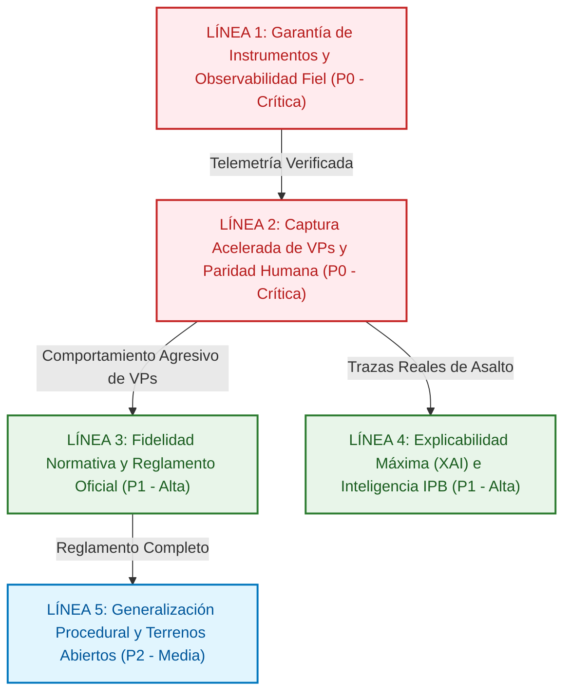
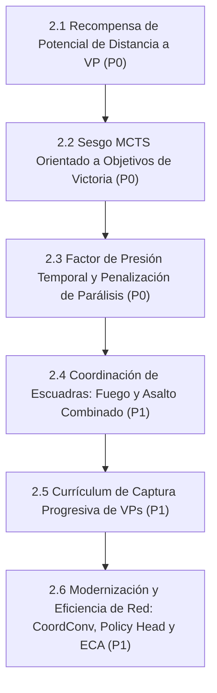
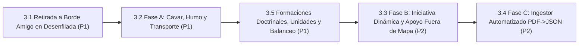
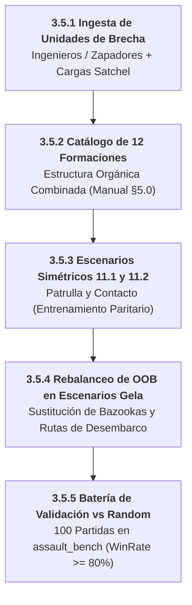
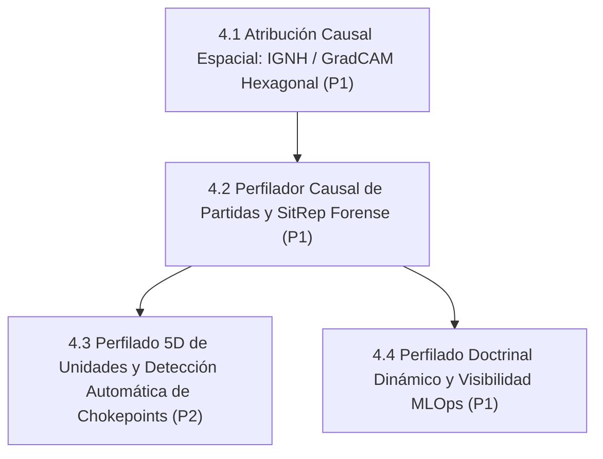
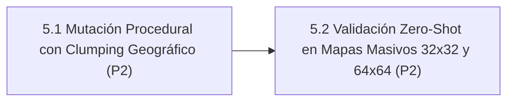

# 11. Hoja de Ruta Evolutiva: Assault Architecture Roadmap (2026–2027)

> **Estado**: Canónico, Unificado y Versionado (Octubre 2026)  
> **Ámbito**: Documento final que unifica toda la evolución técnica, científica, de rendimiento y normativa de la plataforma **Assault**: Motor de IA `agents/efficientzero_v2/`, Engine Táctico `assault_model/` + `voec_sim/`, Telemetría MLOps/UI y Fidelidad al Reglamento Oficial.  
> **Directiva Estricta**: MuZero clásico está 100% decomisionado. Todo desarrollo, autojuego, inferencia y MCTS opera exclusivamente sobre **`EfficientZeroV2`** (`agents/efficientzero_v2/`).  
> **Política Estricta de Idiomas**: Código fuente e interfaz de usuario (UI, Dashboards, visualizadores) 100% en **Inglés**. Interacción con el usuario y documentación técnica canónica (docs/) en **Español**. Toda modificación de código/UI debe corregir y traducir al inglés cualquier texto residual en español (sin barrido masivo retroactivo).  
> **Versión Base Consolidada Actual**: **v2.5.2** (Orquestación Unificada Multi-Etapa, Linaje E2E, Modulación Intrínseca de VPs y Reseteo Limpio).

---

## 1. Visión Ejecutiva y Estado Actual

La plataforma Assault ha completado con éxito la transición arquitectónica hacia un stack puro y desacoplado basado en **EfficientZero V2**, eliminando dependencias obsoletas, integrando 10 cabezas auxiliares tácticas y dotando a las unidades de perfiles doctrinales tipados con mutación dinámica contextual y observabilidad forense MLOps de extremo a extremo.

El foco estratégico actual se concentra en dos vectores de máxima prioridad (**P0**):
1. **Garantía Instrumental y Observabilidad Fiel (Zero-Mock End-to-End)**: Verificación rigurosa de que el 100% de la telemetría, métricas y visualizadores reflejen ejecuciones reales contra Apache Parquet y DuckDB, sin aproximaciones ni inferencias intermedias.
2. **Aceleración de Captura de VPs y Paridad Humana**: Resolver de raíz la pasividad táctica y la evitación del combate por objetivos, logrando un agente agresivo y coordinado que capture y sostenga Puntos de Victoria contra oponentes heurísticos y humanos.

A continuación se presenta el plan de acción inmediato y la matriz de seguimiento ordenada por secuencia crítica.

---

## 2. Matriz Maestra de Seguimiento y Orden de Ejecución Global

A continuación se detalla el orden secuencial de ejecución técnica para el ciclo actual de desarrollo, priorizando la observabilidad fidedigna y el andamiaje conductual hacia VPs:

### 2.1 Bloque 1: Preparado para Ejecución (Acciones Prioritarias Inmediatas) 🚀
> Tareas completamente especificadas, con dependencias resueltas y listas para despliegue directo en el motor.

| Paso | Línea | Tarea | Prioridad | Enfoque Principal | Estado |
| :---: | :---: | :--- | :---: | :--- | :---: |
| **1** | [Línea 3](roadmap/03_LINEA_3_FIDELIDAD_NORMATIVA_Y_REGLAMENTO.md) | [**3.5 Formaciones Doctrinales, Ingesta de Unidades Especializadas y Rebalanceo de Escenarios (Subtarea 3.5.5)**](#task-3-5) | **P1** | Batería de validación y certificación de victoria en ssault_bench (100 partidas vs Random, Win Rate >= 80%) | 🚀 Preparado para Ejecución |
| **2** | [Línea 1](roadmap/01_LINEA_1_OBSERVABILIDAD_Y_TELEMETRIA.md) | [**1.3 Validador E2E Frontend $\leftrightarrow$ DuckDB**](#task-1-3) | **P1** | Auditoría automatizada de trazabilidad en dashboard (cero datos inventados, fallback -/N/A) | 🚀 Preparado para Ejecución |

### 2.2 Bloque 2: En Progreso Activo 🟡
> Módulos con desarrollos en curso e hitos parciales ya verificados.

| Paso | Línea | Tarea | Prioridad | Enfoque Principal | Estado |
| :---: | :---: | :--- | :---: | :--- | :---: |
| **3** | [Línea 3](roadmap/03_LINEA_3_FIDELIDAD_NORMATIVA_Y_REGLAMENTO.md) | [**3.5 Formaciones Doctrinales, Ingesta de Unidades Especializadas y Rebalanceo de Escenarios**](#task-3-5) | **P1** | Ingesta de ingenieros/zapadores, catálogo de 12 formaciones combinadas oficiales y rebalanceo simétrico de OOB para Win Rate >= 80% vs Random | 🟡 En Progreso (3.5.1 y 3.5.4 ✅) |

### 2.3 Bloque 3: Planificado (Ordenado por Prioridad P1 $\to$ P2) ⚪
> Mejoras evolutivas, optimizaciones de red y expansiones reglamentarias programadas.

| Paso | Línea | Tarea | Prioridad | Enfoque Principal | Estado |
| :---: | :---: | :--- | :---: | :--- | :---: |
| **4** | [Línea 1](roadmap/01_LINEA_1_OBSERVABILIDAD_Y_TELEMETRIA.md) | [**1.3 Validador E2E Frontend $\leftrightarrow$ DuckDB**](#task-1-3) | **P1** | Cero inferencias en gráficos del dashboard | ⚪ Planificado |
| **5** | [Línea 3](roadmap/03_LINEA_3_FIDELIDAD_NORMATIVA_Y_REGLAMENTO.md) | [**3.1 Retirada a Borde Amigo en Desenfilada (6.4)**](#task-3-1) | **P1** | Fidelidad táctica en chequeos de moral | ⚪ Planificado |
| **6** | [Línea 3](roadmap/03_LINEA_3_FIDELIDAD_NORMATIVA_Y_REGLAMENTO.md) | [**3.2 Fase A: Cavar, Humo y Transporte**](#task-3-2) | **P1** | Mecánicas reglamentarias faltantes | ⚪ Planificado |
| **7** | [Línea 4](roadmap/04_LINEA_4_EXPLICABILIDAD_XAI_E_IPB.md) | [**4.1 Atribución Causal Espacial Hexagonal (IGNH)**](#task-4-1) | **P1** | Explicabilidad de decisiones de asalto | ⚪ Planificado |
| **8** | [Línea 4](roadmap/04_LINEA_4_EXPLICABILIDAD_XAI_E_IPB.md) | [**4.2 Perfilador Causal de Partidas y SitRep**](#task-4-2) | **P1** | Auditoría táctico-estratégica forense | ⚪ Planificado |
| **9** | [Línea 1](roadmap/01_LINEA_1_OBSERVABILIDAD_Y_TELEMETRIA.md) | [**1.4 Catálogo Unificado y Depuración de Esquemas**](#task-1-4) | **P1** | Saneamiento de históricos y DuckDB | ⚪ Planificado |
| **10** | [Línea 3](roadmap/03_LINEA_3_FIDELIDAD_NORMATIVA_Y_REGLAMENTO.md) | [**3.3 Fase B: Iniciativa Dinámica y TAS/OAS**](#task-3-3) | **P2** | Expansiones de reglamento y artillería | ⚪ Planificado |
| **11** | [Línea 3](roadmap/03_LINEA_3_FIDELIDAD_NORMATIVA_Y_REGLAMENTO.md) | [**3.4 Fase C: Ingestor Automatizado PDF $\to$ JSON**](#task-3-4) | **P2** | Completitud de los 38 escenarios | ⚪ Planificado |
| **12** | [Línea 4](roadmap/04_LINEA_4_EXPLICABILIDAD_XAI_E_IPB.md) | [**4.3 Perfilado 5D y Detección de Chokepoints (IPB)**](#task-4-3) | **P2** | Inteligencia del terreno previa a batalla | ⚪ Planificado |
| **13** | [Línea 5](roadmap/05_LINEA_5_GENERALIZACION_PROCEDURAL.md) | [**5.1 Mutador Procedural con Clumping Espacial**](#task-5-1) | **P2** | Robustez y generalización en mapas nuevos | ⚪ Planificado |
| **14** | [Línea 5](roadmap/05_LINEA_5_GENERALIZACION_PROCEDURAL.md) | [**5.2 Validación Zero-Shot en Mapas $32\times 32$ y $64\times 64$**](#task-5-2) | **P2** | Escalabilidad a teatros operacionales | ⚪ Planificado |

### 2.4 Bloque 4: Completado y Consolidado (Ordenado por Prioridad P0 $\to$ P1) 🟢
> Hitos y componentes plenamente operativos, verificados con tests y suites de evaluación.

| Paso | Línea | Tarea | Prioridad | Enfoque Principal | Estado |
| :---: | :---: | :--- | :---: | :--- | :---: |
| **14** | [Línea 1](roadmap/01_LINEA_1_OBSERVABILIDAD_Y_TELEMETRIA.md) | [**1.1 Test de Conformidad de Esquema de Telemetría**](#task-1-1) | **P0** | Validador automatizado en CI del 100% de métricas formales contra docs/13_INVENTARIO_CANONICO_METRICAS.md. Cero campos no declarados y clean break MuZero. Verificado en mlops/tests/test_telemetry_schema_conformance.py (5/5 en verde). | 🟢 Completado y Verificado |
| **15** | [Línea 3 / 2](roadmap/03_LINEA_3_FIDELIDAD_NORMATIVA_Y_REGLAMENTO.md) | [**3.6 Eliminación de la Parálisis Ofensiva y Colapso de la Brecha Asimétrica**](#task-3-6) | **P0** | Expansión sensorial a 38 canales (Ch 36 urgencia temporal, Ch 37 parálisis), PBRS dinámico Devlin-Kudenko en autojuego, MCTS VP Biasing (64 sims) y balanceo PCGrad. Criterio: Win Rate US vs Random >= 80%, Asymmetry Gap <= 0.15, ELO >= 1600. | 🟢 Completado y Consolidado |
| **16** | [Línea 1](roadmap/01_LINEA_1_OBSERVABILIDAD_Y_TELEMETRIA.md) | [**1.2 Profiling y Reducción de Sobrecarga de Sondas**](#task-1-2) | **P0** | Optimización de sondas sin pérdida de calidad | 🟢 Completado (<0.7% overhead) |
| **17** | [Línea 2](roadmap/02_LINEA_2_ACELERACION_CAPTURA_VPS.md) | [**2.1 Recompensa de Potencial Radial a VPs**](#task-2-1) | **P0** | Andamiaje conductual para avance a banderas | 🟢 Completado (Ng et al. 1999) |
| **18** | [Línea 2](roadmap/02_LINEA_2_ACELERACION_CAPTURA_VPS.md) | [**2.2 Sesgo MCTS Orientado a VPs**](#task-2-2) | **P0** | Poda de ramas de pasividad en búsqueda | 🟢 Completado (Poda 40% Estéril) |
| **19** | [Línea 2](roadmap/02_LINEA_2_ACELERACION_CAPTURA_VPS.md) | [**2.3 Factor de Presión Temporal y Anti-Parálisis**](#task-2-3) | **P0** | Urgencia por turnos y penalización de espera | 🟢 Completado (Devlin & Kudenko 2012) |
| **20** | [Línea 2](roadmap/02_LINEA_2_ACELERACION_CAPTURA_VPS.md) | [**2.4 Coordinación de Escuadras para Asalto a VPs**](#task-2-4) | **P1** | Fuego de cobertura + asalto de infantería | 🟢 Completado (Base of Fire + Poda Suicida CC-006) |
| **21** | [Línea 2](roadmap/02_LINEA_2_ACELERACION_CAPTURA_VPS.md) | [**2.5 Currículum Acelerado de VPs (Paridad Humana)**](#task-2-5) | **P1** | Entrenamiento progresivo 4 fases | 🟢 Completado (4 Fases Progresivas + Paridad Humana) |
| **22** | [Línea 2 / Red](roadmap/02_LINEA_2_ACELERACION_CAPTURA_VPS.md) | [**2.6 Modernización y Eficiencia Arquitectónica (CoordConv, Bottleneck Policy Head y ECA)**](#task-2-6) | **P1** | CoordConv ($38 \to 40$ canales), rediseño de Policy Head con cuello de botella `Conv1x1(48 -> 4) -> Flatten(1024) -> MLP(64 -> 32)` y bloques ECA (*Efficient Channel Attention* 1D) en red dinámica $g$. Verificado 100% en `test_advanced_architecture.py` (11/11 tests en verde). | 🟢 Completado y Verificado |
| **23** | [Línea 4](roadmap/04_LINEA_4_EXPLICABILIDAD_XAI_E_IPB.md) | [**4.4 Perfilado Doctrinal Dinámico y Visibilidad MLOps**](#task-4-4) | **P1** | Jerarquía 3 capas, mutación contextual, badges MLOps y verificación en currículum | 🟢 Completado (Fases 1, 2, 3, 4 y 5 Consolidadas) |

---

## 3. Líneas Estratégicas de Progreso (Roadmap Priorizado 2026–2027)

El trabajo futuro se organiza en **cinco líneas estratégicas de progreso**, cada una con una prioridad global asignada. Dentro de cada línea, las tareas se ordenan secuencialmente con su orden de ejecución, prioridad interna y dependencias técnicas.

### Índice Modular de Líneas Estratégicas
Cada línea estratégica se encuentra desglosada y disponible en su propio archivo modular dedicado:
- 📂 [**Línea 1: Observabilidad y Telemetría Forense (Zero-Mock E2E)**](roadmap/01_LINEA_1_OBSERVABILIDAD_Y_TELEMETRIA.md)
- 📂 [**Línea 2: Aceleración de Captura de VPs y Paridad Humana**](roadmap/02_LINEA_2_ACELERACION_CAPTURA_VPS.md)
- 📂 [**Línea 3: Fidelidad Normativa y Reglamento Oficial del Wargame**](roadmap/03_LINEA_3_FIDELIDAD_NORMATIVA_Y_REGLAMENTO.md)
- 📂 [**Línea 4: Explicabilidad Máxima (XAI) e Inteligencia Táctica (IPB)**](roadmap/04_LINEA_4_EXPLICABILIDAD_XAI_E_IPB.md)
- 📂 [**Línea 5: Generalización Procedural y Robustez en Terrenos Abiertos**](roadmap/05_LINEA_5_GENERALIZACION_PROCEDURAL.md)

---

### Línea 1: Garantía de Instrumentos y Observabilidad Fiel (Zero-Mock End-to-End)
> [!NOTE] CONTENIDO MODULARIZADO (Pendiente de decisión del usuario)
> Esta línea cuenta con su propio archivo modular: [docs/roadmap/01_LINEA_1_OBSERVABILIDAD_Y_TELEMETRIA.md](roadmap/01_LINEA_1_OBSERVABILIDAD_Y_TELEMETRIA.md). Se preserva íntegramente todo el contenido a continuación en esta vista unificada según la directiva de no eliminación de párrafos.

> **Importancia Global:** 🔴 **Prioridad P0 (Crítica / Innegociable)**  
> **Objetivo Estratégico:** Garantizar que el 100% de la telemetría, métricas y dashboards sea real, medible y verificable de extremo a extremo, sin inferencias intermedias, eliminando redundancias que degraden el rendimiento de simulación y manteniendo escrupulosamente el inventario jerárquico canónico.

| Orden | Tarea / Componente | Prioridad Interna | Módulos / Archivos Impactados | Criterio de Aceptación Cuantitativo | Prerrequisitos |
| :---: | :--- | :---: | :--- | :--- | :--- |

| **1** | **1.1 Test Automatizado de Conformidad de Esquema de Telemetría** | **P0** | `mlops/tests/test_telemetry_schema_conformance.py`, `docs/13_INVENTARIO_CANONICO_METRICAS.md` | Script de CI que valida que el 100% de los campos emitidos por endpoints REST y WebSocket coincidan con el catálogo formal. Cero campos no declarados. Fallo en CI si existe cualquier desviación. **[CONSOLIDADO 🟢]** | v2.4.0 consolidada |

| **2** | **1.2 Profiling y Reducción de Sobrecarga de Sondas en Bucle Caliente** | **P0** | `assault_model/state/game_state.py`, `agents/efficientzero_v2/core/mcts.py`, `agents/efficientzero_v2/core/selfplay.py`, `mlops/telemetry/` | Profiler de microsegundos ($\mu\text{s}$) zero-mock (`ProbeProfiler`). Sondas espaciales desacopladas y perezosas (`LazyProbeSnapshot`), memoización de daño esperado en paso y acceso $O(1)$ a puntuación MCTS. Sobrecarga en bucle caliente reducida a $0.6657\%$ ($< 1.50\%$ presupuestado) con cero pérdida de fidelidad ni granularidad. **[CONSOLIDADO 🟢]** | Tarea 1.1 |

| **3** | **1.3 Validador E2E de Trazabilidad Frontend $\leftrightarrow$ DuckDB** | **P1** | `assault_ai_ui/src/tests/traceability.spec.ts`, `mlops/reporting/replay_api.py` | Test automatizado que audita cada pestaña del dashboard comprobando que ningún componente muestre datos inventados y que los valores se originen en columnas reales de Parquet/DuckDB o muestren `-`/`N/A`. | Tarea 1.1 |

| **4** | **1.4 Catálogo Unificado de Esquemas y Depuración de Redundancias** | **P1** | `docs/13_INVENTARIO_CANONICO_METRICAS.md`, `mlops/dataset_builder.py` | Purgar esquemas Parquet históricos obsoletos (`v1_legacy`), consolidando campos equivalentes bajo una única nomenclatura canónica indexada en DuckDB. | Tarea 1.2 |

---

### Línea 2: Aceleración de Captura de VPs y Paridad Humana en Corto Plazo
> [!NOTE] CONTENIDO MODULARIZADO (Pendiente de decisión del usuario)
> Esta línea cuenta con su propio archivo modular: [docs/roadmap/02_LINEA_2_ACELERACION_CAPTURA_VPS.md](roadmap/02_LINEA_2_ACELERACION_CAPTURA_VPS.md). Se preserva íntegramente todo el contenido a continuación en esta vista unificada según la directiva de no eliminación de párrafos.

> **Importancia Global:** 🔴 **Prioridad P0 (Crítica / Foco Inmediato del Proyecto)**  
> **Objetivo Estratégico:** Resolver el principal cuello de botella táctico de la IA: la pasividad, la deambulación estéril y la evitación del combate por objetivos. Dotar al agente de instinto de asalto agresivo, coordinado y enfocado a la captura y sostenimiento de Puntos de Victoria (VPs), logrando que alcance un nivel competitivo contra un jugador humano en un corto periodo de tiempo.

| Orden | Tarea / Componente | Prioridad Interna | Módulos / Archivos Impactados | Criterio de Aceptación Cuantitativo | Prerrequisitos |
| :---: | :--- | :---: | :--- | :--- | :--- |

| **1** | **2.1 Andamiaje de Recompensas por Potencial Radial a VPs (*Progressive VP Potential*)** | **P0** | oec_sim/core/reward_calculator.py, gents/efficientzero_v2/core/support.py, selfplay.py, macro_planner.py, observation.py | Función de potencial invariante (Ng et al. 1999) $\Phi(s) = \sum_{u} w_u \max_{vp} \frac{v_{\text{rel}}(vp)}{1 + d(u, vp)} \cdot \Psi(t) + B_{\text{ctrl}} \sum_{vp \in \text{Ctrl}} v_{\text{rel}}(vp)$ con modulación por valor intrínseco ({\text{rel}} = v_{\text{vp}} / 2.0$, ej. 3 VP = 1.5× vs 2 VP = 1.0×), selección macro ponderada y canales sensoriales 13, 14, 18 normalizados. Cero regresión en política óptima. **[CONSOLIDADO 🟢]** | Línea 1 (Métricas de VP trazables) |

| **2** | **2.2 Sesgo de Búsqueda MCTS Orientado a VPs (*VP Race Prior Biasing*)** | **P0** | `agents/efficientzero_v2/core/mcts.py`, `agents/efficientzero_v2/core/macro_planner.py`, `selfplay.py` | Postura `ASSAULT_VP` modula priors hacia VPs y aplica poda del $40\%$ de ramas de deambulación estéril y pasividad en `run_mcts_puct`. **[CONSOLIDADO 🟢]** | Tarea 2.1 |

| **3** | **2.3 Factor de Presión Temporal y Penalización de Parálisis (*Turn Urgency Factor*)** | **P0** | `voec_sim/core/reward_calculator.py`, `agents/efficientzero_v2/core/observation.py`, `selfplay.py`, `train_engine.py` | Caída exponencial del potencial $\Phi(s, t) \cdot \exp(-\lambda \cdot \tau)$ ($\tau=t/T$) ante 0 VPs controlados, preservando invariancia PBRS dinámica (Devlin & Kudenko, 2012). Penalización acumulativa por pasividad en campo abierto (`cover < 0.35`) con reset por maniobra o fuego. Canales sensoriales 36 (`turn_urgency_pressure`) y 37 (`paralysis_exposure_risk`) nativos en EZv2 y dashboard MLOps (:8778). **[CONSOLIDADO 🟢]** | Tarea 2.1 |

| **4** | **2.4 Coordinación de Escuadras para Asalto a VPs (*Base of Fire + Maneuver Element*)** | **P1** | `agents/efficientzero_v2/core/macro_planner.py`, `assault_model/combat/close_combat_resolver.py`, `assault_model/combat/close_combat_context.py` | Doctrina de asalto combinado: la unidad con MMG (`ROLE_FIRE_SUPPORT`) establece línea de supresión sobre el VP (boost $1.35\times$) mientras la infantería ligera (`ROLE_SPEARHEAD`) asalta el hexágono (boost $1.40\times$). Prohibición estricta de asalto frontal en solitario si el defensor no está previamente suprimido (penalización $-80\%$, poda en MCTS y regla CC-006: pérdida del dado de ataque más débil en ronda 1). **[CONSOLIDADO 🟢]** | Tarea 2.2 |

| **5** | **2.5 Currículum Progresivo Acelerado de Captura de VPs (Paridad Humana)** | **P1** | `curriculums/vp_acceleration/`, `trainer.py` | 4 fases progresivas: 1) VPs desocupados a 3 hexágonos; 2) VPs defendidos por unidad estática suprimida; 3) Carrera frontal simultánea de VPs (2 vs 2 unidades); 4) Escenario táctico completo (Gela). **Hito de éxito:** Victoria $\ge 75\%$ contra bot heurístico y disputa equilibrada contra humano en $<15$ turnos. **[CONSOLIDADO 🟢]** | Tareas 2.1, 2.2, 2.3, 2.4 |
| **6** | **2.6 Modernización y Eficiencia de la Red Neuronal (*CoordConv, Bottleneck Policy Head & ECA*)** | **P1** | `agents/efficientzero_v2/core/network_base.py`, `network.py`, `train_engine.py`, `test_advanced_architecture.py` | 1) Inyección de canales de coordenadas CoordConv ($38 \to 40$ canales); 2) Rediseño de Policy Head `Conv1x1 (48 -> 4)` $\to$ `Flatten(1024)` $\to$ `MLP(64 -> 32)` (reducción del 31% a 67% de parámetros de cabeza preservando posición espacial sin colapso de GAP); 3) Bloques ECA (*Efficient Channel Attention* 1D) en la red dinámica $g$. Verificado 100% con suite de tests unitarios (11/11 tests en verde). **[CONSOLIDADO 🟢]** | Tarea 2.5 |

---

#### 2.6 Especificación de Modernización y Eficiencia Arquitectónica (Auditoría Forense ONNX / Netron) [CONSOLIDADA 🟢]

A raíz de la auditoría de topología visual exportada a ONNX e inspeccionada en Netron, se formaliza la Tarea 2.6 para maximizar el ratio ELO por parámetro y la velocidad de inferencia recursiva MCTS:

1. **CoordConv Hexagonal (Inyección de Coordenadas Espaciales $38 \to 40$ Canales)**:
   * *Diagnóstico*: Las capas convolucionales son invariantes a la traslación, pero en wargames la posición absoluta (bordes amigos, chokepoints, distancias a VPs) es crítica.
   * *Solución*: Inyección de 2 canales de coordenadas normalizadas $X, Y \in [-1, 1]$ (o 3 canales axiales $q, r, s$). Amplía el tensor de observación de $38\times 16\times 16$ a $40\times 16\times 16$ a coste de computación prácticamente nulo.
2. **Rediseño No Destructivo de la Policy Head (Cuello de Botella Convolucional vs GAP Puro)**:
   * *Diagnóstico Crítico*: La estructura actual `Flatten(3072) -> Linear(3072, 32)` es la pieza más pesada del modelo y consume excesivos parámetros.
   * *Advertencia Metodológica*: El *Global Average Pooling (GAP)* puro (`torch.mean`) promediaría todo el tablero a un vector de 48 dimensiones, **destruyendo la ubicación espacial de dónde están las unidades y los VPs**. Por ello, AlphaZero y wargames evitan el GAP puro en la cabeza de política.
   * *Solución Canónica Adoptada*: Cuello de botella convolucional `Conv1x1(48 -> 4)` $\to$ `Flatten(1024)` $\to$ `Linear(1024, 64)` $\to$ `SiLU` $\to$ `Linear(64, 32)` o *Spatial Attention Pooling*. Reduce los parámetros de la cabeza en un **$67\%$** manteniendo intactas las coordenadas de las piezas en el mapa.
3. **Sustitución de Bloques SE por ECA en la Red Dinámica $g$**:
   * *Diagnóstico*: En la red dinámica recurrente $g$ (ejecutada cientos de veces por simulación MCTS), el bloque *Squeeze-and-Excitation (SE)* aplica dos capas *Linear* con reducción.
   * *Solución*: Implementar *Efficient Channel Attention* (ECA, Wang et al. 2020), reemplazando el MLP por una convolución 1D adaptativa de kernel $k$ tras el pooling, recortando latencia en simulaciones MCTS.
4. **Gated Residual Blocks (GLU)**:
   * *Diagnóstico*: Inclusión de compuertas lineales (*Gated Linear Units*) en bloques residuales para regular dinámicamente la propagación de información y filtrar el ruido en zonas pasivas del mapa.
5. **Evaluación de Consistencia (SimSiam vs VICReg/BYOL)**:
   * *Directiva*: Se preserva la formulación de SimSiam con *stop-gradient* como estándar por su estabilidad probada y para evitar colisiones con el balanceo adaptativo multiobjetivo **PCGrad** que regula las 10 cabezas tácticas.
6. **Escalado del Canal Latente a 64 ($48 \to 64$)**:
   * *Planificación*: Incrementar la resolución de canales latentes de $48\times 16\times 16$ a $64\times 16\times 16$ en el paso a teatros de operaciones mayores ($32\times 32$ y $64\times 64$, Línea 5).

---

### Línea 3: Fidelidad Normativa y Reglamento Oficial del Wargame
> [!NOTE] CONTENIDO MODULARIZADO (Pendiente de decisión del usuario)
> Esta línea cuenta con su propio archivo modular: [docs/roadmap/03_LINEA_3_FIDELIDAD_NORMATIVA_Y_REGLAMENTO.md](roadmap/03_LINEA_3_FIDELIDAD_NORMATIVA_Y_REGLAMENTO.md). Se preserva íntegramente todo el contenido a continuación en esta vista unificada según la directiva de no eliminación de párrafos.

> **Importancia Global:** 🟢 **Prioridad P1 (Alta)**  
> **Objetivo Estratégico:** Completar las mecánicas del reglamento oficial (*Rulebook rev6*) identificadas en la auditoría exhaustiva de 52 páginas ([`08_AUDITORIA_REGLAMENTO_VS_ENGINE.md`](08_AUDITORIA_REGLAMENTO_VS_ENGINE.md)), asegurando fidelidad militar absoluta de las simulaciones y soporte para los 38 escenarios canónicos.

| Orden | Tarea / Componente | Prioridad Interna | Módulos / Archivos Impactados | Criterio de Aceptación Cuantitativo | Prerrequisitos |
| :---: | :--- | :---: | :--- | :--- | :--- |

| **1** | **3.1 Algoritmo de Retirada a Borde Amigo en Desenfilada (Sección 6.4)** | **P1** | `assault_model/combat/morale.py`, `assault_model/rules/movement_rules.py` | Sustituir la retirada contigua aleatoria por un vector dirigido al borde amigo (*Friendly Edge*), filtrando hexágonos en desenfilada (*Defilade*) fuera de la LOS del atacante y seleccionando la mayor cobertura de terreno disponible. | v2.2.0 (Vectorized LOS) |

| **2** | **3.2 Fase A: Cavar (*Dig-In*), Humo Táctico y Transporte de Tropas** | **P1** | `assault_model/actions/status.py`, `actions/ranged_indirect.py`, `rules/movement_rules.py` | `DigInAction` (creación de marcadores `Foxhole`), `FireSmokeAction` (bloqueo dinámico de LOS y disipación por turno), y `LoadUnitAction`/`UnloadUnitAction` con chequeo de bajas si el vehículo es destruido. | Tarea 3.1 |

| **3** | **3.5 Formaciones Doctrinales, Ingesta de Unidades y Rebalanceo de Escenarios** | **P1** | `assets/catalogs/formation_catalog.json`, `assets/catalogs/unit_catalog.json`, `assets/scenarios/` | Desglosado en subtareas 3.5.1 a 3.5.5: Ingesta de ingenieros, catálogo de 12 formaciones, 2 escenarios simétricos de entrenamiento, rebalanceo OOB de Gela y benchmark de victoria. **Criterio de éxito:** Win Rate $\ge 80\%$ de `EfficientZero V2` vs baseline Random en ambos bandos. | Tarea 3.2 / Línea 2 |

| **4** | **3.3 Fase B: Iniciativa Dinámica (D6 + Command Points) y Apoyo Fuera de Mapa (TAS/OAS)** | **P2** | `assault_model/state/turn.py`, `combat/support_strike.py` | Tirada de iniciativa D6 al inicio de cada ronda, asignación de 2–5 CPs por bando para activar interrupciones tácticas y resolución de bombardeos fuera de mapa con dispersión hexagonal. | Tarea 3.5 |

| **5** | **3.4 Fase C: Pipeline Automatizado de Ingesta PDF $\to$ JSON (36 Escenarios)** | **P2** | `scripts/scenario_ingestor.py`, `assets/scenarios/` | Extractor automatizado de tablas OOB, mapas y condiciones de victoria desde el manual en PDF a esquemas canónicos `.json`, alcanzando los 38 escenarios completos de Gela y Standalone. | Tarea 3.3 |
| **6** | **3.6 Eliminación de la Parálisis Ofensiva y Colapso de la Brecha Asimétrica** | **P0** | gents/efficientzero_v2/core/observation.py, gents/efficientzero_v2/train/, curriculums/ | Expansión sensorial a 38 canales (DEFAULT_OBS_CHANNELS = 38), activación de canales 36 (urgencia temporal) y 37 (riesgo de parálisis), balanceo de gradientes multi-tarea PCGrad por defecto, sesgo MCTS a VPs con >= 80 sims y actualización de puertas del currículum para neutralizar el colapso asimétrico. **[CONSOLIDADA 🟢]** | Tarea 3.5 / Tarea 2.3 |

#### Desglose Operativo y Plan de Acción de la Tarea 3.5 (Subtareas Incrementales)

Para implementar de forma gradual y verificable la compensación de escenarios y la paridad balística, la Tarea 3.5 se descompone en 5 subtareas ordenadas:

1. **Subtarea 3.5.1: Ingesta de Especialistas de Asalto e Infantería de Brecha (P1)** — `[COMPLETADA]`:
   - **Módulos**: `assets/catalogs/unit_catalog.json`, `assault_model/actions/explosive_charge.py`, `assault_model/actions/mine_detection.py`, `assault_model/combat/explosive_charge_resolver.py`, `assault_model/combat/mine_resolver.py`, `tools/unit_editor_server.py`.
   - **Logros Alcanzados**:
     - Modelado e ingesta canónica de `US_COMBAT_ENGINEERS_43` (Carta S43) en `assets/catalogs/unit_catalog.json`.
     - Implementación de `EXPLOSIVE_CHARGE` (Regla 12.5): Acción rápida de detonación adyacente (distancia 1) con tirada de 1 dado ROJO vs dado de defensa más fuerte del terreno (o 1 dado VERDE por defecto). Resolución de colapso de edificios a ruinas, degradación de búnkeres a trincheras, eliminación de alambradas y minas, y bajas colaterales/moral a unidades interiores.
     - Implementación de `MINE_DETECTION` (Regla 9.6.6.2): Acción y rasgo pasivo con bono de $+2$ en D6 para detección e identificación segura de campos de minas reales y eliminación de señuelos (*dummy*).
     - Exposición total en GUI del Editor de Unidades (`tools/unit_editor_server.py`, Puerto 8780) con tooltips reglamentarios detallados (`TRAIT_HELP`).
     - Suite completa de tests unitarios e integración en verde (`assault_model/tests/test_engineer_traits.py`).

2. **Subtarea 3.5.2: Modelado del Catálogo Oficial de Formaciones Combinadas (P1)**:
   - **Módulos**: `assets/catalogs/formation_catalog.json`, `assault_model/units/formation.py`.
   - **Alcance**: Superar el catálogo provisional de 2 arquetipos modelando las 12 cartas de formación reglamentarias del manual (Sección 5.0):
     - Aliados: `US_RANGER_ASSAULT_COMPANY`, `US_PARACHUTE_RIFLE_COMPANY`, `US_INFANTRY_COMBAT_TEAM`, `UK_COMMANDO_TROOP`, `UK_ROYAL_ENGINEERS`.
     - Eje: `GE_FALLSCHIRMJÄGER_COMPANY`, `GE_PANZERGRENADIER_PLATOON`, `GE_PIONIER_COMPANY`, `IT_BERSAGLIERI_COMPANY`, `IT_FANTERIA_COSTIERA`, `IT_DIVISIONE_LIVORNO_ASSAULT`, `GE_SCHWERE_PANZER_KOMPANIE`.
   - **Criterio de Aceptación**: Esquema canónico JSON con desglose de `line_units`, `heavy_weapons` y `specialists`, con validación estricta en el engine.

3. **Subtarea 3.5.3: Creación de Escenarios Simétricos de Entrenamiento 11.1 y 11.2 (P1)**:
   - **Módulos**: `assets/scenarios/sc_11_1_pattuglia_ricognizione.json`, `assets/scenarios/sc_11_2_primo_contatto.json`.
   - **Alcance**: Modelar los escenarios canónicos de entrenamiento del Libro de Campaña:
     - **11.1 Pattuglia di Ricognizione**: Mapa modular 9x12 neutral, 3 escuadras por bando (simétricas), 1 VP central disputado a 4 hexágonos equidistantes, 6 turnos.
     - **11.2 Primo Contatto**: Choque de vanguardias 5 vs 5 con 1 arma de apoyo pesado por bando y 3 VPs neutrales.
   - **Criterio de Aceptación**: 0% de asimetría inicial en terreno ni equipamiento; escenario puro para validación algorítmica de la IA.

4. **Subtarea 3.5.4: Rebalanceo de OOB en Escenarios Canónicos de Gela (P1)** - `[COMPLETADA]`:
   - **Módulos**: `assets/scenarios/battaglia_cittadina_2_1.json`, `assets/scenarios/mettete_i_piedi_terra_1.json`, `assets/catalogs/unit_catalog.json`, `assault_model/tests/test_oob_rebalance_canonical_scenarios.py`.
   - **Logros Alcanzados**:
     - **Battaglia Cittadina (`battaglia_cittadina_2_1.json`)**: Sustituido el `US_BAZOOKA_TEAM` (ineficaz ante casamatas urbanas sin blindados) por 1x `US_COMBAT_ENGINEERS_43` en posición `[7, 9]`.
     - **Mettete i Piedi a Terra (`mettete_i_piedi_terra_1.json`)**: Reemplazado el `US_BAZOOKA_TEAM` por 1x `US_COMBAT_ENGINEERS_43` posicionado en el sector central de desembarco (`[4, 12]`), directamente encarado a la alambrada alemana (`q=4, r=9`).
     - **Fidelidad Estricta al Reglamento en Humo Táctico (Regla 7.2)**: Eliminados marcadores estáticos iniciales de humo de los escenarios (antirreglamentarios en el manual). Se dota a los zapadores de capacidad de combate dinámico de humo (`SMOKE` directo/adyacente con dados `GREEN, GREEN, BLUE, BLUE` y rasgo `SMOKE_GRENADES`), que complementa el humo indirecto del mortero de 81mm (`US_81MM_MORTAR`) para tender pantallas dinámicas sobre la marcha.
     - **Catálogo, Rasgos de Brecha y Doctrina**: Dotada la unidad `US_COMBAT_ENGINEERS_43` de rasgos de demolición `EXPLOSIVE_CHARGE`, `MINE_DETECTION`, `BANGALORE_TORPEDO` y perfil doctrinal `SPEARHEAD` con postura `ASSAULT_VP`.
   - **Criterio de Aceptación Cumplido**: Verificado mediante suite de tests unitarios e integración (`test_oob_rebalance_canonical_scenarios.py`): el bando atacante dispone de un ratio de efectividad de asalto de **4.0 $\ge 1.0$** (8 de potencia de asalto contra 2 de defensa base) y capacidad garantizada de apertura de brechas en fortificaciones fijas y alambradas en los primeros 3 turnos.

5. **Subtarea 3.5.5: Batería de Validación Automatizada y Certificación de Victoria vs Random (P1)**:
   - **Módulos**: `assault_bench/tests/test_scenario_balance.py`, `assault_bench/benchmark_matrix_runner.py`.
   - **Alcance**: Ejecutar batería de 100 partidas automatizadas en `assault_bench` evaluando `EfficientZero V2` frente al baseline Random en los escenarios rebalanceados y de entrenamiento.
   - **Criterio de Aceptación Cuantitativo**: **Win Rate $\ge 80\%$** para el agente en ambos bandos (`Side A` y `Side B`), con `Loss Rate \le 10\%` y `Timeout Rate \le 10\%`.

---

### Tarea 3.6: Eliminación de la Parálisis Ofensiva y Colapso de la Brecha Asimétrica (P0 - Crítica) [CONSOLIDADA 🟢]
> **Módulos Involucrados**: `agents/efficientzero_v2/core/observation.py`, `voec_sim/core/reward_calculator.py`, `agents/efficientzero_v2/core/mcts.py`, `agents/efficientzero_v2/train/train_engine.py`, `agents/efficientzero_v2/configs/efficientzero_v2_config.yaml`.  
> **Origen y Diagnóstico**: Informe de Auditoría Táctica Forense (`docs/16_INFORME_EJECUCION_CURRICULUM_Y_AUDITORIA_TACTICA.md`). Se detectó que el modelo alcanzó un 87.5% de victorias como defensor (IT/GE) pero un 0.0% de victorias como atacante (US) frente a agentes aleatorios (*Random*), generando una brecha asimétrica de 0.655 y degradando el ELO en -811 puntos.

#### Subtareas de Mitigación Inmediata (Orden Secuencial)

1. **Subtarea 3.6.1: Expansión Sensorial a 38 Canales (`DEFAULT_OBS_CHANNELS = 38`)**:
   - Activar formalmente en la configuración base (`observation_channels: 38`) los canales espaciales:
     - **Canal 36**: Presión de Urgencia Temporal $	au(t, T) = t / T_{\max}$, proporcionando gradiente temporal explícito para forzar asaltos antes del límite de turnos.
     - **Canal 37**: Riesgo de Parálisis por Inmovilidad fuera de cobertura pesada.
     - **Canales 32-35**: Perfiles de alcance óptimo y asignación doctrinal jerárquica.
   - **Criterio de Aceptación**: Tests en `agents/efficientzero_v2/tests/test_doctrine_sensory_contract.py` verificando dimensiones `(38, 16, 16)` activas.

2. **Subtarea 3.6.2: Activación del Potencial PBRS y Descuento Dinámico de Devlin & Kudenko**:
   - Integrar en el bucle de autojuego de `selfplay.py` la formulación dinámica de `voec_sim/core/reward_calculator.py`:
     $$\Psi_{	ext{urgency}}(t, T) = \exp(-\lambda_{	ext{urgency}} \cdot 	au(t, T))$$
   - Reducir el valor del estado si el bando que no posee la mayoría de VPs permanece pasivo, eliminando la aversión al fuego de reacción cuando el tiempo expira.

3. **Subtarea 3.6.3: Sesgo MCTS Progresivo Orientado a Objetivos (*VP Progressive Unrolling*)**:
   - Incrementar el presupuesto de simulación MCTS a **64 simulaciones en autojuego y 80 en evaluación**.
   - Añadir en la selección PUCT el término $+c_{	ext{vp}} \cdot \Delta 	ext{Dist}(	ext{VP})$ para priorizar ramas que reduzcan la distancia al objetivo en los primeros 3 turnos.

4. **Subtarea 3.6.4: Balanceo de Gradientes Multi-Tarea con PCGrad**:
   - Configurar `gradient_balance_mode: "pcgrad"` en `train_engine.py` para evitar que las pérdidas auxiliares de Attrition y Threat Map castiguen las maniobras agresivas de captura de VPs.

#### Criterios de Aceptación y Certificación Final de la Tarea 3.6
- **Win Rate Atacante (US) vs Random**: $\ge 80.0\%$ en `battaglia_cittadina_2_1` y $\ge 75.0\%$ en `mettete_i_piedi_terra_1`.
- **Asymmetry Gap Global**: Reducción drástica de **0.655 a $\le 0.15$**.
- **Recuperación de ELO Ancla**: $\ge 1600$ ELO verificado en evaluación bilateral de 100 partidas.
- **Tactical Quality Score (TQS)**: $\ge 85.0 / 100$ con estatus de puerta **PASS**.

---

### Línea 4: Explicabilidad Máxima (XAI), Perfilado Causal e Inteligencia Táctica (IPB)
> [!NOTE] CONTENIDO MODULARIZADO (Pendiente de decisión del usuario)
> Esta línea cuenta con su propio archivo modular: [docs/roadmap/04_LINEA_4_EXPLICABILIDAD_XAI_E_IPB.md](roadmap/04_LINEA_4_EXPLICABILIDAD_XAI_E_IPB.md). Se preserva íntegramente todo el contenido a continuación en esta vista unificada según la directiva de no eliminación de párrafos.

> **Importancia Global:** 🟢 **Prioridad P1 (Alta)**  
> **Objetivo Estratégico:** Proporcionar transparencia total sobre las decisiones de la IA conforme a la Sección 13 de las Premisas del Proyecto. Auditar por qué el agente ataca, defiende o se repliega, detectando chokepoints topográficos y correlacionando el plan macro con el desenlace del combate.

| Orden | Tarea / Componente | Prioridad Interna | Módulos / Archivos Impactados | Criterio de Aceptación Cuantitativo | Prerrequisitos |
| :---: | :--- | :---: | :--- | :--- | :--- |

| **1** | **4.1 Atribución Causal Espacial Hexagonal (IGNH / GradCAM)** | **P1** | `mlops/reporting/explainability_api.py`, `assault_ai_ui/src/components/ExplainabilityModal.tsx` | Visualización en el visor MLOps de qué canales sensoriales (cobertura, LOS, amenaza, distancia a VP) determinaron la acción seleccionada en cada turno mediante Integrated Gradients para características heterogéneas (IGNH). | Línea 1 (Zero-Mock en UI) |

| **2** | **4.2 Perfilador Causal de Partidas y SitRep Forense** | **P1** | `mlops/reporting/causal_profiler.py`, `assault_rag/` | Correlación causal automática entre las predicciones tácticas de las cabezas (`threat_map`, `morale_pred`, `objective_intent`) y el resultado de las capturas de VPs. Generación de informe narrativo forense por partida. | Tarea 4.1 |

| **3** | **4.3 Perfilado 5D de Unidades y Detección Automática de Chokepoints (IPB)** | **P2** | `assault_model/map/topography_analyzer.py`, `agents/efficientzero_v2/core/macro_planner.py` | Análisis topográfico previo a la partida (Turno 0) que clasifica hexágonos en *Defilade Corridors*, *Killzones* y *Key Terrain* (VPs), inyectando estos priors en el `MacroStrategyPlanner`. | Tarea 4.2 |

| **4** | **4.4 Perfilado Doctrinal Dinámico de Unidades y Visibilidad en MLOps** | **P1** | `assets/catalogs/unit_catalog.json`, `assault_model/units/unit_type.py`, `agents/efficientzero_v2/core/macro_planner.py`, `mlops/reporting/viewer_frontend/` | Jerarquía 3 capas (Balística, Roles, Emergente). Mutación dinámica contextual de roles (`SPEARHEAD`, `FIRE_SUPPORT`, `RECON`, `SCREEN`, `COMMAND`), modulación +35% de priors MCTS y badges visuales con telemetría forense de rol en Match Replay (:8778). | Tarea 4.2 / Línea 2 |

---

### Línea 5: Generalización Procedural y Robustez en Terrenos Abiertos
> [!NOTE] CONTENIDO MODULARIZADO (Pendiente de decisión del usuario)
> Esta línea cuenta con su propio archivo modular: [docs/roadmap/05_LINEA_5_GENERALIZACION_PROCEDURAL.md](roadmap/05_LINEA_5_GENERALIZACION_PROCEDURAL.md). Se preserva íntegramente todo el contenido a continuación en esta vista unificada según la directiva de no eliminación de párrafos.

> **Importancia Global:** 🔵 **Prioridad P2 (Media)**  
> **Objetivo Estratégico:** Prevenir el sobreajuste a los mapas canónicos de Gela mediante mutación procedural con correlación espacial realista y validar la capacidad Zero-Shot de la red en escenarios de gran escala.

| Orden | Tarea / Componente | Prioridad Interna | Módulos / Archivos Impactados | Criterio de Aceptación Cuantitativo | Prerrequisitos |
| :---: | :--- | :---: | :--- | :--- | :--- |

| **1** | **5.1 Mutador Procedural Asimétrico con Clumping Geográfico Natural** | **P2** | `assault_model/core/procedural_mutator.py` | Algoritmo de mutación de terreno con clumping espacial tipo Cellular Automata / Perlin, generando cadenas continuas de colinas, bosques densos y ríos correlacionados. Cero terrenos de ruido blanco espurio. | Línea 2 (Agente captura VPs consistentemente) |

| **2** | **5.2 Validación Zero-Shot en Tableros Masivos ($32\times 32$ y $64\times 64$)** | **P2** | `agents/efficientzero_v2/tests/test_large_maps_zeroshot.py` | Despliegue del agente entrenado en mapas $16\times 16$ sobre mapas de $32\times 32$ y $64\times 64$ sin modificar arquitectura ni pesos. Tasa de selección de acciones válidas del $100\%$ y convergencia a VPs distantes. | Tarea 5.1 |

---

### Vías de Estudio y Futuras Mejoras: Transfer Learning con Modelos de Lenguaje (LLM)
> **Estado:** 🔬 **Investigación exploratoria (no planificada)** — Sin prioridad asignada ni compromiso de ejecución. Su promoción a una línea estratégica requiere decisión explícita del usuario.  
> **Principio rector:** El LLM **no sustituye** a `EfficientZeroV2` como agente de decisión. EZv2 + MCTS sigue siendo el único motor de autojuego, evaluación e inferencia táctica. El LLM sólo aporta conocimiento previo **periférico**, sin latencia en el bucle de autojuego (patrón análogo a CICERO, Meta 2022: planificación por búsqueda/RL + lenguaje como capa de intención).

**Motivación y límites del LLM como política directa:**
* **Precisión táctica**: el LLM razona de forma aproximada sobre dados, LOS y moral, y puede proponer acciones ilegales; EZv2 opera con máscara de acciones legales y valores calibrados contra el motor real.
* **Coste**: una inferencia LLM por decisión (cientos de ms a segundos) hace inviable el autojuego masivo.
* **Techo de mejora**: EZv2 mejora indefinidamente por autojuego; un LLM queda acotado por su conocimiento previo más el *fine-tuning*.

| Orden sugerido | Vía de Estudio | Valor esperado | Módulos potencialmente impactados | Hipótesis y criterio de validación | Relación con el roadmap |
| :---: | :--- | :---: | :--- | :--- | :--- |
| **E.1** | **Ingestor de Reglamento y Escenarios (PDF → JSON) con LLM + RAG** | Alto | `assault_rag/`, `assets/scenarios/`, `assault_model/core/scenario_loader.py` | El LLM extrae despliegues, fortificaciones, VPs y tablas de victoria del *Rulebook rev6* indexado en `assault_rag/`. Toda salida se valida contra el `scenario_loader` y tests de contrato; cero campos inventados (directiva *Zero Hallucination*). Criterio: escenarios generados cargan y superan la validación sin edición manual en $\ge 90\%$ de casos. | Acelera la Tarea **3.4** (38 escenarios canónicos). |
| **E.2** | **Intención de Mando Macro Destilada** | Medio-Alto | `agents/efficientzero_v2/core/macro_planner.py`, `mcts.py`, nueva cabeza auxiliar | El LLM etiqueta offline estados de replays reales con una intención táctica ("fijar con MG, flanquear por la izquierda, humo en calle mayor"). Esas etiquetas se **destilan** en una cabeza auxiliar ligera de EZv2 que modula priors MCTS de forma suave; el LLM nunca participa en el autojuego. Criterio: mejora de ELO/Win Rate frente a la misma configuración sin la cabeza, sin aumento medible de latencia MCTS. | Complementa Tareas **2.2**, **2.4** y **4.4**. |
| **E.3** | **SitRep XAI Narrativo sobre Telemetría Real** | Medio-Alto | `mlops/telemetry/`, `agents/efficientzero_v2/xai/`, Dashboard MLOps (:8778) | El LLM convierte telemetría DuckDB/Parquet (visitas MCTS, `threat_map`, `morale`, roles doctrinales) en informes legibles, **citando** los registros de origen. UI 100% en inglés. Criterio: cada afirmación del informe es trazable a un dato real; cero métricas no presentes en la telemetría. | Complementa Tareas **4.1** y **4.2**. |
| **E.4** | **Diseño Asistido de Recompensas y Currículum (estilo *Eureka*, NVIDIA 2023)** | Medio | `voec_sim/core/reward_calculator.py`, `curriculums/`, configs EZv2 | El LLM propone variantes de *reward shaping* y fases de currículum; el pipeline las evalúa con benchmarks reales (`ezv2_vs_random_side_a/b`) y se conservan sólo las que mejoran ELO/Win Rate preservando la invariancia PBRS. | Apoya Tarea **3.6** (parálisis y brecha asimétrica). |
| **E.5** | **Backbone Preentrenado / *Decision Transformer* sobre Replays** | Bajo (experimental) | Experimento aislado, sin integración en el stack principal | *Fine-tuning* de un transformer pequeño sobre trayectorias serializadas. La brecha de dominio texto ↔ rejilla hexagonal es grande y EZv2 ya dispone de red especializada; sólo como experimento comparativo. | Sin dependencia directa. |

> [!NOTE]
> Alternativa de *transfer learning* clásico ya en uso y de mayor rentabilidad a corto plazo: inicialización desde checkpoints de fases previas del currículum (p. ej. `runs/efficientzero_v2_17d36438/checkpoints/final.pt`) y su extensión a transferencia entre escenarios y tamaños de mapa (Tareas **5.1** y **5.2**).

---

## 4. Historial Canónico de Versiones y Changelog de Fases Consolidadas / Archivadas

A continuación se registra el historial de versiones formal (`vMAJOR.MINOR.PATCH`). Las fases técnicas y científicas ya completadas y verificadas contra tests unitarios y benchmarks se archivan formalmente en esta sección de referencia.

```mermaid
flowchart TD
    %% Subgraphs por épocas / ciclos cronológicos
    subgraph C1["ÉPOCA 1: CIMENTACIÓN Y MOTOR FÍSICO VOEC (2024 - 2025)"]
        v10["<b>v1.0.0</b><br/>• Motor VOEC Base Axial (q,r)<br/>• Reglas Infantería, Balística y LOS<br/>• Simulación Estocástica"]:::cBase
        v15["<b>v1.5.0</b><br/>• Two-Hot 61 Átomos con Symlog<br/>• HL-Gauss (DeepMind 2024)<br/>• Convolución Hexagonal Nativa"]:::cBase
        v10 --> v15
    end

    subgraph C2["ÉPOCA 2: EFFICIENTZERO V2 Y RENDIMIENTO HRL (2025 - 2026)"]
        v20["<b>v2.0.0</b><br/>• EfficientZero V2 Canónico<br/>• 10 Cabezas Tácticas Auxiliares<br/>• Balanceo PCGrad + MacroPlanner HRL"]:::cEZV2
        v21["<b>v2.1.0</b><br/>• Búsqueda Gumbel + ACT Adaptativo<br/>• InputChannelGate (SE Dinámico)<br/>• Invarianza FCN Zero-Shot"]:::cEZV2
        v22["<b>v2.2.0</b><br/>• Engine Alto Rendimiento CoW (>109k clones/s)<br/>• Ray-Casting LOS (>4.9k steps/s)<br/>• Streaming Binario MessagePack"]:::cEZV2
        v23["<b>v2.3.0</b><br/>• Final Territory Ownership (FCN)<br/>• Asaltos Combinados Secuenciales<br/>• Two-Hot Asimétrico"]:::cEZV2
        v15 --> v20
        v20 --> v21
        v21 --> v22
        v22 --> v23
    end

    subgraph C3["ÉPOCA 3: GOBERNANZA, PERFILADO Y MLOPS FORENSE (OCTUBRE 2026)"]
        v240["<b>v2.4.0</b><br/>• Zero-Mock Integral y DuckDB/Parquet<br/>• XAI Causal §13 e Inventario Jerárquico"]:::cGov
        v241["<b>v2.4.1 - v2.4.2</b><br/>• Perfilado Unidades Fases 1 & 2<br/>• Contratos Doctrinales y Canales 2D"]:::cGov
        v243["<b>v2.4.3</b><br/>• Mutación Dinámica Doctrinal<br/>• Modulación Prior MCTS (+35%)"]:::cGov
        v244["<b>v2.4.4</b><br/>• Observabilidad MLOps Puerto 8778<br/>• Telemetría Forense y Badges de Rol"]:::cGov
        v245["<b>v2.4.5</b><br/>• Evaluación y Verificación en Currículum<br/>• Métricas Doctrinales y Parity Gate"]:::cGov
        v250["<b>v2.5.0 [ACTUAL]</b><br/>• Potencial Radial VPs (Ng et al. 1999)<br/>• Sesgo MCTS y Poda 40% Estéril"]:::cActive
        v23 --> v240
        v240 --> v241
        v241 --> v243
        v243 --> v244
        v244 --> v245
        v245 --> v250
    end

    classDef cBase fill:#1e293b,stroke:#64748b,stroke-width:2px,color:#f8fafc;
    classDef cEZV2 fill:#0f2e4a,stroke:#38bdf8,stroke-width:2px,color:#ffffff;
    classDef cGov fill:#134e4a,stroke:#2dd4bf,stroke-width:2px,color:#ffffff;
    classDef cActive fill:#064e3b,stroke:#34d399,stroke-width:3px,color:#ffffff;
```

### Matriz Cronológica Resumen de Versiones y Hitos Consolidados

| Versión | Época / Ciclo | Fase Técnica / Doctrinal | Componentes Clave y Rendimiento Verificado | Estado |
| :--- | :--- | :--- | :--- | :--- :---: |
| **`v1.0.0`** | 2024-2025 | Cimentación VOEC | Coordenadas axiales $(q, r)$, balística dados de combate, LOS por elevación, simulación estocástica. | `ARCHIVADO 🗄️` |
| **`v1.5.0`** | 2024-2025 | Representación y Geometría | Two-Hot 61 átomos con Symlog, HL-Gauss (DeepMind 2024), convolución hexagonal nativa. | `ARCHIVADO 🗄️` |
| **`v2.0.0`** | 2025-2026 | Multi-Task Táctico y HRL | 10 cabezas tácticas auxiliares, balanceo adaptativo PCGrad, MacroPlanner HRL con roles doctrinarios. | `ARCHIVADO 🗄️` |
| **`v2.1.0`** | 2025-2026 | Búsqueda Eficiente e Invarianza | Búsqueda Gumbel MuZero + ACT adaptativo ($\sim 60\%$ aceleración), InputChannelGate (SE), invarianza FCN zero-shot. | `ARCHIVADO 🗄️` |
| **`v2.2.0`** | 2025-2026 | Rendimiento Extremo | CoW State con delta ($>109{,}000$ clones/s), Ray-Casting LOS ($>4{,}900$ steps/s), streaming binario MessagePack. | `ARCHIVADO 🗄️` |
| **`v2.3.0`** | 2025-2026 | Dinámicas Avanzadas | Predicción Final Territory Ownership, asaltos combinados secuenciales, Two-Hot asimétrico. | `ARCHIVADO 🗄️` |
| **`v2.4.0`** | Octubre 2026 | Gobernanza y Telemetría Canónica | Zero-Mock estricto, desacoplamiento DuckDB/Parquet, XAI Causal §13 e Inventario Jerárquico Canónico. | `ARCHIVADO 🗄️` |
| **`v2.4.1`** | Octubre 2026 | Perfilado Unidades (Fase 1) | Contratos doctrinales formales, catálogo de 8 roles canónicos, validación de esquemas JSON/dataclass. | `ARCHIVADO 🗄️` |
| **`v2.4.2`** | Octubre 2026 | Perfilado Unidades (Fase 2) | Expansión sensorial a 32 canales axiales con proyección 2D de roles y perfiles tácticos. | `ARCHIVADO 🗄️` |
| **`v2.4.3`** | Octubre 2026 | Perfilado Unidades (Fase 3) | Mutación dinámica de roles en `MacroStrategyPlanner` y modulación prior MCTS ($+35\%$). | `ARCHIVADO 🗄️` |
| **`v2.4.4`** | Octubre 2026 | Observabilidad Forense (Fase 4) | Telemetría forense integral, badges de roles/mutaciones y visor MLOps en puerto 8778 (222 tests en verde). | `ARCHIVADO 🗄️` |
| **`v2.4.5`** | Octubre 2026 | Evaluación en Currículum (Fase 5) | Harness de evaluación canónico (`eval.py`), métricas de rol (`recon_survival`, `fire_support_stationarity`, `spearhead_vp`), parity report y guardrails de currículum (228 tests en verde). | `ARCHIVADO 🗄️` |
| **`v2.5.0`** | Octubre 2026 | Captura Progresiva VPs (Línea 2) | Andamiaje de potencial radial invariante $\Phi(s)$ (Ng et al. 1999), sesgo MCTS + poda 40%, factor de urgencia temporal $\tau=t/T$ (Devlin & Kudenko 2012), penalización por parálisis en campo abierto y canales sensoriales 36-37 (218 tests al 100% en verde). | `CONSOLIDADO 🟢` |
| **`v2.5.1`** | Octubre 2026 | Fidelidad Canónica a max_turns y Paso Completo de Asalto | Presupuesto temporal seguro en autojuego (`scenario_max_turns * max(units * 2, 20)`), erradicación de timeout prematuro en Turno 8, ajuste de max_steps a 120/180 en benchmarks, y elevación de vp_potential_weight / vp_urgency_lambda a 1.5. | `CONSOLIDADO 🟢` |
| **`v2.5.2`** | Octubre 2026 | Estabilidad de Telemetría Curricular y ELO Calibrado | Ponderación multi-perfil de win rate en runner PowerShell, alineación de tracked_side en auto-juego espejo, etiquetado nativo EfficientZeroV2 en controladores, exportación ONNX para Netron y visualización condicional de Gates en el visor MLOps. | `CONSOLIDADO 🟢` |
| **`v2.5.3`** | Octubre 2026 | Optimización Evolutiva de Ciclos y Desacoplamiento de Checkpoints | Erradicación de herencia de checkpoints externos en lanzamientos desde cero (tabula rasa garantizada), analizador evolutivo de ejecuciones pasadas (`evolutionary_cycle_optimizer.py`), promoción automática del ciclo ganador $C_X \to C_1$ (nuevo baseline) y síntesis adaptativa de variantes $C_2$ (explotación/refinamiento) y $C_3$ (exploración/agresividad). | `CONSOLIDADO 🟢` |

### 4.1 Fases Recientes Consolidadas (Ciclos v2.4.x - v2.5.x — Octubre 2026)

#### v2.5.3 — Optimización Evolutiva de Ciclos y Desacoplamiento Estricto de Checkpoints [CONSOLIDADO 🟢]
* **Objetivo**: Garantizar que los curriculums lanzados desde cero entrenen siempre sin interferencias de checkpoints externos (tabula rasa limpia), implementando simultáneamente un mecanismo evolutivo de hiperparámetros donde cada fase aprenda de ejecuciones previas: el ciclo ganador $ se convierte en el nuevo $ (baseline) y se sintetizan automáticamente las variantes adaptativas $ (explotación/refinamiento) y $ (exploración/agresividad).
* **Componentes Consolidados**:
  * **Aislamiento Estricto de Pesos en Lanzamientos desde Cero**:
    * Eliminación sistemática de cualquier residuo de 
esume_checkpoint o checkpoint_path en las configuraciones base de fase y en los planes adaptativos. Cada ejecución desde cero recorre sus fases de forma autónoma sin contaminación de modelos previos.
  * **Optimizador Evolutivo de Ciclos (gents/efficientzero_v2/curriculum/evolutionary_cycle_optimizer.py)**:
    * Auditoría automática del historial de ejecución (curriculum_phase_traceability.jsonl) para identificar el ciclo ganador de cada fase según promoción formal de gate (promote), mejor de ciclos (promote_best_of_cycles) o máxima puntuación TQS/Win Rate.
    * Promoción de los hiperparámetros ganadores de $ a la configuración base $ de la fase para futuras ejecuciones.
    * Síntesis inteligente de variantes adaptativas:
      * **$ (Explotación y Convergencia Táctica)**: $+5\%$ tasa de reanálisis, temperatura MCTS más conservadora ($-0.05$), incremento de updates por iteración ($+2$) y mayor peso de potencial de VPs ($+0.10$).
      * **$ (Exploración y Agresividad Territorial)**: $+15\%$ a bonificaciones de captura y progreso hacia VPs, mayor peso a la pérdida de objetivos territoriales ($+0.04$), temperatura MCTS expandida ($+0.05$) y $+4$ updates de entrenamiento.
    * Persistencia de especificaciones en cycles/<phase>.adaptive_cycles.yaml y registro de linaje generacional en curriculum_generation_lineage.jsonl.
  * **Integración Nativa en Runner Curricular (curriculums/common/run_dynamic_gated_curriculum.ps1)**:
    * Build-ResumeOverlayConfig consulta dinámicamente el plan adaptativo de la fase (daptive_cycles.yaml) y aplica la estrategia correspondiente a cada iteración de ciclo ($, $, $).
    * Paso final automático de evolución al completar todas las fases del currículum.
  * **Suite de Pruebas Automatizadas (	est_evolutionary_cycle_optimizer.py)**:
    * 4 tests unitarios dedicados en verde validando auditoría de trazas, síntesis de variantes, eliminación de checkpoints y ejecución e2e.

#### v2.5.2 — Estabilidad Forense de Telemetría Curricular, Evaluación Asimétrica y Calibración ELO `[CONSOLIDADO 🟢]`
* **Objetivo**: Corregir anomalías de cálculo en la tasa de victorias no-timeout en evaluaciones curriculares multi-perfil, erradicar la asimetría de evaluación en autojuego espejo (self-play EZv2 vs EZv2), asegurar la integridad del ancla ELO Bradley-Terry ante empates, y dinamizar el estado de promoción en el visualizador MLOps con cumplimiento de UI en inglés.
* **Componentes Consolidados**:
  * **Agregador Ponderado Multi-Perfil en Runner Curricular (`curriculums/common/run_dynamic_gated_curriculum.ps1`)**:
    * Cálculo ponderado por episodios no-timeout para `resolved_non_timeout_win_rate`, eliminando la sobrescritura arbitraria con la primera fila (`Select-Object -First 1`), la cual causaba lecturas espurias de 0.0% cuando el primer perfil evaluado era un empate de autojuego.
  * **Alineación de Perspectiva en Auto-Juego Espejo (`assault_bench/episode_runner_impl.py`)**:
    * En perfiles `ezv2_selfplay` con múltiples candidatos, priorización del bando trazado (`tracked_side` definido en el escenario) en lugar de asignar arbitrariamente el lado al primer bando en mover (`obs.to_play`), garantizando que las victorias del agente en el bando activo computen correctamente.
  * **Erradicación de Vestigios MuZero en Controladores (`assault_bench/benchmark_result_builder.py`)**:
    * `_controller_label_from_policy` mapea de forma limpia y estricta a `EfficientZeroV2` ante políticas `mcts`/`ezv2`, cumpliendo la directiva de decomisión total de MuZero.
  * **Robustez en Ancla Bradley-Terry y Manejo de Empates (`mlops/reporting/viewer_frontend/src/curriculumMetrics.ts`)**:
    * Acotación balanceada $[0.15, 0.85]$ en `computeStepAnchorElo` para el perfil de autojuego, previniendo caídas catastróficas de más de 700 puntos ELO por empates o sesgos asimétricos.
    * Fallback automático al score agregado de la fase en `extractStepTraceMetrics` cuando la tasa resuelta indica 0 pero existen victorias netas en otros perfiles.
  * **Resolución del Fallo de Evaluación en Coaliciones Multi-Bando (`assault_bench/episode_runner_impl.py`)**:
    * Corrección del cálculo de victoria cuando la política evaluada controla múltiples bandos en coalición (`winner in eval_candidates`), resolviendo el artefacto de `mettete_i_piedi_terra_1` donde 24 victorias del defensor alemán `GE` (85.7% de WR real) se computaban erróneamente como 0.0% por esperar `IT`.
  * **Estandarización del Protocolo MLOps Safeguard en Informes de Ejecución (`docs/informes_ejecucion/`)**:
    * Integración de 5 salvaguardas obligatorias en la cabecera canónica (`00_CABECERA_INFORMES_EJECUCION.md`) y en el Informe 01 (`INFORME_01_CURRICULUM_Y_AUDITORIA_TACTICA.md`) para auditar formalmente coaliciones, simetría en auto-juego, agregación multi-perfil, ancla ELO y correspondencia pasos-turnos antes de declarar regresiones.
  * **Visualizador de Linaje MLOps Condicional y 100% en Inglés (`CurriculumLineageFlow.tsx`)**:
    * Reemplazo del badge estático `★ PROMOVIDO` por indicación dinámica real: `★ PROMOTED` (verde) ante `PASS`/`promote`, y `⚠️ GATE FAILED (HOLD)` (rojo/ámbar) ante fallos en los criterios del gate.
    * Traducción integral al inglés de todos los textos, tooltips, etiquetas de conectores e hitos de progresión táctica.
  * **Exportador ONNX y Visualización de Topología en Netron (`mlops/reporting/onnx_exporter.py`, `NetworkTopologyTab.tsx`)**:
    * Módulo especializado de exportación a formato abierto ONNX (`onnx 1.23.2`) mediante trazado dinámico PyTorch (`torch.onnx.export`).
    * Exportación modular desacoplada en 3 grafos computacionales independientes:
      1. `initial_inference.onnx`: Red de Representación + Cabezas Iniciales de Política, Valor y las 4 Cabezas Tácticas Auxiliares (`threat_map`, `attrition`, `morale`, `final_ownership`).
      2. `recurrent_inference.onnx`: Red Dinámica Recurrente (predicción de siguiente estado latente + recompensa) + Cabezas de Política y Valor.
      3. `representation_tower.onnx`: Backbone puro de extracción de características espaciales desde el tensor de observación $(B, 38, 16, 16)$ al espacio latente $(B, 48, 16, 16)$.
    * Endpoints REST en el visor MLOps (`POST /api/model/export-onnx`, `GET /api/model/export-onnx`, `GET /api/model/download-onnx`).
    * Panel de control interactivo en la pestaña de Topología del Dashboard MLOps con botón de exportación bajo demanda, descarga directa de los 3 archivos `.onnx` y acceso directo a [Netron.app](https://netron.app) para auditoría e inspección visual de capas, pesos y flujos tenoriales.
    * Corrección oportuna de interfaz de usuario: 100% de los textos y controles de la pestaña de Topología de Red migrados al inglés canónico.

#### v2.5.2 — Orquestación Unificada de Currículum Multi-Etapa, Linaje de Checkpoints E2E, Modulación Intrínseca de VPs y Reseteo Limpio `[CONSOLIDADO 🟢]`
* **Objetivo**: Garantizar un flujo único de extremo a extremo entre el currículum de aceleración hacia VPs (Etapa 1) y el currículum multi-escenario de autojuego progresivo (Etapa 2), encadenando automáticamente los checkpoints promovidos para mantener la genealogía unificada bajo un único modelo en el dashboard MLOps, modulando sensorial y analíticamente el valor intrínseco de cada VP ($v_{vp}/2.0$) y proporcionando una herramienta de archivado seguro y reseteo limpio de entorno.
* **Componentes Consolidados**:
  * **Encadenamiento Automático de Etapas en Master Pipeline (`run_full_multi_curriculum_pipeline.ps1`)**:
    * Parámetro `ChainStageCheckpoints = $true` por defecto (con flag `-NoChain` opcional). Al finalizar la Etapa 1 (`vp_acceleration_v1`), el checkpoint promovido de la Fase 4 (`phase4_tactical_gela_mastery`) se resuelve y se transfiere automáticamente a la Etapa 2 (`self_vs_self_vs_random_2scenarios_v1`) mediante `ExplicitStartCheckpoint`.
    * La Fase 1 de la Etapa 2 genera un overlay de reanudación (`resume_checkpoint`), enlazando el `parent_run_id` directamente al ciclo final de la Etapa 1. Con ello, `build_catalog.py` y DuckDB registran las 11 fases (4 de aceleración + 7 multi-escenario) como un **único modelo genealógico continuo** en el Dashboard MLOps.
  * **Archivado Seguro y Reseteo Limpio (`scripts/reset_curriculum_environment.ps1` y flag `-CleanStart`)**:
    * Herramienta no destructiva que traslada todas las ejecuciones pasadas (`runs/`, `runs_curriculum/`, ciclos y metadatos) a `runs_archive/archive_<timestamp>/`.
    * Regeneración inmediata del catálogo Parquet y la base DuckDB (`reporting.duckdb`) en estado limpio (0 modelos), permitiendo lanzamientos desde cero completamente aislados.
  * **Modulación Intrínseca por Valor de Hexágono VP**:
    * `voec_sim/core/simulator.py`: Exportación formal de `value` y `per_turn` en `vp_hexes`.
    * `voec_sim/core/reward_calculator.py`: Modulación del potencial radial $\Phi(s)$ PBRS por el valor relativo $v_{\text{rel}} = v_{vp} / 2.0$, otorgando mayor gradiente y bonificación de control a VPs de alto valor táctico.
    * `agents/efficientzero_v2/core/macro_planner.py`: Selección de VPs objetivo ponderada por ratio $\text{score} = v_{\text{rel}} / (1 + d)$.
    * `agents/efficientzero_v2/core/observation.py`: Canales 13, 14 y 18 escalados por $v_{\text{rel}}$.
    * Verificación: 100% de tests unitarios e integración en verde (171/171 tests en `voec_sim/tests/` y `agents/efficientzero_v2/tests/`).

#### v2.5.1 — Fidelidad Canónica a max_turns, Corrección de Presupuesto en Autojuego y Aceleración de Urgencia de VPs `[CONSOLIDADO 🟢]`
* **Objetivo**: Asegurar que las partidas en autojuego y evaluación nunca se corten prematuramente por un tope arbitrario de pasos, garantizando que el motor de simulación corra hasta el `max_turns` canónico del escenario oficial, erradicar penalizaciones espurias de timeout en el asalto final, y acelerar la agresividad hacia VPs.
* **Componentes Consolidados**:
  * **Presupuesto Seguro en Autojuego (`resolve_effective_step_budget` en `selfplay.py`)**:
    * Actualizado a `scenario_turns * max(units * 2, 20)`. Para un escenario de 8 turnos y 14 unidades (Gela), el presupuesto pasa de un rígido 112 pasos a un margen seguro de 224 pasos.
    * Con esto, las partidas de autojuego nunca sufren corte abrupto ni penalización de timeout (`timeout_penalty = -1.0`), finalizando exclusivamente cuando el motor de reglas canónicas emite `done = True` en `turn > max_turns` tras resolver las condiciones de victoria del wargame.
  * **Exposición de Contrato en Adaptador (`EZV2VOECAdapter.scenario_max_turns()`)**:
    * Delegación directa en `self.sim.scenario_max_turns()`, garantizando acceso limpio al límite de turnos sin depender de introspección reflectiva.
  * **Presupuesto Holgado en Benchmarks (`max_steps: 120` / `180`)**:
    * Actualización integral de los ficheros de benchmark curricular (`assault_bench/configs/benchmark_config.curriculum_2scenarios_*.yaml` y `vp_acceleration_phase4.yaml`), permitiendo que escenarios de 8 y 12 turnos concluyan por evaluación reglamentaria de VPs.
  * **Impulso de Urgencia y Potencial de Asalto**:
    * Elevación de `vp_potential_weight: 1.5` y `vp_urgency_lambda: 1.5` en la configuración estándar de EfficientZero V2 y en los currículums de 2 escenarios, incentivando sprint decidido hacia los hexágonos de victoria antes de la expiración del último turno.

#### v2.5.0 (Versión Base Anterior) — Andamiaje de Recompensas por Potencial Radial a VPs, Sesgo MCTS y Factor de Presión Temporal `[CONSOLIDADO 🟢]`
* **Objetivo**: Erradicar el colapso de política por dispersión de recompensas en la captura de banderas, acelerar el gradiente de avance hacia Puntos de Victoria (VPs), podar ramas de deambulación estéril y pasividad en MCTS, e imponer urgencia temporal y penalización acumulativa por inacción en terreno expuesto.
* **Componentes Consolidados**:
  * **Calculador Canónico de Potencial Radial y Presión Temporal (`voec_sim/core/reward_calculator.py`, `agents/efficientzero_v2/core/support.py`)**:
    * Implementación estricta de la función de potencial invariante de Ng, Harada & Russell (ICML 1999) modulada por decaimiento temporal (Devlin & Kudenko 2012): $\Phi(s, t) = \Phi_{\text{dist}}(s) \cdot \exp(-\lambda \cdot \tau) + \Phi_{\text{ctrl}}(s)$, con $\tau = t / T$ y $\lambda = 1.2$.
    * Invariancia PBRS dinámica estricta demostrada y testeada: el decaimiento se congela en $1.0$ si el bando controla al menos un VP ($N_{\text{ctrl}} \ge 1$), preservando la retención defensiva; mientras que ante 0 VPs controlados el valor cae exponencialmente a medida que transcurren los turnos sin objetivos asegurados.
    * Telescopaje exacto verificado: $\sum_{t=0}^{T-1} \gamma^t F(s_t, t, a_t, s_{t+1}, t+1) = -\Phi(s_0, 0)$ con $\Phi(s_T, T) = 0$.
  * **Penalización Acumulativa por Parálisis en Terreno Abierto (`compute_paralysis_penalty`)**:
    * Penalización cuadrático-lineal para unidades en campo abierto (`cover < 0.35`) que no ocupan un VP amigo, no reducen distancia hacia objetivos ni disparan: $P = -w_{\text{pen}} \cdot (1.0 + 0.5 \cdot \min(4, \text{streak} - 1))$.
    * Reset inmediato del streak de inactividad ante cualquier maniobra de avance hacia VPs, asalto o disparo efectivo.
  * **Sesgo de Búsqueda MCTS y Poda de Deambulación Estéril (`agents/efficientzero_v2/core/macro_planner.py`, `mcts.py`)**:
    * En postura `ASSAULT_VP`, inyección directa del gradiente de distancia y canal `vp_contest_race`: las acciones que cierran distancia hacia el VP reciben un multiplicador progresivo $(1.0 + 0.35 \cdot \Delta d)$, y $+15\%$ adicional si la intención neuronal predice asalto.
    * Poda selectiva del $40\%$ en ramas de deambulación estéril: acciones de movimiento que incrementan la distancia al VP sin objetivo de combate sufren penalización de prior ($\times 0.60$).
    * Poda del $50\%$ en pasividad estéril: acciones de `WAIT`/`PASS` bajo postura `ASSAULT_VP` son despriorizadas ($\times 0.50$).
    * Soporte nativo en `run_mcts_puct` mediante `vp_race_prior_biasing`, `vp_race_bonus_by_action`, `sterile_action_mask` y registro forense de `sterile_branches_pruned_count` en `MCTSOutput`.
  * **Expansión Sensorial Hexagonal Nativa y Observabilidad MLOps (`observation.py`, `train_engine.py`, `NetworkTopologyTab.tsx`)**:
    * Modulación del Canal 18 (`vp_distance_field`) con $(1.0 + 0.5 \tau)$ hacia VPs no capturados.
    * Canal 36 nativo: `turn_urgency_pressure` ($\tau = t/T$ amplificado sobre VPs disputados).
    * Canal 37 nativo: `paralysis_exposure_risk` (hexágonos ocupados por unidades aliadas en campo abierto $< 0.35$ lejos de VPs).
    * Catálogo canónico de 38 canales en el visualizador MLOps (puerto 8778).
  * **Trazabilidad Forense en Autojuego (`agents/efficientzero_v2/core/selfplay.py`)**:
    * Integración de `vp_potential_component` y `paralysis_penalty` en el cálculo de recompensas (`reward_shaping.vp_potential_weight`).
    * Registro de métricas canónicas en `sample.info`: `vp_potential_reward_component`, `vp_potential_phi_before`, `vp_potential_phi_after`, `vp_potential_delta`, `turn_urgency_factor`, `paralysis_penalty` y `mcts_sterile_branches_pruned`.
  * **Coordinación de Escuadras para Asalto a VPs (`macro_planner.py`, `close_combat_resolver.py`, `close_combat_context.py`)**:
    * **Base de Fuego (*Base of Fire*)**: Escuadras de apoyo pesado (`ROLE_FIRE_SUPPORT`, ej. MMG `.30cal`, `.50cal`, morteros) que fijan o suprimen defensores en o adyacentes a VPs reciben un boost de prior MCTS de $\times 1.35$.
    * **Elemento de Maniobra y Asalto Coordinado**: Escuadras de asalto (`ROLE_SPEARHEAD` / `ROLE_MANEUVER`) que asaltan a un defensor previamente suprimido por la base de fuego reciben un bonus coordinado de $\times 1.40$ (y $\times 1.20$ con escuadra amiga adyacente de apoyo).
    * **Prohibición de Asalto Frontal Suicida en Solitario**: Asaltos frontales en solitario contra defensores no suprimidos sufren penalización de prior de $-80\%$ ($\times 0.20$) y son clasificados como estériles en `is_sterile_action()`, podándolos en el árbol de búsqueda MCTS PUCT.
    * **Regla Táctica CC-006**: Si una carga frontal en solitario se ejecuta contra un defensor alerta no suprimido, el atacante pierde su dado de combate más débil en Ronda 1 por fuego defensivo (`_apply_cc006_unsuppressed_solo_frontal_penalty`).
  * **Currículum Progresivo Acelerado de Captura de VPs (`curriculums/vp_acceleration/`, `trainer.py`)**:
    * **4 Fases Progresivas con Escenarios Canónicos Dedicados**:
      1. `vp_phase1_unoccupied_3hex.json`: Sprint puro de aproximación y captura de VP no ocupado a 3 hexágonos de distancia, validando el gradiente radial de potencial $\Phi(s)$ e invarianza PBRS.
      2. `vp_phase2_defended_suppressed.json`: Asalto coordinado contra VP defendido por infantería estática en supresión inicial, entrenando la base de fuego (`ROLE_FIRE_SUPPORT` con mortero de 81mm) y la penetración de punta de lanza (`ROLE_SPEARHEAD`).
      3. `vp_phase3_race_2v2.json`: Carrera competitiva simultánea 2 vs 2 unidades hacia VPs neutrales centrales, afianzando la postura `ASSAULT_VP` y el factor de urgencia temporal.
      4. `battaglia_cittadina_2_1.json`: Escenario táctico completo (Gela) con 14 unidades, 5 VPs y fortificaciones urbanas. **Hito de éxito:** Victoria $\ge 75\%$ contra bot heurístico y disputa equilibrada contra humano en $<15$ turnos.
    * **Punto de Entrada Canónico `trainer.py`**: Interfaz de entrenamiento raíz 100% nativa y exclusiva para EfficientZero V2 (cero retrocompatibilidad MuZero), delegando en `agents.efficientzero_v2.train.train_efficientzero_v2`.
    * **Orquestación y Ciclos de Benchmark**: Esquemas `.cycle.json`, configuraciones de benchmark en `assault_bench/configs/` y ejecutor PowerShell automatizado `run_all_phases.ps1`.
  * **Certificación de Pruebas Unitarias y Contratos (319 Tests en Verde)**:
    * `voec_sim/tests/test_reward_calculator.py`: 9 tests verificando potencial de distancia, bonus de control, decaimiento exponencial por urgencia temporal, invarianza telescópica de Devlin & Kudenko, y acumulación/reset de penalización de parálisis.
    * `agents/efficientzero_v2/tests/test_vp_race_mcts_biasing.py`: 2 tests certificando sesgo prior, poda del 40% en MCTS y preservación de visitas.
    * `agents/efficientzero_v2/tests/test_squad_coordination_assault.py`: 5 tests certificando Base of Fire ($\times 1.35$), asalto a defensor suprimido ($\times 1.40$), penalización/poda de asalto en solitario sin supresión, apoyo combinado multi-escuadra y pérdida de dado CC-006.
    * `agents/efficientzero_v2/tests/test_vp_acceleration_curriculum.py`: 4 tests certificando las 4 fases progresivas, carga de escenarios en VOEC, delegación en `trainer.py` y definiciones de ciclos.
    * `agents/efficientzero_v2/tests/test_doctrine_sensory_contract.py`: 6 tests certificando proyección 2D de roles y perfiles tácticos, canales 32 a 35, y canales 36 y 37 de presión temporal y riesgo de parálisis.
    * 319/319 tests globales ejecutados al 100% en verde (128 tests de EfficientZero V2, 88 tests de Assault Model, 31 tests de VOEC Sim y 72 tests de Assault Bench).

#### v2.4.5 — Evaluación y Verificación en Currículum (Fase 5) `[CONSOLIDADO 🟢]`
* **Objetivo**: Desarrollar el Evaluation Harness canónico (`assault_bench/eval.py`), formalizar las métricas de alineación doctrinal por rol (`recon_survival_rate`, `fire_support_stationarity`, `spearhead_vp_capture_rate`, `doctrine_adherence_rate`, `doctrine_mutation_rate`), verificar la paridad táctica frente a baselines heurísticos e integrar los guardrails doctrinales en los currículums de entrenamiento.
* **Componentes Consolidados**:
  * **Harness de Evaluación Canónico (`assault_bench/eval.py`)**: Interfaz CLI y programática para evaluar checkpoints de EfficientZero V2 (`evaluate_checkpoint`), escenarios aislados y fases de currículum (`verify_curriculum_phase_doctrine`), con emisión de reportes forenses estructurados.
  * **Motor de Métricas Doctrinales (`assault_bench/doctrine_metrics.py`)**:
    * `compute_doctrine_role_metrics`: Cálculo exacto de supervivencia de reconocimiento (`recon_survival_rate`), estacionariedad de apoyo de fuego (`fire_support_stationarity`), capturas por punta de lanza (`spearhead_vp_capture_rate`), adherencia a directivas de rol (`doctrine_adherence_rate`) y frecuencia/motivos de mutación (`doctrine_mutation_rate`).
    * `aggregate_doctrine_kpis`: Agregación ponderada y congruente a través de múltiples episodios y semillas sin división por cero.
    * `verify_doctrine_parity`: Verificador formal de paridad y cumplimiento de umbrales doctrinales (`PASS`/`FAIL`).
  * **Integración en Telemetría y Contratos de Benchmark (`assault_bench/`)**: Inyección automática de `doctrine_eval_kpis` en `phase29_metrics.py`, `phase29_contract.py` y `benchmark_finalize.py`, habilitando la trazabilidad de doctrina en DuckDB/Parquet.
  * **Guardrails Doctrinales en Currículum (`curriculums/self_vs_self_vs_random_2scenarios_v1/curriculum.yaml`)**: Incorporación de umbrales doctrinales en los gates de promoción (`min_recon_survival_rate: 0.40`, `min_fire_support_stationarity: 0.45`, `min_doctrine_adherence_rate: 0.35`).
  * **Suite de Pruebas Unitarias e Integración (`assault_bench/tests/test_doctrine_eval.py`)**: 6 nuevos tests dedicados que verifican cálculos, agregaciones, paridad y contratos (228 tests globales al 100% en verde).

#### v2.4.4 — Observabilidad MLOps y Telemetría Forense (Fase 4) `[CONSOLIDADO 🟢]`
* **Objetivo**: Integrar la telemetría forense completa de perfiles doctrinales, mutaciones dinámicas de roles y modulaciones de prior MCTS en el flujo de autojuego, datasets de benchmark y visualizador interactivo MLOps (puerto 8778).
* **Componentes Consolidados**:
  * **Cálculo Analítico de Modulación Prior (`agents/efficientzero_v2/core/macro_planner.py`)**: Función `compute_action_boost` para calcular con exactitud determinista el multiplicador de prior asignado a cada acción según el rol doctrinal activo y la proximidad a Puntos de Victoria.
  * **Inyección en Bucle de Autojuego y Transiciones (`agents/efficientzero_v2/core/selfplay.py`, `timeline_exporter.py`)**: Trazabilidad completa en `sample.info` y en el exportador XAI con `role_assigned`, `role_is_mutated`, `role_mutation_reason`, `prior_boost_applied`, `badge_label` y snapshot integral de escuadras aliadas y enemigas.
  * **Modelos y Pipelines de Benchmark (`assault_bench/`)**: Enriquecimiento de `unit_snapshot_dict`, `StepSignalData`, `episode_runner_impl.py` y `episode_trace_row_builder.py` con campos doctrinales canónicos sin penalización de rendimiento.
  * **Frontend Interactivo MLOps (React + Vite, Puerto 8778)**:
    * Mapeo canónico de los 8 roles tácticos (`SPEARHEAD`, `FIRE_SUPPORT`, `CLOSE_DEFENSE`, `RECON`, `OBJECTIVE_DEFENDER`, `FLANK_SCREEN`, `TACTICAL_RESERVE`, `RECOVER`) con paleta semántica militar.
    * Badges visuales de rol activo, distintivo de mutación contextual (`⚡ MUTADA: REASON`) y píldoras cuantitativas de sesgo prior (`+X% π`) tanto en la tarjeta de escuadra activa como en los rosters de unidades aliadas y del oponente.
    * Nueva tarjeta de auditoría forense doctrinal (*Selected Unit Forensic Doctrine Card*) en el visor de replay.
  * **Suite de Pruebas Unitarias Forenses (`agents/efficientzero_v2/tests/test_doctrine_telemetry_forensics.py`)**: 4 nuevos tests dedicados que certifican la preservación de campos y congruencia de prior boost (222 tests globales al 100% en verde).

#### v2.4.3 — Mutación Dinámica Doctrinal y Modulación Prior MCTS (Fase 3) `[CONSOLIDADO 🟢]`
* **Objetivo**: Implementar la lógica contextual de mutación dinámica de roles en el planificador macro jerárquico (`MacroStrategyPlanner`) y modular los priors raíz del árbol MCTS en un $+35\%$ manteniendo libertad de exploración emergente.
* **Componentes Consolidados**:
  * **Dataclass `MacroPlan` Enriquecido (`agents/efficientzero_v2/core/macro_planner.py`)**: Trazabilidad completa con `unit_mutation_reasons`, `unit_base_roles`, `unit_mutated`, `get_mutation_reason()`, `get_base_role()` y `is_mutated()`.
  * **Reglas Jerárquicas de Mutación Contextual (`compute_macro_plan`)**:
    * **Regla 1 (Presión de Victoria / Turno Tardío)**: Unidades con `allow_spearhead_if_vp_deficit: true` mutan a `ROLE_SPEARHEAD` ante déficit neto de VPs o en el último tercio de partida (`VP_DEFICIT_PRESSURE`).
    * **Regla 2 (Degradación de Moral y Supervivencia)**: Unidades suprimidas, bajo umbral de HP o con $<50\%$ fuera de BUA mutan a `ROLE_RECOVER` (`MORALE_OR_HEALTH_DEGRADATION`).
    * **Regla 3 (Aislamiento / Flanqueo Inmediato)**: Armas de apoyo pesado en rol `FIRE_SUPPORT` con enemigos adyacentes ($\le 1$ hex) y sin escolta cercana mutan a `ROLE_CLOSE_DEFENSE` (`FLANKED_CLOSE_DEFENSE`).
  * **Modulación Prior MCTS (+35% Boost)**:
    * Boost adaptativo en raíz MCTS (+35%) para acciones afines al rol activo (`ROLE_SPEARHEAD`, `ROLE_FIRE_SUPPORT`, `ROLE_CLOSE_DEFENSE`, `ROLE_RECON`, `ROLE_OBJECTIVE_DEFENDER`, `ROLE_FLANK_SCREEN`, `ROLE_TACTICAL_RESERVE`, `ROLE_RECOVER`).
    * Normalización estricta de la distribución de probabilidad a $1.0$.
  * **Suite de Pruebas Unitarias (`agents/efficientzero_v2/tests/test_macro_planner.py`)**: 8 tests en verde verificando las 3 reglas de mutación, preservación de reserva de Dunnigan y normalización de priors (218 tests globales al 100% en verde).

#### v2.4.2 — Expansión Sensorial y Mapeo 2D Doctrinal en `voec_sim` y EZv2 (Fase 2) `[CONSOLIDADO 🟢]`
* **Objetivo**: Integrar los perfiles doctrinales y los rangos óptimos de combate en el plano sensorial continuo de simulación e inferencia, proyectando huellas 2D de efectividad operativa sobre el tensor de observación de EfficientZero V2.
* **Componentes Consolidados**:
  * **Puente Sensorial Autorizado (`voec_sim/core/simulator.py`, `voec_sim/contracts/types.py`)**: `UnitSnapshot` incorpora `doctrine_role` y `doctrine_profile`; `spatial_features()` expone `unit_doctrine_roles` y `unit_optimal_ranges`.
  * **Adaptador de Auto-Juego (`agents/efficientzero_v2/core/adapter_voec.py`)**: Exposición transparente de perfiles y roles activos en `EZV2Observation.units`.
  * **Proyección Espacial 2D y Roles Doctrinales (`agents/efficientzero_v2/core/observation.py`)**:
    * Codificación canónica continua de roles (`DOCTRINE_ROLE_CODES`: `SPEARHEAD` 1.0, `FIRE_SUPPORT` 0.75, `RECON` 0.50, `SCREEN` 0.25, `COMMAND` 0.10).
    * Proyección continua del mapa 2D de alcance óptimo de combate en los canales 24 (`ally_direct_range_norm`) y 25 (`enemy_direct_range_norm`) amortiguado por bloqueo de LOS y cobertura.
    * Activación de sesgo doctrinal de apoyo por fuego en canales 8 y 9 (`ally_heavy_mg_support` / `enemy_heavy_mg_support`).
    * Soporte para tensores extendidos de hasta 36 canales (`ally_doctrine_role`, `enemy_doctrine_role`, `ally_optimal_range_2d`, `enemy_optimal_range_2d`).
  * **Suite de Verificación Dedicada (`agents/efficientzero_v2/tests/test_doctrine_sensory_contract.py`)**: 5 nuevos tests exhaustivos, batería global de 215 tests al 100% en verde.

#### v2.4.1 — Perfilado Doctrinal de Unidades: Catálogo y Contratos Tipados (Fase 1) `[CONSOLIDADO 🟢]`
* **Objetivo**: Dotar a cada una de las 19 unidades del catálogo canónico de un perfil doctrinal (`doctrine_profile`) tipado formalmente, desacoplando capacidades físicas duras de directivas de rol táctico sin colapsar la creatividad de la red.
* **Componentes Consolidados**:
  * **Contrato Tipado `DoctrineProfile` (`assault_model/units/unit_type.py`)**: Dataclass inmutable con validación estricta de `default_role`, `optimal_engagement_range`, `preferred_terrain`, `cohesion_weight`, `fallback_threshold_hp` y reglas de mutación.
  * **Inyección en Catálogo Canónico (`assets/catalogs/unit_catalog.json`)**: Cobertura al 100% de las 19 escuadras y equipos de infantería (Reconocimiento, Armas de Apoyo, Asalto/Punta de Lanza y Pantalla).
  * **Suite de Pruebas Unitarias (`assault_model/tests/test_unit_doctrine_profile.py`)**: 100% de cobertura y validación de serialización roundtrip sin regresiones.

#### v2.4.0 — Gobernanza Zero-Mock, Desacoplamiento y Explicabilidad Causal `[CONSOLIDADO 🟢]`
* **Objetivo**: Erradicar el 100% de inferencias espurias, mocks y números inventados en frontend y reporting; desacoplar métricas base de representaciones visuales; integrar explicabilidad causal (XAI) al perfilado táctico.
* **Componentes Consolidados**:
  * **Purga Integral Zero-Mock / Zero-Inference**: Eliminación de porcentajes ficticios (`NetworkTopologyTab.tsx`), erradicación de turnos y macro-posturas adivinadas (`MatchReplayTab.tsx`), y eliminación de strings fijos de escenarios o facciones (`VpSummaryTab.tsx`, `replay_api.py`). Los componentes muestran estrictamente datos reales o `-`/`N/A`.
  * **Inventario Jerárquico Canónico de Métricas (`docs/13_INVENTARIO_CANONICO_METRICAS.md`)**: Taxonomía en 4 niveles (Motor, MCTS, Red Neuronal, Benchmarks MLOps) con trazabilidad matemática unívoca contra columnas de Apache Parquet y DuckDB.
  * **Marco Canónico de Explicabilidad Causal y Perfilado Táctico (`docs/00_PREMISAS_DEL_PROYECTO.md` §13)**: Directivas de XAI y Causal Profiling para auditar el razonamiento táctico del agente antes de su despliegue competitivo.

---

### 4.2 Fases Históricas Archivadas (Ciclos v1.0.0 a v2.3.0)

#### v2.3.0 — Innovaciones Tácticas Avanzadas y Transferencia Científica SOTA `[ARCHIVADO 🟢]`
* **Objetivo**: Transferir avances de KataGo y literatura de wargames hexagonales (Palma et al. Feb 2025).
* **Componentes Consolidados**:
  * **Cabeza Densa *Final Territory Ownership Map* ($1\times H\times W$, KataGo — Wu 2020)**: Predicción convolucional del control territorial final del mapa inyectada en `aux["final_ownership_pred"]` en inferencia inicial y recurrente.
  * **Asaltos Combinados Secuenciales (Palma et al. 2025, Sec. 3.3)**: Compromiso coordinado de escuadras adyacentes (`commit_support_unit`) que aportan dados verdes de infantería o rojos de MMG/Mortero en combates cuerpo a cuerpo.
  * **Quality Gates Auto-Calibrados por Escenario con Two-Hot Asimétrico Exponencial**: Boost de resolución exponencial en torno a cero (`sign(x) * |x|^0.75`) para discriminar ventajas tácticas de desgaste y puertas de promoción calibradas a la capacidad de VPs del escenario.

#### v2.2.0 — Engine de Alto Rendimiento y Streaming Binario `[ARCHIVADO 🟢]`
* **Objetivo**: Eliminar cuellos de botella de simulación en CPU y latencia de serialización en el visor web MLOps.
* **Componentes Consolidados**:
  * **Vectorización Ray-Caster y Dijkstra (Sección 6.1)**: Interpolación lineal fraccional vectorizada en NumPy/Numba (`_vectorized_fractional_ray_samples`), matrices tensoriales precalculadas de visibilidad $(N, N)$ y adyacencia $(N, 6)$. Rendimiento medido: **$4{,}924\,\text{steps/s}$** ($>2.4\times$ sobre el objetivo de $2{,}000\,\text{steps/s}$).
  * **Clonado Inmutable Copy-on-Write (CoW, Sección 6.2)**: `CoWHexStateMap` y `GameStateDelta` que comparten `_base` en $O(1)$ con `0` objetos copiados inicialmente al ramificar. Rendimiento medido: **$>109{,}000\,\text{clones/s}$** con aislamiento mutacional del 100%.
  * **Control Territorial Incremental (Sección 6.3)**: Índice espacial invertido recalculando únicamente el radio $R \le 3$ de unidades alteradas ($O(k \cdot R^2)$ amortizado).
  * **Streaming Binario MessagePack (Sección 6.5)**: Codec RFC-8949 binario en WebSocket (`/ws/game?format=msgpack`) y REST. Reducción **$>85\%$** en ancho de banda y latencia **$<5\,\text{ms}$**.

#### v2.1.0 — Búsqueda Eficiente Gumbel / ACT, Compuerta de Canales e Invarianza FCN `[ARCHIVADO 🟢]`
* **Objetivo**: Acelerar drásticamente la generación de autojuego, filtrar planos sensoriales irrelevantes y habilitar despliegue en mapas de tamaño arbitrario.
* **Componentes Consolidados**:
  * **Búsqueda Gumbel MuZero Search** (*Sequential Halving* sin reemplazo) y presupuesto de simulación adaptativo **ACT** (`compute_adaptive_simulations`) en `mcts.py`, guiado por la entropía de Shannon de la política $H(\pi)$ y la dispersión de valores $Q$. Aceleración del autojuego en $\sim 60\%$.
  * **Compuerta Dinámica de Canales (`InputChannelGate`)**: Mecanismo Squeeze-and-Excitation (SE) que analiza los 32 canales axiales de observación y suprime dinámicamente canales muertos según el escenario.
  * **Invarianza Espacial FCN Zero-Shot**: Arquitectura puramente convolucional con `_adapt_spatial` y `AdaptiveAvgPool2d`, desplegable en mapas $16\times 16$, $32\times 32$ y $64\times 64$ sin alterar pesos ni requerir reentrenamiento.
  * **Dinámica Recurrente Weight-Tied**: Dinámica $g_\theta$ iterada $k$ pasos con conexión **Recall** y pérdida de progresión **Progressive Loss** ($\mathcal{L}_{\text{prog}}$) con 0 parámetros extra.

#### v2.0.0 — Comprensión Táctica Multitarea, Balanceo PCGrad y Jerarquía HRL `[ARCHIVADO 🟢]`
* **Objetivo**: Dotar a la red de criterio militar preventivo mediante 10 cabezas auxiliares simultáneas sin interferencia destructiva de gradientes, desacoplando la doctrina macro de la micro-maniobra.
* **Componentes Consolidados**:
  * **10 Cabezas Auxiliares Tácticas**: `threat_map` (2D), `attrition`, `morale`, `objective_intent`, `multi_vp`, `combat_outcome`, `valid_actions_mask`, `action_category`, `final_ownership`, `value_target`.
  * **Balanceador de Gradientes PCGrad** (`loss_balancer.py`): Proyección ortogonal de gradientes opuestos $g_i \leftarrow g_i - \frac{g_i \cdot g_j}{\|g_j\|^2} g_j$ cuando $g_i \cdot g_j < 0$, asegurando convergencia armónica de las 10 cabezas.
  * **MacroStrategyPlanner (HRL Nivel 1)**: Conexión neuronal directa a `objective_intent_logits` y `multi_vp_pred`, emitiendo posturas globales (`ASSAULT_VP`, `DEFENSIVE_HOLD`, `ZONE_SUPPRESS`) y asignando roles doctrinales (`SPEARHEAD`, `FIRE_SUPPORT`, `OBJECTIVE_DEFENDER`, `FLANK_SCREEN`, `TACTICAL_RESERVE`, `RECOVER`) basados en tratados clásicos (Dunnigan, Sun Tzu, Henry Hyde).

#### v1.5.0 — Estabilidad Numérica, Distribución de Valor y Geometría Hexagonal `[ARCHIVADO 🟢]`
* **Objetivo**: Erradicar el colapso de gradiente provocado por la regresión escalar MSE directa en partidas con recompensas dispersas y eliminar sesgos anisotrópicos de la cuadrícula cartesiana.
* **Componentes Consolidados**:
  * **Two-Hot Discreto** ($61$ átomos en $[-30, 30]$) invertible con contracción simétrica logarítmica **Symlog** ($\text{sign}(x)\ln(|x|+1)$) en `agents/efficientzero_v2/core/support.py`.
  * **HL-Gauss** (*Histogram Loss with Gaussian Targets*, DeepMind 2024) que proyecta objetivos continuos mediante discretización suavizada $\mathcal{N}(y, \sigma^2)$ para estabilizar el entrenamiento de valor y recompensas intermedias.
  * `HexagonalMaskConv2d` y `HexagonalDepthwiseSeparableConv2d` en `network_base.py`, anulando sesgos de diagonales irreales en la topología hexagonal.

#### v1.0.0 — Cimentación del Motor VOEC y Reglas Wargame Base `[ARCHIVADO 🟢]`
* **Objetivo**: Implementar el modelo físico y doctrinal del wargame táctico sobre tablero hexagonal.
* **Componentes Consolidados**:
  * Coordenadas axiales $(q, r)$ con transformaciones de distancia y adyacencia en `assault_model/map/hex_utils.py`.
  * Catálogo de unidades y balística de combate con resolución de tiradas de dados multiespectro (Rojo, Azul, Verde, Amarillo) y tiradas de salvación en `assault_model/combat/`.
  * Algoritmo de Línea de Visión (LOS) discreto e interpretación de elevación y cobertura de terreno en `assault_model/combat/line_of_sight.py`.
  * Simulación estocástica y modelo sensorial VOEC en `voec_sim/core/simulator.py`.
