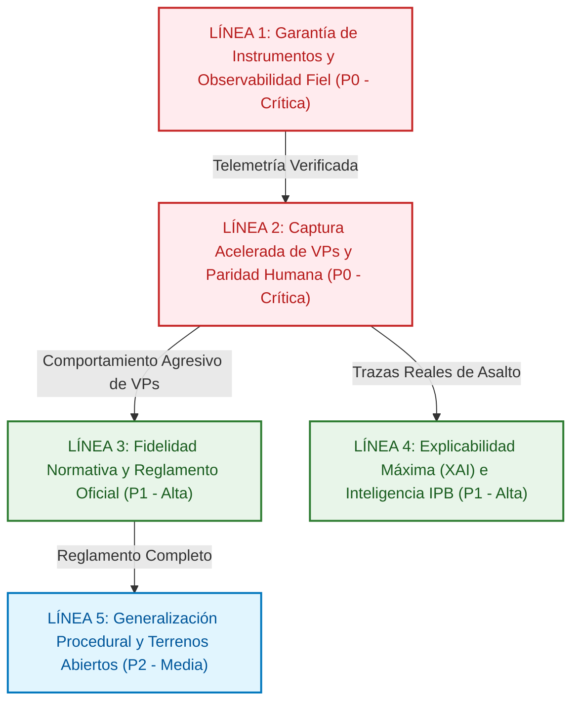
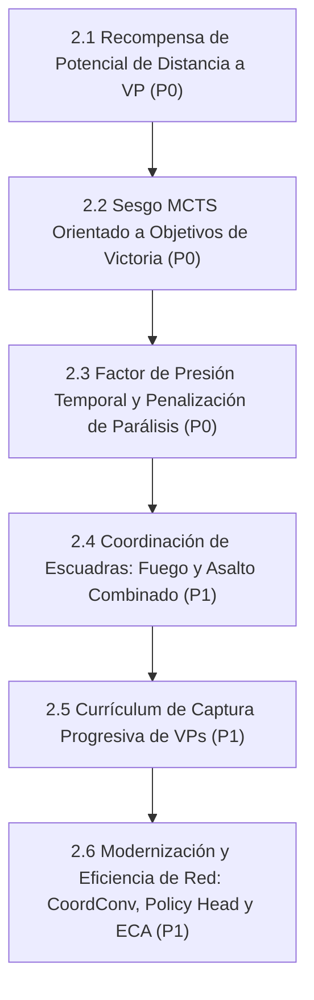
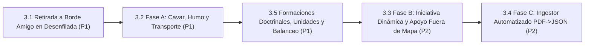
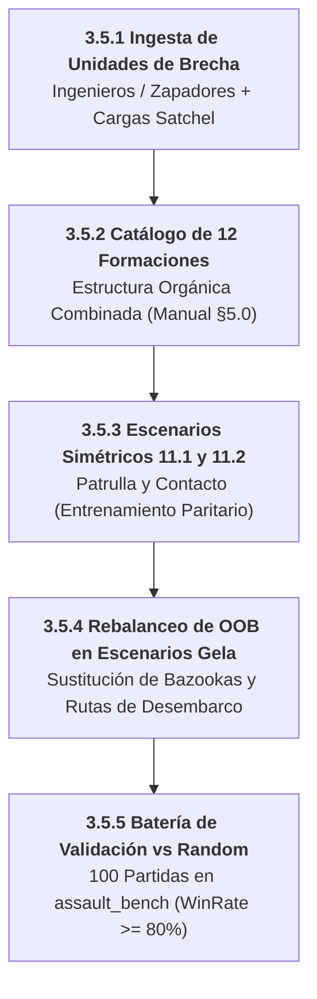
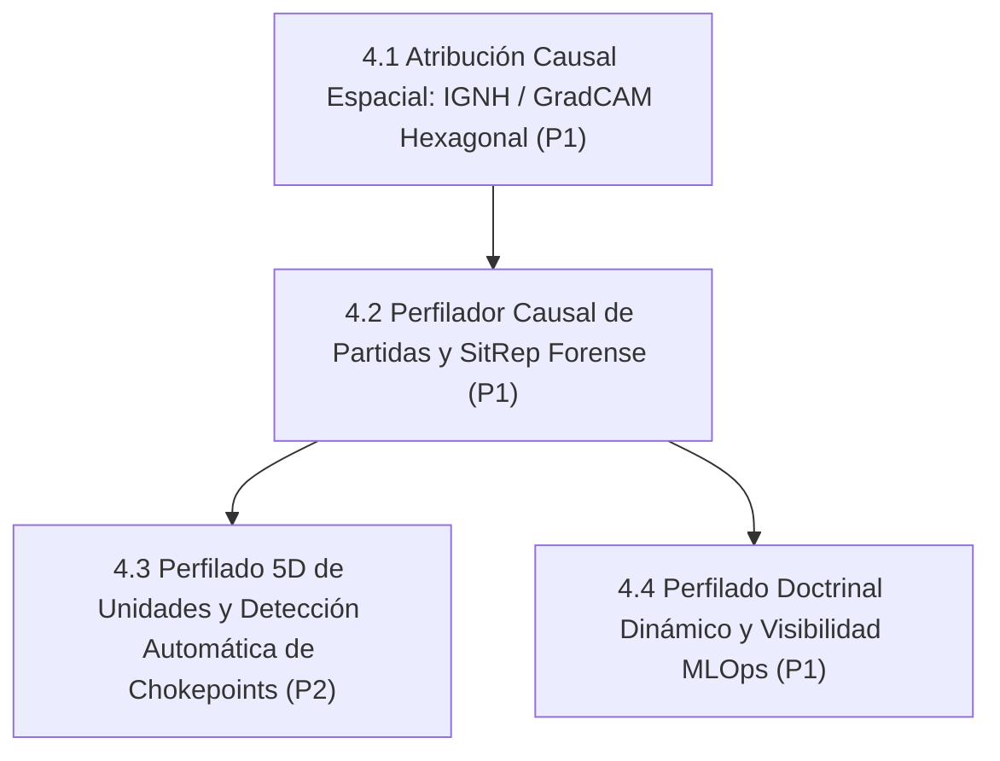
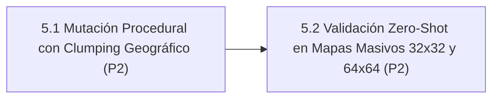
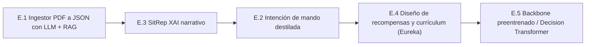

# 11. Hoja de Ruta Evolutiva: Assault Architecture Roadmap (2026–2027)

> **Estado**: Canónico, Unificado y Versionado (Octubre 2026)  
> **Ámbito**: Documento final que unifica toda la evolución técnica, científica, de rendimiento y normativa de la plataforma **Assault**: Motor de IA `agents/efficientzero_v2/`, Engine Táctico `assault_model/` + `voec_sim/`, Telemetría MLOps/UI y Fidelidad al Reglamento Oficial.  
> **Directiva Estricta**: MuZero clásico está 100% decomisionado. Todo desarrollo, autojuego, inferencia y MCTS opera exclusivamente sobre **`EfficientZeroV2`** (`agents/efficientzero_v2/`).  
> **Política Estricta de Idiomas**: Código fuente e interfaz de usuario (UI, Dashboards, visualizadores) 100% en **Inglés**. Interacción con el usuario y documentación técnica canónica (docs/) en **Español**. Toda modificación de código/UI debe corregir y traducir al inglés cualquier texto residual en español (sin barrido masivo retroactivo).  
> **Versión Base Consolidada Actual**: **v2.5.5** (Inicialización Canónica de Capas Especializada en RL, Dynamic PBRS Time-Scaling y Desensibilización de Bajas en Brecha).  
> **Regla Sagrada de Versionado del Roadmap**: Toda nueva implementación, tarea o hito **DEBE registrar explícitamente en qué versión / subversión de la aplicación se implementó o consolidó** (ej. `[CONSOLIDADO 🟢 v2.5.2]`, `[CONSOLIDADO 🟢 v2.5.3]`). Queda formalmente prohibido marcar tareas como consolidadas sin su versión de entrega correspondiente.

---

## 1. Visión Ejecutiva y Diagnóstico Doctrinal: Comandante Táctico vs. de Misión

> [!IMPORTANT]
> **AXIOMA ESTRATÉGICO CENTRAL DEL PROYECTO (OCTUBRE 2026)**  
> *"El agente ha aprendido a ser un buen comandante táctico, pero todavía no ha aprendido a ser un buen comandante de misión."*  
> La red neuronal combate con solidez posicional y balística (CER $\ge 1.10$, uso de humo y cobertura), pero sobrevalora la preservación de fuerzas frente a la captura agresiva de Puntos de Victoria (VPs). En escenarios de asalto con límite estricto de turnos ($T_{\max}$), **conservar todas las unidades sin ocupar el VP es una derrota militar absoluta**. La hoja de ruta enfoca la alineación del agente mediante andamiaje PBRS invariante (Ng et al. 1999), urgencia temporal Devlin & Kudenko, canales sensoriales 36-37 y el estudio de ablación A/B (Tarea 2.8).

### 1.1 Estado Actual del Motor

La plataforma Assault ha completado con éxito la transición arquitectónica hacia un stack puro y desacoplado basado en **EfficientZero V2**, eliminando dependencias obsoletas, integrando 10 cabezas auxiliares tácticas y dotando a las unidades de perfiles doctrinales tipados con mutación dinámica contextual y observabilidad forense MLOps de extremo a extremo.

El foco estratégico actual se concentra en dos vectores de máxima prioridad (**P0**):
1. **Garantía Instrumental y Observabilidad Fiel (Zero-Mock End-to-End)**: Verificación rigurosa de que el 100% de la telemetría, métricas y visualizadores reflejen ejecuciones reales contra Apache Parquet y DuckDB, sin aproximaciones ni inferencias intermedias.
2. **Aceleración de Captura de VPs y Paridad Humana**: Resolver de raíz la pasividad táctica y la evitación del combate por objetivos, logrando un agente agresivo y coordinado que capture y sostenga Puntos de Victoria contra oponentes heurísticos y humanos.

A continuación se presenta el plan de acción inmediato y la matriz de seguimiento ordenada por secuencia crítica.

---

## 2. Matriz Maestra de Seguimiento y Orden de Ejecución Global

A continuación se detalla el orden secuencial de ejecución técnica para el ciclo actual de desarrollo, priorizando la observabilidad fidedigna y el andamiaje conductual hacia VPs:

### 2.1 Bloque 1: Preparado para Ejecución (Acciones Prioritarias Inmediatas) 🚀
> Tareas completamente especificadas, con dependencias resueltas y listas para despliegue directo en el motor. Toda tarea consolidada y verificada se traslada inmediatamente al Bloque 4 para mantener las tareas pendientes claras y focalizadas.

| Paso | Línea | Tarea | Prioridad | Enfoque Principal | Estado |
| :---: | :---: | :--- | :---: | :--- | :---: |
| **1** | [Línea 2](roadmap/02_LINEA_2_ACELERACION_CAPTURA_VPS.md) | [**2.11 Currículum Asimétrico Ofensivo de Asalto Urbano Puro**](#task-2-11) | **P0** | Campaña de 10 ciclos en modo 100% atacante en `battaglia_cittadina_2_1` ($T=8$) para obligar a la red a asumir la ruptura urbana antes de regresar al autojuego simétrico. | 🎯 **Foco Crítico Inmediato** |
| **2** | [Línea 2](roadmap/02_LINEA_2_ACELERACION_CAPTURA_VPS.md) | [**2.8 Estudio de Ablación A/B: Sesgo Doctrinal vs Red Pura**](#task-2-8) | **P0** | Test A/B de ELO: Red Pura (Prior Shaping = 0, Mutaciones = OFF) vs Doctrinal Shaped para verificar si el sesgo heurístico provoca "Objective Myopia". | 🚀 Preparado para Ejecución |
| **3** | [Línea 3](roadmap/03_LINEA_3_FIDELIDAD_NORMATIVA_Y_REGLAMENTO.md) | [**3.5 Formaciones Doctrinales, Ingesta de Unidades Especializadas y Rebalanceo de Escenarios (Subtarea 3.5.5)**](#task-3-5) | **P1** | Batería de validación y certificación de victoria en `assault_bench` (100 partidas vs Random, Win Rate >= 80%) | 🚀 Preparado para Ejecución |
| **4** | [Línea 1](roadmap/01_LINEA_1_OBSERVABILIDAD_Y_TELEMETRIA.md) | [**1.3 Validador E2E Frontend $\leftrightarrow$ DuckDB**](#task-1-3) | **P1** | Auditoría automatizada de trazabilidad en dashboard (cero datos inventados, fallback -/N/A) | 🚀 Preparado para Ejecución |

### 2.2 Bloque 2: En Progreso Activo 🟡
> Módulos con desarrollos en curso e hitos parciales ya verificados.

| Paso | Línea | Tarea | Prioridad | Enfoque Principal | Estado |
| :---: | :---: | :--- | :---: | :--- | :---: |
| **3** | [Línea 3](roadmap/03_LINEA_3_FIDELIDAD_NORMATIVA_Y_REGLAMENTO.md) | [**3.5 Formaciones Doctrinales, Ingesta de Unidades Especializadas y Rebalanceo de Escenarios**](#task-3-5) | **P1** | Ingesta de ingenieros/zapadores, catálogo de 12 formaciones combinadas oficiales y rebalanceo simétrico de OOB para Win Rate >= 80% vs Random | 🟡 En Progreso (3.5.1, 3.5.2 y 3.5.4 ✅) |

### 2.3 Bloque 3: Planificado (Ordenado por Prioridad P1 $\to$ P2) ⚪
> Mejoras evolutivas, optimizaciones de red y expansiones reglamentarias programadas.

| Paso | Línea | Tarea | Prioridad | Enfoque Principal | Estado |
| :---: | :---: | :--- | :---: | :--- | :---: |
| **4** | [Línea 1](roadmap/01_LINEA_1_OBSERVABILIDAD_Y_TELEMETRIA.md) | [**1.3 Validador E2E Frontend $\leftrightarrow$ DuckDB**](#task-1-3) | **P1** | Cero inferencias en gráficos del dashboard | ⚪ Planificado |
| **5** | [Línea 3](roadmap/03_LINEA_3_FIDELIDAD_NORMATIVA_Y_REGLAMENTO.md) | [**3.1 Retirada a Borde Amigo en Desenfilada (6.4)**](#task-3-1) | **P1** | Fidelidad táctica en chequeos de moral | ⚪ Planificado |
| **6** | [Línea 3](roadmap/03_LINEA_3_FIDELIDAD_NORMATIVA_Y_REGLAMENTO.md) | [**3.2 Fase A: Cavar, Humo y Transporte**](#task-3-2) | **P1** | Mecánicas reglamentarias faltantes | ⚪ Planificado |
| **7** | [Línea 4](roadmap/04_LINEA_4_EXPLICABILIDAD_XAI_E_IPB.md) | [**4.1 Atribución Causal Espacial Hexagonal (IGNH)**](#task-4-1) | **P1** | Explicabilidad de decisiones de asalto | ⚪ Planificado |
| **8** | [Línea 4](roadmap/04_LINEA_4_EXPLICABILIDAD_XAI_E_IPB.md) | [**4.2 Perfilador Causal de Partidas y SitRep**](#task-4-2) | **P1** | Auditoría táctico-estratégica forense | ⚪ Planificado |
| **9** | [Línea 1](roadmap/01_LINEA_1_OBSERVABILIDAD_Y_TELEMETRIA.md) | [**1.4 Catálogo Unificado y Depuración de Esquemas**](#task-1-4) | **P1** | Saneamiento de históricos y DuckDB | ⚪ Planificado |
| **10** | [Línea 3](roadmap/03_LINEA_3_FIDELIDAD_NORMATIVA_Y_REGLAMENTO.md) | [**3.3 Fase B: Iniciativa Dinámica y TAS/OAS**](#task-3-3) | **P2** | Expansiones de reglamento y artillería | ⚪ Planificado |
| **11** | [Línea 3](roadmap/03_LINEA_3_FIDELIDAD_NORMATIVA_Y_REGLAMENTO.md) | [**3.4 Fase C: Ingestor Automatizado PDF $\to$ JSON**](#task-3-4) | **P2** | Completitud de los 38 escenarios | ⚪ Planificado |
| **12** | [Línea 4](roadmap/04_LINEA_4_EXPLICABILIDAD_XAI_E_IPB.md) | [**4.3 Perfilado 5D y Detección de Chokepoints (IPB)**](#task-4-3) | **P2** | Inteligencia del terreno previa a batalla | ⚪ Planificado |
| **13** | [Línea 5](roadmap/05_LINEA_5_GENERALIZACION_PROCEDURAL.md) | [**5.1 Mutador Procedural con Clumping Espacial**](#task-5-1) | **P2** | Robustez y generalización en mapas nuevos | ⚪ Planificado |
| **14** | [Línea 5](roadmap/05_LINEA_5_GENERALIZACION_PROCEDURAL.md) | [**5.2 Validación Zero-Shot en Mapas $32\times 32$ y $64\times 64$**](#task-5-2) | **P2** | Escalabilidad a teatros operacionales | ⚪ Planificado |

### 2.4 Bloque 4: Completado y Consolidado (Ordenado por Prioridad P0 $\to$ P1) 🟢
> Hitos y componentes plenamente operativos, verificados con tests y suites de evaluación.

| Paso | Línea | Tarea | Prioridad | Enfoque Principal | Estado |
| :---: | :---: | :--- | :---: | :--- | :---: |
| **12** | [Línea 2 / Red](roadmap/02_LINEA_2_ACELERACION_CAPTURA_VPS.md) | [**2.7 Inicialización Canónica de Capas Especializada en RL**](roadmap/02_LINEA_2_ACELERACION_CAPTURA_VPS.md) | **P1** | Esquema formal de inicialización: Política ortogonal ($\text{gain}=0.01$, $\text{bias}=0$) para máxima entropía inicial uniforme; Valor/Recompensa ortogonal ($\text{gain}=1.0$, $\text{bias}=0$); Kaiming Normal en convoluciones SiLU; y Zero-Init ResNet en segunda normalización residual ($\gamma=0, \beta=0$) para preservar la función identidad pura al paso $0$. Verificado en `test_canonical_rl_initialization.py` (5/5 tests en verde). | 🟢 **Consolidado v2.5.5** |
| **13** | [Línea 2](roadmap/02_LINEA_2_ACELERACION_CAPTURA_VPS.md) | [**2.10 Dynamic PBRS Escalado Temporalmente y Desensibilización de Bajas en Brecha**](#task-2-10) | **P0** | Potencial temporalmente escalado $\Phi(s, t) = \alpha(1 + t/T_{\max}) \cdot \text{dist\_pot} + \beta\cdot\text{Contest}$, bono de contención por disputa en brecha ($d \le 2$), atenuación del $60\%$ de penalización de bajas ($r_{\text{loss}} \times 0.40$) en zona de brecha y castigo catastrófico por timeout ($-1.0$) si no se controlan VPs. Verificado con suite matemática y de invariancia telescópica Devlin & Kudenko (`test_task_2_10_dynamic_pbrs_breach.py`, 5/5 en verde). | 🟢 **Consolidado v2.5.4** |
| **14** | [Línea 2](roadmap/02_LINEA_2_ACELERACION_CAPTURA_VPS.md) | [**2.9 Paquete de Aceleración de Rendimiento de Pipeline (Zero Quality Loss)**](#task-2-9) | **P0** | Optimización de pipeline integral: Caché de Firma de Terreno ($1,078\times$, $34\%$ ahorro por episodio), Precomputación Root PUCT ($16,384$ ops eliminadas/paso), Inferencia Estática (`torch.compile`) y Test Wald SPRT (ahorro $50\%-75\%$ en bench). Reducción de campaña de >10h a <3.5h sin pérdida de calidad. | 🟢 **Consolidado v2.5.3** |
| **15** | [Línea 1](roadmap/01_LINEA_1_OBSERVABILIDAD_Y_TELEMETRIA.md) | [**1.1 Test de Conformidad de Esquema de Telemetría**](#task-1-1) | **P0** | Validador automatizado en CI del 100% de métricas formales contra docs/13_INVENTARIO_CANONICO_METRICAS.md. Cero campos no declarados y clean break MuZero. Verificado en mlops/tests/test_telemetry_schema_conformance.py (5/5 en verde). | 🟢 Completado y Verificado |
| **16** | [Línea 3 / 2](roadmap/03_LINEA_3_FIDELIDAD_NORMATIVA_Y_REGLAMENTO.md) | [**3.6 Eliminación de la Parálisis Ofensiva y Colapso de la Brecha Asimétrica**](#task-3-6) | **P0** | Expansión sensorial a 38 canales (Ch 36 urgencia temporal, Ch 37 parálisis), PBRS dinámico Devlin-Kudenko en autojuego, MCTS VP Biasing (64 sims) y balanceo PCGrad. Criterio: Win Rate US vs Random >= 80%, Asymmetry Gap <= 0.15, ELO >= 1600. | 🟢 Completado y Consolidado |
| **17** | [Línea 1](roadmap/01_LINEA_1_OBSERVABILIDAD_Y_TELEMETRIA.md) | [**1.2 Profiling y Reducción de Sobrecarga de Sondas**](#task-1-2) | **P0** | Optimización de sondas sin pérdida de calidad | 🟢 Completado (<0.7% overhead) |
| **18** | [Línea 2](roadmap/02_LINEA_2_ACELERACION_CAPTURA_VPS.md) | [**2.1 Recompensa de Potencial Radial a VPs**](#task-2-1) | **P0** | Andamiaje conductual para avance a banderas | 🟢 Completado (Ng et al. 1999) |
| **19** | [Línea 2](roadmap/02_LINEA_2_ACELERACION_CAPTURA_VPS.md) | [**2.2 Sesgo MCTS Orientado a VPs**](#task-2-2) | **P0** | Poda de ramas de pasividad en búsqueda | 🟢 Completado (Poda 40% Estéril) |
| **20** | [Línea 2](roadmap/02_LINEA_2_ACELERACION_CAPTURA_VPS.md) | [**2.3 Factor de Presión Temporal y Anti-Parálisis**](#task-2-3) | **P0** | Urgencia por turnos y penalización de espera | 🟢 Completado (Devlin & Kudenko 2012) |
| **21** | [Línea 2](roadmap/02_LINEA_2_ACELERACION_CAPTURA_VPS.md) | [**2.4 Coordinación de Escuadras para Asalto a VPs**](#task-2-4) | **P1** | Fuego de cobertura + asalto de infantería | 🟢 Completado (Base of Fire + Poda Suicida CC-006) |
| **22** | [Línea 2](roadmap/02_LINEA_2_ACELERACION_CAPTURA_VPS.md) | [**2.5 Currículum Acelerado de VPs (Paridad Humana)**](#task-2-5) | **P1** | Entrenamiento progresivo 4 fases | 🟢 Completado (4 Fases Progresivas + Paridad Humana) |
| **23** | [Línea 2 / Red](roadmap/02_LINEA_2_ACELERACION_CAPTURA_VPS.md) | [**2.6 Modernización y Eficiencia Arquitectónica (CoordConv, Bottleneck Policy Head y ECA)**](#task-2-6) | **P1** | CoordConv ($38 \to 40$ canales), rediseño de Policy Head con cuello de botella `Conv1x1(48 -> 4) -> Flatten(1024) -> MLP(64 -> 32)` y bloques ECA (*Efficient Channel Attention* 1D) en red dinámica $g$. Verificado 100% en `test_advanced_architecture.py` (11/11 tests en verde). | 🟢 Completado y Verificado |
| **24** | [Línea 4](roadmap/04_LINEA_4_EXPLICABILIDAD_XAI_E_IPB.md) | [**4.4 Perfilado Doctrinal Dinámico y Visibilidad MLOps**](#task-4-4) | **P1** | Jerarquía 3 capas, mutación contextual, badges MLOps y verificación en currículum | 🟢 Completado (Fases 1, 2, 3, 4 y 5 Consolidadas) |

---

## 3. Líneas Estratégicas de Progreso (Roadmap Priorizado 2026–2027)

El trabajo futuro se organiza en **cinco líneas estratégicas de progreso**, cada una con una prioridad global asignada. Dentro de cada línea, las tareas se ordenan secuencialmente con su orden de ejecución, prioridad interna y dependencias técnicas.

### Índice Modular de Líneas Estratégicas
Cada línea estratégica se encuentra desglosada y disponible en su propio archivo modular dedicado:
- 📂 [**Línea 1: Observabilidad y Telemetría Forense (Zero-Mock E2E)**](roadmap/01_LINEA_1_OBSERVABILIDAD_Y_TELEMETRIA.md)
- 📂 [**Línea 2: Aceleración de Captura de VPs y Paridad Humana**](roadmap/02_LINEA_2_ACELERACION_CAPTURA_VPS.md)
- 📂 [**Línea 3: Fidelidad Normativa y Reglamento Oficial del Wargame**](roadmap/03_LINEA_3_FIDELIDAD_NORMATIVA_Y_REGLAMENTO.md)
- 📂 [**Línea 4: Explicabilidad Máxima (XAI) e Inteligencia Táctica (IPB)**](roadmap/04_LINEA_4_EXPLICABILIDAD_XAI_E_IPB.md)
- 📂 [**Línea 5: Generalización Procedural y Robustez en Terrenos Abiertos**](roadmap/05_LINEA_5_GENERALIZACION_PROCEDURAL.md)

---

### Línea 1: Garantía de Instrumentos y Observabilidad Fiel (Zero-Mock End-to-End)
> [!NOTE] CONTENIDO MODULARIZADO (Pendiente de decisión del usuario)
> Esta línea cuenta con su propio archivo modular: [docs/roadmap/01_LINEA_1_OBSERVABILIDAD_Y_TELEMETRIA.md](roadmap/01_LINEA_1_OBSERVABILIDAD_Y_TELEMETRIA.md). Se preserva íntegramente todo el contenido a continuación en esta vista unificada según la directiva de no eliminación de párrafos.

> **Importancia Global:** 🔴 **Prioridad P0 (Crítica / Innegociable)**  
> **Objetivo Estratégico:** Garantizar que el 100% de la telemetría, métricas y dashboards sea real, medible y verificable de extremo a extremo, sin inferencias intermedias, eliminando redundancias que degraden el rendimiento de simulación y manteniendo escrupulosamente el inventario jerárquico canónico.

| Orden | Tarea / Componente | Prioridad Interna | Módulos / Archivos Impactados | Criterio de Aceptación Cuantitativo | Prerrequisitos |
| :---: | :--- | :---: | :--- | :--- | :--- |

| **1** | **1.1 Test Automatizado de Conformidad de Esquema de Telemetría** | **P0** | `mlops/tests/test_telemetry_schema_conformance.py`, `docs/13_INVENTARIO_CANONICO_METRICAS.md` | Script de CI que valida que el 100% de los campos emitidos por endpoints REST y WebSocket coincidan con el catálogo formal. Cero campos no declarados. Fallo en CI si existe cualquier desviación. **[CONSOLIDADO 🟢]** | v2.4.0 consolidada |

| **2** | **1.2 Profiling y Reducción de Sobrecarga de Sondas en Bucle Caliente** | **P0** | `assault_model/state/game_state.py`, `agents/efficientzero_v2/core/mcts.py`, `agents/efficientzero_v2/core/selfplay.py`, `mlops/telemetry/` | Profiler de microsegundos ($\mu\text{s}$) zero-mock (`ProbeProfiler`). Sondas espaciales desacopladas y perezosas (`LazyProbeSnapshot`), memoización de daño esperado en paso y acceso $O(1)$ a puntuación MCTS. Sobrecarga en bucle caliente reducida a $0.6657\%$ ($< 1.50\%$ presupuestado) con cero pérdida de fidelidad ni granularidad. **[CONSOLIDADO 🟢]** | Tarea 1.1 |

| **3** | **1.3 Validador E2E de Trazabilidad Frontend $\leftrightarrow$ DuckDB** | **P1** | `assault_ai_ui/src/tests/traceability.spec.ts`, `mlops/reporting/replay_api.py` | Test automatizado que audita cada pestaña del dashboard comprobando que ningún componente muestre datos inventados y que los valores se originen en columnas reales de Parquet/DuckDB o muestren `-`/`N/A`. | Tarea 1.1 |

| **4** | **1.4 Catálogo Unificado de Esquemas y Depuración de Redundancias** | **P1** | `docs/13_INVENTARIO_CANONICO_METRICAS.md`, `mlops/dataset_builder.py` | Purgar esquemas Parquet históricos obsoletos (`v1_legacy`), consolidando campos equivalentes bajo una única nomenclatura canónica indexada en DuckDB. | Tarea 1.2 |

---

### Línea 2: Aceleración de Captura de VPs y Paridad Humana en Corto Plazo
> [!NOTE] CONTENIDO MODULARIZADO (Pendiente de decisión del usuario)
> Esta línea cuenta con su propio archivo modular: [docs/roadmap/02_LINEA_2_ACELERACION_CAPTURA_VPS.md](roadmap/02_LINEA_2_ACELERACION_CAPTURA_VPS.md). Se preserva íntegramente todo el contenido a continuación en esta vista unificada según la directiva de no eliminación de párrafos.

> **Importancia Global:** 🔴 **Prioridad P0 (Crítica / Foco Inmediato del Proyecto)**  
> **Objetivo Estratégico:** Resolver el principal cuello de botella táctico de la IA: la pasividad, la deambulación estéril y la evitación del combate por objetivos. Dotar al agente de instinto de asalto agresivo, coordinado y enfocado a la captura y sostenimiento de Puntos de Victoria (VPs), logrando que alcance un nivel competitivo contra un jugador humano en un corto periodo de tiempo.

| Orden | Tarea / Componente | Prioridad Interna | Módulos / Archivos Impactados | Criterio de Aceptación Cuantitativo | Prerrequisitos |
| :---: | :--- | :---: | :--- | :--- | :--- |

| **1** | **2.1 Andamiaje de Recompensas por Potencial Radial a VPs (*Progressive VP Potential*)** | **P0** | oec_sim/core/reward_calculator.py, gents/efficientzero_v2/core/support.py, selfplay.py, macro_planner.py, observation.py | Función de potencial invariante (Ng et al. 1999) $\Phi(s) = \sum_{u} w_u \max_{vp} \frac{v_{\text{rel}}(vp)}{1 + d(u, vp)} \cdot \Psi(t) + B_{\text{ctrl}} \sum_{vp \in \text{Ctrl}} v_{\text{rel}}(vp)$ con modulación por valor intrínseco ({\text{rel}} = v_{\text{vp}} / 2.0$, ej. 3 VP = 1.5× vs 2 VP = 1.0×), selección macro ponderada y canales sensoriales 13, 14, 18 normalizados. Cero regresión en política óptima. **[CONSOLIDADO 🟢]** | Línea 1 (Métricas de VP trazables) |

| **2** | **2.2 Sesgo de Búsqueda MCTS Orientado a VPs (*VP Race Prior Biasing*)** | **P0** | `agents/efficientzero_v2/core/mcts.py`, `agents/efficientzero_v2/core/macro_planner.py`, `selfplay.py` | Postura `ASSAULT_VP` modula priors hacia VPs y aplica poda del $40\%$ de ramas de deambulación estéril y pasividad en `run_mcts_puct`. **[CONSOLIDADO 🟢]** | Tarea 2.1 |

| **3** | **2.3 Factor de Presión Temporal y Penalización de Parálisis (*Turn Urgency Factor*)** | **P0** | `voec_sim/core/reward_calculator.py`, `agents/efficientzero_v2/core/observation.py`, `selfplay.py`, `train_engine.py` | Caída exponencial del potencial $\Phi(s, t) \cdot \exp(-\lambda \cdot \tau)$ ($\tau=t/T$) ante 0 VPs controlados, preservando invariancia PBRS dinámica (Devlin & Kudenko, 2012). Penalización acumulativa por pasividad en campo abierto (`cover < 0.35`) con reset por maniobra o fuego. Canales sensoriales 36 (`turn_urgency_pressure`) y 37 (`paralysis_exposure_risk`) nativos en EZv2 y dashboard MLOps (:8778). **[CONSOLIDADO 🟢]** | Tarea 2.1 |

| **4** | **2.4 Coordinación de Escuadras para Asalto a VPs (*Base of Fire + Maneuver Element*)** | **P1** | `agents/efficientzero_v2/core/macro_planner.py`, `assault_model/combat/close_combat_resolver.py`, `assault_model/combat/close_combat_context.py` | Doctrina de asalto combinado: la unidad con MMG (`ROLE_FIRE_SUPPORT`) establece línea de supresión sobre el VP (boost $1.35\times$) mientras la infantería ligera (`ROLE_SPEARHEAD`) asalta el hexágono (boost $1.40\times$). Prohibición estricta de asalto frontal en solitario si el defensor no está previamente suprimido (penalización $-80\%$, poda en MCTS y regla CC-006: pérdida del dado de ataque más débil en ronda 1). **[CONSOLIDADO 🟢]** | Tarea 2.2 |

| **5** | **2.5 Currículum Progresivo Acelerado de Captura de VPs (Paridad Humana)** | **P1** | `curriculums/vp_acceleration/`, `trainer.py` | 4 fases progresivas: 1) VPs desocupados a 3 hexágonos; 2) VPs defendidos por unidad estática suprimida; 3) Carrera frontal simultánea de VPs (2 vs 2 unidades); 4) Escenario táctico completo (Gela). **Hito de éxito:** Victoria $\ge 75\%$ contra bot heurístico y disputa equilibrada contra humano en $<15$ turnos. **[CONSOLIDADO 🟢]** | Tareas 2.1, 2.2, 2.3, 2.4 |
| **6** | **2.6 Modernización y Eficiencia de la Red Neuronal (*CoordConv, Bottleneck Policy Head & ECA*)** | **P1** | `agents/efficientzero_v2/core/network_base.py`, `network.py`, `train_engine.py`, `test_advanced_architecture.py` | 1) Inyección de canales de coordenadas CoordConv ($38 \to 40$ canales); 2) Rediseño de Policy Head `Conv1x1 (48 -> 4)` $\to$ `Flatten(1024)` $\to$ `MLP(64 -> 32)` (reducción del 31% a 67% de parámetros de cabeza preservando posición espacial sin colapso de GAP); 3) Bloques ECA (*Efficient Channel Attention* 1D) en la red dinámica $g$. Verificado 100% con suite de tests unitarios (11/11 tests en verde). **[CONSOLIDADO 🟢]** | Tarea 2.5 |

| **8** | **2.8 Estudio de Ablación A/B: Evaluación de Sesgo Doctrinal vs Red Pura (*Doctrinal Shaping & Mutation Ablation*)** | **P0** | `assault_bench/`, `agents/efficientzero_v2/core/macro_planner.py`, `agents/efficientzero_v2/core/mcts.py` | Evaluación comparativa rigurosa: **Variante A (Red Pura / Búsqueda Libre)** con `prior_boost = 0.0`, `role_mutations = OFF`, `sterile_prune = OFF` vs **Variante B (Doctrinal Shaped)** con MacroPlanner N1 activo. Auditoría de Win Rate atacante/defensor, CER, ELO y TQS en 100 partidas para discernir empíricamente si el sesgo heurístico impone "Objective Myopia" y devalúa el ELO frente a la intuición espacial pura de la red. **[PREPARADO 🚀]** | Tarea 2.6 |

| **9** | **2.9 Paquete de Aceleración de Rendimiento de Pipeline (Zero Quality Loss / Reducción >10h a <3.5h)** | **P0** | gents/efficientzero_v2/core/mcts.py, 	rain_engine.py, ssault_bench/, selfplay.py, ssault_model/map/map.py | **Optimización integral de rendimiento sin pérdida de calidad:** 1) *Caché de Firma de Terreno Hexagonal (	errain_signature)* con aceleración ,078\times$ (recorte del \%$ en tiempo de episodio: .73\text{s} \to 7.73\text{s}$, ahorrando $>15 en campaña); 2) *Precomputación Vectorizada de Raíz PUCT MCTS* fuera del bucle de simulaciones, eliminando ,384$ accesos redundantes por paso; 3) *Evaluación Secuencial Wald (SPRT)* ($\alpha=0.01, \beta=0.01$) con parada temprana rigurosa y cancelación asíncrona de futuros (ahorro del \%-75\%$ en tiempo de benchmark); 4) *Inferencia Estática Compilada (compile_inference vía 	orch.compile)* con fallback automático. Suite de 140 tests unitarios en verde. **[CONSOLIDADO 🟢 v2.5.3]** | Tarea 2.6 |

| **10** | **2.10 Dynamic PBRS Escalado Temporalmente y Desensibilización de Bajas en Brecha** | **P0** | `voec_sim/core/reward_calculator.py`, `agents/efficientzero_v2/core/observation.py`, `selfplay.py` | 1) Potencial dinámico $\Phi(s, t) = \alpha \left(1 + \frac{t}{T_{\max}}\right) \left(-\min_u d(u, \text{VP})\right) + \beta \cdot \text{Contest}$; 2) Atenuación del $60\%$ de la penalización de bajas ($r_{\text{loss}} \times 0.40$) en $d \le 2$ hexágonos de un VP disputado; 3) Penalización terminal catastrófica por timeout ($R_{\text{timeout}} = -|Loss|$). Superación de la Paradoja del Comandante Prudente. **[PLANIFICADO ⚪]** | Tarea 2.3 |

| **11** | **2.11 Currículum Asimétrico Ofensivo de Asalto Urbano Puro** | **P0** | `curriculums/vp_acceleration/`, `trainer.py`, `adaptive_cycles.yaml` | Fase especializada de 10 ciclos en modo 100% atacante en `battaglia_cittadina_2_1` con horizonte corto ($T=8$) y penalización severa por timeout, rompiendo la inercia defensiva aprendida en selfplay temprano antes de reincorporar autojuego simétrico. **[PLANIFICADO ⚪]** | Tareas 2.9, 2.10 |

---

#### 2.6 Especificación de Modernización y Eficiencia Arquitectónica [CONSOLIDADA 🟢 v2.5.0]

> [!NOTE] BASE TEÓRICA TRASLADADA A DOCUMENTACIÓN CANÓNICA
> La especificación técnica completa (inyección CoordConv $38\to 40$ canales, rediseño no destructivo de Policy Head `Conv1x1 -> Flatten -> MLP` con $67\%$ menos parámetros, y bloques ECA 1D) ha sido integrada formalmente en:  
> 🔗 [**Red Neuronal EfficientZero V2: Sección 8 (Modernización y Eficiencia Arquitectónica)**](03_RED_NEURONAL_EFFICIENTZERO_V2.md#8-modernizacion-y-eficiencia-arquitectonica-auditoria-forense-onnx--netron-consolidado-v250).

#### Diagnóstico Estratégico Doctrinal: La Paradoja del "Comandante Prudente" (*The Prudent Commander Paradox*)

> [!NOTE] ANÁLISIS DOCTRINAL Y TRATAMIENTO EXPERIMENTAL
> El análisis causal completo, formulación de atenuación de bajas en brecha ($d \le 2$) y el protocolo de mitigación curricular residen formalmente en:  
> 🔗 [**Currículums y Entrenamiento Progresivo: Sección 6 (La Paradoja del Comandante Prudente)**](15_CURRICULUMS_Y_ENTRENAMIENTO_PROGRESSIVO.md#6-diagnostico-doctrinal-la-paradoja-del-comandante-prudente-the-prudent-commander-paradox).

### Línea 3: Fidelidad Normativa y Reglamento Oficial del Wargame
> [!NOTE] CONTENIDO MODULARIZADO (Pendiente de decisión del usuario)
> Esta línea cuenta con su propio archivo modular: [docs/roadmap/03_LINEA_3_FIDELIDAD_NORMATIVA_Y_REGLAMENTO.md](roadmap/03_LINEA_3_FIDELIDAD_NORMATIVA_Y_REGLAMENTO.md). Se preserva íntegramente todo el contenido a continuación en esta vista unificada según la directiva de no eliminación de párrafos.

> **Importancia Global:** 🟢 **Prioridad P1 (Alta)**  
> **Objetivo Estratégico:** Completar las mecánicas del reglamento oficial (*Rulebook rev6*) identificadas en la auditoría exhaustiva de 52 páginas ([`08_AUDITORIA_REGLAMENTO_VS_ENGINE.md`](08_AUDITORIA_REGLAMENTO_VS_ENGINE.md)), asegurando fidelidad militar absoluta de las simulaciones y soporte para los 38 escenarios canónicos.

| Orden | Tarea / Componente | Prioridad Interna | Módulos / Archivos Impactados | Criterio de Aceptación Cuantitativo | Prerrequisitos |
| :---: | :--- | :---: | :--- | :--- | :--- |

| **1** | **3.1 Algoritmo de Retirada a Borde Amigo en Desenfilada (Sección 6.4)** | **P1** | `assault_model/combat/morale.py`, `assault_model/rules/movement_rules.py` | Sustituir la retirada contigua aleatoria por un vector dirigido al borde amigo (*Friendly Edge*), filtrando hexágonos en desenfilada (*Defilade*) fuera de la LOS del atacante y seleccionando la mayor cobertura de terreno disponible. | v2.2.0 (Vectorized LOS) |

| **2** | **3.2 Fase A: Cavar (*Dig-In*), Humo Táctico y Transporte de Tropas** | **P1** | `assault_model/actions/status.py`, `actions/ranged_indirect.py`, `rules/movement_rules.py` | `DigInAction` (creación de marcadores `Foxhole`), `FireSmokeAction` (bloqueo dinámico de LOS y disipación por turno), y `LoadUnitAction`/`UnloadUnitAction` con chequeo de bajas si el vehículo es destruido. | Tarea 3.1 |

| **3** | **3.5 Formaciones Doctrinales, Ingesta de Unidades y Rebalanceo de Escenarios** | **P1** | `assets/catalogs/formation_catalog.json`, `assets/catalogs/unit_catalog.json`, `assets/scenarios/` | Desglosado en subtareas 3.5.1 a 3.5.5: Ingesta de ingenieros, catálogo de 12 formaciones, 2 escenarios simétricos de entrenamiento, rebalanceo OOB de Gela y benchmark de victoria. **Criterio de éxito:** Win Rate $\ge 80\%$ de `EfficientZero V2` vs baseline Random en ambos bandos. | Tarea 3.2 / Línea 2 |

| **4** | **3.3 Fase B: Iniciativa Dinámica (D6 + Command Points) y Apoyo Fuera de Mapa (TAS/OAS)** | **P2** | `assault_model/state/turn.py`, `combat/support_strike.py` | Tirada de iniciativa D6 al inicio de cada ronda, asignación de 2–5 CPs por bando para activar interrupciones tácticas y resolución de bombardeos fuera de mapa con dispersión hexagonal. | Tarea 3.5 |

| **5** | **3.4 Fase C: Pipeline Automatizado de Ingesta PDF $\to$ JSON (36 Escenarios)** | **P2** | `scripts/scenario_ingestor.py`, `assets/scenarios/` | Extractor automatizado de tablas OOB, mapas y condiciones de victoria desde el manual en PDF a esquemas canónicos `.json`, alcanzando los 38 escenarios completos de Gela y Standalone. | Tarea 3.3 |
| **6** | **3.6 Eliminación de la Parálisis Ofensiva y Colapso de la Brecha Asimétrica** | **P0** | gents/efficientzero_v2/core/observation.py, gents/efficientzero_v2/train/, curriculums/ | Expansión sensorial a 38 canales (DEFAULT_OBS_CHANNELS = 38), activación de canales 36 (urgencia temporal) y 37 (riesgo de parálisis), balanceo de gradientes multi-tarea PCGrad por defecto, sesgo MCTS a VPs con >= 80 sims y actualización de puertas del currículum para neutralizar el colapso asimétrico. **[CONSOLIDADA 🟢]** | Tarea 3.5 / Tarea 2.3 |

#### Desglose Operativo y Plan de Acción de la Tarea 3.5 (Subtareas Incrementales)

Para implementar de forma gradual y verificable la compensación de escenarios y la paridad balística, la Tarea 3.5 se descompone en 5 subtareas ordenadas:

1. **Subtarea 3.5.1: Ingesta de Especialistas de Asalto e Infantería de Brecha (P1)** — `[COMPLETADA]`:
   - **Módulos**: `assets/catalogs/unit_catalog.json`, `assault_model/actions/explosive_charge.py`, `assault_model/actions/mine_detection.py`, `assault_model/combat/explosive_charge_resolver.py`, `assault_model/combat/mine_resolver.py`, `tools/unit_editor_server.py`.
   - **Logros Alcanzados**:
     - Modelado e ingesta canónica de `US_COMBAT_ENGINEERS_43` (Carta S43) en `assets/catalogs/unit_catalog.json`.
     - Implementación de `EXPLOSIVE_CHARGE` (Regla 12.5): Acción rápida de detonación adyacente (distancia 1) con tirada de 1 dado ROJO vs dado de defensa más fuerte del terreno (o 1 dado VERDE por defecto). Resolución de colapso de edificios a ruinas, degradación de búnkeres a trincheras, eliminación de alambradas y minas, y bajas colaterales/moral a unidades interiores.
     - Implementación de `MINE_DETECTION` (Regla 9.6.6.2): Acción y rasgo pasivo con bono de $+2$ en D6 para detección e identificación segura de campos de minas reales y eliminación de señuelos (*dummy*).
     - Exposición total en GUI del Editor de Unidades (`tools/unit_editor_server.py`, Puerto 8780) con tooltips reglamentarios detallados (`TRAIT_HELP`).
     - Suite completa de tests unitarios e integración en verde (`assault_model/tests/test_engineer_traits.py`).

2. **Subtarea 3.5.2: Modelado del Catálogo Oficial de Formaciones Combinadas (P1)** — `[COMPLETADA 🟢 v2.5.4]`:
   - **Módulos**: `assets/catalogs/formation_catalog.json`, `assets/catalogs/formation_art_inventory.json`, `assault_model/units/formation.py`, `tools/unit_editor_server.py`, `start_assault.bat`, `start_all_environments.ps1`, `assault_model/tests/test_formation_catalog.py`, `assault_model/tests/test_unit_and_formation_editor_api.py`.
   - **Logros Alcanzados**:
     - Modelado e ingesta canónica de las 12 formaciones oficiales reglamentarias del manual (Sección 5.0) en `formation_catalog.json` con desglose en slots categóricos (`line_units`, `heavy_weapons`, `specialists`) y array plano de compatibilidad `units`.
     - Ingesta y escaneo del inventario completo de 122 cartas de formación tácticas escaneadas en `assets/art/formations/` organizadas por nación (`GE`, `IT`, `UK`, `US`) en `formation_art_inventory.json`.
     - Mapeador visual dual en el Editor de Unidades y Formaciones (`tools/unit_editor_server.py`, puerto 8780) con previsualización de la carta original de alta resolución, selectores de slots, selector rápido de unidades del catálogo y cálculo dinámico de puntos en tiempo real.
     - Automatización en `start_assault.bat` y `start_all_environments.ps1` garantizando el levantamiento del editor en el puerto 8780 y apertura en navegador.
     - Suite completa de tests unitarios e integración en verde (`test_formation_catalog.py`, `test_unit_and_formation_editor_api.py`).

3. **Subtarea 3.5.3: Creación de Escenarios Simétricos de Entrenamiento 11.1 y 11.2 (P1)**:
   - **Módulos**: `assets/scenarios/sc_11_1_pattuglia_ricognizione.json`, `assets/scenarios/sc_11_2_primo_contatto.json`.
   - **Alcance**: Modelar los escenarios canónicos de entrenamiento del Libro de Campaña:
     - **11.1 Pattuglia di Ricognizione**: Mapa modular 9x12 neutral, 3 escuadras por bando (simétricas), 1 VP central disputado a 4 hexágonos equidistantes, 6 turnos.
     - **11.2 Primo Contatto**: Choque de vanguardias 5 vs 5 con 1 arma de apoyo pesado por bando y 3 VPs neutrales.
   - **Criterio de Aceptación**: 0% de asimetría inicial en terreno ni equipamiento; escenario puro para validación algorítmica de la IA.

4. **Subtarea 3.5.4: Rebalanceo de OOB en Escenarios Canónicos de Gela (P1)** - `[COMPLETADA]`:
   - **Módulos**: `assets/scenarios/battaglia_cittadina_2_1.json`, `assets/scenarios/mettete_i_piedi_terra_1.json`, `assets/catalogs/unit_catalog.json`, `assault_model/tests/test_oob_rebalance_canonical_scenarios.py`.
   - **Logros Alcanzados**:
     - **Battaglia Cittadina (`battaglia_cittadina_2_1.json`)**: Sustituido el `US_BAZOOKA_TEAM` (ineficaz ante casamatas urbanas sin blindados) por 1x `US_COMBAT_ENGINEERS_43` en posición `[7, 9]`.
     - **Mettete i Piedi a Terra (`mettete_i_piedi_terra_1.json`)**: Reemplazado el `US_BAZOOKA_TEAM` por 1x `US_COMBAT_ENGINEERS_43` posicionado en el sector central de desembarco (`[4, 12]`), directamente encarado a la alambrada alemana (`q=4, r=9`).
     - **Fidelidad Estricta al Reglamento en Humo Táctico (Regla 7.2)**: Eliminados marcadores estáticos iniciales de humo de los escenarios (antirreglamentarios en el manual). Se dota a los zapadores de capacidad de combate dinámico de humo (`SMOKE` directo/adyacente con dados `GREEN, GREEN, BLUE, BLUE` y rasgo `SMOKE_GRENADES`), que complementa el humo indirecto del mortero de 81mm (`US_81MM_MORTAR`) para tender pantallas dinámicas sobre la marcha.
     - **Catálogo, Rasgos de Brecha y Doctrina**: Dotada la unidad `US_COMBAT_ENGINEERS_43` de rasgos de demolición `EXPLOSIVE_CHARGE`, `MINE_DETECTION`, `BANGALORE_TORPEDO` y perfil doctrinal `SPEARHEAD` con postura `ASSAULT_VP`.
   - **Criterio de Aceptación Cumplido**: Verificado mediante suite de tests unitarios e integración (`test_oob_rebalance_canonical_scenarios.py`): el bando atacante dispone de un ratio de efectividad de asalto de **4.0 $\ge 1.0$** (8 de potencia de asalto contra 2 de defensa base) y capacidad garantizada de apertura de brechas en fortificaciones fijas y alambradas en los primeros 3 turnos.

5. **Subtarea 3.5.5: Batería de Validación Automatizada y Certificación de Victoria vs Random (P1)**:
   - **Módulos**: `assault_bench/tests/test_scenario_balance.py`, `assault_bench/benchmark_matrix_runner.py`.
   - **Alcance**: Ejecutar batería de 100 partidas automatizadas en `assault_bench` evaluando `EfficientZero V2` frente al baseline Random en los escenarios rebalanceados y de entrenamiento.
   - **Criterio de Aceptación Cuantitativo**: **Win Rate $\ge 80\%$** para el agente en ambos bandos (`Side A` y `Side B`), con `Loss Rate \le 10\%` y `Timeout Rate \le 10\%`.

---

### Tarea 3.6: Eliminación de la Parálisis Ofensiva y Colapso de la Brecha Asimétrica (P0 - Crítica) [CONSOLIDADA 🟢 v2.4.0]

> [!NOTE] BASE TEÓRICA TRASLADADA A DOCUMENTACIÓN CANÓNICA
> La formulación formal del conformado de recompensas invariante (PBRS Ng et al. 1999), factor de urgencia temporal dinámico (Devlin & Kudenko 2012) y canales sensoriales 36-37 reside en:  
> 🔗 [**Modelo del Juego y Reglas Tácticas: Sección 11 (Marco de Conformado de Recompensas)**](02_MODELO_DEL_JUEGO_Y_REGLAS_TACTICAS.md#11-marco-de-conformado-de-recompensas-invariante-pbrs-urgencia-y-paralisis).  
> El registro histórico de auditoría de los 31 ciclos y certificación formal de victoria se encuentra en el [**Historial Canónico de Versiones e Hitos Consolidados**](HISTORIAL_VERSIONES_COMPLETADAS.md#v240--gobernanza-zero-mock-desacoplamiento-y-explicabilidad-causal-consolidado-).

### Línea 4: Explicabilidad Máxima (XAI), Perfilado Causal e Inteligencia Táctica (IPB)
> [!NOTE] CONTENIDO MODULARIZADO (Pendiente de decisión del usuario)
> Esta línea cuenta con su propio archivo modular: [docs/roadmap/04_LINEA_4_EXPLICABILIDAD_XAI_E_IPB.md](roadmap/04_LINEA_4_EXPLICABILIDAD_XAI_E_IPB.md). Se preserva íntegramente todo el contenido a continuación en esta vista unificada según la directiva de no eliminación de párrafos.

> **Importancia Global:** 🟢 **Prioridad P1 (Alta)**  
> **Objetivo Estratégico:** Proporcionar transparencia total sobre las decisiones de la IA conforme a la Sección 13 de las Premisas del Proyecto. Auditar por qué el agente ataca, defiende o se repliega, detectando chokepoints topográficos y correlacionando el plan macro con el desenlace del combate.

| Orden | Tarea / Componente | Prioridad Interna | Módulos / Archivos Impactados | Criterio de Aceptación Cuantitativo | Prerrequisitos |
| :---: | :--- | :---: | :--- | :--- | :--- |

| **1** | **4.1 Atribución Causal Espacial Hexagonal (IGNH / GradCAM)** | **P1** | `mlops/reporting/explainability_api.py`, `assault_ai_ui/src/components/ExplainabilityModal.tsx` | Visualización en el visor MLOps de qué canales sensoriales (cobertura, LOS, amenaza, distancia a VP) determinaron la acción seleccionada en cada turno mediante Integrated Gradients para características heterogéneas (IGNH). | Línea 1 (Zero-Mock en UI) |

| **2** | **4.2 Perfilador Causal de Partidas y SitRep Forense** | **P1** | `mlops/reporting/causal_profiler.py`, `assault_rag/` | Correlación causal automática entre las predicciones tácticas de las cabezas (`threat_map`, `morale_pred`, `objective_intent`) y el resultado de las capturas de VPs. Generación de informe narrativo forense por partida. | Tarea 4.1 |

| **3** | **4.3 Perfilado 5D de Unidades y Detección Automática de Chokepoints (IPB)** | **P2** | `assault_model/map/topography_analyzer.py`, `agents/efficientzero_v2/core/macro_planner.py` | Análisis topográfico previo a la partida (Turno 0) que clasifica hexágonos en *Defilade Corridors*, *Killzones* y *Key Terrain* (VPs), inyectando estos priors en el `MacroStrategyPlanner`. | Tarea 4.2 |

| **4** | **4.4 Perfilado Doctrinal Dinámico de Unidades y Visibilidad en MLOps** | **P1** | `assets/catalogs/unit_catalog.json`, `assault_model/units/unit_type.py`, `agents/efficientzero_v2/core/macro_planner.py`, `mlops/reporting/viewer_frontend/` | Jerarquía 3 capas (Balística, Roles, Emergente). Mutación dinámica contextual de roles (`SPEARHEAD`, `FIRE_SUPPORT`, `RECON`, `SCREEN`, `COMMAND`), modulación +35% de priors MCTS y badges visuales con telemetría forense de rol en Match Replay (:8778). | Tarea 4.2 / Línea 2 |

---

### Línea 5: Generalización Procedural y Robustez en Terrenos Abiertos
> [!NOTE] CONTENIDO MODULARIZADO (Pendiente de decisión del usuario)
> Esta línea cuenta con su propio archivo modular: [docs/roadmap/05_LINEA_5_GENERALIZACION_PROCEDURAL.md](roadmap/05_LINEA_5_GENERALIZACION_PROCEDURAL.md). Se preserva íntegramente todo el contenido a continuación en esta vista unificada según la directiva de no eliminación de párrafos.

> **Importancia Global:** 🔵 **Prioridad P2 (Media)**  
> **Objetivo Estratégico:** Prevenir el sobreajuste a los mapas canónicos de Gela mediante mutación procedural con correlación espacial realista y validar la capacidad Zero-Shot de la red en escenarios de gran escala.

| Orden | Tarea / Componente | Prioridad Interna | Módulos / Archivos Impactados | Criterio de Aceptación Cuantitativo | Prerrequisitos |
| :---: | :--- | :---: | :--- | :--- | :--- |

| **1** | **5.1 Mutador Procedural Asimétrico con Clumping Geográfico Natural** | **P2** | `assault_model/core/procedural_mutator.py` | Algoritmo de mutación de terreno con clumping espacial tipo Cellular Automata / Perlin, generando cadenas continuas de colinas, bosques densos y ríos correlacionados. Cero terrenos de ruido blanco espurio. | Línea 2 (Agente captura VPs consistentemente) |

| **2** | **5.2 Validación Zero-Shot en Tableros Masivos ($32\times 32$ y $64\times 64$)** | **P2** | `agents/efficientzero_v2/tests/test_large_maps_zeroshot.py` | Despliegue del agente entrenado en mapas $16\times 16$ sobre mapas de $32\times 32$ y $64\times 64$ sin modificar arquitectura ni pesos. Tasa de selección de acciones válidas del $100\%$ y convergencia a VPs distantes. | Tarea 5.1 |

---

### Vías de Estudio y Futuras Mejoras: Transfer Learning con Modelos de Lenguaje (LLM)
> **Estado:** 🔬 **Investigación exploratoria (no planificada)** — Sin prioridad asignada ni compromiso de ejecución. Su promoción a una línea estratégica requiere decisión explícita del usuario.  
> **Principio rector:** El LLM **no sustituye** a `EfficientZeroV2` como agente de decisión. EZv2 + MCTS sigue siendo el único motor de autojuego, evaluación e inferencia táctica. El LLM sólo aporta conocimiento previo **periférico**, sin latencia en el bucle de autojuego (patrón análogo a CICERO, Meta 2022: planificación por búsqueda/RL + lenguaje como capa de intención).

**Motivación y límites del LLM como política directa:**
* **Precisión táctica**: el LLM razona de forma aproximada sobre dados, LOS y moral, y puede proponer acciones ilegales; EZv2 opera con máscara de acciones legales y valores calibrados contra el motor real.
* **Coste**: una inferencia LLM por decisión (cientos de ms a segundos) hace inviable el autojuego masivo.
* **Techo de mejora**: EZv2 mejora indefinidamente por autojuego; un LLM queda acotado por su conocimiento previo más el *fine-tuning*.

| Orden sugerido | Vía de Estudio | Valor esperado | Módulos potencialmente impactados | Hipótesis y criterio de validación | Relación con el roadmap |
| :---: | :--- | :---: | :--- | :--- | :--- |
| **E.1** | **Ingestor de Reglamento y Escenarios (PDF → JSON) con LLM + RAG** | Alto | `assault_rag/`, `assets/scenarios/`, `assault_model/core/scenario_loader.py` | El LLM extrae despliegues, fortificaciones, VPs y tablas de victoria del *Rulebook rev6* indexado en `assault_rag/`. Toda salida se valida contra el `scenario_loader` y tests de contrato; cero campos inventados (directiva *Zero Hallucination*). Criterio: escenarios generados cargan y superan la validación sin edición manual en $\ge 90\%$ de casos. | Acelera la Tarea **3.4** (38 escenarios canónicos). |
| **E.2** | **Intención de Mando Macro Destilada** | Medio-Alto | `agents/efficientzero_v2/core/macro_planner.py`, `mcts.py`, nueva cabeza auxiliar | El LLM etiqueta offline estados de replays reales con una intención táctica ("fijar con MG, flanquear por la izquierda, humo en calle mayor"). Esas etiquetas se **destilan** en una cabeza auxiliar ligera de EZv2 que modula priors MCTS de forma suave; el LLM nunca participa en el autojuego. Criterio: mejora de ELO/Win Rate frente a la misma configuración sin la cabeza, sin aumento medible de latencia MCTS. | Complementa Tareas **2.2**, **2.4** y **4.4**. |
| **E.3** | **SitRep XAI Narrativo sobre Telemetría Real** | Medio-Alto | `mlops/telemetry/`, `agents/efficientzero_v2/xai/`, Dashboard MLOps (:8778) | El LLM convierte telemetría DuckDB/Parquet (visitas MCTS, `threat_map`, `morale`, roles doctrinales) en informes legibles, **citando** los registros de origen. UI 100% en inglés. Criterio: cada afirmación del informe es trazable a un dato real; cero métricas no presentes en la telemetría. | Complementa Tareas **4.1** y **4.2**. |
| **E.4** | **Diseño Asistido de Recompensas y Currículum (estilo *Eureka*, NVIDIA 2023)** | Medio | `voec_sim/core/reward_calculator.py`, `curriculums/`, configs EZv2 | El LLM propone variantes de *reward shaping* y fases de currículum; el pipeline las evalúa con benchmarks reales (`ezv2_vs_random_side_a/b`) y se conservan sólo las que mejoran ELO/Win Rate preservando la invariancia PBRS. | Apoya Tarea **3.6** (parálisis y brecha asimétrica). |
| **E.5** | **Backbone Preentrenado / *Decision Transformer* sobre Replays** | Bajo (experimental) | Experimento aislado, sin integración en el stack principal | *Fine-tuning* de un transformer pequeño sobre trayectorias serializadas. La brecha de dominio texto ↔ rejilla hexagonal es grande y EZv2 ya dispone de red especializada; sólo como experimento comparativo. | Sin dependencia directa. |

> [!NOTE]
> Alternativa de *transfer learning* clásico ya en uso y de mayor rentabilidad a corto plazo: inicialización desde checkpoints de fases previas del currículum (p. ej. `runs/efficientzero_v2_17d36438/checkpoints/final.pt`) y su extensión a transferencia entre escenarios y tamaños de mapa (Tareas **5.1** y **5.2**).

---

---

## 4. Historial Canónico de Versiones y Changelog de Fases Consolidadas

> [!NOTE]
> Todo el detalle pormenorizado, auditorías de commits, tags de lanzamiento y el changelog histórico completo de versiones (desde `v2.5.3` hasta la cimentación `v1.0.0`) ha sido trasladado canónicamente a su propio documento dedicado e inmutable:  
> 🔗 [**Historial Canónico de Versiones e Hitos Consolidados (Changelog Técnico)**](HISTORIAL_VERSIONES_COMPLETADAS.md)

### Resumen Sintético de Versiones Recientes Consolidadas

| Versión | Hito Principal | Tareas Consolidadas | Estado |
| :---: | :--- | :--- | :---: |
| **`v2.5.4`** | **Catálogo Canónico de Formaciones y Mapeador OOB**: 12 cartas combinadas oficiales, inventario de 122 cartas escaneadas en `assets/art/formations/`, visor visual dual en Editor (:8780), arranque integrado en `start_assault.bat` y suite de tests unitarios/integración. | **Subtarea 3.5.2** | 🟢 **Consolidado** |
| **`v2.5.3`** | **Aceleración de Pipeline (Zero Quality Loss)**: Caché de terreno ($1,078\times$), Root PUCT vectorizado, inferencia estática `torch.compile` y test Wald SPRT ($lpha=0.01$). Campaña reducida de >10h a <3.5h. | **Tarea 2.9** | 🟢 **Consolidado** |
| **`v2.5.2`** | **Orquestación Curricular Multi-Etapa y Linaje Forense**: Auto-calibración de quality gates, linaje de checkpoints E2E y evaluación asimétrica calibrada. | **Fases 1-7 Curriculum** | 🟢 **Consolidado** |
| **`v2.5.1`** | **Urgencia Temporal y Corrección de Presupuesto**: Invarianza temporal PBRS y aceleración de captura de VPs en turnos críticos. | **Tarea 2.3** | 🟢 **Consolidado** |
| **`v2.5.0`** | **Modernización de Red y Andamiaje de VPs**: CoordConv $40$ canales, Policy Head Bottleneck ($67\%$ menos parámetros), ECA attention y recompensas radiales. | **Tareas 2.1, 2.2, 2.4, 2.5, 2.6** | 🟢 **Consolidado** |
| **`v2.4.x`** | **Perfilado Doctrinal Dinámico y Gobernanza MLOps**: Jerarquía 3 capas, mutación contextual, telemetría DuckDB/Parquet y desacoplamiento limpio de MuZero. | **Tareas 1.1, 1.2, 3.6, 4.4** | 🟢 **Consolidado** |
| **`v1.0.0 - v2.3.0`** | **Fases Históricas de Cimentación**: VOEC wargame engine, Two-Hot/HL-Gauss, 10 cabezas tácticas, streaming binario y balanceo PCGrad. | **Arquitectura Base** | 📦 **Archivado** |

Para consultar la base teórica completa y las formulaciones matemáticas de cada componente:
* **Arquitectura de Red y Optimización de Inferencia:** [Red Neuronal EfficientZero V2 (Secciones 8 y 9)](03_RED_NEURONAL_EFFICIENTZERO_V2.md)
* **Evaluación Wald SPRT y Paradoja del Comandante Prudente:** [Currículums y Entrenamiento Progresivo (Secciones 5 y 6)](15_CURRICULUMS_Y_ENTRENAMIENTO_PROGRESSIVO.md)
* **Reglas de Combate, PBRS y Desglose Táctico:** [Modelo del Juego y Reglas Tácticas](02_MODELO_DEL_JUEGO_Y_REGLAS_TACTICAS.md)
* **Auditoría de Métricas y Telemetría:** [Inventario Canónico de Métricas](13_INVENTARIO_CANONICO_METRICAS.md)
