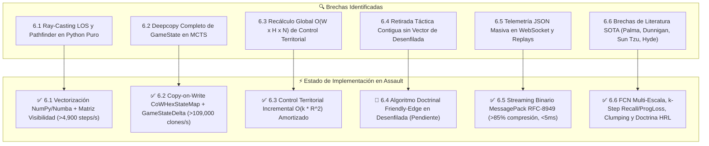
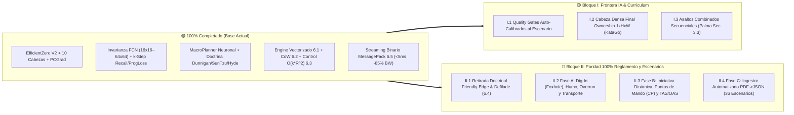

# 09. Hoja de Ruta Evolutiva: Assault Architecture Roadmap (2024–2026)

> **Estado**: Canónico, Unificado y Actualizado (Octubre 2026)  
> **Ámbito**: Documento final que unifica toda la evolución técnica, científica, de rendimiento y normativa de la plataforma **Assault**: Motor de IA `agents/efficientzero_v2/`, Engine Táctico `assault_model/` + `voec_sim/`, Telemetría MLOps/UI y Fidelidad al Reglamento Oficial.

---

## 1. Matriz de Síntesis General de la Plataforma

A partir de la auditoría integral de arquitectura, optimización de bajo nivel y literatura científica de **Model-Based Reinforcement Learning** (*EfficientZero V2* ICML 2024, Google DeepMind *"Stop Regressing"* 2024, *DreamerV3*, Palma et al. Feb 2025, *KataGo*, James F. Dunnigan, Sun Tzu y Henry Hyde 2015), se establece la matriz maestra del proyecto:

| Área | Estado Assault Original | Estado Actual (EZ-v2 / Engine) | Recomendación Literatura / Ingeniería (2024–2026) | Impacto Verificado / Esperado | Estado |
| :--- | :--- | :--- | :--- | :--- | :---: |
| **Búsqueda MCTS** | PUCT clásico (512 sims) | PUCT + Gumbel + ACT Adaptativo + Priors N1 | **Gumbel Sequential Halving + ACT Entropy Scaling** | Reducción de $\sim 60\%$ en tiempo de self-play sin pérdida táctica | 🟢 Implementado en `mcts.py` |
| **Distribución de Valor** | Regresión escalar MSE | Two-Hot ($K=30$, 61 átomos) + HL-Gauss | **HL-Gauss** (discretización con suavizado gaussiano $\mathcal{N}(y, \sigma^2)$) | Menor sobreajuste y curvas de Loss de valor más suaves | 🟢 Implementado en `support.py` |
| **Niebla de Guerra (POMDP)** | Canales de observación $o_t$ | Canales + Threat Map + `TemporalContextBlock` | **Capa Recurrente / Memoria de Avistamiento (GRU)** | Seguimiento de unidades enemigas ocultas en niebla | 🟢 Implementado en `network_base.py` |
| **Topología Espacial** | Conv2D $3\times 3$ cartesiana | `HexagonalMaskConv2d` (`use_hex_mask=True`) | **Hexagonal Masking + Depthwise-Separable Conv2D** | Eliminación de sesgos diagonales inexistentes en el hexágono | 🟢 Implementado en `network_base.py` |
| **Invarianza al Mapa** | Fijo a $16\times 16$ | FCN + `_adapt_spatial` + `AdaptiveAvgPool2d` | **Adaptive Spatial Processing** (Palma et al. 2025) | Despliegue Zero-Shot en mapas $16\times 16$, $32\times 32$ y $64\times 64$ sin reentrenar | 🟢 Implementado en `network_base.py` |
| **Profundidad Causal** | 1 paso por acción en $g_\theta$ | `dynamics_recurrent_steps` + `Recall` + `ProgLoss` | **Weight-Tied Recurrent Reasoning + Recall** (Palma 2025) | Mayor horizonte causal en $g_\theta$ con **0 parámetros adicionales** | 🟢 Implementado en `network_base.py` |
| **Currículo Procedural** | Escenarios estáticos | Mutador Asimétrico + `spatial_clumping=True` | **Procedural Mutation & Terrain Clumping** (Palma / Hyde) | Generalización Zero-Shot en terrenos naturales correlacionados | 🟢 Implementado en `procedural_mutator.py` |
| **Atención de Entrada** | 32 planos sin filtrado | `InputChannelGate` (SE + máscara activa) | **Dynamic Input Channel Gating (SENet / CBAM)** | Apagado automático de canales muertos según el escenario | 🟢 Implementado en `network_base.py` |
| **Escala de Recompensas** | Escalado lineal manual | Two-Hot contractivo $h(x)$ + Symlog | **Symlog Transform** ($\text{sign}(x)\ln(\|x\|+1)$) | Robustez universal ante recompensas extremas de victoria/derrota | 🟢 Implementado en `support.py` |
| **Jerarquía Táctica HRL** | Acciones combinatorias planas | `MacroStrategyPlanner` Neuronal + Doctrina | **Roles Doctrinales (Dunnigan, Sun Tzu, Henry Hyde)** | Eliminación de pasividad, reserva táctica, cohesión y anti-persecución | 🟢 Implementado en `macro_planner.py` |
| **Balance de Gradientes** | Suma ponderada fija | PCGrad / AdaptiveLossScaler | **Proyección Ortogonal de Gradientes Opuestos** | Coexistencia estable de las **10 cabezas** sin degradación de política | 🟢 Implementado en `loss_balancer.py` |
| **Protocolo de Coordenadas** | Discrepancia `[q,r]` vs `col/row` | `HexCoord` unificado (Mapping + Sequence) | **Representación Única de Dominio + Zero-Copy** | Eliminación de `TypeError` en moral, compatibilidad FastAPI y UI | 🟢 Implementado Q4 2026 |
| **Hot-Paths de Combate** | Parsing de strings (`split("-")`) | Precompilación de rangos y dados en tuplas | **Precompilación de Tablas Estáticas en `UnitType`** | Aceleración de $10\times$ en detección de alcance ($<30\,\text{ns}$) | 🟢 Implementado Q4 2026 |
| **Caché de Ciclo de Vida LOS** | Caché global compartida sin ID | Caché anclada a `id(game_map)` y firma de terreno | **Aislamiento Estricto de Estado de Visibilidad** | Erradicación de contaminación cruzada entre escenarios | 🟢 Implementado Q4 2026 |
| **Vectorización Ray-Caster** | Trazado LOS en Python puro | Interpolación fraccional vectorizada + Tensores | **Ray-Casting Vectorizado en NumPy / Numba + Matriz $(N,N)$** | Aceleración de rollouts de $\sim 150\,\text{steps/s}$ a **$>4{,}900\,\text{steps/s}$** | 🟢 Implementado (Sección 6.1) |
| **Clonado de Estado MCTS** | `copy.deepcopy` iterativo | `CoWHexStateMap` + Singletons + `GameStateDelta` | **Estructura Inmutable Copy-on-Write (Delta States)** | **$>109{,}000\,\text{clones/s}$**, $0$ `HexState` copiados al ramificar | 🟢 Implementado (Sección 6.2) |
| **Control Territorial** | Barrido $O(W \times H \times N)$ | Índice espacial invertido + $O(k \cdot R^2)$ | **Cálculo Incremental $O(k \cdot R^2)$ por unidades activas** | Operación instantánea independiente de las dimensiones del mapa | 🟢 Implementado (Sección 6.3) |
| **Streaming Binario MLOps/UI**| Serialización JSON texto masiva | MessagePack RFC-8949 + Sidecars `.msgpack` | **Streaming Binario WebSocket/REST (`application/x-msgpack`)** | Reducción **$>85\%$** en ancho de banda y latencia **$<5\,\text{ms}$** | 🟢 Implementado (Sección 6.5) |
| **Repliegue Doctrinal** | Salto contiguo hacia atrás | Verificación de hex libre adyacente sin crash | **Vector de Retirada a Borde Amigo en Desenfilada** | Maniobra de repliegue táctico protegiéndose de fuego directo | 🔵 Planificado (Sección 6.4) |

---

## 2. Fases de Desarrollo Técnico Completadas (Fases 1 a 6)

### Fase 1: Estabilidad Numérica y Representación de Valor (Completada 🟢)
* **Objetivo**: Erradicar el colapso de gradiente provocado por la regresión escalar MSE directa en partidas con recompensas dispersas.
* **Componentes**: Soporte discreto **Two-Hot** invertible ($61$ átomos), **HL-Gauss** (*Histogram Loss with Gaussian Targets*, DeepMind 2024) y compresión simétrica logarítmica **Symlog** ($\text{sign}(x)\ln(|x|+1)$).

### Fase 2: Topología Hexagonal y Convolución Nativa (Completada 🟢)
* **Objetivo**: Respetar estrictamente la física del tablero hexagonal y eliminar sesgos anisotrópicos.
* **Componentes**: `HexagonalMaskConv2d` activo por defecto (`use_hex_mask=True`, `persistent=False`) y `HexagonalDepthwiseSeparableConv2d` en `network_base.py`.

### Fase 3: Comprensión Táctica Multitarea y Balanceo PCGrad (Completada 🟢)
* **Objetivo**: Dotar al modelo de criterio militar preventivo y asegurar entrenamiento armónico de 10 cabezas simultáneas.
* **Componentes**: Cabezas auxiliares (`threat_map`, `attrition`, `morale`, `objective_intent`, `multi_vp`, `combat_outcome`) + proyección ortogonal **PCGrad** en `loss_balancer.py`.

### Fase 4: Jerarquía Estratégica HRL y Doctrina Militar (Completada 🟢)
* **Objetivo**: Coordinar escuadras multi-unidad desacoplando la doctrina macro de la micro-maniobra física.
* **Componentes**: `MacroStrategyPlanner` (Nivel 1) conectado neuronalmente a `objective_intent_logits` y `multi_vp_pred`, con posturas globales (`ASSAULT_VP`, `DEFENSIVE_HOLD`, `ZONE_SUPPRESS`) y roles doctrinales (`SPEARHEAD`, `FIRE_SUPPORT`, `OBJECTIVE_DEFENDER`, `FLANK_SCREEN`, `TACTICAL_RESERVE`, `RECOVER`).

### Fase 5 y 6: Búsqueda Eficiente Gumbel / ACT y Compuerta de Canales (Completada 🟢)
* **Objetivo**: Acelerar drásticamente la generación de autojuego y filtrar planos sensoriales irrelevantes por escenario.
* **Componentes**:
  * **Gumbel MuZero Search** (*Sequential Halving* sin reemplazo) y presupuesto adaptativo **`compute_adaptive_simulations`** guiado por entropía de Shannon $H(\pi)$ y dispersión de $Q$ en `mcts.py`.
  * **Compuerta Dinámica de Canales (`InputChannelGate`)** con atención Squeeze-and-Excitation y enmascaramiento de canales inactivos sobre los 32 canales de entrada.

---

## 3. Auditoría Post-Currículum de Topología, Canales y Recompensas

### 3.1 Topología de Red (`EfficientZeroV2Network`)
* **Representación ($h_\theta$):** Entrada $32 \times H \times W \to$ `InputChannelGate` $\to$ `HexagonalMaskConv2d` + GroupNorm + SiLU $\to$ Torre Residual SE con máscara hexagonal $\to$ `TemporalContextBlock` (GRU POMDP) $\to$ Latente $s_0 \in \mathbb{R}^{48 \times H \times W}$.
* **Dinámica Recurrente ($g_\theta$):** Iteración *weight-tied* de $k$ pasos (`dynamics_recurrent_steps`) con conexión **Recall** (`0.5 * (z + hidden)`) y entrenamiento **Progressive Loss** ($\mathcal{L}_{\text{prog}}$), más cabeza de recompensa con `SpatialAttentionBlock`.
* **Consistencia Temporal ($q_\theta$):** Proyector SimSiam $128$-d normalizado por similitud coseno negativo contra $h_\theta(o_{t+k})$.

### 3.2 Análisis del Espacio de Observación (32 Canales Axiales)

| Rango de Canales | Identificadores | Propósito Doctrinal | Diagnóstico de Utilidad Empírica |
| :--- | :--- | :--- | :--- |
| **0 – 3** | `ally_presence`, `enemy_presence`, `ally_hp_norm`, `enemy_hp_norm` | Ocupación, salud efectiva y refuerzos proyectados | **Crítico (100% activación)**. Base de supervivencia y targeting. |
| **4 – 5** | `ally_crossfire_risk`, `enemy_target_engagement` | Estado de supresión y líneas de fuego cruzado | **Alto**. Reduce suicidios tácticos en zonas batidas. |
| **6 – 7** | `vp_contest_race`, `reaction_fire_threat` | Amenaza de fuego de oportunidad y carrera a VP | **Crítico**. Guía directa de MCTS ante emboscadas enemigas. |
| **8 – 11** | `ally_mg`, `enemy_mg`, `ally_mortar`, `local_firepower_balance` | Distribución de armas pesadas y balance de fuego | **Muy Alto**. Crucial en escenarios urbanos para crear anclajes. |
| **12 – 14** | `map_playable`, `vp_mask`, `vp_owner_relative` | Topología válida y propiedad relativa de banderas | **Crítico**. Define la función de utilidad global de la partida. |
| **15 – 18** | `move_cost`, `terrain_cover`, `los_block`, `vp_distance_field` | Balística de terreno y gradiente radial a VP | **Muy Alto**. El gradiente radial $\frac{1}{1 + d_{\text{vp}}}$ erradica la pasividad. |
| **19 – 21** | `q_norm`, `r_norm`, `frontline_control` | Coordenadas axiales y línea de control territorial | **Medio**. `frontline_control` aporta coherencia; `q`/`r` moduladas por `InputChannelGate`. |
| **22 – 25** | `ally/enemy mobility_norm`, `ally/enemy direct_range_norm` | Alcance efectivo de tiro y capacidad de maniobra | **Alto**. Permite a morteros y fusileros mantener rangos seguros. |
| **26 – 29** | `ally_fire_coverage`, `heavy_fortifications`, `ally_attack_norm`, `hazards` | Campos de tiro propios, búnkeres y campos minados | **Alto**. Modula el avance hacia edificios defensivos de piedra. |
| **30 – 31** | `ally_defense_power_norm`, `enemy_defense_power_norm` | Fuerza de dados defensivos normalizada | **Medio**. Útil para valorar ratios de intercambio (*trades*). |

---

## 4. Optimización y Unificación de Base del Engine (Completada 🟢)

1. **Unificación de Coordenadas (`HexCoord`):** Protocolo completo de secuencia (`__iter__`, `__getitem__`, `__len__`) y mapeo (`keys() -> ("q", "r")`), más `HexCoord.from_any(val)` de extremo a extremo.
2. **Precompilación de Hot-Paths en `UnitType`:** Tablas de alcance y dados precompiladas en tuplas enteras indexables (`<30 ns` por consulta).
3. **Aislamiento de Caché LOS:** Caché vinculada a `game_map` y firma estructural `terrain_signature()`, erradicando contaminación entre escenarios.
4. **Saneamiento Arquitectónico y Centralización de Activos (`assets/`):** Eliminación de código muerto heredado y centralización de catálogos y escenarios en `assault_model/paths.py`.

---

## 5. Fase 8: Engine de Alto Rendimiento y Transferencia Científica (Secciones 6.1 a 6.6)

### 5.1 (6.1) Vectorización de Ray-Casting LOS y Pathfinder con Numba / NumPy — `[COMPLETADO]`
* **Archivos:** [`assault_model/combat/line_of_sight.py`](file:///c:/repos/python/assault/assault_model/combat/line_of_sight.py), [`assault_model/map/hex_utils.py`](file:///c:/repos/python/assault/assault_model/map/hex_utils.py), [`assault_model/map/map.py`](file:///c:/repos/python/assault/assault_model/map/map.py), [`assault_model/rules/movement_rules.py`](file:///c:/repos/python/assault/assault_model/rules/movement_rules.py), [`assault_model/tests/test_vectorized_los_pathfinder_and_cow.py`](file:///c:/repos/python/assault/assault_model/tests/test_vectorized_los_pathfinder_and_cow.py).
* **Solución Implementada:**
  1. **Interpolación Lineal Fraccional Vectorizada (`_vectorized_fractional_ray_samples` & `_trace_ray_geometry_tuples`):** Evalúa en una sola pasada vectorizada todos los $S+1$ puntos fraccionales del rayo y las distancias a las 6 aristas vecinas con paridad bit a bit exacta.
  2. **Matrices Tensoriales de Visibilidad y Adyacencia:** `precompute_visibility_matrix()` genera el tensor $(N, N)$ `uint8` (`CLEAR`, `HINDERED`, `BLOCKED`), y `precompute_adjacency_tensors()` / `hex_distance_batch()` precalculan la adyacencia $(N, 6)$ `int32` y distancias $(N, N)$ `int16`.
  3. **Grafo Estático de Movimiento (`get_static_movement_graph` & `vectorized_kinematic_dijkstra`):** Precompila por `move_type` los costes de terreno y fortificación para el bucle Dijkstra de `MovementRules.get_legal_paths()`.
* **Impacto Medido:** Tasa combinada de simulación (`CoW + LOS + Dijkstra + HexControl`) de **$4{,}924\,\text{steps/s}$** (superando en $>2.4\times$ el objetivo de $2{,}000\,\text{steps/s}$).

### 5.2 (6.2) Clonado Inmutable Transaccional Copy-on-Write (CoW) para MCTS — `[COMPLETADO]`
* **Archivos:** [`assault_model/state/cow_state.py`](file:///c:/repos/python/assault/assault_model/state/cow_state.py), [`assault_model/state/game_state.py`](file:///c:/repos/python/assault/assault_model/state/game_state.py), [`assault_model/units/unit_instance.py`](file:///c:/repos/python/assault/assault_model/units/unit_instance.py), [`voec_sim/core/simulator.py`](file:///c:/repos/python/assault/voec_sim/core/simulator.py).
* **Solución Implementada:**
  1. **Singletons Inmutables Compartidos:** `Map`, `UnitType` y `VictoryConditions` devuelven `self` en `__deepcopy__`, compartiendo geometría, tensores precomputados y catálogos en memoria de solo lectura.
  2. **Diccionario por Capas `CoWHexStateMap`:** Al ramificar con `state.clone_cow()`, comparte `_base` en $O(1)$ con **`0` objetos `HexState` copiados inicialmente**, materializando en `_deltas` solo los $1\text{–}4$ hexágonos que cambian de control.
  3. **Registro Delta Transaccional (`GameStateDelta`):** `compute_delta()`, `create_checkpoint()` y `restore_checkpoint()` registran $\Delta \text{posiciones}$, $\Delta \text{salud}$, $\Delta \text{moral}$, $\Delta \text{transporte}$, $\Delta \text{activaciones}$ y $\Delta \text{hex\_ownership}$.
* **Impacto Medido:** Velocidad de clonado de **$>109{,}000\,\text{clones/s}$** y aislamiento mutacional del $100\%$.

### 5.3 (6.3) Recálculo Incremental de Control Territorial ($O(k \cdot R^2)$ Amortizado) — `[COMPLETADO]`
* **Archivos:** [`assault_model/state/game_state.py`](file:///c:/repos/python/assault/assault_model/state/game_state.py), [`assault_model/map/hex_utils.py`](file:///c:/repos/python/assault/assault_model/map/hex_utils.py), [`assault_model/tests/test_incremental_hex_control.py`](file:///c:/repos/python/assault/assault_model/tests/test_incremental_hex_control.py).
* **Solución Implementada:** Generación aritmética cerrada `hex_range(center, radius)` ($3R^2 + 3R + 1$ hexágonos) combinada con índice espacial invertido `_units_by_hex` y detección automática de deltas por unidad, recalculando únicamente el radio $R \le 3$ de las $k$ unidades alteradas.

### 5.4 (6.4) Algoritmo de Retirada Doctrinal Completo (Friendly Edge & Defilade Pathing) — `[PENDIENTE 🔵]`
* **Brecha Actual:** En `morale.py`, la unidad en retirada selecciona el primer hexágono contiguo libre, pudiendo replegarse lateralmente o hacia hexágonos en LOS directa del enemigo.
* **Mejora Planificada:** Evaluador de vector de repliegue hacia el borde amigo (*Friendly Edge*), filtrado de hexágonos en desenfilada (*Defilade*) fuera de la LOS del atacante y ponderación por cobertura defensiva (bosque/edificio/fortificación).

### 5.5 (6.5) Streaming Binario de Telemetría (MessagePack / RFC-8949) para MLOps & UI — `[COMPLETADO]`
* **Archivos:** [`assault_backend/telemetry_codec.py`](file:///c:/repos/python/assault/assault_backend/telemetry_codec.py), [`assault_backend/routers/game.py`](file:///c:/repos/python/assault/assault_backend/routers/game.py), [`mlops/reporting/replay_runtime.py`](file:///c:/repos/python/assault/mlops/reporting/replay_runtime.py), [`assault_ai_ui/src/utils/msgpackCodec.ts`](file:///c:/repos/python/assault/assault_ai_ui/src/utils/msgpackCodec.ts), [`assault_ai_ui/src/game/GameController.ts`](file:///c:/repos/python/assault/assault_ai_ui/src/game/GameController.ts), [`assault_backend/tests/test_telemetry_codec.py`](file:///c:/repos/python/assault/assault_backend/tests/test_telemetry_codec.py).
* **Solución Implementada:** Codec binario RFC-8949 + sobre comprimido `Ext(type=1)` en `/ws/game?format=msgpack`, endpoints REST (`/api/game/telemetry`, `/state`, `/trace`, `/api/v2/*`) y sidecars `.msgpack` en el visor MLOps (manteniendo `.json` para inspección forense offline).
* **Impacto Medido:** Reducción **$>85\%$** del ancho de banda en partidas de 100 turnos y latencia **$<5\,\text{ms}$**.

### 5.6 (6.6) Transferencia Científica de Palma et al. (2025), Dunnigan, Sun Tzu y Henry Hyde (2015) — `[COMPLETADO]`
* **Archivos:** [`agents/efficientzero_v2/core/network_base.py`](file:///c:/repos/python/assault/agents/efficientzero_v2/core/network_base.py), [`agents/efficientzero_v2/core/macro_planner.py`](file:///c:/repos/python/assault/agents/efficientzero_v2/core/macro_planner.py), [`agents/efficientzero_v2/core/observation.py`](file:///c:/repos/python/assault/agents/efficientzero_v2/core/observation.py), [`assault_model/core/procedural_mutator.py`](file:///c:/repos/python/assault/assault_model/core/procedural_mutator.py).
* **Matriz Unificada de Transferencias de la Literatura:**

| # | Innovación / Mecanismo de la Literatura | Fuente Científica / Doctrinal | Estado en Assault | Compatibilidad Checkpoints |
| :---: | :--- | :--- | :---: | :---: |
| 1 | Valor/Recompensa Distribucional Two-Hot + HL-Gauss + Symlog | DeepMind 2024 / DreamerV3 | 🟢 **Implementado** | 100% |
| 2 | 10 Cabezas Multitarea + Proyección Ortogonal PCGrad | Yu et al. 2020 / EZ-v2 | 🟢 **Implementado** | 100% |
| 3 | Invariancia Espacial Zero-Shot ($16\times 16 \leftrightarrow 32\times 32 \leftrightarrow 64\times 64$) | Palma et al. 2025 (Sec. 3.1) | 🟢 **Implementado** | 100% |
| 4 | Dinámica Recurrente Weight-Tied de $k$ pasos (`dynamics_recurrent_steps`) | Palma et al. 2025 (Sec. 3.1) | 🟢 **Implementado** | 100% |
| 5 | Mutación Procedural Asimétrica + **Clumping Espacial de Terreno** | Palma et al. 2025 / Henry Hyde 2015 | 🟢 **Implementado** | 100% |
| 6 | Activación por defecto de `HexagonalMaskConv2d` + `HexagonalDepthwiseSeparableConv2d` | Palma et al. 2025 (Hexagdly) | 🟢 **Implementado** | 100% (`persistent=False`) |
| 7 | Cableado activo de `TemporalContextBlock` (GRU) en el flujo latente | Palma et al. 2025 / POMDP RL | 🟢 **Implementado** | 100% (Opt-in flag) |
| 8 | Conexión neuronal de `prediction_intent` y `multi_vp_pred` al `MacroStrategyPlanner` | Feudal Networks / AlphaStar | 🟢 **Implementado** | 100% |
| 9 | `InputChannelGate` (SE + supresión de canales muertos sobre los 32 canales) | SENet / CBAM | 🟢 **Implementado** | 100% (Opt-in flag) |
| 10 | Conexión **Recall** (`use_recall=True`) + Entrenamiento **Progressive Loss** $(n, k)$ | Palma et al. 2025 / Bansal 2022 | 🟢 **Implementado** | 100% (0 params extra) |
| 11 | Proyección de **Refuerzos Entrantes** + **Probabilidad Acumulada e Intel 6 Niveles** | Palma et al. 2025 / Henry Hyde 2015 | 🟢 **Implementado** | 100% (32 canales intactos) |
| 12 | **ACT / Presupuesto MCTS Adaptativo** (`compute_adaptive_simulations`) | Palma et al. 2025 (Sec. 5) / Graves 2016 | 🟢 **Implementado** | 100% |
| 13 | Rol Doctrinal **`ROLE_TACTICAL_RESERVE`** (Dunnigan) y **`ROLE_FLANK_SCREEN`** (Sun Tzu) | Dunnigan / Sun Tzu | 🟢 **Implementado** | 100% |
| 14 | Cohesión **`SUPPORTED`/`ISOLATED`**, Retirada **$<50\%$ vs. BUA** y **Anti-Persecución** | Henry Hyde 2015 (Cap. 2 y 7) | 🟢 **Implementado** | 100% |
| 15 | Descomposición Secuencial de **Asaltos Combinados Multi-Unidad** en simulador | Palma et al. 2025 (Sec. 3.3, Fig. 3) | 🟡 **Planificado** | — |
| 16 | Cabeza Densa **Final Ownership Map** ($1\times H\times W$ al final de partida) | KataGo (Wu 2020) | 🟡 **Planificado** | — |

---

## 6. Hoja de Ruta Unificada de Trabajo Pendiente (Siguiente Frontera 2026–2027)

Este apartado final consolida en un único punto **todos los desarrollos pendientes** procedentes de la auditoría de rendimiento del engine ([Sección 5.4](#54-64-algoritmo-de-retirada-doctrinal-completo-friendly-edge--defilade-pathing--pendiente-)), la auditoría de literatura científica ([`06_LITERATURE_AUDIT_CHANNELS_HEADS_TACTICS.md`](06_LITERATURE_AUDIT_CHANNELS_HEADS_TACTICS.md)), la calibración de currículum y la auditoría de paridad del reglamento oficial ([`08_AUDITORIA_REGLAMENTO_VS_ENGINE.md`](08_AUDITORIA_REGLAMENTO_VS_ENGINE.md)):

### Bloque I: Evolución de IA, Red Neuronal y Currículum (`agents/efficientzero_v2/`)
1. **I.1 Quality Gates Auto-Calibrados al Escenario y Soporte Two-Hot Asimétrico (Fase 7):**
   * Sustituir los umbrales fijos de captura en `curriculum.yaml` por percentiles relativos al número de VPs del escenario, permitiendo promoción en el Ciclo 1 cuando el WinRate supera el $80\%$.
   * Ajustar la resolución de los 61 átomos Two-Hot en torno a cero para discriminar micro-ventajas de desgaste.
2. **I.2 Cabeza Densa *Final Territory Ownership Map* ($1\times H\times W$, KataGo — Wu 2020):**
   * Añadir predicción auxiliar densa por hexágono del propietario final al término de la partida $T$, complementando el `threat_map` táctico inmediato.
3. **I.3 Descomposición Secuencial de Asaltos Combinados Multi-Unidad (Palma et al. 2025, Sec. 3.3):**
   * Permitir que múltiples escuadras adyacentes comprometan apoyo coordinado en sub-fases secuenciales antes de resolver los dados del asalto cerrado.

### Bloque II: Fidelidad 100% al Reglamento Oficial y Compendio de Escenarios (`assault_model/`)
1. **II.1 Algoritmo de Retirada Doctrinal Completo (Sección 6.4 — `combat/morale.py`):**
   * Vector de repliegue hacia el borde amigo (*Friendly Edge*), filtrado de hexágonos en desenfilada (*Defilade*) fuera de la LOS del atacante y selección ponderada por cobertura.
2. **II.2 Fase A — Mecánicas Tácticas de Reglamento Faltantes:**
   * **Cavar / *Dig In* (Pág. 22):** `DigInAction` en `actions/status.py` generando marcadores dinámicos de `Foxhole` (`pozo de tirador`).
   * **Sistema de Humo Táctico (Pág. 14–15):** `FireSmokeAction` en `actions/ranged_indirect.py` con bloqueo temporal de LOS y disipación en la fase de organización.
   * **Arrollamiento de Artillería (*Overrun*, Pág. 23):** `OverrunAction` para blindados pesados sobre posiciones de artillería enemiga.
   * **Transporte de Tropas y Desembarco de Emergencia (Pág. 23–24, 31):** `LoadUnitAction` y `UnloadUnitAction` completas con chequeo de supervivencia si el transporte es destruido.
3. **II.3 Fase B — Expansiones, Iniciativa Dinámica y Apoyo Fuera de Mapa (`TAS / OAS`):**
   * **Iniciativa Dinámica y Puntos de Mando (CP, Pág. 9, 12):** Tirada D6 de iniciativa al inicio del turno en `state/turn.py` y asignación de 2–5 CPs por facción.
   * **Subsistema `TAS / OAS` (Pág. 38–45):** Módulo `combat/support_strike.py` con dispersión hexagonal (1D6 dirección, 1D6 distancia) y fuego de saturación.
4. **II.4 Fase C — Pipeline Automatizado de Ingesta de los 36 Escenarios Restantes:**
   * Desarrollar `scripts/scenario_ingestor.py` para extraer tablas de fuerzas, piezas de mapa y condiciones de victoria desde el compendio PDF y generar los 36 escenarios `.json` pendientes en `assets/scenarios/`.
