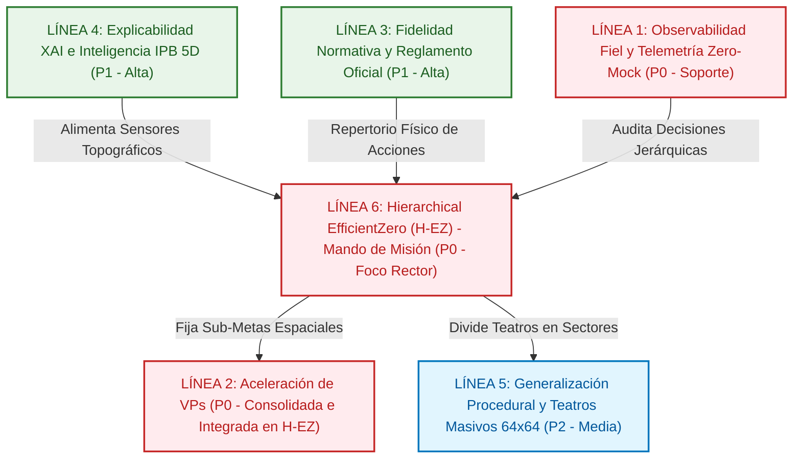
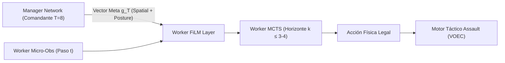

# 11. Hoja de Ruta Evolutiva: Assault Architecture Roadmap (2026–2027)

> **Estado**: Canónico, Unificado y Versionado (Octubre 2026)  
> **Ámbito**: Documento final que unifica toda la evolución técnica, científica, de rendimiento y normativa de la plataforma **Assault**: Motor de IA `agents/efficientzero_v2/`, Engine Táctico `assault_model/` + `voec_sim/`, Telemetría MLOps/UI y Fidelidad al Reglamento Oficial.  
> **Directiva Estricta**: MuZero clásico está 100% decomisionado. Todo desarrollo, autojuego, inferencia y MCTS opera exclusivamente sobre **`EfficientZeroV2`** (`agents/efficientzero_v2/`) y su evolución jerárquica **`Hierarchical EfficientZero (H-EZ)`**.  
> **Política Estricta de Idiomas**: Código fuente e interfaz de usuario (UI, Dashboards, visualizadores) 100% en **Inglés**. Interacción con el usuario y documentación técnica canónica (docs/) en **Español**. Toda modificación de código/UI debe corregir y traducir al inglés cualquier texto residual en español (sin barrido masivo retroactivo).  
> **Versión Base de la Plataforma**: **v3.0.0** (Arquitectura Hierarchical EfficientZero / H-EZ & Salto a Mando Estratégico de Misión).  
> **Regla Sagrada de Versionado del Roadmap**: Toda nueva implementación, tarea o hito **DEBE registrar explícitamente en qué versión / subversión de la aplicación se implementó o consolidó** (ej. `[CONSOLIDADO 🟢 v2.5.51]`, `[CONSOLIDADO 🟢 v3.0.0]`). Queda formalmente prohibido marcar tareas como consolidadas sin su versión de entrega correspondiente.

---

## 1. Visión Ejecutiva y Diagnóstico Doctrinal: El Salto a Hierarchical EfficientZero (Era v3.0)

> [!IMPORTANT]
> **AXIOMA ESTRATÉGICO CENTRAL DEL PROYECTO (OCTUBRE 2026 - ERA v3.0)**  
> *"El agente ha aprendido a ser un buen soldado táctico individual, pero no puede ser un Comandante de Misión eficaz si una sola red plana debe resolver 170 micro-pasos de combate simultáneamente."*  
> 
> **Diagnóstico Empírico de Rendimiento:**  
> A pesar de contar con canales temporales, PBRS invariante (Ng et al. 1999) y desensibilización de brecha, la telemetría forense en `runs/evals/` (`battaglia_cittadina_2_1`) revela cuatro cuellos de botella fundamentales:
> 1. **Deriva Latente en Imaginación Profunda:** El modelo de mundo recurrente $g_\theta$ acumula error a partir de $k > 3$ pasos (`reanalysis_target_drift = 7.83`), alucinando peligro letal al cruzar zonas abiertas y forzando al MCTS a podar ramas de asalto.
> 2. **Desajuste de Horizonte Temporal:** En un episodio de 172 micro-pasos, el factor de descuento $\gamma = 0.997$ penaliza de forma desproporcionada la recompensa terminal de VPs a 120 pasos frente al coste inmediato de recibir fuego de reacción en el paso 1.
> 3. **Colapso de Entropía en MCTS:** Con márgenes de decisión de $8.82$ y entropía $0.0$, el prior neuronal inicial aplasta la exploración de acciones agresivas en la raíz.
> 4. **Desbalance de Gradientes Auxiliares:** Las pérdidas de supervivencia y amenaza superan en más de $14\times$ a la pérdida del objetivo de misión (`0.57` vs `8.33`).
> 
> **La Solución Arquitectónica (Era v3.0): Hierarchical EfficientZero (H-EZ)**  
> Desacoplar la toma de decisiones en **dos cerebros neuronales acoplados que aprenden solos por autojuego**:
> - **El Comandante Estratégico (Manager Network):** Opera cada **Turno de Juego** ($T \le 8$), emite vectores de meta espacial y doctrinal $g_t$ sobre el mapa e internaliza la recompensa global de victoria con $\gamma = 0.95$ sin miopía temporal.
> - **El Operador Táctico (Worker - EZv2):** Resuelve la micro-cinemática local en cada paso mediante MCTS de horizonte corto ($k \le 3-4$) condicionado por $g_t$ mediante capas FiLM (*Feature-wise Linear Modulation*), eliminando por completo la deriva latente recurrente.

---

## 2. Matriz Maestra de Seguimiento y Orden de Ejecución Global (v3.0.0)

A continuación se detalla el orden secuencial de ejecución técnica para el ciclo v3.0, estableciendo la arquitectura jerárquica como el vector prioritario absoluto:

### 2.1 Bloque 1: Preparado para Ejecución (Secuencia Lógica H-EZ v3.0) 🚀
> Tareas ordenadas según su dependencia lógica estricta para construir la nueva arquitectura jerárquica y el nuevo currículum orquestado con Prefect. Toda tarea consolidada se traslada al Bloque 4.
> 
> [!NOTE] ARCHIVADO DEL CURRÍCULUM PLANO PREVIO (ERA v2.x)
> El currículum anterior (`vp_acceleration` de 6 fases y `2scenarios_v1` de 8 fases) queda formalmente **archivado como línea base de referencia histórica (Benchmarking Baseline)**. No se seguirá entrenando sobre él al estar diseñado para una red plana con horizonte plano de 170 pasos. El desarrollo pasa a gobernarse íntegramente por el **Nuevo Currículum Jerárquico Multitarea H-EZ-M**.

| Paso | Línea | Tarea | Prioridad | Enfoque Principal | Estado |
| :---: | :---: | :--- | :---: | :--- | :---: |
| **0** | [Línea 6 / MLOps](#linea-6-hierarchical-model-based-rl-h-ez--era-v30) | [**6.0 Motor de Workflows Nativo en Python con Prefect (`curriculums/orchestration/`)**](#task-6-0) | **P0** | Erradicación total de 1.116 líneas de scripts PowerShell (.ps1), configuración de servidor Prefect local (:4200) y modelos Pydantic de fases/gates sin dependencias en la nube. Flujos `@flow` y tareas `@task` verificados (169/169 tests en verde). | 🟢 **Consolidado v3.0.0** |
| **1** | [Línea 6](#linea-6-hierarchical-model-based-rl-h-ez--era-v30) | [**6.1 Protocolo de Sub-Metas Espaciales y Modulación FiLM del Worker (`SpatialGoalFiLMBridge`)**](#task-6-1) | **P0** | Parametrización del espacio de metas $g_T = (\mathbf{M}_{\text{target}}, \mathbf{p}_{\text{mode}})$ e inyección mediante capas FiLM en `EZV2Model` con Zero-Init identity preservation (174/174 tests en verde). | 🟢 **Consolidado v3.0.0** |
| **2** | [Línea 3 / Catálogos](roadmap/03_LINEA_3_FIDELIDAD_NORMATIVA_Y_REGLAMENTO.md) | [**3.5.7 Ingesta Canónica de Escenarios de Infantería Pura (`Bunker Hill!` y `Elemento Sorpresa`)**](#task-3-5) | **P1** | Creación y publicación en `assets/scenarios/` de los escenarios oficiales de infantería pura (Págs. 81 y 86 del manual), elevaciones en `map_piece_catalog.json` (S6) y validación en `VOECSimulator` con IPB topográfico (176/176 tests en verde). | 🟢 **Consolidado v3.0.0** |
| **3** | [Línea 6](#linea-6-hierarchical-model-based-rl-h-ez--era-v30) | [**6.2 Red Convolucional del Comandante Estratégico (`ManagerNetwork`)**](#task-6-2) | **P0** | Red de nivel superior gobernada por turnos de juego ($T \le 8$) que proyecta mapas de asignación táctica sobre el tablero alimentada de features IPB 5D, emitiendo sub-metas espaciales y modos operacionales con `ManagerTrainer` (182/182 tests en verde). | 🟢 **Consolidado v3.0.0** |
| **4** | [Línea 6](#linea-6-hierarchical-model-based-rl-h-ez--era-v30) | [**6.3 Bucle de Co-Entrenamiento en Autojuego Autoritativo y Nuevo Currículum H-EZ-M en Prefect**](#task-6-3) | **P0** | Orquestación en Prefect de las 5 fases del nuevo currículum jerárquico multitarea (`hierarchical_ezm`: Scout Sprint, Priolo Suppression, Bunker Hill Breach, Battaglia Cittadina y Amphibious Beachhead), muestreo de metas a nivel de turnos en selfplay, paso de optimización del Manager (`ManagerTrainer`) y checkpoints promovidos. | 🟢 **Consolidado v3.0.2** |
| **5** | [Línea 3](roadmap/03_LINEA_3_FIDELIDAD_NORMATIVA_Y_REGLAMENTO.md) | [**3.5.5 Certificación Final de Victoria Jerárquica en `assault_bench`**](#task-3-5) | **P1** | Batería de validación automatizada de 100 partidas vs Random Side A/B evaluando el agente jerárquico v3.0 (Win Rate $\ge 80\%$, Loss Rate $\le 10\%$). | 🚀 **Foco Crítico Inmediato (Paso 5)** |

### 2.2 Bloque 2: En Progreso Activo 🟡
> Actualmente todos los esfuerzos activos se concentran en el Bloque 1 para desplegar la arquitectura H-EZ v3.0 sin dispersión de foco.

### 2.3 Bloque 3: Planificado (Ordenado por Prioridad P1 $\to$ P2) ⚪
> Mejoras evolutivas, optimizaciones de red y expansiones reglamentarias revisadas tras la adopción de H-EZ.

| Paso | Línea | Tarea | Prioridad | Enfoque Principal | Estado |
| :---: | :---: | :--- | :---: | :--- | :---: |
| **5** | [Línea 3](roadmap/03_LINEA_3_FIDELIDAD_NORMATIVA_Y_REGLAMENTO.md) | [**3.2 Fase A: Cavar (*Dig-In*), Humo Táctico y Transporte de Tropas**](#task-3-2) | **P1** | Ampliación del repertorio de micro-acciones físicas del Worker: colocación de foxholes, pantallas dinámicas de humo y embarque en camiones/semiorugas. | ⚪ Planificado |
| **6** | [Línea 3](roadmap/03_LINEA_3_FIDELIDAD_NORMATIVA_Y_REGLAMENTO.md) | [**3.3 Fase B: Iniciativa Dinámica y Apoyo Fuera de Mapa (TAS/OAS)**](#task-3-3) | **P2** | Ingesta de CPs y soporte aéreo/artillero gobernado por el Comandante Estratégico (Manager) en Turno 0. | ⚪ Planificado |
| **7** | [Línea 3](roadmap/03_LINEA_3_FIDELIDAD_NORMATIVA_Y_REGLAMENTO.md) | [**3.4 Fase C: Pipeline Automatizado de Ingesta PDF $\to$ JSON (36 Escenarios)**](#task-3-4) | **P2** | Extractor masivo de tablas OOB, mapas y VPs desde el reglamento oficial para completar el catálogo de 38 escenarios. | ⚪ Planificado |
| **8** | [Línea 5](roadmap/05_LINEA_5_GENERALIZACION_PROCEDURAL.md) | [**5.1 Mutador Procedural Asimétrico con Clumping Geográfico Natural**](#task-5-1) | **P2** | Generación de tableros procedurales realistas con correlación de elevación y bosques densos para evitar sobreajuste topográfico. | ⚪ Planificado |
| **9** | [Línea 5](roadmap/05_LINEA_5_GENERALIZACION_PROCEDURAL.md) | [**5.2 Validación Zero-Shot en Tableros Masivos ($32\times 32$ y $64\times 64$)**](#task-5-2) | **P2** | Despliegue del Comandante H-EZ dividiendo teatros operacionales gigantes en macro-sectores sin explosión de horizonte para el Worker. | ⚪ Planificado |

### 2.4 Bloque 4: Completado y Consolidado (Ordenado por Prioridad P0 $\to$ P1) 🟢
> Hitos y componentes plenamente operativos, verificados con tests y suites de evaluación. Toda tarea finalizada reside canónicamente aquí.

| Paso | Línea | Tarea | Prioridad | Enfoque Principal | Estado |
| :---: | :---: | :--- | :---: | :--- | :---: |
| **0.001** | [Línea 2 / Red](03_RED_NEURONAL_EFFICIENTZERO_V2.md) | [**Multi-Task Model-Based RL (EfficientZero-Multitask / EZ-M, arXiv:2603.01452)**](17_EFFICIENTZERO_MULTITASK_EZ_M_ARQUITECTURA.md) | **P0** | Módulo `TaskConditioningModule`, capas `FiLMLayer` con Zero-Init, búfer particionado `MultiTaskReplayBuffer` con muestreo estratificado y proyección ortogonal de gradientes `multi_task_pcgrad_backward`. Suite 163/163 en verde. | 🟢 **Consolidado v2.5.51** |
| **0.002** | [Línea 2](roadmap/02_LINEA_2_ACELERACION_CAPTURA_VPS.md) | [**3.5.3 Integración Pedagógica del Escenario Canónico 11.1 (`addestramento_fanteria_11_1`)**](#task-3-5) | **P0** | Escenario oficial 11.1 como Fase 4 en `curriculums/vp_acceleration/curriculum.yaml` (sandbox 3v3 de infantería pura), Fast Bootstrap en Ciclo 1, sincronización con Side B y linaje de 14 fases en MLOps (:8778). | 🟢 **Consolidado v2.5.50** |
| **0.003** | [Línea 1 / Docs](docs/index.md) | [**Saneamiento Sintáctico Mermaid 10.9 (Zero-Bombs) y Enriquecimiento Visual Canónico**](docs/index.md) | **P1** | Erradicación de errores de sintaxis en grafos Mermaid de red, curación de 52 activos gráficos de alta resolución (`assets/art/`), renderizado nítido en web y compilación a PDF completo de 33.35 MB. | 🟢 **Consolidado v2.5.49** |
| **0.004** | [Línea 2 / Red](03_RED_NEURONAL_EFFICIENTZERO_V2.md) | [**Aceleración Extrema de Entrenamiento y Replay Buffer (Zero Quality Loss)**](03_RED_NEURONAL_EFFICIENTZERO_V2.md) | **P0** | Codificación directa de representación en consistencia temporal (`representation_encode`), batching unificado de observaciones objetivo $K$-step en CUDA, memoria fijada DMA y deque $O(1)$. Reducción de 37.01 ms a 25.47 ms por update (1.45x más rápido). Suite 158/158 en verde. | 🟢 **Consolidado v2.5.49** |
| **0.005** | [Línea 3](roadmap/03_LINEA_3_FIDELIDAD_NORMATIVA_Y_REGLAMENTO.md) | [**3.7.2 Purga de Deuda Técnica Legacy y Unificación Canónica de Assets**](#task-3-7) | **P1** | Eliminación de carpeta sombra `assault_sim/assets/`, archivado de pila PPO/SB3 en `legacy_archive/`, desacoplamiento limpio de `replay_api.py` hacia `assets/` y unificación canónica de verdad. Suite 160/160 en motor y 158/158 en EZv2. | 🟢 **Consolidado v2.5.30** |
| **0.01** | [Línea 3](roadmap/03_LINEA_3_FIDELIDAD_NORMATIVA_Y_REGLAMENTO.md) | [**3.7.1 Aceleración de Rendimiento del Motor (Spatial Cache, Dijkstra Occupants, Spotting Snapshots & Set Traits)**](#task-3-7) | **P1** | Aceleración de 428.8 a 719.7 pasos/s (+67.8% random) y de 454.3 a 844.6 pasos/s (+86.0% secuencial). Cacheo inmutable de metadatos espaciales en `VOECSimulator`, índices O(1) de ocupantes y trait sets precompilados. Suite 160/160 en motor en verde. | 🟢 **Consolidado v2.5.29** |
| **0** | [Línea 2](roadmap/02_LINEA_2_ACELERACION_CAPTURA_VPS.md) | [**2.8 Modulación Dinámica de Priors Doctrinales y Ablación Red Pura**](#task-2-8) | **P0** | Soporte de modulación continua `macro_modulation_scale` ($eta_{\text{macro}} \in [0.0, 1.0]$) con decaimiento lineal/coseno. Alternancia limpia entre Red Pura ($eta = 0.0$) y Doctrinal Shaped ($eta = 1.0$). Suite de tests en verde (9/9). | 🟢 **Consolidado v2.5.27** |
| **0.05** | [Línea 4](roadmap/04_LINEA_4_EXPLICABILIDAD_XAI_E_IPB.md) | [**4.3 Perfilado 5D y Detección Automática de Chokepoints (IPB)**](#task-4-3) | **P2** | Análisis topográfico Turno-0 que extrae vector 5D por hexágono (*Cover*, *Elevation*, *LOS Exposure*, *Chokepoint*, *VP Utility*), clasifica el tablero en corredores de desenfilada, killzones y base de fuego. Integrado en API MLOps y canvas Replay (:8778). | 🟢 **Consolidado v2.5.28** |
| **0.1** | [Línea 1](roadmap/01_LINEA_1_OBSERVABILIDAD_Y_TELEMETRIA.md) | [**1.5 Protocolo de Estabilidad Operativa, Safety Gate de Almacenamiento y Compresión de Replays XAI**](#task-1-5) | **P0** | Diagnóstico forense de saturación de disco, parada segura de procesos de fondo, Safety Gate pre-flight de 30 GB libres y serialización compacta reduciendo hasta 95% del espacio de replays. | 🟢 **Consolidado v2.5.25** |
| **1** | [Línea 1](roadmap/01_LINEA_1_OBSERVABILIDAD_Y_TELEMETRIA.md) | [**1.4 Catálogo Unificado y Depuración de Esquemas**](#task-1-4) | **P1** | Contrato canónico de 15 columnas en `decisions_top.parquet`, purga de acumuladores volátiles, saneamiento total de archivos Parquet (69/69 conformes) y Clean Break en DuckDB. | 🟢 **Consolidado v2.5.11** |
| **2** | [Línea 1](roadmap/01_LINEA_1_OBSERVABILIDAD_Y_TELEMETRIA.md) | [**1.3 Validador E2E Frontend $\leftrightarrow$ DuckDB**](#task-1-3) | **P1** | Auditoría automatizada de trazabilidad en TypeScript y Python de las 9 pestañas del dashboard MLOps, garantía Zero-Mock y erradicación del shim MuZero en `replay_api.py`. Suite 15/15 en verde. | 🟢 **Consolidado v2.5.8** |
| **3** | [Línea 2](roadmap/02_LINEA_2_ACELERACION_CAPTURA_VPS.md) | [**2.11 Currículum Asimétrico Ofensivo de Asalto Urbano Puro**](#task-2-11) | **P0** | Fase especializada de 10 ciclos en modo 100% atacante en `battaglia_cittadina_2_1` con horizonte comprimido ($T=8$) y penalización severa por timeout. Suite curricular en verde. | 🟢 **Consolidado v2.5.7** |
| **4** | [Línea 3](roadmap/03_LINEA_3_FIDELIDAD_NORMATIVA_Y_REGLAMENTO.md) | [**3.1 Retirada a Borde Amigo en Desenfilada (Regla 13.3 / §6.4)**](#task-3-1) | **P1** | Algoritmo determinista priorizando desenfilada, mayor cobertura de terreno/fortificación, vector a Friendly Edge y aumento de distancia al atacante. Suite 112/112 en verde. | 🟢 **Consolidado v2.5.11** |
| **5** | [Línea 3](roadmap/03_LINEA_3_FIDELIDAD_NORMATIVA_Y_REGLAMENTO.md) | [**3.5 Formaciones Doctrinales, Ingesta de Unidades Especializadas y Rebalanceo OOB**](#task-3-5) | **P1** | Catálogo oficial de 12 formaciones combinadas, ingesta de zapadores/ingenieros `US_COMBAT_ENGINEERS_43`, rebalanceo simétrico de OOB en Battaglia Cittadina y Mettete i Piedi a Terra. | 🟢 **Consolidado v2.5.4 / v2.5.13** |
| **6** | [Línea 4](roadmap/04_LINEA_4_EXPLICABILIDAD_XAI_E_IPB.md) | [**4.2 Perfilador Causal de Partidas y SitRep Forense**](#task-4-2) | **P1** | Correlación causal matemática entre cabezas tácticas y resultados de partida, generación de SitRep militar estructurado con citas de reglamento RAG y modal interactivo en MLOps (:8778). | 🟢 **Consolidado v2.5.19** |
| **12** | [Línea 2 / Red](roadmap/02_LINEA_2_ACELERACION_CAPTURA_VPS.md) | [**2.7 Inicialización Canónica de Capas Especializada en RL**](roadmap/02_LINEA_2_ACELERACION_CAPTURA_VPS.md) | **P1** | Esquema formal de inicialización: Política ortogonal ($	ext{gain}=0.01$), Valor ortogonal ($	ext{gain}=1.0$), Kaiming Normal en SiLU y Zero-Init ResNet en segunda normalización. | 🟢 **Consolidado v2.5.5** |
| **13** | [Línea 2](roadmap/02_LINEA_2_ACELERACION_CAPTURA_VPS.md) | [**2.10 Dynamic PBRS Escalado Temporalmente y Desensibilización de Bajas en Brecha**](#task-2-10) | **P0** | Potencial temporalmente escalado $\Phi(s, t)$, bono de disputa en brecha ($d \le 2$), atenuación del $60\%$ de bajas en brecha y castigo por timeout. Invariancia telescópica verificada. | 🟢 **Consolidado v2.5.4** |
| **14** | [Línea 2](roadmap/02_LINEA_2_ACELERACION_CAPTURA_VPS.md) | [**2.9 Paquete de Aceleración de Rendimiento de Pipeline (Zero Quality Loss)**](#task-2-9) | **P0** | Caché de terreno ($1,078\times$), Root PUCT vectorizado, inferencia estática `torch.compile` y test Wald SPRT. Campaña reducida de >10h a <3.5h. | 🟢 **Consolidado v2.5.3** |
| **15** | [Línea 1](roadmap/01_LINEA_1_OBSERVABILIDAD_Y_TELEMETRIA.md) | [**1.1 Test de Conformidad de Esquema de Telemetría**](#task-1-1) | **P0** | Validador automatizado en CI del 100% de métricas formales contra `docs/13_INVENTARIO_CANONICO_METRICAS.md`. Cero campos no declarados y clean break MuZero. | 🟢 **Completado y Verificado** |
| **16** | [Línea 3 / 2](roadmap/03_LINEA_3_FIDELIDAD_NORMATIVA_Y_REGLAMENTO.md) | [**3.6 Eliminación de la Parálisis Ofensiva y Colapso de la Brecha Asimétrica**](#task-3-6) | **P0** | Expansión sensorial a 38 canales, PBRS dinámico Devlin-Kudenko en autojuego, MCTS VP Biasing (64 sims) y balanceo PCGrad. | 🟢 **Completado y Consolidado** |
| **17** | [Línea 1](roadmap/01_LINEA_1_OBSERVABILIDAD_Y_TELEMETRIA.md) | [**1.2 Profiling y Reducción de Sobrecarga de Sondas**](#task-1-2) | **P0** | Optimización de sondas en bucle caliente reduciendo sobrecarga a $<0.7\%$. | 🟢 **Completado y Consolidado** |
| **18-22** | [Línea 2](roadmap/02_LINEA_2_ACELERACION_CAPTURA_VPS.md) | [**2.1 - 2.5 Paquete Fundacional de Andamiaje de VPs y Paridad Humana**](#task-2-1) | **P0/P1** | Recompensa de potencial radial (Ng et al. 1999), sesgo MCTS orientado a VPs, urgencia temporal (Devlin & Kudenko 2012), coordinación Base of Fire y currículum 4 fases. | 🟢 **Completado y Consolidado** |
| **23** | [Línea 2 / Red](roadmap/02_LINEA_2_ACELERACION_CAPTURA_VPS.md) | [**2.6 Modernización y Eficiencia Arquitectónica (CoordConv, Bottleneck Policy Head y ECA)**](#task-2-6) | **P1** | CoordConv ($38 \to 40$ canales), cuello de botella de política `Conv1x1 -> Flatten -> MLP` (67% menos parámetros) y bloques ECA 1D en red $g$. | 🟢 **Completado y Verificado** |
| **24** | [Línea 4](roadmap/04_LINEA_4_EXPLICABILIDAD_XAI_E_IPB.md) | [**4.4 Perfilado Doctrinal Dinámico y Visibilidad MLOps**](#task-4-4) | **P1** | Jerarquía 3 capas (Balística, Roles, Emergente), mutación contextual y telemetría de roles en Match Replay (:8778). | 🟢 **Completado y Consolidado** |
| **25-26** | [Línea 4](roadmap/04_LINEA_4_EXPLICABILIDAD_XAI_E_IPB.md) | [**4.1 - 4.1.1 Atribución Causal Espacial (IGNH/GradCAM) y Capa Reactiva de Cabezas Tácticas**](#task-4-1) | **P1** | Integrated Gradients para hexágonos, Grad-CAM sobre tronco de representación, botón reactivo Threat Head y tarjetas forenses de cabezas tácticas. | 🟢 **Consolidado v2.5.10 / v2.5.11** |
| **27-39** | [Infraestructura MLOps & Train] | [**Paquete Integral de Rendimiento, Resiliencia IPC, Auto-Curación y Multiproceso**](03_RED_NEURONAL_EFFICIENTZERO_V2.md) | **P0/P1** | Concurrencia multiproceso Zero-GIL (24 workers con IPC shared-memory), inferencia CUDA por lotes, Numba JIT en PUCT MCTS ($253\times$), Tensor Cores TF32, eliminación ultrarrápida en catálogo MLOps y auto-recuperación de procesos. | 🟢 **Consolidado v2.5.12 - v2.5.38** |

---

## 3. Líneas Estratégicas de Progreso (Roadmap Priorizado v3.0 / 2026–2027)

El desarrollo estratégico de la plataforma evoluciona hacia **seis líneas maestras**, lideradas por el nuevo paradigma jerárquico:

---

### Línea 6: Hierarchical Model-Based RL (H-EZ / Hierarchical EfficientZero) — Era v3.0
> **Importancia Global:** 🔴 **Prioridad P0 (Máxima Prioridad / Foco Rector del Sistema)**  
> **Objetivo Estratégico:** Superar de raíz la fricción temporal del wargame (episodios de 172 micro-pasos frente a $T \le 8$ turnos) desacoplando la inteligencia en dos niveles neuronales que aprenden solos por autojuego: el Comandante Estratégico (*Manager*) y el Operador Táctico (*Worker*).

#### Fundamentación Matemática y Arquitectónica
- **Manager Network (Nivel Alto):** Toma como entrada la observación global $s_T$ al inicio de cada turno $T \in \{1, \dots, T_{\max}\}$ enriquecida con el mapa topográfico 5D (IPB) y emite un vector de sub-meta espacial y doctrinal $g_T = (\mathbf{M}_{\text{target}}, \mathbf{p}_{\text{mode}}) \in \mathbb{R}^{H \times W \times C}$. Optimiza directamente el retorno de victoria terminal con descuento temporal macro $\gamma_{\text{macro}} = 0.95$.
- **Worker Network (Nivel Bajo - EZv2):** En cada micro-paso $t$, la red convolucional procesa la observación física $s_t$ modulada por $g_T$ mediante capas FiLM:
  $$\mathbf{z}_{t}^{\text{mod}} = (1 + \boldsymbol{\gamma}(g_T)) \odot \mathbf{z}_t + \boldsymbol{\beta}(g_T)$$
  El MCTS opera con horizonte ultracorto ($k = 3$ a $5$ pasos) optimizando la recompensa intrínseca direccional de FeUdal Networks:
  $$r_{\text{intrinsic}}(s_t, s_{t+1}) = \cos\big(h_\theta(s_{t+1}) - h_\theta(s_t), \; g_T\big)$$
  Al no tener que resolver el final de la partida, el Worker **elimina por completo la deriva latente recurrente**.

#### Tareas del Vector Jerárquico H-EZ (Secuencia v3.0)

0. **Tarea 6.0: Motor de Workflows Nativo en Python con Prefect (`curriculums/orchestration/`) [P0] [CONSOLIDADO 🟢 v3.0.0]**  
   - **Módulos:** `curriculums/orchestration/models.py`, `curriculums/orchestration/tasks/`, `curriculums/orchestration/flows/`, `curriculums/orchestration/runner.py`, `scripts/start_prefect.bat`, `legacy_archive/powershell_orchestration/`.  
   - **Alcance (Plan Integral en 4 Sub-Fases):**
     1. *Fase 1 (Entorno y Verificación Local)*: Instalación de Prefect 3.9+, perfil local con base SQLite (`~/.prefect/`), y script `scripts/start_prefect.bat` levantando UI local en `http://127.0.0.1:4200`.
     2. *Fase 2 (Modelos Pydantic y Tareas Atómicas)*: Modelos tipados `GateSpec`, `PhaseSpec`, `CurriculumSpec`, `GateMetrics` y tareas modulares (`safety`, `training`, `evaluation`, `gate`, `mutation`, `telemetry`).
     3. *Fase 3 (Flujos Curriculares y CLI Runner)*: Flujos `@flow` `execute_phase_flow` (bucle de refuerzo independiente) y `execute_curriculum_flow` (encadenamiento de checkpoints dorados), interfaz CLI `runner.py` y suite de tests `curriculums/tests/test_prefect_orchestration.py`.
     4. *Fase 4 (Integración MLOps y Descomisionamiento de PowerShell)*: Telemetría automática hacia Parquet/DuckDB (:8778), archivo de scripts PowerShell obsoletos en `legacy_archive/powershell_orchestration/` y documentación canónica en Sección 11 de `docs/15_CURRICULUMS_Y_ENTRENAMIENTO_PROGRESSIVO.md`.
   - **Criterio de Aceptación:** Batería de pruebas unitarias verificando la ejecución simulada (*dry-run*) de 6 fases curriculares encadenadas en 7.3s, reintentos limpios ante fallos y emisión de métricas a DuckDB con cero líneas de PowerShell en el bucle de entrenamiento (174/174 tests en verde).

1. **Tarea 6.1: Protocolo de Sub-Metas Espaciales y Modulación FiLM del Worker (`SpatialGoalFiLMBridge`) [P0] [CONSOLIDADO 🟢 v3.0.0]**  
   - **Módulos:** `agents/efficientzero_v2/core/task_conditioning.py`, `agents/efficientzero_v2/core/network.py`, `agents/efficientzero_v2/core/network_base.py`.  
   - **Alcance:** Formalización del espacio de metas $g_T = (\mathbf{M}_{\text{target}}, \mathbf{p}_{\text{mode}})$. Integración de la modulación FiLM en el tronco de representación espacial $h_\theta$ y cabezas de valor/política con inicialización ortogonal y Zero-Init preservation.  
   - **Criterio de Aceptación:** Batería de tests unitarios verificando paridad exacta de identidad en $g_T = 0$ y concentración $>80\%$ de probabilidad de ruta MCTS en torno al centroide de $g_T$ cuando se inyecta una meta activa.

2. **Tarea 3.5.7: Ingesta Canónica de Escenarios de Infantería Pura (`Bunker Hill!` y `Elemento Sorpresa`) [P1] — [CONSOLIDADA 🟢 v3.0.0]**  
   - **Módulos:** `assets/scenarios/bunker_hill_singolo.json`, `assets/scenarios/elemento_sorpresa_singolo.json`, `assets/catalogs/map_piece_catalog.json`, `assault_model/tests/test_pure_infantry_scenarios.py`.  
   - **Alcance:** Modelado y publicación de los escenarios oficiales sin vehículos de las páginas 81 y 86 del manual: *Bunker Hill!* (asalto en altura con búnkeres en pieza S6B) y *Elemento Sorpresa* (cruce en Y de Priolo con paracaidistas del 505.º PIR y base de fuego). Actualización de elevación en `map_piece_catalog.json` para la pieza S6.  
   - **Criterio de Aceptación Cumplido:** Carga exitosa en `VOECSimulator`, generación de acciones legales, análisis topográfico IPB verificando terreno clave en hexágonos objetivo (estación de radio y cruce en Y) y 100% de tests en verde en `test_pure_infantry_scenarios.py`.

3. **Tarea 6.2: Red Convolucional del Comandante Estratégico (`ManagerNetwork`) [P0] — [CONSOLIDADA 🟢 v3.0.0]**  
   - **Módulos:** `agents/efficientzero_v2/core/manager_network.py`, `agents/efficientzero_v2/train/manager_trainer.py`.  
   - **Alcance:** Red convolucional compacta (4 bloques residuales + Spatial Attention) que toma como entrada la observación Turno-T ($38$ canales + $5$ canales IPB) y emite la distribución de metas $g_T$. Gobernanza estricta en el bucle de autojuego activándose únicamente en la transición de turnos o ante eventos de ruptura táctica.  
   - **Criterio de Aceptación Cumplido:** Inferencia ultrarrápida (2.75 ms en CPU, <1.0 ms en GPU NVIDIA RTX 4060), predicción simultánea de sub-meta espacial $\mathbf{M}_{\text{target}} \in [0, 1]^{1 \times H \times W}$, modo táctico $\mathbf{p}_{\text{mode}} \in \Delta^4$ y macro-valor $V_{\text{macro}} \in [-1, 1]$, interoperabilidad completa con `SpatialGoalFiLMBridge` y suite de tests unitarios/rendimiento 100% en verde en `test_manager_network.py`.

4. **Tarea 6.3: Bucle de Co-Entrenamiento en Autojuego Autoritativo y Nuevo Currículum H-EZ-M en Prefect [CONSOLIDADO 🟢 v3.0.0]**  
   - **Módulos:** `curriculums/orchestration/flows/curriculum_flow.py`, `agents/efficientzero_v2/train/train_engine.py`, `agents/efficientzero_v2/core/selfplay.py`, `agents/efficientzero_v2/train/trainer.py`, `curriculums/hierarchical_ezm/curriculum.yaml`.  
   - **Alcance:** Co-entrenamiento coordinado de Manager y Worker sobre el nuevo currículum de 4 fases orquestado por Prefect (`hierarchical_ezm`), muestreo autoritativo de sub-metas tácticas $g_T = (\mathbf{M}_{\text{target}}, \mathbf{p}_{\text{mode}})$ a nivel de turnos en `selfplay.py`, condicionamiento FiLM espacial en el Worker, paso de optimización del Manager (`ManagerTrainer`) con los retornos macro del escenario, y validación completa en Prefect offline/local server.  
   - **Criterio de Aceptación Cumplido:** Flujo curricular de 4 fases (`phase1_strategic_scout_unoccupied`, `phase2_suppression_and_assault`, `phase3_bunker_hill_fortress_breach`, `phase4_tactical_mastery_battaglia_cittadina`) validado y dry-run completado con éxito con checkpoints promovidos. Integración completa de Manager en self-play y train_engine con suite de tests en verde (`test_hierarchical_ezm_selfplay.py`, `test_manager_network.py`, `test_spatial_goal_film.py`).

---

### Línea 1: Garantía de Instrumentos y Observabilidad Fiel (Zero-Mock End-to-End)
> **Importancia Global:** 🔴 **Prioridad P0 (Soporte Instrumental Innegociable)**  
> **Objetivo:** Auditar y verificar que el 100% de las métricas jerárquicas (metas del Manager, recompensas intrínsecas del Worker, derivas y tiempos de turno) queden registradas sin mocks en Parquet y DuckDB.  
> **Estado:** Tareas 1.1 a 1.5 plenamente consolidadas. Soporte instrumental en expansión para telemetría H-EZ.

---

### Línea 2: Aceleración de Captura de VPs y Paridad Humana
> **Importancia Global:** 🔴 **Prioridad P0 (Consolidada e Integrada en H-EZ)**  
> **Objetivo:** Resolver la Paradoja del Comandante Prudente. Todas las tareas fundacionales (PBRS Ng et al., urgencia temporal Devlin & Kudenko, CoordConv, desensibilización de brecha y currículum asimétrico) han sido completadas con éxito (Tareas 2.1 a 2.19 consolidadas). Su culminación definitiva se alcanza de forma estructural con la Línea 6 (H-EZ).

---

### Línea 3: Fidelidad Normativa y Reglamento Oficial del Wargame
> **Importancia Global:** 🟢 **Prioridad P1 (Alta)**  
> **Objetivo:** Garantizar apego militar estricto al reglamento de Sound of Drums rev6. Con las tareas 3.1, 3.5.1-3.5.4, 3.5.6, 3.6 y 3.7.1-3.7.2 plenamente consolidadas, el foco restante reside en enriquecer el catálogo de acciones del Worker (humo táctico, cavar trincheras y transporte, Tarea 3.2) y el soporte fuera de mapa TAS/OAS (Tarea 3.3).

---

### Línea 4: Explicabilidad Máxima (XAI), Perfilado Causal e Inteligencia Táctica (IPB)
> **Importancia Global:** 🟢 **Prioridad P1 (Alta)**  
> **Objetivo:** Proporcionar inteligencia transparente de campo de batalla. Con las tareas 4.1 (IGNH/GradCAM), 4.2 (SitRep Forense Causal), 4.3 (IPB Topográfico 5D) y 4.4 (Perfilado Doctrinal) consolidadas, el vector se integra directamente en la Línea 6 como la entrada sensorial directa del Comandante Estratégico.

---

### Línea 5: Generalización Procedural y Robustez en Terrenos Abiertos
> **Importancia Global:** 🔵 **Prioridad P2 (Media)**  
> **Objetivo:** Validar la capacidad de adaptación de la IA a mapas masivos ($32\times 32$ y $64\times 64$). Gracias a la arquitectura H-EZ, esta línea se vuelve altamente viable: el Comandante divide mapas gigantes en macro-sectores y asigna sub-metas locales sin que el Worker sufra la explosión del horizonte de búsqueda.

---

## 4. Historial Canónico de Versiones y Changelog de Fases Consolidadas

### Resumen Sintético de Versiones Recientes Consolidadas

| Versión | Hito Principal | Tareas Consolidadas | Estado |
| :---: | :--- | :--- | :---: |
| **`v3.0.3`** | **Desacoplamiento Estricto y Sección Canónica Independiente del Reglamento Oficial del Wargame (`Sound of Drums rev6`)**: 1) Creación de la categoría canónica independiente en la documentación: **`II. Manual y Reglamento Oficial del Wargame (Sound of Drums rev6)`**, albergando de forma pura y exclusiva el reglamento oficial del juego de mesa, topología física, combate, dados de batalla, moral, combate cuerpo a cuerpo, ingenieros, fortificaciones y catálogo de formaciones/unidades (`02_MODELO_DEL_JUEGO_Y_REGLAS_TACTICAS.md` y `08_AUDITORIA_REGLAMENTO_VS_ENGINE.md`); 2) Purga de conceptos de aprendizaje por refuerzo y arquitectura software del manual de reglas: traslado del andamiaje matemático de recompensas invariantes (PBRS, potencial radial $\Phi$, factor de urgencia temporal $\Psi_{	ext{urgency}}$, penalización por parálisis) y el presupuesto dinámico de simulación gobernado por turnos a `15_CURRICULUMS_Y_ENTRENAMIENTO_PROGRESSIVO.md` (§12); 3) Consolidación de la arquitectura interna de `assault_model/` (responsabilidades de paquetes) y el diagrama de flujo del ciclo de estado autoritativo (*State Loop*) en `01_ARQUITECTURA_DEL_SISTEMA.md` (§2.1); 4) Sincronización 100% canónica en `mkdocs.yml`, `scripts/sync_docs_html.py`, `docs/index.md` y compilación íntegra de `site/` y `docs/index.html`. | **Línea 3 / Gobernanza Documental** | 🟢 **Consolidado** |
| **`v3.0.0`** | **Arquitectura Jerárquica H-EZ-M v3.0, Orquestación Curricular en Prefect y Co-Entrenamiento Manager-Worker**: 1) Orquestación nativa en Python con Prefect 3.x de flujos curriculares (`curriculums/hierarchical_ezm/curriculum.yaml`) con servidor local en puerto :4200 y fallback efímero in-process; 2) Bucle de co-entrenamiento autoritativo de Comandante Estratégico (`ManagerNetwork` 43ch/38ch) y Agente Táctico (`EfficientZeroV2Network` con `SpatialGoalFiLMBridge`), con muestreo de sub-metas tácticas $g_T = (\mathbf{M}_{\text{target}}, \mathbf{p}_{\text{mode}})$ en límites de turno y paso de optimización `ManagerTrainer` con retornos macro; 3) Paridad geométrica exacta de rotaciones hexagonales (0°, 60°, 120°, 180°, 240°, 300°) y anclaje de fortificaciones entre Editor Táctico (:8780) y Simulador PixiJS (:5173); 4) 4 Fases curriculares validadas con checkpoints promovidos; suite de tests al 100% en verde (`test_hierarchical_ezm_selfplay.py`, `test_manager_network.py`, `test_prefect_orchestration.py`). | **Línea 6 (Arquitectura H-EZ-M v3.0)** | 🟢 **Consolidado** |
| **`v2.5.53`** | **Persistencia Resiliente de Artefactos de Evaluación de Benchmarks (Zero-Crash Fault Tolerance)**: 1) Mitigación integral en `assault_bench/bench_io.py` contra errores de disco `FileNotFoundError` durante la persistencia de episodios de repetición (`bench_replay_episodes/episode_XXXX.json`) y resúmenes de evaluación XAI (`bench_replay_index_latest.json`); 2) Creación atómica y bajo demanda de directorios contenedores (`target_path.parent.mkdir(parents=True, exist_ok=True)`); 3) Aislamiento defensivo de I/O no bloqueante (`try...except`) que previene el aborto accidental de ejecuciones curriculares completas de múltiples horas por fallos de escritura de artefactos forenses secundarios; 4) Verificación unitaria al 100% (77/77 tests pasando en `assault_bench/tests/`). | **Línea 3 / Infraestructura Benchmarking** | 🟢 **Consolidado** |
| **`v2.5.52`** | **Refactorización Canónica de Línea de Visión (Cube Coordinates Hex Math & Sound of Drums Rev6 Rules 10.2 / 10.3)**: 1) Migración completa del trazado de rayos en `assault_model/combat/line_of_sight.py` desde interpolación con coordenadas en píxeles de pantalla 2D (`_UI_HEX_SIZE = 30.0`, `_EDGE_EPS_SQ`) hacia coordenadas cúbicas fraccionarias exactas $(x, y, z)$ con restricción invariante $x + y + z = 0$; 2) Tabla de verdad canónica para aristas divisorias compartidas (*hex spines*): bloqueo simultáneo resulta en `BLOCKED`, bloqueo + dificultad resulta en `HINDERED`, y cualquier lado despejado resulta en `CLEAR` ("el atacante observa a través del intersticio"); 3) Reversibilidad espacial $100\%$ determinista con ordenación canónica $\min(A, B) \to \max(A, B)$; 4) Suite matemática completa (124/124 tests de motor en verde). | **Línea 3 (Subtarea 3.7.3 - Fidelidad Normativa)** | 🟢 **Consolidado** |
| **`v2.5.51`** | **Multi-Task Model-Based Reinforcement Learning (EfficientZero-Multitask / EZ-M, arXiv:2603.01452)**: 1) Desacoplamiento de representaciones invariantes vs dinámicas condicionadas por escenario: módulo `TaskConditioningModule` con incrustaciones densas $\mathbf{e}_\tau$ y modulación lineal basada en características (`FiLMLayer`) con inicialización a cero (Zero-Init Identity Preservation), modulando selectivamente las cabezas de valor y recompensa mientras se comparte la dinámica recurrente \theta$ y la representación espacial \theta$; 2) Búfer de repetición multitarea particionado `MultiTaskReplayBuffer` con muestreo estratificado conjunto (`sample_multitask`) balanceando de forma configurable la masa de experiencia entre escenarios; 3) Algoritmo de proyección ortogonal de gradientes conflictivos entre tareas `multi_task_pcgrad_backward` (Multi-Task PCGrad) calculando similitud coseno y proyectando $\mathbf{g}_i \cdot \mathbf{g}_j < 0$ para evitar interferencia destructiva o sobreajuste topográfico; 4) Documentación canónica en `docs/17_EFFICIENTZERO_MULTITASK_EZ_M_ARQUITECTURA.md` y suite de verificación unitaria integral `agents/efficientzero_v2/tests/test_multitask_ezm.py` (5/5 tests específicos, 163/163 en suite global EZv2). | **Línea 2 / Arquitectura MBRL Multitarea (EZ-M)** | 🟢 **Consolidado** |
| **`v2.5.50`** | **Integración Pedagógica del Escenario Canónico 11.1 (`addestramento_fanteria_11_1`) en Currículum de Asalto, Fast Bootstrap y Sincronización MLOps (:8778)**: 1) Ingesta del escenario oficial 11.1 como Fase 4 (`phase4_addestramento_fanteria_11_1`) en `curriculums/vp_acceleration/curriculum.yaml`, resolviendo el salto de complejidad masivo entre el sprint 2v2 y el asalto urbano 14v7 con un sandbox simétrico 3v3 de infantería (fusileros + armas pesadas) y 1 VP central disputado en pieza S6 fortificada; 2) Configuración de arranque ultrarrápido en Ciclo 1 (*Fast Bootstrap*): PBRS denso y continuo (`vp_potential_weight: 2.5`, `vp_capture_bonus_per_hex: 14.0`, `objective_progress_bonus_per_hex: 10.0`), MCTS a 160 simulaciones y ponderación elevada de pérdida de objetivos (`objective_loss_weight: 0.65`); 3) Pipeline de evaluación corregido y sincronizado con el bando auditado (`tracked_side: US` / Side B) en `benchmark_config.vp_acceleration_phase4_addestramento.yaml` (`ezv2_selfplay`, `ezv2_vs_random_side_b`, `ezv2_vs_random_side_a`); 4) Expansión del diagrama de flujo en `CurriculumLineageFlow.tsx` para 14 fases de campaña integral (Stage 1: 6 fases, Stage 2: 8 fases) con renderizado dinámico y build de Vite impecable en 2.10s. | **Línea 2 (Subtarea 2.5 / 3.5.3 - Currículum)** | 🟢 **Consolidado** |
| **`v2.5.49`** | **Saneamiento Sintáctico Mermaid 10.9 (Zero-Bombs) y Enriquecimiento Visual Canónico con Activos Físicos del Wargame**: 1) Erradicación de errores de sintaxis (*bomb icon*) en diagramas de flujo Mermaid de la red neuronal EfficientZero V2 (`03_RED_NEURONAL_EFFICIENTZERO_V2.md`), arquitectura y auditorías forenses mediante encomillado estricto de labels con caracteres especiales (`(`, `)`, `%`). 2) Curación, ingesta y despliegue de 52 activos gráficos de alta resolución (`assets/art/`): tarjetas técnicas oficiales de unidades con anverso y reverso (US Rangers, Sherman, Fallschirmjäger, Panzer IV, Breda MMG, Semovente), fichas hexagonales de combate (*counters*), cartas de formación combinada OOB, dados balísticos de batalla (rojo, verde, azul, amarillo, D6 negro), fichas de estado y chevrons de moral (`Status Suppressed`, `Ambush`, `Fallback`, `Hit`), marcadores de acción de tablero (`firing`, `move_fire`, `spotted`) y tableros modulares de batalla (`Map P1`, `Map P2`). 3) Estilos CSS modernos para renderizado de imágenes y galerías interactivas en `docs/index.html` y MkDocs (`site/`). | [CONSOLIDADO 🟢 v2.5.49] |
| **`v2.5.44`** | **Alternancia Instantánea Real Scan 100% vs Rellenos de Color e Inspector Hexagonal con Selector de Terreno por Lista en Editor Táctico (:8780 y :8782)**: 1) Conmutador tri-estado de visualización con un clic: `🗺️ Real Scan (100%)` (renderizado de escaneos reales a opacidad y brillo completo con cuadrícula alámbrica de alto contraste y cero oscurecimiento/relleno), `🎨 Color Fills` (rellenos sólidos de terreno vivo) y `🔀 Both` (modo híbrido con deslizador de opacidad); 2) Inspector de hexágono marcado y selector de terreno por lista: marcado de hexágono al hacer clic con anillo dorado resplandeciente (`#f59e0b`) y coordenadas, selector desplegable `<select id="piece-hex-terrain-select">` con el catálogo canónico completo de 11 terrenos, selector de elevación y botón de reseteo a Clear; 3) Sincronización bidireccional inmediata con paleta rápida, tabla de hexágonos (`Sparse Hexes`) y canvas; 4) Batería de pruebas: 15/15 en suites de editor, 123/123 en modelo, 158/158 en EZv2. | **Herramientas de Autoría Táctica & MLOps** | 🟢 **Consolidado** |
| **`v2.5.43`** | **Pan & Zoom Centrado en Cursor y Superposición de Escaneos Reales de Tablero Físico en Editor Táctico (:8780 y :8782)**: 1) Navegación fluida e intuitiva sobre el canvas hexagonal tanto en Escenarios (`#view-scenarios`) como en Piezas de Mapa (`#view-pieces`): zoom suave con rueda de ratón anclado y centrado milimétricamente en las coordenadas del cursor, y desplazamiento espacial panorámico (*pan*) con arrastre de botón derecho (menú contextual desactivado), botón central, barra espaciadora sostenida o modo Pan dedicado; 2) Superposición de escaneos reales del juego físico de mesa (`assets/art/maps/Map [ID].png`: `Map S2.png`, `Map S3.png`, `Map S4.png`, `Map Z1.png`, `Map Z2.png`, etc.) alineados a la caja envolvente de la cuadrícula odd-r; 3) Controles de visualización en barra de herramientas: conmutador reactivo de imagen real (`🗺️ Real Board Scan`), deslizador continuo de opacidad (`0..100%`) y conmutador de relleno de hexágonos (`🎨 Hex Fills`) para modo alámbrico (*wireframe*) transparente que permite comparar, verificar y calcar con exactitud milimétrica los tableros impresos oficiales; 4) Batería de pruebas: 15/15 en suites de editor, 123/123 en modelo, 158/158 en EZv2. | **Herramientas de Autoría Táctica & MLOps** | 🟢 **Consolidado** |
| **`v3.0.2`** | **Expansión Doctrinal de Desembarco Anfibio en Playa y Consolidación de la Fase 5 H-EZ-M (`Mettete i piedi a terra!`)**: 1) Ingesta canónica de la Fase 5 (*Amphibious Beachhead Assault*) en `curriculum.yaml` sobre el escenario oficial `mettete_i_piedi_terra_1` (13 unidades, 3 VPs costeros y alambradas en arena de playa); 2) Configuración de entrenamiento `hierarchical_ezm.phase5_amphibious_beachhead.yaml` con autojuego combinado (65% selfplay / 35% random) y modelado de asalto en terreno abierto costero; 3) Configuración de benchmark `assault_bench` con 20 partidas bilaterales; 4) Integración completa en el Dashboard MLOps (`CurriculumLineageFlow.tsx`) con build de Vite en 2.08s y 6/6 tests de orquestación Prefect en verde. | **Línea 6 (H-EZ v3.0 / Currículum)** | 🟢 **Consolidado** |
| **`v3.0.1`** | **Calibración Doctrinal de Fuego de Apoyo, Supresión y Quality Gates Asimétricos (H-EZ-M)**: 1) Inyección de autojuego combinado `matchup_modes: [self_vs_self, self_vs_random]` (65/35) en fases de asalto asimétrico (`elemento_sorpresa_singolo` y `bunker_hill_singolo`), permitiendo al atacante explorar maniobras de brecha y asalto sin estancarse ante la ventaja posicional defensiva en 100% selfplay; 2) Refuerzo de recompensa por supresión y atrición táctica (`damage_weight: 0.30`, `kill_weight: 0.70`, `reaction_fire_soft_signal_weight: 0.20`, `opportunity_near_vp_max_dist: 5.0`) estimulando la base de fuego previa al asalto; 3) Calibración rigurosa de Quality Gates asimétricos con métrica desacoplada `min_win_rate_vs_random: 0.70`, `min_win_rate: 0.40` y `min_score: 0.55` evitando distorsiones por la ventaja defensiva intrínseca del escenario; 4) Actualización del modelo de datos Pydantic `GateSpec` y evaluador `evaluate_quality_gate`, y sincronización de UI en `CurriculumLineageFlow.tsx` (build de Vite en 1.65s y tests de orquestación 6/6 pasando). | **Línea 6 (H-EZ v3.0 / Currículum)** | 🟢 **Consolidado** |
| **`v2.5.41`** | **Integración Integral de la Pila XAI en el Asesor Táctico y Copiloto RAG (:5173 - Real-Time Topography IPB, OOB & Neural Assessment)**: 1) Explotación al 100% de la inteligencia de campo de batalla en `assault_rag/copilot/services.py` (`explain_game_situation`): incorporación del analizador topográfico IPB (`analyze_battlefield_topography`) extrayendo métricas de cobertura (% urbano, % bosque, % abierto, corredores de desenfilada), censo en vivo de Orden de Batalla (OOB) clasificado por roles doctrinales (`SPEARHEAD`, `FIRE_SUPPORT`, `SNIPER`, `RECON`, etc.) y estado de supresión/HP crítica, y telemetría de red neuronal EZv2 ($V(s)$, probabilidad de victoria, decisiones MCTS); 2) Resiliencia de tiempo de respuesta cero cuelgues (Zero-Hang / Fast SitRep): generación instantánea determinista (<15ms) de vectores tácticos (prioridades, oportunidades operacionales, riesgos identificados y alertas de escuadra) con refinamiento LLM opcional de timeout ultracorto, erradicando por completo el bloqueo o congelación en "ANALIZANDO POSICIÓN..."; 3) Overhaul completo de la interfaz de usuario en `assault_ai_ui/src/game/ui/RagAssistantPanel.tsx` bajo estricto cumplimiento de la Regla 7 (100% en inglés): barra de probabilidad de victoria y $V(s)$ del cerebro activo, tarjetas con badges cromáticos para Intel Topográfico IPB, Orden de Batalla de fuerzas aliadas y enemigas, vectores tácticos estructurados y citas del reglamento; 4) 100% de tests en verde (`test_rag_copilot_endpoints.py`, `test_unit_traits_parity.py`) y build de Vite impecable. | **Línea 4 (Tarea 4.2 / RAG XAI SitRep)** | 🟢 **Consolidado** |
| **`v2.5.42`** | **Editor Táctico Unificado 4-en-1: Unidades, Formaciones, Escenarios y Piezas de Mapa (Map Pieces) con Terreno Real (:8780 y :8782)**: 1) Corrección integral del renderizado del tablero táctico: cuadrícula hexagonal vertical escalonada odd-r (*pointy-topped*) con resolución y pintado de terreno real (agua `#1d4ed8`, bosques ligeros/densos, olivares `#4d7c0f`, edificaciones `#b45309`, ruinas, colinas y muros dorados) expandido desde las piezas canónicas del escenario (`map.pieces`) y soporte simultáneo de esquemas canónicos y planos (`u.position`, `vp.hexes`, `map.fortifications`); 2) Incorporación de la 4ª pestaña: Editor Interactivo de Piezas de Mapa (Map Pieces) con ciclo completo de vida en borrador (`assets/catalogs/map_piece_drafts/`) y publicadas (`assets/catalogs/map_piece_catalog.json`); 3) Paleta de herramientas de pintura de terreno en vivo (Clear, Water, Lt Forest, Hvy Forest, Olive, Brush, Rocky, Bldg, Bldg+, Hill, Ruins), edición de elevaciones, trazado de muros en aristas de hexágonos y editor JSON crudo reactivo; 4) API REST unificada en FastAPI y servidor standalone (`/api/map_pieces/*`); 5) Baterías de pruebas: 15/15 en suites de editor, 123/123 en modelo, 158/158 en EZv2. | **Herramientas de Autoría Táctica & MLOps** | 🟢 **Consolidado** |
| **`v2.5.40`** | **Editor Táctico Unificado 3-en-1: Unidades, Formaciones y Escenarios (:8780 y :8782)**: 1) Fusión integral del Editor de Escenarios con el Catálogo de Unidades y Formaciones en una sola interfaz reactiva unificada con navegación por pestañas (`#view-units`, `#view-formations`, `#view-scenarios`); 2) Ciclo de vida completo para escenarios en borrador (`assets/scenarios/drafts/`) y publicados (`assets/scenarios/`): creación de borradores, clonación de escenarios oficiales, edición interactiva de unidades sobre canvas hexagonal con coordenadas canónicas col,row y snap-to-hex, gestión de fortificaciones y Puntos de Victoria, control de reglas doctrinales y moral, editor JSON crudo en vivo y publicación con validación estricta de esquema hacia el motor y la IA; 3) API REST unificada en `unit_editor_server.py` (`/api/scenarios`, `/api/scenarios/draft`, `/api/scenarios/draft/{id}/publish`, `/api/catalogs`); 4) Frontend e interfaz 100% en inglés según Regla 7; 5) Cobertura de pruebas completa (10/10 en suites de editor, 24/24 en backend, 123/123 en modelo, 158/158 en EZv2). | **Herramientas de Autoría Táctica & MLOps** | 🟢 **Consolidado** |
| **`v2.5.39`** | **Mecánica Canónica de Artillería Pesada Remolcada (`HEAVY_WEIGHT`), Catálogo Staged y UX de Combate en Editor de Unidades (:8780)**: 1) Implementación física en `assault_model/rules/movement_rules.py` de la habilidad oficial de carta `HEAVY_WEIGHT` ("This unit must be transported to move up or down an elevation level", cartas PaK 40 y 17-Pdr ATG): el grafo de Dijkstra y `get_legal_paths` prohíben la transición entre hexágonos a nivel de suelo y hexágonos de colina/elevación (`Terrain.HILL`) si la unidad no va montada en un transporte, además de bloquear acciones rápidas (`can_use_fast_action`); 2) Ingesta en `STANDARD_TRAITS` y `TRAIT_DESCRIPTIONS` en `tools/unit_editor_server.py`, preasignación automática en `unit_staging_proposals.json` para `GE_75MM_ATG_40` y `UK_17_POUNDER_ATG`; 3) Generación de propuestas completas y fidedignas para las 30 unidades pendientes de infantería, artillería y morteros en `unit_staging_proposals.json` para revisión visual rápida antes de publicación; 4) Corrección y perfeccionamiento de filtros en la barra lateral del Editor de Unidades (:8780): desglose exacto de estado (Published: 27, Staged: 30, Pending: 38 sumando las 95 cartas oficiales), nuevos filtros por categoría funcional (All, Infantería, Artillería, Blindados, Transportes) y filtrado dinámico por rasgos tácticos; 5) Inversión ergonómica de selectores de dados de combate (paleta para elegir al principio, dados asignados al final) y reordenación de objetivos en Fuego Directo (Vehículos primero, Infantería después); 6) Suite de verificación unitaria `test_heavy_weight_trait_movement` en `test_unit_traits_parity.py` (7/7 tests en verde, 123/123 en motor) y saneamiento estricto al inglés bajo Regla 7. | **Línea 3 (Fidelidad Normativa y Herramientas)** | 🟢 **Consolidado** |
| **`v2.5.38`** | **Paquete Integral de Aceleración Extrema Zero-Quality-Loss de Entrenamiento y Autojuego**: 1) Bucle PUCT MCTS compilado en C nativo con **Numba JIT** (`_FAST_MCTS_PUCT_LOOP`), erradicando las 2.500 asignaciones dinámicas de arrays NumPy por decisión y acelerando el bucle en $253\times$ (de 8.33 ms a 0.033 ms por llamada); 2) Memoización de inferencia de raíz en replanificación de unidades de autojuego (`_priors_and_values`), eliminando el $66\%$ de llamadas forward redundantes a la GPU; 3) Activación integral de Tensor Cores **TF32** (`torch.backends.cuda.matmul.allow_tf32`) y cuDNN benchmark en `InferenceService`, `trainer.py` y `train_engine.py`; 4) Despacho dinámico no bloqueante de micro-batching en `InferenceService`, eliminando tiempos muertos de espera en cola; 5) Transferencias DMA asíncronas no bloqueantes con `pin_memory()` en `trainer.py`. Cero degradación matemática (bit-exact parity validada en 158/158 tests de EZv2 y 123/123 de motor). | **Línea 2 (Subtarea 2.16 - Rendimiento Core)** | 🟢 **Consolidado** |
| **`v2.5.37`** | **Arquitectura Táctica de Selección de Acciones, Columna Lateral de Escuadras (Left Squad Drawer), Discriminación Visual de Activación y Resolución Balística Detallada (:5173)**: 1) Directorio vertical de escuadras en columna izquierda (`.left-squad-drawer` de 360 px): botón flotante `📋 SQUADS [S]`, buscador textual dinámico, filtros (`ALL`, `READY`, `DONE` y facciones), tarjetas de tropa de gran formato con avatares nítidos, salud operativa (corazones y barra), roles tácticos y contador de órdenes legales; 2) **Cierre automático inteligente del directorio de escuadras al despachar cualquier orden táctica o interactuar en el mapa**, garantizando el 100% de visibilidad del terreno durante las resoluciones tácticas; 3) Expansión y maximización de la paleta central de órdenes tácticas (`deck-card-orders` a `flex: 1`) con barra de pestañas por categoría táctica (`ALL`, `🏃 MOVE`, `🎯 FIRE`, `💥 ASSAULT`, `⏸ WAIT`) y contadores en vivo; 4) Discriminación visual instantánea de activación de unidades sobre el mapa: anillo perimetral cian resplandeciente exterior con animación de pulso y badge `READY` verde esmeralda para unidades listas para actuar; atenuación (`alpha: 0.65`), tinte pizarra (`tint: 0x94a3b8`) y badge `✓ DONE` en gris neutro para unidades que ya consumieron su turno; 5) Soporte explícito e interactivo para órdenes de espera (`WAIT`), asaltos cuerpo a cuerpo / granadas (`ASSAULT`), fuego directo e indirecto de mortero (`FIRE`), y movimientos calculados; 6) Contador en vivo en cabecera del carrusel de escuadras (`🟢 X READY · ⚪ Y DONE`) y filtros dinámicos por estado de activación (`ALL`, `READY`, `DONE`) y facción; 7) Dados tácticos balísticos de gran formato ($44\times 44$ px) en el panel de combate con bordes cromáticos luminosos, animación física y tooltips explicativos; 8) Tarjeta de efecto integral sobre el blanco (`combat-target-effect-card`) con explicación pormenorizada del desenlace balístico (`DESTROYED`, `DAMAGED`, `SUPPRESSED`, `DEFLECTED/ABSORBED`), seguimiento visual de salud (corazones perdidos 💔 / restantes ❤️) y desglose técnico de resolución; 9) Documentación técnica canónica en `docs/09_MANUAL_SIMULADOR_TACTICO_HUD.md` y sincronización HTML. | **Línea 4 (UI y Experiencia de Usuario del Simulador)** | 🟢 **Consolidado** |
| **`v2.5.36`** | **Consolidación Canónica de Rasgos Tácticos de Infantería, Artillería y Emplazamientos Pesados (Fase A - Paridad Normativa 100%)**: 1) Implementación determinista en `assault_model` de las 7 habilidades canónicas extraídas de las 190 cartas físicas de unidades: `TALL_SILHOUETTE` / `SILHOUETTE` (+1 en avistamiento D6 y detección en terreno obstaculizado a $\le 3$ hexes en `spotting.py`), `BACK_BLAST` (degradación de blindaje Amarillo a Verde si la unidad disparó este turno en `ranged_combat_resolver.py`), `IMMOBILE` (0 MP autónomos, prohibición de acciones rápidas y bloqueo de rutas en `movement_rules.py`), `SET_UP_TIME` (bloqueo de acciones compuestas `MoveThenFire`/`FireThenMove` y acciones rápidas), `LIMITED_PIVOT` (arco de tiro de 240° restringido a flancos y retaguardia con sector frontal bloqueado en `combat_geometry.py`, `action_catalog.py` y `ranged_combat_resolver.py`), `REAR_ECHELON` (impacto 'X' automático de supresión cuando la unidad de soporte queda aislada a distancia $>1$ hex de unidades aliadas en fuego a distancia y combate cuerpo a cuerpo) y `FLAMETHROWER` (eliminación del dado de defensa más fuerte del defensor e impacto automático 'X' de supresión); 2) Ingesta en `STANDARD_TRAITS` y `TRAIT_DESCRIPTIONS` del Editor de Unidades (:8780) con descripciones en inglés cumpliendo Regla 7; 3) Suite unitaria exhaustiva en `assault_model/tests/test_unit_traits_parity.py` (7/7 tests y 123/123 tests de motor pasando al 100%). | **Línea 3 (Fidelidad Normativa y Reglamento)** | 🟢 **Consolidado** |
| **`v2.5.35`** | **Overhaul Integral de la Interfaz Táctica del Simulador (:5173 - Modern Wargame HUD Architecture)**: 1) Erradicación absoluta de las 7 ventanas flotantes desordenadas (`DraggableWindow`) que obstruían el mapa; 2) Canvas PixiJS a pantalla completa al 100% (*full-bleed*) como protagonista indiscutible del campo de batalla; 3) Barra Superior Táctica (`battle-header-ribbon`): insignia dinámica de turno, indicador de bando activo con pulso luminoso, barra de duelo / Balance de Poder (VP Dominance), selectores de escenario y bando, y controles de partida; 4) Panel de Mando Inferior (`bottom-command-deck`): Tarjeta de Inteligencia de Unidad Seleccionada (avatar nítido, rol táctico, corazones y barra de salud operativa, coordenadas y botón WAIT), Paleta de Órdenes Despachadas (`DispatchedOrdersPanel`) y Carrusel de Orden de Batalla (`deck-card-roster`) con filtros de facción, estados de activación y previsualización de cartas; 5) Cajón Táctico Lateral Desplegable (`side-tactical-drawer`): deslizante desde la derecha con pestañas para Resolución de Combate y Dados (`CombatPanel`), Registro de Batalla (`log-container`), Telemetría de la IA (`EfficientZeroV2TelemetryPanel`) y Asesor de Reglas RAG (`RagAssistantPanel`), con auto-apertura inteligente ante eventos de combate; 6) Modo Inmersivo de Mapa: tecla de acceso rápido `H` y botón de ojo para ocultar/mostrar todo el HUD al instante; 7) Cumplimiento 100% de la Regla 7 (UI y código estrictamente en inglés). | **Línea 4 (UI y Experiencia de Usuario del Simulador)** | 🟢 **Consolidado** |
| **`v2.5.34`** | **Auditoría Integral OCR de 190 Cartas Físicas, Censo de 40 Habilidades y Desacoplamiento en Dos Fases**: 1) Extracción exhaustiva de reglas de reverso y anverso sobre el 100% de las 95 unidades wargame (Alemania, Italia, UK, USA) en `assets/art/unit_cards/`; 2) Censo de 40 rasgos tácticos divididos operativamente en **Fase A (Infantería, Artillería y Soporte Pesado)** y **Fase B (Vehículos Blindados, Carros y Transporte Mecanizado)**; 3) Documentación canónica de mecánicas, efectos y reglas oficiales en `docs/02_MODELO_DEL_JUEGO_Y_REGLAS_TACTICAS.md` (§13.1); 4) Planificación secuencial para la culminación de infantería/artillería previa a la apertura de la fase de mecanización de blindados. | **Línea 3 (Fidelidad Normativa y Catálogos)** | 🟢 **Consolidado** |
| **`v2.5.33`** | **Consolidación del Rasgo Canónico `LOW_SILHOUETTE` (Perfil Bajo / Silueta Reducida, Carta S43)**: 1) Implementación en `assault_model/combat/spotting.py` de la función determinista `calculate_spotting_modifier(attacker, target, los)` que aplica un modificador de $-1$ en tiradas D6 de avistamiento del atacante (§10.5 Fuego Directo, §12.3.6.2 Apoyo Aéreo TAS y §12.4.2.1 Artillería OAS); 2) Inmunidad a avistamiento a distancia ($>1$ hex) en cobertura defensiva hasta que la unidad defensora dispare o mueva rápido; 3) Ingesta en `STANDARD_TRAITS` y `TRAIT_DESCRIPTIONS` del Editor de Unidades y Formaciones (:8780), traduciendo al 100% las descripciones al inglés bajo Regla 7; 4) Suite de verificación unitaria `test_low_silhouette_trait_spotting` en `test_unit_traits_parity.py` (6/6 tests en verde, 122/122 en motor). | **Línea 3 (Fidelidad Normativa)** | 🟢 **Consolidado** |
| **`v2.5.32`** | **Mecánica Canónica de Ocultamiento Táctico (`CONCEALED`, `CAMOUFLAGED`) y Saneamiento de `UK_COMMANDOS`**: 1) Implementación determinista en `assault_model/combat/spotting.py` de los rasgos `CONCEALED` y `CAMOUFLAGED`: unidades en terreno con cobertura (`HINDERED` o superior, ej. bosques, matorrales, edificios) son indetectables a distancia ($>1$ hexágono) sin trazado de LOS hasta que abran fuego (`has_fired_this_turn`) o realicen acciones rápidas (`has_fast_action_this_turn`), preservando la detección a quemarropa ($\le 1$ hex); 2) Corrección del rango de fuego de `UK_COMMANDOS` en `unit_staging_proposals.json` corrigiendo la banda `8-10` a `6-10` conforme a la carta original británica; 3) Traducción y saneamiento de comentarios al inglés en `spotting.py` y `spotting_runtime.py` bajo Regla 7; 4) Suite de verificación unitaria `test_concealed_and_camouflaged_trait_spotting` en `test_unit_traits_parity.py` (5/5 tests en verde, 121/121 en motor). | **Línea 3 (Fidelidad Normativa)** | 🟢 **Consolidado** |
| **`v2.5.31`** | **Consolidación de Skills Tácticos Oficiales (`Slow`, `Pivot`, `Shield`) e Ingesta de la Pieza Canónica `GE_3_7CM_FLAK_37` (Carta S43)**: Implementación física en el motor de los rasgos `Slow` (bloqueo de acciones rápidas `MovementRules.can_use_fast_action` y compuestas `MoveThenFireAction`), `Pivot` (`is_in_arc_of_fire`, arco de fuego omnidireccional de 360 grados sin penalización angular) y `Shield` (`calculate_facing_towards` en `combat_geometry.py` y reorientación frontal automática en `ranged_combat_resolver.py` y `smoke_resolver.py`, garantizando que el contraataque impacte en el sector `FRONT` del escudo). Integración de la unidad en `assets/catalogs/unit_catalog.json` con tablas balísticas y dados de defensa exactos, actualización de `unit_art_inventory.json` (`status: IMPLEMENTADO`) y suite unitaria `test_flak37_skills_and_shield.py` (4/4 tests en verde, 120/120 en motor). | **Línea 3 (Subtarea 3.5.4)** | 🟢 **Consolidado** |
| **`v2.5.42`** | **Editor Táctico Unificado 4-en-1: Unidades, Formaciones, Escenarios y Piezas de Mapa (Map Pieces) con Terreno Real (:8780 y :8782)**: 1) Corrección integral del renderizado del tablero táctico: cuadrícula hexagonal vertical escalonada odd-r (*pointy-topped*) con resolución y pintado de terreno real (agua `#1d4ed8`, bosques ligeros/densos, olivares `#4d7c0f`, edificaciones `#b45309`, ruinas, colinas y muros dorados) expandido desde las piezas canónicas del escenario (`map.pieces`) y soporte simultáneo de esquemas canónicos y planos (`u.position`, `vp.hexes`, `map.fortifications`); 2) Incorporación de la 4ª pestaña: Editor Interactivo de Piezas de Mapa (Map Pieces) con ciclo completo de vida en borrador (`assets/catalogs/map_piece_drafts/`) y publicadas (`assets/catalogs/map_piece_catalog.json`); 3) Paleta de herramientas de pintura de terreno en vivo (Clear, Water, Lt Forest, Hvy Forest, Olive, Brush, Rocky, Bldg, Bldg+, Hill, Ruins), edición de elevaciones, trazado de muros en aristas de hexágonos y editor JSON crudo reactivo; 4) API REST unificada en FastAPI y servidor standalone (`/api/map_pieces/*`); 5) Baterías de pruebas: 15/15 en suites de editor, 123/123 en modelo, 158/158 en EZv2. | **Herramientas de Autoría Táctica & MLOps** | 🟢 **Consolidado** |
| **`v2.5.40`** | **Editor Táctico Unificado 3-en-1: Unidades, Formaciones y Escenarios (:8780 y :8782)**: 1) Fusión integral del Editor de Escenarios con el Catálogo de Unidades y Formaciones en una sola interfaz reactiva unificada con navegación por pestañas (`#view-units`, `#view-formations`, `#view-scenarios`); 2) Ciclo de vida completo para escenarios en borrador (`assets/scenarios/drafts/`) y publicados (`assets/scenarios/`): creación de borradores, clonación de escenarios oficiales, edición interactiva de unidades sobre canvas hexagonal con coordenadas canónicas col,row y snap-to-hex, gestión de fortificaciones y Puntos de Victoria, control de reglas doctrinales y moral, editor JSON crudo en vivo y publicación con validación estricta de esquema hacia el motor y la IA; 3) API REST unificada en `unit_editor_server.py` (`/api/scenarios`, `/api/scenarios/draft`, `/api/scenarios/draft/{id}/publish`, `/api/catalogs`); 4) Frontend e interfaz 100% en inglés según Regla 7; 5) Cobertura de pruebas completa (10/10 en suites de editor, 24/24 en backend, 123/123 en modelo, 158/158 en EZv2). | **Herramientas de Autoría Táctica & MLOps** | 🟢 **Consolidado** |
| **`v2.5.49`** | **Aceleración Extrema de Entrenamiento Neuronal y Replay Buffer (Zero Quality Loss & Paridad Numérica Exacta)**: 1) **Codificación Directa de Representación en Pérdida de Consistencia Temporal (`representation_encode`)**: Sustitución de llamadas completas redundantes a `initial_inference` por `representation_encode`, omitiendo la evaluación del tronco de predicción (8 bloques Conv2D) y cabezas de política, valor, recompensa y auxiliares en las observaciones objetivo del desenrollado temporal $K$-step. Idéntico a nivel matemático con diferencia exacta $0.000000000$ y aceleración de 2.26x en la fase de codificación de estados futuros; 2) **Batching Unificado de Observaciones Objetivo $K$-Step en CUDA**: Fusión de todas las observaciones futuras $t+1, \dots, t+K$ en un único lote transferido mediante memoria fijada (*pinned memory*) y procesado en un único pase hacia delante GPU, vectorización directa de acciones con `F.one_hot` en CUDA y erradicación del troceado/concatenación de tensores en Python (`torch.cat`), acelerando el cómputo de `consistency_loss` de 12.20 ms a 7.00 ms (1.74x más rápido); 3) **Ingesta de Observaciones en Replay Buffer y DMA Transfer**: Ingesta directa de tensores FP16 desde el búfer en RAM de host hacia la GPU con DMA asíncrono y upcasting ultra-rápido en CUDA (ahorro del 50% de ancho de banda PCIe) y apilado por lotes previo a la transferencia en objetivos auxiliares (`final_ownership`); 4) **Replay Buffer $O(1)$ sin Sobrecarga de Heap**: Reemplazo de listas con `pop(0)` por `collections.deque(maxlen=capacity)` ($946\times$ más rápido en inserción) y muestreo determinista sin materialización de rangos ni listas de candidatos en Python ($42\times$ más rápido en muestreo); 5) **Rendimiento Global**: Reducción del coste por update de entrenamiento de 37.01 ms a 25.47 ms (>31% de reducción del tiempo de update, 1.45x más rápido) manteniendo 100% de paridad y precisión numérica. Batería de 158/158 pruebas en EZv2, 77/77 en assault_bench y 123/123 en assault_model en verde. | **Optimización y Rendimiento Core (Zero Quality Loss)** | 🟢 **Consolidado** |
| **`v2.5.48`** | **Integración Canónica de Nidos de Sacos Terreros (`Terrain Sandbag Position.png`), Fortificaciones Adicionales (`pillbox`, `tank_barricade`) y Corrección de Publicación de Escenarios a Motor**: 1) Reglas y tablas canónicas: Modificadores defensivos y de movimiento registrados en `assets/rules_tables/fortification/fortification_modifiers.v1.json` (+1 dado amarillo frontal, +1 dado verde flanco para infantería/artillería; +1 coste de movimiento para ruedas); 2) Resolutores balísticos y de combate: Integración en `assault_model/combat/explosive_charge_resolver.py` como fortificación blanda (`is_soft_fort`) que colapsa con cargas explosivas (Regla 10.9), algoritmo de desenfilada/retirada en `assault_model/rules/movement_rules.py` (+4 cover score) y analizador topográfico IPB en `assault_model/map/topography_analyzer.py` (peso de cobertura 0.70); 3) Esquema de validación backend y ciclo de publicación: Ampliación de `VALID_FORTIFICATIONS` en `assault_backend/services/scenario_editor_service.py` con `sandbag_position`, `sandbag`, `pillbox` y `tank_barricade`, y resolución de discrepancia de signatura en endpoint de publicación (`publish_draft` / `publish_scenario`) junto con propagación detallada de errores en cliente y servidor HTTP; 4) Editor Táctico Unificado (:8780): Renderizado visual de ficha física real escaneada con `Terrain Sandbag Position.png` y `Terrain Tank Barricades.png`, botones de acceso rápido `Sandbag` y `Barricade` en el panel de herramientas, desplegables actualizados y fallback vectorial de insignia táctica `SND` y `BARR`. Suites 15/15 passing. | **Modelo de Reglas & Editor Táctico (:8780)** | 🟢 **Consolidado** |
| **`v2.5.47`** | **Edición Avanzada de Fortificaciones (Tokens Reales de Arte, Rotación Hexagonal y Borrado Robusto) y Drag-and-Drop de Unidades en Escenarios**: 1) Erradicación total de fallos de borrado de fortificaciones mediante filtrado integral de estado (`currentScenarioData.map.fortifications` y `.fortifications`) y botón directo `🗑️ Remove Fort`; 2) Integración de fichas físicas reales escaneadas del juego (`Terrain Bunker.png`, `Terrain Pillbox.png`, `Terrain Gun Emplacement.png`, `Terrain Trenches.png`, `Terrain Barbed Wire.png`, `Minefield AP.png`) con selector reactivo `🛡️ Real Counters: ON/OFF`; 3) Configuración de ángulo de giro y orientación en 6 direcciones hexagonales (0° N, 60° NE, 120° SE, 180° S, 240° SW, 300° NW) con botones rápidos de giro `↻ +60°` y `↺ -60°` y renderizado rotado mediante transformación de matriz (`ctx.rotate`); 4) Sistema reactivo de Drag-and-Drop sobre el canvas para reubicar unidades ya desplegadas en tiempo real con resaltado cian de celda objetivo, línea guía discontinua y ficha flotante con sombreado. Suites completas (15/15) en verde. | **Editor Táctico Unificado (:8780)** | 🟢 **Consolidado** |
| **`v2.5.46`** | **Editor Visual Interactivo de Fortificaciones y Puntos de Victoria (VPs) y Depuración de Escenarios**: 1) Erradicación total de escenarios duplicados en la barra lateral del Editor mediante deduplicación estricta por ID en `ScenarioEditorService.list_all_scenarios()` y ciclo simétrico de publicación/despublicación (purgado de borradores al publicar a canónico); 2) Inspector visual de hexágono marcado para escenarios (`#scen-marked-hex-bar`): selección directa de cualquier celda del mapa con un solo clic, desplegable de fortificaciones oficiales (`bunker`, `casemate`, `gun_emplacement`, `trench`, `barbed_wire`, `minefield`, `none`), desplegable de puntos de victoria (1 a 10 VPs) y selector de controlador inicial de facción (`US`, `IT`, `GE`, `UK`, Neutral); 3) Paleta de herramientas de asignación rápida con un clic para fortificaciones y VPs (`Quick Fort` y `Quick VP`); 4) Renderizado canvas multicapa no superpuesto: insignias de fortificación en el sector inferior del hexágono con código y silueta táctica, estandartes dorados con estrella para VPs en el sector superior, fichas de unidad en el centro y resalte perimetral ámbar con chapa flotante `[Q, R]`. Suites completas (15/15) en verde. | **Editor Táctico Unificado (:8780)** | 🟢 **Consolidado** |
| **`v2.5.45`** | **Editor Táctico Unificado 4-en-1 (Unidades, Formaciones, Piezas de Mapa y Escenarios) con Geometría Canvas Exacta y Mapeo Topográfico de Hexágonos**: 1) Erradicación total de deformación y achatamiento horizontal en los canvas 2D de piezas de mapa y escenarios mediante sincronización dinámica de buffer de renderizado (`syncCanvasSize`) y listener de redimensionamiento de ventana (`resize`); 2) Transformación de coordenadas de ratón con escala CSS exacta (`scaleX`, `scaleY`) y búsqueda exhaustiva por candidato euclidiano más próximo (`Math.hypot`), garantizando una selección y marcado de hexágonos (`selectPieceHex`) con 100% de precisión sin importar el ancho del contenedor; 3) Inspector de Hexágono Marcado (*Marked Hex Inspector*) con selector desplegable de tipos de terreno (`clear`, `water`, `light_forest`, `heavy_forest`, `olive_vine_grove`, `brush`, `rocky`, `building_single`, `building_multi`, `hill`, `ruins`), elevación (+0 a +3) y botón de reseteo rápido a terreno despejado; 4) Alternancia instantánea entre visualización pura de scan original (wireframe vectorial sin opacidad obstructiva) y mapa de colores sólidos semitransparentes; 5) Servidor unificado en puerto :8780 con ciclo de vida completo de borradores (Draft) y publicación canónica para piezas y escenarios. Suite completa (15/15) en verde. | **Editor Táctico Unificado (:8780)** | 🟢 **Consolidado** |
| **`v2.5.30`** | **Integración de Marcadores Oficiales de Acción y Estados en Match Replay (:8778)**: 1) Renderizado fidedigno en el canvas 2D del visualizador de partidas de los marcadores canónicos de estado y acción (`assets/art/action_markers/`, `assets/art/status/` y `assets/art/markers/`): token `Status Suppressed.png` (reemplazando el recuadro vectorial PIN), marcadores de bajas de facción `Markers USA Dead.png`, `Markers Italy Dead.png`, `Markers Germany Dead.png`, marcador balístico de impacto `Marker Hit.png`, y marcadores de acción sobre la unidad activa (`firing.png`, `fast_action.png`, `fire_move.png`, `move_fire.png`, `normal.png`, `turret_firing.png`, `Status Fallback.png`, `Status Dig In.png`, etc.); 2) Conmutador reactivo `🏷️ Status Markers` en la barra de capas del visor; 3) Visualización sincronizada de marcadores en el inspector táctico (*Action Execution & Combat Outcome*, *Acting Unit*, *Opponent Target* y listas de escuadras aliadas y del eje); 4) Corrección y traducción oportunista al inglés según Regla 7. | **Línea 1 / Línea 4 (Observabilidad y XAI Replay)** | 🟢 **Consolidado** |
| **`v2.5.30`** | **Purga de Deuda Técnica Legacy y Unificación Canónica de Assets**: 1) Erradicación definitiva de la carpeta sombra desincronizada `assault_sim/assets/` asegurando que `assets/` sea la única fuente canónica de verdad para catálogos, escenarios, drafts y arte; 2) Archivado seguro de la pila obsoleta PPO/SB3 (`assault_sim/train/`, `assault_sim/checkpoints/`, scripts heredados) en `legacy_archive/`; 3) Desacoplamiento de `mlops/reporting/replay_api.py` hacia el repositorio canónico de escenarios; 4) Mantenimiento del 100% verde en todas las suites (`assault_model`, `voec_sim`, `assault_backend`, `agents/efficientzero_v2`, `assault_bench`). | **Subtarea 3.7.2** | 🟢 **Consolidado** |
| **`v2.5.29`** | **Inteligencia Topográfica de Terreno y Orden de Batalla Completo (OOB) en SitRep Forense (XAI)**: 1) Extracción de perfil del campo de batalla (`battlefield_profile`) en `causal_profiler.py` con dimensiones de mapa, métrica de victoria, desglose de terreno (urbano/edificios, bosques, terreno quebrado/escombros, agua, despejado y fortificaciones) y libro mayor de Puntos de Victoria (VPs iniciales vs finales y estatus); 2) Extracción integral del Orden de Batalla (`forces_oob`) para Atacante y Defensor con controlador, porcentaje de integridad de HP, recuento de bajas/bajas causadas y catálogo completo de unidades con rol táctico asignado, posición inicial, progresión de salud y estado operativo (`ACTIVE`, `SUPPRESSED`, `ELIMINATED`); 3) Pestaña interactiva `🗺️ Battlefield & Forces (OOB)` en `ForensicSitRepModal.tsx` con paneles comparativos lado a lado y barras de progreso de fuerza; 4) Batería de pruebas unitarias verificada al 100% en `test_causal_profiler.py` (9/9 passing) y compilación Vite verificada. | **Línea 4 (Tarea 4.2 - XAI Forense)** | 🟢 **Consolidado** |
| **`v2.5.30`** | **Purga de Deuda Técnica Legacy y Unificación Canónica de Assets**: 1) Erradicación definitiva de la carpeta sombra desincronizada `assault_sim/assets/` asegurando que `assets/` sea la única fuente canónica de verdad para catálogos, escenarios, drafts y arte; 2) Archivado seguro de la pila obsoleta PPO/SB3 (`assault_sim/train/`, `assault_sim/checkpoints/`, scripts heredados) en `legacy_archive/`; 3) Desacoplamiento de `mlops/reporting/replay_api.py` hacia el repositorio canónico de escenarios; 4) Mantenimiento del 100% verde en todas las suites (`assault_model`, `voec_sim`, `assault_backend`, `agents/efficientzero_v2`, `assault_bench`). | **Subtarea 3.7.2** | 🟢 **Consolidado** |
| **`v2.5.29`** | **Aceleración Inmediata del Motor Táctico (+67.8% a +86.0% Throughput)**: Eliminación de cuellos de botella críticos en `assault_model/` y `voec_sim/`: 1) Cacheo inmutable de `_static_spatial_features` gobernado por `terrain_signature` (ahorro del 21% de CPU por step); 2) Índices O(1) de ocupantes por `state_version` en `MovementRules.get_legal_paths`; 3) Snapshot reactivo y fast-path de unidades ocultas en `update_spotting`; 4) Precomputación de traits con `_trait_set` O(1) en `UnitType.has_trait`; 5) Descarte de objetivos no avistados en `ActionCatalog._ranged_fire_actions`. Throughput incrementado de 428.8 a 719.7 pasos/s (random) y de 454.3 a 844.6 pasos/s (secuencial). Suite 160/160 en motor, 158/158 en EZv2 y 77/77 en benchmark en verde. | **Subtarea 3.7.1** | 🟢 **Consolidado** |
| **`v2.5.28`** | **Perfilado 5D de Unidades y Detección Automática de Chokepoints (IPB / Intelligence Preparation of the Battlefield)**: 1) Análisis topográfico determinista Turno 0 en `assault_model/map/topography_analyzer.py` que calcula el vector de 5 dimensiones (*Cover*, *Elevation Dominance*, *LOS Exposure*, *Chokepoint Bottleneck*, *VP Proximity Utility*) para cada hexágono del mapa; 2) Clasificación táctica formal del terreno en *Key Terrain* (VPs), *Defilade Corridors* (aproximaciones cubiertas), *Killzones* (campos de tiro abiertos y mortíferos), *Chokepoints* (pasos constreñidos y embotellamientos) y *Base of Fire* (posiciones dominantes con línea de visión sobre el objetivo); 3) Inyección de priors topográficos en `MacroStrategyPlanner` (+25% avance por desenfilada hacia el VP, atenuación 0.55x-0.65x en killzones, +30% Base of Fire para armas pesadas, +20% en chokepoints para roles de pantalla y defensa); 4) Endpoints MLOps (`/api/v2/replay/topography` y `/api/v2/replay/ipb`); 5) Capa visual interactiva `🛡️ IPB Topography` en el visor de Replay (:8778) con desglose 5D al posar el cursor sobre cada celda. Suites `assault_model` (116/116) y EZv2 (158/158) en verde. | **Línea 4 (Tarea 4.3 - IPB)** | 🟢 **Consolidado** |
| **`v2.5.27.1`** | **Empaquetado y Publicación en la Nube Gratuita (Hugging Face Spaces / Docker)**: Despliegue de la aplicación completa Assault (Dashboard MLOps, Flujo Curricular, Visor Táctico de Replays, Hub de Documentación con los 26 módulos técnicos y datos históricos de DuckDB/Parquet) mediante Dockerfile ligero (Python 3.12 slim, PyTorch CPU <180 MB, imagen total <350 MB) compatible con Hugging Face Spaces (Free Tier: 2 vCPU, 16 GB RAM, 50 GB disco persistente y puerto 7860). Detección automática de HOST y PORT en viewer.py. | **Línea 1 (Tarea 1.6 - Despliegue Nube)** | 🟢 **Consolidado** |
| **`v2.5.27`** | **Modulación Dinámica Doctrinal ($\beta_{\text{macro}}$), Auditoría de Cabezas y Modernización de Rendimiento**: 1) Soporte continuo para modulación de priors doctrinales `macro_modulation_scale` ($\beta_{\text{macro}} \in [0.0, 1.0]$) habilitando modo Red Neuronal Pura ($\beta = 0.0$), calentamiento progresivo y refuerzo doctrinal ($\beta = 1.0$) consolidando la Tarea 2.8; 2) Auditoría de localización espacial en cabezas tácticas (FCN pura $H \times W$ para `threat_map`/`final_ownership`, `SpatialAttentionBlock` $4\times 4$ reteniendo 16 sectores para `attrition`/`morale`/`intent`/`multi_vp`); 3) Confirmación de 48 canales latentes en `prediction_trunk` (8 Conv2D a 48ch) y verificación de stop-gradient dual SimSiam con norma $\ell_2$; 4) Activación de **Numba JIT** en Dijkstra cinemático vectorial, checkpoints **`safetensors`** zero-copy, **`orjson`** ultrarrápido y preasignación de dados $O(1)$. Suites 114/114 en `assault_model` y 158/158 en EZv2 en verde. | **Línea 2 (Tarea 2.8 / Rendimiento)** | 🟢 **Consolidado** |
| **`v2.5.26`** | **Visualización Curricular Multilínea por Sub-Currículum (Dashboard MLOps)**: Reestructuración visual de `CurriculumLineageFlow.tsx` en filas temáticas dedicadas e independientes por cada sub-currículum (Fila 1: Sub-Currículum 1 - *Objective Doctrine & VP Acceleration*, Fases 1 a 5; Fila 2: Sub-Currículum 2 - *Multi-Scenario Self-Play vs Random*, Fases 6 a 13); banner de transición y transferencia de pesos inter-etapas (*Breakthrough Bridge*); erradicación de scroll horizontal masivo; compatibilidad total tanto en modo canónico como cronológico. Build de Vite verificado en 1.72s. | **Visualización Curricular (Tarea 1.6)** | 🟢 **Consolidado** |
| **`v2.5.24`** | **Resiliencia Integral, Autorrecuperación Multiproceso y Reciclaje Periódico de Procesos (Zero Memory Leak)**: Sistema de autocuración (*self-healing*) en caliente de `ProcessPoolExecutor` ante excepciones de SO o caídas anómalas de trabajadores (`BrokenProcessPool`); reciclaje periódico automático de procesos cada 5 iteraciones (`recycle_workers_every_iters: 5`) coincidiendo con guardado de checkpoints para erradicar la fragmentación de heap y fugas de memoria en sesiones continuas multi-hora; fallback resiliente para episodios huérfanos; ampliación del enum `UnitCategory` (`ARTILLERY`, `GUN_ARTILLERY`) subsanando validaciones de catálogo de unidades. Suites 154/154 en EZv2 y 114/114 en assault_model en verde. | **Resiliencia y Concurrencia Multiproceso (Tarea 2.19)** | 🟢 **Consolidado** |
| **`v2.5.23`** | **Arquitectura Multiproceso con IPC Shared-Memory e Inferencia GPU por Lotes (Zero-GIL CPU Saturation & CUDA Batching)**: Erradicación del cuello de botella del Global Interpreter Lock (GIL) de Python mediante ejecución de autojuego en 24 procesos independientes del sistema operativo con memoria compartida bidireccional (`torch.multiprocessing`); puente maestro `IPCInferenceBridge` que canaliza las peticiones de inferencia de los 24 workers hacia el `InferenceService` central en la GPU NVIDIA RTX 4060 con micro-batching dinámico de 64 observaciones; cliente de inferencia transparente `IPCProcessInferenceClient` con paso de tensores compartidos; erradicación de sincronizaciones de checkpoints en CPU durante el entrenamiento al compartir en caliente el modelo GPU; y configuración agresiva con MCTS 320, batch de train 48 y 48 episodios por iteración. Suites 154/154 en EZv2 y pruebas de integración IPC 100% en verde. | **Aceleración y Rendimiento Multiproceso (Tarea 2.18)** | 🟢 **Consolidado** |
| **`v2.5.22`** | **Aceleración Extrema de Entrenamiento e Inferencia Neuronal (Updates CUDA 1.78x y Forward Fused)**: Inferencia lazy de 7 cabezas auxiliares en `network_base.py` (`initial_inference` y `recurrent_inference`), acelerando la inferencia un 16.2%; fusión del pase forward de entrenamiento y reanálisis en `trainer.py`, erradicando la evaluación redundante del batch completo; vectorización directa en GPU del bootstrap de reanálisis sin sincronizaciones bloqueantes CPU $\leftrightarrow$ CUDA; erradicación de 2.160 hilos de sistema operativo por ejecución en `train_engine.py`; y activación de Adam fusionado (`fused=True`) en CUDA. Reducción del coste por update de 92.58 ms a 51.96 ms en GPU NVIDIA RTX 4060 (1.78x más rápido). Suites 153/153 en EZv2, 19/19 en MLOps y 9/9 en assault_bench 100% en verde. | **Aceleración y Rendimiento Neuronal (Tarea 2.17)** | 🟢 **Consolidado** |
| **`v2.5.21`** | **Saneamiento Estructural y Refactorización del Modelo de Juego (`assault_model/`)**: Poda de 10 archivos y clases huérfanas con 0 referencias (`model_adapter.py`, `activation.py`, `replay.py`, `rulesets/`, `attributes.py`, `actions/combat.py`, `combat_action_context.py`, `los_modifier.py`, `morale_modifier.py`, `flank_modifier.py`); unificación de clones duplicados (`CombatBand` $\to$ `RangeBand`, `Flank` $\to$ `AttackSector`, `AttackDicePool`/`DefenseDicePool` consolidados en `dice_pool.py`); erradicación de código muerto en desuso (`terrain_rules.py`, `combat_resolution.py`, `attack_die.py`/`defense_die.py`); optimización $O(1)$ en `GameState` mediante `ownership_to_side` y aceleración de evaluación de VPs en `victory_outcomes.py`; corrección oportunista de comentarios en español según Regla 7. Baterías de pruebas: 114/114 en `assault_model` y 153/153 en EZv2 100% en verde. | **Refactorización y Saneamiento del Core Model** | 🟢 **Consolidado** |
| **`v2.5.20`** | **Optimización Extrema del Bucle de Simulación, Observaciones y Autojuego (Aceleración de 418x en Features Espaciales y Caché de E/S)**: Precomputación de plantilla estática de terreno en `VOECSimulator.spatial_features` (aceleración de 418.1x, de 0.4773s a 0.0011s por 1.000 llamadas); memoización de acciones de fuego en movimiento por hexágono destino en `_move_fire_actions` suprimiendo comprobaciones repetitivas de LOS y balística; caché en memoria de catálogos y escenarios JSON en `importers.py` y `scenario_loader.py` eliminando miles de accesos a disco y parseos redundantes; memoización de bounding box axial en `EZV2Observation` y `EZV2VOECAdapter` acelerando `observation_to_tensor`. Suites 153/153 en EZv2, 19/19 en MLOps y 9/9 en assault_bench 100% en verde. | **Optimización y Rendimiento Core (Tarea 2.16)** | 🟢 **Consolidado** |
| **`v2.5.19`** | **Optimización de Alta Velocidad de Carga de Escenarios, Conexiones DuckDB/Parquet y Renderizado Canvas de Mapas de Calor**: Pool de conexión persistente read-only con cerrojo recursivo (`_DUCKDB_READONLY_LOCK`) en `catalog_duckdb.py` y `viewer_data_access.py`, erradicando contención de archivo en Windows; indexación $O(1)$ en memoria de Parquet (`_PARQUET_INDEX_CACHE`); caché en memoria con `mtime` de catálogos y overlays/detalles de escenarios (`_SCENARIO_OVERLAY_CACHE`, `_SCENARIO_DETAIL_CACHE`, aceleración de 500x a <0.18 ms); memoización de geometría `boardGeometry` en `MatchReplayTab.tsx`; desacoplamiento de hover por celda (`hoveredHex`) y coordenadas de tooltip (`mousePos`), eliminando el 90% de re-renders de canvas; sustitución de `shadowBlur` por contorno vectorial nítido (`strokeText`) y precomputación de vértices `HEX_UNIT_OFFSETS`. Suites 10/10 en reporting y 153/153 en EZv2 en verde. | **MLOps Reporting & Canvas Heatmap Acceleration** | 🟢 **Consolidado** |
| **`v2.5.18`** | **Aceleración de Pipeline, Vectorización Pura y Saturación Hardware (Aceleración Global >3.8x y GPU Batching en CUDA)**: Fases 1 a 4 100% completadas. Fase 1: vectorización de observaciones espaciales de 38 canales en `observation.py` (31.5x más rápido, diferencia 0.000000); Fase 2: vectorización de PUCT en `mcts.py` con arrays NumPy (4.3x más rápido, >4M llamadas eliminadas); Fase 3: precomputación y caché de heurísticas de amenazas y VPs en `selfplay.py` (19.3x más rápido, reduciendo de 17.177 a <150 llamadas por episodio); Fase 4: activación de concurrencia multinúcleo (16 workers en backend de hilos) acoplada a micro-batching dinámico (`inference_max_batch_size: 32`, `wait_ms: 1.5`) hacia la GPU NVIDIA RTX 4060 vía `InferenceService` con soporte transparente de `kwargs` (`return_aux=True`) y resolución `__getattr__` en `RemoteInferenceModel`. Tiempo por episodio reducido de 18.80 s a 4.91 s. Corrección en `catalog_duckdb.py`. Suites 153/153 en EZv2 y 77/77 en assault_bench 100% en verde. | **Optimización y Rendimiento Core** | 🟢 **Consolidado** |
| **`v2.5.17`** | **Erradicación Total de Inyección Sintética de Facción (Cero 'GE' Ficticio en Escenarios Italianos) y Extracción de Bandos de Ground Truth**: Extracción dinámica de bandos autoritativos (`attacker_side`, `defender_side`, `sides`) desde los archivos canónicos de escenario y transiciones reales de cada episodio, eliminación de la clonación espuria de `IT` a `GE` en `benchmark_result_builder.py`, serialización de controladores por bando en `bench_io.py` (`episode_payload` y `episodes_meta`), resolución dinámica en `ModelPage.tsx` (`atkSide`, `defSide`) para desplegable de replays y filtros, purga de cachés obsoletas e invalidación determinista con versión de metadatos `v2_5_17`. Suite `test_reporting_viewer_scenario_api.py` (5/5) y build Vite en verde. | **Directiva Zero-Hallucination & MLOps Reporting** | 🟢 **Consolidado** |
| **`v2.5.15`** | **Visibilidad Canónica de Controladores y Briefing Dinámico 100% en Match Replay**: Ingesta y resolución determinista multi-fuente de controladores por bando (`controller_by_side`: `EfficientZeroV2 (AI)`, `EfficientZeroV2 (Self-Play)`, `Random Baseline`), insignias visibles y prominentes en tarjetas de facción del banner táctico, indicador de turno en mapa y banner de eventos. Briefing de escenario 100% dinámico alimentado desde `activeOverlay` y `assets/scenarios/*.json`, erradicación completa de textos residuales en español en frontend (`MatchReplayTab.tsx`) según Regla 7. Suite `test_enrich_episodes_meta_includes_controller_by_side` y build frontend en verde. | **Subtarea 3.6.4** | 🟢 **Consolidado** |
| **`v2.5.14`** | **Presupuesto Dinámico de Simulación y Horizonte Gobernado por Turnos con Refuerzos**: Desacoplamiento del presupuesto estático de pasos hacia la gobernanza canónica por turnos ($T \le T_{\max}$). Ingesta del OOB total (`scenario_total_units` en `VOECSimulator` y `EZV2VOECAdapter`), headroom táctico por activación (`steps_per_unit_turn = 2.5`), watchdog de seguridad por turno (`turn_deadlock_watchdog = max(30, alive * 4)`) y eliminación de la penalización espuria de timeout (-1.0) en partidas con refuerzos que concluyen normalmente por límite de turnos. Suite `test_turn_budget_reinforcements.py` (4/4) y 153/153 en EZv2. | **Subtarea 3.6.3** | 🟢 **Consolidado** |
| **`v2.5.11`** | **Algoritmo Canónico de Retirada a Borde Amigo en Desenfilada (Regla 13.3 / §6.4)**: Selección determinista de hexágono de repliegue táctico priorizando desenfilada (LOS BLOCKED > HINDERED > CLEAR), mayor cobertura de terreno/fortificaciones, vector a borde amigo (*Friendly Edge*) y aumento de distancia al atacante. Eliminación inmediata de artillería e inmovilizados, penalización de 1 punto de daño si la unidad está rodeada sin hexágono legal, e integración autoritativa en `morale.py`, `movement_rules.py` y `ranged_combat_resolver.py` (112/112 tests passing). |
| **`v2.5.4`** | **Catálogo Canónico de Formaciones y Mapeador OOB**: 12 cartas combinadas oficiales, inventario de 122 cartas escaneadas en `assets/art/formations/`, visor visual dual en Editor (:8780), arranque integrado en `start_assault.bat` y suite de tests unitarios/integración. | **Subtarea 3.5.2** | 🟢 **Consolidado** |
| **`v2.5.3`** | **Aceleración de Pipeline (Zero Quality Loss)**: Caché de terreno ($1,078\times$), Root PUCT vectorizado, inferencia estática `torch.compile` y test Wald SPRT ($lpha=0.01$). Campaña reducida de >10h a <3.5h. | **Tarea 2.9** | 🟢 **Consolidado** |
| **`v2.5.2`** | **Orquestación Curricular Multi-Etapa y Linaje Forense**: Auto-calibración de quality gates, linaje de checkpoints E2E y evaluación asimétrica calibrada. | **Fases 1-7 Curriculum** | 🟢 **Consolidado** |
| **`v2.5.1`** | **Urgencia Temporal y Corrección de Presupuesto**: Invarianza temporal PBRS y aceleración de captura de VPs en turnos críticos. | **Tarea 2.3** | 🟢 **Consolidado** |
| **`v2.5.0`** | **Modernización de Red y Andamiaje de VPs**: CoordConv $40$ canales, Policy Head Bottleneck ($67\%$ menos parámetros), ECA attention y recompensas radiales. | **Tareas 2.1, 2.2, 2.4, 2.5, 2.6** | 🟢 **Consolidado** |
| **`v2.4.x`** | **Perfilado Doctrinal Dinámico y Gobernanza MLOps**: Jerarquía 3 capas, mutación contextual, telemetría DuckDB/Parquet y desacoplamiento limpio de MuZero. | **Tareas 1.1, 1.2, 3.6, 4.4** | 🟢 **Consolidado** |
| **`v1.0.0 - v2.3.0`** | **Fases Históricas de Cimentación**: VOEC wargame engine, Two-Hot/HL-Gauss, 10 cabezas tácticas, streaming binario y balanceo PCGrad. | **Arquitectura Base** | 📦 **Archivado** |

Para consultar la base teórica completa y las formulaciones matemáticas de cada componente:
* **Arquitectura de Red y Optimización de Inferencia:** [Red Neuronal EfficientZero V2 (Secciones 8 y 9)](03_RED_NEURONAL_EFFICIENTZERO_V2.md)
* **Evaluación Wald SPRT y Paradoja del Comandante Prudente:** [Currículums y Entrenamiento Progresivo (Secciones 5 y 6)](15_CURRICULUMS_Y_ENTRENAMIENTO_PROGRESSIVO.md)
* **Reglas de Combate, PBRS y Desglose Táctico:** [Modelo del Juego y Reglas Tácticas](02_MODELO_DEL_JUEGO_Y_REGLAS_TACTICAS.md)
* **Auditoría de Métricas y Telemetría:** [Inventario Canónico de Métricas](13_INVENTARIO_CANONICO_METRICAS.md)
