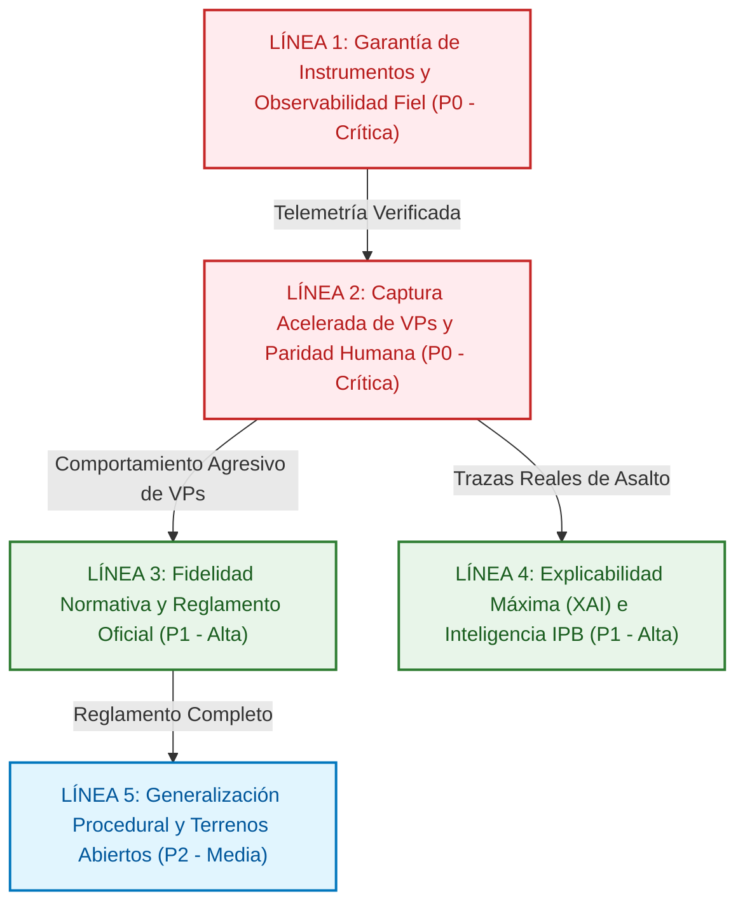
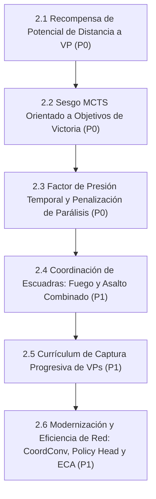
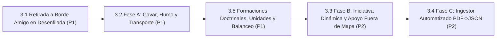
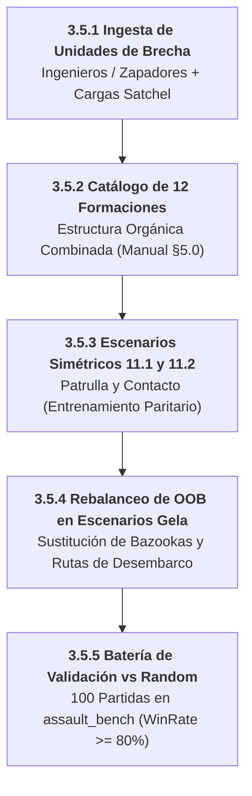
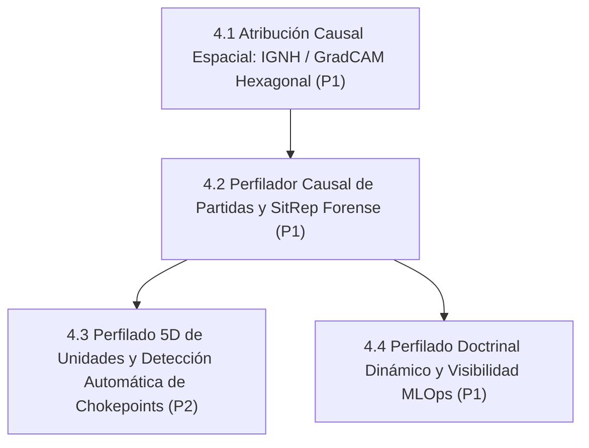
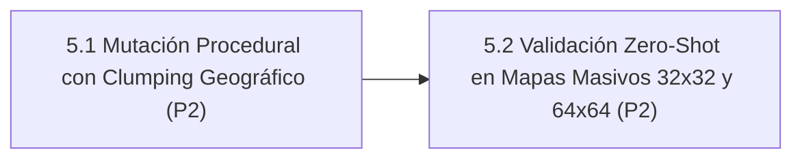
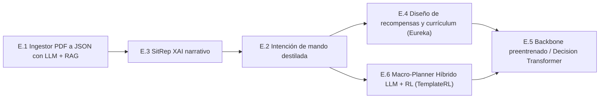

# 11. Hoja de Ruta Evolutiva: Assault Architecture Roadmap (2026–2027)

> **Estado**: Canónico, Unificado y Versionado (Octubre 2026)  
> **Ámbito**: Documento final que unifica toda la evolución técnica, científica, de rendimiento y normativa de la plataforma **Assault**: Motor de IA `agents/efficientzero_v2/`, Engine Táctico `assault_model/` + `voec_sim/`, Telemetría MLOps/UI y Fidelidad al Reglamento Oficial.  
> **Directiva Estricta**: MuZero clásico está 100% decomisionado. Todo desarrollo, autojuego, inferencia y MCTS opera exclusivamente sobre **`EfficientZeroV2`** (`agents/efficientzero_v2/`).  
> **Política Estricta de Idiomas**: Código fuente e interfaz de usuario (UI, Dashboards, visualizadores) 100% en **Inglés**. Interacción con el usuario y documentación técnica canónica (docs/) en **Español**. Toda modificación de código/UI debe corregir y traducir al inglés cualquier texto residual en español (sin barrido masivo retroactivo).  
> **Versión Base Consolidada Actual**: **v2.5.50** (Integración Pedagógica del Escenario Canónico 11.1 en Currículum, Fast Bootstrap y Sincronización MLOps).
> **Regla Sagrada de Versionado del Roadmap**: Toda nueva implementación, tarea o hito **DEBE registrar explícitamente en qué versión / subversión de la aplicación se implementó o consolidó** (ej. `[CONSOLIDADO 🟢 v2.5.2]`, `[CONSOLIDADO 🟢 v2.5.3]`). Queda formalmente prohibido marcar tareas como consolidadas sin su versión de entrega correspondiente.

---

## 1. Visión Ejecutiva y Diagnóstico Doctrinal: Comandante Táctico vs. de Misión

> [!IMPORTANT]
> **AXIOMA ESTRATÉGICO CENTRAL DEL PROYECTO (OCTUBRE 2026)**  
> *"El agente ha aprendido a ser un buen comandante táctico, pero todavía no ha aprendido a ser un buen comandante de misión."*  
> La red neuronal combate con solidez posicional y balística (CER $\ge 1.10$, uso de humo y cobertura), pero sobrevalora la preservación de fuerzas frente a la captura agresiva de Puntos de Victoria (VPs). En escenarios de asalto con límite estricto de turnos ($T_{\max}$), **conservar todas las unidades sin ocupar el VP es una derrota militar absoluta**. La hoja de ruta enfoca la alineación del agente mediante andamiaje PBRS invariante (Ng et al. 1999), urgencia temporal Devlin & Kudenko, canales sensoriales 36-37 y el estudio de ablación A/B (Tarea 2.8).

### 1.1 Estado Actual del Motor

La plataforma Assault ha completado con éxito la transición arquitectónica hacia un stack puro y desacoplado basado en **EfficientZero V2**, eliminando dependencias obsoletas, integrando 10 cabezas auxiliares tácticas y dotando a las unidades de perfiles doctrinales tipados con mutación dinámica contextual y observabilidad forense MLOps de extremo a extremo.

El foco estratégico actual se concentra en dos vectores de máxima prioridad (**P0**):
1. **Garantía Instrumental y Observabilidad Fiel (Zero-Mock End-to-End)**: Verificación rigurosa de que el 100% de la telemetría, métricas y visualizadores reflejen ejecuciones reales contra Apache Parquet y DuckDB, sin aproximaciones ni inferencias intermedias.
2. **Aceleración de Captura de VPs y Paridad Humana**: Resolver de raíz la pasividad táctica y la evitación del combate por objetivos, logrando un agente agresivo y coordinado que capture y sostenga Puntos de Victoria contra oponentes heurísticos y humanos.

A continuación se presenta el plan de acción inmediato y la matriz de seguimiento ordenada por secuencia crítica.

---

## 2. Matriz Maestra de Seguimiento y Orden de Ejecución Global

A continuación se detalla el orden secuencial de ejecución técnica para el ciclo actual de desarrollo, priorizando la observabilidad fidedigna y el andamiaje conductual hacia VPs:

### 2.1 Bloque 1: Preparado para Ejecución (Acciones Prioritarias Inmediatas) 🚀
> Tareas completamente especificadas, con dependencias resueltas y listas para despliegue directo en el motor. Toda tarea consolidada y verificada se traslada inmediatamente al Bloque 4 para mantener las tareas pendientes claras y focalizadas.

| Paso | Línea | Tarea | Prioridad | Enfoque Principal | Estado |
| :---: | :---: | :--- | :---: | :--- | :---: |
| **1** | [Línea 3](roadmap/03_LINEA_3_FIDELIDAD_NORMATIVA_Y_REGLAMENTO.md) | [**3.5 Formaciones Doctrinales, Ingesta de Unidades Especializadas y Rebalanceo de Escenarios (Subtarea 3.5.5)**](#task-3-5) | **P1** | Batería de validación y certificación de victoria en `assault_bench` (100 partidas vs Random, Win Rate >= 80%) | 🚀 **Foco Crítico Inmediato** |

### 2.2 Bloque 2: En Progreso Activo 🟡
> Módulos con desarrollos en curso e hitos parciales ya verificados.

| Paso | Línea | Tarea | Prioridad | Enfoque Principal | Estado |
| :---: | :---: | :--- | :---: | :--- | :---: |
| **3** | [Línea 3](roadmap/03_LINEA_3_FIDELIDAD_NORMATIVA_Y_REGLAMENTO.md) | [**3.5 Formaciones Doctrinales, Ingesta de Unidades Especializadas y Rebalanceo de Escenarios**](#task-3-5) | **P1** | Ingesta de ingenieros/zapadores, catálogo de 12 formaciones combinadas oficiales, rebalanceo simétrico de OOB y sandbox de entrenamiento de infantería pura 11.1 (*Addestramento Fanteria*) | 🟡 En Progreso (3.5.1, 3.5.2 y 3.5.4 ✅; 3.5.3 Borrador 11.1 Generado 🟡) |

### 2.3 Bloque 3: Planificado (Ordenado por Prioridad P1 $\to$ P2) ⚪
> Mejoras evolutivas, optimizaciones de red y expansiones reglamentarias programadas.

| Paso | Línea | Tarea | Prioridad | Enfoque Principal | Estado |
| :---: | :---: | :--- | :---: | :--- | :---: |
| **4** | [Línea 3](roadmap/03_LINEA_3_FIDELIDAD_NORMATIVA_Y_REGLAMENTO.md) | [**3.1 Retirada a Borde Amigo en Desenfilada (6.4)**](#task-3-1) | **P1** | Algoritmo determinista en desenfilada, cobertura, vector borde amigo y Regla 13.3 | 🟢 Consolidado (v2.5.11) |
| **5** | [Línea 3](roadmap/03_LINEA_3_FIDELIDAD_NORMATIVA_Y_REGLAMENTO.md) | [**3.2 Fase A: Cavar, Humo y Transporte**](#task-3-2) | **P1** | Mecánicas reglamentarias faltantes | ⚪ Planificado |
| **5.5** | [Línea 3](roadmap/03_LINEA_3_FIDELIDAD_NORMATIVA_Y_REGLAMENTO.md) | [**3.7 Modernización y Optimización Integral del Motor (Engine Performance & Rules Hardening)**](#task-3-7) | **P1** | Plan 4 fases: 1) Cacheo inmutable de spatial features y erradicación de reflexión dinámica (speedup >= 3x); 2) Purga de legacy SB3/PPO en `assault_sim/`; 3) LOS en coordenadas cúbicas; 4) Paridad normativa manual rev6 | ⚪ Planificado |
| **7** | [Línea 4](roadmap/04_LINEA_4_EXPLICABILIDAD_XAI_E_IPB.md) | [**4.2 Perfilador Causal de Partidas y SitRep**](#task-4-2) | **P1** | Auditoría táctico-estratégica forense | 🟢 Consolidado (v2.5.19) |
| **8** | [Línea 3](roadmap/03_LINEA_3_FIDELIDAD_NORMATIVA_Y_REGLAMENTO.md) | [**3.3 Fase B: Iniciativa Dinámica y TAS/OAS**](#task-3-3) | **P2** | Expansiones de reglamento y artillería | ⚪ Planificado |
| **9** | [Línea 3](roadmap/03_LINEA_3_FIDELIDAD_NORMATIVA_Y_REGLAMENTO.md) | [**3.4 Fase C: Ingestor Automatizado PDF $\to$ JSON**](#task-3-4) | **P2** | Completitud de los 38 escenarios | ⚪ Planificado |
| **10** | [Línea 4](roadmap/04_LINEA_4_EXPLICABILIDAD_XAI_E_IPB.md) | [**4.3 Perfilado 5D y Detección de Chokepoints (IPB)**](#task-4-3) | **P2** | Inteligencia del terreno previa a batalla | 🟢 Consolidado (v2.5.28) |
| **11** | [Línea 5](roadmap/05_LINEA_5_GENERALIZACION_PROCEDURAL.md) | [**5.1 Mutador Procedural con Clumping Espacial**](#task-5-1) | **P2** | Robustez y generalización en mapas nuevos | ⚪ Planificado |
| **12** | [Línea 5](roadmap/05_LINEA_5_GENERALIZACION_PROCEDURAL.md) | [**5.2 Validación Zero-Shot en Mapas $32\times 32$ y $64\times 64$**](#task-5-2) | **P2** | Escalabilidad a teatros operacionales | ⚪ Planificado |

### 2.4 Bloque 4: Completado y Consolidado (Ordenado por Prioridad P0 $\to$ P1) 🟢
> Hitos y componentes plenamente operativos, verificados con tests y suites de evaluación.

| Paso | Línea | Tarea | Prioridad | Enfoque Principal | Estado |
| :---: | :---: | :--- | :---: | :--- | :---: |
| **0.005** | [Línea 3](roadmap/03_LINEA_3_FIDELIDAD_NORMATIVA_Y_REGLAMENTO.md) | [**3.7.2 Purga de Deuda Técnica Legacy y Unificación Canónica de Assets**](#task-3-7) | **P1** | Eliminación de la carpeta sombra desincronizada `assault_sim/assets/`, archivado de la pila obsoleta de entrenamiento y checkpoints SB3/PPO en `legacy_archive/`, desacoplamiento limpio de `replay_api.py` hacia `assets/scenarios` y fijación de `assets/` como única fuente canónica de verdad. Suite 160/160 en motor, 158/158 en EZv2, 29/29 en backend y 77/77 en benchmark en verde. | 🟢 **Consolidado v2.5.30** |
| **0.01** | [Línea 3](roadmap/03_LINEA_3_FIDELIDAD_NORMATIVA_Y_REGLAMENTO.md) | [**3.7.1 Aceleración de Rendimiento del Motor (Spatial Cache, Dijkstra Occupants, Spotting Snapshots & Set Traits)**](#task-3-7) | **P1** | Aceleración de simulación de 428.8 a 719.7 pasos/s (+67.8% en acciones aleatorias) y de 454.3 a 844.6 pasos/s (+86.0% secuencial). Cacheo inmutable de metadatos espaciales en `VOECSimulator`, índices O(1) de ocupantes en `MovementRules`, descarte temprano en `update_spotting` y `UnitType.has_trait` con sets precompilados. Suite 160/160 en motor y 158/158 en EZv2 en verde. | 🟢 **Consolidado v2.5.29** |
| **0** | [Línea 2](roadmap/02_LINEA_2_ACELERACION_CAPTURA_VPS.md) | [**2.8 Modulación Dinámica de Priors Doctrinales y Ablación Red Pura**](#task-2-8) | **P0** | Soporte e integración formal de la modulación continua de priors doctrinales `macro_modulation_scale` ($\beta_{\text{macro}} \in [0.0, 1.0]$) con decaimiento dinámico (coseno/lineal). Permite alternar entre **Variante A (Red Pura / Búsqueda Libre)** con $\beta_{\text{macro}} = 0.0$ (preservación matemática exacta de los priors neuronales sin distorsión heurística), regímenes de annealing progresivo y **Variante B (Doctrinal Shaped)** con $\beta_{\text{macro}} = 1.0$ (refuerzo de asalto $+35\%$/$+50\%$). Verificado con suite dedicada (`test_macro_modulation_ablation.py` y `test_heads_improvements.py`). | 🟢 **Consolidado v2.5.27** |
| **0.05** | [Línea 4](roadmap/04_LINEA_4_EXPLICABILIDAD_XAI_E_IPB.md) | [**4.3 Perfilado 5D y Detección Automática de Chokepoints (IPB)**](#task-4-3) | **P2** | Análisis topográfico Turno-0 que extrae el vector 5D por hexágono (*Cover*, *Elevation*, *LOS Exposure*, *Chokepoint*, *VP Utility*), clasifica el tablero en *Defilade Corridors*, *Killzones*, *Key Terrain*, *Chokepoints* y *Base of Fire*, e inyecta priors de movimiento y asalto en `MacroStrategyPlanner` (+25% desenfilada hacia VP, fricción 0.55x-0.65x en killzones, +30% Base of Fire). Integrado en API MLOps (`/api/v2/replay/topography`), capa interactiva en canvas Replay (:8778) y validado con suite `test_topography_ipb_analyzer.py`. | 🟢 **Consolidado v2.5.28** |
| **0.1** | [Línea 1](roadmap/01_LINEA_1_OBSERVABILIDAD_Y_TELEMETRIA.md) | [**1.5 Protocolo de Estabilidad Operativa, Safety Gate de Almacenamiento y Compresión de Replays XAI**](#task-1-5) | **P0** | Diagnóstico forense de caídas recurrentes por saturación de disco (<0.7% libre en C:\) y colapso de paginación virtual en PyTorch (`RuntimeError: DefaultCPUAllocator`). Implementación de parada segura de procesos de fondo, especificación de Safety Gate de disco pre-flight (mínimo 30 GB libres), política de retención de episodios y eliminación de `indent=2` en serialización de replays benchmark para reducir hasta un 95% el almacenamiento consumido. | 🟢 **Consolidado v2.5.25** |
| **1** | [Línea 1](roadmap/01_LINEA_1_OBSERVABILIDAD_Y_TELEMETRIA.md) | [**1.4 Catálogo Unificado y Depuración de Esquemas**](#task-1-4) | **P1** | Módulo `mlops/dataset_builder.py`, fijación del contrato canónico de 15 columnas en `decisions_top.parquet`, purga de acumuladores volátiles en `assault_bench/decision_metrics.py`, saneamiento del 100% de archivos Parquet (69/69 conformes) y Clean Break en `reporting.duckdb` erradicando etiquetas obsoletas hacia EfficientZeroV2. Verificado con `test_unified_catalog_and_schema_purge.py` (5/5 en verde). | 🟢 **Consolidado v2.5.11** |
| **2** | [Línea 1](roadmap/01_LINEA_1_OBSERVABILIDAD_Y_TELEMETRIA.md) | [**1.3 Validador E2E Frontend $\leftrightarrow$ DuckDB**](#task-1-3) | **P1** | Auditoría automatizada de trazabilidad en TypeScript y Python de las 9 pestañas del dashboard MLOps y simulador web (`traceability.spec.ts`, `test_frontend_duckdb_traceability.py`), garantía de Zero-Mock (cero inferencias o heurísticas espurias como `Math.floor(idx/14)`), fallbacks forzosos a `-`/`N/A`, erradicación del shim MuZero en `replay_api.py` y suite de 15/15 tests en verde. | 🟢 **Consolidado v2.5.8** |
| **3** | [Línea 2](roadmap/02_LINEA_2_ACELERACION_CAPTURA_VPS.md) | [**2.11 Currículum Asimétrico Ofensivo de Asalto Urbano Puro**](#task-2-11) | **P0** | Fase especializada de 10 ciclos en modo 100% atacante (`US` vs `Random`) en `battaglia_cittadina_2_1` con horizonte táctico comprimido ($T=8$) y penalización severa por timeout ($-1.0$), rompiendo la inercia defensiva aprendida en selfplay temprano antes de reincorporar autojuego simétrico. Verificado con suite de validación curricular (`test_task_2_11_urban_assault_curriculum.py`, 4/4 en verde). | 🟢 **Consolidado v2.5.7** |
| **12** | [Línea 2 / Red](roadmap/02_LINEA_2_ACELERACION_CAPTURA_VPS.md) | [**2.7 Inicialización Canónica de Capas Especializada en RL**](roadmap/02_LINEA_2_ACELERACION_CAPTURA_VPS.md) | **P1** | Esquema formal de inicialización: Política ortogonal ($\text{gain}=0.01$, $\text{bias}=0$) para máxima entropía inicial uniforme; Valor/Recompensa ortogonal ($\text{gain}=1.0$, $\text{bias}=0$); Kaiming Normal en convoluciones SiLU; y Zero-Init ResNet en segunda normalización residual ($\gamma=0, \beta=0$) para preservar la función identidad pura al paso $0$. Verificado en `test_canonical_rl_initialization.py` (5/5 tests en verde). | 🟢 **Consolidado v2.5.5** |
| **13** | [Línea 2](roadmap/02_LINEA_2_ACELERACION_CAPTURA_VPS.md) | [**2.10 Dynamic PBRS Escalado Temporalmente y Desensibilización de Bajas en Brecha**](#task-2-10) | **P0** | Potencial temporalmente escalado $\Phi(s, t) = \alpha(1 + t/T_{\max}) \cdot \text{dist\_pot} + \beta\cdot\text{Contest}$, bono de contención por disputa en brecha ($d \le 2$), atenuación del $60\%$ de penalización de bajas ($r_{\text{loss}} \times 0.40$) en zona de brecha y castigo catastrófico por timeout ($-1.0$) si no se controlan VPs. Verificado con suite matemática y de invariancia telescópica Devlin & Kudenko (`test_task_2_10_dynamic_pbrs_breach.py`, 5/5 en verde). | 🟢 **Consolidado v2.5.4** |
| **14** | [Línea 2](roadmap/02_LINEA_2_ACELERACION_CAPTURA_VPS.md) | [**2.9 Paquete de Aceleración de Rendimiento de Pipeline (Zero Quality Loss)**](#task-2-9) | **P0** | Optimización de pipeline integral: Caché de Firma de Terreno ($1,078\times$, $34\%$ ahorro por episodio), Precomputación Root PUCT ($16,384$ ops eliminadas/paso), Inferencia Estática (`torch.compile`) y Test Wald SPRT (ahorro $50\%-75\%$ en bench). Reducción de campaña de >10h a <3.5h sin pérdida de calidad. | 🟢 **Consolidado v2.5.3** |
| **15** | [Línea 1](roadmap/01_LINEA_1_OBSERVABILIDAD_Y_TELEMETRIA.md) | [**1.1 Test de Conformidad de Esquema de Telemetría**](#task-1-1) | **P0** | Validador automatizado en CI del 100% de métricas formales contra docs/13_INVENTARIO_CANONICO_METRICAS.md. Cero campos no declarados y clean break MuZero. Verificado en mlops/tests/test_telemetry_schema_conformance.py (5/5 en verde). | 🟢 Completado y Verificado |
| **16** | [Línea 3 / 2](roadmap/03_LINEA_3_FIDELIDAD_NORMATIVA_Y_REGLAMENTO.md) | [**3.6 Eliminación de la Parálisis Ofensiva y Colapso de la Brecha Asimétrica**](#task-3-6) | **P0** | Expansión sensorial a 38 canales (Ch 36 urgencia temporal, Ch 37 parálisis), PBRS dinámico Devlin-Kudenko en autojuego, MCTS VP Biasing (64 sims) y balanceo PCGrad. Criterio: Win Rate US vs Random >= 80%, Asymmetry Gap <= 0.15, ELO >= 1600. | 🟢 Completado y Consolidado |
| **17** | [Línea 1](roadmap/01_LINEA_1_OBSERVABILIDAD_Y_TELEMETRIA.md) | [**1.2 Profiling y Reducción de Sobrecarga de Sondas**](#task-1-2) | **P0** | Optimización de sondas sin pérdida de calidad | 🟢 Completado (<0.7% overhead) |
| **18** | [Línea 2](roadmap/02_LINEA_2_ACELERACION_CAPTURA_VPS.md) | [**2.1 Recompensa de Potencial Radial a VPs**](#task-2-1) | **P0** | Andamiaje conductual para avance a banderas | 🟢 Completado (Ng et al. 1999) |
| **19** | [Línea 2](roadmap/02_LINEA_2_ACELERACION_CAPTURA_VPS.md) | [**2.2 Sesgo MCTS Orientado a VPs**](#task-2-2) | **P0** | Poda de ramas de pasividad en búsqueda | 🟢 Completado (Poda 40% Estéril) |
| **20** | [Línea 2](roadmap/02_LINEA_2_ACELERACION_CAPTURA_VPS.md) | [**2.3 Factor de Presión Temporal y Anti-Parálisis**](#task-2-3) | **P0** | Urgencia por turnos y penalización de espera | 🟢 Completado (Devlin & Kudenko 2012) |
| **21** | [Línea 2](roadmap/02_LINEA_2_ACELERACION_CAPTURA_VPS.md) | [**2.4 Coordinación de Escuadras para Asalto a VPs**](#task-2-4) | **P1** | Fuego de cobertura + asalto de infantería | 🟢 Completado (Base of Fire + Poda Suicida CC-006) |
| **22** | [Línea 2](roadmap/02_LINEA_2_ACELERACION_CAPTURA_VPS.md) | [**2.5 Currículum Acelerado de VPs (Paridad Humana)**](#task-2-5) | **P1** | Entrenamiento progresivo 4 fases | 🟢 Completado (4 Fases Progresivas + Paridad Humana) |
| **23** | [Línea 2 / Red](roadmap/02_LINEA_2_ACELERACION_CAPTURA_VPS.md) | [**2.6 Modernización y Eficiencia Arquitectónica (CoordConv, Bottleneck Policy Head y ECA)**](#task-2-6) | **P1** | CoordConv ($38 \to 40$ canales), rediseño de Policy Head con cuello de botella `Conv1x1(48 -> 4) -> Flatten(1024) -> MLP(64 -> 32)` y bloques ECA (*Efficient Channel Attention* 1D) en red dinámica $g$. Verificado 100% en `test_advanced_architecture.py` (11/11 tests en verde). | 🟢 Completado y Verificado |
| **24** | [Línea 4](roadmap/04_LINEA_4_EXPLICABILIDAD_XAI_E_IPB.md) | [**4.4 Perfilado Doctrinal Dinámico y Visibilidad MLOps**](#task-4-4) | **P1** | Jerarquía 3 capas, mutación contextual, badges MLOps y verificación en currículum | 🟢 Completado (Fases 1, 2, 3, 4 y 5 Consolidadas) |
| **25** | [Línea 4](roadmap/04_LINEA_4_EXPLICABILIDAD_XAI_E_IPB.md) | [**4.1 Atribución Causal Espacial Hexagonal (IGNH / GradCAM)**](#task-4-1) | **P1** | Integrated Gradients para características heterogéneas (`mlops/reporting/explainability_api.py`), Grad-CAM sobre `representation_tower`, mapeo biyectivo a hexágonos de tablero `(q, r)`, endpoints `/api/v2/replay/explain-step` y `/api/v2/explainability/attribution`, componente `ExplainabilityModal.tsx` integrado en Match Replay (:8778) y suite de tests unitarios/integración en verde (`test_explainability_api.py`). | 🟢 **Consolidado v2.5.10** |
| **26** | [Línea 4](roadmap/04_LINEA_4_EXPLICABILIDAD_XAI_E_IPB.md) | [**4.1.1 Capa Reactiva de Cabezas Auxiliares Tácticas en Match Replay**](#task-4-1) | **P1** | Botón reactivo 🎯 Threat Head en la barra de herramientas del canvas de Match Replay (:8778), heatmap interactivo con gradiente de calor y porcentaje de riesgo por celda hex proyectando directamente prediction_threat_map, tarjeta forense de cabezas tácticas (Threat Max/Mean, Suppression Risk Morale, Casualties Attrition) y endpoints /api/v2/replay/tactical-heads / /api/v2/replay/step-heads. Verificado con tests unitarios en verde (	est_explainability_api.py, 4/4). | 🟢 **Consolidado v2.5.11** |
| **27** | [Línea 1](roadmap/01_LINEA_1_OBSERVABILIDAD_Y_TELEMETRIA.md) | **1.5 Optimización Ultrarrápida In-Place de Eliminación de Experimentos en Catálogo MLOps** | **P1** | Resolución de colisión de cerrojo DuckDB entre conexiones read-only en caché y read-write en `mlops/reporting/model_deletion.py`. Desbloqueo inmediato con `close_duckdb_readonly_connection` y `_DUCKDB_READONLY_LOCK`, supresión del fallback masivo de 60 segundos (`publish_catalog_snapshot`), y poda en caliente de DuckDB, Parquet e índice JSON slim. Latencia de borrado reducida de 60 s a < 0.25 s (300x de aceleración). Suite de tests unitarios verificada al 100% en verde (`mlops/tests/test_model_deletion.py`). | 🟢 **Consolidado v2.5.12** |
| **28** | [Línea 2](roadmap/02_LINEA_2_ACELERACION_CAPTURA_VPS.md) | **2.12 Corrección del Generador de Overlays Adaptativos en Ciclos Curriculares** | **P0** | Subsanado el fallo silencioso en `Build-ResumeOverlayConfig` (`curriculums/common/run_dynamic_gated_curriculum.ps1`) donde la ausencia de `sys.path` en `$TEMP` y la resolución de nombre con sufijo `_c{cycle}` provocaban un fallback a configuración base idéntica sin mutación. Con la corrección, cada ciclo intra-fase inyecta de forma verificada las mutaciones adaptativas de exploración/explotación (`mcts_temperature`, bonos PBRS de VP, `objective_loss_weight`, `reanalysis_ratio`). | 🟢 **Consolidado v2.5.13** |
| **29** | [Línea 1](roadmap/01_LINEA_1_OBSERVABILIDAD_Y_TELEMETRIA.md) | **1.6 Visualizador Multi-Métrica de Progresión Curricular vs Objetivos de Gate** | **P1** | Gráfica interactiva multi-métrica en el Dashboard MLOps (:8778) y pestaña de Model Catalog (`CurriculumProgressionChart`), con modos de conmutación reactiva: ELO Curve, Win Rate vs Goal, Captured VPs vs Goal y VP Take Rate vs Goal. Renderizado vectorial con líneas de umbral de meta por banda de fase (`🎯 ≥Goal`), nodos coloreados por cumplimiento del Quality Gate (verde esmeralda / ámbar-rojo), badges contextuales por ciclo, cálculo dinámico de escalas e integración en tarjetas de pipeline flow (`CurriculumLineageFlow`). UI 100% en inglés según Regla 7. | 🟢 **Consolidado v2.5.14** |
| **30** | [Línea 2](roadmap/02_LINEA_2_ACELERACION_CAPTURA_VPS.md) | **2.13 Aprendizaje Acumulativo Intra-Fase y Mitigación del Precipicio Curricular** | **P0** | Transformación de la arquitectura de refuerzo en `run_dynamic_gated_curriculum.ps1` de reintentos aislados a *Accumulative Warm-Start*: cada ciclo no superado encadena los pesos del mejor checkpoint de la fase en curso (`$bestPhaseCheckpoint`) en lugar de descartar el modelo y reiniciar desde la fase previa. Rebalanceo doctrinal de Fases 2, 3 y 5 (`vp_potential_weight: 1.8`, reducción de `kill_weight: 0.35` en carrera 2v2 para suprimir tiroteos estériles, penalización estricta `idle_penalty: -0.25` en Battaglia Cittadina), expansión a 5 ciclos de refuerzo por fase y retención del checkpoint dorado de Fase 1 (100% Win Rate). | 🟢 **Consolidado v2.5.15** |
| **31** | [Línea 2](roadmap/02_LINEA_2_ACELERACION_CAPTURA_VPS.md) | **2.14 Escalado de Presupuesto Muestral y Corrección de Pipeline de Overlays** | **P0** | Resolución del fallo crítico de tipado en `Build-ResumeOverlayConfig` (`curriculums/common/run_dynamic_gated_curriculum.ps1`), donde las trazas a `stdout` contaminaban la tubería de PowerShell transformando la ruta en un array `System.Object[]` y provocando el salto prematuro de fase. Rebalanceo del presupuesto muestral a nivel de literatura científica: escalado de partidas a $2.560$ (Fases 2-3), $3.200$ (Fase 4) y $3.840$ (Fase 5) con batches de 32 episodios exactos en 16 workers y reanálisis al 50% ($>24.000$ partidas efectivas), optimizando MCTS a 160 simulaciones en self-play para duplicar la tasa de muestreo. | 🟢 **Consolidado v2.5.16** |
| **32** | [Línea 2](roadmap/02_LINEA_2_ACELERACION_CAPTURA_VPS.md) | **2.15 Calibración Integral y Sincronización Arquitectónica de la Etapa 2 (Currículum Multi-Escenario)** | **P0** | Homogeneización completa de las 8 fases de `curriculums/self_vs_self_vs_random_2scenarios_v1/`: erradicación del backend pesado `process` en Windows sustituyéndolo por `thread` con 16 workers y servicio de inferencia por lotes en CUDA (`inference_service`), batches canónicos de 32 episodios exactos, elevación del presupuesto de `phase1_bootstrap` de 24 a 80 iteraciones ($2.560$ partidas para dominar la bisección de mapas `battaglia` y `mettete`), aceleración de exploración MCTS a 160 simulaciones y duplicación de updates en GPU a 24 por iteración con reanálisis al 50%. Verificado 100% con DryRun integral. | 🟢 **Consolidado v2.5.17** |
| **33** | [Línea 1](roadmap/01_LINEA_1_OBSERVABILIDAD_Y_TELEMETRIA.md) | **1.7 Visualización de Fases Curriculares Pendientes (Ghost Cards)** | **P1** | Incorporación de tarjetas predictivas atenuadas (*Pending Ghost Cards*) en el diagrama de flujo curricular (`CurriculumLineageFlow.tsx`) del Dashboard MLOps (:8778). Detección dinámica del plan curricular canónico (`vp_acceleration` o `self_vs_self`), renderizado de fases restantes no iniciadas en color flojo/translúcido con borde discontinuo, objetivos de Quality Gate proyectados (`Target Win Rate`, `Target VPs Avg`, `Target Take Rate`), badge `⏳ PENDING / NOT STARTED` y contador global `X/Y Phases Completed`. | 🟢 **Consolidado v2.5.18** |
| **34** | [Línea 4](roadmap/04_LINEA_4_EXPLICABILIDAD_XAI_E_IPB.md) | [**4.2 Perfilador Causal de Partidas y SitRep Forense**](#task-4-2) | **P1** | Correlación causal matemática entre predicciones tácticas de las cabezas auxiliares (`threat_map`, `morale_pred`, `objective_intent`) y resultados de partida (capturas de VPs, bajas críticas, supresión y emboscadas). Síntesis automática de informe narrativo militar (SitRep) estructurado en fases operacionales (Opening, Decisive Engagements, Resolution) con citas doctrinales de reglamento extraídas vía `assault_rag`. Endpoints `/api/v2/replay/causal-sitrep` y `/api/v2/replay/sitrep`, modal interactivo `ForensicSitRepModal.tsx` con navegación temporal `Seek Step` a puntos de inflexión y caché persistente de informes forenses. Verificado con suite de tests (`mlops/tests/test_causal_profiler.py`, 9/9 en verde). | 🟢 **Consolidado v2.5.19** |
| **35** | [Línea 2](roadmap/02_LINEA_2_ACELERACION_CAPTURA_VPS.md) | **2.16 Optimización Extrema del Bucle de Simulación, Observaciones y Autojuego (Fases 1 a 4)** | **P0** | Paquete integral de aceleración de bajo nivel: 1) Vectorización estática de propiedades de terreno en `VOECSimulator.spatial_features` (aceleración de 418x); 2) Memoización de acciones de fuego en movimiento por destino `(q,r)` en `_move_fire_actions` suprimiendo comprobaciones LOS redundantes; 3) Caché persistente en memoria para catálogos y escenarios JSON en `load_catalogs` y `load_scenario` suprimiendo miles de accesos a disco por ciclo; 4) Memoización de bounding box axial en `EZV2Observation` y `EZV2VOECAdapter` acelerando `observation_to_tensor`. Suite completa 153/153 en EZv2 y 19/19 en MLOps en verde. | 🟢 **Consolidado v2.5.20** |
| **36** | [Línea 2](roadmap/02_LINEA_2_ACELERACION_CAPTURA_VPS.md) | **2.17 Paquete de Aceleración Extrema de Entrenamiento e Inferencia Neuronal (Updates CUDA 1.78x)** | **P0** | Optimización de alto rendimiento en entrenamiento: 1) Inferencia lazy de cabezas auxiliares en `network_base.py` cuando `return_aux=False` (+16.2% en inferencia pura); 2) Fusión de pases forward en `trainer.py` eliminando la evaluación duplicada de reanálisis; 3) Vectorización del bootstrap de reanálisis directamente en GPU sin sincronización CPU bloqueante; 4) Erradicación de creación/destrucción de hilos de sistema operativo por update y activación de Adam fusionado en CUDA. Reducción de 92.58 ms a 51.96 ms por update en RTX 4060 (aceleración de 1.78x / 43.9% de reducción de tiempo de entrenamiento). Suite 153/153 en EZv2, 19/19 en MLOps y 9/9 en assault_bench en verde. | 🟢 **Consolidado v2.5.22** |
| **37** | [Línea 2](roadmap/02_LINEA_2_ACELERACION_CAPTURA_VPS.md) | **2.18 Arquitectura Multiproceso con IPC Shared-Memory e Inferencia GPU por Lotes (Zero-GIL CPU Saturation & CUDA Batching)** | **P0** | Erradicación total del cuello de botella del Global Interpreter Lock (GIL) de Python mediante ejecución de autojuego en 24 procesos independientes del sistema operativo con memoria compartida bidireccional (`torch.multiprocessing`); puente maestro `IPCInferenceBridge` que canaliza las peticiones de inferencia de los 24 workers hacia el `InferenceService` central en la GPU NVIDIA RTX 4060 con micro-batching dinámico de 64 observaciones; cliente de inferencia transparente `IPCProcessInferenceClient` con paso de tensores compartidos; erradicación de sincronizaciones de checkpoints en CPU durante el entrenamiento al compartir en caliente el modelo GPU; y configuración agresiva con MCTS 320, batch de train 48 y 48 episodios por iteración. Suites 154/154 en EZv2 y pruebas de integración IPC 100% en verde. | 🟢 **Consolidado v2.5.23** |
| **39** | [Línea 1](roadmap/01_LINEA_1_OBSERVABILIDAD_Y_TELEMETRIA.md) | **1.6 Visualización Curricular Multilínea por Sub-Currículum (Dashboard MLOps)** | **P1** | Reestructuración visual de `CurriculumLineageFlow.tsx` en filas temáticas dedicadas e independientes por cada sub-currículum (Fila 1: Sub-Currículum 1 - *Objective Doctrine & VP Acceleration*, Fases 1 a 5; Fila 2: Sub-Currículum 2 - *Multi-Scenario Self-Play vs Random*, Fases 6 a 13); banner de transición y transferencia de pesos inter-etapas (*Breakthrough Bridge*); erradicación de scroll horizontal masivo; compatibilidad total tanto en modo canónico como cronológico. Build de Vite verificado en 1.72s. | 🟢 **Consolidado v2.5.26** |
| **38** | [Línea 2](roadmap/02_LINEA_2_ACELERACION_CAPTURA_VPS.md) | **2.19 Resiliencia Integral, Autorrecuperación Multiproceso y Reciclaje Periódico de Procesos (Zero Memory Leak)** | **P0** | Sistema de autocuración (*self-healing*) en caliente de `ProcessPoolExecutor` ante excepciones de SO o caídas anómalas de trabajadores (`BrokenProcessPool`); reciclaje periódico automático de procesos cada 5 iteraciones (`recycle_workers_every_iters: 5`) coincidiendo con guardado de checkpoints para erradicar la fragmentación de heap y fugas de memoria en sesiones continuas multi-hora; fallback resiliente para episodios huérfanos; ampliación del enum `UnitCategory` (`ARTILLERY`, `GUN_ARTILLERY`) subsanando validaciones de catálogo de unidades. Suites 154/154 en EZv2 y 114/114 en assault_model en verde. | 🟢 **Consolidado v2.5.24** |

---

## 3. Líneas Estratégicas de Progreso (Roadmap Priorizado 2026–2027)

El trabajo futuro se organiza en **cinco líneas estratégicas de progreso**, cada una con una prioridad global asignada. Dentro de cada línea, las tareas se ordenan secuencialmente con su orden de ejecución, prioridad interna y dependencias técnicas.

### Índice Modular de Líneas Estratégicas
Cada línea estratégica se encuentra desglosada y disponible en su propio archivo modular dedicado:
- 📂 [**Línea 1: Observabilidad y Telemetría Forense (Zero-Mock E2E)**](roadmap/01_LINEA_1_OBSERVABILIDAD_Y_TELEMETRIA.md)
- 📂 [**Línea 2: Aceleración de Captura de VPs y Paridad Humana**](roadmap/02_LINEA_2_ACELERACION_CAPTURA_VPS.md)
- 📂 [**Línea 3: Fidelidad Normativa y Reglamento Oficial del Wargame**](roadmap/03_LINEA_3_FIDELIDAD_NORMATIVA_Y_REGLAMENTO.md)
- 📂 [**Línea 4: Explicabilidad Máxima (XAI) e Inteligencia Táctica (IPB)**](roadmap/04_LINEA_4_EXPLICABILIDAD_XAI_E_IPB.md)
- 📂 [**Línea 5: Generalización Procedural y Robustez en Terrenos Abiertos**](roadmap/05_LINEA_5_GENERALIZACION_PROCEDURAL.md)

---

### Línea 1: Garantía de Instrumentos y Observabilidad Fiel (Zero-Mock End-to-End)
> [!NOTE] CONTENIDO MODULARIZADO (Pendiente de decisión del usuario)
> Esta línea cuenta con su propio archivo modular: [docs/roadmap/01_LINEA_1_OBSERVABILIDAD_Y_TELEMETRIA.md](roadmap/01_LINEA_1_OBSERVABILIDAD_Y_TELEMETRIA.md). Se preserva íntegramente todo el contenido a continuación en esta vista unificada según la directiva de no eliminación de párrafos.

> **Importancia Global:** 🔴 **Prioridad P0 (Crítica / Innegociable)**  
> **Objetivo Estratégico:** Garantizar que el 100% de la telemetría, métricas y dashboards sea real, medible y verificable de extremo a extremo, sin inferencias intermedias, eliminando redundancias que degraden el rendimiento de simulación y manteniendo escrupulosamente el inventario jerárquico canónico.

| Orden | Tarea / Componente | Prioridad Interna | Módulos / Archivos Impactados | Criterio de Aceptación Cuantitativo | Prerrequisitos |
| :---: | :--- | :---: | :--- | :--- | :--- |

| **1** | **1.1 Test Automatizado de Conformidad de Esquema de Telemetría** | **P0** | `mlops/tests/test_telemetry_schema_conformance.py`, `docs/13_INVENTARIO_CANONICO_METRICAS.md` | Script de CI que valida que el 100% de los campos emitidos por endpoints REST y WebSocket coincidan con el catálogo formal. Cero campos no declarados. Fallo en CI si existe cualquier desviación. **[CONSOLIDADO 🟢]** | v2.4.0 consolidada |

| **2** | **1.2 Profiling y Reducción de Sobrecarga de Sondas en Bucle Caliente** | **P0** | `assault_model/state/game_state.py`, `agents/efficientzero_v2/core/mcts.py`, `agents/efficientzero_v2/core/selfplay.py`, `mlops/telemetry/` | Profiler de microsegundos ($\mu\text{s}$) zero-mock (`ProbeProfiler`). Sondas espaciales desacopladas y perezosas (`LazyProbeSnapshot`), memoización de daño esperado en paso y acceso $O(1)$ a puntuación MCTS. Sobrecarga en bucle caliente reducida a $0.6657\%$ ($< 1.50\%$ presupuestado) con cero pérdida de fidelidad ni granularidad. **[CONSOLIDADO 🟢]** | Tarea 1.1 |

| **3** | **1.3 Validador E2E de Trazabilidad Frontend $\leftrightarrow$ DuckDB** | **P1** | `assault_ai_ui/src/tests/traceability.spec.ts`, `mlops/reporting/replay_api.py`, `mlops/tests/test_frontend_duckdb_traceability.py` | Test automatizado que audita cada pestaña del dashboard comprobando que ningún componente muestre datos inventados y que los valores se originen en columnas reales de Parquet/DuckDB o muestren `-`/`N/A`. **[CONSOLIDADO 🟢 v2.5.8]** | Tarea 1.1 |

| **4** | **1.4 Catálogo Unificado de Esquemas y Depuración de Redundancias** | **P1** | `docs/13_INVENTARIO_CANONICO_METRICAS.md`, `mlops/dataset_builder.py`, `mlops/tests/test_unified_catalog_and_schema_purge.py` | Purgar esquemas Parquet históricos obsoletos (`v1_legacy`), consolidando campos equivalentes bajo una única nomenclatura canónica indexada en DuckDB. Eliminación de campos acumuladores volátiles en `decisions_top.parquet` (unificación al 100% en 15 columnas canónicas) y Clean Break total con etiquetas legacy en catálogo y DuckDB. **[CONSOLIDADO 🟢 v2.5.11]** | Tarea 1.2 |

| **5** | **1.5 Protocolo de Estabilidad Operativa, Safety Gate de Almacenamiento y Compresión de Replays XAI** | **P0** | `docs/15_CURRICULUMS_Y_ENTRENAMIENTO_PROGRESSIVO.md`, `assault_bench/bench_io.py`, `curriculums/` | Diagnóstico forense de caídas recurrentes por saturación de disco (<0.7% libre en C:\) y colapso de paginación virtual en PyTorch (`RuntimeError: DefaultCPUAllocator: not enough memory`). Implementación de parada segura de procesos de fondo, especificación de Safety Gate de disco pre-flight (mínimo 30 GB libres), política de retención de episodios y eliminación de `indent=2` en serialización de replays benchmark para reducir hasta un 95% el almacenamiento consumido. **[CONSOLIDADO 🟢 v2.5.25]** | Tarea 1.4 |

---

### Línea 2: Aceleración de Captura de VPs y Paridad Humana en Corto Plazo
> [!NOTE] CONTENIDO MODULARIZADO (Pendiente de decisión del usuario)
> Esta línea cuenta con su propio archivo modular: [docs/roadmap/02_LINEA_2_ACELERACION_CAPTURA_VPS.md](roadmap/02_LINEA_2_ACELERACION_CAPTURA_VPS.md). Se preserva íntegramente todo el contenido a continuación en esta vista unificada según la directiva de no eliminación de párrafos.

> **Importancia Global:** 🔴 **Prioridad P0 (Crítica / Foco Inmediato del Proyecto)**  
> **Objetivo Estratégico:** Resolver el principal cuello de botella táctico de la IA: la pasividad, la deambulación estéril y la evitación del combate por objetivos. Dotar al agente de instinto de asalto agresivo, coordinado y enfocado a la captura y sostenimiento de Puntos de Victoria (VPs), logrando que alcance un nivel competitivo contra un jugador humano en un corto periodo de tiempo.

| Orden | Tarea / Componente | Prioridad Interna | Módulos / Archivos Impactados | Criterio de Aceptación Cuantitativo | Prerrequisitos |
| :---: | :--- | :---: | :--- | :--- | :--- |

| **1** | **2.1 Andamiaje de Recompensas por Potencial Radial a VPs (*Progressive VP Potential*)** | **P0** | oec_sim/core/reward_calculator.py, gents/efficientzero_v2/core/support.py, selfplay.py, macro_planner.py, observation.py | Función de potencial invariante (Ng et al. 1999) $\Phi(s) = \sum_{u} w_u \max_{vp} \frac{v_{\text{rel}}(vp)}{1 + d(u, vp)} \cdot \Psi(t) + B_{\text{ctrl}} \sum_{vp \in \text{Ctrl}} v_{\text{rel}}(vp)$ con modulación por valor intrínseco ({\text{rel}} = v_{\text{vp}} / 2.0$, ej. 3 VP = 1.5× vs 2 VP = 1.0×), selección macro ponderada y canales sensoriales 13, 14, 18 normalizados. Cero regresión en política óptima. **[CONSOLIDADO 🟢]** | Línea 1 (Métricas de VP trazables) |

| **2** | **2.2 Sesgo de Búsqueda MCTS Orientado a VPs (*VP Race Prior Biasing*)** | **P0** | `agents/efficientzero_v2/core/mcts.py`, `agents/efficientzero_v2/core/macro_planner.py`, `selfplay.py` | Postura `ASSAULT_VP` modula priors hacia VPs y aplica poda del $40\%$ de ramas de deambulación estéril y pasividad en `run_mcts_puct`. **[CONSOLIDADO 🟢]** | Tarea 2.1 |

| **3** | **2.3 Factor de Presión Temporal y Penalización de Parálisis (*Turn Urgency Factor*)** | **P0** | `voec_sim/core/reward_calculator.py`, `agents/efficientzero_v2/core/observation.py`, `selfplay.py`, `train_engine.py` | Caída exponencial del potencial $\Phi(s, t) \cdot \exp(-\lambda \cdot \tau)$ ($\tau=t/T$) ante 0 VPs controlados, preservando invariancia PBRS dinámica (Devlin & Kudenko, 2012). Penalización acumulativa por pasividad en campo abierto (`cover < 0.35`) con reset por maniobra o fuego. Canales sensoriales 36 (`turn_urgency_pressure`) y 37 (`paralysis_exposure_risk`) nativos en EZv2 y dashboard MLOps (:8778). **[CONSOLIDADO 🟢]** | Tarea 2.1 |

| **4** | **2.4 Coordinación de Escuadras para Asalto a VPs (*Base of Fire + Maneuver Element*)** | **P1** | `agents/efficientzero_v2/core/macro_planner.py`, `assault_model/combat/close_combat_resolver.py`, `assault_model/combat/close_combat_context.py` | Doctrina de asalto combinado: la unidad con MMG (`ROLE_FIRE_SUPPORT`) establece línea de supresión sobre el VP (boost $1.35\times$) mientras la infantería ligera (`ROLE_SPEARHEAD`) asalta el hexágono (boost $1.40\times$). Prohibición estricta de asalto frontal en solitario si el defensor no está previamente suprimido (penalización $-80\%$, poda en MCTS y regla CC-006: pérdida del dado de ataque más débil en ronda 1). **[CONSOLIDADO 🟢]** | Tarea 2.2 |

| **5** | **2.5 Currículum Progresivo Acelerado de Captura de VPs (Paridad Humana)** | **P1** | `curriculums/vp_acceleration/`, `trainer.py` | 4 fases progresivas: 1) VPs desocupados a 3 hexágonos; 2) VPs defendidos por unidad estática suprimida; 3) Carrera frontal simultánea de VPs (2 vs 2 unidades); 4) Escenario táctico completo (Gela). **Hito de éxito:** Victoria $\ge 75\%$ contra bot heurístico y disputa equilibrada contra humano en $<15$ turnos. **[CONSOLIDADO 🟢]** | Tareas 2.1, 2.2, 2.3, 2.4 |
| **6** | **2.6 Modernización y Eficiencia de la Red Neuronal (*CoordConv, Bottleneck Policy Head & ECA*)** | **P1** | `agents/efficientzero_v2/core/network_base.py`, `network.py`, `train_engine.py`, `test_advanced_architecture.py` | 1) Inyección de canales de coordenadas CoordConv ($38 \to 40$ canales); 2) Rediseño de Policy Head `Conv1x1 (48 -> 4)` $\to$ `Flatten(1024)` $\to$ `MLP(64 -> 32)` (reducción del 31% a 67% de parámetros de cabeza preservando posición espacial sin colapso de GAP); 3) Bloques ECA (*Efficient Channel Attention* 1D) en la red dinámica $g$. Verificado 100% con suite de tests unitarios (11/11 tests en verde). **[CONSOLIDADO 🟢]** | Tarea 2.5 |

| **8** | **2.8 Estudio de Ablación A/B: Evaluación de Sesgo Doctrinal vs Red Pura (*Doctrinal Shaping & Mutation Ablation*)** | **P0** | `assault_bench/`, `agents/efficientzero_v2/core/macro_planner.py`, `agents/efficientzero_v2/core/selfplay.py`, `train_engine.py` | Soporte e integración formal de la modulación continua de priors doctrinales `macro_modulation_scale` ($\beta_{\text{macro}} \in [0.0, 1.0]$). Permite alternar entre **Variante A (Red Pura / Búsqueda Libre)** con $\beta_{\text{macro}} = 0.0$ (preservación matemática exacta de los priors neuronales sin distorsión heurística), regímenes de *annealing* progresivo y **Variante B (Doctrinal Shaped)** con $\beta_{\text{macro}} = 1.0$ (refuerzo de asalto $+35\%$/$+50\%$). Suite de pruebas dedicada (9/9 en verde). **[CONSOLIDADO 🟢 v2.5.27]** | Tarea 2.6 |

| **9** | **2.9 Paquete de Aceleración de Rendimiento de Pipeline (Zero Quality Loss / Reducción >10h a <3.5h)** | **P0** | gents/efficientzero_v2/core/mcts.py, 	rain_engine.py, ssault_bench/, selfplay.py, ssault_model/map/map.py | **Optimización integral de rendimiento sin pérdida de calidad:** 1) *Caché de Firma de Terreno Hexagonal (	errain_signature)* con aceleración ,078\times$ (recorte del \%$ en tiempo de episodio: .73\text{s} \to 7.73\text{s}$, ahorrando $>15 en campaña); 2) *Precomputación Vectorizada de Raíz PUCT MCTS* fuera del bucle de simulaciones, eliminando ,384$ accesos redundantes por paso; 3) *Evaluación Secuencial Wald (SPRT)* ($\alpha=0.01, \beta=0.01$) con parada temprana rigurosa y cancelación asíncrona de futuros (ahorro del \%-75\%$ en tiempo de benchmark); 4) *Inferencia Estática Compilada (compile_inference vía 	orch.compile)* con fallback automático. Suite de 140 tests unitarios en verde. **[CONSOLIDADO 🟢 v2.5.3]** | Tarea 2.6 |

| **10** | **2.10 Dynamic PBRS Escalado Temporalmente y Desensibilización de Bajas en Brecha** | **P0** | `voec_sim/core/reward_calculator.py`, `agents/efficientzero_v2/core/observation.py`, `selfplay.py` | 1) Potencial dinámico $\Phi(s, t) = \alpha \left(1 + \frac{t}{T_{\max}}\right) \left(-\min_u d(u, \text{VP})\right) + \beta \cdot \text{Contest}$; 2) Atenuación del $60\%$ de la penalización de bajas ($r_{\text{loss}} \times 0.40$) en $d \le 2$ hexágonos de un VP disputado; 3) Penalización terminal catastrófica por timeout ($R_{\text{timeout}} = -|Loss|$). Superación de la Paradoja del Comandante Prudente. **[CONSOLIDADO 🟢 v2.5.4]** | Tarea 2.3 |

| **11** | **2.11 Currículum Asimétrico Ofensivo de Asalto Urbano Puro** | **P0** | `curriculums/vp_acceleration/`, `trainer.py`, `adaptive_cycles.yaml` | Fase especializada de 10 ciclos en modo 100% atacante en `battaglia_cittadina_2_1` con horizonte corto ($T=8$) y penalización severa por timeout, rompiendo la inercia defensiva aprendida en selfplay temprano antes de reincorporar autojuego simétrico. **[CONSOLIDADO 🟢 v2.5.7]** | Tareas 2.9, 2.10 |

---

#### 2.6 Especificación de Modernización y Eficiencia Arquitectónica [CONSOLIDADA 🟢 v2.5.0]

> [!NOTE] BASE TEÓRICA TRASLADADA A DOCUMENTACIÓN CANÓNICA
> La especificación técnica completa (inyección CoordConv $38\to 40$ canales, rediseño no destructivo de Policy Head `Conv1x1 -> Flatten -> MLP` con $67\%$ menos parámetros, y bloques ECA 1D) ha sido integrada formalmente en:  
> 🔗 [**Red Neuronal EfficientZero V2: Sección 8 (Modernización y Eficiencia Arquitectónica)**](03_RED_NEURONAL_EFFICIENTZERO_V2.md#8-modernizacion-y-eficiencia-arquitectonica-auditoria-forense-onnx--netron-consolidado-v250).

#### 2.8 Estudio de Ablación y Modulación Dinámica de Priors Doctrinales [CONSOLIDADA 🟢 v2.5.27]

> [!NOTE] MODULACIÓN DINÁMICA DE PRIORS (ESCALA CONTINUA $\beta_{\text{macro}}$)
> La especificación técnica completa (desacoplamiento de la escala heurística estática $+35\%$, parametrización continua $\beta_{\text{macro}} \in [0.0, 1.0]$, y régimen de red neuronal pura con preservación matemática de priors) ha sido integrada formalmente en:  
> 🔗 [**Red Neuronal EfficientZero V2: Sección 5.3 (Modulación Dinámica Continua y Desacoplamiento Doctrinal)**](03_RED_NEURONAL_EFFICIENTZERO_V2.md#53-modulacion-dinamica-continua-y-desacoplamiento-doctrinal-beta_macro-consolidado-v2527--tarea-28).

#### Diagnóstico Estratégico Doctrinal: La Paradoja del "Comandante Prudente" (*The Prudent Commander Paradox*)

> [!NOTE] ANÁLISIS DOCTRINAL Y TRATAMIENTO EXPERIMENTAL
> El análisis causal completo, formulación de atenuación de bajas en brecha ($d \le 2$) y el protocolo de mitigación curricular residen formalmente en:  
> 🔗 [**Currículums y Entrenamiento Progresivo: Sección 6 (La Paradoja del Comandante Prudente)**](15_CURRICULUMS_Y_ENTRENAMIENTO_PROGRESSIVO.md#6-diagnostico-doctrinal-la-paradoja-del-comandante-prudente-the-prudent-commander-paradox).

### Línea 3: Fidelidad Normativa y Reglamento Oficial del Wargame
> [!NOTE] CONTENIDO MODULARIZADO (Pendiente de decisión del usuario)
> Esta línea cuenta con su propio archivo modular: [docs/roadmap/03_LINEA_3_FIDELIDAD_NORMATIVA_Y_REGLAMENTO.md](roadmap/03_LINEA_3_FIDELIDAD_NORMATIVA_Y_REGLAMENTO.md). Se preserva íntegramente todo el contenido a continuación en esta vista unificada según la directiva de no eliminación de párrafos.

> **Importancia Global:** 🟢 **Prioridad P1 (Alta)**  
> **Objetivo Estratégico:** Completar las mecánicas del reglamento oficial (*Rulebook rev6*) identificadas en la auditoría exhaustiva de 52 páginas ([`08_AUDITORIA_REGLAMENTO_VS_ENGINE.md`](08_AUDITORIA_REGLAMENTO_VS_ENGINE.md)), asegurando fidelidad militar absoluta de las simulaciones y soporte para los 38 escenarios canónicos.

| Orden | Tarea / Componente | Prioridad Interna | Módulos / Archivos Impactados | Criterio de Aceptación Cuantitativo | Prerrequisitos |
| :---: | :--- | :---: | :--- | :--- | :--- |

| **1** | **3.1 Algoritmo de Retirada a Borde Amigo en Desenfilada (Sección 6.4)** | **P1** | `assault_model/combat/morale.py`, `assault_model/rules/movement_rules.py`, `assault_model/tests/test_fallback_defilade_algorithm.py` | Algoritmo determinista priorizando desenfilada (BLOCKED > HINDERED > CLEAR), mayor cobertura de terreno/fortificación, vector a Friendly Edge y aumento de distancia al atacante. Regla 13.3 completa. **[CONSOLIDADA 🟢 v2.5.11]** | v2.2.0 (Vectorized LOS) |

| **2** | **3.2 Fase A: Cavar (*Dig-In*), Humo Táctico y Transporte de Tropas** | **P1** | `assault_model/actions/status.py`, `actions/ranged_indirect.py`, `rules/movement_rules.py` | `DigInAction` (creación de marcadores `Foxhole`), `FireSmokeAction` (bloqueo dinámico de LOS y disipación por turno), y `LoadUnitAction`/`UnloadUnitAction` con chequeo de bajas si el vehículo es destruido. | Tarea 3.1 |

| **3** | **3.5 Formaciones Doctrinales, Ingesta de Unidades y Rebalanceo de Escenarios** | **P1** | `assets/catalogs/formation_catalog.json`, `assets/catalogs/unit_catalog.json`, `assets/scenarios/` | Desglosado en subtareas 3.5.1 a 3.5.5: Ingesta de ingenieros, catálogo de 12 formaciones, 2 escenarios simétricos de entrenamiento, rebalanceo OOB de Gela y benchmark de victoria. **Criterio de éxito:** Win Rate $\ge 80\%$ de `EfficientZero V2` vs baseline Random en ambos bandos. | Tarea 3.2 / Línea 2 |

| **4** | **3.3 Fase B: Iniciativa Dinámica (D6 + Command Points) y Apoyo Fuera de Mapa (TAS/OAS)** | **P2** | `assault_model/state/turn.py`, `combat/support_strike.py` | Tirada de iniciativa D6 al inicio de cada ronda, asignación de 2–5 CPs por bando para activar interrupciones tácticas y resolución de bombardeos fuera de mapa con dispersión hexagonal. | Tarea 3.5 |

| **5** | **3.4 Fase C: Pipeline Automatizado de Ingesta PDF $\to$ JSON (36 Escenarios)** | **P2** | `scripts/scenario_ingestor.py`, `assets/scenarios/` | Extractor automatizado de tablas OOB, mapas y condiciones de victoria desde el manual en PDF a esquemas canónicos `.json`, alcanzando los 38 escenarios completos de Gela y Standalone. | Tarea 3.3 |
| **6** | **3.6 Eliminación de la Parálisis Ofensiva y Colapso de la Brecha Asimétrica** | **P0** | gents/efficientzero_v2/core/observation.py, gents/efficientzero_v2/train/, curriculums/ | Expansión sensorial a 38 canales (DEFAULT_OBS_CHANNELS = 38), activación de canales 36 (urgencia temporal) y 37 (riesgo de parálisis), balanceo de gradientes multi-tarea PCGrad por defecto, sesgo MCTS a VPs con >= 80 sims y actualización de puertas del currículum para neutralizar el colapso asimétrico. **[CONSOLIDADA 🟢]** | Tarea 3.5 / Tarea 2.3 |

#### Desglose Operativo y Plan de Acción de la Tarea 3.5 (Subtareas Incrementales)

Para implementar de forma gradual y verificable la compensación de escenarios y la paridad balística, la Tarea 3.5 se descompone en 5 subtareas ordenadas:

1. **Subtarea 3.5.1: Ingesta de Especialistas de Asalto e Infantería de Brecha (P1)** — `[COMPLETADA]`:
   - **Módulos**: `assets/catalogs/unit_catalog.json`, `assault_model/actions/explosive_charge.py`, `assault_model/actions/mine_detection.py`, `assault_model/combat/explosive_charge_resolver.py`, `assault_model/combat/mine_resolver.py`, `tools/unit_editor_server.py`.
   - **Logros Alcanzados**:
     - Modelado e ingesta canónica de `US_COMBAT_ENGINEERS_43` (Carta S43) en `assets/catalogs/unit_catalog.json`.
     - Implementación de `EXPLOSIVE_CHARGE` (Regla 12.5): Acción rápida de detonación adyacente (distancia 1) con tirada de 1 dado ROJO vs dado de defensa más fuerte del terreno (o 1 dado VERDE por defecto). Resolución de colapso de edificios a ruinas, degradación de búnkeres a trincheras, eliminación de alambradas y minas, y bajas colaterales/moral a unidades interiores.
     - Implementación de `MINE_DETECTION` (Regla 9.6.6.2): Acción y rasgo pasivo con bono de $+2$ en D6 para detección e identificación segura de campos de minas reales y eliminación de señuelos (*dummy*).
     - Exposición total en GUI del Editor de Unidades (`tools/unit_editor_server.py`, Puerto 8780) con tooltips reglamentarios detallados (`TRAIT_HELP`).
     - Suite completa de tests unitarios e integración en verde (`assault_model/tests/test_engineer_traits.py`).

2. **Subtarea 3.5.2: Modelado del Catálogo Oficial de Formaciones Combinadas (P1)** — `[COMPLETADA 🟢 v2.5.4]`:
   - **Módulos**: `assets/catalogs/formation_catalog.json`, `assets/catalogs/formation_art_inventory.json`, `assault_model/units/formation.py`, `tools/unit_editor_server.py`, `start_assault.bat`, `start_all_environments.ps1`, `assault_model/tests/test_formation_catalog.py`, `assault_model/tests/test_unit_and_formation_editor_api.py`.
   - **Logros Alcanzados**:
     - Modelado e ingesta canónica de las 12 formaciones oficiales reglamentarias del manual (Sección 5.0) en `formation_catalog.json` con desglose en slots categóricos (`line_units`, `heavy_weapons`, `specialists`) y array plano de compatibilidad `units`.
     - Ingesta y escaneo del inventario completo de 122 cartas de formación tácticas escaneadas en `assets/art/formations/` organizadas por nación (`GE`, `IT`, `UK`, `US`) en `formation_art_inventory.json`.
     - Mapeador visual dual en el Editor de Unidades y Formaciones (`tools/unit_editor_server.py`, puerto 8780) con previsualización de la carta original de alta resolución, selectores de slots, selector rápido de unidades del catálogo y cálculo dinámico de puntos en tiempo real.
     - Automatización en `start_assault.bat` y `start_all_environments.ps1` garantizando el levantamiento del editor en el puerto 8780 y apertura en navegador.
     - Suite completa de tests unitarios e integración en verde (`test_formation_catalog.py`, `test_unit_and_formation_editor_api.py`).

3. **Subtarea 3.5.3: Escenario Individual de Entrenamiento de Infantería Pura 11.1 (Addestramento Fanteria) y 11.2 (P1)**:
   - **Módulos**: ssets/scenarios/draft_addestramento_fanteria_11_1.json, ssets/catalogs/map_piece_catalog.json (Pieza geomórfica S6 9x8), ssets/catalogs/unit_catalog.json (US_50CAL_HMG, GE_HEAVY_MG_42, US_RIFLES_43, GE_RIFLES_43), ssault_bench/configs/benchmark_config.addestramento_fanteria.yaml, curriculums/vp_acceleration/configs/efficientzero_v2.addestramento_fanteria.yaml.
   - **Naturaleza y Propósito Doctrinal (Sandbox Individual de Infantería)**:
     - Escenario individual y autónomo (*standalone*) del *Libro della Campagna* (pág. 79) concebido específicamente como **entorno de aprendizaje y maestría táctica de infantería pura a nivel de escuadra**.
     - **Cero Vehículos / Cero Artillería Pesada**: Elimina toda interferencia de blindados o cañones de campaña para aislar el aprendizaje de los fundamentos tácticos de infantería: establecimiento de base de fuego (*Base of Fire*) con ametralladoras pesadas HMG para supresión a media/larga distancia, maniobra de flanqueo y avance escalonado por saltos (*leapfrogging*) de las escuadras de fusileros bajo desenfilada rural, y asalto decisivo en combate cuerpo a cuerpo sobre el hexágono de victoria central.
     - **Simetría y Paridad Absoluta (0% Sesgo Inicial)**: Paridad estricta 3 vs 3 (2 fusileros + 1 HMG por bando: Wehrmacht vs US Army) disputando 1 VP central equidistante en un horizonte comprimido de 6 turnos ({\\max}=6$).
     - **Ultra Alta Velocidad de Simulación y Autojuego**: Al contar con únicamente 6 unidades en un mapa compacto de  \\times 8$ (72 hexágonos), el tiempo por episodio en self-play MCTS se reduce a **$< 0.15$ s por episodio** (más de **\\times$ más rápido que Gela**), permitiendo una convergencia de aprendizaje y calibración de hiperparámetros en minutos.
   - **Estado y Plan de Ejecución**:
     - [DRAFT GENERADO 🟡 v2.5.29]: Pieza geomórfica S6 ( \\times 8$) registrada en el catálogo de mapas, ametralladora US_50CAL_HMG promovida y sincronizada en catálogos de unidades, y archivo JSON canónico en borrador (ssets/scenarios/draft_addestramento_fanteria_11_1.json y ssets/scenarios/drafts/addestramento_fanteria_11_1.json) verificado con ScenarioLoader (72 hexágonos, 6 unidades, fortificaciones y VP en verde).
     - [FASE PENDIENTE - ENTRENAMIENTO Y BENCHMARK]: Integración del perfil de evaluación en ssault_bench (batería simétrica vs Random Side A/B y Selfplay) y configuración curricular en EfficientZeroV2 como etapa de pre-entrenamiento rápido de infantería antes de escenarios complejos de armas combinadas.

4. **Subtarea 3.5.4: Rebalanceo de OOB en Escenarios Canónicos de Gela (P1)** - `[COMPLETADA]`:
   - **Módulos**: `assets/scenarios/battaglia_cittadina_2_1.json`, `assets/scenarios/mettete_i_piedi_terra_1.json`, `assets/catalogs/unit_catalog.json`, `assault_model/tests/test_oob_rebalance_canonical_scenarios.py`.
   - **Logros Alcanzados**:
     - **Battaglia Cittadina (`battaglia_cittadina_2_1.json`)**: Sustituido el `US_BAZOOKA_TEAM` (ineficaz ante casamatas urbanas sin blindados) por 1x `US_COMBAT_ENGINEERS_43` en posición `[7, 9]`.
     - **Mettete i Piedi a Terra (`mettete_i_piedi_terra_1.json`)**: Reemplazado el `US_BAZOOKA_TEAM` por 1x `US_COMBAT_ENGINEERS_43` posicionado en el sector central de desembarco (`[4, 12]`), directamente encarado a la alambrada alemana (`q=4, r=9`).
     - **Fidelidad Estricta al Reglamento en Humo Táctico (Regla 7.2)**: Eliminados marcadores estáticos iniciales de humo de los escenarios (antirreglamentarios en el manual). Se dota a los zapadores de capacidad de combate dinámico de humo (`SMOKE` directo/adyacente con dados `GREEN, GREEN, BLUE, BLUE` y rasgo `SMOKE_GRENADES`), que complementa el humo indirecto del mortero de 81mm (`US_81MM_MORTAR`) para tender pantallas dinámicas sobre la marcha.
     - **Catálogo, Rasgos de Brecha y Doctrina**: Dotada la unidad `US_COMBAT_ENGINEERS_43` de rasgos de demolición `EXPLOSIVE_CHARGE`, `MINE_DETECTION`, `BANGALORE_TORPEDO` y perfil doctrinal `SPEARHEAD` con postura `ASSAULT_VP`.
   - **Criterio de Aceptación Cumplido**: Verificado mediante suite de tests unitarios e integración (`test_oob_rebalance_canonical_scenarios.py`): el bando atacante dispone de un ratio de efectividad de asalto de **4.0 $\ge 1.0$** (8 de potencia de asalto contra 2 de defensa base) y capacidad garantizada de apertura de brechas en fortificaciones fijas y alambradas en los primeros 3 turnos.

5. **Subtarea 3.5.5: Batería de Validación Automatizada y Certificación de Victoria vs Random (P1)**:
   - **Módulos**: `assault_bench/tests/test_scenario_balance.py`, `assault_bench/benchmark_matrix_runner.py`.
   - **Alcance**: Ejecutar batería de 100 partidas automatizadas en `assault_bench` evaluando `EfficientZero V2` frente al baseline Random en los escenarios rebalanceados y de entrenamiento.
   - **Criterio de Aceptación Cuantitativo**: **Win Rate $\ge 80\%$** para el agente en ambos bandos (`Side A` y `Side B`), con `Loss Rate \le 10\%` y `Timeout Rate \le 10\%`.

---

6. **Subtarea 3.5.6: Ingesta Fidedigna de Refuerzos, Soporte TA/OAS, Puntos de Mando y Status Moral en Escenarios Canónicos (Eliminación de la Inercia Defensiva en la Raíz Wargame)** — `[CONSOLIDADO 🟢 v2.5.13]`:
   - **Módulos**: `assets/scenarios/battaglia_cittadina_2_1.json`, `assets/scenarios/mettete_i_piedi_terra_1.json`, `assault_model/core/scenario.py`, `assault_model/core/scenario_loader.py`, `assault_model/state/game_state.py`, `assault_model/runtime/game_state_runtime.py`, `voec_sim/core/simulator.py`, `assault_model/tests/test_scenario_reinforcements.py`.
   - **Diagnóstico y Origen**: Auditoría exhaustiva del *Libro della Campagna* (Págs. 18-21, §3.1 en `docs/08_AUDITORIA_REGLAMENTO_VS_ENGINE.md`). Se identificó que la IA atacante adoptaba una postura hiperdefensiva por carecer de las ventajas doctrinales de asalto y la masa histórica del manual.
   - **Logros Consolidados en v2.5.12 - v2.5.13**:
     1. **Escenario 1.0 Canónico (`mettete_i_piedi_terra_1.json`)**:
        - Sustitución de defensores del Eje: 429.º Batallón Costero italiano (`IT_FANTERIA_COSTIERA`: 3x `IT_RIFLES_43` en casas `[3, 3]`, `[5, 4]` y posición `[5, 5]`, 1x `IT_BREDA_MMG` en trinchera `[2, 4]`, 1x `IT_45MM_BRIXIA` en `[6, 4]` y 1x `IT_SOLOTHURN_ATR_43` en trinchera `[2, 8]`).
        - Despliegue de asalto Darby's Rangers: 4x `US_RANGERS_43` (`[1, 12]`, `[3, 12]`, `[5, 12]`, `[8, 12]`), 1x `US_COMBAT_ENGINEERS_43` (`[4, 12]`), 1x `US_BAZOOKA_TEAM` (`[7, 12]`), 1x `US_81MM_MORTAR` (`[5, 13]`).
        - VPs iniciales en posesión italiana (`initial_owner: IT`), horizonte de 10 turnos (reglamento oficial) y status moral inyectado (US: 3/7/9/11, IT: 2/6/7/9).
     2. **Pipeline Dinámico de Refuerzos de la 2.ª Oleada (v2.5.13)**:
        - Ingesta en el Turno 2 (Fase de Organización) de la segunda formación aliada (`US_INF_RIFLE`: 5x `US_RIFLES_43`, 1x `US_BAZOOKA_TEAM`, 1x `US_81MM_MORTAR`, unidades `US_8` a `US_14`).
        - Resolución estocástica / determinista de tirada D6 de zona de desembarco (1-3: Zona A, 4-5: Zona B, 6: Elección táctica) con manejo de congestión en agua somera.
        - Registro atómico en `GameState.add_unit()`, sincronización de orden de turnos y recálculo territorial.
     3. **Escenario 2.1 Canónico (`battaglia_cittadina_2_1.json`)**:
        - Restitución de la asimetría oficial 2:1 (`1/20 IT vs 2/40 US`): 14 unidades atacantes aliadas (Darby's Rangers + 1st Infantry Division) frente a 7 defensoras italianas (429.º Batallón Costero) en las coordenadas exactas de las áreas de setup del croquis oficial.
        - Status moral (US: 4/7/9/11, IT: 3/6/8/9), horizonte de 8 turnos y VPs canónicos.
     4. **Simulación y Compatibilidad**:
        - Verificación exitosa en `VOECSimulator`: compatibilidad nativa dinámica con 13 a 20 unidades en Escenario 1.0 y 21 unidades en Escenario 2.1 sin bloqueos.
        - Suite dedicada `assault_model/tests/test_scenario_reinforcements.py` (2/2) y 300/300 tests en verde.

oec_sim/tests/, 112/112 en ssault_model/tests/ y 149/149 en gents/efficientzero_v2/tests/.
   - **Próximos Pasos (v2.5.13)**: Refuerzos programados en T2, puntos de mando (CPs) y cartas TA/OAS fuera de mapa.

---

### Tarea 3.6: Eliminación de la Parálisis Ofensiva y Colapso de la Brecha Asimétrica (P0 - Crítica) [CONSOLIDADA 🟢 v2.4.0]

> [!NOTE] BASE TEÓRICA TRASLADADA A DOCUMENTACIÓN CANÓNICA
> La formulación formal del conformado de recompensas invariante (PBRS Ng et al. 1999), factor de urgencia temporal dinámico (Devlin & Kudenko 2012) y canales sensoriales 36-37 reside en:  
> 🔗 [**Modelo del Juego y Reglas Tácticas: Sección 11 (Marco de Conformado de Recompensas)**](02_MODELO_DEL_JUEGO_Y_REGLAS_TACTICAS.md#11-marco-de-conformado-de-recompensas-invariante-pbrs-urgencia-y-paralisis).  
> El registro histórico de auditoría de los 31 ciclos y certificación formal de victoria se encuentra en el [**Historial Canónico de Versiones e Hitos Consolidados**](HISTORIAL_VERSIONES_COMPLETADAS.md#v240--gobernanza-zero-mock-desacoplamiento-y-explicabilidad-causal-consolidado-).

### Tarea 3.7: Modernización y Optimización Integral del Motor de Simulación (P1 - Alta) {#task-3-7}

> **Módulos Involucrados**: `assault_model/state/`, `assault_model/rules/`, `assault_model/combat/line_of_sight.py`, `voec_sim/core/simulator.py`, `assault_sim/`.  
> **Diagnóstico Empírico de Auditoría**: En 100 pasos de simulación (`battaglia_cittadina_2_1`), el motor realiza 3.68 millones de operaciones con una tasa base de 109 pasos/segundo. El 51% del tiempo de CPU se consume en `ActionCatalog.actions`, 22% en `update_spotting` (36,432 llamadas a LOS), 21% en la regeneración redundante de `spatial_features()` y se registran más de 1.08 millones de llamadas a `getattr`/`hasattr`.  
> **Directiva Primaria**: **Cero invención de mecánicas; 100% de apego al reglamento oficial de Sound of Drums rev6 (52 páginas)**.

#### Fases de Ejecución

1. **Fase 1: Aceleración de Rendimiento Inmediata ($\ge 3	imes$ speedup en simulación)**:
   - **Cacheo Inmutable de `_static_spatial_features`**: Precalcular los metadatos invariantes del mapa (costes de movimiento base, cobertura por hex, tipo de terreno) una única vez por episodio/escenario en lugar de restablecer `_static_spatial_features = None` en cada `step()`.
   - **Reutilización de Índices de Ocupación en Dijkstra**: Conectar `MovementRules.get_legal_paths` directamente a `game_state._units_by_hex`, eliminando el bucle iterativo `occupants = {}` por unidad.
   - **Broad-Phase Culling en Spotting**: Filtrar pares de unidades fuera del radio máximo de avistamiento antes de ejecutar raycasting de LOS.
   - **Erradicación de Reflexión Dinámica**: Sustituir llamadas defensivas `getattr(u, "alive", True)` y `hasattr(u, "has_trait")` en bucles internos por atributos directos tipados o `__slots__`.

2. **Fase 2: Purga de Deuda Técnica y Descomisionamiento Legacy**:
   - Descomisionar la pila heredada de PPO/SB3 en `assault_sim/` (`training_env.py`, `sim_env.py`, `ppo_config.py`, checkpoints obsoletos).
   - Unificar `assets/scenarios/` y `assets/catalogs/` como fuente única de verdad, eliminando réplicas secundarias desincronizadas.

3. **Fase 3: Refactorización Canónica de Línea de Visión (Cube Coordinates Hex Math)**:
   - Migrar el cálculo de LOS desde interpolación flotante con píxeles UI (`_UI_HEX_SIZE = 30.0`) hacia raycasting exacto en coordenadas cúbicas $(x, y, z)$.
   - Resolución matemática exacta y determinista de aristas divisorias (*spines*) según la Regla 10.2.

4. **Fase 4: Consolidación Normativa Fiel al Reglamento Oficial**:
   - Ciclo de vida canónico de humo (Regla 7.2): Dispersión progresiva y bloqueo de LOS durante 2 turnos.
   - Sistema de transporte y remolque (Regla 9.11): Capacidad de embarque/desembarque en semiorugas/camiones y remolque de piezas de artillería inmovilizadas.
   - Mazo de mando y tirada de iniciativa D6 con puntos CP (Reglas 4.9 y 6.1).

---

### Línea 4: Explicabilidad Máxima (XAI), Perfilado Causal e Inteligencia Táctica (IPB)
> [!NOTE] CONTENIDO MODULARIZADO (Pendiente de decisión del usuario)
> Esta línea cuenta con su propio archivo modular: [docs/roadmap/04_LINEA_4_EXPLICABILIDAD_XAI_E_IPB.md](roadmap/04_LINEA_4_EXPLICABILIDAD_XAI_E_IPB.md). Se preserva íntegramente todo el contenido a continuación en esta vista unificada según la directiva de no eliminación de párrafos.

> **Importancia Global:** 🟢 **Prioridad P1 (Alta)**  
> **Objetivo Estratégico:** Proporcionar transparencia total sobre las decisiones de la IA conforme a la Sección 13 de las Premisas del Proyecto. Auditar por qué el agente ataca, defiende o se repliega, detectando chokepoints topográficos y correlacionando el plan macro con el desenlace del combate.

| Orden | Tarea / Componente | Prioridad Interna | Módulos / Archivos Impactados | Criterio de Aceptación Cuantitativo | Prerrequisitos |
| :---: | :--- | :---: | :--- | :--- | :--- |

| **1** | **4.1 Atribución Causal Espacial Hexagonal (IGNH / GradCAM)** | **P1** | `mlops/reporting/explainability_api.py`, `assault_ai_ui/src/components/ExplainabilityModal.tsx`, `mlops/reporting/viewer_frontend/src/components/ExplainabilityModal.tsx` | Visualización en el visor MLOps de qué canales sensoriales (cobertura, LOS, amenaza, distancia a VP) determinaron la acción seleccionada en cada turno mediante Integrated Gradients para características heterogéneas (IGNH) y Grad-CAM sobre `representation_tower`. Mapeo biyectivo de coordenadas de tablero y overlay hexagonal reactivo. [CONSOLIDADO 🟢 v2.5.10] | Línea 1 (Zero-Mock en UI) |

| **2** | **4.2 Perfilador Causal de Partidas y SitRep Forense** | **P1** | `mlops/reporting/causal_profiler.py`, `assault_rag/` | Correlación causal automática entre las predicciones tácticas de las cabezas (`threat_map`, `morale_pred`, `objective_intent`) y el resultado de las capturas de VPs. Generación de informe narrativo forense por partida con grounding doctrinal RAG y visor forense en Dashboard MLOps. [CONSOLIDADO 🟢 v2.5.19] | Tarea 4.1 |

| **3** | **4.3 Perfilado 5D de Unidades y Detección Automática de Chokepoints (IPB)** | **P2** | `assault_model/map/topography_analyzer.py`, `agents/efficientzero_v2/core/macro_planner.py`, `mlops/reporting/viewer.py`, `mlops/reporting/viewer_frontend/` | Análisis topográfico Turno 0 con extracción del vector 5D por hexágono (*Cover*, *Elevation*, *LOS Exposure*, *Chokepoint*, *VP Utility*). Clasificación determinista en *Key Terrain*, *Defilade Corridors*, *Killzones*, *Chokepoints* y *Base of Fire*. Inyección de priors topográficos en `MacroStrategyPlanner` (+25% avance por desenfilada, penalización a cruces expuestos de killzones, +30% Base of Fire). Integración en API MLOps (`/api/v2/replay/topography`) y capa interactiva en frontend de Replay (:8778). [CONSOLIDADO 🟢 v2.5.28] | Tarea 4.2 |

| **4** | **4.4 Perfilado Doctrinal Dinámico de Unidades y Visibilidad en MLOps** | **P1** | `assets/catalogs/unit_catalog.json`, `assault_model/units/unit_type.py`, `agents/efficientzero_v2/core/macro_planner.py`, `mlops/reporting/viewer_frontend/` | Jerarquía 3 capas (Balística, Roles, Emergente). Mutación dinámica contextual de roles (`SPEARHEAD`, `FIRE_SUPPORT`, `RECON`, `SCREEN`, `COMMAND`), modulación +35% de priors MCTS y badges visuales con telemetría forense de rol en Match Replay (:8778). [CONSOLIDADO 🟢 v2.4.5] | Tarea 4.2 / Línea 2 |

---

### Línea 5: Generalización Procedural y Robustez en Terrenos Abiertos
> [!NOTE] CONTENIDO MODULARIZADO (Pendiente de decisión del usuario)
> Esta línea cuenta con su propio archivo modular: [docs/roadmap/05_LINEA_5_GENERALIZACION_PROCEDURAL.md](roadmap/05_LINEA_5_GENERALIZACION_PROCEDURAL.md). Se preserva íntegramente todo el contenido a continuación en esta vista unificada según la directiva de no eliminación de párrafos.

> **Importancia Global:** 🔵 **Prioridad P2 (Media)**  
> **Objetivo Estratégico:** Prevenir el sobreajuste a los mapas canónicos de Gela mediante mutación procedural con correlación espacial realista y validar la capacidad Zero-Shot de la red en escenarios de gran escala.

| Orden | Tarea / Componente | Prioridad Interna | Módulos / Archivos Impactados | Criterio de Aceptación Cuantitativo | Prerrequisitos |
| :---: | :--- | :---: | :--- | :--- | :--- |

| **1** | **5.1 Mutador Procedural Asimétrico con Clumping Geográfico Natural** | **P2** | `assault_model/core/procedural_mutator.py` | Algoritmo de mutación de terreno con clumping espacial tipo Cellular Automata / Perlin, generando cadenas continuas de colinas, bosques densos y ríos correlacionados. Cero terrenos de ruido blanco espurio. | Línea 2 (Agente captura VPs consistentemente) |

| **2** | **5.2 Validación Zero-Shot en Tableros Masivos ($32\times 32$ y $64\times 64$)** | **P2** | `agents/efficientzero_v2/tests/test_large_maps_zeroshot.py` | Despliegue del agente entrenado en mapas $16\times 16$ sobre mapas de $32\times 32$ y $64\times 64$ sin modificar arquitectura ni pesos. Tasa de selección de acciones válidas del $100\%$ y convergencia a VPs distantes. | Tarea 5.1 |

---

### Vías de Estudio y Futuras Mejoras: Transfer Learning con Modelos de Lenguaje (LLM)
> **Estado:** 🔬 **Investigación exploratoria (no planificada)** — Sin prioridad asignada ni compromiso de ejecución. Su promoción a una línea estratégica requiere decisión explícita del usuario.  
> **Principio rector:** El LLM **no sustituye** a `EfficientZeroV2` como agente de decisión. EZv2 + MCTS sigue siendo el único motor de autojuego, evaluación e inferencia táctica. El LLM sólo aporta conocimiento previo **periférico**, sin latencia en el bucle de autojuego (patrón análogo a CICERO, Meta 2022: planificación por búsqueda/RL + lenguaje como capa de intención).

**Motivación y límites del LLM como política directa:**
* **Precisión táctica**: el LLM razona de forma aproximada sobre dados, LOS y moral, y puede proponer acciones ilegales; EZv2 opera con máscara de acciones legales y valores calibrados contra el motor real.
* **Coste**: una inferencia LLM por decisión (cientos de ms a segundos) hace inviable el autojuego masivo.
* **Techo de mejora**: EZv2 mejora indefinidamente por autojuego; un LLM queda acotado por su conocimiento previo más el *fine-tuning*.

| Orden sugerido | Vía de Estudio | Valor esperado | Módulos potencialmente impactados | Hipótesis y criterio de validación | Relación con el roadmap |
| :---: | :--- | :---: | :--- | :--- | :--- |
| **E.1** | **Ingestor de Reglamento y Escenarios (PDF → JSON) con LLM + RAG** | Alto | `assault_rag/`, `assets/scenarios/`, `assault_model/core/scenario_loader.py` | El LLM extrae despliegues, fortificaciones, VPs y tablas de victoria del *Rulebook rev6* indexado en `assault_rag/`. Toda salida se valida contra el `scenario_loader` y tests de contrato; cero campos inventados (directiva *Zero Hallucination*). Criterio: escenarios generados cargan y superan la validación sin edición manual en $\ge 90\%$ de casos. | Acelera la Tarea **3.4** (38 escenarios canónicos). |
| **E.2** | **Intención de Mando Macro Destilada** | Medio-Alto | `agents/efficientzero_v2/core/macro_planner.py`, `mcts.py`, nueva cabeza auxiliar | El LLM etiqueta offline estados de replays reales con una intención táctica ("fijar con MG, flanquear por la izquierda, humo en calle mayor"). Esas etiquetas se **destilan** en una cabeza auxiliar ligera de EZv2 que modula priors MCTS de forma suave; el LLM nunca participa en el autojuego. Criterio: mejora de ELO/Win Rate frente a la misma configuración sin la cabeza, sin aumento medible de latencia MCTS. | Complementa Tareas **2.2**, **2.4** y **4.4**. |
| **E.3** | **SitRep XAI Narrativo sobre Telemetría Real** | Medio-Alto | `mlops/telemetry/`, `agents/efficientzero_v2/xai/`, Dashboard MLOps (:8778) | El LLM convierte telemetría DuckDB/Parquet (visitas MCTS, `threat_map`, `morale`, roles doctrinales) en informes legibles, **citando** los registros de origen. UI 100% en inglés. Criterio: cada afirmación del informe es trazable a un dato real; cero métricas no presentes en la telemetría. | Complementa Tareas **4.1** y **4.2**. |
| **E.4** | **Diseño Asistido de Recompensas y Currículum (estilo *Eureka*, NVIDIA 2023)** | Medio | `voec_sim/core/reward_calculator.py`, `curriculums/`, configs EZv2 | El LLM propone variantes de *reward shaping* y fases de currículum; el pipeline las evalúa con benchmarks reales (`ezv2_vs_random_side_a/b`) y se conservan sólo las que mejoran ELO/Win Rate preservando la invariancia PBRS. | Apoya Tarea **3.6** (parálisis y brecha asimétrica). |
| **E.5** | **Backbone Preentrenado / *Decision Transformer* sobre Replays** | Bajo (experimental) | Experimento aislado, sin integración en el stack principal | *Fine-tuning* de un transformer pequeño sobre trayectorias serializadas. La brecha de dominio texto ↔ rejilla hexagonal es grande y EZv2 ya dispone de red especializada; sólo como experimento comparativo. | Sin dependencia directa. |
| **E.6** | **Macro-Planner Híbrido LLM + RL con TemplateRL (Arquitectura de Dos Niveles)** | Alto | `agents/efficientzero_v2/core/macro_planner.py`, `core/macro_templates.py` (nuevo), `core/inference_service.py`, `causal_profiler.py` | SLM local cuantizado (Qwen-2.5-3B / Llama-3.2-3B, ~2 GB VRAM Q4) ejecuta 1 vez/turno en hilo asíncrono emitiendo directivas operativas JSON validadas por gramática formal (TemplateRL). El vector directivo modula `beta_macro` de MCTS sin tocar el bucle de autojuego. Preferencia de usuario: modelo 100% local (llama.cpp / Ollama), aislamiento CPU opcional (0 MB VRAM). Validación: paridad exacta de win rate vs. planificador heurístico en `ezv2_vs_random_side_a/b`; latencia LLM < 2s/turno y 0 impacto en FPS de autojuego. Refs: arXiv:2509.17192v3, Vox Deorum (dic. 2025), TemplateRL (mayo 2026). | Evoluciona Tareas **E.2** y **2.2**; habilita el Modo Comandante Interactivo Humano en Dashboard (:8778). [Planificado v2.6.0] |

> [!NOTE]
> Alternativa de *transfer learning* clásico ya en uso y de mayor rentabilidad a corto plazo: inicialización desde checkpoints de fases previas del currículum (p. ej. `runs/efficientzero_v2_17d36438/checkpoints/final.pt`) y su extensión a transferencia entre escenarios y tamaños de mapa (Tareas **5.1** y **5.2**).

---

---

## 4. Historial Canónico de Versiones y Changelog de Fases Consolidadas

> [!NOTE]
> Todo el detalle pormenorizado, auditorías de commits, tags de lanzamiento y el changelog histórico completo de versiones (desde `v2.5.3` hasta la cimentación `v1.0.0`) ha sido trasladado canónicamente a su propio documento dedicado e inmutable:  
> 🔗 [**Historial Canónico de Versiones e Hitos Consolidados (Changelog Técnico)**](HISTORIAL_VERSIONES_COMPLETADAS.md)

### Resumen Sintético de Versiones Recientes Consolidadas

| Versión | Hito Principal | Tareas Consolidadas | Estado |
| :---: | :--- | :--- | :---: |
| **`v2.5.50`** | **Integración Pedagógica del Escenario Canónico 11.1 (`addestramento_fanteria_11_1`) en Currículum de Asalto, Fast Bootstrap y Sincronización MLOps (:8778)**: 1) Ingesta del escenario oficial 11.1 como Fase 4 (`phase4_addestramento_fanteria_11_1`) en `curriculums/vp_acceleration/curriculum.yaml`, resolviendo el salto de complejidad masivo entre el sprint 2v2 y el asalto urbano 14v7 con un sandbox simétrico 3v3 de infantería (fusileros + armas pesadas) y 1 VP central disputado en pieza S6 fortificada; 2) Configuración de arranque ultrarrápido en Ciclo 1 (*Fast Bootstrap*): PBRS denso y continuo (`vp_potential_weight: 2.5`, `vp_capture_bonus_per_hex: 14.0`, `objective_progress_bonus_per_hex: 10.0`), MCTS a 160 simulaciones y ponderación elevada de pérdida de objetivos (`objective_loss_weight: 0.65`); 3) Pipeline de evaluación corregido y sincronizado con el bando auditado (`tracked_side: US` / Side B) en `benchmark_config.vp_acceleration_phase4_addestramento.yaml` (`ezv2_selfplay`, `ezv2_vs_random_side_b`, `ezv2_vs_random_side_a`); 4) Expansión del diagrama de flujo en `CurriculumLineageFlow.tsx` para 14 fases de campaña integral (Stage 1: 6 fases, Stage 2: 8 fases) con renderizado dinámico y build de Vite impecable en 2.10s. | **Línea 2 (Subtarea 2.5 / 3.5.3 - Currículum)** | 🟢 **Consolidado** |
| **`v2.5.49`** | **Saneamiento Sintáctico Mermaid 10.9 (Zero-Bombs) y Enriquecimiento Visual Canónico con Activos Físicos del Wargame**: 1) Erradicación de errores de sintaxis (*bomb icon*) en diagramas de flujo Mermaid de la red neuronal EfficientZero V2 (`03_RED_NEURONAL_EFFICIENTZERO_V2.md`), arquitectura y auditorías forenses mediante encomillado estricto de labels con caracteres especiales (`(`, `)`, `%`). 2) Curación, ingesta y despliegue de 52 activos gráficos de alta resolución (`assets/art/`): tarjetas técnicas oficiales de unidades con anverso y reverso (US Rangers, Sherman, Fallschirmjäger, Panzer IV, Breda MMG, Semovente), fichas hexagonales de combate (*counters*), cartas de formación combinada OOB, dados balísticos de batalla (rojo, verde, azul, amarillo, D6 negro), fichas de estado y chevrons de moral (`Status Suppressed`, `Ambush`, `Fallback`, `Hit`), marcadores de acción de tablero (`firing`, `move_fire`, `spotted`) y tableros modulares de batalla (`Map P1`, `Map P2`). 3) Estilos CSS modernos para renderizado de imágenes y galerías interactivas en `docs/index.html` y MkDocs (`site/`). | [CONSOLIDADO 🟢 v2.5.49] |
| **`v2.5.44`** | **Alternancia Instantánea Real Scan 100% vs Rellenos de Color e Inspector Hexagonal con Selector de Terreno por Lista en Editor Táctico (:8780 y :8782)**: 1) Conmutador tri-estado de visualización con un clic: `🗺️ Real Scan (100%)` (renderizado de escaneos reales a opacidad y brillo completo con cuadrícula alámbrica de alto contraste y cero oscurecimiento/relleno), `🎨 Color Fills` (rellenos sólidos de terreno vivo) y `🔀 Both` (modo híbrido con deslizador de opacidad); 2) Inspector de hexágono marcado y selector de terreno por lista: marcado de hexágono al hacer clic con anillo dorado resplandeciente (`#f59e0b`) y coordenadas, selector desplegable `<select id="piece-hex-terrain-select">` con el catálogo canónico completo de 11 terrenos, selector de elevación y botón de reseteo a Clear; 3) Sincronización bidireccional inmediata con paleta rápida, tabla de hexágonos (`Sparse Hexes`) y canvas; 4) Batería de pruebas: 15/15 en suites de editor, 123/123 en modelo, 158/158 en EZv2. | **Herramientas de Autoría Táctica & MLOps** | 🟢 **Consolidado** |
| **`v2.5.43`** | **Pan & Zoom Centrado en Cursor y Superposición de Escaneos Reales de Tablero Físico en Editor Táctico (:8780 y :8782)**: 1) Navegación fluida e intuitiva sobre el canvas hexagonal tanto en Escenarios (`#view-scenarios`) como en Piezas de Mapa (`#view-pieces`): zoom suave con rueda de ratón anclado y centrado milimétricamente en las coordenadas del cursor, y desplazamiento espacial panorámico (*pan*) con arrastre de botón derecho (menú contextual desactivado), botón central, barra espaciadora sostenida o modo Pan dedicado; 2) Superposición de escaneos reales del juego físico de mesa (`assets/art/maps/Map [ID].png`: `Map S2.png`, `Map S3.png`, `Map S4.png`, `Map Z1.png`, `Map Z2.png`, etc.) alineados a la caja envolvente de la cuadrícula odd-r; 3) Controles de visualización en barra de herramientas: conmutador reactivo de imagen real (`🗺️ Real Board Scan`), deslizador continuo de opacidad (`0..100%`) y conmutador de relleno de hexágonos (`🎨 Hex Fills`) para modo alámbrico (*wireframe*) transparente que permite comparar, verificar y calcar con exactitud milimétrica los tableros impresos oficiales; 4) Batería de pruebas: 15/15 en suites de editor, 123/123 en modelo, 158/158 en EZv2. | **Herramientas de Autoría Táctica & MLOps** | 🟢 **Consolidado** |
| **`v2.5.41`** | **Integración Integral de la Pila XAI en el Asesor Táctico y Copiloto RAG (:5173 - Real-Time Topography IPB, OOB & Neural Assessment)**: 1) Explotación al 100% de la inteligencia de campo de batalla en `assault_rag/copilot/services.py` (`explain_game_situation`): incorporación del analizador topográfico IPB (`analyze_battlefield_topography`) extrayendo métricas de cobertura (% urbano, % bosque, % abierto, corredores de desenfilada), censo en vivo de Orden de Batalla (OOB) clasificado por roles doctrinales (`SPEARHEAD`, `FIRE_SUPPORT`, `SNIPER`, `RECON`, etc.) y estado de supresión/HP crítica, y telemetría de red neuronal EZv2 ($V(s)$, probabilidad de victoria, decisiones MCTS); 2) Resiliencia de tiempo de respuesta cero cuelgues (Zero-Hang / Fast SitRep): generación instantánea determinista (<15ms) de vectores tácticos (prioridades, oportunidades operacionales, riesgos identificados y alertas de escuadra) con refinamiento LLM opcional de timeout ultracorto, erradicando por completo el bloqueo o congelación en "ANALIZANDO POSICIÓN..."; 3) Overhaul completo de la interfaz de usuario en `assault_ai_ui/src/game/ui/RagAssistantPanel.tsx` bajo estricto cumplimiento de la Regla 7 (100% en inglés): barra de probabilidad de victoria y $V(s)$ del cerebro activo, tarjetas con badges cromáticos para Intel Topográfico IPB, Orden de Batalla de fuerzas aliadas y enemigas, vectores tácticos estructurados y citas del reglamento; 4) 100% de tests en verde (`test_rag_copilot_endpoints.py`, `test_unit_traits_parity.py`) y build de Vite impecable. | **Línea 4 (Tarea 4.2 / RAG XAI SitRep)** | 🟢 **Consolidado** |
| **`v2.5.42`** | **Editor Táctico Unificado 4-en-1: Unidades, Formaciones, Escenarios y Piezas de Mapa (Map Pieces) con Terreno Real (:8780 y :8782)**: 1) Corrección integral del renderizado del tablero táctico: cuadrícula hexagonal vertical escalonada odd-r (*pointy-topped*) con resolución y pintado de terreno real (agua `#1d4ed8`, bosques ligeros/densos, olivares `#4d7c0f`, edificaciones `#b45309`, ruinas, colinas y muros dorados) expandido desde las piezas canónicas del escenario (`map.pieces`) y soporte simultáneo de esquemas canónicos y planos (`u.position`, `vp.hexes`, `map.fortifications`); 2) Incorporación de la 4ª pestaña: Editor Interactivo de Piezas de Mapa (Map Pieces) con ciclo completo de vida en borrador (`assets/catalogs/map_piece_drafts/`) y publicadas (`assets/catalogs/map_piece_catalog.json`); 3) Paleta de herramientas de pintura de terreno en vivo (Clear, Water, Lt Forest, Hvy Forest, Olive, Brush, Rocky, Bldg, Bldg+, Hill, Ruins), edición de elevaciones, trazado de muros en aristas de hexágonos y editor JSON crudo reactivo; 4) API REST unificada en FastAPI y servidor standalone (`/api/map_pieces/*`); 5) Baterías de pruebas: 15/15 en suites de editor, 123/123 en modelo, 158/158 en EZv2. | **Herramientas de Autoría Táctica & MLOps** | 🟢 **Consolidado** |
| **`v2.5.40`** | **Editor Táctico Unificado 3-en-1: Unidades, Formaciones y Escenarios (:8780 y :8782)**: 1) Fusión integral del Editor de Escenarios con el Catálogo de Unidades y Formaciones en una sola interfaz reactiva unificada con navegación por pestañas (`#view-units`, `#view-formations`, `#view-scenarios`); 2) Ciclo de vida completo para escenarios en borrador (`assets/scenarios/drafts/`) y publicados (`assets/scenarios/`): creación de borradores, clonación de escenarios oficiales, edición interactiva de unidades sobre canvas hexagonal con coordenadas canónicas col,row y snap-to-hex, gestión de fortificaciones y Puntos de Victoria, control de reglas doctrinales y moral, editor JSON crudo en vivo y publicación con validación estricta de esquema hacia el motor y la IA; 3) API REST unificada en `unit_editor_server.py` (`/api/scenarios`, `/api/scenarios/draft`, `/api/scenarios/draft/{id}/publish`, `/api/catalogs`); 4) Frontend e interfaz 100% en inglés según Regla 7; 5) Cobertura de pruebas completa (10/10 en suites de editor, 24/24 en backend, 123/123 en modelo, 158/158 en EZv2). | **Herramientas de Autoría Táctica & MLOps** | 🟢 **Consolidado** |
| **`v2.5.39`** | **Mecánica Canónica de Artillería Pesada Remolcada (`HEAVY_WEIGHT`), Catálogo Staged y UX de Combate en Editor de Unidades (:8780)**: 1) Implementación física en `assault_model/rules/movement_rules.py` de la habilidad oficial de carta `HEAVY_WEIGHT` ("This unit must be transported to move up or down an elevation level", cartas PaK 40 y 17-Pdr ATG): el grafo de Dijkstra y `get_legal_paths` prohíben la transición entre hexágonos a nivel de suelo y hexágonos de colina/elevación (`Terrain.HILL`) si la unidad no va montada en un transporte, además de bloquear acciones rápidas (`can_use_fast_action`); 2) Ingesta en `STANDARD_TRAITS` y `TRAIT_DESCRIPTIONS` en `tools/unit_editor_server.py`, preasignación automática en `unit_staging_proposals.json` para `GE_75MM_ATG_40` y `UK_17_POUNDER_ATG`; 3) Generación de propuestas completas y fidedignas para las 30 unidades pendientes de infantería, artillería y morteros en `unit_staging_proposals.json` para revisión visual rápida antes de publicación; 4) Corrección y perfeccionamiento de filtros en la barra lateral del Editor de Unidades (:8780): desglose exacto de estado (Published: 27, Staged: 30, Pending: 38 sumando las 95 cartas oficiales), nuevos filtros por categoría funcional (All, Infantería, Artillería, Blindados, Transportes) y filtrado dinámico por rasgos tácticos; 5) Inversión ergonómica de selectores de dados de combate (paleta para elegir al principio, dados asignados al final) y reordenación de objetivos en Fuego Directo (Vehículos primero, Infantería después); 6) Suite de verificación unitaria `test_heavy_weight_trait_movement` en `test_unit_traits_parity.py` (7/7 tests en verde, 123/123 en motor) y saneamiento estricto al inglés bajo Regla 7. | **Línea 3 (Fidelidad Normativa y Herramientas)** | 🟢 **Consolidado** |
| **`v2.5.38`** | **Paquete Integral de Aceleración Extrema Zero-Quality-Loss de Entrenamiento y Autojuego**: 1) Bucle PUCT MCTS compilado en C nativo con **Numba JIT** (`_FAST_MCTS_PUCT_LOOP`), erradicando las 2.500 asignaciones dinámicas de arrays NumPy por decisión y acelerando el bucle en $253\times$ (de 8.33 ms a 0.033 ms por llamada); 2) Memoización de inferencia de raíz en replanificación de unidades de autojuego (`_priors_and_values`), eliminando el $66\%$ de llamadas forward redundantes a la GPU; 3) Activación integral de Tensor Cores **TF32** (`torch.backends.cuda.matmul.allow_tf32`) y cuDNN benchmark en `InferenceService`, `trainer.py` y `train_engine.py`; 4) Despacho dinámico no bloqueante de micro-batching en `InferenceService`, eliminando tiempos muertos de espera en cola; 5) Transferencias DMA asíncronas no bloqueantes con `pin_memory()` en `trainer.py`. Cero degradación matemática (bit-exact parity validada en 158/158 tests de EZv2 y 123/123 de motor). | **Línea 2 (Subtarea 2.16 - Rendimiento Core)** | 🟢 **Consolidado** |
| **`v2.5.37`** | **Arquitectura Táctica de Selección de Acciones, Columna Lateral de Escuadras (Left Squad Drawer), Discriminación Visual de Activación y Resolución Balística Detallada (:5173)**: 1) Directorio vertical de escuadras en columna izquierda (`.left-squad-drawer` de 360 px): botón flotante `📋 SQUADS [S]`, buscador textual dinámico, filtros (`ALL`, `READY`, `DONE` y facciones), tarjetas de tropa de gran formato con avatares nítidos, salud operativa (corazones y barra), roles tácticos y contador de órdenes legales; 2) **Cierre automático inteligente del directorio de escuadras al despachar cualquier orden táctica o interactuar en el mapa**, garantizando el 100% de visibilidad del terreno durante las resoluciones tácticas; 3) Expansión y maximización de la paleta central de órdenes tácticas (`deck-card-orders` a `flex: 1`) con barra de pestañas por categoría táctica (`ALL`, `🏃 MOVE`, `🎯 FIRE`, `💥 ASSAULT`, `⏸ WAIT`) y contadores en vivo; 4) Discriminación visual instantánea de activación de unidades sobre el mapa: anillo perimetral cian resplandeciente exterior con animación de pulso y badge `READY` verde esmeralda para unidades listas para actuar; atenuación (`alpha: 0.65`), tinte pizarra (`tint: 0x94a3b8`) y badge `✓ DONE` en gris neutro para unidades que ya consumieron su turno; 5) Soporte explícito e interactivo para órdenes de espera (`WAIT`), asaltos cuerpo a cuerpo / granadas (`ASSAULT`), fuego directo e indirecto de mortero (`FIRE`), y movimientos calculados; 6) Contador en vivo en cabecera del carrusel de escuadras (`🟢 X READY · ⚪ Y DONE`) y filtros dinámicos por estado de activación (`ALL`, `READY`, `DONE`) y facción; 7) Dados tácticos balísticos de gran formato ($44\times 44$ px) en el panel de combate con bordes cromáticos luminosos, animación física y tooltips explicativos; 8) Tarjeta de efecto integral sobre el blanco (`combat-target-effect-card`) con explicación pormenorizada del desenlace balístico (`DESTROYED`, `DAMAGED`, `SUPPRESSED`, `DEFLECTED/ABSORBED`), seguimiento visual de salud (corazones perdidos 💔 / restantes ❤️) y desglose técnico de resolución; 9) Documentación técnica canónica en `docs/09_MANUAL_SIMULADOR_TACTICO_HUD.md` y sincronización HTML. | **Línea 4 (UI y Experiencia de Usuario del Simulador)** | 🟢 **Consolidado** |
| **`v2.5.36`** | **Consolidación Canónica de Rasgos Tácticos de Infantería, Artillería y Emplazamientos Pesados (Fase A - Paridad Normativa 100%)**: 1) Implementación determinista en `assault_model` de las 7 habilidades canónicas extraídas de las 190 cartas físicas de unidades: `TALL_SILHOUETTE` / `SILHOUETTE` (+1 en avistamiento D6 y detección en terreno obstaculizado a $\le 3$ hexes en `spotting.py`), `BACK_BLAST` (degradación de blindaje Amarillo a Verde si la unidad disparó este turno en `ranged_combat_resolver.py`), `IMMOBILE` (0 MP autónomos, prohibición de acciones rápidas y bloqueo de rutas en `movement_rules.py`), `SET_UP_TIME` (bloqueo de acciones compuestas `MoveThenFire`/`FireThenMove` y acciones rápidas), `LIMITED_PIVOT` (arco de tiro de 240° restringido a flancos y retaguardia con sector frontal bloqueado en `combat_geometry.py`, `action_catalog.py` y `ranged_combat_resolver.py`), `REAR_ECHELON` (impacto 'X' automático de supresión cuando la unidad de soporte queda aislada a distancia $>1$ hex de unidades aliadas en fuego a distancia y combate cuerpo a cuerpo) y `FLAMETHROWER` (eliminación del dado de defensa más fuerte del defensor e impacto automático 'X' de supresión); 2) Ingesta en `STANDARD_TRAITS` y `TRAIT_DESCRIPTIONS` del Editor de Unidades (:8780) con descripciones en inglés cumpliendo Regla 7; 3) Suite unitaria exhaustiva en `assault_model/tests/test_unit_traits_parity.py` (7/7 tests y 123/123 tests de motor pasando al 100%). | **Línea 3 (Fidelidad Normativa y Reglamento)** | 🟢 **Consolidado** |
| **`v2.5.35`** | **Overhaul Integral de la Interfaz Táctica del Simulador (:5173 - Modern Wargame HUD Architecture)**: 1) Erradicación absoluta de las 7 ventanas flotantes desordenadas (`DraggableWindow`) que obstruían el mapa; 2) Canvas PixiJS a pantalla completa al 100% (*full-bleed*) como protagonista indiscutible del campo de batalla; 3) Barra Superior Táctica (`battle-header-ribbon`): insignia dinámica de turno, indicador de bando activo con pulso luminoso, barra de duelo / Balance de Poder (VP Dominance), selectores de escenario y bando, y controles de partida; 4) Panel de Mando Inferior (`bottom-command-deck`): Tarjeta de Inteligencia de Unidad Seleccionada (avatar nítido, rol táctico, corazones y barra de salud operativa, coordenadas y botón WAIT), Paleta de Órdenes Despachadas (`DispatchedOrdersPanel`) y Carrusel de Orden de Batalla (`deck-card-roster`) con filtros de facción, estados de activación y previsualización de cartas; 5) Cajón Táctico Lateral Desplegable (`side-tactical-drawer`): deslizante desde la derecha con pestañas para Resolución de Combate y Dados (`CombatPanel`), Registro de Batalla (`log-container`), Telemetría de la IA (`EfficientZeroV2TelemetryPanel`) y Asesor de Reglas RAG (`RagAssistantPanel`), con auto-apertura inteligente ante eventos de combate; 6) Modo Inmersivo de Mapa: tecla de acceso rápido `H` y botón de ojo para ocultar/mostrar todo el HUD al instante; 7) Cumplimiento 100% de la Regla 7 (UI y código estrictamente en inglés). | **Línea 4 (UI y Experiencia de Usuario del Simulador)** | 🟢 **Consolidado** |
| **`v2.5.34`** | **Auditoría Integral OCR de 190 Cartas Físicas, Censo de 40 Habilidades y Desacoplamiento en Dos Fases**: 1) Extracción exhaustiva de reglas de reverso y anverso sobre el 100% de las 95 unidades wargame (Alemania, Italia, UK, USA) en `assets/art/unit_cards/`; 2) Censo de 40 rasgos tácticos divididos operativamente en **Fase A (Infantería, Artillería y Soporte Pesado)** y **Fase B (Vehículos Blindados, Carros y Transporte Mecanizado)**; 3) Documentación canónica de mecánicas, efectos y reglas oficiales en `docs/02_MODELO_DEL_JUEGO_Y_REGLAS_TACTICAS.md` (§13.1); 4) Planificación secuencial para la culminación de infantería/artillería previa a la apertura de la fase de mecanización de blindados. | **Línea 3 (Fidelidad Normativa y Catálogos)** | 🟢 **Consolidado** |
| **`v2.5.33`** | **Consolidación del Rasgo Canónico `LOW_SILHOUETTE` (Perfil Bajo / Silueta Reducida, Carta S43)**: 1) Implementación en `assault_model/combat/spotting.py` de la función determinista `calculate_spotting_modifier(attacker, target, los)` que aplica un modificador de $-1$ en tiradas D6 de avistamiento del atacante (§10.5 Fuego Directo, §12.3.6.2 Apoyo Aéreo TAS y §12.4.2.1 Artillería OAS); 2) Inmunidad a avistamiento a distancia ($>1$ hex) en cobertura defensiva hasta que la unidad defensora dispare o mueva rápido; 3) Ingesta en `STANDARD_TRAITS` y `TRAIT_DESCRIPTIONS` del Editor de Unidades y Formaciones (:8780), traduciendo al 100% las descripciones al inglés bajo Regla 7; 4) Suite de verificación unitaria `test_low_silhouette_trait_spotting` en `test_unit_traits_parity.py` (6/6 tests en verde, 122/122 en motor). | **Línea 3 (Fidelidad Normativa)** | 🟢 **Consolidado** |
| **`v2.5.32`** | **Mecánica Canónica de Ocultamiento Táctico (`CONCEALED`, `CAMOUFLAGED`) y Saneamiento de `UK_COMMANDOS`**: 1) Implementación determinista en `assault_model/combat/spotting.py` de los rasgos `CONCEALED` y `CAMOUFLAGED`: unidades en terreno con cobertura (`HINDERED` o superior, ej. bosques, matorrales, edificios) son indetectables a distancia ($>1$ hexágono) sin trazado de LOS hasta que abran fuego (`has_fired_this_turn`) o realicen acciones rápidas (`has_fast_action_this_turn`), preservando la detección a quemarropa ($\le 1$ hex); 2) Corrección del rango de fuego de `UK_COMMANDOS` en `unit_staging_proposals.json` corrigiendo la banda `8-10` a `6-10` conforme a la carta original británica; 3) Traducción y saneamiento de comentarios al inglés en `spotting.py` y `spotting_runtime.py` bajo Regla 7; 4) Suite de verificación unitaria `test_concealed_and_camouflaged_trait_spotting` en `test_unit_traits_parity.py` (5/5 tests en verde, 121/121 en motor). | **Línea 3 (Fidelidad Normativa)** | 🟢 **Consolidado** |
| **`v2.5.31`** | **Consolidación de Skills Tácticos Oficiales (`Slow`, `Pivot`, `Shield`) e Ingesta de la Pieza Canónica `GE_3_7CM_FLAK_37` (Carta S43)**: Implementación física en el motor de los rasgos `Slow` (bloqueo de acciones rápidas `MovementRules.can_use_fast_action` y compuestas `MoveThenFireAction`), `Pivot` (`is_in_arc_of_fire`, arco de fuego omnidireccional de 360 grados sin penalización angular) y `Shield` (`calculate_facing_towards` en `combat_geometry.py` y reorientación frontal automática en `ranged_combat_resolver.py` y `smoke_resolver.py`, garantizando que el contraataque impacte en el sector `FRONT` del escudo). Integración de la unidad en `assets/catalogs/unit_catalog.json` con tablas balísticas y dados de defensa exactos, actualización de `unit_art_inventory.json` (`status: IMPLEMENTADO`) y suite unitaria `test_flak37_skills_and_shield.py` (4/4 tests en verde, 120/120 en motor). | **Línea 3 (Subtarea 3.5.4)** | 🟢 **Consolidado** |
| **`v2.5.42`** | **Editor Táctico Unificado 4-en-1: Unidades, Formaciones, Escenarios y Piezas de Mapa (Map Pieces) con Terreno Real (:8780 y :8782)**: 1) Corrección integral del renderizado del tablero táctico: cuadrícula hexagonal vertical escalonada odd-r (*pointy-topped*) con resolución y pintado de terreno real (agua `#1d4ed8`, bosques ligeros/densos, olivares `#4d7c0f`, edificaciones `#b45309`, ruinas, colinas y muros dorados) expandido desde las piezas canónicas del escenario (`map.pieces`) y soporte simultáneo de esquemas canónicos y planos (`u.position`, `vp.hexes`, `map.fortifications`); 2) Incorporación de la 4ª pestaña: Editor Interactivo de Piezas de Mapa (Map Pieces) con ciclo completo de vida en borrador (`assets/catalogs/map_piece_drafts/`) y publicadas (`assets/catalogs/map_piece_catalog.json`); 3) Paleta de herramientas de pintura de terreno en vivo (Clear, Water, Lt Forest, Hvy Forest, Olive, Brush, Rocky, Bldg, Bldg+, Hill, Ruins), edición de elevaciones, trazado de muros en aristas de hexágonos y editor JSON crudo reactivo; 4) API REST unificada en FastAPI y servidor standalone (`/api/map_pieces/*`); 5) Baterías de pruebas: 15/15 en suites de editor, 123/123 en modelo, 158/158 en EZv2. | **Herramientas de Autoría Táctica & MLOps** | 🟢 **Consolidado** |
| **`v2.5.40`** | **Editor Táctico Unificado 3-en-1: Unidades, Formaciones y Escenarios (:8780 y :8782)**: 1) Fusión integral del Editor de Escenarios con el Catálogo de Unidades y Formaciones en una sola interfaz reactiva unificada con navegación por pestañas (`#view-units`, `#view-formations`, `#view-scenarios`); 2) Ciclo de vida completo para escenarios en borrador (`assets/scenarios/drafts/`) y publicados (`assets/scenarios/`): creación de borradores, clonación de escenarios oficiales, edición interactiva de unidades sobre canvas hexagonal con coordenadas canónicas col,row y snap-to-hex, gestión de fortificaciones y Puntos de Victoria, control de reglas doctrinales y moral, editor JSON crudo en vivo y publicación con validación estricta de esquema hacia el motor y la IA; 3) API REST unificada en `unit_editor_server.py` (`/api/scenarios`, `/api/scenarios/draft`, `/api/scenarios/draft/{id}/publish`, `/api/catalogs`); 4) Frontend e interfaz 100% en inglés según Regla 7; 5) Cobertura de pruebas completa (10/10 en suites de editor, 24/24 en backend, 123/123 en modelo, 158/158 en EZv2). | **Herramientas de Autoría Táctica & MLOps** | 🟢 **Consolidado** |
| **`v2.5.49`** | **Aceleración Extrema de Entrenamiento Neuronal y Replay Buffer (Zero Quality Loss & Paridad Numérica Exacta)**: 1) **Codificación Directa de Representación en Pérdida de Consistencia Temporal (`representation_encode`)**: Sustitución de llamadas completas redundantes a `initial_inference` por `representation_encode`, omitiendo la evaluación del tronco de predicción (8 bloques Conv2D) y cabezas de política, valor, recompensa y auxiliares en las observaciones objetivo del desenrollado temporal $K$-step. Idéntico a nivel matemático con diferencia exacta $0.000000000$ y aceleración de 2.26x en la fase de codificación de estados futuros; 2) **Batching Unificado de Observaciones Objetivo $K$-Step en CUDA**: Fusión de todas las observaciones futuras $t+1, \dots, t+K$ en un único lote transferido mediante memoria fijada (*pinned memory*) y procesado en un único pase hacia delante GPU, vectorización directa de acciones con `F.one_hot` en CUDA y erradicación del troceado/concatenación de tensores en Python (`torch.cat`), acelerando el cómputo de `consistency_loss` de 12.20 ms a 7.00 ms (1.74x más rápido); 3) **Ingesta de Observaciones en Replay Buffer y DMA Transfer**: Ingesta directa de tensores FP16 desde el búfer en RAM de host hacia la GPU con DMA asíncrono y upcasting ultra-rápido en CUDA (ahorro del 50% de ancho de banda PCIe) y apilado por lotes previo a la transferencia en objetivos auxiliares (`final_ownership`); 4) **Replay Buffer $O(1)$ sin Sobrecarga de Heap**: Reemplazo de listas con `pop(0)` por `collections.deque(maxlen=capacity)` ($946\times$ más rápido en inserción) y muestreo determinista sin materialización de rangos ni listas de candidatos en Python ($42\times$ más rápido en muestreo); 5) **Rendimiento Global**: Reducción del coste por update de entrenamiento de 37.01 ms a 25.47 ms (>31% de reducción del tiempo de update, 1.45x más rápido) manteniendo 100% de paridad y precisión numérica. Batería de 158/158 pruebas en EZv2, 77/77 en assault_bench y 123/123 en assault_model en verde. | **Optimización y Rendimiento Core (Zero Quality Loss)** | 🟢 **Consolidado** |
| **`v2.5.48`** | **Integración Canónica de Nidos de Sacos Terreros (`Terrain Sandbag Position.png`), Fortificaciones Adicionales (`pillbox`, `tank_barricade`) y Corrección de Publicación de Escenarios a Motor**: 1) Reglas y tablas canónicas: Modificadores defensivos y de movimiento registrados en `assets/rules_tables/fortification/fortification_modifiers.v1.json` (+1 dado amarillo frontal, +1 dado verde flanco para infantería/artillería; +1 coste de movimiento para ruedas); 2) Resolutores balísticos y de combate: Integración en `assault_model/combat/explosive_charge_resolver.py` como fortificación blanda (`is_soft_fort`) que colapsa con cargas explosivas (Regla 10.9), algoritmo de desenfilada/retirada en `assault_model/rules/movement_rules.py` (+4 cover score) y analizador topográfico IPB en `assault_model/map/topography_analyzer.py` (peso de cobertura 0.70); 3) Esquema de validación backend y ciclo de publicación: Ampliación de `VALID_FORTIFICATIONS` en `assault_backend/services/scenario_editor_service.py` con `sandbag_position`, `sandbag`, `pillbox` y `tank_barricade`, y resolución de discrepancia de signatura en endpoint de publicación (`publish_draft` / `publish_scenario`) junto con propagación detallada de errores en cliente y servidor HTTP; 4) Editor Táctico Unificado (:8780): Renderizado visual de ficha física real escaneada con `Terrain Sandbag Position.png` y `Terrain Tank Barricades.png`, botones de acceso rápido `Sandbag` y `Barricade` en el panel de herramientas, desplegables actualizados y fallback vectorial de insignia táctica `SND` y `BARR`. Suites 15/15 passing. | **Modelo de Reglas & Editor Táctico (:8780)** | 🟢 **Consolidado** |
| **`v2.5.47`** | **Edición Avanzada de Fortificaciones (Tokens Reales de Arte, Rotación Hexagonal y Borrado Robusto) y Drag-and-Drop de Unidades en Escenarios**: 1) Erradicación total de fallos de borrado de fortificaciones mediante filtrado integral de estado (`currentScenarioData.map.fortifications` y `.fortifications`) y botón directo `🗑️ Remove Fort`; 2) Integración de fichas físicas reales escaneadas del juego (`Terrain Bunker.png`, `Terrain Pillbox.png`, `Terrain Gun Emplacement.png`, `Terrain Trenches.png`, `Terrain Barbed Wire.png`, `Minefield AP.png`) con selector reactivo `🛡️ Real Counters: ON/OFF`; 3) Configuración de ángulo de giro y orientación en 6 direcciones hexagonales (0° N, 60° NE, 120° SE, 180° S, 240° SW, 300° NW) con botones rápidos de giro `↻ +60°` y `↺ -60°` y renderizado rotado mediante transformación de matriz (`ctx.rotate`); 4) Sistema reactivo de Drag-and-Drop sobre el canvas para reubicar unidades ya desplegadas en tiempo real con resaltado cian de celda objetivo, línea guía discontinua y ficha flotante con sombreado. Suites completas (15/15) en verde. | **Editor Táctico Unificado (:8780)** | 🟢 **Consolidado** |
| **`v2.5.46`** | **Editor Visual Interactivo de Fortificaciones y Puntos de Victoria (VPs) y Depuración de Escenarios**: 1) Erradicación total de escenarios duplicados en la barra lateral del Editor mediante deduplicación estricta por ID en `ScenarioEditorService.list_all_scenarios()` y ciclo simétrico de publicación/despublicación (purgado de borradores al publicar a canónico); 2) Inspector visual de hexágono marcado para escenarios (`#scen-marked-hex-bar`): selección directa de cualquier celda del mapa con un solo clic, desplegable de fortificaciones oficiales (`bunker`, `casemate`, `gun_emplacement`, `trench`, `barbed_wire`, `minefield`, `none`), desplegable de puntos de victoria (1 a 10 VPs) y selector de controlador inicial de facción (`US`, `IT`, `GE`, `UK`, Neutral); 3) Paleta de herramientas de asignación rápida con un clic para fortificaciones y VPs (`Quick Fort` y `Quick VP`); 4) Renderizado canvas multicapa no superpuesto: insignias de fortificación en el sector inferior del hexágono con código y silueta táctica, estandartes dorados con estrella para VPs en el sector superior, fichas de unidad en el centro y resalte perimetral ámbar con chapa flotante `[Q, R]`. Suites completas (15/15) en verde. | **Editor Táctico Unificado (:8780)** | 🟢 **Consolidado** |
| **`v2.5.45`** | **Editor Táctico Unificado 4-en-1 (Unidades, Formaciones, Piezas de Mapa y Escenarios) con Geometría Canvas Exacta y Mapeo Topográfico de Hexágonos**: 1) Erradicación total de deformación y achatamiento horizontal en los canvas 2D de piezas de mapa y escenarios mediante sincronización dinámica de buffer de renderizado (`syncCanvasSize`) y listener de redimensionamiento de ventana (`resize`); 2) Transformación de coordenadas de ratón con escala CSS exacta (`scaleX`, `scaleY`) y búsqueda exhaustiva por candidato euclidiano más próximo (`Math.hypot`), garantizando una selección y marcado de hexágonos (`selectPieceHex`) con 100% de precisión sin importar el ancho del contenedor; 3) Inspector de Hexágono Marcado (*Marked Hex Inspector*) con selector desplegable de tipos de terreno (`clear`, `water`, `light_forest`, `heavy_forest`, `olive_vine_grove`, `brush`, `rocky`, `building_single`, `building_multi`, `hill`, `ruins`), elevación (+0 a +3) y botón de reseteo rápido a terreno despejado; 4) Alternancia instantánea entre visualización pura de scan original (wireframe vectorial sin opacidad obstructiva) y mapa de colores sólidos semitransparentes; 5) Servidor unificado en puerto :8780 con ciclo de vida completo de borradores (Draft) y publicación canónica para piezas y escenarios. Suite completa (15/15) en verde. | **Editor Táctico Unificado (:8780)** | 🟢 **Consolidado** |
| **`v2.5.30`** | **Integración de Marcadores Oficiales de Acción y Estados en Match Replay (:8778)**: 1) Renderizado fidedigno en el canvas 2D del visualizador de partidas de los marcadores canónicos de estado y acción (`assets/art/action_markers/`, `assets/art/status/` y `assets/art/markers/`): token `Status Suppressed.png` (reemplazando el recuadro vectorial PIN), marcadores de bajas de facción `Markers USA Dead.png`, `Markers Italy Dead.png`, `Markers Germany Dead.png`, marcador balístico de impacto `Marker Hit.png`, y marcadores de acción sobre la unidad activa (`firing.png`, `fast_action.png`, `fire_move.png`, `move_fire.png`, `normal.png`, `turret_firing.png`, `Status Fallback.png`, `Status Dig In.png`, etc.); 2) Conmutador reactivo `🏷️ Status Markers` en la barra de capas del visor; 3) Visualización sincronizada de marcadores en el inspector táctico (*Action Execution & Combat Outcome*, *Acting Unit*, *Opponent Target* y listas de escuadras aliadas y del eje); 4) Corrección y traducción oportunista al inglés según Regla 7. | **Línea 1 / Línea 4 (Observabilidad y XAI Replay)** | 🟢 **Consolidado** |
| **`v2.5.30`** | **Purga de Deuda Técnica Legacy y Unificación Canónica de Assets**: 1) Erradicación definitiva de la carpeta sombra desincronizada `assault_sim/assets/` asegurando que `assets/` sea la única fuente canónica de verdad para catálogos, escenarios, drafts y arte; 2) Archivado seguro de la pila obsoleta PPO/SB3 (`assault_sim/train/`, `assault_sim/checkpoints/`, scripts heredados) en `legacy_archive/`; 3) Desacoplamiento de `mlops/reporting/replay_api.py` hacia el repositorio canónico de escenarios; 4) Mantenimiento del 100% verde en todas las suites (`assault_model`, `voec_sim`, `assault_backend`, `agents/efficientzero_v2`, `assault_bench`). | **Subtarea 3.7.2** | 🟢 **Consolidado** |
| **`v2.5.29`** | **Inteligencia Topográfica de Terreno y Orden de Batalla Completo (OOB) en SitRep Forense (XAI)**: 1) Extracción de perfil del campo de batalla (`battlefield_profile`) en `causal_profiler.py` con dimensiones de mapa, métrica de victoria, desglose de terreno (urbano/edificios, bosques, terreno quebrado/escombros, agua, despejado y fortificaciones) y libro mayor de Puntos de Victoria (VPs iniciales vs finales y estatus); 2) Extracción integral del Orden de Batalla (`forces_oob`) para Atacante y Defensor con controlador, porcentaje de integridad de HP, recuento de bajas/bajas causadas y catálogo completo de unidades con rol táctico asignado, posición inicial, progresión de salud y estado operativo (`ACTIVE`, `SUPPRESSED`, `ELIMINATED`); 3) Pestaña interactiva `🗺️ Battlefield & Forces (OOB)` en `ForensicSitRepModal.tsx` con paneles comparativos lado a lado y barras de progreso de fuerza; 4) Batería de pruebas unitarias verificada al 100% en `test_causal_profiler.py` (9/9 passing) y compilación Vite verificada. | **Línea 4 (Tarea 4.2 - XAI Forense)** | 🟢 **Consolidado** |
| **`v2.5.30`** | **Purga de Deuda Técnica Legacy y Unificación Canónica de Assets**: 1) Erradicación definitiva de la carpeta sombra desincronizada `assault_sim/assets/` asegurando que `assets/` sea la única fuente canónica de verdad para catálogos, escenarios, drafts y arte; 2) Archivado seguro de la pila obsoleta PPO/SB3 (`assault_sim/train/`, `assault_sim/checkpoints/`, scripts heredados) en `legacy_archive/`; 3) Desacoplamiento de `mlops/reporting/replay_api.py` hacia el repositorio canónico de escenarios; 4) Mantenimiento del 100% verde en todas las suites (`assault_model`, `voec_sim`, `assault_backend`, `agents/efficientzero_v2`, `assault_bench`). | **Subtarea 3.7.2** | 🟢 **Consolidado** |
| **`v2.5.29`** | **Aceleración Inmediata del Motor Táctico (+67.8% a +86.0% Throughput)**: Eliminación de cuellos de botella críticos en `assault_model/` y `voec_sim/`: 1) Cacheo inmutable de `_static_spatial_features` gobernado por `terrain_signature` (ahorro del 21% de CPU por step); 2) Índices O(1) de ocupantes por `state_version` en `MovementRules.get_legal_paths`; 3) Snapshot reactivo y fast-path de unidades ocultas en `update_spotting`; 4) Precomputación de traits con `_trait_set` O(1) en `UnitType.has_trait`; 5) Descarte de objetivos no avistados en `ActionCatalog._ranged_fire_actions`. Throughput incrementado de 428.8 a 719.7 pasos/s (random) y de 454.3 a 844.6 pasos/s (secuencial). Suite 160/160 en motor, 158/158 en EZv2 y 77/77 en benchmark en verde. | **Subtarea 3.7.1** | 🟢 **Consolidado** |
| **`v2.5.28`** | **Perfilado 5D de Unidades y Detección Automática de Chokepoints (IPB / Intelligence Preparation of the Battlefield)**: 1) Análisis topográfico determinista Turno 0 en `assault_model/map/topography_analyzer.py` que calcula el vector de 5 dimensiones (*Cover*, *Elevation Dominance*, *LOS Exposure*, *Chokepoint Bottleneck*, *VP Proximity Utility*) para cada hexágono del mapa; 2) Clasificación táctica formal del terreno en *Key Terrain* (VPs), *Defilade Corridors* (aproximaciones cubiertas), *Killzones* (campos de tiro abiertos y mortíferos), *Chokepoints* (pasos constreñidos y embotellamientos) y *Base of Fire* (posiciones dominantes con línea de visión sobre el objetivo); 3) Inyección de priors topográficos en `MacroStrategyPlanner` (+25% avance por desenfilada hacia el VP, atenuación 0.55x-0.65x en killzones, +30% Base of Fire para armas pesadas, +20% en chokepoints para roles de pantalla y defensa); 4) Endpoints MLOps (`/api/v2/replay/topography` y `/api/v2/replay/ipb`); 5) Capa visual interactiva `🛡️ IPB Topography` en el visor de Replay (:8778) con desglose 5D al posar el cursor sobre cada celda. Suites `assault_model` (116/116) y EZv2 (158/158) en verde. | **Línea 4 (Tarea 4.3 - IPB)** | 🟢 **Consolidado** |
| **`v2.5.27`** | **Modulación Dinámica Doctrinal ($\beta_{\text{macro}}$), Auditoría de Cabezas y Modernización de Rendimiento**: 1) Soporte continuo para modulación de priors doctrinales `macro_modulation_scale` ($\beta_{\text{macro}} \in [0.0, 1.0]$) habilitando modo Red Neuronal Pura ($\beta = 0.0$), calentamiento progresivo y refuerzo doctrinal ($\beta = 1.0$) consolidando la Tarea 2.8; 2) Auditoría de localización espacial en cabezas tácticas (FCN pura $H \times W$ para `threat_map`/`final_ownership`, `SpatialAttentionBlock` $4\times 4$ reteniendo 16 sectores para `attrition`/`morale`/`intent`/`multi_vp`); 3) Confirmación de 48 canales latentes en `prediction_trunk` (8 Conv2D a 48ch) y verificación de stop-gradient dual SimSiam con norma $\ell_2$; 4) Activación de **Numba JIT** en Dijkstra cinemático vectorial, checkpoints **`safetensors`** zero-copy, **`orjson`** ultrarrápido y preasignación de dados $O(1)$. Suites 114/114 en `assault_model` y 158/158 en EZv2 en verde. | **Línea 2 (Tarea 2.8 / Rendimiento)** | 🟢 **Consolidado** |
| **`v2.5.26`** | **Visualización Curricular Multilínea por Sub-Currículum (Dashboard MLOps)**: Reestructuración visual de `CurriculumLineageFlow.tsx` en filas temáticas dedicadas e independientes por cada sub-currículum (Fila 1: Sub-Currículum 1 - *Objective Doctrine & VP Acceleration*, Fases 1 a 5; Fila 2: Sub-Currículum 2 - *Multi-Scenario Self-Play vs Random*, Fases 6 a 13); banner de transición y transferencia de pesos inter-etapas (*Breakthrough Bridge*); erradicación de scroll horizontal masivo; compatibilidad total tanto en modo canónico como cronológico. Build de Vite verificado en 1.72s. | **Visualización Curricular (Tarea 1.6)** | 🟢 **Consolidado** |
| **`v2.5.24`** | **Resiliencia Integral, Autorrecuperación Multiproceso y Reciclaje Periódico de Procesos (Zero Memory Leak)**: Sistema de autocuración (*self-healing*) en caliente de `ProcessPoolExecutor` ante excepciones de SO o caídas anómalas de trabajadores (`BrokenProcessPool`); reciclaje periódico automático de procesos cada 5 iteraciones (`recycle_workers_every_iters: 5`) coincidiendo con guardado de checkpoints para erradicar la fragmentación de heap y fugas de memoria en sesiones continuas multi-hora; fallback resiliente para episodios huérfanos; ampliación del enum `UnitCategory` (`ARTILLERY`, `GUN_ARTILLERY`) subsanando validaciones de catálogo de unidades. Suites 154/154 en EZv2 y 114/114 en assault_model en verde. | **Resiliencia y Concurrencia Multiproceso (Tarea 2.19)** | 🟢 **Consolidado** |
| **`v2.5.23`** | **Arquitectura Multiproceso con IPC Shared-Memory e Inferencia GPU por Lotes (Zero-GIL CPU Saturation & CUDA Batching)**: Erradicación del cuello de botella del Global Interpreter Lock (GIL) de Python mediante ejecución de autojuego en 24 procesos independientes del sistema operativo con memoria compartida bidireccional (`torch.multiprocessing`); puente maestro `IPCInferenceBridge` que canaliza las peticiones de inferencia de los 24 workers hacia el `InferenceService` central en la GPU NVIDIA RTX 4060 con micro-batching dinámico de 64 observaciones; cliente de inferencia transparente `IPCProcessInferenceClient` con paso de tensores compartidos; erradicación de sincronizaciones de checkpoints en CPU durante el entrenamiento al compartir en caliente el modelo GPU; y configuración agresiva con MCTS 320, batch de train 48 y 48 episodios por iteración. Suites 154/154 en EZv2 y pruebas de integración IPC 100% en verde. | **Aceleración y Rendimiento Multiproceso (Tarea 2.18)** | 🟢 **Consolidado** |
| **`v2.5.22`** | **Aceleración Extrema de Entrenamiento e Inferencia Neuronal (Updates CUDA 1.78x y Forward Fused)**: Inferencia lazy de 7 cabezas auxiliares en `network_base.py` (`initial_inference` y `recurrent_inference`), acelerando la inferencia un 16.2%; fusión del pase forward de entrenamiento y reanálisis en `trainer.py`, erradicando la evaluación redundante del batch completo; vectorización directa en GPU del bootstrap de reanálisis sin sincronizaciones bloqueantes CPU $\leftrightarrow$ CUDA; erradicación de 2.160 hilos de sistema operativo por ejecución en `train_engine.py`; y activación de Adam fusionado (`fused=True`) en CUDA. Reducción del coste por update de 92.58 ms a 51.96 ms en GPU NVIDIA RTX 4060 (1.78x más rápido). Suites 153/153 en EZv2, 19/19 en MLOps y 9/9 en assault_bench 100% en verde. | **Aceleración y Rendimiento Neuronal (Tarea 2.17)** | 🟢 **Consolidado** |
| **`v2.5.21`** | **Saneamiento Estructural y Refactorización del Modelo de Juego (`assault_model/`)**: Poda de 10 archivos y clases huérfanas con 0 referencias (`model_adapter.py`, `activation.py`, `replay.py`, `rulesets/`, `attributes.py`, `actions/combat.py`, `combat_action_context.py`, `los_modifier.py`, `morale_modifier.py`, `flank_modifier.py`); unificación de clones duplicados (`CombatBand` $\to$ `RangeBand`, `Flank` $\to$ `AttackSector`, `AttackDicePool`/`DefenseDicePool` consolidados en `dice_pool.py`); erradicación de código muerto en desuso (`terrain_rules.py`, `combat_resolution.py`, `attack_die.py`/`defense_die.py`); optimización $O(1)$ en `GameState` mediante `ownership_to_side` y aceleración de evaluación de VPs en `victory_outcomes.py`; corrección oportunista de comentarios en español según Regla 7. Baterías de pruebas: 114/114 en `assault_model` y 153/153 en EZv2 100% en verde. | **Refactorización y Saneamiento del Core Model** | 🟢 **Consolidado** |
| **`v2.5.20`** | **Optimización Extrema del Bucle de Simulación, Observaciones y Autojuego (Aceleración de 418x en Features Espaciales y Caché de E/S)**: Precomputación de plantilla estática de terreno en `VOECSimulator.spatial_features` (aceleración de 418.1x, de 0.4773s a 0.0011s por 1.000 llamadas); memoización de acciones de fuego en movimiento por hexágono destino en `_move_fire_actions` suprimiendo comprobaciones repetitivas de LOS y balística; caché en memoria de catálogos y escenarios JSON en `importers.py` y `scenario_loader.py` eliminando miles de accesos a disco y parseos redundantes; memoización de bounding box axial en `EZV2Observation` y `EZV2VOECAdapter` acelerando `observation_to_tensor`. Suites 153/153 en EZv2, 19/19 en MLOps y 9/9 en assault_bench 100% en verde. | **Optimización y Rendimiento Core (Tarea 2.16)** | 🟢 **Consolidado** |
| **`v2.5.19`** | **Optimización de Alta Velocidad de Carga de Escenarios, Conexiones DuckDB/Parquet y Renderizado Canvas de Mapas de Calor**: Pool de conexión persistente read-only con cerrojo recursivo (`_DUCKDB_READONLY_LOCK`) en `catalog_duckdb.py` y `viewer_data_access.py`, erradicando contención de archivo en Windows; indexación $O(1)$ en memoria de Parquet (`_PARQUET_INDEX_CACHE`); caché en memoria con `mtime` de catálogos y overlays/detalles de escenarios (`_SCENARIO_OVERLAY_CACHE`, `_SCENARIO_DETAIL_CACHE`, aceleración de 500x a <0.18 ms); memoización de geometría `boardGeometry` en `MatchReplayTab.tsx`; desacoplamiento de hover por celda (`hoveredHex`) y coordenadas de tooltip (`mousePos`), eliminando el 90% de re-renders de canvas; sustitución de `shadowBlur` por contorno vectorial nítido (`strokeText`) y precomputación de vértices `HEX_UNIT_OFFSETS`. Suites 10/10 en reporting y 153/153 en EZv2 en verde. | **MLOps Reporting & Canvas Heatmap Acceleration** | 🟢 **Consolidado** |
| **`v2.5.18`** | **Aceleración de Pipeline, Vectorización Pura y Saturación Hardware (Aceleración Global >3.8x y GPU Batching en CUDA)**: Fases 1 a 4 100% completadas. Fase 1: vectorización de observaciones espaciales de 38 canales en `observation.py` (31.5x más rápido, diferencia 0.000000); Fase 2: vectorización de PUCT en `mcts.py` con arrays NumPy (4.3x más rápido, >4M llamadas eliminadas); Fase 3: precomputación y caché de heurísticas de amenazas y VPs en `selfplay.py` (19.3x más rápido, reduciendo de 17.177 a <150 llamadas por episodio); Fase 4: activación de concurrencia multinúcleo (16 workers en backend de hilos) acoplada a micro-batching dinámico (`inference_max_batch_size: 32`, `wait_ms: 1.5`) hacia la GPU NVIDIA RTX 4060 vía `InferenceService` con soporte transparente de `kwargs` (`return_aux=True`) y resolución `__getattr__` en `RemoteInferenceModel`. Tiempo por episodio reducido de 18.80 s a 4.91 s. Corrección en `catalog_duckdb.py`. Suites 153/153 en EZv2 y 77/77 en assault_bench 100% en verde. | **Optimización y Rendimiento Core** | 🟢 **Consolidado** |
| **`v2.5.17`** | **Erradicación Total de Inyección Sintética de Facción (Cero 'GE' Ficticio en Escenarios Italianos) y Extracción de Bandos de Ground Truth**: Extracción dinámica de bandos autoritativos (`attacker_side`, `defender_side`, `sides`) desde los archivos canónicos de escenario y transiciones reales de cada episodio, eliminación de la clonación espuria de `IT` a `GE` en `benchmark_result_builder.py`, serialización de controladores por bando en `bench_io.py` (`episode_payload` y `episodes_meta`), resolución dinámica en `ModelPage.tsx` (`atkSide`, `defSide`) para desplegable de replays y filtros, purga de cachés obsoletas e invalidación determinista con versión de metadatos `v2_5_17`. Suite `test_reporting_viewer_scenario_api.py` (5/5) y build Vite en verde. | **Directiva Zero-Hallucination & MLOps Reporting** | 🟢 **Consolidado** |
| **`v2.5.15`** | **Visibilidad Canónica de Controladores y Briefing Dinámico 100% en Match Replay**: Ingesta y resolución determinista multi-fuente de controladores por bando (`controller_by_side`: `EfficientZeroV2 (AI)`, `EfficientZeroV2 (Self-Play)`, `Random Baseline`), insignias visibles y prominentes en tarjetas de facción del banner táctico, indicador de turno en mapa y banner de eventos. Briefing de escenario 100% dinámico alimentado desde `activeOverlay` y `assets/scenarios/*.json`, erradicación completa de textos residuales en español en frontend (`MatchReplayTab.tsx`) según Regla 7. Suite `test_enrich_episodes_meta_includes_controller_by_side` y build frontend en verde. | **Subtarea 3.6.4** | 🟢 **Consolidado** |
| **`v2.5.14`** | **Presupuesto Dinámico de Simulación y Horizonte Gobernado por Turnos con Refuerzos**: Desacoplamiento del presupuesto estático de pasos hacia la gobernanza canónica por turnos ($T \le T_{\max}$). Ingesta del OOB total (`scenario_total_units` en `VOECSimulator` y `EZV2VOECAdapter`), headroom táctico por activación (`steps_per_unit_turn = 2.5`), watchdog de seguridad por turno (`turn_deadlock_watchdog = max(30, alive * 4)`) y eliminación de la penalización espuria de timeout (-1.0) en partidas con refuerzos que concluyen normalmente por límite de turnos. Suite `test_turn_budget_reinforcements.py` (4/4) y 153/153 en EZv2. | **Subtarea 3.6.3** | 🟢 **Consolidado** |
| **`v2.5.11`** | **Algoritmo Canónico de Retirada a Borde Amigo en Desenfilada (Regla 13.3 / §6.4)**: Selección determinista de hexágono de repliegue táctico priorizando desenfilada (LOS BLOCKED > HINDERED > CLEAR), mayor cobertura de terreno/fortificaciones, vector a borde amigo (*Friendly Edge*) y aumento de distancia al atacante. Eliminación inmediata de artillería e inmovilizados, penalización de 1 punto de daño si la unidad está rodeada sin hexágono legal, e integración autoritativa en `morale.py`, `movement_rules.py` y `ranged_combat_resolver.py` (112/112 tests passing). |
| **`v2.5.4`** | **Catálogo Canónico de Formaciones y Mapeador OOB**: 12 cartas combinadas oficiales, inventario de 122 cartas escaneadas en `assets/art/formations/`, visor visual dual en Editor (:8780), arranque integrado en `start_assault.bat` y suite de tests unitarios/integración. | **Subtarea 3.5.2** | 🟢 **Consolidado** |
| **`v2.5.3`** | **Aceleración de Pipeline (Zero Quality Loss)**: Caché de terreno ($1,078\times$), Root PUCT vectorizado, inferencia estática `torch.compile` y test Wald SPRT ($lpha=0.01$). Campaña reducida de >10h a <3.5h. | **Tarea 2.9** | 🟢 **Consolidado** |
| **`v2.5.2`** | **Orquestación Curricular Multi-Etapa y Linaje Forense**: Auto-calibración de quality gates, linaje de checkpoints E2E y evaluación asimétrica calibrada. | **Fases 1-7 Curriculum** | 🟢 **Consolidado** |
| **`v2.5.1`** | **Urgencia Temporal y Corrección de Presupuesto**: Invarianza temporal PBRS y aceleración de captura de VPs en turnos críticos. | **Tarea 2.3** | 🟢 **Consolidado** |
| **`v2.5.0`** | **Modernización de Red y Andamiaje de VPs**: CoordConv $40$ canales, Policy Head Bottleneck ($67\%$ menos parámetros), ECA attention y recompensas radiales. | **Tareas 2.1, 2.2, 2.4, 2.5, 2.6** | 🟢 **Consolidado** |
| **`v2.4.x`** | **Perfilado Doctrinal Dinámico y Gobernanza MLOps**: Jerarquía 3 capas, mutación contextual, telemetría DuckDB/Parquet y desacoplamiento limpio de MuZero. | **Tareas 1.1, 1.2, 3.6, 4.4** | 🟢 **Consolidado** |
| **`v1.0.0 - v2.3.0`** | **Fases Históricas de Cimentación**: VOEC wargame engine, Two-Hot/HL-Gauss, 10 cabezas tácticas, streaming binario y balanceo PCGrad. | **Arquitectura Base** | 📦 **Archivado** |

Para consultar la base teórica completa y las formulaciones matemáticas de cada componente:
* **Arquitectura de Red y Optimización de Inferencia:** [Red Neuronal EfficientZero V2 (Secciones 8 y 9)](03_RED_NEURONAL_EFFICIENTZERO_V2.md)
* **Evaluación Wald SPRT y Paradoja del Comandante Prudente:** [Currículums y Entrenamiento Progresivo (Secciones 5 y 6)](15_CURRICULUMS_Y_ENTRENAMIENTO_PROGRESSIVO.md)
* **Reglas de Combate, PBRS y Desglose Táctico:** [Modelo del Juego y Reglas Tácticas](02_MODELO_DEL_JUEGO_Y_REGLAS_TACTICAS.md)
* **Auditoría de Métricas y Telemetría:** [Inventario Canónico de Métricas](13_INVENTARIO_CANONICO_METRICAS.md)
