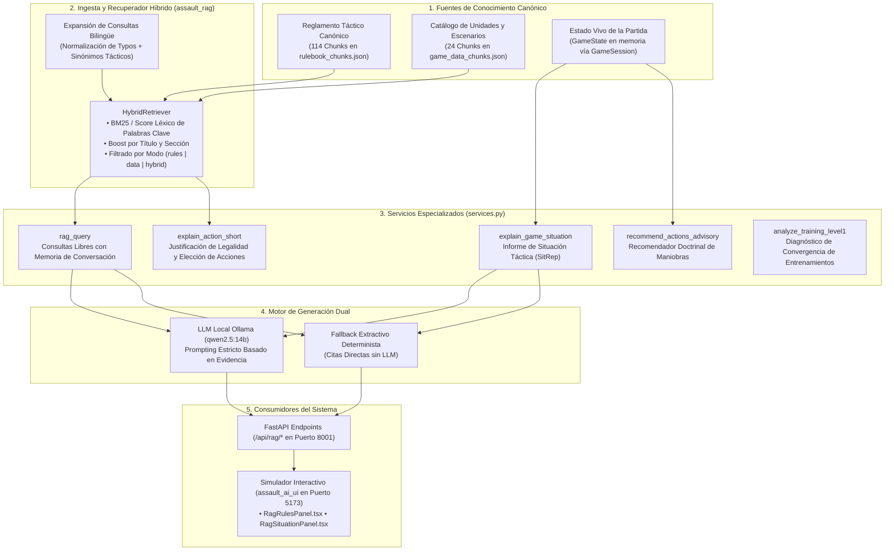

# Sistema RAG Copilot: Asistente Táctico y Explicabilidad Normativa

> **Estado**: Canónico y Exhaustivo (2026)  
> **Ámbito**: Paquete `assault_rag/`, router FastAPI `assault_backend/routers/rag.py` y paneles UI en `assault_ai_ui/`.

---

## 1. Visión General y Filosofía de Diseño

El sistema **RAG Copilot** (*Retrieval-Augmented Generation*) de *Assault* actúa como un árbitro normativo, analista situacional y copiloto táctico en tiempo real. Está diseñado con dos principios irrenunciables:

1. **Cero Alucinaciones en Reglas Físicas**: Un wargame no admite invenciones. Toda respuesta relativa a dados, cobertura, modificadores o costes de movimiento debe estar respaldada por citas explícitas a los fragmentos canónicos del reglamento (`rulebook_chunks.json`) y catálogos técnicos (`game_data_chunks.json`).
2. **Resiliencia Determinista (Dual Engine)**: Si el modelo de lenguaje generativo (LLM local vía Ollama) está disponible, el sistema redacta informes tácticos fluidos y concisos. Si Ollama está apagado o sobrecargado, el sistema recurre inmediatamente a un **fallback extractivo determinista**, garantizando que el juego y la interfaz nunca se bloqueen.



---

## 2. Ingesta y Base de Conocimiento Vectorial / Estructurada

La base de conocimiento de RAG se divide en dos colecciones particionadas en formato JSON:

### 2.1. Chunks del Reglamento (`rulebook_chunks.json`)
* **Ubicación**: `assault_rag/data/rulebook/chunks/rulebook_chunks.json`.
* **Volumen**: 114 fragmentos canónicos preindexados.
* **Cobertura**:
  * Secuencia de turno, alternancia de activaciones e iniciativa.
  * Geometría hexagonal, cálculo de elevación y trazado de línea de visión (LOS).
  * Terrenos, bocage, bosques, ríos y modificadores de dados de defensa.
  * Fuego a distancia, arcos de fuego, alcance efectivo y fuego de oportunidad/reacción.
  * Asaltos cuerpo a cuerpo en el mismo hexágono y tablas de bajas.
  * Cohesión moral (`NORMAL`, `PINNED`, `SUPPRESSED`, `ROUTED`) y chequeos de pánico.

### 2.2. Chunks de Datos del Juego (`game_data_chunks.json`)
* **Ubicación**: `assault_rag/data/game_data/chunks/game_data_chunks.json`.
* **Volumen**: 24 fragmentos generados dinámicamente desde `index_builder.py`.
* **Estructura por Tipo**:
  * **Unidades (`unit::*`)**: Perfiles de ataque desglosados por modo de disparo, tipo de blanco (infantería/vehículo) y banda de distancia, más dados asignados (`BattleDie`), puntos de movimiento y atributos de blindaje.
  * **Escenarios (`scenario::*`)**: Condiciones de victoria, límite de turnos, composición de fuerzas atacantes/defensoras y control inicial de banderas VP.
  * **Fortificaciones (`fortification::*`)**: Modificadores de cobertura de trincheras, búnkeres de hormigón, sacos de arena y nidos de ametralladora.

---

## 3. Recuperación Híbrida (`HybridRetriever`)

El recuperador (`assault_rag/copilot/retriever.py`) optimiza la búsqueda léxica y semántica mediante técnicas específicas para el dominio de juegos de estrategia militar:

### 3.1. Normalización Tipográfica y Stopwords
Elimina palabras vacías en español e inglés y corrige erratas comunes en nombres de armamento y reglas (ej. `"riffles"` $\to$ `"rifles"`, `"uniddaes"` $\to$ `"unidades"`).

### 3.2. Diccionario de Expansión de Consultas (`QUERY_EXPANSIONS`)
Mapea términos coloquiales a conceptos canónicos del motor táctico:
* `"bunker"` $\to$ `{"fortification", "casemate", "pillbox", "crossing", "movement", "occupancy"}`
* `"dados"` $\to$ `{"die", "dice", "ataque", "defensa", "blancos", "negros"}`
* `"alcance"` $\to$ `{"distancia", "range", "hex", "hexes"}`
* `"ficha"` $\to$ `{"counter", "icono", "símbolo", "unidad", "unit"}`

### 3.3. Puntuación Ponderada y Modos de Búsqueda
1. **Modo `rules`**: Busca exclusivamente en los fragmentos del manual de combate.
2. **Modo `data`**: Busca exclusivamente en las fichas técnicas de unidades y escenarios.
3. **Modo `hybrid`** (por defecto): Cruza reglas y datos, asegurando que si el usuario pregunta por una unidad y una regla (ej. *"¿cómo dispara el mortero de 81mm en bosque?"*), el motor recupere tanto el perfil del mortero como las reglas de terreno forestal.

---

## 4. Servicios Tácticos del Copiloto (`assault_rag/copilot/services.py`)

### 4.1. Consulta Libre con Memoria Conversacional (`rag_query`)
* Admite diálogo continuo con el usuario mediante un buffer circular de memoria (`_RAG_MEMORY`) configurable (`ASSAULT_RAG_MEMORY_TURNS=6`).
* **Reescritura de Consultas Ambigüas**: Si el usuario realiza una pregunta de seguimiento (ej. *"¿y qué alcance tiene?"* después de preguntar por la ametralladora MG42), el sistema detecta la elipsis y reescribe internamente la consulta contextualizándola antes de la búsqueda.

### 4.2. Explicador de Acciones (`explain_action_short`)
* Recibe una acción propuesta ($a_t$) junto con la instantánea del estado (`GameState`).
* Valida si la acción es legal o ilegal según las reglas de movimiento/combate y emite un veredicto explicativo referenciando los artículos exactos del reglamento que habilitan o prohíben la maniobra.

### 4.3. Informe Situacional Táctico (`explain_game_situation`)
* Analiza exhaustivamente el tablero de juego en vivo:
  * **Balance de Fuerzas**: Unidades operativas vs bajas confirmadas de cada bando.
  * **Estado de Cohesión**: Unidades clavadas (`PINNED`) o suprimidas (`SUPPRESSED`) que requieren reorganización urgente.
  * **Amenazas Inmediatas**: Escuadras enemigas a distancia de asalto o en línea de visión directa.
  * **Objetivos Críticos**: Distancia hexagonal a los hexágonos con Puntos de Victoria (VP) y diferencial actual de marcador.

### 4.4. Recomendador Asesor de Maniobras (`recommend_actions_advisory`)
* Evalúa todas las acciones legales disponibles para el bando activo y las ordena por una función de valoración táctica:
  $$\text{Score}(a) = 5 \cdot \mathbb{I}_{\text{Captura VP}} + 3 \cdot \mathbb{I}_{\text{Fuego Flanco}} + 2 \cdot \mathbb{I}_{\text{Mejora Cobertura}} - 4 \cdot \mathbb{I}_{\text{Expuesto en Abierto}}$$
* Devuelve al jugador las 3 mejores opciones estratégicas con su correspondiente razonamiento táctico.

### 4.5. Analizador de Entrenamientos RL (`analyze_training_level1`)
* Diseñado para el flujo de trabajo de los ingenieros de IA:
* Analiza los registros de autojuego de EfficientZero v2, diagnostica si el agente padece de **pasividad táctica** (altos empates por timeout), **colapso de valor** o **descalibración en la cabeza de threat map**, sugiriendo ajustes en los hiperparámetros o recompensas.

---

## 5. Integración Generativa con LLM Local (Ollama)

Cuando la generación por LLM está habilitada (`ASSAULT_RAG_LLM_ENABLED=1`):

* **Conexión**: Se comunica mediante API REST HTTP local con el servidor **Ollama** (`http://127.0.0.1:11434/api/generate`).
* **Modelo Estándar**: `qwen2.5:14b` (compatible con `deepseek-r1:14b`, `qwen3-coder:latest` y familias Llama 3).
* **Parámetros**: Temperatura baja ($T=0.2$) para máxima fidelidad fáctica.
* **Prompting Blindado**:
  ```text
  Eres un copiloto de reglas de un wargame táctico.
  Responde en español, corto y preciso.
  Usa SOLO la evidencia dada. Si no alcanza, di que falta evidencia.
  Incluye al final una línea 'Base:' con ids de evidencia usados.
  ```

---

## 6. Endpoints REST de la API (`assault_backend/routers/rag.py`)

El backend FastAPI en el puerto `8001` expone la suite completa bajo el prefijo `/api/rag`:

| Método | Endpoint | Descripción | Parámetros Clave |
| :---: | :--- | :--- | :--- |
| `GET` | `/api/rag/ollama/status` | Comprueba conectividad con Ollama y lista modelos disponibles. | Ninguno. |
| `POST` | `/api/rag/query` | Ejecuta una consulta RAG con evidencia y citas. | `query`, `mode` (`rules`/`data`/`hybrid`), `context`. |
| `GET` | `/api/rag/index/status` | Devuelve el recuento de chunks indexados y rutas activas. | Ninguno. |
| `POST` | `/api/rag/reindex` | Fuerza la reindexación de reglas y catálogo de datos. | `force: true/false`. |
| `POST` | `/api/rag/explain_action` | Explica causalmente una acción táctica ejecutada o propuesta. | `action`, `state_snapshot`, `trace_context`. |
| `POST` | `/api/rag/explain_situation` | Genera un informe táctico (SitRep) de la situación actual. | `state_snapshot`. |
| `POST` | `/api/rag/recommend_actions` | Recomienda las jugadas prioritarias para un bando. | `side`, `state_snapshot`, `constraints`. |
| `POST` | `/api/rag/training_analysis` | Diagnostica la calidad y estabilidad de runs de entrenamiento. | `runs` (lista de métricas de autojuego). |

---

## 7. Interfaz de Usuario en el Simulador (`assault_ai_ui`)

En el simulador interactivo (**`http://localhost:5173/`**), el sistema RAG se materializa en tres paneles arrastrables:

1. **`RagRulesPanel.tsx`**: Ventana flotante donde el jugador puede escribir preguntas en lenguaje natural sobre cualquier aspecto del manual mientras juega.
2. **`RagSituationPanel.tsx`**: Resumen táctico en tiempo real del turno en curso, alertando sobre escuadras en peligro de flanqueo o pérdida inminente de banderas de victoria.
3. **`RagEvalPanel.tsx`**: Panel de auditoría para inspeccionar los tensores y la justificación de las decisiones tomadas por el agente de red neuronal.
