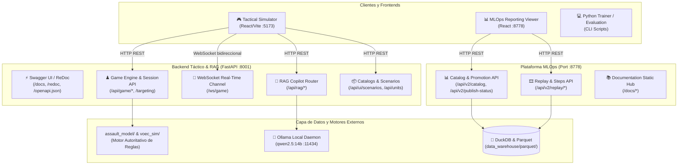
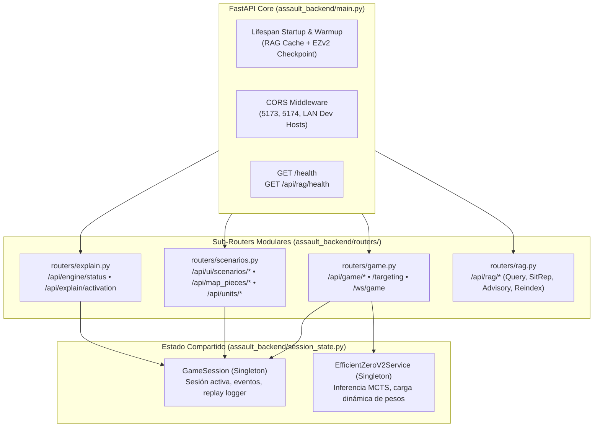
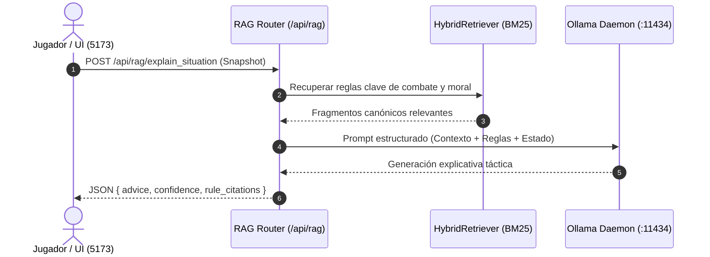

# 07. Servicios Backend y Catálogo de APIs

Este documento constituye la referencia canónica de los servicios backend, microservicios y APIs expuestas en la plataforma **Assault Wargame & AI**. Detalla la arquitectura de comunicación, los contratos de datos, las especificaciones REST y WebSocket, y los enlaces directos a las páginas interactivas de publicación y exploración (**Swagger UI**, **ReDoc** y **OpenAPI JSON**).

---

## 1. Mapa de Acceso a Servicios y Publicación de APIs

La plataforma opera dos servidores backend concurrentes con responsabilidades segregadas: el **Backend de Simulación e Inferencia Táctica** (FastAPI en puerto 8001) y el **Servidor de Telemetría MLOps y Documentación** (ThreadingHTTPServer / DuckDB en puerto 8778).

### 1.1. URLs de Publicación e Interfaces Interactivas

| Servicio / Recurso | URL Directa | Descripción / Función |
| :--- | :--- | :--- |
| **Swagger UI Interactivo** | [http://127.0.0.1:8001/docs](http://127.0.0.1:8001/docs) | Explorador interactivo OpenAPI de FastAPI para pruebas en vivo de todos los endpoints tácticos y RAG. |
| **ReDoc Documentation** | [http://127.0.0.1:8001/redoc](http://127.0.0.1:8001/redoc) | Documentación técnica estructurada en formato de 3 columnas para desarrolladores. |
| **Esquema OpenAPI JSON** | [http://127.0.0.1:8001/openapi.json](http://127.0.0.1:8001/openapi.json) | Especificación JSON canónica OpenAPI 3.1 para generación de clientes y validación de esquemas. |
| **Simulador Web Táctico** | [http://localhost:5173/](http://localhost:5173/) | Frontend SPA React/Vite para partidas interactivas, visualización de niebla y combate en tiempo real. |
| **Portal MLOps Viewer** | [http://127.0.0.1:8778/](http://127.0.0.1:8778/) | Dashboard analítico DuckDB/Parquet de modelos, curvas de pérdida y telemetría de entrenamiento. |
| **Tabla de Clasificación Elo** | [http://127.0.0.1:8778/elo](http://127.0.0.1:8778/elo) | Ranking Elo histórico de checkpoints de agentes evaluados en self-play y torneos. |
| **Hub de Documentación** | [http://127.0.0.1:8778/docs/](http://127.0.0.1:8778/docs/) | Portal unificado de arquitectura, reglas, EfficientZero v2, telemetría y APIs. |

---

## 2. Arquitectura de Conectividad e Integración

El siguiente diagrama ilustra cómo los clientes (Simulador UI, MLOps Viewer y scripts de entrenamiento) interactúan con los servicios backend:



---

## 3. Arquitectura Modular del Backend Táctico (`assault_backend/`)

El backend de simulación fue completamente refactorizado y desacoplado, reduciendo el archivo monolítico `main.py` de **1.076 líneas** a **110 líneas limpias y declarativas** orientadas a sub-routers especializados:



### 3.1. Auditoría y Eliminación de Componentes Obsoletos

1. **`assault_backend/services/sb3_ai_service.py` (ELIMINADO)**:
   - Basado en el stack obsoleto de Stable-Baselines3 (PPO). Decomisionado para cumplir la directiva estricta de usar exclusivamente **EfficientZero V2** como el estándar de IA del proyecto.
   - Se eliminaron las importaciones y la dependencia externa de `stable_baselines3`.
2. **`assault_backend/services/scenario_service.py` (ELIMINADO)**:
   - Código muerto duplicado. El backend y el frontend consumen canónicamente `assault_backend/services/scenario_service_ui.py`.
3. **Limpieza de variables heredadas en `game_session.py`**:
   - Supresión de `sb3_status`, `sb3_status_counts` y redirección hacia `ai_status_counts` con trazabilidad unificada.

---

### 3.2. Endpoints de Diagnóstico y Salud

#### `GET /health`
* **Descripción**: Verifica la disponibilidad del microservicio táctico, la versión y el motor de IA activo.
* **Respuesta Exitosa (200 OK)**:
  ```json
  {
    "status": "ok",
    "service": "assault-backend",
    "version": "2.0.0",
    "ai_engine": "EfficientZeroV2",
    "rag_ready": true
  }
  ```

#### `GET /api/engine/status`
* **Descripción**: Comprueba el estado de inicialización del motor y los servicios de explicabilidad táctica.
* **Respuesta Exitosa (200 OK)**:
  ```json
  {
    "status": "ready",
    "engine": "assault-backend",
    "explanations_enabled": true,
    "layers": {
      "strategic": "local_heuristic",
      "tactical": "event_summary"
    }
  }
  ```

---

### 3.2. Catálogo de Escenarios, Mapas y Unidades

#### `GET /api/ui/scenarios`
* **Descripción**: Lista los identificadores de todos los escenarios tácticos disponibles en disco (`assault_sim/assets/scenarios/`).
* **Respuesta Exitosa (200 OK)**:
  ```json
  {
    "scenarios": [
      "scenario_gela_beachhead",
      "scenario_biscari_airfield",
      "scenario_counterattack_pz_div"
    ]
  }
  ```

#### `GET /api/ui/scenarios/{scenario_id}`
* **Descripción**: Carga la configuración completa de un escenario: mapa base, piezas de terreno, unidades asignadas por bando, condiciones de victoria y turnos máximos.
* **Parámetros de Ruta**: `scenario_id` (string, ej: `scenario_gela_beachhead`).
* **Códigos de Respuesta**: `200 OK`, `500 STEP_RUNTIME_ERROR`.

#### `GET /api/map_pieces`
* **Descripción**: Devuelve la lista de piezas hexagonales prefabricadas en el catálogo.
* **Respuesta Exitosa (200 OK)**: `["piece_01_hills", "piece_02_village", "piece_03_crossroads"]`

#### `GET /api/map_pieces/{piece_id}`
* **Descripción**: Devuelve la matriz hexagonal, tipos de terreno por hexágono y elevaciones de la pieza solicitada.

#### `GET /api/units`
* **Descripción**: Catálogo completo de plantillas de unidades (escuadras de infantería, ametralladoras, cañones anticarro, tanques).

#### `GET /api/units/{unit_key}`
* **Descripción**: Detalle de atributos estáticos de una unidad: dados de combate (`white_dice`, `black_dice`), armadura, puntos de movimiento, alcance de armas y atributos especiales (`HMG`, `MORTAR`, `ARMORED`).

---

### 3.3. Ciclo de Vida de Partida y State Loop

#### `POST /api/game/start`
* **Descripción**: Inicializa una nueva sesión de juego (`GameSession`), carga el escenario, genera las piezas de mapa y posiciona las tropas iniciales.
* **Cuerpo de Solicitud (JSON)**:
  ```json
  {
    "scenario_id": "scenario_gela_beachhead",
    "allied_side": "player",
    "axis_side": "ai"
  }
  ```
* **Respuesta (200 OK)**: Snapshot completo inicial del `GameState` serializado.

#### `GET /api/game/state`
* **Descripción**: Obtiene el estado actual de la partida, incluyendo posiciones de unidades, puntos de vida, estado de cohesión/moral (`NORMAL`, `PINNED`, `SUPPRESSED`, `ROUTED`), control de hexágonos y puntos de victoria (VP).

#### `GET /api/game/trace`
* **Descripción**: Obtiene la traza secuencial de eventos ocurridos en el turno actual (movimientos, disparos, impactos de dados, chequeos de moral) útil para depuración e historial.

#### `POST /api/game/actions`
* **Descripción**: Devuelve la lista exhaustiva de acciones tácticas legales para una unidad específica en su posición actual.
* **Cuerpo de Solicitud (JSON)**:
  ```json
  {
    "unit_id": "us_rifle_squad_1"
  }
  ```
* **Respuesta (200 OK)**: Array de acciones válidas codificadas con sus costes en puntos de acción (PA) y coordenadas de destino.

#### `POST /api/game/step`
* **Descripción**: Aplica una acción táctica autoritativa en el motor. Si la acción provoca un fuego de interrupción enemigo (*Opportunity Fire*), la resolución de la reacción queda pendiente.
* **Cuerpo de Solicitud (JSON)**:
  ```json
  {
    "action_type": "MOVE",
    "unit_id": "us_rifle_squad_1",
    "target_coord": {"q": 4, "r": 2}
  }
  ```
* **Respuesta (200 OK)**: Nuevo estado tras la mutación atómica, resultado de dados y flag `reaction_pending`.

#### `POST /api/game/reaction/resolve`
* **Descripción**: Resuelve el combate de oportunidad desencadenado por el movimiento de una unidad enemiga frente a defensores en guardia.

#### `POST /api/game/ai-turn`
* **Descripción**: Ejecuta el turno de la IA para el bando activo utilizando el motor estándar **`EfficientZeroV2Service`** con búsqueda MCTS PUCT.
* **Flujo de Ejecución**:
  1. **Inferencia Neuronal**: Construye la observación espacial (`EZV2Observation`) de 32 canales a partir del estado de la simulación.
  2. **Búsqueda MCTS**: Ejecuta 80 simulaciones MCTS guiadas por los priors de la red y cabezas tácticas (`threat_map`, `attrition`, `morale`).
  3. **Comprobación de Seguridad**: Valida que la acción seleccionada sea legal y no constituya un retroceso táctico injustificado.
  4. **Fallback Heurístico**: Si no hay pesos neuronales disponibles en `runs_curriculum/`, recurre de manera transparente a `DecisionEngine` sin bloquear el frontend.
* **Respuesta Exitosa (200 OK)**:
  ```json
  {
    "state": { "...": "GameState Snapshot" },
    "steps": [
      {
        "unit": "US_3",
        "action": "MoveAction",
        "action_id": "MOVE:US_3:13:8",
        "source": "efficientzero_v2",
        "ai_status": "used",
        "ai_reason": "ezv2_mcts_success",
        "move_to": {"q": 13, "r": 8}
      }
    ]
  }
  ```

#### `GET /targeting`
* **Descripción**: Calcula en tiempo real el trazado de Línea de Visión (LOS), distancia axial/cúbica, coberturas intermedias y modificadores de tiro entre dos coordenadas hexagonales.
* **Query Parameters**:
  - `origin_q`, `origin_r`: Coordenadas del atacante.
  - `target_q`, `target_r`: Coordenadas del defensor.

---

### 3.4. Explicabilidad Táctica y WebSocket

#### `POST /api/explain/activation`
* **Descripción**: Genera una justificación en lenguaje natural de por qué se activó una unidad determinada o por qué la IA seleccionó una ruta táctica específica.
* **Modelo Request**: `ExplainActivationRequest`
* **Modelo Response**: `ExplainActivationResponse`

#### `WS /ws/game`
* **Descripción**: Canal WebSocket persistente para transmisión bidireccional y actualización de eventos a baja latencia entre el motor de simulación y el interfaz visual (`assault_ai_ui`).
* **Eventos transmitidos**:
  - `STATE_MUTATED`: Notifica cambio en el estado del mapa o de unidades.
  - `COMBAT_RESOLVED`: Notifica tirada de dados, impactos netos y bajas.
  - `OPPORTUNITY_TRIGGERED`: Notifica interrupción por fuego de reacción.
  - `PHASE_TRANSITION`: Notifica cambio de turno o fase de reagrupamiento.

---

## 4. Catálogo Completo: Sub-Router RAG Copilot (`/api/rag`)

El microservicio de asesoramiento táctico RAG se encuentra en `assault_backend/routers/rag.py`. Integra el recuperador híbrido (BM25 + Dense) con el modelo local **Ollama** (`qwen2.5:14b`).



### 4.1. Endpoints RAG

| Método | Endpoint | Parámetros / Payload | Descripción y Funcionalidad |
| :---: | :--- | :--- | :--- |
| `GET` | `/api/rag/health` | Ninguno | Estado de precarga del motor RAG en arranque (chunks de datos y reglas). |
| `GET` | `/api/rag/ollama/status` | Ninguno | Verifica conectividad con el daemon local Ollama en `127.0.0.1:11434` y lista modelos disponibles. |
| `POST` | `/api/rag/query` | `RagQueryRequest` (`query`, `mode`, `context`) | Consulta semántica abierta sobre el reglamento o el estado táctico. |
| `GET` | `/api/rag/index/status` | Ninguno | Número de fragmentos procesados en memoria y ruta del archivo índice activo. |
| `POST` | `/api/rag/reindex` | `{"force": boolean}` | Reconstrucción en caliente del índice de fragmentos de reglas y assets de datos. |
| `POST` | `/api/rag/explain_action` | `RagExplainActionRequest` | Explica tácticamente la justificación de una acción realizada por la IA. |
| `POST` | `/api/rag/explain_situation` | `RagExplainSituationRequest` | Diagnóstico estratégico de la situación global del tablero (amenazas, flanqueos, VP). |
| `POST` | `/api/rag/recommend_actions` | `RagRecommendActionsRequest` | Genera recomendaciones consultivas para el bando solicitante (*Allied* o *Axis*). |
| `POST` | `/api/rag/training_analysis` | `RagTrainingAnalysisRequest` | Análisis automatizado del desempeño táctico de ejecuciones de entrenamiento N1. |

---

## 5. Catálogo Completo: Plataforma MLOps y Telemetría (`:8778`)

El backend de telemetría reside en `mlops/reporting/viewer.py`. Proporciona acceso ultra-rápido a miles de partidas y entrenamientos persistidos en formato **Parquet** y consultados mediante **DuckDB in-process**.

### 5.1. Endpoints de Modelos, Catálogo y Telemetría

#### `GET /api/v2/catalog`
* **Descripción**: Devuelve la lista agregada de todos los modelos entrenados, checkpoints disponibles, número de partidas evaluadas y métricas globales de victoria/derrota.
* **Query Parameters**:
  - `path`: Ruta relativa del archivo de catálogo (por defecto `runs_curriculum/experiments/reporting/catalog_v2.json`).

#### `GET /api/v2/publish-status`
* **Descripción**: Evalúa los criterios de calidad (*Promotion Gates*) para determinar si el último modelo candidato es apto para su promoción como agente activo.

#### `GET /api/v2/model`
* **Descripción**: Devuelve la telemetría granular de un modelo concreto: evolución de funciones de pérdida (Value Loss, Policy Loss, Reward Loss, Tactical Heads Loss) a lo largo de los steps.
* **Query Parameters**:
  - `engine`: Nombre del motor (`efficientzero_v2`).
  - `model`: ID del modelo o checkpoint.
  - `train_limit`: Número máximo de registros de entrenamiento a devolver (1-256).
  - `eval_limit`: Número máximo de registros de evaluación a devolver (1-256).

#### `GET /api/v2/model/trains`
* **Descripción**: Paginación optimizada de ejecuciones de entrenamiento asociadas a un modelo desde la base DuckDB.

#### `GET /api/v2/model/evals`
* **Descripción**: Paginación de partidas de evaluación disputadas por el modelo, incluyendo oponentes, ratios de victorias y escenarios probados.
* **Query Parameters**:
  - `train_run_id`: Filtrado por ciclo de entrenamiento.
  - `scenario_id`: Identificador del escenario o `__all__`.
  - `offset`, `limit`: Paginador de resultados.
  - `include_payload`: `true` para incluir tensores de observación y distribuciones de acción.

#### `DELETE /api/v2/model`
* **Descripción**: Eliminación segura de artefactos de un modelo en disco y actualización atómica del catálogo.

---

### 5.2. Replay y Trazabilidad de Curriculums

#### `GET /api/v2/replay/meta`
* **Descripción**: Metadatos de una partida grabada (semilla pseudoaleatoria, escenario, duración en turnos, ganador y versión de la red).
* **Query Parameters**: `run_id`, `match_id`.

#### `GET /api/v2/replay/steps`
* **Descripción**: Secuencia fotograma a fotograma de cada estado hexagonal, acciones tomadas y valores predichos por la red para reproducción visual paso a paso.

#### `GET /api/v2/replay/log`
* **Descripción**: Registro textual sin procesar del log de eventos de la repetición.

#### `GET /api/v2/scenario` y `GET /api/v2/scenario/overlay`
* **Descripción**: Provee las capas de superposición táctica (*overlays*) para renderizar mapas de calor de amenazas (*threat map*) y zonas de control territorial calculadas por la red.

#### `GET /api/v2/curriculum-traceability`
* **Descripción**: Historial completo de transiciones de fase curricular (fases 1 a 5) y evolución de pesos de la red.

---

## 6. Verificación en Vivo y Pruebas Rápidas con `curl`

Para verificar la disponibilidad de las APIs desde terminal o scripts de integración, pueden ejecutarse los siguientes comandos:

```bash
# 1. Comprobar disponibilidad del backend táctico (Puerto 8001)
curl -s http://127.0.0.1:8001/health

# 2. Consultar escenarios disponibles
curl -s http://127.0.0.1:8001/api/ui/scenarios

# 3. Comprobar estado de conectividad con Ollama
curl -s http://127.0.0.1:8001/api/rag/ollama/status

# 4. Consultar catálogo MLOps DuckDB (Puerto 8778)
curl -s "http://127.0.0.1:8778/api/v2/catalog"
```
