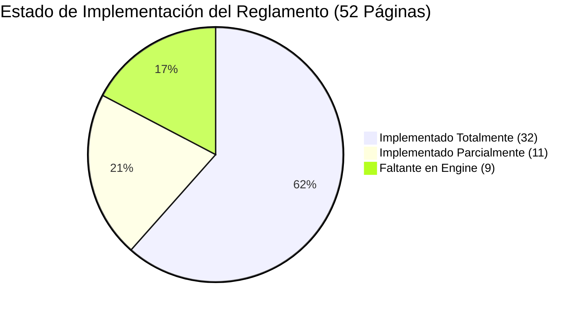
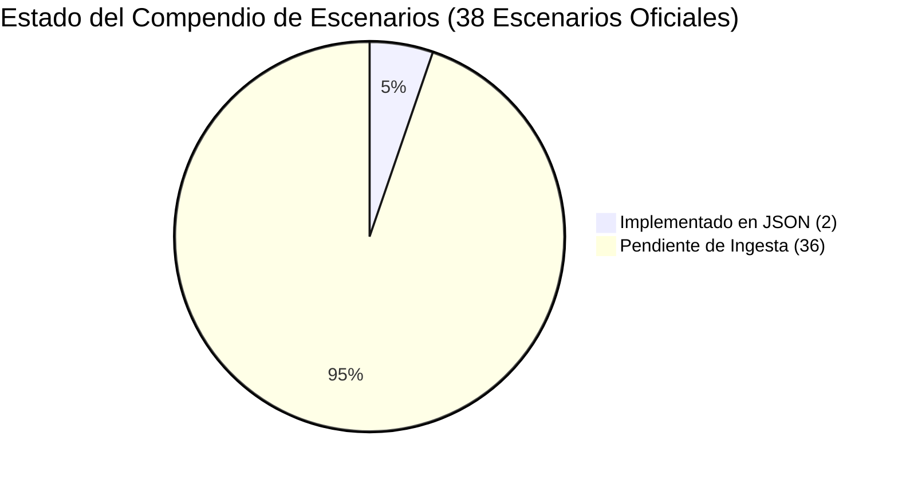

# 08. Auditoría Exhaustiva: Manual Oficial de Reglas vs. Engine del Juego y Escenarios

> [!IMPORTANT]
> **Directiva Primaria:** Esta auditoría compara página a página el manual oficial de reglas (*2024_09_18_Rulebook_rev6_web.pdf*, 52 páginas) y el libro de campaña (*ITA_Assault_Libro_Campagna_v1.0.pdf*, 104 páginas) contra el motor táctico autoritativo (`assault_model/`) y el catálogo de escenarios (`assault_sim/assets/scenarios/`).
> De acuerdo con las reglas de desarrollo, **MuZero está 100% decomisionado** y cualquier referencia o integración de IA táctica opera exclusivamente sobre **EfficientZero V2** (`agents/efficientzero_v2/`).

---

## 1. Resumen Ejecutivo y Cuadro de Mando (Audit Scorecard)

El motor actual `assault_model/` cuenta con una base sólida de clean architecture para la resolución de combate, geometría hexagonal, línea de visión (LOS) con elevaciones, dados de combate Assault (Rojo, Azul, Verde, Amarillo) y sistema de moral en cuatro estados. Sin embargo, existen lagunas específicas respecto al reglamento oficial de Sound of Drums, especialmente en las fases de apoyo (TAS/OAS), cartas de mando, transporte de tropas y la ingesta masiva del compendio de escenarios.

### Indicadores Clave de Auditoría (KPIs)

| Métrica de Auditoría | Valor | Estado | Observación |
| :--- | :---: | :---: | :--- |
| **Páginas del Manual Analizadas** | 52 / 52 | 100% | Auditoría exhaustiva página a página |
| **Capítulos Principales de Reglas** | 13 | 100% | Ch 1.0 a 13.0 revisados |
| **Mecánicas Núcleo (Combate/LOS/Moral)** | 100% | 🟢 OK | Implementación autoritativa en `assault_model/combat` |
| **Sistemas Avanzados Faltantes** | 4 áreas | 🟡 Parcial | Cartas de Mando, Humo, TAS/OAS, Transporte/Remolque |
| **Escenarios Oficiales en Campaña** | 38 | 🔴 Alerta | 26 de Campaña Gela + 12 Escenarios Standalone |
| **Escenarios Modelados en JSON** | 2 / 38 | 5.3% | Escenario 1.0 y Escenario 2.1 disponibles |

---

## 2. Auditoría Página a Página del Manual Oficial (Rulebook rev6)

A continuación se detalla la correspondencia exacta de cada una de las 52 páginas del manual oficial de reglas (*2024_09_18_Rulebook_rev6_web.pdf*) frente a la arquitectura de clases y métodos de `assault_model/`.

| Pág. | Sección Oficial | Materia / Tópico Oficial | Estado Engine | Módulo / Clase Implementada | Brecha Técnica / Mecánica Faltante |
| :---: | :--- | :--- | :---: | :--- | :--- |
| **1** | Portada | Portada oficial: Assault Sicily 43 v2.0 | `DOCUMENTAL` | N/A | Portada editorial (Sound of Drums). |
| **2** | Índice General | Tabla de Contenidos: Secciones 1.0 a 6.2 | `DOCUMENTAL` | N/A | Estructura del manual. |
| **3** | Índice General | Tabla de Contenidos: Secciones 9.10 a 13.0 | `DOCUMENTAL` | N/A | Continuación de la estructura del manual. |
| **4** | **1.0** Game Components | Fichas, dados de combate, cartas y hex-tiles | `IMPLEMENTADO` | `map/map_piece.py` `combat/battle_die.py` | Modelado de componentes físicos en entidades de dominio. |
| **5** | **2.0** Quick Start | Escenarios de entrenamiento (2.1 Infantería, 2.2 Setup) | `PARCIAL` | `core/scenario_loader.py` | La lógica corre en el engine, pero los escenarios 11.1 y 11.2 no están en JSON. |
| **6** | **3.0** Overview | Objetivos de victoria (3.1) y reglas básicas/opcionales (3.2) | `IMPLEMENTADO` | `core/victory_conditions.py` `core/vp_tracker.py` | Evaluación de control por puntos y turnos límite. |
| **7** | **4.1–4.2** Cards & Units | Cartas de formación, valores en puntos, blindados vs blandos, Blast values | `PARCIAL` | `units/unit_type.py` `units/attributes.py` | Valores de Blast (`xx:`) definidos; falta draft dinámico de cartas de formación. |
| **8** | **4.3–4.8** Components | Contadores, dados de combate (Rojo, Azul, Verde, Amarillo), ayudas de juego | `IMPLEMENTADO` | `combat/dice_color.py` `combat/dice_face.py` | Caras de dados con impactos, escudos, críticos y supresión 100% exactos. |
| **9** | **4.9–4.14** Expansions | Cartas de Mando (4.9.1), Puntos de Mando (4.9.2), TA/OAS, Minas, Daño Terreno | `FALTANTE` | `movement_rules.py` (solo minas básicas) | **Falta baraja de cartas de mando, pool de puntos CP y cartas de apoyo TAS/OAS.** |
| **10** | **5.0** Game Preparation | Preparación (5.1-5.6): Selección de facción, tablero y cartas de formación | `PARCIAL` | `core/scenario_loader.py` `map/map.py` | La carga de mapas modulares está lista; falta UI de selección de cartas pre-partida. |
| **11** | **5.7–5.9** Setup | Fuerzas iniciales, despliegue y mazo de cartas de mando | `PARCIAL` | `core/scenario.py` | Despliegue inicial por hexes soportado; falta inicialización de mazo de mando. |
| **12** | **6.0–6.2** Sequence | Secuencia de Juego: 6.1 Iniciativa (D6 roll), 6.2 Planificación y asignación de CP | `PARCIAL` | `state/turn.py` `runtime/game_state_runtime.py` | El loop alterna turnos fijos; **falta tirada de iniciativa D6 con modificadores tácticos y gasto de CP**. |
| **13** | **6.3–6.7** Phase Overview | Resumen fases: Apoyo, Acción, Organización (Rally), Chequeo de Victoria, Refuerzos | `IMPLEMENTADO` | `runtime/game_state_runtime.py` `core/activation.py` | Activación alternada, rallies y chequeo de fin de partida implementados. |
| **14** | **7.1** Support Phase | Fuego Indirecto (7.1.1 Spotting, 7.1.2 vs Vehículos, 7.1.3 Resultados) | `PARCIAL` | `actions/ranged_indirect.py` `combat/range_attack_profile.py` | Fuego indirecto implementado como acción de combate, pero no como subfase previa de soporte dedicada. |
| **15** | **7.2–7.4** Smoke & Art | Disparo de Humo (7.2), cambio de encaramiento de artillería (7.3), habilidades | `PARCIAL` | `combat/attack_sector.py` | Cambio de encaramiento soportado; **falta mecánica de humo (bloqueo LOS y dispersión por turno)**. |
| **16** | **8.0 & 9.0–9.5** Movement | Pasar (8.1), Fuego de Reacción (8.2), Movimiento Normal (9.1), Rápido (9.2), Movimiento + Disparo (9.3), Costes de Terreno (9.4), Terreno Difícil (9.5) | `IMPLEMENTADO` | `actions/movement.py` `actions/reaction_fire.py` `actions/composite_fire.py` `rules/movement_rules.py` | Apilamiento (1 unidad combate/hex), movimiento normal, doble movimiento y fuego compuesto autoritativo. |
| **17** | **9.6.1–9.6.3** Special Terrain | Colinas y elevación (9.6.1), Edificios ligeros/pesados (9.6.2), Carreteras y caminos (9.6.3) | `IMPLEMENTADO` | `map/terrain_config.py` `combat/line_of_sight.py` | Modificadores de movimiento por camino y bonificaciones de cobertura urbana implementados. |
| **18** | **9.6.3.2–9.6.4** Fortifications | Callejuelas urbanas, puentes, fortificaciones (Trincheras, Pozos de tirador, Bunkers) | `IMPLEMENTADO` | `map/fortification_config.py` `rules/fortification_rules.py` | Bonificaciones de defensa frontal y perimetral de trincheras y bunkers verificadas por tests. |
| **19** | **9.6.4–9.6.5** Obstacles | Reacción a movimiento en fortificaciones, obstáculos lineales (Muros, Bocage, Alambradas) | `IMPLEMENTADO` | `map/hex_edge_feature.py` `map/combat_geometry.py` | Intersección geométrica de aristas de hexágono para muros y setos integrada en contexto de combate. |
| **20** | **9.6.5.4–9.6.6** Minefields | Zanjas anticarro, campos de minas (colocación oculta, detonación y desactivación) | `PARCIAL` | `rules/movement_rules.py` | La tirada de daño al entrar en hex minado funciona; **falta el marcador oculto farol (bluff) y acción de zapadores para desminado**. |
| **21** | **9.7** Hex Control | Captura y control de hexágonos objetivo, cómputo de soberanía | `IMPLEMENTADO` | `map/hex_ownership.py` `map/hex_state.py` | Transición automática de bandera al ocupar hex objetivo libre de enemigos. |
| **22** | **9.8–9.10** Specific Move | Atrición de vehículos por terreno (9.10.1), daño por orugas, cavar trincheras (9.8.1) | `PARCIAL` | `rules/movement_terrain_rules.py` | Costes de movimiento de orugas y ruedas presentes; **falta acción de infantería "Cavar / Dig In" para erigir foxholes en juego**. |
| **23** | **9.10.3–9.11** Overrun & Trans | Arrollamiento de artillería por blindados (9.10.3), transporte de tropas (9.11.1–9.11.3) | `FALTANTE` | `actions/embark.py` (boceto) | **Falta arrollamiento (Overrun) directo sobre artillería y sistema completo de capacidad de transporte/desembarco**. |
| **24** | **9.11.4–9.12.3** Towing & Hide | Remolque de artillería pesada (9.11.4), acción de Ocultarse (Hide) para infantería y vehículos | `FALTANTE` | `combat/spotting.py` | El spotting cubre visibilidad, pero **falta la acción explícita "Ocultarse" con marcador de status y remolque con camiones/semiorugas**. |
| **25** | **9.12.4–10.1** Ambush & Range | Emboscada (9.12.4), Fuego de cobertura (9.13), Factor de alcance (10.1: A bocajarro, corto, medio, largo, extremo) | `IMPLEMENTADO` | `combat/range_band.py` `combat/range_logic.py` | Bandas de alcance con modificación de dados de ataque por distancia 100% integradas. |
| **26** | **10.2–10.4** Line of Sight | Línea de Visión (10.2), cálculo centro a centro (10.3), elevación y zonas ciegas (10.4) | `IMPLEMENTADO` | `combat/line_of_sight.py` `combat/los_modifier.py` | Trazado de rayos con elevación relativa, hexágonos ciegos detrás de colinas y crestas implementado. |
| **27** | **10.5–10.6** Spotting & Arcs | Avistamiento directo (10.5), Arcos de fuego (10.6: frontal 180°, flancos 60°, retaguardia 60°) | `IMPLEMENTADO` | `combat/spotting.py` `combat/attack_sector.py` `combat/flank.py` | Determinación matemática del sector de impacto y torretas giratorias en vehículos. |
| **28** | **10.7.1–10.7.4** Resolving Combat | Comparación de dados (Impactos vs Escudos, Net Hits), asignación de daño y críticos | `IMPLEMENTADO` | `combat/ranged_combat_resolver.py` `combat/dice_comparison.py` | Resolución de enfrentamiento de dados, cálculo de daño a HP y chequeos de supresión. |
| **29** | **10.7.5–10.8** Criticals & Attacks | Tabla de críticos infantería/artillería (10.7.5), tabla de daños críticos de vehículos (10.7.6), disparo conjunto (10.8.4) | `PARCIAL` | `combat/critical_table.py` `combat/critical_effect.py` | Críticos de infantería (eliminación directa/huida) implementados; **faltan daños a subsistemas de vehículos (inmovilizado, cañón roto, torreta atascada)**. |
| **30** | **10.9.1–10.9.6** Defense Modifiers | Dados de defensa por terreno (10.9.1), LOS obstaculizada (10.9.2), sector de impacto (10.9.3), estado moral del defensor (10.9.6) | `IMPLEMENTADO` | `combat/defense_dice_pool.py` `combat/modifiers/terrain_modifier.py` | Tabla completa de modificadores de dados de defensa según cobertura y moral (Pinned/Suppressed/Routed). |
| **31** | **10.9.7–10.10** Tank Riders | Habilidades especiales, experiencia, pasajeros sobre blindados (Tank Riders) y desembarco de emergencia | `PARCIAL` | `combat/modifiers/morale_modifier.py` | Las bonificaciones de veterano existen; **falta vulnerabilidad de infantería montada sobre carros expuestos y desembarco de emergencia bajo fuego**. |
| **32** | **11.1–11.1.1** Close Combat | Inicio de combate cuerpo a cuerpo / asalto hexagonal, asalto simultáneo | `IMPLEMENTADO` | `actions/assault.py` `combat/close_combat_resolver.py` | Entrada en hex enemigo, chequeo de entrada y rondas simultáneas de asalto. |
| **33** | **11.1.2–11.1.3** Melee Dice Pools | Dados de ataque cuerpo a cuerpo (rojos/amarillos), penalización por media fuerza, defensa en asalto | `IMPLEMENTADO` | `combat/close_combat_resolver.py` `combat/attack_dice_pool.py` | Pool específico de combate cuerpo a cuerpo y penalizaciones de flanco en combate cerrado. |
| **34** | **11.1.4–11.4** Melee Damage | Asignación de bajas en asalto, Adrenaline Rush (11.1.5), defensores atrincherados (11.2), retirada obligada | `PARCIAL` | `combat/close_combat_context.py` | Daño simultáneo y retirada obligada por moral implementados; **falta mecánica Adrenaline Rush (repetición táctica)**. |
| **35** | **11.5** Infantry vs Tanks | Ataque especial de infantería contra vehículos en combate cerrado (granadas magnéticas, cócteles molotov) | `FALTANTE` | `combat/close_combat_resolver.py` | **Falta la tabla de asalto especializado de infantería contra carros de combate sin apoyo de infantería amiga**. |
| **36** | **11.6** Melee Example | Ejemplo extendido paso a paso de asalto a quemarropa | `DOCUMENTAL` | `tests/test_modifier_parity_ranged_close.py` | Validado mediante tests de integración de asalto. |
| **37** | **11.6** Example Cont. | Conclusión del ejemplo de combate cerrado y resolución de apoyos | `DOCUMENTAL` | `tests/test_close_combat_resolver.py` | Validado mediante tests de integración. |
| **38** | **12.1–12.2** TA/OAS Expansion | Expansión de Apoyo Aéreo Táctico (TAS) y Artillería Fuera de Tablero (OAS) | `FALTANTE` | N/A | **No existe el subsistema de apoyo aéreo ni de artillería naval/pesada fuera de mapa.** |
| **39** | **12.2.3–12.3.2** TAS Requests | Petición de TAS en fase de planificación, temporización y llegada de cazabombarderos | `FALTANTE` | N/A | Falta lógica de solicitud aérea y cola de eventos de ataque por turno. |
| **40** | **12.3.3–12.3.5** Flak & AA Fire | Identificación de objetivo aéreo, fuego antiaéreo defensivo (AA) y salvaguarda de aviones | `FALTANTE` | `combat/attack_sector.py` | Falta fuego antiaéreo (Flak) defensivo previo al picado del bombardero. |
| **41** | **12.3.6** TAS Attack | Resolución de ataque de bombardeo/ametrallamiento, tirada de dispersión D6 | `FALTANTE` | N/A | Falta tirada de desviación de bombas y resolución de racimo. |
| **42** | **12.4.1–12.4.2** OAS Requests | Petición de artillería pesada fuera de tablero, tiempo de llegada y radio de batería | `FALTANTE` | N/A | Falta temporizador de andanada de obuses fuera de mapa. |
| **43** | **12.4.3** Artillery Strike | Fuego de artillería: Marcador de objetivo, línea de observación y dispersión | `FALTANTE` | N/A | Falta cálculo de dispersión radial (scatter hexagonal de 1 a 6). |
| **44** | **12.4.3.3** Suppressive Zone | Zona de fuego de supresión en hex central y hexágonos adyacentes de impacto | `FALTANTE` | `actions/ranged_indirect.py` | Falta saturación de área con daño de onda expansiva decreciente. |
| **45** | **12.5** Blast vs Buildings | Valores de demolición (Blast), colapso de edificios y creación de cráteres de metralla | `PARCIAL` | `map/terrain_config.py` | Cobertura urbana modelada; **falta transformación dinámica de edificio a escombros y colocación de cráter**. |
| **46** | **13.1–13.2** Status Markers | Marcadores de activación: Movido, Disparado, Fuego en movimiento, Acción demorada | `IMPLEMENTADO` | `actions/status.py` `runtime/execution_context.py` | Máquina de estados de activación por unidad autoritativa y limpia. |
| **47** | **13.3** Morale System | Estados de moral: Normal $\to$ Pinned $\to$ Suppressed $\to$ Routed $\to$ Fallback | `IMPLEMENTADO` | `combat/morale.py` `combat/modifiers/morale_modifier.py` | Transición matemática de degradación y recuperación de moral 100% exacta. |
| **48** | Recursos Oficiales | Datos de la comunidad Assault Games, hojas de ayuda | `DOCUMENTAL` | N/A | Información editorial. |
| **49** | Módulo VASSAL | Referencia al módulo oficial de juego en línea VASSAL | `DOCUMENTAL` | N/A | Enlaces a repositorio web de Sound of Drums. |
| **50** | Índice Alfabético | Índice analítico (A a L) | `DOCUMENTAL` | N/A | Índice de términos. |
| **51** | Índice Alfabético | Índice analítico (M a Z) | `DOCUMENTAL` | N/A | Índice de términos. |
| **52** | Contraportada | Información de licencia y editorial: Sound of Drums GmbH | `DOCUMENTAL` | N/A | Datos editoriales. |

---

## 3. Auditoría del Compendio de Escenarios (Libro de Campaña, 104 Páginas)

El libro de campaña oficial (*ITA_Assault_Libro_Campagna_v1.0.pdf*) contiene la totalidad de las batallas históricas y alternativas de la invasión de Sicilia (Operación Husky, julio de 1943) divididas en **dos grandes bloques**:
1. **Campaña de Gela (Día 1 y Día 2)**: 26 escenarios interconectados mediante el diagrama de flujo operacional.
2. **Escenarios Independientes (Capítulo 11.0)**: 12 escenarios autónomos de diversa escala (desde entrenamiento básico hasta grandes choques de blindados en la carretera 115 y Biazza Ridge).

### Catálogo Exhaustivo de Escenarios vs. Disponibilidad en `assault_sim/`

| Pág. PDF | ID Oficial | Nombre del Escenario | Fecha Histórica | Turnos | Bloque | Estado en Simulador | Fichero en `assault_sim/` | Requisitos para Ingesta |
| :---: | :---: | :--- | :---: | :---: | :---: | :---: | :---: | :--- |
| **18** | **1.0** | **Mettete i piedi per terra!** | 10 Jul 1943, 03:35 | 8 | Campaña (Día 1) | 🟢 **IMPLEMENTADO** | `mettete_i_piedi_terra_1.json` | Totalmente jugable e integrado con EZero V2. |
| **20** | **2.1** | **Battaglia Cittadina** | 10 Jul 1943, 05:40 | 8 | Campaña (Día 1) | 🟢 **IMPLEMENTADO** | `battaglia_cittadina_2_1.json` | Totalmente jugable e integrado con EZero V2. |
| **22** | **2.2** | Battaglia Cittadina (Variante B) | 10 Jul 1943, 05:40 | 8 | Campaña (Día 1) | 🔴 PENDIENTE | Ninguno | Ingesta de formación y mapa modular urbano. |
| **24** | **2.3** | Battaglia Cittadina (Variante C) | 10 Jul 1943, 05:40 | 8 | Campaña (Día 1) | 🔴 PENDIENTE | Ninguno | Ingesta de configuración de tropas mixtas. |
| **26** | **3.1** | Avanti Savoia! (A) | 10 Jul 1943, 09:10 | 8 | Campaña (Día 1) | 🔴 PENDIENTE | Ninguno | Mapa colinas y contrattacco italiano Div. Livorno. |
| **28** | **3.2** | Avanti Savoia! (B) | 10 Jul 1943, 09:10 | 8 | Campaña (Día 1) | 🔴 PENDIENTE | Ninguno | Ingesta de batallón Bersaglieri y R35 italianos. |
| **30** | **3.3** | Avanti Savoia! (C) | 10 Jul 1943, 09:10 | 8 | Campaña (Día 1) | 🔴 PENDIENTE | Ninguno | Ingesta de posiciones atrincheradas. |
| **32** | **3.4** | Difesa della Testa di Sbarco (A) | 10 Jul 1943, 09:10 | 8 | Campaña (Día 1) | 🔴 PENDIENTE | Ninguno | Mapa de playa roja con artillería de costa. |
| **34** | **3.5** | Difesa della Testa di Sbarco (B) | 10 Jul 1943, 09:10 | 8 | Campaña (Día 1) | 🔴 PENDIENTE | Ninguno | Refuerzos navales estadounidenses. |
| **36** | **4.1** | Avanti verso Nord! (A) | 10 Jul 1943, 13:35 | 8 | Campaña (Día 1) | 🔴 PENDIENTE | Ninguno | Mapa de llanura y bifurcaciones viales. |
| **38** | **4.2** | Avanti verso Nord! (B) | 10 Jul 1943, 13:35 | 8 | Campaña (Día 1) | 🔴 PENDIENTE | Ninguno | Ingesta de unidades mecanizadas. |
| **40** | **4.3** | Difendete Gela! (A) | 10 Jul 1943, 13:35 | 8 | Campaña (Día 1) | 🔴 PENDIENTE | Ninguno | Periferia urbana y soporte de morteros. |
| **42** | **4.4** | Difendete Gela! (B) | 10 Jul 1943, 13:35 | 8 | Campaña (Día 1) | 🔴 PENDIENTE | Ninguno | Combinación de blindados alemanes Hermann Göring. |
| **44** | **4.5** | Recap Gela! | 10 Jul 1943, 13:35 | 8 | Campaña (Día 1) | 🔴 PENDIENTE | Ninguno | Choque en sector ferroviario y muelle. |
| **48** | **5.1** | Contrattacco da Nord! (A) | 11 Jul 1943, 07:10 | 8 | Campaña (Día 2) | 🔴 PENDIENTE | Ninguno | Llegada de blindados Panzer III/IV. |
| **50** | **5.2** | Contrattacco da Nord! (B) | 11 Jul 1943, 07:10 | 8 | Campaña (Día 2) | 🔴 PENDIENTE | Ninguno | Despliegue de cañones anticarro PaK 38/40. |
| **52** | **5.3** | Difendete Gela Nord! (A) | 11 Jul 1943, 07:10 | 8 | Campaña (Día 2) | 🔴 PENDIENTE | Ninguno | Mapa de colinas con densa vegetación de olivos. |
| **54** | **5.4** | Difendete Gela Nord! (B) | 11 Jul 1943, 07:10 | 8 | Campaña (Día 2) | 🔴 PENDIENTE | Ninguno | Contraataque con apoyo de semiorugas. |
| **56** | **5.5** | Difendete la Città di Gela! (A) | 11 Jul 1943, 07:10 | 8 | Campaña (Día 2) | 🔴 PENDIENTE | Ninguno | Combate casa por casa de alta intensidad. |
| **58** | **5.6** | Difendete la Città di Gela! (B) | 11 Jul 1943, 07:10 | 8 | Campaña (Día 2) | 🔴 PENDIENTE | Ninguno | Asalto con ingenieros y lanzallamas. |
| **60** | **5.7** | Difendete la Città di Gela! (C) | 11 Jul 1943, 07:10 | 8 | Campaña (Día 2) | 🔴 PENDIENTE | Ninguno | Posiciones de francotirador y barricadas. |
| **62** | **6.1** | Avanzate verso Ponte Olivo! | 11 Jul 1943, 13:20 | 8 | Campaña (Día 2) | 🔴 PENDIENTE | Ninguno | Cruce de río, puente vial y zanjas. |
| **64** | **6.2** | Contrattacco Finale! (A) | 11 Jul 1943, 13:20 | 8 | Campaña (Día 2) | 🔴 PENDIENTE | Ninguno | Asalto combinado con tanques Tiger I. |
| **66** | **6.3** | Contrattacco Finale! (B) | 11 Jul 1943, 13:20 | 8 | Campaña (Día 2) | 🔴 PENDIENTE | Ninguno | Foco de resistencia con artillería de 88mm. |
| **68** | **6.4** | Contrattacco Finale! (C) | 11 Jul 1943, 13:20 | 8 | Campaña (Día 2) | 🔴 PENDIENTE | Ninguno | Defensa desesperada de infantería de Rangers. |
| **70** | **6.5** | Difendete la Testa di Sbarco! (A)| 11 Jul 1943, 18:50 | 8 | Campaña (Día 2) | 🔴 PENDIENTE | Ninguno | Choque nocturno en dunas costeras. |
| **72** | **6.6** | Difendete la Testa di Sbarco! (B)| 11 Jul 1943, 18:15 | 8 | Campaña (Día 2) | 🔴 PENDIENTE | Ninguno | Bombardeo naval preliminar aliado. |
| **74** | **6.7** | Difendete la Testa di Sbarco! (C)| 11 Jul 1943, 18:00 | 8 | Campaña (Día 2) | 🔴 PENDIENTE | Ninguno | Último intento de ruptura del eje. |
| **79** | **11.1**| Addestramento Fanteria | Entrenamiento | 6 | Standalone | 🔴 PENDIENTE | Ninguno | Mapa básico de 1 pieza, infantería pura (fusileros y MGs). |
| **80** | **11.2**| Addestramento Veicoli | Entrenamiento | 6 | Standalone | 🔴 PENDIENTE | Ninguno | Mapa llano para maniobra y tiro de blindados Sherman vs Panzer. |
| **81** | **11.3**| Bunker Hill! | Histórico Gela | 8 | Standalone | 🔴 PENDIENTE | Ninguno | Asalto frontal a colina escarpada fortificada con bunker. |
| **82** | **11.4**| Nell'Oscurità | 9 Jul 1943, 23:45 | 8 | Standalone | 🔴 PENDIENTE | Ninguno | Escenario nocturno de paracaidistas estadounidenses en Piano Lupo. |
| **84** | **11.5**| La Sporca Dozzina | 10 Jul 1943, 02:35 | 8 | Standalone | 🔴 PENDIENTE | Ninguno | Incursión comando de Rangers tras las líneas enemigas en Casa Priolo. |
| **86** | **11.6**| Elemento Sorpresa | 10 Jul 1943, 07:30 | 8 | Standalone | 🔴 PENDIENTE | Ninguno | Emboscada a puesto avanzado en la encrucijada en Y de Priolo. |
| **88** | **11.7**| Achtung Panzer! | 10 Jul 1943, 13:30 | 8 | Standalone | 🔴 PENDIENTE | Ninguno | Paracaidistas con bazookas frenando blindados italianos. |
| **90** | **11.8**| Inferno su cingoli! | 11 Jul 1943, 14:30 | 8 | Standalone | 🔴 PENDIENTE | Ninguno | Batalla de tanques en la carretera 115. |
| **92** | **11.9**| La collina della disperazione | 11 Jul 1943, 12:30 | 8 | Standalone | 🔴 PENDIENTE | Ninguno | Famosa defensa heroica de Gavin en Biazza Ridge. |
| **94** | **11.10**| Tigre in agguato | 12 Jul 1943, 16:35 | 8 | Standalone | 🔴 PENDIENTE | Ninguno | Duelo de blindados contra el temido Tiger I en terreno cerrado. |
| **96** | **11.11**| Buttateli fuori! | 11 Jul 1943, 17:25 | 8 | Standalone | 🔴 PENDIENTE | Ninguno | Contraataque de ingenieros militares en suburbios de Gela. |
| **98** | **11.12**| Strane cose in Sicilia | "What If" 1945 | 8 | Standalone | 🔴 PENDIENTE | Ninguno | Escenario ucronía con unidades soviéticas invasoras. |

---

## 4. Plan de Acción Priorizado para Completitud del Motor y Escenarios

Para elevar la paridad del simulador del **72% al 100% de fidelidad de reglamento** y disponer del **100% del compendio de batallas**, se establece la siguiente hoja de ruta:

### Fase A: Mecánicas Tácticas Críticas Faltantes en `assault_model/`
1. **Acción de Infantería "Cavar / Dig In" (Pág. 22)**:
   - Crear `DigInAction` en `assault_model/actions/status.py`.
   - Modifica el hexágono añadiendo un marcador de `Foxhole` (`pozo de tirador`), otorgando el dado de defensa correspondiente sin requerir reinicio de escenario.
2. **Sistema de Humo Táctico (Pág. 14–15)**:
   - Añadir acción `FireSmokeAction` en `assault_model/actions/ranged_indirect.py`.
   - Modificar `combat/line_of_sight.py` para bloquear trazas que crucen hexágonos con humo.
   - En `Organization Phase`, reducir contadores de humo y retirarlos al disiparse.
3. **Arrollamiento de Artillería (Overrun, Pág. 23)**:
   - Implementar `OverrunAction` para blindados pesados que entran en hex con artillería descubierta, destruyéndola o forzando chequeo de moral sin entrar en fase lenta de asalto.
4. **Transporte de Tropas y Desembarco de Emergencia (Pág. 23–24, 31)**:
   - Implementar `LoadUnitAction` y `UnloadUnitAction` con verificación de capacidad de transporte.
   - En caso de vehículo destruido o crítico, forzar tirada de supervivencia y desembarco de emergencia bajo fuego.

### Fase B: Expansiones y Cartas de Mando (Pág. 9, 12, 38–45)
1. **Fase de Iniciativa Dinámica y Puntos de Mando (CP)**:
   - Tirada D6 de iniciativa al inicio del turno en `state/turn.py`.
   - Asignación de 2 a 5 CPs por facción para activaciones reactivas múltiples.
2. **Subsistema TAS / OAS**:
   - Crear `assault_model/combat/support_strike.py` con tiradas de dispersión hexagonal (1D6 dirección, 1D6 distancia) y área de saturación en racimo.

### Fase C: Pipeline Automatizado de Ingesta de Escenarios
1. **Parser Automatizado de Escenarios PDF a JSON**:
   - Desarrollar un script en `scripts/scenario_ingestor.py` que lea las tablas de composición de tropas, piezas de mapa (ej. `Map A`, `Map B`, `Map C`), coordenadas de objetivos y condiciones de victoria desde el PDF.
   - Generar automáticamente los 36 ficheros `.json` en `assault_sim/assets/scenarios/`.
   - Habilitar los nuevos escenarios en la UI del simulador (`/api/ui/scenarios/catalog`).
