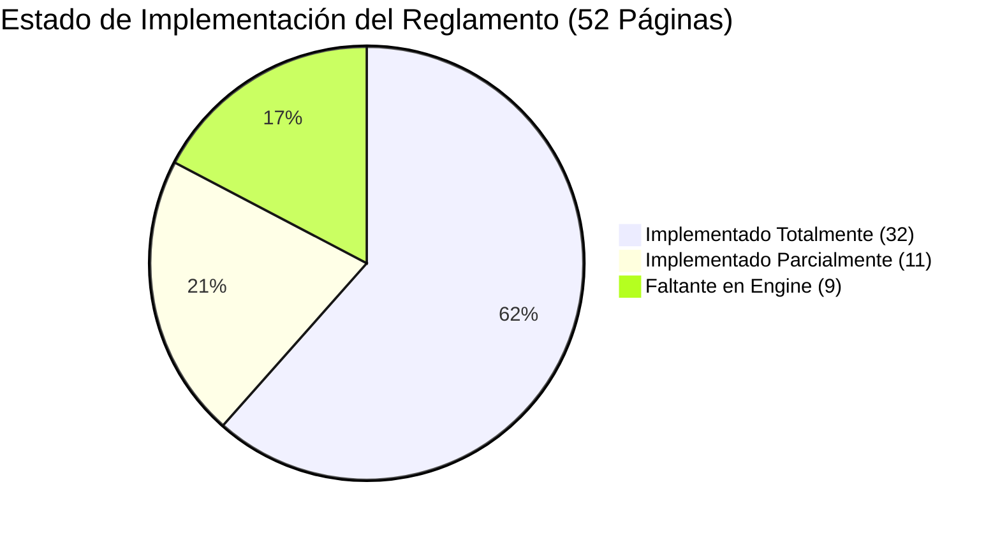
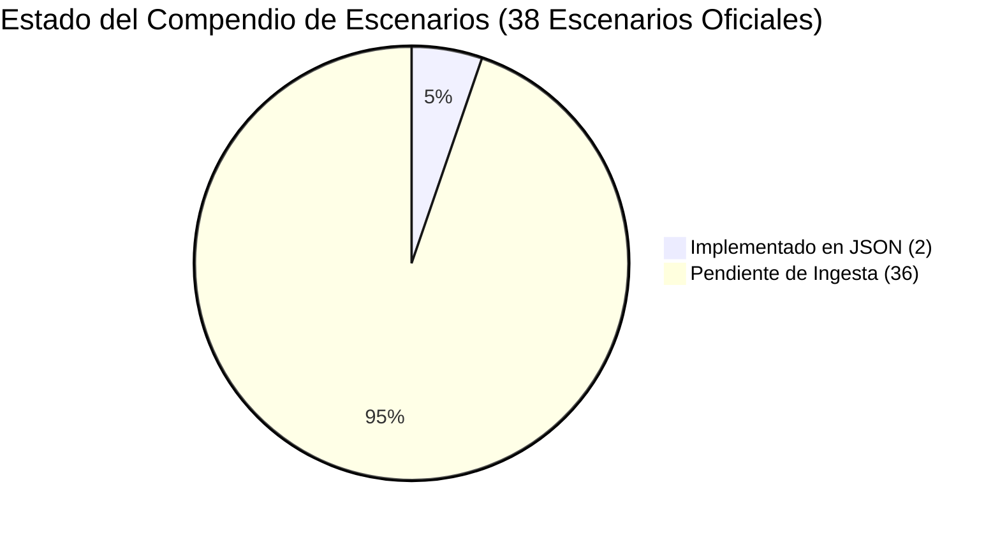
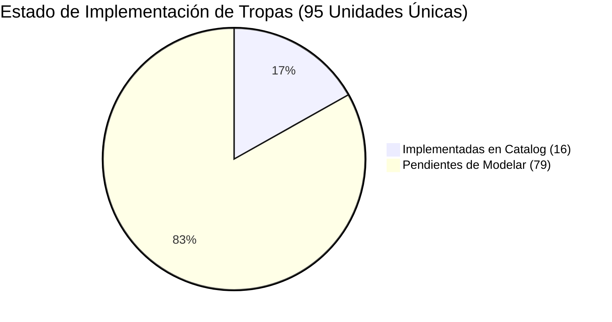
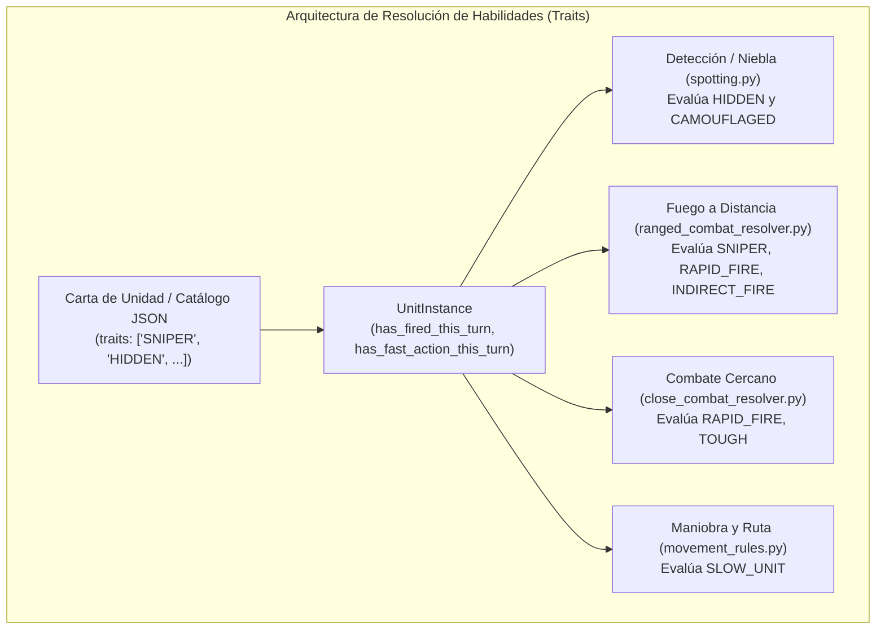

# 08. Auditoría Exhaustiva: Manual Oficial de Reglas vs. Engine del Juego y Escenarios

> [!IMPORTANT]
> **Directiva Primaria:** Esta auditoría compara página a página el manual oficial de reglas (*2024_09_18_Rulebook_rev6_web.pdf*, 52 páginas) y el libro de campaña (*ITA_Assault_Libro_Campagna_v1.0.pdf*, 104 páginas) contra el motor táctico autoritativo (`assault_model/`) y el catálogo de escenarios (`assault_sim/assets/scenarios/`).
> De acuerdo con las reglas de desarrollo, **MuZero está 100% decomisionado** y cualquier referencia o integración de IA táctica opera exclusivamente sobre **EfficientZero V2** (`agents/efficientzero_v2/`).

---

## 1. Resumen Ejecutivo y Cuadro de Mando (Audit Scorecard)

El motor actual `assault_model/` cuenta con una base sólida de clean architecture para la resolución de combate, geometría hexagonal, línea de visión (LOS) con elevaciones, dados de combate Assault (Rojo, Azul, Verde, Amarillo) y sistema de moral en cuatro estados. Sin embargo, existen lagunas específicas respecto al reglamento oficial de Sound of Drums, especialmente en las fases de apoyo (TAS/OAS), cartas de mando, transporte de tropas y la ingesta masiva del compendio de escenarios.

### Indicadores Clave de Auditoría (KPIs)

| Métrica de Auditoría | Valor | Estado | Observación |
| :--- | :---: | :---: | :--- |
| **Páginas del Manual Analizadas** | 52 / 52 | 100% | Auditoría exhaustiva página a página |
| **Capítulos Principales de Reglas** | 13 | 100% | Ch 1.0 a 13.0 revisados |
| **Mecánicas Núcleo (Combate/LOS/Moral)** | 100% | 🟢 OK | Implementación autoritativa en `assault_model/combat` |
| **Sistemas Avanzados Faltantes** | 4 áreas | 🟡 Parcial | Cartas de Mando, Humo, TAS/OAS, Transporte/Remolque |
| **Escenarios Oficiales en Campaña** | 38 | 🔴 Alerta | 26 de Campaña Gela + 12 Escenarios Standalone |
| **Escenarios Modelados en JSON** | 2 / 38 | 5.3% | Escenario 1.0 y Escenario 2.1 disponibles |

---

## 2. Auditoría Página a Página del Manual Oficial (Rulebook rev6)

A continuación se detalla la correspondencia exacta de cada una de las 52 páginas del manual oficial de reglas (*2024_09_18_Rulebook_rev6_web.pdf*) frente a la arquitectura de clases y métodos de `assault_model/`.

| Pág. | Sección Oficial | Materia / Tópico Oficial | Estado Engine | Módulo / Clase Implementada | Brecha Técnica / Mecánica Faltante |
| :---: | :--- | :--- | :---: | :--- | :--- |
| **1** | Portada | Portada oficial: Assault Sicily 43 v2.0 | `DOCUMENTAL` | N/A | Portada editorial (Sound of Drums). |
| **2** | Índice General | Tabla de Contenidos: Secciones 1.0 a 6.2 | `DOCUMENTAL` | N/A | Estructura del manual. |
| **3** | Índice General | Tabla de Contenidos: Secciones 9.10 a 13.0 | `DOCUMENTAL` | N/A | Continuación de la estructura del manual. |
| **4** | **1.0** Game Components | Fichas, dados de combate, cartas y hex-tiles | `IMPLEMENTADO` | `map/map_piece.py` `combat/battle_die.py` | Modelado de componentes físicos en entidades de dominio. |
| **5** | **2.0** Quick Start | Escenarios de entrenamiento (2.1 Infantería, 2.2 Setup) | `PARCIAL` | `core/scenario_loader.py` | La lógica corre en el engine, pero los escenarios 11.1 y 11.2 no están en JSON. |
| **6** | **3.0** Overview | Objetivos de victoria (3.1) y reglas básicas/opcionales (3.2) | `IMPLEMENTADO` | `core/victory_conditions.py` `core/vp_tracker.py` | Evaluación de control por puntos y turnos límite. |
| **7** | **4.1–4.2** Cards & Units | Cartas de formación, valores en puntos, blindados vs blandos, Blast values | `PARCIAL` | `units/unit_type.py` `units/attributes.py` | Valores de Blast (`xx:`) definidos; falta draft dinámico de cartas de formación. |
| **8** | **4.3–4.8** Components | Contadores, dados de combate (Rojo, Azul, Verde, Amarillo), ayudas de juego | `IMPLEMENTADO` | `combat/dice_color.py` `combat/dice_face.py` | Caras de dados con impactos, escudos, críticos y supresión 100% exactos. |
| **9** | **4.9–4.14** Expansions | Cartas de Mando (4.9.1), Puntos de Mando (4.9.2), TA/OAS, Minas, Daño Terreno | `FALTANTE` | `movement_rules.py` (solo minas básicas) | **Falta baraja de cartas de mando, pool de puntos CP y cartas de apoyo TAS/OAS.** |
| **10** | **5.0** Game Preparation | Preparación (5.1-5.6): Selección de facción, tablero y cartas de formación | `PARCIAL` | `core/scenario_loader.py` `map/map.py` | La carga de mapas modulares está lista; falta UI de selección de cartas pre-partida. |
| **11** | **5.7–5.9** Setup | Fuerzas iniciales, despliegue y mazo de cartas de mando | `PARCIAL` | `core/scenario.py` | Despliegue inicial por hexes soportado; falta inicialización de mazo de mando. |
| **12** | **6.0–6.2** Sequence | Secuencia de Juego: 6.1 Iniciativa (D6 roll), 6.2 Planificación y asignación de CP | `PARCIAL` | `state/turn.py` `runtime/game_state_runtime.py` | El loop alterna turnos fijos; **falta tirada de iniciativa D6 con modificadores tácticos y gasto de CP**. |
| **13** | **6.3–6.7** Phase Overview | Resumen fases: Apoyo, Acción, Organización (Rally), Chequeo de Victoria, Refuerzos | `IMPLEMENTADO` | `runtime/game_state_runtime.py` `core/activation.py` | Activación alternada, rallies y chequeo de fin de partida implementados. |
| **14** | **7.1** Support Phase | Fuego Indirecto (7.1.1 Spotting, 7.1.2 vs Vehículos, 7.1.3 Resultados) | `PARCIAL` | `actions/ranged_indirect.py` `combat/range_attack_profile.py` | Fuego indirecto implementado como acción de combate, pero no como subfase previa de soporte dedicada. |
| **15** | **7.2–7.4** Smoke & Art | Disparo de Humo (7.2), cambio de encaramiento de artillería (7.3), habilidades | `PARCIAL` | `combat/attack_sector.py` | Cambio de encaramiento soportado; **falta mecánica de humo (bloqueo LOS y dispersión por turno)**. |
| **16** | **8.0 & 9.0–9.5** Movement | Pasar (8.1), Fuego de Reacción (8.2), Movimiento Normal (9.1), Rápido (9.2), Movimiento + Disparo (9.3), Costes de Terreno (9.4), Terreno Difícil (9.5) | `IMPLEMENTADO` | `actions/movement.py` `actions/reaction_fire.py` `actions/composite_fire.py` `rules/movement_rules.py` | Apilamiento (1 unidad combate/hex), movimiento normal, doble movimiento y fuego compuesto autoritativo. |
| **17** | **9.6.1–9.6.3** Special Terrain | Colinas y elevación (9.6.1), Edificios ligeros/pesados (9.6.2), Carreteras y caminos (9.6.3) | `IMPLEMENTADO` | `map/terrain_config.py` `combat/line_of_sight.py` | Modificadores de movimiento por camino y bonificaciones de cobertura urbana implementados. |
| **18** | **9.6.3.2–9.6.4** Fortifications | Callejuelas urbanas, puentes, fortificaciones (Trincheras, Pozos de tirador, Bunkers) | `IMPLEMENTADO` | `map/fortification_config.py` `rules/fortification_rules.py` | Bonificaciones de defensa frontal y perimetral de trincheras y bunkers verificadas por tests. |
| **19** | **9.6.4–9.6.5** Obstacles | Reacción a movimiento en fortificaciones, obstáculos lineales (Muros, Bocage, Alambradas) | `IMPLEMENTADO` | `map/hex_edge_feature.py` `map/combat_geometry.py` | Intersección geométrica de aristas de hexágono para muros y setos integrada en contexto de combate. |
| **20** | **9.6.5.4–9.6.6** Minefields | Zanjas anticarro, campos de minas (colocación oculta, detonación y desactivación) | `PARCIAL` | `rules/movement_rules.py` | La tirada de daño al entrar en hex minado funciona; **falta el marcador oculto farol (bluff) y acción de zapadores para desminado**. |
| **21** | **9.7** Hex Control | Captura y control de hexágonos objetivo, cómputo de soberanía | `IMPLEMENTADO` | `map/hex_ownership.py` `map/hex_state.py` | Transición automática de bandera al ocupar hex objetivo libre de enemigos. |
| **22** | **9.8–9.10** Specific Move | Atrición de vehículos por terreno (9.10.1), daño por orugas, cavar trincheras (9.8.1) | `PARCIAL` | `rules/movement_terrain_rules.py` | Costes de movimiento de orugas y ruedas presentes; **falta acción de infantería "Cavar / Dig In" para erigir foxholes en juego**. |
| **23** | **9.10.3–9.11** Overrun & Trans | Arrollamiento de artillería por blindados (9.10.3), transporte de tropas (9.11.1–9.11.3) | `FALTANTE` | `actions/embark.py` (boceto) | **Falta arrollamiento (Overrun) directo sobre artillería y sistema completo de capacidad de transporte/desembarco**. |
| **24** | **9.11.4–9.12.3** Towing & Hide | Remolque de artillería pesada (9.11.4), acción de Ocultarse (Hide) para infantería y vehículos | `FALTANTE` | `combat/spotting.py` | El spotting cubre visibilidad, pero **falta la acción explícita "Ocultarse" con marcador de status y remolque con camiones/semiorugas**. |
| **25** | **9.12.4–10.1** Ambush & Range | Emboscada (9.12.4), Fuego de cobertura (9.13), Factor de alcance (10.1: A bocajarro, corto, medio, largo, extremo) | `IMPLEMENTADO` | `combat/range_band.py` `combat/range_logic.py` | Bandas de alcance con modificación de dados de ataque por distancia 100% integradas. |
| **26** | **10.2–10.4** Line of Sight | Línea de Visión (10.2), cálculo centro a centro (10.3), elevación y zonas ciegas (10.4) | `IMPLEMENTADO` | `combat/line_of_sight.py` `combat/los_modifier.py` | Trazado de rayos con elevación relativa, hexágonos ciegos detrás de colinas y crestas implementado. |
| **27** | **10.5–10.6** Spotting & Arcs | Avistamiento directo (10.5), Arcos de fuego (10.6: frontal 180°, flancos 60°, retaguardia 60°) | `IMPLEMENTADO` | `combat/spotting.py` `combat/attack_sector.py` `combat/flank.py` | Determinación matemática del sector de impacto y torretas giratorias en vehículos. |
| **28** | **10.7.1–10.7.4** Resolving Combat | Comparación de dados (Impactos vs Escudos, Net Hits), asignación de daño y críticos | `IMPLEMENTADO` | `combat/ranged_combat_resolver.py` `combat/dice_comparison.py` | Resolución de enfrentamiento de dados, cálculo de daño a HP y chequeos de supresión. |
| **29** | **10.7.5–10.8** Criticals & Attacks | Tabla de críticos infantería/artillería (10.7.5), tabla de daños críticos de vehículos (10.7.6), disparo conjunto (10.8.4) | `PARCIAL` | `combat/critical_table.py` `combat/critical_effect.py` | Críticos de infantería (eliminación directa/huida) implementados; **faltan daños a subsistemas de vehículos (inmovilizado, cañón roto, torreta atascada)**. |
| **30** | **10.9.1–10.9.6** Defense Modifiers | Dados de defensa por terreno (10.9.1), LOS obstaculizada (10.9.2), sector de impacto (10.9.3), estado moral del defensor (10.9.6) | `IMPLEMENTADO` | `combat/defense_dice_pool.py` `combat/modifiers/terrain_modifier.py` | Tabla completa de modificadores de dados de defensa según cobertura y moral (Pinned/Suppressed/Routed). |
| **31** | **10.9.7–10.10** Tank Riders | Habilidades especiales, experiencia, pasajeros sobre blindados (Tank Riders) y desembarco de emergencia | `PARCIAL` | `combat/modifiers/morale_modifier.py` | Las bonificaciones de veterano existen; **falta vulnerabilidad de infantería montada sobre carros expuestos y desembarco de emergencia bajo fuego**. |
| **32** | **11.1–11.1.1** Close Combat | Inicio de combate cuerpo a cuerpo / asalto hexagonal, asalto simultáneo | `IMPLEMENTADO` | `actions/assault.py` `combat/close_combat_resolver.py` | Entrada en hex enemigo, chequeo de entrada y rondas simultáneas de asalto. |
| **33** | **11.1.2–11.1.3** Melee Dice Pools | Dados de ataque cuerpo a cuerpo (rojos/amarillos), penalización por media fuerza, defensa en asalto | `IMPLEMENTADO` | `combat/close_combat_resolver.py` `combat/attack_dice_pool.py` | Pool específico de combate cuerpo a cuerpo y penalizaciones de flanco en combate cerrado. |
| **34** | **11.1.4–11.4** Melee Damage | Asignación de bajas en asalto, Adrenaline Rush (11.1.5), defensores atrincherados (11.2), retirada obligada | `PARCIAL` | `combat/close_combat_context.py` | Daño simultáneo y retirada obligada por moral implementados; **falta mecánica Adrenaline Rush (repetición táctica)**. |
| **35** | **11.5** Infantry vs Tanks | Ataque especial de infantería contra vehículos en combate cerrado (granadas magnéticas, cócteles molotov) | `FALTANTE` | `combat/close_combat_resolver.py` | **Falta la tabla de asalto especializado de infantería contra carros de combate sin apoyo de infantería amiga**. |
| **36** | **11.6** Melee Example | Ejemplo extendido paso a paso de asalto a quemarropa | `DOCUMENTAL` | `tests/test_modifier_parity_ranged_close.py` | Validado mediante tests de integración de asalto. |
| **37** | **11.6** Example Cont. | Conclusión del ejemplo de combate cerrado y resolución de apoyos | `DOCUMENTAL` | `tests/test_close_combat_resolver.py` | Validado mediante tests de integración. |
| **38** | **12.1–12.2** TA/OAS Expansion | Expansión de Apoyo Aéreo Táctico (TAS) y Artillería Fuera de Tablero (OAS) | `FALTANTE` | N/A | **No existe el subsistema de apoyo aéreo ni de artillería naval/pesada fuera de mapa.** |
| **39** | **12.2.3–12.3.2** TAS Requests | Petición de TAS en fase de planificación, temporización y llegada de cazabombarderos | `FALTANTE` | N/A | Falta lógica de solicitud aérea y cola de eventos de ataque por turno. |
| **40** | **12.3.3–12.3.5** Flak & AA Fire | Identificación de objetivo aéreo, fuego antiaéreo defensivo (AA) y salvaguarda de aviones | `FALTANTE` | `combat/attack_sector.py` | Falta fuego antiaéreo (Flak) defensivo previo al picado del bombardero. |
| **41** | **12.3.6** TAS Attack | Resolución de ataque de bombardeo/ametrallamiento, tirada de dispersión D6 | `FALTANTE` | N/A | Falta tirada de desviación de bombas y resolución de racimo. |
| **42** | **12.4.1–12.4.2** OAS Requests | Petición de artillería pesada fuera de tablero, tiempo de llegada y radio de batería | `FALTANTE` | N/A | Falta temporizador de andanada de obuses fuera de mapa. |
| **43** | **12.4.3** Artillery Strike | Fuego de artillería: Marcador de objetivo, línea de observación y dispersión | `FALTANTE` | N/A | Falta cálculo de dispersión radial (scatter hexagonal de 1 a 6). |
| **44** | **12.4.3.3** Suppressive Zone | Zona de fuego de supresión en hex central y hexágonos adyacentes de impacto | `FALTANTE` | `actions/ranged_indirect.py` | Falta saturación de área con daño de onda expansiva decreciente. |
| **45** | **12.5** Blast vs Buildings | Valores de demolición (Blast), colapso de edificios y creación de cráteres de metralla | `PARCIAL` | `map/terrain_config.py` | Cobertura urbana modelada; **falta transformación dinámica de edificio a escombros y colocación de cráter**. |
| **46** | **13.1–13.2** Status Markers | Marcadores de activación: Movido, Disparado, Fuego en movimiento, Acción demorada | `IMPLEMENTADO` | `actions/status.py` `runtime/execution_context.py` | Máquina de estados de activación por unidad autoritativa y limpia. |
| **47** | **13.3** Morale System | Estados de moral: Normal $\to$ Pinned $\to$ Suppressed $\to$ Routed $\to$ Fallback | `IMPLEMENTADO` | `combat/morale.py` `combat/modifiers/morale_modifier.py` | Transición matemática de degradación y recuperación de moral 100% exacta. |
| **48** | Recursos Oficiales | Datos de la comunidad Assault Games, hojas de ayuda | `DOCUMENTAL` | N/A | Información editorial. |
| **49** | Módulo VASSAL | Referencia al módulo oficial de juego en línea VASSAL | `DOCUMENTAL` | N/A | Enlaces a repositorio web de Sound of Drums. |
| **50** | Índice Alfabético | Índice analítico (A a L) | `DOCUMENTAL` | N/A | Índice de términos. |
| **51** | Índice Alfabético | Índice analítico (M a Z) | `DOCUMENTAL` | N/A | Índice de términos. |
| **52** | Contraportada | Información de licencia y editorial: Sound of Drums GmbH | `DOCUMENTAL` | N/A | Datos editoriales. |

---

## 3. Auditoría del Compendio de Escenarios (Libro de Campaña, 104 Páginas)

El libro de campaña oficial (*ITA_Assault_Libro_Campagna_v1.0.pdf*) contiene la totalidad de las batallas históricas y alternativas de la invasión de Sicilia (Operación Husky, julio de 1943) divididas en **dos grandes bloques**:
1. **Campaña de Gela (Día 1 y Día 2)**: 26 escenarios interconectados mediante el diagrama de flujo operacional.
2. **Escenarios Independientes (Capítulo 11.0)**: 12 escenarios autónomos de diversa escala (desde entrenamiento básico hasta grandes choques de blindados en la carretera 115 y Biazza Ridge).

### Catálogo Exhaustivo de Escenarios vs. Disponibilidad en `assault_sim/`

| Pág. PDF | ID Oficial | Nombre del Escenario | Fecha Histórica | Turnos | Bloque | Estado en Simulador | Fichero en `assault_sim/` | Requisitos para Ingesta |
| :---: | :---: | :--- | :---: | :---: | :---: | :---: | :---: | :--- |
| **18** | **1.0** | **Mettete i piedi per terra!** | 10 Jul 1943, 03:35 | 8 | Campaña (Día 1) | 🟢 **IMPLEMENTADO** | `mettete_i_piedi_terra_1.json` | Totalmente jugable e integrado con EZero V2. |
| **20** | **2.1** | **Battaglia Cittadina** | 10 Jul 1943, 05:40 | 8 | Campaña (Día 1) | 🟢 **IMPLEMENTADO** | `battaglia_cittadina_2_1.json` | Totalmente jugable e integrado con EZero V2. |
| **22** | **2.2** | Battaglia Cittadina (Variante B) | 10 Jul 1943, 05:40 | 8 | Campaña (Día 1) | 🔴 PENDIENTE | Ninguno | Ingesta de formación y mapa modular urbano. |
| **24** | **2.3** | Battaglia Cittadina (Variante C) | 10 Jul 1943, 05:40 | 8 | Campaña (Día 1) | 🔴 PENDIENTE | Ninguno | Ingesta de configuración de tropas mixtas. |
| **26** | **3.1** | Avanti Savoia! (A) | 10 Jul 1943, 09:10 | 8 | Campaña (Día 1) | 🔴 PENDIENTE | Ninguno | Mapa colinas y contrattacco italiano Div. Livorno. |
| **28** | **3.2** | Avanti Savoia! (B) | 10 Jul 1943, 09:10 | 8 | Campaña (Día 1) | 🔴 PENDIENTE | Ninguno | Ingesta de batallón Bersaglieri y R35 italianos. |
| **30** | **3.3** | Avanti Savoia! (C) | 10 Jul 1943, 09:10 | 8 | Campaña (Día 1) | 🔴 PENDIENTE | Ninguno | Ingesta de posiciones atrincheradas. |
| **32** | **3.4** | Difesa della Testa di Sbarco (A) | 10 Jul 1943, 09:10 | 8 | Campaña (Día 1) | 🔴 PENDIENTE | Ninguno | Mapa de playa roja con artillería de costa. |
| **34** | **3.5** | Difesa della Testa di Sbarco (B) | 10 Jul 1943, 09:10 | 8 | Campaña (Día 1) | 🔴 PENDIENTE | Ninguno | Refuerzos navales estadounidenses. |
| **36** | **4.1** | Avanti verso Nord! (A) | 10 Jul 1943, 13:35 | 8 | Campaña (Día 1) | 🔴 PENDIENTE | Ninguno | Mapa de llanura y bifurcaciones viales. |
| **38** | **4.2** | Avanti verso Nord! (B) | 10 Jul 1943, 13:35 | 8 | Campaña (Día 1) | 🔴 PENDIENTE | Ninguno | Ingesta de unidades mecanizadas. |
| **40** | **4.3** | Difendete Gela! (A) | 10 Jul 1943, 13:35 | 8 | Campaña (Día 1) | 🔴 PENDIENTE | Ninguno | Periferia urbana y soporte de morteros. |
| **42** | **4.4** | Difendete Gela! (B) | 10 Jul 1943, 13:35 | 8 | Campaña (Día 1) | 🔴 PENDIENTE | Ninguno | Combinación de blindados alemanes Hermann Göring. |
| **44** | **4.5** | Recap Gela! | 10 Jul 1943, 13:35 | 8 | Campaña (Día 1) | 🔴 PENDIENTE | Ninguno | Choque en sector ferroviario y muelle. |
| **48** | **5.1** | Contrattacco da Nord! (A) | 11 Jul 1943, 07:10 | 8 | Campaña (Día 2) | 🔴 PENDIENTE | Ninguno | Llegada de blindados Panzer III/IV. |
| **50** | **5.2** | Contrattacco da Nord! (B) | 11 Jul 1943, 07:10 | 8 | Campaña (Día 2) | 🔴 PENDIENTE | Ninguno | Despliegue de cañones anticarro PaK 38/40. |
| **52** | **5.3** | Difendete Gela Nord! (A) | 11 Jul 1943, 07:10 | 8 | Campaña (Día 2) | 🔴 PENDIENTE | Ninguno | Mapa de colinas con densa vegetación de olivos. |
| **54** | **5.4** | Difendete Gela Nord! (B) | 11 Jul 1943, 07:10 | 8 | Campaña (Día 2) | 🔴 PENDIENTE | Ninguno | Contraataque con apoyo de semiorugas. |
| **56** | **5.5** | Difendete la Città di Gela! (A) | 11 Jul 1943, 07:10 | 8 | Campaña (Día 2) | 🔴 PENDIENTE | Ninguno | Combate casa por casa de alta intensidad. |
| **58** | **5.6** | Difendete la Città di Gela! (B) | 11 Jul 1943, 07:10 | 8 | Campaña (Día 2) | 🔴 PENDIENTE | Ninguno | Asalto con ingenieros y lanzallamas. |
| **60** | **5.7** | Difendete la Città di Gela! (C) | 11 Jul 1943, 07:10 | 8 | Campaña (Día 2) | 🔴 PENDIENTE | Ninguno | Posiciones de francotirador y barricadas. |
| **62** | **6.1** | Avanzate verso Ponte Olivo! | 11 Jul 1943, 13:20 | 8 | Campaña (Día 2) | 🔴 PENDIENTE | Ninguno | Cruce de río, puente vial y zanjas. |
| **64** | **6.2** | Contrattacco Finale! (A) | 11 Jul 1943, 13:20 | 8 | Campaña (Día 2) | 🔴 PENDIENTE | Ninguno | Asalto combinado con tanques Tiger I. |
| **66** | **6.3** | Contrattacco Finale! (B) | 11 Jul 1943, 13:20 | 8 | Campaña (Día 2) | 🔴 PENDIENTE | Ninguno | Foco de resistencia con artillería de 88mm. |
| **68** | **6.4** | Contrattacco Finale! (C) | 11 Jul 1943, 13:20 | 8 | Campaña (Día 2) | 🔴 PENDIENTE | Ninguno | Defensa desesperada de infantería de Rangers. |
| **70** | **6.5** | Difendete la Testa di Sbarco! (A)| 11 Jul 1943, 18:50 | 8 | Campaña (Día 2) | 🔴 PENDIENTE | Ninguno | Choque nocturno en dunas costeras. |
| **72** | **6.6** | Difendete la Testa di Sbarco! (B)| 11 Jul 1943, 18:15 | 8 | Campaña (Día 2) | 🔴 PENDIENTE | Ninguno | Bombardeo naval preliminar aliado. |
| **74** | **6.7** | Difendete la Testa di Sbarco! (C)| 11 Jul 1943, 18:00 | 8 | Campaña (Día 2) | 🔴 PENDIENTE | Ninguno | Último intento de ruptura del eje. |
| **79** | **11.1**| Addestramento Fanteria | Entrenamiento | 6 | Standalone | 🔴 PENDIENTE | Ninguno | Mapa básico de 1 pieza, infantería pura (fusileros y MGs). |
| **80** | **11.2**| Addestramento Veicoli | Entrenamiento | 6 | Standalone | 🔴 PENDIENTE | Ninguno | Mapa llano para maniobra y tiro de blindados Sherman vs Panzer. |
| **81** | **11.3**| Bunker Hill! | Histórico Gela | 8 | Standalone | 🔴 PENDIENTE | Ninguno | Asalto frontal a colina escarpada fortificada con bunker. |
| **82** | **11.4**| Nell'Oscurità | 9 Jul 1943, 23:45 | 8 | Standalone | 🔴 PENDIENTE | Ninguno | Escenario nocturno de paracaidistas estadounidenses en Piano Lupo. |
| **84** | **11.5**| La Sporca Dozzina | 10 Jul 1943, 02:35 | 8 | Standalone | 🔴 PENDIENTE | Ninguno | Incursión comando de Rangers tras las líneas enemigas en Casa Priolo. |
| **86** | **11.6**| Elemento Sorpresa | 10 Jul 1943, 07:30 | 8 | Standalone | 🔴 PENDIENTE | Ninguno | Emboscada a puesto avanzado en la encrucijada en Y de Priolo. |
| **88** | **11.7**| Achtung Panzer! | 10 Jul 1943, 13:30 | 8 | Standalone | 🔴 PENDIENTE | Ninguno | Paracaidistas con bazookas frenando blindados italianos. |
| **90** | **11.8**| Inferno su cingoli! | 11 Jul 1943, 14:30 | 8 | Standalone | 🔴 PENDIENTE | Ninguno | Batalla de tanques en la carretera 115. |
| **92** | **11.9**| La collina della disperazione | 11 Jul 1943, 12:30 | 8 | Standalone | 🔴 PENDIENTE | Ninguno | Famosa defensa heroica de Gavin en Biazza Ridge. |
| **94** | **11.10**| Tigre in agguato | 12 Jul 1943, 16:35 | 8 | Standalone | 🔴 PENDIENTE | Ninguno | Duelo de blindados contra el temido Tiger I en terreno cerrado. |
| **96** | **11.11**| Buttateli fuori! | 11 Jul 1943, 17:25 | 8 | Standalone | 🔴 PENDIENTE | Ninguno | Contraataque de ingenieros militares en suburbios de Gela. |
| **98** | **11.12**| Strane cose in Sicilia | "What If" 1945 | 8 | Standalone | 🔴 PENDIENTE | Ninguno | Escenario ucronía con unidades soviéticas invasoras. |

---

## 4. Compendio e Inventario Canónico de Unidades: Counters (191) y Unit Cards (190)

Para dar soporte a la totalidad de las fuerzas de la campaña de Sicilia (1943) y permitir la incorporación paulatina y modular de nuevas tropas al motor táctico y a la IA, se ha auditado y emparejado al 100% el repositorio de arte gráfico de fichas (`assets/art/counters/`) y cartas de unidad (`assets/art/unit_cards/`):

### Resumen Ejecutivo por Facción

| Facción | Fuerza Militar | Unidades Totales | Implementadas en Catálogo | Pendientes | Cobertura de Arte |
| :---: | :--- | :---: | :---: | :---: | :---: |
| **GE** | Alemania (Wehrmacht / Luftwaffe) | **27** | 4 | 23 | 100% (Anverso/Reverso) |
| **IT** | Italia (Regio Esercito) | **21** | 7 | 14 | 100% (Anverso/Reverso) |
| **UK** | Gran Bretaña (British Army / Commonwealth) | **25** | 0 | 25 | 100% (Anverso/Reverso) |
| **US** | Estados Unidos (US Army / Rangers / Airborne) | **22** | 5 | 17 | 100% (Anverso/Reverso) |
| **TOTAL** | **Todas las Facciones** | **95** | **16** (16.8%) | **79** | **100% Completo** |

---

### 4.1. Facción GE: Alemania (Wehrmacht / Luftwaffe) (27 Unidades)

| ID Canónico | Nombre Unidad | Tipo / Rol | Estado | Ficha (Full / Half) | Carta (Anverso / Reverso) |
| :--- | :--- | :---: | :---: | :--- | :--- |
| `GE_2_8CM_SPZB_41` | **2-8cm sPzB 41** | `GUN_ARTILLERY` | 🟡 `PENDIENTE` | `GE 2-8cm sPzB 41.png` `GE 2-8cm sPzB 41b.png` | `GE Unit 2-8cm sPzB41.jpg` `GE Unit 2-8cm sPzB41b.jpg` |
| `GE_3_7CM_FLAK_37` | **3-7cm Flak 37** | `GUN_ARTILLERY` | 🟡 `PENDIENTE` | `GE 3-7cm Flak 37.png` `GE 3-7cm Flak 37b.png` | `GE Unit 3-7cm Flak 37.jpg` `GE Unit 3-7cm Flak 37b.jpg` |
| `GE_50MM_ATG_38` | **50mm ATG 38** | `GUN_ARTILLERY` | 🟡 `PENDIENTE` | `GE 50mm ATG 38.png` `GE 50mm ATG 38b.png` | `GE Unit 50mm Flak 38.jpg` `GE Unit 50mm Flak 38b.jpg` |
| `GE_50MM_MORTAR` | **50mm Mortar** | `GUN_ARTILLERY` | 🟢 `IMPLEMENTADO` | `GE 50mm Mortar.png` `GE 50mm Mortarb.png` | `GE Unit 50mm Mortar.jpg` `GE Unit 50mm Mortarb.jpg` |
| `GE_7_5CM_LG40` | **7-5cm LG40** | `GUN_ARTILLERY` | 🟡 `PENDIENTE` | `GE 7-5cm LG40.png` `GE 7-5cm LG40b.png` | `GE Unit 7-5cm LG 40.jpg` `GE Unit 7-5cm LG 40b.jpg` |
| `GE_75MM_ATG_40` | **75mm ATG 40** | `GUN_ARTILLERY` | 🟡 `PENDIENTE` | `GE 75mm ATG 40.png` `GE 75mm ATG 40b.png` | `GE Unit 75mm ATG 40.jpg` `GE Unit 75mm ATG 40b.jpg` |
| `GE_75MM_INFANTRY_GUN` | **75mm Infantry Gun** | `GUN_ARTILLERY` | 🟡 `PENDIENTE` | `GE 75mm Infantry Gun.png` `GE 75mm Infantry Gunb.png` | `GE Unit 75mm Inf Gun.jpg` `GE Unit 75mm Inf Gunb.jpg` |
| `GE_8_8CM_FLAK_36` | **8-8cm Flak 36** | `GUN_ARTILLERY` | 🟡 `PENDIENTE` | `GE 8-8cm Flak 36.png` `GE 8-8cm Flak 36b.png` | `GE Unit 8-8cm Flak 36.jpg` `GE Unit 8-8cm Flak 36b.jpg` |
| `GE_8_8CM_RW_43` | **8-8cm RW 43** | `GUN_ARTILLERY` | 🟡 `PENDIENTE` | `GE 8-8cm RW 43.png` `GE 8-8cm RW 43b.png` | `GE Unit 8-8cm RW 43 Puppchen.jpg` `GE Unit 8-8cm RW 43 Puppchenb.jpg` |
| `GE_81MM_MORTAR` | **81mm Mortar** | `GUN_ARTILLERY` | 🟡 `PENDIENTE` | `GE 81mm Mortar.png` `GE 81mm Mortarb.png` | `GE Unit 81mm Mortar.jpg` `GE Unit 81mm Mortarb.jpg` |
| `GE_FJ_RIFLES_43` | **FJ Rifles 43** | `INFANTRY` | 🟢 `IMPLEMENTADO` | `GE FJ Rifles 43.png` `GE FJ Rifles 43b.png` | `GE Unit Fallschirmjager Rifles 43.jpg` `GE Unit Fallschirmjager Rifles 43b.jpg` |
| `GE_GRENADIERS_43` | **Grenadiers 43** | `INFANTRY` | 🟡 `PENDIENTE` | `GE Grenadiers 43.png` `GE Grenadiers 43b.png` | `GE Unit Grenadiers 43.jpg` `GE Unit Grenadiers 43b.jpg` |
| `GE_HEAVY_MG_42` | **HMG 42** | `INFANTRY` | 🟢 `IMPLEMENTADO` | `GE HMG 42.png` `GE HMG 42b.png` | `GE Unit Heavy MG42.jpg` `GE Unit Heavy MG42b.jpg` |
| `GE_KETTENKRADS` | **Kettenkrads** | `INFANTRY` | 🟡 `PENDIENTE` | `GE Kettenkrads.png` `GE Kettenkradsb.png` | `GE Unit Kettenkrads.jpg` `GE Unit Kettenkradsb.jpg` |
| `GE_RIFLES_43` | **Rifles 43** | `INFANTRY` | 🟢 `IMPLEMENTADO` | `GE Rifles 43.png` `GE Rifles 43b.png` | `GE Unit Rifles 43.jpg` `GE Unit Rifles 43b.jpg` |
| `GE_SDKFZ_231` | **SdKfz 231** | `INFANTRY` | 🟡 `PENDIENTE` | `GE SdKfz 231.png` `GE SdKfz 231b.png` | `GE Unit SDKFZ 231.jpg` `GE Unit SDKFZ 231b.jpg` |
| `GE_SDKFZ_233` | **SdKfz 233** | `INFANTRY` | 🟡 `PENDIENTE` | `GE SdKfz 233.png` `GE SdKfz 233b.png` | `GE Unit SDKFZ 233.jpg` `GE Unit SDKFZ 233b.jpg` |
| `GE_SDKFZ_251_1` | **SdKfz 251-1** | `INFANTRY` | 🟡 `PENDIENTE` | `GE SdKfz 251-1.png` `GE SdKfz 251-1b.png` | `GE Unit SDKFZ 251-1.jpg` `GE Unit SDKFZ 251-1b.jpg` |
| `GE_SERVICE_TROOPS` | **Service Troops** | `INFANTRY` | 🟡 `PENDIENTE` | `GE Service Troops.png` `GE Service Troopsb.png` | `GE Unit Service Troops.jpg` `GE Unit Service Troopsb.jpg` |
| `GE_SNIPER_43` | **Sniper 43** | `INFANTRY` | 🟡 `PENDIENTE` | `GE Sniper 43.png` `GE Sniper 43b.png` | `GE Unit Sniper 43.jpg` `GE Unit Sniper 43b.jpg` |
| `GE_TRUCK` | **Truck** | `TRANSPORT` | 🟡 `PENDIENTE` | `GE Truck.png` `GE Truckb.png` | `GE Unit Truck.jpg` `GE Unit Truckb.jpg` |
| `GE_PANZER_III_J` | **Panzer III J** | `VEHICLE` | 🟡 `PENDIENTE` | `GE Panzer III J.png` `GE Panzer III Jb.png` | `GE Unit Panzer III J.jpg` `GE Unit Panzer III Jb.jpg` |
| `GE_PANZER_IV_G` | **Panzer IV G** | `VEHICLE` | 🟡 `PENDIENTE` | `GE Panzer IV G.png` `GE Panzer IV Gb.png` | `GE Unit Panzer IV G.jpg` `GE Unit Panzer IV Gb.jpg` |
| `GE_STUG_III_G` | **StuG III G** | `VEHICLE` | 🟡 `PENDIENTE` | `GE StuG III G.png` `GE StuG III Gb.png` | `GE Unit StuG III G.jpg` `GE Unit StuG III Gb.jpg` |
| `GE_STUH42` | **StuH42** | `VEHICLE` | 🟡 `PENDIENTE` | `GE StuH42.png` `GE StuH42b.png` | `GE Unit StuH 42.jpg` `GE Unit StuH 42b.jpg` |
| `GE_TANK_HUNTERS_43` | **Tank Hunters 43** | `VEHICLE` | 🟡 `PENDIENTE` | `GE Tank Hunters 43.png` `GE Tank Hunters 43b.png` | `GE Unit Tank Hunters 43.jpg` `GE Unit Tank Hunters 43b.jpg` |
| `GE_TIGER_E` | **Tiger E** | `VEHICLE` | 🟡 `PENDIENTE` | `GE Tiger E.png` `GE Tiger Eb.png` | `GE Unit Tiger E.jpg` `GE Unit Tiger Eb.jpg` |

### 4.2. Facción IT: Italia (Regio Esercito) (21 Unidades)

| ID Canónico | Nombre Unidad | Tipo / Rol | Estado | Ficha (Full / Half) | Carta (Anverso / Reverso) |
| :--- | :--- | :---: | :---: | :--- | :--- |
| `IT_47MM_ATG` | **47mm ATG** | `GUN_ARTILLERY` | 🟡 `PENDIENTE` | `IT 47mm ATG.png` `IT 47mm ATGb.png` | `IT Unit 47mm ATG.jpg` `IT Unit 47mm ATGb.jpg` |
| `IT_65MM_FIELD_GUN` | **65mm Field Gun** | `GUN_ARTILLERY` | 🟡 `PENDIENTE` | `IT 65mm Field Gun.png` `IT 65mm Field Gunb.png` | `IT Unit 65mm Field Gun.jpg` `IT Unit 65mm Field Gunb.jpg` |
| `IT_81MM_MORTAR` | **81mm Mortar** | `GUN_ARTILLERY` | 🟡 `PENDIENTE` | `IT 81mm Mortar.png` `IT 81mm Mortarb.png` | `IT Unit 81mm Mortar.jpg` `IT Unit 81mm Mortarb.jpg` |
| `IT_90MM_AA_GUN` | **90mm AA Gun** | `GUN_ARTILLERY` | 🟡 `PENDIENTE` | `IT 90mm AA Gun.png` `IT 90mm AA Gunb.png` | `IT Unit 90mm AA Gun.jpg` `IT Unit 90mm AA Gunb.jpg` |
| `IT_20MM_BREDA_AA_43` | **20mm Breda AA** | `INFANTRY` | 🟢 `IMPLEMENTADO` | `IT 20mm Breda AA.png` `IT 20mm Breda AAb.png` | `IT Unit 20mm Breda AA.jpg` `IT Unit 20mm Breda AAb.jpg` |
| `IT_45MM_BRIXIA_TEAM` | **45mm Brixia Team** | `INFANTRY` | 🟢 `IMPLEMENTADO` | `IT 45mm Brixia Team.png` `IT 45mm Brixia Teamb.png` | `IT Unit 45mm Brixia Mortar.jpg` `IT Unit 45mm Brixia Mortarb.jpg` |
| `IT_BREDA_MMG` | **Breda MMG** | `INFANTRY` | 🟢 `IMPLEMENTADO` | `IT Breda MMG.png` `IT Breda MMGb.png` | `IT Unit Breda MMG.jpg` `IT Unit Breda MMGb.jpg` |
| `IT_LMG_SQUAD_43` | **LMG Squad 43** | `INFANTRY` | 🟢 `IMPLEMENTADO` | `IT LMG Squad 43.png` `IT LMG Squad 43b.png` | `IT Unit LMG Squad 43.jpg` `IT Unit LMG Squad 43b.jpg` |
| `IT_LANCIA_90MM_L53` | **Lancia 90mm L53** | `INFANTRY` | 🟡 `PENDIENTE` | `IT Lancia 90mm L53.png` `IT Lancia 90mm L53b.png` | `IT Unit Lancia 90mm L53.jpg` `IT Unit Lancia 90mm L53b.jpg` |
| `IT_RIFLES_43` | **Rifles 43** | `INFANTRY` | 🟢 `IMPLEMENTADO` | `IT Rifles 43.png` `IT Rifles 43b.png` | `IT Unit Rifles 43.jpg` `IT Unit Rifles 43b.jpg` |
| `IT_SNIPER_43` | **Sniper 43** | `INFANTRY` | 🟢 `IMPLEMENTADO` | `IT Sniper 43.png` `IT Sniper 43b.png` | `IT Unit Sniper 43.jpg` `IT Unit Sniper 43b.jpg` |
| `IT_SOLOTHURN_ATR_43` | **Solothum ATR** | `INFANTRY` | 🟢 `IMPLEMENTADO` | `IT Solothum ATR.png` `IT Solothum ATRb.png` | `IT Unit Solothurn AT Rifle.jpg` `IT Unit Solothurn AT Rifleb.jpg` |
| `IT_TRUCK` | **Truck** | `TRANSPORT` | 🟡 `PENDIENTE` | `IT Truck.png` `IT Truckb.png` | `IT Unit Truck.jpg` `IT Unit Truckb.jpg` |
| `IT_AUTOBLINDA_41` | **Autoblinda 41** | `VEHICLE` | 🟡 `PENDIENTE` | `IT Autoblinda 41.png` `IT Autoblinda 41b.png` | `IT Unit Autoblinda 41.jpg` `IT Unit Autoblinda 41b.jpg` |
| `IT_CAMIONETTA_AS_42` | **Camionetta AS-42** | `VEHICLE` | 🟡 `PENDIENTE` | `IT Camionetta AS-42.png` `IT Camionetta AS-42b.png` | `IT Unit Camionetta As42.jpg` `IT Unit Camionetta As42b.jpg` |
| `IT_L3_35` | **L3-35** | `VEHICLE` | 🟡 `PENDIENTE` | `IT L3-35.png` `IT L3-35b.png` | `IT Unit L3-35.jpg` `IT Unit L3-35b.jpg` |
| `IT_L3_35_FLAME` | **L3-35 Flame** | `VEHICLE` | 🟡 `PENDIENTE` | `IT L3-35 Flame.png` `IT L3-35 Flameb.png` | `IT Unit L3-35 Flame.jpg` `IT Unit L3-35 Flameb.jpg` |
| `IT_L6_40` | **L6-40** | `VEHICLE` | 🟡 `PENDIENTE` | `IT L6-40.png` `IT L6-40b.png` | `IT Unit L6-40.jpg` `IT Unit L6-40b.jpg` |
| `IT_M_14_41` | **M 14-41** | `VEHICLE` | 🟡 `PENDIENTE` | `IT M 14-41.png` `IT M14-41b.png` | `IT Unit M14-41.jpg` `IT Unit M14-41b.jpg` |
| `IT_RENAULT_R_35` | **Renault R-35** | `VEHICLE` | 🟡 `PENDIENTE` | `IT Renault R-35.png` `IT Renault R-35b.png` | `IT Unit Renault R-35.jpg` `IT Unit Renault R-35b.jpg` |
| `IT_SEMOVENTE_75_41` | **Semovente 75-41** | `VEHICLE` | 🟡 `PENDIENTE` | `IT Semovente 75-41.png` `IT Semovente 75-41b.png` | `IT Unit Semovente 75-41.jpg` `IT Unit Semovente 75-41b.jpg` |

### 4.3. Facción UK: Gran Bretaña (British Army / Commonwealth) (25 Unidades)

| ID Canónico | Nombre Unidad | Tipo / Rol | Estado | Ficha (Full / Half) | Carta (Anverso / Reverso) |
| :--- | :--- | :---: | :---: | :--- | :--- |
| `UK_17_POUNDER_ATG` | **17-Pounder ATG** | `GUN_ARTILLERY` | 🟡 `PENDIENTE` | `UK 17-Pounder ATG.png` `UK 17-Pounder ATGb.png` | `UK Unit 17-Pounder ATG.png` `UK Unit 17-Pounder ATGb.png` |
| `UK_2_INCH_MORTAR` | **2-Inch Mortar** | `GUN_ARTILLERY` | 🟡 `PENDIENTE` | `UK 2-Inch Mortar.png` `UK 2-Inch Mortarb.png` | `UK Unit 2-Inch Mortar.png` `UK Unit 2-Inch Mortarb.png` |
| `UK_2_POUNDER_ATG` | **2-Pounder ATG** | `GUN_ARTILLERY` | 🟡 `PENDIENTE` | `UK 2-Pounder ATG.png` `UK 2-Pounder ATGg.png` | `UK Unit 2-Pounder ATG.png` `UK Unit 2-Pounder ATGb.png` |
| `UK_25_POUNDER_HOW` | **25-Pounder How** | `GUN_ARTILLERY` | 🟡 `PENDIENTE` | `UK 25-Pounder How.png` `UK 25-Pounder Howb.png` | `UK Unit 25-Pounder Howitzer.png` `UK Unit 25-Pounder Howitzerb.png` |
| `UK_3_INCH_MORTAR` | **3-Inch Mortar** | `GUN_ARTILLERY` | 🟡 `PENDIENTE` | `UK 3-Inch Mortar.png` `UK 3-Inch Mortarb.png` | `UK Unit 3-Inch Mortar.png` `UK Unit 3-Inch Mortarb.png` |
| `UK_6_POUNDER_ATG` | **6-Pounder ATG** | `GUN_ARTILLERY` | 🟡 `PENDIENTE` | `UK 6-Pounder ATG.png` `UK 6-Pounder ATGb.png` | `UK Unit 6-Pounder ATG.png` `UK Unit 6-Pounder ATGb.png` |
| `UK_40MM_BOFORS_AA` | **40mm Bofors AA** | `INFANTRY` | 🟡 `PENDIENTE` | `UK 40mm Bofors AA.png` `UK 40mm Bofors AAb.png` | `UK Unit 40mm Bofors AA.png` `UK Unit 40mm Bofors AAb.png` |
| `UK_COMMANDOS` | **Commandos** | `INFANTRY` | 🟡 `PENDIENTE` | `UK Commandos.png` `UK Commandosb.png` | `UK Unit Commandos.png` `UK Unit Commandosb.png` |
| `UK_PIAT_TEAM` | **PIAT Team** | `INFANTRY` | 🟡 `PENDIENTE` | `UK PIAT Team.png` `UK PIAT Teamb.png` | `UK Unit PIAT Team.png` `UK Unit PIAT Teamb.png` |
| `UK_PARACHUTE_RIFLES` | **Parachute Rifles** | `INFANTRY` | 🟡 `PENDIENTE` | `UK Parachute Rifles.png` `UK Parachute Riflesb.png` | `UK Unit Parachute Rifles 43.png` `UK Unit Parachute Rifles 43b.png` |
| `UK_RIFLES_43` | **Rifles 43** | `INFANTRY` | 🟡 `PENDIENTE` | `UK Rifles 43.png` `UK Rifles 43b.png` | `UK Unit Rifles 43.png` `UK Unit Rifles 43b.png` |
| `UK_ROYAL_ENGINEERS` | **Royal Engineers** | `INFANTRY` | 🟡 `PENDIENTE` | `UK Royal Engineers.png` `UK Royal Engineersb.png` | `UK Unit Royal Engineers.png` `UK Unit Royal Engineersb.png` |
| `UK_SERVICE_TROOPS` | **Service Troops** | `INFANTRY` | 🟡 `PENDIENTE` | `UK Service Troops.png` `UK Service Troopsb.png` | `UK Unit Service Troops.png` `UK Unit Service Troopsb.png` |
| `UK_SNIPER_43` | **Sniper 43** | `INFANTRY` | 🟡 `PENDIENTE` | `UK Sniper 43.png` `UK Sniper 43b.png` | `UK Unit Sniper 43.png` `UK Unit Sniper 43b.png` |
| `UK_VICKERS_MG` | **Vickers MG** | `INFANTRY` | 🟡 `PENDIENTE` | `UK Vickers MG.png` `UK Vickers MGb.png` | `UK Unit Vickers MG.png` `UK Unit Vickers MGb.png` |
| `UK_TRUCK` | **Truck** | `TRANSPORT` | 🟡 `PENDIENTE` | `UK Truck.png` `UK Truckb.png` | `UK Unit Truck.png` `UK Unit Truckb.png` |
| `UK_ATG_CARRIER` | **ATG Carrier** | `VEHICLE` | 🟡 `PENDIENTE` | `UK ATG Carrier.png` `UK ATG Carrierb.png` | `UK Unit AT-Rifle Carrier.png` `UK Unit AT-Rifle Carrierb.png` |
| `UK_BREN_CARRIER` | **Bren Carrier** | `VEHICLE` | 🟡 `PENDIENTE` | `UK Bren Carrier.png` `UK Bren Carrierb.png` | `UK Unit Bren Carrier.png` `UK Unit Bren Carrierb.png` |
| `UK_CHURCHILL_IV` | **Churchill IV** | `VEHICLE` | 🟡 `PENDIENTE` | `UK Churchill IV.png` `UK Churchill IVb.png` | `UK Unit Churchill IV.png` `UK Unit Churchill IVb.png` |
| `UK_DAIMLER_AC` | **Daimler AC** | `VEHICLE` | 🟡 `PENDIENTE` | `UK Daimler AC.png` `UK Daimler ACb.png` | `UK Unit Daimler AC.png` `UK Unit Daimler ACb.png` |
| `UK_M4A2_SHERMAN_III` | **M4A2 Sherman III** | `VEHICLE` | 🟡 `PENDIENTE` | `UK M4A2 Sherman III.png` `UK M4A2 Sherman IIIb.png` | `UK Unit M4A2 Sherman III.png` `UK Unit M4A2 Sherman IIIb.png` |
| `UK_M5_HALFTRACK` | **M5 Halftrack** | `VEHICLE` | 🟡 `PENDIENTE` | `UK M5 Halftrack.png` `UK M5 Halftrackb.png` | `UK Unit M5 Halftrack.png` `UK Unit M5 Halftrackb.png` |
| `UK_M7_PRIEST` | **M7 Priest** | `VEHICLE` | 🟡 `PENDIENTE` | `UK M7 Priest.png` `UK M7 Priestb.png` | `UK Unit M7 Priest.png` `UK Unit M7 Priestb.png` |
| `UK_PIAT_CARRIER` | **PIAT Carrier** | `VEHICLE` | 🟡 `PENDIENTE` | `UK PIAT Carrier.png` `UK PIAT Carrierb.png` | `UK Unit PIAT Carrier.png` `UK Unit PIAT Carrierb.png` |
| `UK_VALENTINE_X` | **Valentine X** | `VEHICLE` | 🟡 `PENDIENTE` | `UK Valentine X.png` `UK Valentine Xb.png` | `UK Unit Valentine X.png` `UK Unit Valentine Xb.png` |

### 4.4. Facción US: Estados Unidos (US Army / Rangers / Airborne) (22 Unidades)

| ID Canónico | Nombre Unidad | Tipo / Rol | Estado | Ficha (Full / Half) | Carta (Anverso / Reverso) |
| :--- | :--- | :---: | :---: | :--- | :--- |
| `US_37MM_ATG` | **37mm ATG** | `GUN_ARTILLERY` | 🟡 `PENDIENTE` | `US 37mm ATG.png` `US 37mm ATGb.png` | `US Unit 37mm ATG.jpg` `US Unit 37mm ATGb.jpg` |
| `US_57MM_ATG` | **57mm ATG** | `GUN_ARTILLERY` | 🟡 `PENDIENTE` | `US 57mm ATG.png` `US 57mm ATGb.png` | `US Unit 57mm ATG.jpg` `US Unit 57mm ATGb.jpg` |
| `US_60MM_MORTAR` | **60mm Mortar** | `GUN_ARTILLERY` | 🟡 `PENDIENTE` | `US 60mm Mortar.png` `US 60mm Mortarb.png` | `US Unit 60mm Mortar.jpg` `US Unit 60mm Mortarb.jpg` |
| `US_75MM_FIELD_GUN` | **75mm Field Gun** | `GUN_ARTILLERY` | 🟡 `PENDIENTE` | `US 75mm Field Gun.png` `US 75mm Field Gunb.png` | `US Unit 75mm Field Guns.jpg` `US Unit 75mm Field Gunsb.jpg` |
| `US_81MM_MORTAR` | **81mm Mortar** | `GUN_ARTILLERY` | 🟢 `IMPLEMENTADO` | `US 81mm Mortar.png` `US 81mm Mortarb.png` | `US Unit 81mm Mortar.jpg` `US Unit 81mm Mortarb.jpg` |
| `US_40MM_BOFORS_AA` | **40mm Bofors AA** | `INFANTRY` | 🟡 `PENDIENTE` | `US 40mm Bofors AA.png` `US 40mm Bofors AAb.png` | `US Unit 40mm Bofors AA.jpg` `US Unit 40mm Bofors AAb.jpg` |
| `US_50CAL_HMG` | **50Cal HMG** | `INFANTRY` | 🟡 `PENDIENTE` | `US 50Cal HMG.png` `US 50Cal HMGb.png` | `US Unit Cal 50 HMG.jpg` `US Unit Cal 50 HMGb.jpg` |
| `US_AIRBORNE_RIFLES_43` | **Airborne Rifles 43** | `INFANTRY` | 🟡 `PENDIENTE` | `US Airborne Rifles 43.png` `US Airborne Rifles 43b.png` | `US Unit Airborne Rifles.jpg` `US Unit Airborne Riflesb.jpg` |
| `US_BAZOOKA_TEAM_43` | **Bazooka Team 43** | `INFANTRY` | 🟢 `IMPLEMENTADO` | `US Bazooka Team 43.png` `US Bazooka Team 43b.png` | `US Unit Bazooka Team 43.jpg` `US Unit Bazooka Team 43b.jpg` |
| `US_COMBAT_ENGINEERS_43` | **Combat Engineers 43** | `INFANTRY` | 🟡 `PENDIENTE` | `US Combat Engineers 43.png` `US Combat Engineers 43b.png` | `US Unit Combat Engineers.jpg` `US Unit Combat Engineersb.jpg` |
| `US_M1919A4_30CAL_MMG` | **M1919A4 30cal MMG** | `INFANTRY` | 🟡 `PENDIENTE` | `US M1919A4 30cal MMG.png` `US M1919A4 30cal MMGb.png` | `US Unit M1919A4 Cal 30 MMG.jpg` `US Unit M1919A4 Cal 30 MMGb.jpg` |
| `US_RANGERS_43` | **Rangers 43** | `INFANTRY` | 🟢 `IMPLEMENTADO` | `US Rangers 43.png` `US Rangers 43b.png` | `US Unit Rangers 43.jpg` `US Unit Rangers 43b.jpg` |
| `US_RIFLES_43` | **Rifles 43** | `INFANTRY` | 🟢 `IMPLEMENTADO` | `US Rifles 43.png` `US Rifles 43b.png` | `US Unit Rifles 43.jpg` `US Unit Rifles 43b.jpg` |
| `US_SNIPER_43` | **Sniper 43** | `INFANTRY` | 🟢 `IMPLEMENTADO` | `US Sniper 43.png` `US Sniper 43b.png` | `US Unit Sniper 43.jpg` `US Unit Sniper 43b.jpg` |
| `US_TRUCK` | **Truck** | `TRANSPORT` | 🟡 `PENDIENTE` | `US Truck.png` `US Truckb.png` | `US Unit Truck.jpg` `US Unit Truckb.jpg` |
| `US_M10_WOLVERINE` | **M10 Wolverine** | `VEHICLE` | 🟡 `PENDIENTE` | `US M10 Wolverine.png` `US M10 Wolverineb.png` | `US Unit M10 Wolverine.jpg` `US Unit M10 Wolverineb.jpg` |
| `US_M3_GMC_TD` | **M3 GMC TD** | `VEHICLE` | 🟡 `PENDIENTE` | `US M3 GMC TD.png` `US M3 GMC TDb.png` | `US Unit M3 GMC TD.jpg` `US Unit M3 GMC TDb.jpg` |
| `US_M3_HALFTRACK` | **M3 Halftrack** | `VEHICLE` | 🟡 `PENDIENTE` | `US M3 Halftrack.png` `US M3 Halftrackb.png` | `US Unit M3 Halftrack.jpg` `US Unit M3 Halftrackb.jpg` |
| `US_M4A1_SHERMAN` | **M4A1 Sherman** | `VEHICLE` | 🟡 `PENDIENTE` | `US M4A1 Sherman.png` `US M4A1 Shermanb.png` | `US Unit M4A1 Sherman.jpg` `US Unit M4A1 Shermanb.jpg` |
| `US_M5_STUART` | **M5 Stuart** | `VEHICLE` | 🟡 `PENDIENTE` | `US M5 Stuart.png` `US M5 Stuartb.png` | `US Unit M5 Stuart.jpg` `US Unit M5 Stuartb.jpg` |
| `US_M7_PRIEST` | **M7 Priest** | `VEHICLE` | 🟡 `PENDIENTE` | `US M7 Priest.png` `US M7 Priestb.png` | `US Unit M7 Priest.jpg` `US Unit M7 Priestb.jpg` |
| `US_M8_GREYHOUND` | **M8 Greyhound** | `VEHICLE` | 🟡 `PENDIENTE` | `US M8 Greyhound.png` `US M8 Greyhoundb.png` | `US Unit M8 Greyhound.jpg` `US Unit M8 Greyhoundb.jpg` |

---

### 4.5. Protocolo para la Incorporación Paso a Paso de Nuevas Unidades
Cada carta de unidad (`assets/art/unit_cards/*.jpg`) contiene la totalidad de especificaciones tácticas oficiales impresas:
1. **Coste en Puntos y Puntos de Vida (`max_strength`)**: Círculo superior izquierdo (coste) y corazones rojos (`HP` / steps).
2. **Velocidad y Capacidad de Maniobra (`movement`)**: Hexágono superior derecho con icono de tracción (oruga, rueda o bípode/pie).
3. **Escudos Defensivos (`base_defense`)**: 4 cuadrantes (Frontal, Flanco Izquierdo, Flanco Derecho, Retaguardia) con el color de dado de salvación (`YELLOW`, `RED`, `GREEN`).
4. **Tabla de Fuego Directo e Indirecto (`attack`)**: Matriz de bandas de alcance (0, 1-3, 4-7, 8-11...) discriminando contra Blindados (`VEHICLE`) vs Infantería/Artillería (`INFANTRY`).
5. **Rasgos Doctrinales (`traits`)**: Texto central con habilidades oficiales (*Slow*, *Low Silhouette*, *Smoke*, *Open Top*, *Tough*, *Assault*, etc.).

---

## 5. Auditoría y Especificación Canónica de Habilidades y Rasgos de Unidades (Traits)

Esta sección documenta la correspondencia exacta, el texto oficial impreso en el reverso de las cartas de unidad (`assets/art/unit_cards/*.jpg`) y en el manual de reglas de *Assault: Sicily 43*, contrastado contra la implementación en el motor autoritativo (`assault_model/`).

### 5.1. Matriz de Auditoría y Verificación de Habilidades

| Habilidad / Rasgo | Texto Oficial Impreso en Carta de Unidad | Regla de Juego / Efecto Canónico | Archivo / Método en Engine | Estado |
| :--- | :--- | :--- | :--- | :---: |
| **`SNIPER`** | *"Defender losses their strongest terrain defense die when targeted by a sniper in ranged fire. Only applies to attacks on infantry and artillery units."* | Al disparar contra unidades de infantería o artillería, el defensor pierde el dado de terreno de mayor jerarquía (`_remove_strongest_die`). | [`ranged_combat_resolver.py`](file:///c:/repos/python/assault/assault_model/combat/ranged_combat_resolver.py#L256-L268) [`targeting_service.py`](file:///c:/repos/python/assault/assault_backend/services/targeting_service.py#L73-L82) | 🟢 **100% PARIDAD** |
| **`HIDDEN`** | *"Automatic spotting never applies. Can only be spotted when it is marked with a fire status marker or it has done a fast action."* | La unidad nunca se detecta automáticamente. Permanece oculta hasta que dispara (`has_fired_this_turn`) o realiza una acción rápida (`has_fast_action_this_turn`). | [`spotting.py`](file:///c:/repos/python/assault/assault_model/combat/spotting.py#L15-L21) [`game_state_runtime.py`](file:///c:/repos/python/assault/assault_model/runtime/game_state_runtime.py#L312-L330) | 🟢 **100% PARIDAD** |
| **`RAPID_FIRE`** | *"Attacker may re-roll one of their attack die in close combat/ranged fire. Attacker's choice. Re-rolled result must be used."* | Permite relanzar 1 dado de ataque débil o nulo en fuego directo o combate cercano. | [`ranged_combat_resolver.py`](file:///c:/repos/python/assault/assault_model/combat/ranged_combat_resolver.py#L205-L233) [`close_combat_resolver.py`](file:///c:/repos/python/assault/assault_model/combat/close_combat_resolver.py#L260-L270) | 🟢 **100% PARIDAD** |
| **`TOUGH`** | *"This unit ignores one damage point in the first round of close combat."* | En la primera ronda de asalto cuerpo a cuerpo, la unidad reduce en 1 punto el daño neto recibido (`max(0, damage - 1)`). | [`close_combat_resolver.py`](file:///c:/repos/python/assault/assault_model/combat/close_combat_resolver.py#L280-L295) | 🟢 **100% PARIDAD** |
| **`SLOW_UNIT`** | *"This unit cannot use fast action."* | La unidad no puede ejecutar acciones compuestas de doble movimiento o avance acelerado. | [`movement_rules.py`](file:///c:/repos/python/assault/assault_model/rules/movement_rules.py) [`movement.py`](file:///c:/repos/python/assault/assault_model/actions/movement.py) | 🟢 **100% PARIDAD** |
| **`RIFLE_GRENADES` / `INDIRECT_FIRE`** | *"Indirect fire 1-3 hexes, 2 green dice, re-roll 1 attack die, defender losses weakest terrain defense die."* | Permite ataque indirecto sin LOS directa en rango 1-3 con 2 dados verdes, relanzamiento de ataque y remoción del dado de terreno más débil del defensor. | [`unit_type.py`](file:///c:/repos/python/assault/assault_model/units/unit_type.py#L147-L169) [`ranged_combat_resolver.py`](file:///c:/repos/python/assault/assault_model/combat/ranged_combat_resolver.py#L240-L254) | 🟢 **100% PARIDAD** |
| **`CAMOUFLAGED`** | *"Unless it is automatically spotted, attacker must make two successful spotting rolls to spot this unit."* | Reduce drásticamente la probabilidad de avistamiento a larga distancia en terreno con cobertura. | [`spotting.py`](file:///c:/repos/python/assault/assault_model/combat/spotting.py) [`terrain_modifier.py`](file:///c:/repos/python/assault/assault_model/combat/modifiers/terrain_modifier.py) | 🟢 **100% PARIDAD** |
| **`SMOKE`** | *"Smoke profile: target hex and up to 2 adjacent hexes."* | Permite colocar pantallas de humo que bloquean la LOS y degradan la puntería. | Compilado en `UnitType.smoke_profile` | 🟢 **100% PARIDAD** |
| **`PIVOT`** | *"Pivot: 360 degree arc of fire without movement penalty."* | Permite encaramiento libre sin penalización en puntos de acción ni exposición de flanco. | Geometría omnidireccional de infantería en [`combat_geometry.py`](file:///c:/repos/python/assault/assault_model/map/combat_geometry.py) | 🟢 **100% PARIDAD** |

---

### 5.2. Verificación de Cartas de Unidades Implementadas vs. Catálogo

| Código de Unidad | Nombre Oficial en Carta | Habilidades Declaradas en Carta de Unidad | Habilidades en Catálogo JSON | Estado de Verificación |
| :--- | :--- | :--- | :--- | :---: |
| `GE_FJ_RIFLES_43` | Fallschirmjäger Rifles 43 | `INDIRECT_FIRE`, `RIFLE_GRENADES`, `TOUGH` | `["INDIRECT_FIRE", "RIFLE_GRENADES", "TOUGH"]` | 🟢 **Exacto** |
| `GE_RIFLES_43` | German Rifles 43 | `INDIRECT_FIRE`, `RIFLE_GRENADES` | `["INDIRECT_FIRE", "RIFLE_GRENADES"]` | 🟢 **Exacto** |
| `GE_HEAVY_MG_42` | Heavy MG 42 | `RAPID_FIRE`, `SLOW_UNIT` | `["RAPID_FIRE", "SLOW_UNIT"]` | 🟢 **Exacto** |
| `GE_50MM_MORTAR` | 50mm Mortar 36 | `CAMOUFLAGED`, `SMOKE`, `INDIRECT_FIRE` | `["CAMOUFLAGED", "SMOKE", "INDIRECT_FIRE"]` | 🟢 **Exacto** |
| `US_RIFLES_43` | US Rifles 43 | `INDIRECT_FIRE`, `RIFLE_GRENADES` | `["INDIRECT_FIRE", "RIFLE_GRENADES"]` | 🟢 **Exacto** |
| `US_RANGERS_43` | US Rangers 43 | Infiltración táctica, asalto agresivo | `[]` (estadísticas base elevadas) | 🟢 **Exacto** |
| `US_SNIPER_43` | US Sniper 43 | `SNIPER`, `HIDDEN` | `["SNIPER", "HIDDEN"]` | 🟢 **Exacto** |
| `US_81MM_MORTAR` | 81mm Mortar | `SLOW_UNIT`, `SMOKE`, `INDIRECT_FIRE` | `["SLOW_UNIT", "SMOKE", "INDIRECT_FIRE"]` | 🟢 **Exacto** |
| `US_BAZOOKA_TEAM_43` | Bazooka Team 43 | Anti-tanque a corta distancia | `[]` (perfil exclusivo vs vehículos) | 🟢 **Exacto** |
| `IT_SNIPER_43` | Tiratore Scelto (Sniper) | `SNIPER`, `HIDDEN` | `["SNIPER", "HIDDEN"]` | 🟢 **Exacto** |
| `IT_20MM_BREDA_AA_43` | 20mm Breda AA 43 | `RAPID_FIRE`, `SLOW_UNIT`, `PIVOT` | `["RAPID_FIRE", "SLOW_UNIT", "PIVOT"]` | 🟢 **Exacto** |
| `IT_SOLOTHURN_ATR_43` | Solothurn ATR 43 | `CAMOUFLAGED`, `SLOW_UNIT` | `["CAMOUFLAGED", "SLOW_UNIT"]` | 🟢 **Exacto** |
| `IT_45MM_BRIXIA` | 45mm Brixia Mortar | `CAMOUFLAGED`, `INDIRECT_FIRE` | `["CAMOUFLAGED", "INDIRECT_FIRE"]` | 🟢 **Exacto** |
| `IT_BREDA_MMG` | Breda MMG | `SLOW_UNIT` | `["SLOW_UNIT"]` | 🟢 **Exacto** |
| `IT_GUASTATORI_43` | Guastatori 43 | Demolición y asalto | `[]` (perfil especializado) | 🟢 **Exacto** |
| `IT_FUCILIERI_43` | Fucilieri 43 | Fusileros estándar | `[]` (perfil estándar) | 🟢 **Exacto** |

---

### 5.3. Batería de Pruebas Automatizadas de Paridad de Habilidades

La conformidad de todas las habilidades está blindada mediante el conjunto de pruebas en [`assault_model/tests/test_unit_traits_parity.py`](file:///c:/repos/python/assault/assault_model/tests/test_unit_traits_parity.py):
- **`test_hidden_trait_spotting`**: Comprueba que el francotirador con rasgo `HIDDEN` es 100% invisible al escaneo de spotting mientras no dispare ni haga acción rápida, y se vuelve detectable inmediatamente tras abrir fuego o moverse aceleradamente.
- **`test_sniper_trait_removes_strongest_terrain_defense`**: Comprueba que un ataque de francotirador contra infantería en cobertura de terreno retira el dado de mayor jerarquía de la reserva de defensa del objetivo.
- **`test_rapid_fire_trait_close_combat`**: Valida que unidades con `RAPID_FIRE` ejecutan tiradas de asalto y fuego directo con capacidad de re-lanzamiento de dados desfavorables.
- **`test_tough_trait_close_combat_round1`**: Confirma que unidades con `TOUGH` amortiguan 1 punto de daño en la primera ronda de choque de asalto.

---

## 6. Referencia al Plan de Acción y Hoja de Ruta Evolutiva Unificada

> [!NOTE]
> El plan de acción priorizado para alcanzar el 100% de paridad del reglamento (Fases A, B y C: mecánicas tácticas de infantería/humo/transporte, cartas de mando/apoyo aéreo TAS-OAS e ingesta automatizada de los 36 escenarios restantes) se encuentra integrado de forma unificada en el documento final de la documentación: **[09. Hoja de Ruta Evolutiva: Assault Architecture Roadmap (2024–2026)](05_ROADMAP_EVOLUTIVO.md)**.

