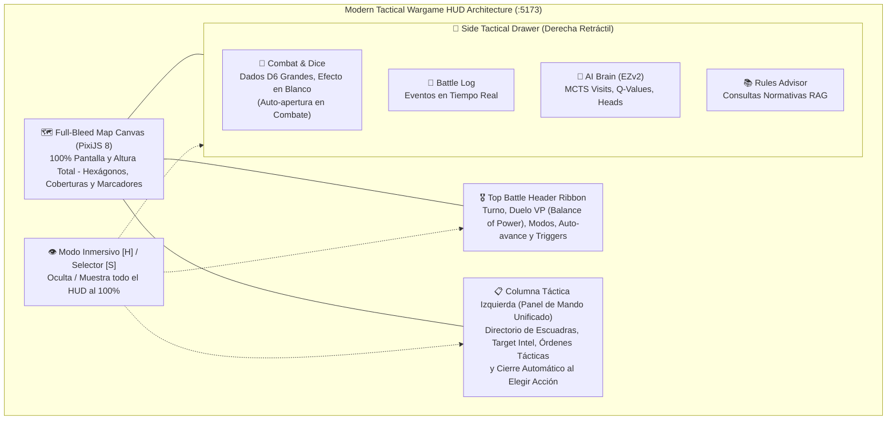
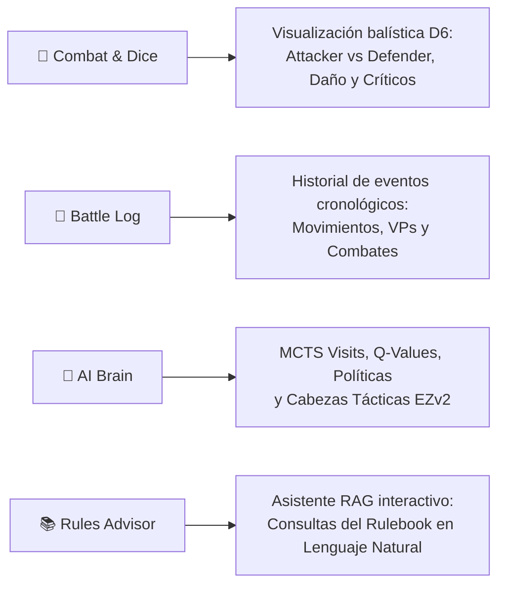

# 14. Manual de Usuario y Guía de Interfaz del Simulador Táctico (:5173)

> **Estado**: Canónico y Actualizado (Octubre 2026 - Versión `v2.5.37`)  
> **Servicio Frontend**: Simulador Táctico Militar Assault (`assault_ai_ui`) en `http://localhost:5173/`  
> **Tecnologías Core**: Vite 8 + React 19 + PixiJS 8 + TypeScript + Glassmorphism CSS  
> **Directiva de Idiomas (Regla 7)**: Interfaz de usuario (UI), código fuente y registros 100% en **Inglés**. Manual de usuario y documentación técnica en **Español**.  

---

## 1. Visión General y Propósito Operativo

El **Simulador Táctico Militar (:5173)** es el entorno interactivo visual de primera línea de la plataforma **Assault**. Diseñado como un banco de pruebas táctico y estación de mando para comandantes humanos e investigadores de IA, permite:

1. **Evaluación Táctica en Vivo (Human-in-the-Loop)**: Despliegue de órdenes directas por parte de un jugador humano contra el agente neuronal de aprendizaje por refuerzo **EfficientZero V2**.
2. **Supervisión de Autojuego y Evaluación (AI vs AI)**: Visualización paso a paso o en flujo continuo de partidas de evaluación entre agentes `EfficientZeroV2` o contra baselines heurísticos/aleatorios.
3. **Reproducción Forense de Sesiones (Replay Engine)**: Carga y análisis táctico celda a celda de trazas generadas por el pipeline de evaluación y torneos.
4. **Verificación Normativa Instantánea**: Inspección visual de reglas de línea de visión (LOS), sectores de cobertura, penalizaciones de movimiento y ventanas de fuego de reacción bajo el reglamento canónico de *Assault: Sicily 1943*.



---

## 2. Filosofía Arquitectónica: De Ventanas Flotantes al Modern Wargame HUD

En versiones anteriores (`v1.x` y primeras iteraciones de `v2`), la interfaz empleaba múltiples ventanas flotantes independientes (`DraggableWindow`): *Target Intel*, *Active Units (1450px)*, *Combat Dice*, *System Log*, *Match Status*, *AI Telemetry* y *RAG Copilot*. Este diseño provocaba saturación visual, solapamiento masivo sobre el tablero y obligaba al usuario a reorganizar o minimizar ventanas continuamente para ver el terreno.

A partir de la versión **`v2.5.35`**, la interfaz adopta el paradigma **Modern Tactical Wargame HUD** (inspirado en títulos tácticos de referencia como *Unity of Command 2* y *Company of Heroes*):
- **Principio *Map-First***: El mapa táctico es el protagonista indiscutible y llena el 100% de la ventana sin divisiones fijas de página.
- **HUD No Invasivo con Glassmorphism**: Todos los elementos de control flotan como capas translúcidas perimetrales (`backdrop-filter: blur(16px)`), garantizando visibilidad periférica del campo de batalla.
- **Acceso por Demanda**: Los paneles densos de telemetría y resolución de combate se retiran a un cajón lateral deslizante que no interfiere en la toma de decisiones sobre el mapa.
- **Modo Inmersivo Limpio**: Conmutación total mediante una sola tecla (`H`) para transformar la aplicación en un visor cartográfico puro.

---

## 3. Módulo 1: Canvas Hexagonal a Pantalla Completa (PixiJS 8)

El centro de la aplicación está gobernado por `GameCanvas.tsx`, un renderizador vectorial y raster acelerado por hardware mediante **PixiJS 8**.

### 3.1. Navegación y Control de Cámara
- **Desplazamiento Panorámico (Pan)**: Arrastre con clic primario o secundario sobre cualquier zona vacía del terreno.
- **Zoom Dinámico**: Rueda del ratón (*mouse wheel*). El zoom escala el mundo vectorial respecto a la posición actual del cursor.
- **Enfoque Automático (Auto-fit)**: Al inicializar una partida o cambiar de escenario, la cámara encuadra automáticamente todos los hexágonos del mapa con un margen perimetral seguro de $2.6 \times \text{HEX\_SIZE}$.
- **Centrado en Unidad**: Al hacer clic en cualquier ficha del carrusel de escuadras o mapa, la cámara realiza una transición suave hacia las coordenadas axiales $(q, r)$ de la unidad.

### 3.2. Barra Flotante de Capas Tácticas (`LayerControls`)
Ubicada de forma discreta bajo el ribbon superior (esquina superior izquierda, `top: 72px`), permite activar o desactivar tres capas esenciales:

| Capa | Estado por Defecto | Descripción |
| :--- | :---: | :--- |
| **Map** | Activada | Imagen de satélite/tablero geográfico original con texturas de terreno (bosques, ríos, ciudades). |
| **Grid** | Activada | Rejilla vectorial de bordes hexagonales con relieve táctico. |
| **Coords** | Desactivada | Renderizado de coordenadas axiales numéricas $(q, r)$ en el centro de cada hexágono. |

### 3.3. Marcadores Oficiales y Discriminación Visual de Activación sobre el Tablero
El motor visual proyecta sobre los hexágonos y fichas los marcadores de reglamento canónico y una diferenciación inmediata del estado de activación:

1. **Estado de Activación de Unidades en el Mapa**:
   - **Unidades Listas (`READY`)**:
     - Ficha nítida con opacidad al 100% (`alpha = 1.0`).
     - **Anillo Táctico Resplandeciente**: Anillo exterior perimetral en cian esmeralda (`0x00f0ff`, pulso senoidal animado) que rodea la ficha sin ocultarla.
     - **Insignia `READY`**: Etiqueta táctica en verde esmeralda brillante (`#10b981`) visible en la parte inferior de la ficha.
   - **Unidades que ya han actuado (`DONE`)**:
     - Ficha atenuada (`alpha = 0.65`) con tinte pizarra tenue (`tint = 0x94a3b8`).
     - **Insignia `✓ DONE`**: Etiqueta en gris pizarra neutro (`#64748b`) confirmando que su turno se ha consumido.
   - **Unidades Hostiles (`OPFOR`)**: Borde y retícula de puntería en naranja/rojo táctico.
2. **Marcadores de Acción Activa**: `firing.png` (disparo realizado), `fast_action.png` (movimiento rápido ejecutado), `normal.png` (orden estándar completada), `turret_firing.png` (disparo de torreta blindada).
3. **Marcadores de Estado**: `Status Suppressed.png` (unidad bajo fuego de supresión / desorganizada), `Marker Hit.png` (impacto balístico recibido).
4. **Bajas y Destrucción**: `Markers USA Dead.png`, `Markers Italy Dead.png` o `Markers Germany Dead.png` marcando la posición de eliminación definitiva.

---

## 4. Módulo 2: Barra Superior Táctica (Top Battle Header Ribbon)

La barra superior flotante (`.battle-header-ribbon`) centraliza el control de sesión y el estado estratégico global de la partida.

```
+--------------------------------------------------------------------------------------------------------------------+
| ⚡ ASSAULT // EZv2 | [Scenario ▼] [Side: US ▼] [🎮 Human] [🤖 AI] [▶ Start] [⛔ Stop] | TURN 3 [US HUMAN] | US 12 === 8 GE | Auto [x] [▶ Step] [💾] [🎲] [📜] [🧠] [📚] [👁] |
+--------------------------------------------------------------------------------------------------------------------+
```

### 4.1. Zona Izquierda: Configuración y Modos
- **Brand & Versión**: Identificador `⚡ ASSAULT // EZv2` indicando que el motor opera bajo el stack canónico de EfficientZero V2.
- **Selector de Escenario**: Menú desplegable con los 38 escenarios canónicos disponibles (ej. `Initial Contact`, `Sicily Gela Counterattack`, etc.).
- **Selector de Bando Humano**: Determina qué facción controla el jugador humano (`US`, `GE`, `IT`, `UK`). Se sincroniza dinámicamente según las facciones legales del escenario.
- **Conmutadores de Modo**:
  - `🎮 Human`: Partida interactiva Humano vs IA.
  - `🤖 AI vs AI`: Autojuego autónomo entre agentes neuronales.
  - `🔁 Replay`: Reproducción de partidas archivadas.
- **Botón `▶ Start`**: Inicializa el estado del juego, resetea la cámara y conecta el WebSocket de eventos.
- **Botón `⛔ Stop`**: Detiene de forma segura el bucle de simulación y restablece el tablero.

### 4.2. Zona Central: Turno, Fase y Duelo de Puntos de Victoria (Balance of Power)
- **Insignia de Turno**: Muestra el turno actual (ej. `TURN 3`) y el bando activo con su controlador (`US (HUMAN)` o `GE (AI)`), respaldado por un **pulso luminoso animado** (verde para humano, naranja para IA).
- **Barra de Dominancia / Duelo de VPs (Balance of Power)**:
  - Muestra las puntuaciones acumuladas de Puntos de Victoria de ambos contendientes: `[US: 12 VP]` vs `[GE: 8 VP]`.
  - Un medidor visual bicolor (*tug-of-war bar*) calcula el porcentaje relativo de control territorial y se desplaza en tiempo real ante cada captura o pérdida de objetivo.
- **Indicador de Objetivos (OBJ)**: Muestra el recuento de hexágonos de victoria controlados sobre el total del escenario (ej. `🚩 OBJ: 2/3`).

### 4.3. Zona Derecha: Avance, Trazas, Cajón y Modo Inmersivo
- **Casilla `Auto`**: Activa o desactiva el auto-avance tras las acciones humanas. Si está marcado, la IA responde inmediatamente tras la orden del jugador; si está desmarcado, el flujo espera la confirmación del usuario.
- **Botón `▶ Step`**: Permite avanzar manualmente un único paso táctico de la IA cuando el autoavance está deshabilitado.
- **Botón `💾` (Export Trace)**: Descarga un archivo JSON estructurado con la telemetría completa de la partida para su posterior análisis o auditoría forense.
- **Botones Disparadores del Cajón**: Botones de acceso directo a las 4 pestañas del cajón lateral:
  - `🎲 Combat`: Incluye una insignia de alerta roja `!` cuando hay una tirada de dados reciente.
  - `📜 Log (N)`: Muestra el recuento de eventos registrados en la sesión.
  - `🧠 AI`: Abre la telemetría del árbol MCTS.
  - `📚 Rules`: Despliega el asesor normativo RAG.
- **Botón Ojo (`👁`)**: Oculta inmediatamente todos los componentes del HUD para disfrutar de la vista limpia del mapa (equivalente al atajo `H`).

---

## 5. Módulo 3: Plataforma de Mando Inferior (Bottom Command Deck)

---

## 5. Módulo 3: Columna Táctica Izquierda Unificada (`Left Command & Squad Panel`)

Para maximizar la visibilidad vertical del mapa y evitar que los paneles obstaculicen la base de la pantalla o colisionen entre sí, la versión **`v2.5.37`** unifica la inspección de tropas y la paleta de órdenes en una **columna táctica lateral izquierda limpia y desacoplada** (`.left-squad-drawer`, ancho de $380\text{ px}$, `top: 112px`, `bottom: 16px`, `left: 14px`). Esta columna se sitúa inmediatamente debajo de la barra de capas (`Map / Grid / Coords`) y erradica por completo la barra inferior (`bottom-command-deck` y `footer-squad-dock`), suprimiendo cualquier solapamiento visual y concediendo el 100% de la altura de pantalla al mapa táctico PixiJS.

```
+-------------------------------------------------------------+
| ⚡ UNIT ORDERS                                    [● READY] ✕|
+-------------------------------------------------------------+
| [Avatar]  IT Breda MMG                                      |
|           ID: IT_6  Coords: [C6]  Italy                     |
|           Health: 100% (2 / 2 HP)                           |
| [⏸ WAIT]  [🛡️ HMG]                                          |
+-------------------------------------------------------------+
| ⚡ AVAILABLE ACTIONS                               Unit IT_6 |
| [ALL (21)]  [🏃 MOVE (15)]  [🎯 FIRE (4)]  [💥 ASSAULT (1)]  |
| +---------------------------------------------------------+ |
| | 💥 ASSAULT                                         [C8] | |
| +---------------------------------------------------------+ |
| | 🎯 RANGED                                          [A8] | |
| +---------------------------------------------------------+ |
| | 🏃 MOVE                                            [F5] | |
| +---------------------------------------------------------+ |
| | ⏸ WAIT                                        END TURN | |
| +---------------------------------------------------------+ |
| [✕ Deselect Unit [Esc]                                   ] |
+-------------------------------------------------------------+
```

### 5.1. Modo A: Ficha de Unidad y Paleta de Acciones (`Unit Command Mode`)
Se activa automáticamente cuando el comandante hace clic en cualquier unidad sobre el mapa táctico o en el directorio de escuadras:
1. **Cabecera Táctica**:
   - Botón `← SQUADS`: Regresa al directorio general de tropas para cambiar de escuadra.
   - Píldora de estado balístico: `● READY` (verde resplandeciente), `✓ DONE` (gris pizarra), `OPFOR` (enemigo) o `KIA` (baja).
   - Botón `✕`: Repliega el panel para examinar el mapa con total libertad.
2. **Tarjeta de Inteligencia Balística (Target Intel)**:
   - Avatar en alta definición y denominación reglamentaria de la unidad.
   - Posición axial precisa (`Q: 5, R: 3`) y bando faccional (`US`, `GE`, `IT`).
   - Barra de salud operativa dinámica y pips de corazón (❤️❤️❤️❤️ `4/4 HP`).
   - Distintivos tácticos de especialización: `💥 Mortar / No-LOS`, `🛡️ Suppression / HMG`, `⚔️ Assault & Breach`.
   - Botón directo `⏸ WAIT`: Permite finalizar voluntariamente la activación cediendo la iniciativa.
3. **Paleta de Selección por Categoría (`DispatchedOrdersPanel`)**:
   - Pestañas con contadores en tiempo real: `ALL (N)`, `🏃 MOVE (N)`, `🎯 FIRE (N)`, `💥 ASSAULT (N)`, `⏸ WAIT (N)`.
   - Tarjetas de acción interactivas con previsualización balística en mapa al posar el cursor (*hover*).
   - **Cierre Automático Inteligente**: Al hacer clic en cualquier acción, la orden se envía al simulador y **la columna lateral izquierda se repliega y cierra automáticamente al instante**, otorgando el 100% de visibilidad a la maniobra táctica y a la tirada de dados D6 en el panel de combate.

### 5.2. Modo B: Directorio de Escuadras (`Order of Battle Mode`)
Cuando no hay ninguna unidad seleccionada (o tras pulsar `← SQUADS` o el botón flotante `📋 SQUADS`), el panel se transforma en un explorador completo del ejército:
1. **Barra de Búsqueda y Filtrado Instantáneo**:
   - Búsqueda en vivo por nombre de unidad, armamento o identificador militar.
   - Filtros de activación: `ALL`, `READY (N)` (escuadras pendientes de actuar) y `DONE (N)` (escuadras que ya consumieron su turno).
   - Filtros de facción: `ALL SIDES`, `US`, `GE`, etc.
2. **Tarjetas de Escuadra en Gran Formato (`squad-row-card`)**:
   - Avatar táctico, salud operativa (corazones y barra de integridad), rol balístico y contador de órdenes legales (`⚡ N actions`).
   - Al hacer clic en cualquier ficha, la cámara viaja suavemente hacia la unidad en el mapa y la columna pasa inmediatamente al **Modo A (Ficha y Acciones)**.

---

## 6. Módulo 4: Cajón Táctico Lateral Retráctil (Side Tactical Drawer)

El cajón lateral derecho (`.side-tactical-drawer`, ancho de $440\text{ px}$) se desliza suavemente sobre el mapa al activarse cualquier pestaña desde la barra superior o al desencadenarse eventos de combate. Puede cerrarse en cualquier momento pulsando el botón `✕` o la tecla `Esc`.



### 6.1. Pestaña 🎲: Combate, Dados Tácticos de Gran Formato y Efecto sobre el Blanco (`CombatPanel`)
- **Apertura Reactiva Inteligente**: Cuando cualquier unidad (humana o IA) resuelve un ataque, el cajón lateral **se abre automáticamente** en esta pestaña para que el usuario pueda presenciar el intercambio de fuego sin interrumpir la partida.
- **Dados Balísticos Tácticos de Gran Formato ($44\times 44\text{ px}$)**:
  - Visualización ampliada a más del doble del tamaño original con texturas de alta resolución, bordes luminiscentes por color (Rojo, Amarillo, Verde, Azul) y animación física de giro balístico (`dice-roll`).
  - **Tooltips Informativos al Hover**: Al posar el cursor sobre cada dado se detalla el color y la cara obtenida (ej. *"RED Die: CRITICAL + DAMAGE"*, *"YELLOW Die: DAMAGE"*, *"BLUE Die: DEFENSE / SHIELD"*).
  - Separación nítida en dos reservas: `ATTACK POOL (N Dice)` y `DEFENSE POOL (N Dice)`.
- **Tarjeta Táctica de Efecto Integral sobre el Blanco (`combat-target-effect-card`)**:
  - Explica de forma inmediata y sin ambigüedades el impacto exacto sobre la unidad defensora:
    - `☠️ TARGET DESTROYED (KIA)`: Bando/unidad aniquilada y retirada del mapa tras agotar sus puntos de vida.
    - `💥 TARGET PENETRATED (-N HP)`: Daño cinemático que penetró la cobertura, indicando la pérdida exacta de salud (`HP Before → HP After`).
    - `⚠️ TARGET SUPPRESSED / PINNED DOWN`: Los dados defensivos absorbieron el daño a la salud (0 HP perdidos), pero el volumen de fuego causó supresión moral (la escuadra queda clavada al terreno, pierde movilidad rápida y sufre penalizaciones en fuego de reacción).
    - `🛡️ ATTACK DEFLECTED / ABSORBED BY COVER`: La tirada de defensa y la cobertura de terreno neutralizaron por completo el ataque (0 daño, salud intacta).
  - **Seguimiento Visual de Puntos de Impacto**: Fila de corazones interactivos mostrando el estado antes y después (corazones activos ❤️ frente a corazones perdidos en el asalto 💔).
  - **Desglose Técnico de Resolución**: Daño no cancelado, tiradas de supresión resultantes y efectos críticos específicos.

### 6.2. Pestaña 📜: Registro de Batalla (`Battle Log`)
- Registro cronológico inalterable con marcas de tiempo (`[HH:MM:SS]`).
- Código cromático de eventos:
  - **Azul**: Eventos de sistema y configuración.
  - **Púrpura**: Cambios de turno y relevos de fase.
  - **Cian**: Bloqueo y selección de objetivos.
  - **Verde**: Movimientos tácticos y desplazamientos de hexágono.
  - **Rojo**: Fuego balístico, resoluciones de daño y bajas confirmadas.
  - **Dorado / Amarillo**: Capturas y transiciones de Puntos de Victoria.

### 6.3. Pestaña 🧠: Cerebro y Telemetría de la IA (`EfficientZeroV2TelemetryPanel`)
Acceso directo a la mente del agente neuronal en tiempo real:
- **Métricas de Búsqueda MCTS**: Número de simulaciones ejecutadas, profundidad media del árbol y valor esperado $Q(s, a)$.
- **Distribución de Política ($\pi$)**: Probabilidades asignadas a cada orden candidata en el nodo raíz.
- **Cabezas Tácticas Auxiliares**: Lecturas de mapa de amenazas (`threat_map`), desgaste proyectado (`attrition`), moral esperada y predicción de posesión de VPs.
- **Botón de Refresco**: Permite forzar una actualización instantánea contra el endpoint de telemetría de FastAPI (`/api/game/telemetry`).

### 6.4. Pestaña 📚: Asesor Normativo y Situacional (`RagAssistantPanel`)
- Sistema integrado de asistencia en lenguaje natural conectado con el motor RAG Copilot de la plataforma.
- Permite formular preguntas sobre reglas específicas de *Assault* (ej. *¿Cómo afecta el humo a la línea de visión?*, *¿Qué penalización sufre una unidad al retirarse en terreno abierto?*).
- Analiza el estado actual de la partida (`gameData`) para ofrecer asesoramiento táctico contextualizado.

---

## 7. Ventana de Fuego de Reacción (Reaction Fire Modal)

Cuando una unidad enemiga ejecuta un movimiento que cruza el arco de fuego de una unidad defensora preparada, el motor detiene temporalmente la ejecución e invoca el diálogo modal de **Fuego de Reacción** (`Reaction Fire Opportunity`):

```
+-------------------------------------------------------------------+
| ⚡ REACTION FIRE OPPORTUNITY                                      |
|                                                                   |
| Enemy movement triggered a reaction fire opportunity.             |
| Reactor: US Ranger Assault Company                                |
| Target:  GE Panzergrenadier Platoon                               |
|                                                                   |
|                             [⏭ Skip]   [⚡ Use Reaction Fire]    |
+-------------------------------------------------------------------+
```

- **`⚡ Use Reaction Fire`**: La unidad defensora interrumpe el movimiento hostil y ejecuta un ataque inmediato de interdicción balística.
- **`⏭ Skip`**: Cede la oportunidad de fuego de reacción preservando la activación de la unidad para fases posteriores.

---

## 8. Guía de Atajos de Teclado y Controles de Ratón

| Acción / Control | Tecla / Gesto | Ámbito | Descripción |
| :--- | :---: | :---: | :--- |
| **Alternar Modo Inmersivo** | <kbd>H</kbd> | Global | Oculta o restaura todo el HUD al 100% para despejar el mapa táctico. |
| **Alternar Directorio de Escuadras** | <kbd>S</kbd> / Botón 📋 | Global | Abre o repliega el directorio vertical de escuadras en la columna izquierda. |
| **Cerrar Cajón / Deseleccionar** | <kbd>Esc</kbd> | Global | Cierra el cajón lateral o el directorio si están abiertos, o deselecciona la unidad activa. |
| **Desplazamiento del Mapa** | Clic y Arrastre | Canvas | Mueve la vista panorámica del campo de batalla. |
| **Zoom In / Zoom Out** | Rueda del Ratón | Canvas | Acerca o aleja la cámara centrada en el cursor. |
| **Seleccionar Unidad** | Clic Izquierdo | Mapa / Directorio | Selecciona una unidad y despliega sus órdenes tácticas. |
| **Despachar Orden Rápida** | Clic Izquierdo | Paleta de Órdenes | Envía la acción elegida y cierra automáticamente el directorio de escuadras. |
| **Finalizar Turno de Unidad** | Botón `WAIT` | Target Intel | Consume o cede la activación de la unidad seleccionada. |

---

## 9. Verificación de Funcionamiento y Diagnóstico

Para iniciar el simulador táctico y verificar su correcto funcionamiento:

1. **Arranque Completo del Stack**:
   Ejecutar desde el directorio raíz el script unificado:
   ```powershell
   .\start_assault.bat
   ```
   Esto levantará el backend FastAPI (`:8001`), el servidor de telemetría y MLOps (`:8778`), el editor de unidades (`:8780`) y el simulador de usuario (`:5173`).

2. **Acceso al Simulador**:
   Abrir en cualquier navegador moderno: [http://localhost:5173/](http://localhost:5173/)

3. **Verificación de Compilación Frontend**:
   Para compilar y verificar la ausencia de errores en TypeScript y CSS:
   ```powershell
   npm --prefix assault_ai_ui run build
   ```
   El proceso debe concluir en menos de 500 ms con cero advertencias o errores de tipado.
