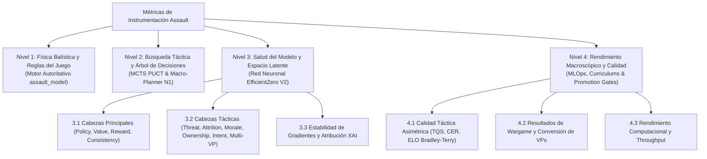

# 13. Inventario Jerárquico Canónico de Métricas y Registro Experimental
**Proyecto: Assault Tactical AI Engine (EfficientZero V2)**  
*Documento de Referencia Vinculante para Instrumentación, Esquemas Parquet, APIs y Trazabilidad 100% del Dashboard*

---

## Directiva de Gobernanza y Mantenimiento Escrupuloso

> ### ⚠️ REGLA DE ORO DE INSTRUMENTACIÓN (ZERO-MOCK / ZERO-INFERENCE)
> 1. **Cero Invención / Cero Inferencia:** Ningún componente (motor, runner, pipeline analítico, DuckDB o dashboard UI) puede inventar, simular, aproximar o rellenar un valor métrico con datos sintéticos no observables. Si un dato no existe o no se midió, su valor debe ser estrictamente `null` / `None` / `NO_DISPONIBLE` / `"-"`.
> 2. **Prohibición de Fallbacks Falsos:** Se prohíben patrones de enmascaramiento arbitrario como `value || 0`, porcentajes fake de relleno (ej. `58.4%`), deducciones heurísticas de roles/posturas o etiquetas obsoletas como `"MuZero"`.
> 3. **Trazabilidad 100% del Frontend:** Cualquier métrica, indicador o porcentaje que sea visible en cualquier pestaña del visor MLOps debe poder trazarse directamente hasta una columna canónica de Parquet, un cálculo determinista sobre DuckDB o un parámetro del manifiesto del modelo.
> 4. **Mantenimiento Vinculante:** Cualquier adición, renombrado o eliminación de columnas en el almacén Parquet (`data_warehouse/` o `runs_curriculum/`) o en los endpoints de telemetría requiere actualizar previamente este inventario con su definición física y matemática exacta.

---

## Taxonomía Jerárquica de 4 Niveles

---

## Nivel 1: Física Balística y Reglas del Juego (Motor Autoritativo)

Métricas generadas directamente por la ejecución determinista y estocástica de `assault_model/`.

| Métrica Canónica | Tipo de Dato | Origen Autoritativo | Definición Física / Matemática | Nullable | Redundancia / Estado |
| :--- | :---: | :--- | :--- | :---: | :--- |
| `step` | `int32` | `episode_runner_impl.py` | Índice secuencial de la decisión física dentro del episodio ($t \ge 0$). | No | Primitivo. |
| `game_turn` | `int32` | `obs.turn` | Turno canónico del escenario militar ($1 \dots T_{\text{max}}$). | Sí | Canónico (`turn` es alias secundario). Si no existe, no se infiere. |
| `active_side` / `unit_side` | `str` | `obs.to_play` | Bando activo que ejecuta la acción (`"US"`, `"GE"`, `"IT"`, `"UK"`). | No | Primitivo. |
| `action_id` | `str` | `action` | Identificador serializado de la acción (`TIPO:UNIDAD:Q:R`). | No | Primitivo. |
| `action_kind` | `str` | `action_catalog.py` | Categoría táctica canónica (`"MOVE"`, `"RANGED_DIRECT"`, `"ASSAULT"`, `"WAIT"`, etc.). | No | Canónico derivado. |
| `unit_id` | `str` | `action_parts[1]` | Identificador unívoco de la escuadra activa (ej. `"US_1"`). | No | Primitivo. |
| `unit_hp` | `float32` | `unit.hp` | Puntos de resistencia física restantes de la unidad ($0 \dots \text{max\_hp}$). | No | Primitivo. |
| `unit_moral_state` | `str` | `unit.morale` | Estado de cohesión (`NORMAL`, `PINNED`, `SUPPRESSED`, `ROUTED`). | No | Primitivo. |
| `attack_dice_rolls` | `list[dict]` | `transition.info` | Lista cruda de dados lanzados en ataque con color y cara (`{"color":"red","faces":["hit"]}`). | Sí | Primitivo auditado. |
| `defense_dice_rolls` | `list[dict]` | `transition.info` | Lista cruda de dados lanzados en defensa con color y cara (`{"color":"blue","faces":["block"]}`). | Sí | Primitivo auditado. |
| `damage_dealt` | `float32` | `transition.info` | Daño neto en HP infligido al objetivo en este paso: $\max(0, \text{hits} - \text{saves})$. | No | Canónico (`enemy_damage` queda purgado). |
| `kills_dealt` | `int32` | `transition.info` | Número de unidades enemigas eliminadas ($0$ ó $1$) en este paso. | No | Canónico (`enemy_kills` queda purgado). |
| `target_cover` | `float32` | `terrain.cover` | Modificador de cobertura defensiva del hexágono objetivo ($0.0 \dots 2.0$). | Sí | Primitivo. |
| `target_los` | `float32` | `los_engine` | Estado de bloqueo de visión hacia el objetivo ($0.0$ despejada, $1.0$ bloqueada). | Sí | Primitivo. |
| `vp_captures` | `int32` | `vp_tracker` | Número de VPs que cambiaron de dueño a favor del bando activo en este paso. | No | Primitivo. |

---

## Nivel 2: Búsqueda Táctica y Árbol de Decisiones (MCTS PUCT & Jerarquía N1)

Métricas generadas por la exploración en el espacio latente y el planificador jerárquico.

| Métrica Canónica | Tipo de Dato | Origen Autoritativo | Definición Física / Matemática | Nullable | Redundancia / Estado |
| :--- | :---: | :--- | :--- | :---: | :--- |
| `mcts_total_visits` | `int32` | `mcts.root.visit_count` | Suma de visitas en la raíz del árbol: $\sum_a N(s_0, a)$. | No | Primitivo de cómputo. |
| `mcts_root_actions_count` | `int32` | `mcts.root.legal_count` | Número total de ramas de acción explorables desde la raíz. | No | Primitivo. |
| `mcts_active_actions` | `int32` | `mcts.active_branches` | Número de acciones que recibieron al menos 1 visita ($N(s_0, a) > 0$). | No | Primitivo. |
| `mcts_q_clipped_count` | `int32` | `mcts.guardrail` | Número de nodos donde el valor $Q$ fue acotado por guardarraíl de divergencia. | No | Diagnóstico de estabilidad. |
| `mcts_entropy` | `float32` | `mcts.distribution` | Entropía de la distribución de visitas: $H(\pi) = -\sum \pi(a) \log \pi(a)$. | No | Diagnóstico de dilema táctico. |
| `chosen_prob` | `float32` | $\pi(a^*)$ | Probabilidad final asignada a la acción elegida tras la búsqueda: $\frac{N(a^*)^{1/T}}{\sum N(a)^{1/T}}$. | No | Primitivo. |
| `decision_margin` | `float32` | $\pi(a^*) - \pi(a_{\text{segunda}})$ | Brecha de confianza frente a la segunda mejor alternativa. | No | Canónico (`eval_policy_margin_mean`). |
| `mcts_q_value` | `float32` | $Q(s_0, a^*)$ | Valor medio esperado de retorno acumulado de la acción elegida. | Sí | Primitivo latente. |
| `mcts_prior_value` | `float32` | $P_\theta(a^*)$ | Prior puro predicho por la cabeza de política de la red antes de buscar. | Sí | Primitivo de red (`eval_policy_confidence_mean`). |
| `macro_posture` | `str` | `macro_planner` | Postura doctrinal activa (`ASSAULT_VP`, `DEFENSIVE_HOLD`, `ZONE_SUPPRESS`). | Sí | Nivel 1 doctrinal. Cero inferencia si viene vacío. |
| `macro_target_vp_id` | `str` | `macro_planner` | Identificador del hexágono VP prioritario asignado por el planner N1. | Sí | Nivel 1 doctrinal. |
| `unit_macro_role` | `str` | `macro_planner` | Rol asignado a la escuadra (`SPEARHEAD`, `FIRE_SUPPORT`, `OBJECTIVE_DEFENDER`, `FLANK_SCREEN`). | Sí | Nivel 1 doctrinal. Cero inferencia si viene vacío. |
| `policy_overridden_by_mcts` | `bool` | $\arg\max P_\theta \neq a^*$ | Indicador booleano de si la búsqueda MCTS corrigió la intuición inicial de la red. | No | Canónico (`policy_overridden`). |
| `mcts_sterile_branches_pruned` | `int32` | `mcts.prune` | Número de ramas estériles de deambulación o pasividad podadas bajo postura `ASSAULT_VP` (poda del 40%). | No | Diagnóstico de búsqueda ofensiva. |
| `prior_boost_applied` | `float32` | `macro_planner` | Factor multiplicativo de modulación de prior (+20% a +40%) aplicado sobre la acción elegida. | No | Sesgo doctrinal MCTS. |
| `vp_potential_reward_component` | `float32` | `reward_calculator.py` | Componente de recompensa escalado de potencial radial hacia VPs (Ng et al. 1999). | Sí | Canónico de shaping. |
| `vp_potential_delta` | `float32` | `reward_calculator.py` | Delta puro de potencial $F(s, a, s') = \gamma \Phi(s') - \Phi(s)$ garantizando invariancia telescópica. | Sí | Diagnóstico de convergencia PBRS. |
| `turn_urgency_factor` | `float32` | `reward_calculator.py` | Presión temporal relativa $\tau = t / T_{\text{max}} \in [0.0, 1.0]$. | Sí | Diagnóstico temporal. |
| `turn_urgency_decay` | `float32` | `reward_calculator.py` | Factor de decaimiento exponencial $\exp(-\lambda \cdot \tau)$ aplicado al potencial cuando $N_{\text{VP}} = 0$. | Sí | Andamiaje anti-retraso. |
| `paralysis_penalty` | `float32` | `reward_calculator.py` | Penalización negativa por parálisis acumulada en unidades expuestas (`cover < 0.35`) en campo abierto. | Sí | Penalización anti-parálisis. |
| `paralysis_units_count` | `int32` | `reward_calculator.py` | Número de unidades aliadas que incurrieron en penalización por pasividad en este paso. | Sí | Diagnóstico de parálisis. |
| `vp_horizon_steps` | `float32` | `selfplay.py` | Distancia mínima estimada en pasos hasta el VP objetivo. | Sí | Soft-signal. |
| `vp_horizon_component` | `float32` | `selfplay.py` | Componente de recompensa auxiliar por reducción del horizonte hacia el VP. | Sí | Soft-signal. |
| `telemetry_coverage_status` | `str` | `trace_row_builder` | Estado formal de completitud de la fila (`COMPLETE`, `PARTIAL`, `DEGRADED`). | No | Control de calidad. |

---

## Nivel 3: Salud del Modelo, Cabezas Tácticas y Espacio Latente (EfficientZero V2)

Métricas generadas durante el entrenamiento, backpropagation y diagnósticos de cabezas auxiliares.

### 3.1 Cabezas Principales

| Métrica Canónica | Tipo de Dato | Origen Autoritativo | Definición Física / Matemática | Nullable | Redundancia / Estado |
| :--- | :---: | :--- | :--- | :---: | :--- |
| `train_loss_total` | `float32` | `loss_balancer` | Pérdida global combinada ponderada por balanceo adaptativo. | No | Primitivo (`loss_total`). |
| `train_policy_loss` | `float32` | `cross_entropy` | Pérdida de entropía cruzada entre $\pi_{\text{MCTS}}$ y logits de política: $-\sum \pi \log p_\theta$. | No | Primitivo (`loss_policy`). |
| `policy_entropy` | `float32` | `policy_head` | Entropía promedio de los priors emitidos por la red neuronal. | No | Indicador de dispersión/confianza. |
| `policy_grad_norm` | `float32` | `torch.autograd` | Norma L2 de los gradientes acumulados en la cabeza de política. | No | Diagnóstico de estabilidad. |
| `train_value_loss` | `float32` | `two_hot_loss` | Pérdida distribucional Two-Hot con targets symlogueados: $\mathcal{L}_{\text{two\_hot}}(v, z)$. | No | Primitivo (`loss_value`). |
| `value_grad_norm` | `float32` | `torch.autograd` | Norma L2 de los gradientes acumulados en la cabeza de valor. | No | Diagnóstico de estabilidad. |
| `value_explained_variance` | `float32` | `metrics.py` | Varianza explicada del valor predicho frente al retorno real: $1 - \frac{\text{Var}(y - \hat{y})}{\text{Var}(y)}$. | No | Calidad de predicción de valor. |
| `train_reward_loss` | `float32` | `two_hot_loss` | Pérdida distribucional Two-Hot para transiciones inmediatas: $\mathcal{L}_{\text{two\_hot}}(r, \hat{r})$. | No | Primitivo (`loss_reward`). |
| `reward_grad_norm` | `float32` | `torch.autograd` | Norma L2 de los gradientes acumulados en la cabeza de recompensa. | No | Diagnóstico de estabilidad. |
| `train_consistency_loss` | `float32` | `simsiam` | Coseno negativo entre proyecciones latentes: $-\frac{p \cdot z}{\|p\|_2 \|z\|_2}$. | No | Anti-colapso representacional. |
| `train_reanalysis_coverage` | `float32` | `reanalysis_buffer` | Proporción de trayectorias reanalizadas con el modelo más reciente. | Sí | Eficiencia muestral. |
| `train_consistency_pairs` | `int32` | `trainer.py` | Número de pares $(s_t, s_{t+k})$ evaluados en la pérdida de consistencia. | No | Diagnóstico de lote. |
| `eval_latent_drift` | `float32` | `eval_runner.py` | Deriva euclídea del espacio latente a lo largo de un desenrollado recursivo de $K$ pasos. | Sí | Estabilidad del modelo dinámico. |

### 3.2 Cabezas Tácticas Auxiliares

| Métrica Canónica | Tipo de Dato | Origen Autoritativo | Definición Física / Matemática | Nullable | Redundancia / Estado |
| :--- | :---: | :--- | :--- | :---: | :--- |
| `train_threat_loss` | `float32` | `threat_map_head` | Pérdida MSE/BCE sobre la predicción espacial del mapa de amenazas rival. | Sí | Cabeza táctica Threat. |
| `threat_coverage_ratio` | `float32` | `threat_map_head` | Proporción de hexágonos del tablero con valor de amenaza superior al umbral operativo ($> 0.15$). | Sí | Diagnóstico XAI. |
| `max_threat` | `float32` | `threat_map_head` | Nivel máximo de amenaza registrado en el mapa axial ($[0.0, 1.0]$). | Sí | Severidad de zona de combate. |
| `mean_threat` | `float32` | `threat_map_head` | Nivel promedio de amenaza sobre hexágonos ocupados por unidades aliadas. | Sí | Exposición táctica. |
| `train_attrition_loss` | `float32` | `attrition_head` | Pérdida MSE en la predicción del balance de bajas acumuladas al término del escenario. | Sí | Cabeza táctica Attrition. |
| `predicted_exchange_ratio` | `float32` | `attrition_head` | Ratio proyectado de bajas causadas vs recibidas: $\frac{\hat{C}_{\text{rival}}}{\max(0.1, \hat{C}_{\text{aliado}})}$. | Sí | Diagnóstico doctrinal. |
| `casualty_prediction_error_mae` | `float32` | `attrition_head` | Error absoluto medio (MAE) en la predicción de bajas al concluir el episodio. | Sí | Precisión predictiva. |
| `train_morale_loss` | `float32` | `morale_head` | Pérdida de clasificación de riesgo de supresión de escuadras. | Sí | Cabeza táctica Morale. |
| `suppression_risk_score` | `float32` | `morale_head` | Probabilidad estimada de que una unidad clave sufra supresión en el próximo turno. | Sí | Diagnóstico de vulnerabilidad. |
| `suppression_accuracy` | `float32` | `morale_head` | Precisión binaria en la predicción del estado de supresión real posterior. | Sí | Fiabilidad del prior de moral. |
| `train_final_ownership_loss` | `float32` | `ownership_head` | Pérdida sobre la máscara de control final de objetivos geográficos. | Sí | Cabeza táctica Ownership. |
| `eval_ownership_mae` | `float32` | `ownership_head` | Error absoluto medio en la predicción del dueño final de los hexágonos VP. | Sí | Precisión geográfica. |
| `territory_control_score` | `float32` | `ownership_head` | Puntuación compuesta de control territorial efectivo ($0.0 \dots 1.0$). | Sí | Diagnóstico de frente. |
| `train_intent_loss` | `float32` | `macro_intent_head` | Pérdida de clasificación supervisada de la macro-intención táctica. | Sí | Nivel 1 jerárquico. |
| `eval_intent_accuracy` | `float32` | `macro_intent_head` | Precisión de la red en predecir la postura doctrinal que adoptará el planner. | Sí | Cohesión jerárquica. |
| `train_multi_vp_loss` | `float32` | `multi_vp_head` | Pérdida combinada multiobjetivo sobre el control independiente de cada VP. | Sí | Control multiobjetivo. |
| `eval_multi_vp_mae` | `float32` | `multi_vp_head` | Error medio en el valor esperado individual de los $N$ puntos de victoria. | Sí | Precisión multiobjetivo. |

### 3.3 Estabilidad de Gradientes y Atribución Causal

| Métrica Canónica | Tipo de Dato | Origen Autoritativo | Definición Física / Matemática | Nullable | Redundancia / Estado |
| :--- | :---: | :--- | :--- | :---: | :--- |
| `gradient_norm` | `float32` | `torch.nn.utils` | Norma L2 del vector global de gradientes: $\|g\|_2$. | No | Diagnóstico de estabilidad numérica. |
| `pcgrad_conflict_count` | `int32` | `loss_balancer` | Número de proyecciones ortogonales realizadas por conflictos $\langle g_i, g_j \rangle < 0$. | No | Diagnóstico multitarea. |
| `channel_attribution` | `list[float]` | `integrated_gradients` | Vector de 32 pesos de atribución causal sobre los canales axiales de entrada. | Sí | Diagnóstico XAI (IGNH). |

---

## Nivel 4: Rendimiento Macroscópico, Calidad Táctica y Gates MLOps

Métricas agregadas sobre partidas completas y evaluación de checkpoints en `assault_bench/` y DuckDB.

### 4.1 Calidad Táctica Desesgada y ELO Ancla

| Métrica Canónica | Tipo de Dato | Origen Autoritativo | Definición Física / Matemática | Nullable | Redundancia / Estado |
| :--- | :---: | :--- | :--- | :---: | :--- |
| `tactical_quality_score` | `float32` | `quality_metrics.py` | Puntuación compuesta TQS ($0 \dots 100$): $35\% \text{Self} + 25\% \text{Random} + 20\% \text{CER} + 10\% \text{VP} + 10\% \text{Decisive}$. | No | Indicador Maestro de Calidad. |
| `tactical_grade` | `str` | `quality_metrics.py` | Rango táctico canónico: `S` ($\ge 85$), `A` ($\ge 70$), `B` ($\ge 55$), `C` ($\ge 40$), `D` ($< 40$). | No | Clasificación cualitativa. |
| `anchor_elo` | `float32` | `quality_metrics.py` | ELO Bradley-Terry calibrado contra anclas fijas (Random=800, MCTS Baseline=1400): $R_0 + 400 \log_{10} \frac{S}{1-S}$. | No | Rendimiento absoluto desesgado. |
| `delta_elo` | `float32` | `curriculumMetrics.ts` | Incremento o decremento de ELO frente al paso cronológico previo del curriculum. | Sí | Progreso de entrenamiento. |
| `combat_exchange_ratio` | `float32` | `quality_metrics.py` | Ratio de desgaste (CER): $\frac{\text{Victorias Ponderadas} + 0.05}{\max(0.1, \text{Derrotas Ponderadas} + 0.05)}$. | No | Preservación de fuerza. |
| `mean_asymmetry_gap` | `float32` | `quality_metrics.py` | Diferencia absoluta de rendimiento entre bandos asimétricos: $|S_{\text{Side A}} - S_{\text{Side B}}|$. | Sí | Detección de sesgo/fragilidad de bando. |
| `global_mirror_vs_random` | `float32` | `quality_metrics.py` | Rendimiento mirror promedio enfrentando al bando opuesto controlado por Random. | No | Baseline de competencia táctica. |
| `global_mirror_vs_self` | `float32` | `quality_metrics.py` | Rendimiento mirror en partidas espejo de self-play MCTS vs MCTS. | No | Profundidad estratégica. |
| `decisive_rate` | `float32` | `quality_metrics.py` | Proporción de partidas resueltas con victoria o derrota decisiva (no empates neutros). | No | Capacidad resolutiva. |
| `quality_gate_status` | `str` | `quality_metrics.py` | Estado de la puerta de calidad (`PASS`, `WARN`, `FAIL`). | No | Decisión de promoción. |

### 4.2 Resultados de Wargame y Conversión de Objetivos

| Métrica Canónica | Tipo de Dato | Origen Autoritativo | Definición Física / Matemática | Nullable | Redundancia / Estado |
| :--- | :---: | :--- | :--- | :---: | :--- |
| `win_rate` | `float32` | `benchmark_aggregation` | Tasa de victorias sobre episodios totales: $\frac{\text{Victorias}}{\text{Episodios}}$. | No | Primitivo macro. |
| `resolved_non_timeout_win_rate` | `float32` | `benchmark_aggregation` | Tasa de victorias excluyendo partidas que terminaron en timeout. | Sí | Calidad resolutiva. |
| `timeout_rate` | `float32` | `benchmark_aggregation` | Ratio de partidas que alcanzaron $T_{\text{max}}$ sin resolución formal. | No | Detección de estancamiento. |
| `non_timeout_resolution_rate` | `float32` | `benchmark_aggregation` | Proporción de partidas concluidas antes del límite de turnos: $1 - \text{timeout\_rate}$. | No | Madurez operativa. |
| `score` | `float32` | `benchmark_aggregation` | Puntuación canónica de torneo: $\text{win\_rate} + 0.5 \times \text{draw\_rate}$. | No | Rendimiento competitivo. |
| `vp_net_avg_side` | `float32` | `benchmark_aggregation` | Balance neto de puntos de victoria al término del combate: $\overline{\text{VP}_{\text{propios}} - \text{VP}_{\text{rival}}}$. | No | Dominio territorial. |
| `tracked_captured_avg` | `float32` | `benchmark_aggregation` | Promedio de hexágonos de victoria controlados por el bando evaluado. | No | Eficiencia de captura. |
| `eval_vp_capture_take_rate` | `float32` | `eval_runner.py` | Tasa de aprovechamiento de oportunidades de captura de VP detectadas. | Sí | Diagnóstico de oportunismo. |
| `eval_vp_conversion_efficiency`| `float32` | `eval_runner.py` | Eficiencia de conversión de ventaja de posicionamiento en captura consolidada. | Sí | Madurez táctica. |

### 4.3 Rendimiento Computacional y Eficiencia

| Métrica Canónica | Tipo de Dato | Origen Autoritativo | Definición Física / Matemática | Nullable | Redundancia / Estado |
| :--- | :---: | :--- | :--- | :---: | :--- |
| `duration_seconds` | `float32` | `manifest.lock.json` | Tiempo total de reloj de pared consumido por la fase o benchmark. | No | Coste computacional. |
| `train_duration_seconds` | `float32` | `summary.json` | Tiempo total de reloj de pared invertido en entrenamiento (autojuego MCTS + optimización). | Sí | Coste de entrenamiento. |
| `bench_duration_seconds` | `float32` | `bench_eval_*.json` | Tiempo total de reloj de pared invertido en evaluación de benchmark contra baselines. | Sí | Coste de evaluación. |
| `selfplay_duration_seconds` | `float32` | `summary.json` | Tiempo neto consumido en la generación distribuida de trayectorias de autojuego MCTS. | Sí | Desglose de cómputo. |
| `opt_duration_seconds` | `float32` | `summary.json` | Tiempo neto consumido en la optimización y retropropagación de gradientes en GPU/CUDA. | Sí | Desglose de cómputo. |
| `episodes_per_second` | `float32` | `benchmark_timing` | Throughput de simulación e inferencia: $\frac{\text{Episodios}}{\text{Tiempo de Ejecución}}$. | No | Rendimiento del motor/árbol. |
| `episode_wall_s_mean` | `float32` | `benchmark_timing` | Latencia media en segundos por episodio completo jugado. | No | Tiempo de ciclo. |
| `total_steps` | `int32` | `train_summary.json` | Pasos totales de entrenamiento neuronal ejecutados por el optimizador. | No | Volumen de aprendizaje. |
| `wall_time_seconds` | `float32` | `train_summary.json` | Tiempo acumulado de entrenamiento de la red neuronal. | No | Cómputo invertido. |

---

## Matriz de Trazabilidad 100%: Frontend (Dashboard) <--> Métricas Base

A continuación se detalla la correspondencia exacta entre **lo que se ve en la pantalla** del visor y **el origen en el almacén de datos / Parquet**:

| Pestaña UI (Dashboard) | Métrica Visible en Pantalla | Clave en Payload JSON | Origen Canónico / Almacén Base | Estado de Trazabilidad |
| :--- | :--- | :--- | :--- | :---: |
| **CatalogPage / Header** | ELO Ancla (calibrado) | `elo` / `anchor_elo` | `quality_metrics.py` / `compute_anchor_elo` sobre DuckDB | **100% Real (Bradley-Terry)** |
| **CatalogPage / Header** | Δ ELO vs Anterior | `deltaElo` | `curriculumMetrics.ts` ($R_t - R_{t-1}$) | **100% Real** |
| **CatalogPage / Header** | Tasa de Victoria | `winRate` | `catalog_eval_result_sides.win_rate` | **100% Real** |
| **CatalogPage / Header** | Score Canónico | `score` | `catalog_eval_result_sides.score` | **100% Real** |
| **CatalogPage / Header** | Puntuación Táctica TQS | `tactical_quality_score` | `quality_metrics.py` (cálculo determinista DuckDB) | **100% Real (Fórmula TQS)** |
| **CatalogPage / Header** | Rango Táctico (S/A/B/C/D)| `tactical_grade` | `quality_metrics.py` (umbrales 85/70/55/40) | **100% Real** |
| **CatalogPage / Header** | Combat Exchange (CER) | `combat_exchange_ratio` | `quality_metrics.py` ($\frac{\text{Vic} + 0.05}{\text{Def} + 0.05}$) | **100% Real** |
| **CatalogPage / Header** | Brecha Asimetría | `mean_asymmetry_gap` | `quality_metrics.py` ($\vert S_A - S_B \vert$) | **100% Real** |
| **CatalogPage / Header** | Duración de Fase | `durationSeconds` | `manifest.lock.json` (`phase_finished - phase_started`) | **100% Real** |
| **CatalogPage / Table 1** | Desglose Train / Bench | `train_duration_seconds`, `bench_duration_seconds` | `summary.json` & `bench_eval_*.json` | **100% Real** |
| **CatalogPage / Table 1** | Autojuego y Optimización | `selfplay_duration_seconds`, `opt_duration_seconds` | `metrics/summary.json` (`timing_summary`) | **100% Real** |
| **TrainDetailTab** | Metadatos de Checkpoint | `run_id`, `git_commit`, `phase` | Manifiesto de entrenamiento `meta/manifest.lock.json` | **100% Real** |
| **TrainDetailTab** | Pérdidas de Entrenamiento| `loss_policy`, `loss_value`, etc. | `01_train.log` / `train_summary.json` | **100% Real** |
| **TrainHeadDiagnosticsTab**| Gradientes y Pérdidas | `policy_grad_norm`, `explained_var`| Registro interno de `trainer.py` exportado en summary | **100% Real** |
| **ObjectiveRewardConfigTab**| Parámetros Activos | `objective_pos_weight`, etc. | `trainRow.config` vs defaults de arquitectura | **100% Real (Transparente)** |
| **EvalMetricsTab** | Victorias / Empates / Derrotas| `total_victory_rate`, etc. | Filas de evaluación agregadas en DuckDB | **100% Real** |
| **EvalMetricsTab** | Métricas de VP y Captura | `vp_net_avg_by_side`, `tracked_cap` | Filas de evaluación agregadas en DuckDB | **100% Real** |
| **EvalMetricsTab** | Throughput Computacional | `episodes_per_second`, `wall_s` | `benchmark_timing` medido por `eval_runner.py` | **100% Real** |
| **EvalDecisionsTab** | Matriz Acción x Bando | `count`, `damage`, `kills` | Agregación directa de Parquet `eval_decision_summary` | **100% Real (Zero-Mock)** |
| **EvalDecisionsTab** | Sobreescritura MCTS | `policy_kept`, `overwritten` | `decision_ownership_by_side` desde Parquet | **100% Real** |
| **MatchReplayTab** | Turno y Paso de la Partida | `gameTurn`, `clamped` | `game_turn` / `step` crudos de Parquet (o `-`) | **100% Real (Sin inferencia)** |
| **MatchReplayTab** | Postura Doctrinal N1 | `macroPosture` | `s.macro_posture` de la traza (o `-` si no existe) | **100% Real (Sin inferencia)** |
| **MatchReplayTab** | Rol Táctico de Escuadra | `unitMacroRole` | `s.unit_macro_role` de la traza (o `-` si no existe) | **100% Real (Sin inferencia)** |
| **MatchReplayTab** | Búsqueda MCTS (Visitas, Q)| `mcts_total_visits`, `mcts_q` | Nodos raíz de MCTS exportados en el paso | **100% Real** |
| **MatchReplayTab** | Estado de Unidades | `hp`, `alive`, `suppressed` | Snapshots autoritativos del motor en el hexágono | **100% Real** |
| **NetworkTopologyTab** | Telemetría Táctica Empírica | `assaultPct`, `spearheadPct`, etc.| Calculado estrictamente sobre pasos reales evaluados | **100% Real (N/A si vacío)** |
| **NetworkTopologyTab** | Atribución de Canales | `ranked_channels`, pesos IGNH | `channel_attribution.json` generado con PyTorch IG | **100% Real** |
| **VpSummaryTab** | Balance Bilateral y Controlador| `ownController`, `oppController` | `controller_by_side` real de la evaluación (sin guesses) | **100% Real** |

---

## Auditoría de Redundancias Purgadas y Esquema Parquet

En cumplimiento estricto con las directivas de optimización y fidelidad:
1. **Purgado de Duplicidad `damage_dealt` vs `enemy_damage`**:
   - `damage_dealt` es la columna única y canónica en Parquet.
2. **Purgado de Duplicidad `kills_dealt` vs `enemy_kills`**:
   - `kills_dealt` es la columna única y canónica en Parquet.
3. **Purgado de Triple Registro de Dados**:
   - `dice_rolls` ha sido deprecada en favor de las listas atómicas `attack_dice_rolls` y `defense_dice_rolls`.
4. **Erradicación de Mocks y Deducciones Heurísticas en el Frontend**:
   - Eliminados porcentajes falsos fijos en `NetworkTopologyTab.tsx` (ahora reflejan `N/A` si no hay partidas evaluadas).
   - Eliminada la invención de turnos (`Math.floor(idx / 14) + 1`) y posturas tácticas en `MatchReplayTab.tsx`.
   - Eliminada la deducción de controladores cruzando escenarios y la etiqueta obsoleta `"MuZero"` en `VpSummaryTab.tsx` y `CatalogPage.tsx`.

---

## Procedimiento de Modificación y Test de Conformidad Automatizado

* **Invarianza del Catálogo**: Cualquier nuevo parámetro o métrica debe registrarse en este documento antes de emitirse a Parquet o consumirse en el frontend.
* **Test de Conformidad de Esquema**: Se incluye el test de regresión `tests/test_telemetry_schema_conformance.py` para garantizar que no existan campos no documentados ni discrepancias entre el almacén analítico y esta especificación.
