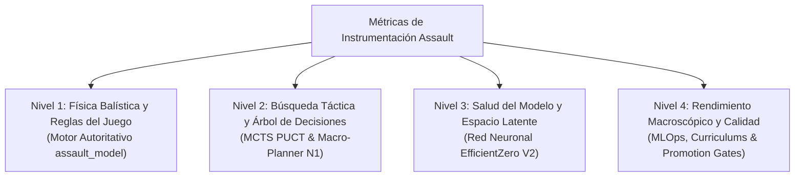

# 13. Inventario Jerárquico Canónico de Métricas y Registro Experimental
**Proyecto: Assault Tactical AI Engine (EfficientZero V2)**  
*Documento de Referencia Vinculante para Instrumentación, Esquemas Parquet y APIs de Observabilidad*

---

## Directiva de Gobernanza y Mantenimiento Escrupuloso

> ### ⚠️ REGLA DE ORO DE INSTRUMENTACIÓN (ZERO-MOCK / ZERO-INFERENCE)
> 1. **Cero Invención / Cero Inferencia:** Ningún componente (motor, runner, pipeline analítico, DuckDB o dashboard UI) puede inventar, simular, aproximar o rellenar un valor métrico con datos sintéticos no observables. Si un dato no existe o no se midió, su valor debe ser estrictamente `null` / `None` / `NO_DISPONIBLE`.
> 2. **Prohibición de Fallbacks Falsos:** Se prohíben patrones de enmascaramiento arbitrario como `value || 0` o `get(key, "MuZero")` que alteren la identidad o el valor de la medición.
> 3. **Mantenimiento Vinculante:** Cualquier adición, renombrado o eliminación de columnas en el almacén Parquet (`data_warehouse/` o `runs_curriculum/`) o en los endpoints de telemetría requiere actualizar previamente este inventario con su definición física y matemática exacta.

---

## Taxonomía Jerárquica de 4 Niveles

---

## Nivel 1: Física Balística y Reglas del Juego (Motor Autoritativo)

Métricas generadas directamente por la ejecución determinista y estocástica de `assault_model/`.

| Métrica Canónica | Tipo de Dato | Origen Autoritativo | Definición Física / Matemática | Nullable | Redundancia / Estado |
| :--- | :---: | :--- | :--- | :---: | :--- |
| `step` | `int32` | `episode_runner_impl.py` | Índice secuencial de la decisión física dentro del episodio ($t \ge 0$). | No | Primitivo. |
| `game_turn` / `turn` | `int32` | `obs.turn` | Turno canónico del escenario militar ($1 \dots T_{\text{max}}$). | No | `turn` es alias histórico; canónico: `game_turn`. |
| `active_side` | `str` | `obs.to_play` | Bando activo que ejecuta la acción (`"US"`, `"GE"`, `"IT"`, `"UK"`). | No | Primitivo. |
| `action_id` | `str` | `action` | Identificador serializado de la acción (`TIPO:UNIDAD:Q:R`). | No | Primitivo. |
| `action_kind` | `str` | `action_catalog.py` | Categoría táctica (`"MOVE"`, `"ATTACK"`, `"ASSAULT"`, `"WAIT"`). | No | Canónico derivado. |
| `unit_id` | `str` | `action_parts[1]` | Identificador unívoco de la escuadra activa (ej. `"US_1"`). | No | Primitivo. |
| `unit_hp` | `float32` | `unit.hp` | Puntos de resistencia física restantes de la unidad ($0 \dots \text{max\_hp}$). | No | Primitivo. |
| `unit_moral_state` | `str` | `unit.morale` | Estado de cohesión (`NORMAL`, `PINNED`, `SUPPRESSED`, `ROUTED`). | No | Primitivo. |
| `attack_dice_rolls` | `list[dict]` | `transition.info` | Lista cruda de dados lanzados en ataque con color y cara (`{"color":"red","faces":["hit"]}`). | Sí | Primitivo auditado. |
| `defense_dice_rolls` | `list[dict]` | `transition.info` | Lista cruda de dados lanzados en defensa con color y cara (`{"color":"blue","faces":["block"]}`). | Sí | Primitivo auditado. |
| `damage_dealt` | `float32` | `transition.info` | Daño neto en HP infligido al objetivo en este paso: $\max(0, \text{hits} - \text{saves})$. | No | Canónico (`enemy_damage` es alias redundante a purgar). |
| `kills_dealt` | `int32` | `transition.info` | Número de unidades enemigas eliminadas ($0$ ó $1$) en este paso. | No | Canónico (`enemy_kills` es alias redundante a purgar). |
| `target_cover` | `float32` | `terrain.cover` | Modificador de cobertura defensiva del hexágono objetivo ($0.0 \dots 2.0$). | Sí | Primitivo. |
| `target_los` | `float32` | `los_engine` | Estado de bloqueo de visión hacia el objetivo ($0.0$ despejada, $1.0$ bloqueada). | Sí | Primitivo. |
| `vp_captures` | `int32` | `vp_tracker` | Número de VPs que cambiaron de dueño a favor del bando activo en este paso. | No | Primitivo. |

---

## Nivel 2: Búsqueda Táctica y Árbol de Decisiones (MCTS PUCT)

Métricas generadas por la exploración en el espacio latente y el planificador jerárquico.

| Métrica Canónica | Tipo de Dato | Origen Autoritativo | Definición Física / Matemática | Nullable | Redundancia / Estado |
| :--- | :---: | :--- | :--- | :---: | :--- |
| `mcts_total_visits` | `int32` | `mcts.root.visit_count` | Suma de visitas en la raíz del árbol: $\sum_a N(s_0, a)$. | No | Primitivo de cómputo. |
| `mcts_entropy` | `float32` | `mcts.distribution` | Entropía de la distribución de visitas: $H(\pi) = -\sum \pi(a) \log \pi(a)$. | No | Diagnóstico de dilema táctico. |
| `chosen_prob` | `float32` | $\pi(a^*)$ | Probabilidad final asignada a la acción elegida tras la búsqueda: $\frac{N(a^*)^{1/T}}{\sum N(a)^{1/T}}$. | No | Primitivo. |
| `decision_margin` | `float32` | $\pi(a^*) - \pi(a_{\text{segunda}})$ | Brecha de confianza frente a la segunda mejor alternativa. | No | Canónico (`margin` es alias). |
| `mcts_q_value` | `float32` | $Q(s_0, a^*)$ | Valor medio esperado de retorno acumulado de la acción elegida. | Sí | Primitivo latente. |
| `mcts_prior_value` | `float32` | $P_\theta(a^*)$ | Prior puro predicho por la cabeza de política de la red antes de buscar. | Sí | Primitivo de red. |
| `macro_posture` | `str` | `macro_planner` | Postura doctrinal activa (`ASSAULT_VP`, `DEFENSIVE_HOLD`, `ZONE_SUPPRESS`). | Sí | Nivel 1 doctrinal. |
| `unit_macro_role` | `str` | `macro_planner` | Rol asignado a la escuadra (`SPEARHEAD`, `FIRE_SUPPORT`, `OBJECTIVE_DEFENDER`, etc.). | Sí | Nivel 1 doctrinal. |
| `policy_overridden` | `bool` | $\arg\max P_\theta \neq a^*$ | Indicador booleano de si la búsqueda MCTS corrigió la intuición inicial de la red. | Sí | Canónico (`policy_overridden_by_mcts`). |
| `vp_horizon_steps` | `float32` | `selfplay.py` | Distancia mínima estimada en pasos hasta el VP objetivo. | Sí | Soft-signal. |
| `vp_horizon_component` | `float32` | `selfplay.py` | Componente de recompensa auxiliar por reducción del horizonte hacia el VP. | Sí | Soft-signal. |
| `reaction_exposure_risk`| `float32` | `selfplay.py` | Riesgo estimado de sufrir fuego de oportunidad en la trayectoria ($[0, 1]$). | Sí | Soft-signal (`obs_enemy_reaction_fire_risk`). |

---

## Nivel 3: Salud del Modelo y Espacio Latente (Red Neuronal)

Métricas generadas durante el entrenamiento y la propagación de gradientes en `trainer.py`.

| Métrica Canónica | Tipo de Dato | Origen Autoritativo | Definición Física / Matemática | Nullable | Redundancia / Estado |
| :--- | :---: | :--- | :--- | :---: | :--- |
| `loss_total` | `float32` | `loss_balancer` | Pérdida global combinada ponderada por balanceo PCGrad. | No | Primitivo de optimización. |
| `loss_policy` | `float32` | `cross_entropy` | Pérdida de entropía cruzada entre $\pi_{\text{MCTS}}$ y logits de política. | No | Primitivo. |
| `loss_value` | `float32` | `two_hot_loss` | Pérdida distribucional Two-Hot con targets symlogueados. | No | Primitivo. |
| `loss_consistency` | `float32` | `simsiam` | Coseno negativo entre proyecciones latentes: $-\frac{p \cdot z}{\|p\|_2 \|z\|_2}$. | No | Anti-colapso representacional. |
| `gradient_norm` | `float32` | `torch.nn.utils` | Norma L2 del vector global de gradientes: $\|g\|_2$. | No | Diagnóstico de estabilidad numérica. |
| `pcgrad_conflict_count`| `int32` | `loss_balancer` | Número de pares de tareas con gradientes opuestos ($\langle g_i, g_j \rangle < 0$). | No | Diagnóstico multitarea. |
| `channel_attribution` | `list[float]` | `integrated_gradients` | Vector de 32 pesos de atribución causal sobre los canales axiales de entrada. | Sí | Diagnóstico XAI (IGNH). |

---

## Nivel 4: Rendimiento Macroscópico y Calidad (MLOps y Benchmarks)

Métricas agregadas por evaluación sobre episodios completos en `assault_bench/`.

| Métrica Canónica | Tipo de Dato | Origen Autoritativo | Definición Física / Matemática | Nullable | Redundancia / Estado |
| :--- | :---: | :--- | :--- | :---: | :--- |
| `win_rate` | `float32` | `benchmark_aggregation` | Ratio de partidas ganadas según el bando evaluado: $\frac{\text{Victorias}}{\text{Episodios}}$. | No | Primitivo macro. |
| `loss_rate` | `float32` | `benchmark_aggregation` | Ratio de partidas perdidas: $\frac{\text{Derrotas}}{\text{Episodios}}$. | No | Primitivo macro. |
| `timeout_rate` | `float32` | `benchmark_aggregation` | Ratio de partidas que alcanzaron el límite de turnos sin resolución decisiva. | No | Diagnóstico de pasividad táctica. |
| `net_vp_avg` | `float32` | `benchmark_aggregation` | Promedio de balance neto de VPs al finalizar: $\overline{\text{VP}_{\text{propios}} - \text{VP}_{\text{rival}}}$. | No | Rendimiento geográfico. |
| `damage_ratio` | `float32` | `benchmark_aggregation` | Ratio de eficiencia de desgaste: $\frac{\text{Daño Causado}}{\max(1, \text{Daño Recibido})}$. | No | Rendimiento balístico. |
| `elo_rating` | `float32` | `viewer_elo_page` | Puntuación ELO logística actualizada contra pool histórico de baselines ($K=32$). | No | Rendimiento competitivo relativo. |
| `gate_status` | `str` | `promotion_gate` | Resultado formal de evaluación (`"PASS"` o `"FAIL"`). | No | Criterio de despliegue. |

---

## Auditoría de Redundancias Detectadas y Plan de Purgado

1. **Duplicidad `damage_dealt` vs. `enemy_damage`**:
   - *Hallazgo*: Ambas columnas registran exactamente el mismo float en cada fila de Parquet.
   - *Resolución*: Se designa `damage_dealt` como canónico; `enemy_damage` queda deprecado y se eliminará de las tablas analíticas en el siguiente corte de versión.
2. **Duplicidad `kills_dealt` vs. `enemy_kills`**:
   - *Hallazgo*: Duplicación idéntica a la anterior.
   - *Resolución*: Se designa `kills_dealt` como canónico.
3. **Multiplicidad de Listas de Dados**:
   - *Hallazgo*: Se registran `attack_dice_rolls`, `defense_dice_rolls` y simultáneamente `dice_rolls` (que es la concatenación de ambas).
   - *Resolución*: Purgar `dice_rolls` redundante del almacenamiento en disco, calculándola en memoria solo si un consumidor legacy la solicita.
4. **Fallback Falso en Frontend (`EvalMetricsTab.tsx`)**:
   - *Hallazgo*: En `EvalMetricsTab.tsx`, el oponente desconocido se intentaba deducir mediante `if (oppSide === "IT") oppCtrl = oppCtrlMap["GE"]` y `if (oppCtrl === "mcts") oppCtrl = "MuZero"`.
   - *Resolución*: Erradicar la inferencia de bandos cruzados y eliminar la etiqueta obsoleta `"MuZero"`; reflejar estrictamente el controlador real registrado (`"EfficientZeroV2"` o `"Random"`).

---

## Procedimiento de Modificación y Control de Calidad

* **Invarianza del Catálogo**: Ningún desarrollador ni agente puede introducir una columna en Parquet sin añadir su fila correspondiente en este documento.
* **Test de Conformidad de Esquema**: Se añade el test automatizado `tests/test_telemetry_schema_conformance.py` que compara el esquema físico de DuckDB contra las tablas de este documento y falla la suite si detecta campos no catalogados.
