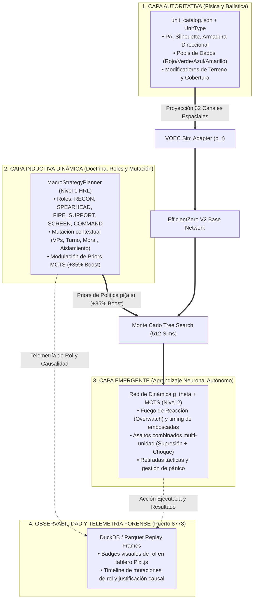

# Plan Estratégico: Perfilado de Unidades e Integración con EfficientZero V2

> **Documento de Diseño Arquitectónico, Doctrinal y de Telemetría MLOps**  
> **Estado:** 🟢 **Completado y Consolidado al 100% — Fases 1 a 5 (v2.4.5)**  
> **Ámbito:** `assets/catalogs/` • `assault_model/units/` • `voec_sim/` • `agents/efficientzero_v2/` • `mlops/`  
> **Tarea Roadmap Asociada:** Línea 4, Tarea 4.4 (Paso Global 16 en [Hoja de Ruta Evolutiva](05_ROADMAP_EVOLUTIVO.md))

> [!NOTE] POSIBLE CONTENIDO REPETIDO (Pendiente de decisión del usuario)
> El contenido de perfilado doctrinal dinámico coincide parcialmente con la Tarea 4.4 de [Línea 4 (Roadmap)](roadmap/04_LINEA_4_EXPLICABILIDAD_XAI_E_IPB.md) y [03. Red Neuronal EfficientZero V2](03_RED_NEURONAL_EFFICIENTZERO_V2.md). Se preserva íntegramente conforme a la directiva de no eliminación de párrafos.

---

## 1. Visión General y Principios Rectores

En simulaciones tácticas de guerra terrestre con tablero hexagonal (*Wargaming AI*), delegar el 100% de la comprensión de unidades al aprendizaje por refuerzo puro (*Tabula Rasa*) conduce a una ineficiencia muestral severa: el agente necesita decenas de millones de pasos para aprender correlaciones elementales (como que un mortero o una ametralladora pesada no deben encabezar un asalto frontal a campo abierto). Por el contrario, un sistema puramente cableado con reglas rígidas (*Behavior Trees*) ahoga la capacidad de descubrimiento táctico emergente.

El diseño canónico de **Assault** se basa en un **Modelo Jerárquico de 3 Capas Ontológicas**, con dos decisiones directivas confirmadas:
1. **Flexibilidad Doctrinal Dinámica:** Los roles no son etiquetas estáticas. Cada unidad posee un rol base preferente, pero el **Macro-Planner (Nivel 1)** puede mutar su rol en tiempo de ejecución según el contexto táctico de la partida (ej. presión de turnos/VPs, degradación de moral o flanqueos).
2. **Visibilidad Táctica y Forense en MLOps (Puerto 8778):** Toda asignación o mutación de rol se registra en DuckDB/Parquet y se visualiza en tiempo real mediante *badges* visuales en el *Match Replay* y en la pestaña de decisiones de inferencia.



---

## 2. Los Tres Niveles de Perfilado de Unidades

### 2.1. Nivel 1: Perfil Físico-Balístico (Autoritativo y Determinista)
* **Propósito:** Definir de manera exacta las capacidades físicas de cada escuadra según el reglamento oficial de *Assault*.
* **Atributos:**
  * **Movilidad:** Puntos de Acción (PA), penalizaciones de terreno, coste de encaramiento/giro y tipo de tracción.
  * **Potencia de Fuego:** Alcance mínimo/máximo, arcos de tiro, pools de dados de combate por distancia (`point_blank`, `effective`, `long_range`), capacidad de fuego indirecto (*spotter required*).
  * **Supervivencia:** Puntos de Vida (HP), valor de armadura direccional (Frontal, Lateral, Posterior) y tiradas de salvación.
  * **Rasgos Especiales:** `SMOKE_DISPENSER`, `INDIRECT_FIRE`, `OVERWATCH_CAPABLE`, `OPEN_TOP`, `HIGH_EXPLOSIVE`.
* **Integración:**
  * Se proyecta directamente como canales sensoriales continuos en el tensor $o_t \in \mathbb{R}^{32 \times H \times W}$ (`voec_sim`).
  * El motor autoritativo (`assault_model`) aplica la máscara de acciones legales, impidiendo que la red intente acciones imposibles (ej. disparar fuera de rango o sin LOS).

---

### 2.2. Nivel 2: Perfil Doctrinal y Roles Tácticos (Sesgo Inductivo Flexible)
* **Propósito:** Orientar doctrinalmente la función operativa de cada unidad en el orden de batalla sin restringir rígidamente su libertad de acción.
* **Catálogo de Roles Doctrinales:**

| Rol Doctrinal | Unidades Base Típicas | Distancia Operativa | Terreno Preferente | Misión Principal |
| :--- | :--- | :---: | :--- | :--- |
| **`SPEARHEAD`** | Fusileros de Asalto, Blindados Medios/Pesados | 0 – 2 hexes | Cobertura media / avance cubierto | Ruptura de línea, asalto a puntos de victoria (VP). |
| **`FIRE_SUPPORT`** | Ametralladoras (MMG, HMG), Cañones AT, Morteros | 3 – 8 hexes | Crestas, colinas, edificios con LOS amplia | Fijación, supresión continua e interdicción de avance. |
| **`RECON`** | Jeeps de reconocimiento, patrullas ligeras | 4 – 10 hexes | Bocage, bosques, desenfiladas | Despeje de niebla de guerra, detección temprana de anticarros. |
| **`SCREEN / FLANK`** | Infantería ligera, tropas secundarias | 2 – 4 hexes | Edificios periféricos, cruces de caminos | Protección de armas de apoyo y contención de flanqueos. |
| **`COMMAND / HQ`** | Escuadras de mando, vehículos de oficiales | 2 – 5 hexes detrás de vanguardia | Cobertura pesada (trincheras, búnkeres) | Estabilidad de moral, coordinación y rallies de tropas en pánico. |

* **Reglas de Mutación Dinámica (Flexibilidad):**
  1. **Presión de Victoria (VPs y Turnos):** Si en el último tercio de la partida el bando va por detrás en VP netos, unidades en roles de apoyo o pantalla pueden mutar dinámicamente a `SPEARHEAD` para un asalto decisivo.
  2. **Degradación de Moral:** Si una unidad `SPEARHEAD` entra en estado `PINNED` o `SUPPRESSED`, su rol muta transitoriamente a `RECOVER` o `SCREEN` para priorizar la supervivencia y el reagrupamiento.
  3. **Aislamiento / Flanqueo:** Si un arma pesada `FIRE_SUPPORT` detecta enemigos adyacentes sin escolta aliada, muta a `DEFENSIVE_HOLD` / `CLOSE_DEFENSE`.
* **Mecanismo de Modulación MCTS:**
  - El rol modula los *logits* de la política prior $\pi(a|s)$ en un **$+35\%$** en la raíz del árbol MCTS.
  - El valor esperado $Q(s, a)$ obtenido tras las 512 simulaciones en el espacio latente puede anular este sesgo si descubre una jugada superior imprevista.

---

### 2.3. Nivel 3: Micro-táctica y Coordinación (100% Aprendido Autónomamente)
* **Propósito:** Dejar que la red neuronal descubra las sutilezas de la guerra táctica mediante auto-juego (*self-play*), reanálisis off-policy y modelo de mundo.
* **Comportamientos Emergentes Aprendidos:**
  * **Tácticas de Emboscada:** Aprender a permanecer en sigilo en bosques o edificios sin disparar para no desvelar la posición al fuego concentrado enemigo.
  * **Armas Combinadas (Fuego y Maniobra):** Sincronizar el fuego supresivo de una HMG antes de que la escuadra de choque penetre en el hexágono del objetivo.
  * **Uso Decisivo del Fuego de Oportunidad (*Overwatch*):** Reservar activación para castigar al enemigo en campo abierto en lugar de gastar munición contra coberturas pesadas.

---

## 3. Hoja de Ruta de Implementación y Estado por Fases

| Fase | Título | Ámbito de Código | Entregables Clave | Estado Actual |
| :---: | :--- | :--- | :--- | :---: |
| **Fase 1** | **Enriquecimiento del Catálogo y Contratos de Datos** | `assets/catalogs/unit_catalog.json`, `assault_model/units/unit_type.py`, `catalog_loader.py` | Definición de `doctrine_profile` en JSON (rol base, distancias de combate, peso de cohesión) y validación tipada estricta en `UnitType` con suite de tests en verde (100% de 19 unidades cubiertas). | 🟢 **Completado (v2.4.1)** |
| **Fase 2** | **Expansión Sensorial y Mapeo en `voec_sim`** | `voec_sim/core/simulator.py`, `agents/efficientzero_v2/core/adapter_voec.py`, `agents/efficientzero_v2/core/observation.py` | Inyección de `doctrine_role` y `doctrine_profile` en `UnitSnapshot` y `EZV2Observation`, proyección de footprint 2D de alcance óptimo de combate en canales 24/25, codificación doctrinal continua (`DOCTRINE_ROLE_CODES`) y soporte de canales extendidos 32..35 con suite de tests dedicada en verde. | 🟢 **Completado (v2.4.2)** |
| **Fase 3** | **Mutación Dinámica en MacroStrategyPlanner** | `agents/efficientzero_v2/core/macro_planner.py` | Reglas jerárquicas de mutación (Regla 1: Déficit de VPs / Turno Tardío $\to$ `SPEARHEAD`, Regla 2: Moral/Salud $\to$ `RECOVER`, Regla 3: Aislamiento / Flanqueo $\to$ `CLOSE_DEFENSE`), trazabilidad formal con `mutation_reason`, modulación MCTS prior (+35%) y suite de tests unitarios exhaustiva al 100%. | 🟢 **Completado (v2.4.3)** |
| **Fase 4** | **Observabilidad MLOps y Telemetría Forense** | `agents/efficientzero_v2/core/selfplay.py`, `agents/efficientzero_v2/xai/timeline_exporter.py`, `assault_bench/`, `viewer_frontend/` | Registro de `role_assigned`, `role_is_mutated`, `role_mutation_reason`, `prior_boost_applied` y `badge_label` en transiciones y snapshots; renderizado interactivo de badges visuales de rol, etiquetas de mutación (`⚡ MUTADA`) y píldoras de prior boost (`+X% π`) en el *Match Replay* (puerto 8778). | 🟢 **Completado (v2.4.4)** |
| **Fase 5** | **Evaluación y Verificación en Currículum** | `assault_bench/eval.py`, `assault_bench/doctrine_metrics.py`, `curriculums/` | Harness de evaluación canónico (CLI/programático), cálculo y agregación de métricas de rol (`recon_survival_rate`, `fire_support_stationarity`, `spearhead_vp_capture_rate`, `doctrine_adherence_rate`, `doctrine_mutation_rate`), verificación de paridad doctrinal y guardrails de currículum con suite de tests dedicada al 100%. | 🟢 **Completado (v2.4.5)** |

---

## 4. Esquema de Metadatos Propuesto (Fase 1)

```json
{
  "id": "us_hmg_m2hb",
  "name": "US HMG .50 M2HB Team",
  "doctrine_profile": {
    "default_role": "FIRE_SUPPORT",
    "optimal_engagement_range": [3, 8],
    "preferred_terrain": ["HILL", "BUILDING", "WOODS"],
    "cohesion_weight": 1.25,
    "fallback_threshold_hp": 2,
    "mutation_rules": {
      "allow_spearhead_if_vp_deficit": false,
      "allow_close_defense_on_flank": true
    }
  }
}
```

---

## 5. Telemetría y Contrato para Dashboard MLOps (Fase 4)

Conforme a la **Regla 6 de Gobernanza**, la estructura de cada fotograma de replay incorporará:
```json
{
  "unit_id": "us_hmg_m2hb_1",
  "role_assigned": "FIRE_SUPPORT",
  "role_is_mutated": false,
  "role_mutation_reason": "DEFAULT_PROFILE",
  "prior_boost_applied": 0.35,
  "badge_label": "🎯 FIRE_SUPPORT"
}
```
Esto permitirá inspeccionar de manera visual y forense si la IA respeta la doctrina militar o si experimenta desalineación táctica.
