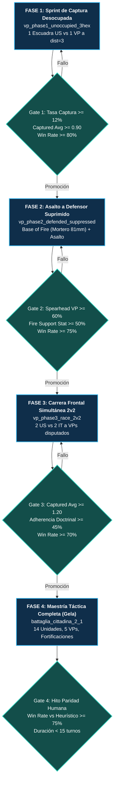

# 11. Currículums y Entrenamiento Progresivo

> [!NOTE] POSIBLE CONTENIDO REPETIDO (Pendiente de decisión del usuario)
> La especificación del Currículum Acelerado de Captura de VPs coincide parcialmente con la Tarea 2.5 de [Línea 2 (Roadmap)](roadmap/02_LINEA_2_ACELERACION_CAPTURA_VPS.md). Se preserva íntegramente conforme a la directiva de no eliminación de párrafos.

## 1. Fundamentos del Aprendizaje por Currículum en Wargames Tácticos

El entrenamiento de agentes de Aprendizaje por Refuerzo en wargames tácticos de nivel de sección/escuadra como **Assault** se enfrenta a dos desafíos fundamentales:
1. **Dispersión Extrema de Recompensas (*Sparse Rewards*)**: En escenarios tácticos completos con mapas $18\times 12$ y 14 unidades simultáneas, un agente iniciado desde cero rara vez alcanza Puntos de Victoria (VPs) mediante exploración puramente estocástica, cayendo en mínimos locales de pasividad, intercambio estéril de disparos a larga distancia o deambulación defensiva.
2. **Complejidad Combinatoria de Espacio de Estados y Acciones**: Con miles de ramas legales por paso de decisión (movimiento hexagonal, encaramiento, líneas de visión, combate a distancia, asaltos combinados y fuego de oportunidad), la convergencia directa sobre escenarios complejos es lenta e ineficiente.

Para resolver este desafío de raíz, la plataforma implementa una **Arquitectura de Currículum Progresivo con Puertas de Calidad Dinámicas (*Dynamic Gated Curriculum Architecture*)** basada exclusivamente en **`EfficientZeroV2`** (con la arquitectura clásica MuZero 100% decomisionada).

El sistema cuenta con **dos currículums canónicos oficiales**:
1. **Currículum Acelerado de Captura de VPs y Paridad Humana (`curriculums/vp_acceleration/`)**: Currículum vertical de 4 fases progresivas enfocado en erradicar la pasividad, dominar la base de fuego y asaltar VPs competitivamente en $<15$ turnos.
2. **Currículum Multi-Escenario Progresivo Self-Play vs Random (`curriculums/self_vs_self_vs_random_2scenarios_v1/`)**: Currículum horizontal de 7 fases progresivas para robustez táctica, estabilización de políticas en múltiples mapas y balanceo de matchmaking.

---

## 2. Currículum 1: Aceleración de Captura de VPs y Paridad Humana (`vp_acceleration`)

> **Ruta Canónica:** `curriculums/vp_acceleration/`  
> **Motor Exclusivo:** `EfficientZeroV2`  
> **Objetivo Primario:** Forjar un agente agresivo y coordinado que capture y retenga VPs contra oponentes heurísticos y humanos, alcanzando $\ge 75\%$ de victorias en $<15$ turnos en el escenario canónico de Gela.



### 2.1 Especificación de Fases y Escenarios Dedicados

| Fase | Nombre Técnico | Escenario Canónico | Configuración Táctica | Mecánicas Clave Entrenadas |
| :---: | :--- | :--- | :--- | :--- |
| **Fase 1** | `phase1_vp_sprint_unoccupied` | `vp_phase1_unoccupied_3hex.json` | 1 escuadra `US_RIFLES_43` a 3 hexágonos de un VP neutral desocupado. Límite: 6 turnos. | Andamiaje de potencial radial $\Phi(s)$ (Ng et al. 1999). Gradiente PBRS directo hacia bandera sin interferencia de combate. |
| **Fase 2** | `phase2_vp_assault_suppressed` | `vp_phase2_defended_suppressed.json` | 1 punta de lanza `US_RIFLES_43`, 1 apoyo `US_81MM_MORTAR`, 1 defensor `IT_RIFLES_43` suprimido sobre VP. Límite: 8 turnos. | Doctrina de Base de Fuego (boost $1.35\times$) y Asalto Coordinado a defensor suprimido (boost $1.40\times$). Regla CC-006. |
| **Fase 3** | `phase3_vp_race_2v2` | `vp_phase3_race_2v2.json` | 2 escuadras aliadas vs 2 escuadras del Eje a distancias equidistantes de 2 VPs centrales. Límite: 10 turnos. | Postura `ASSAULT_VP`, factor de urgencia temporal $\tau=t/T$ (Devlin & Kudenko 2012) y penalización por parálisis en campo abierto. |
| **Fase 4** | `phase4_tactical_gela_mastery` | `battaglia_cittadina_2_1.json` | Escenario táctico completo (Gela): 7 unidades US, 7 unidades IT, 5 VPs, fortificaciones, trincheras y cobertura urbana. | Asalto integral multinivel, roles dinámicos, desvío de reservas y convergencia estratégica hacia la victoria. |

### 2.2 Umbrales Cuantitativos de Promoción (*Quality Gates*)

Para avanzar de una fase a la siguiente, el evaluador de benchmark ejecuta la suite de evaluación sobre los checkpoints generados y verifica que se cumplan estrictamente los siguientes criterios:

```yaml
# curriculums/vp_acceleration/curriculum.yaml
phases:
  - name: phase1_vp_sprint_unoccupied
    gate:
      min_vp_capture_take_rate: 0.12     # Captura rápida de banderas desocupadas
      min_tracked_captured_avg: 0.90     # Promedio de VPs asegurados por partida
      min_vp_net_avg_tracked_side: 0.50  # Diferencial positivo neto de control
      min_win_rate: 0.80                 # Tasa de victoria mínima del 80%

  - name: phase2_vp_assault_suppressed
    gate:
      no_regression_defeat_rate: true    # Cero tolerancia a incrementos de derrotas
      min_vp_capture_take_rate: 0.10     
      min_spearhead_vp_capture_rate: 0.60 # >= 60% de VPs capturados por escuadras SPEARHEAD
      min_fire_support_stationarity: 0.50 # Apoyo pesado mantiene desenfilada/estacionariedad
      min_doctrine_adherence_rate: 0.45  # Cumplimiento formal de órdenes doctrinales
      min_win_rate: 0.75

  - name: phase3_vp_race_2v2
    gate:
      no_regression_defeat_rate: true
      min_vp_capture_take_rate: 0.08
      min_tracked_captured_avg: 1.20     # Dominio en disputa de 2 VPs simultáneos
      min_vp_net_avg_tracked_side: 0.40
      min_doctrine_adherence_rate: 0.45
      min_win_rate: 0.70

  - name: phase4_tactical_gela_mastery
    gate:
      no_regression_defeat_rate: true
      min_win_rate_vs_heuristic: 0.75    # Hito: >= 75% victorias vs bot heurístico
      max_avg_turns: 15.0                # Hito: Resolución decisiva en < 15 turnos
      min_vp_capture_take_rate: 0.08
      min_tracked_captured_avg: 2.50
      min_doctrine_adherence_rate: 0.40
      min_recon_survival_rate: 0.40
      min_fire_support_stationarity: 0.45
```

---

## 3. Currículum 2: Multi-Escenario Progresivo Self-Play vs Random (`self_vs_self_vs_random_2scenarios_v1`)

> **Ruta Canónica:** `curriculums/self_vs_self_vs_random_2scenarios_v1/`  
> **Motor Exclusivo:** `EfficientZeroV2`  
> **Objetivo Primario:** Dotar al modelo de invarianza topográfica y generalización ante comportamientos caóticos mediante la alternancia progresiva entre partidas de auto-juego (*Self-Play*) y partidas contra baselines aleatorios en dos escenarios tácticos simultáneos (`battaglia_cittadina_2_1` y `mettete_i_piedi_terra_1`).


### 3.1 Esquema de Fases y Ponderación de Escenarios

| Fase | Mezcla de Escenarios | Matchmaking de Autojuego | Propósito Táctico y Científico |
| :--- | :--- | :--- | :--- |
| **`phase1_bootstrap`** | 80% Battaglia, 20% Mettete | 100% Self-Play (MCTS Temp 1.2) | Establecer las primeras representaciones latentes de terreno, líneas de visión y balística. |
| **`phase1_channel_adapt`** | 70% Battaglia, 30% Mettete | 100% Self-Play (Canales 0-37) | Adaptar el codificador hexagonal residual a los canales sensoriales tácticos y de moral. |
| **`phase1_refine_aggressive`** | 60% Battaglia, 40% Mettete | 100% Self-Play | Fomentar el avance ofensivo y el castigo de la pasividad en aproximación. |
| **`phase2_mix_70_30`** | 50% Battaglia, 50% Mettete | 70% Self-Play, 30% vs Random | Inyectar ruido estocástico del rival para evitar el sobreajuste a patrones repetitivos. |
| **`phase3_mix_50_50`** | 50% Battaglia, 50% Mettete | 50% Self-Play, 50% vs Random | Régimen equilibrado de explotación y robustez ante maniobras impredecibles. |
| **`phase4_mix_30_70`** | 50% Battaglia, 50% Mettete | 30% Self-Play, 70% vs Random | Prueba de estrés: castigo a políticas que asumen que el rival juega racionalmente. |
| **`phase5_self_dominant_90_10`** | 50% Battaglia, 50% Mettete | 90% Self-Play, 10% vs Random | Vuelta a la alta competición MCTS con un residuo de perturbación. |
| **`phase6_self_only_stabilize`** | 50% Battaglia, 50% Mettete | 100% Self-Play Puro | Estabilización final de valor y política a máxima profundidad de búsqueda ($MCTS \ge 512$). |

### 3.2 Guardrails Doctrinales y Soft Guardrail para `side_b`

Debido a la asimetría táctica de los wargames (donde un bando defiende fortificaciones elevadas y el otro asalta en campo abierto), este currículum implementa el **Soft Guardrail para `ezv2_vs_random_side_b`**, permitiendo la promoción de checkpoints siempre que el lado más desfavorable no sufra colapso catastrófico (`severe_min_score: 0.03`, `max_score_drop_vs_prev: 0.20`), al tiempo que se exige estricta no-regresión en la tasa de derrota global (`no_regression_defeat_rate: true`).

---

## 4. Guía Operativa de Ejecución

### 4.1 Orquestación Integral Multi-Currículum (`run_full_multi_curriculum_pipeline.ps1`)

Para ejecutar de manera totalmente desatendida y secuencial el **viaje táctico completo** (Etapa 1: Aceleración de VPs $\to$ Ingesta MLOps $\to$ Etapa 2: Multi-Escenario Progresivo con autojuego al 70% $\to$ Cierre MLOps), se utiliza el orquestador maestro [`scripts/run_full_multi_curriculum_pipeline.ps1`](file:///c:/repos/python/assault/scripts/run_full_multi_curriculum_pipeline.ps1):

```powershell
# Ejecución completa del viaje táctico (desde cero o con seed opcional)
powershell -ExecutionPolicy Bypass -File .\scripts\run_full_multi_curriculum_pipeline.ps1

# Opciones avanzadas:
# 1. Validación previa de integridad y manifiestos sin computar en GPU (DryRun)
powershell -ExecutionPolicy Bypass -File .\scripts\run_full_multi_curriculum_pipeline.ps1 -DryRun

# 2. Warm-start desde un checkpoint preexistente como semilla inicial
powershell -ExecutionPolicy Bypass -File .\scripts\run_full_multi_curriculum_pipeline.ps1 -InitialCheckpoint "mlops/checkpoints/best_baseline.pt"

# 3. Detenerse inmediatamente ante fallo de gate tras agotar ciclos de refuerzo
powershell -ExecutionPolicy Bypass -File .\scripts\run_full_multi_curriculum_pipeline.ps1 -StopOnGateFail -StopOnPhaseError

# 4. Ejecutar únicamente Etapa 1 (vp_acceleration) y sincronizar DuckDB
powershell -ExecutionPolicy Bypass -File .\scripts\run_full_multi_curriculum_pipeline.ps1 -SkipMultiScenario
```

### 4.2 Orquestación por Currículum Individual (`run_all_phases.ps1`)

Cada currículum dispone además de su propio script `run_all_phases.ps1` que delega en el motor unificado [`curriculums/common/run_dynamic_gated_curriculum.ps1`](file:///c:/repos/python/assault/curriculums/common/run_dynamic_gated_curriculum.ps1):

```powershell
# -------------------------------------------------------------
# 1. Ejecución del Currículum de Aceleración de VPs
# -------------------------------------------------------------
powershell -ExecutionPolicy Bypass -File .\curriculums\vp_acceleration\run_all_phases.ps1

# Opciones avanzadas:
# Simulación rápida sin ejecutar entrenamiento (DryRun)
powershell -ExecutionPolicy Bypass -File .\curriculums\vp_acceleration\run_all_phases.ps1 -DryRun

# Iniciar en una fase específica
powershell -ExecutionPolicy Bypass -File .\curriculums\vp_acceleration\run_all_phases.ps1 -StartPhase phase2_vp_assault_suppressed

# Detenerse inmediatamente si un gate no se supera
powershell -ExecutionPolicy Bypass -File .\curriculums\vp_acceleration\run_all_phases.ps1 -StopOnGateFail

# Reanudar desde el último checkpoint registrado
powershell -ExecutionPolicy Bypass -File .\curriculums\vp_acceleration\run_all_phases.ps1 -ContinueFromLatestCheckpoint


# -------------------------------------------------------------
# 2. Ejecución del Currículum Multi-Escenario (2 Scenarios v1)
# -------------------------------------------------------------
powershell -ExecutionPolicy Bypass -File .\curriculums\self_vs_self_vs_random_2scenarios_v1\run_all_phases.ps1
```

### 4.2 Ejecución Manual por Fase con el Entrenador Canónico (`trainer.py`)

Para entrenar o depurar una fase individual de forma aislada, se utiliza el punto de entrada canónico [`trainer.py`](file:///c:/repos/python/assault/trainer.py):

```powershell
# Fase 1: Sprint de captura a VPs desocupados
python trainer.py --config curriculums/vp_acceleration/configs/efficientzero_v2.phase1_unoccupied.yaml

# Fase 2: Asalto coordinado con Base of Fire a VP defendido
python trainer.py --config curriculums/vp_acceleration/configs/efficientzero_v2.phase2_defended.yaml

# Fase 3: Carrera frontal simultánea 2v2
python trainer.py --config curriculums/vp_acceleration/configs/efficientzero_v2.phase3_race_2v2.yaml

# Fase 4: Maestría en escenario completo (Gela)
python trainer.py --config curriculums/vp_acceleration/configs/efficientzero_v2.phase4_gela_mastery.yaml
```

### 4.3 Evaluación y Verificación de Checkpoints con `assault_bench`

Para evaluar formalmente el rendimiento de un checkpoint frente a baselines heurísticos o aleatorios:

```powershell
# Evaluar Fase 1 (Tasa de captura en 3 hexágonos)
python -m assault_bench.runner --config assault_bench/configs/benchmark_config.vp_acceleration_phase1.yaml

# Evaluar Fase 4 (Meta: Victoria >= 75% vs heurístico en <15 turnos)
python -m assault_bench.runner --config assault_bench/configs/benchmark_config.vp_acceleration_phase4.yaml
```

### 4.4 Monitorización en Vivo en Dashboard MLOps (Puerto 8778)

Durante y tras la ejecución de los currículums, el servidor MLOps permite visualizar el progreso de las fases, curvas de aprendizaje, matrices de confusión táctica y repeticiones interactivas de partidas con trazabilidad de roles:

```powershell
# Iniciar servidor de visualización MLOps
python -m mlops.reporting.viewer_server --port 8778
```

En `http://localhost:8778`:
- **Pestaña VpSummaryTab**: Trazabilidad del diferencial de VPs, tasa de conversión y tiempo de captura por turno.
- **Pestaña EvalMetricsTab**: Verificación de cumplimiento de gates por fase y evolución de la tasa de victorias.
- **Pestaña MatchReplayTab**: Reproducción forense paso a paso con badges doctrinales (`SPEARHEAD`, `FIRE_SUPPORT`, `RECON`) e inspectores de modulación de prior MCTS.


---

## 5. Aceleración Estadística de Evaluación: Test Secuencial Wald SPRT [Consolidado v2.5.3]

Durante las fases de evaluación curricular y benchmarks frente a baselines heurísticos o aleatorios, evaluar una cuota fija de partidas (ej. 100 partidas) introduce un coste temporal masivo cuando un modelo ya es claramente ganador o perdedor tras las primeras 25-30 partidas.

Para erradicar este desperdicio computacional sin degradar el rigor matemático, se implementa el **Test Secuencial de Razón de Verosimilitud de Wald (SPRT)** (*Sequential Probability Ratio Test*):

### 5.1. Formulación del Test de Hipótesis Binaria
Se formula una prueba de hipótesis sobre la probabilidad de victoria $p$:
* **Hipótesis Nula ($H_0$)**: $p \le p_0$ (El modelo evaluado no supera el umbral mínimo aceptable, ej. $p_0 = 0.50$).
* **Hipótesis Alternativa ($H_1$)**: $p \ge p_1$ (El modelo evaluado alcanza la calidad objetivo, ej. $p_1 = 0.65$).

### 5.2. Razón de Verosimilitud Logarítmica y Límites de Parada
Tras observar $n$ partidas independientes con $w$ victorias, $l$ derrotas y $d$ empates (ponderados como $0.5$ victorias), la razón de verosimilitud logarítmica acumulada $\Lambda_n$ se define como:
$$\Lambda_n = w \ln \left(\frac{p_1}{p_0}\right) + l \ln \left(\frac{1 - p_1}{1 - p_0}\right)$$

Los límites de decisión de Wald para probabilidades de error tipo I ($\alpha = 0.01$) y tipo II ($\beta = 0.01$) se calculan formalmente como:
$$A = \ln \left(\frac{1 - \beta}{\alpha}\right) = \ln \left(\frac{0.99}{0.01}\right) \approx +4.5951$$
$$B = \ln \left(\frac{\beta}{1 - \alpha}\right) = \ln \left(\frac{0.01}{0.99}\right) \approx -4.5951$$

### 5.3. Regla de Decisión y Cancelación Asíncrona
En cada partida finalizada en el pool concurrente de evaluación:
1. Si $\Lambda_n \ge A$: **Se Acepta $H_1$ (Victoria Confirmada)**. Se detiene inmediatamente la evaluación y se cancelan todas las tareas asíncronas en vuelo (`future.cancel()`).
2. Si $\Lambda_n \le B$: **Se Rechaza $H_1$ / Se Acepta $H_0$ (Derrota Confirmada)**. Se detiene inmediatamente la evaluación sin malgastar computación.
3. Si $B < \Lambda_n < A$: La evidencia es aún inconclusa; se continúa evaluando hasta alcanzar la muestra máxima presupuestada ($N_{\max}$).

**Impacto Cuantitativo**: Reduce el tiempo total de benchmarking entre un **$50\%$ y un $75\%$**, garantizando un nivel de confianza estadística del $99\%$ ($p < 0.01$).

---

## 6. Diagnóstico Doctrinal: La Paradoja del "Comandante Prudente" (*The Prudent Commander Paradox*)

### 6.1. Definición y Origen Causal
La **Paradoja del Comandante Prudente** es una patología conductual de aprendizaje por refuerzo descubierta en las campañas de self-play de Assault:
> El agente aprende con gran maestría los fundamentos tácticos de supervivencia (uso de cobertura, desenfilada, concentración de fuego), logrando ratios de intercambio de bajas favorables ($CER \ge 1.10$). Sin embargo, ante escenarios con límite estricto de turnos ($T_{\max}$), **el agente prefiere no arriesgar sus unidades en un asalto urbano al hexágono de VP**, resultando en derrotas automáticas por expiración de turnos. En términos doctrinales: *un comandante que preserva todas sus fuerzas pero no cumple la misión ha sido derrotado militarmente*.

### 6.2. Mitigación Matemática y Curricular (Tareas 2.10 y 2.11)
Para quebrar la Paradoja del Comandante Prudente sin perder la solidez táctica adquirida, se implementan tres intervenciones estructurales:

1. **Desensibilización de Bajas en la Brecha ($d \le 2$)**:
   La penalización de recompensa por pérdida de unidades ($r_{\text{loss}}$) se atenúa en un $60\%$ ($r_{\text{loss}} \times 0.40$) cuando la unidad se encuentra en el radio de asalto del VP ($d(u, \text{VP}) \le 2$), permitiendo al agente asumir el desgaste necesario para la ruptura defensiva.
2. **Potencial de Urgencia Temporal Invariante PBRS**:
   $$\Phi(s, t) = \alpha \left(1 + \frac{t}{T_{\max}}\right) \left(-\min_u d(u, \text{VP})\right) + \beta \cdot \text{Contest}$$
   El valor de acercarse al VP aumenta a medida que el reloj de la partida avanza, venciendo la inercia conservadora en turnos finales.
3. **Penalización Catastrófica por Timeout**:
   Si la partida expira ($t = T_{\max}$) sin que el atacante controle el VP, se aplica un castigo terminal estricto ($R_{\text{timeout}} = -|Loss|$), forzando al algoritmo MCTS a descartar ramas pasivas en los turnos finales.
