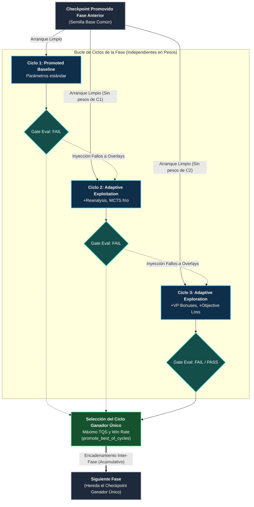
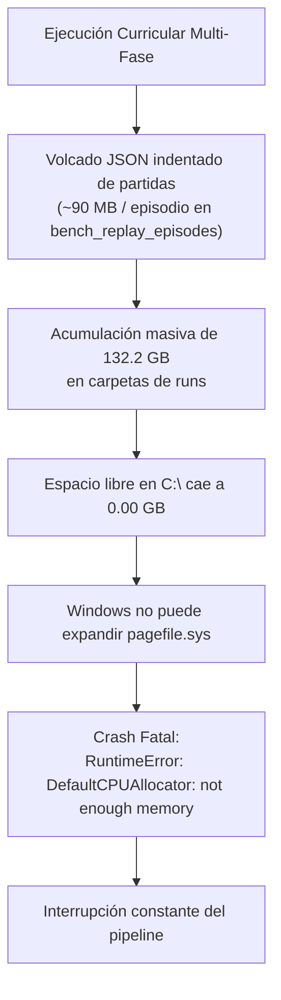
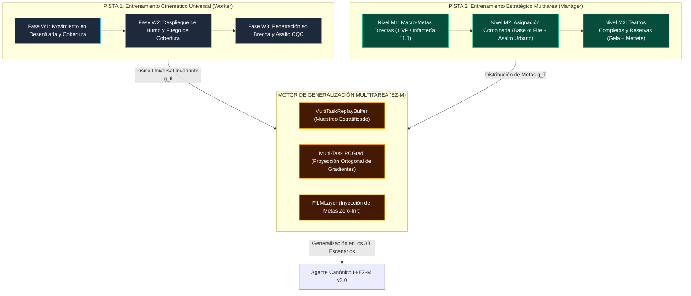
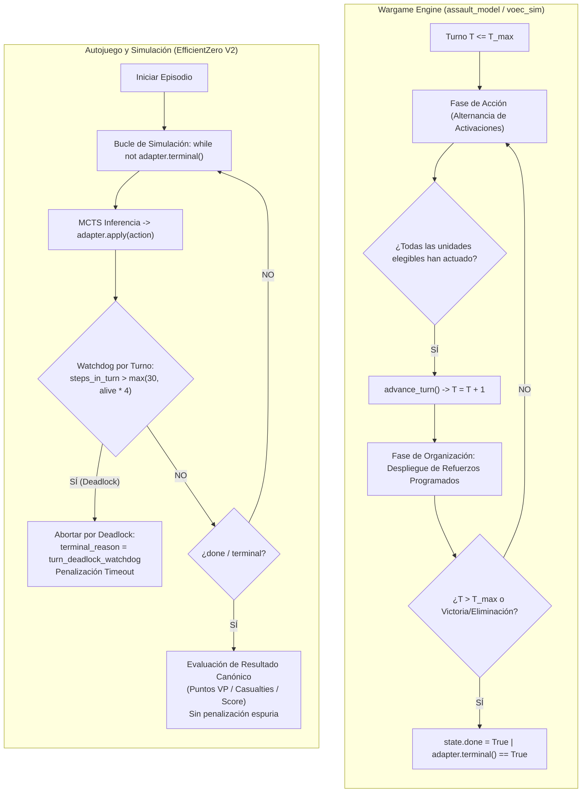

# 11. Currículums y Entrenamiento Progresivo

> [!NOTE] POSIBLE CONTENIDO REPETIDO (Pendiente de decisión del usuario)
> La especificación del Currículum Acelerado de Captura de VPs coincide parcialmente con la Tarea 2.5 de [Línea 2 (Roadmap)](roadmap/02_LINEA_2_ACELERACION_CAPTURA_VPS.md). Se preserva íntegramente conforme a la directiva de no eliminación de párrafos.

## 1. Fundamentos del Aprendizaje por Currículum en Wargames Tácticos

El entrenamiento de agentes de Aprendizaje por Refuerzo en wargames tácticos de nivel de sección/escuadra como **Assault** se enfrenta a dos desafíos fundamentales:
1. **Dispersión Extrema de Recompensas (*Sparse Rewards*)**: En escenarios tácticos completos con mapas $18\times 12$ y 14 unidades simultáneas, un agente iniciado desde cero rara vez alcanza Puntos de Victoria (VPs) mediante exploración puramente estocástica, cayendo en mínimos locales de pasividad, intercambio estéril de disparos a larga distancia o deambulación defensiva.
2. **Complejidad Combinatoria de Espacio de Estados y Acciones**: Con miles de ramas legales por paso de decisión (movimiento hexagonal, encaramiento, líneas de visión, combate a distancia, asaltos combinados y fuego de oportunidad), la convergencia directa sobre escenarios complejos es lenta e ineficiente.

Para resolver este desafío de raíz, la plataforma implementa una **Arquitectura de Currículum Progresivo con Puertas de Calidad Dinámicas (*Dynamic Gated Curriculum Architecture*)** basada exclusivamente en **`EfficientZeroV2`** (con la arquitectura clásica MuZero 100% decomisionada).

El sistema cuenta con **dos currículums canónicos oficiales**:
1. **Currículum Acelerado de Captura de VPs y Paridad Humana (`curriculums/vp_acceleration/`)**: Currículum vertical de 5 fases progresivas enfocado en erradicar la pasividad, dominar la base de fuego, romper la inercia defensiva mediante asalto asimétrico y asaltar VPs competitivamente en $<15$ turnos.
2. **Currículum Multi-Escenario Progresivo Self-Play vs Random (`curriculums/self_vs_self_vs_random_2scenarios_v1/`)**: Currículum horizontal de 7 fases progresivas para robustez táctica, estabilización de políticas en múltiples mapas y balanceo de matchmaking.

---

## 2. Currículum 1: Aceleración de Captura de VPs y Paridad Humana (`vp_acceleration`)

> **Ruta Canónica:** `curriculums/vp_acceleration/`  
> **Motor Exclusivo:** `EfficientZeroV2`  
> **Objetivo Primario:** Forjar un agente agresivo y coordinado que capture y retenga VPs contra oponentes heurísticos y humanos, alcanzando $\ge 75\%$ de victorias en $<15$ turnos en el escenario canónico de Gela y dominando la ruptura urbana ofensiva en Battaglia Cittadina.

```mermaid
flowchart TD
    classDef phase fill:#0f2e4a,stroke:#38bdf8,stroke-width:2px,color:#ffffff;
    classDef gate fill:#134e4a,stroke:#2dd4bf,stroke-width:2px,color:#ffffff;

    P1["<b>FASE 1: Sprint de Captura Desocupada</b><br/>vp_phase1_unoccupied_3hex<br/>1 Escuadra US vs 1 VP a dist=3"]:::phase
    G1{"Gate 1: Tasa Captura >= 12%<br/>Captured Avg >= 0.90<br/>Win Rate >= 80%"}:::gate
    P2["<b>FASE 2: Asalto a Defensor Suprimido</b><br/>vp_phase2_defended_suppressed<br/>Base of Fire (Mortero 81mm) + Asalto"]:::phase
    G2{"Gate 2: Spearhead VP >= 60%<br/>Fire Support Stat >= 50%<br/>Win Rate >= 75%"}:::gate
    P3["<b>FASE 3: Carrera Frontal Simultánea 2v2</b><br/>vp_phase3_race_2v2<br/>2 US vs 2 IT a VPs disputados"]:::phase
    G3{"Gate 3: Captured Avg >= 1.20<br/>Adherencia Doctrinal >= 45%<br/>Win Rate >= 70%"}:::gate
    P4["<b>FASE 4: Maestría Táctica Completa (Gela)</b><br/>battaglia_cittadina_2_1<br/>14 Unidades, 5 VPs, Fortificaciones"]:::phase
    G4{"Gate 4: Hito Paridad Humana<br/>Win Rate vs Heurístico >= 75%<br/>Duración < 15 turnos"}:::gate
    P5["<b>FASE 5: Asalto Urbano Puro Ofensivo Asimétrico</b><br/>battaglia_cittadina_2_1 (T=8)<br/>100% Atacante (US vs Random), Timeout -1.0"]:::phase
    G5{"Gate 5: Ruptura Ofensiva Asimétrica<br/>Win Rate >= 80%<br/>Captured Avg >= 1.50<br/>Take Rate >= 12%"}:::gate

    P1 --> G1
    G1 -- "Promoción" --> P2
    G1 -- "Fallo" --> P1
    P2 --> G2
    G2 -- "Promoción" --> P3
    G2 -- "Fallo" --> P2
    P3 --> G3
    G3 -- "Promoción" --> P4
    G3 -- "Fallo" --> P3
    P4 --> G4
    G4 -- "Promoción" --> P5
    G4 -- "Fallo" --> P4
    P5 --> G5
    G5 -- "Fallo" --> P5
```



### 2.1 Especificación de Fases y Escenarios Dedicados

| Fase | Nombre Técnico | Escenario Canónico | Configuración Táctica | Mecánicas Clave Entrenadas |
| :---: | :--- | :--- | :--- | :--- |
| **Fase 1** | `phase1_vp_sprint_unoccupied` | `vp_phase1_unoccupied_3hex.json` | 1 escuadra `US_RIFLES_43` a 3 hexágonos de un VP neutral desocupado. Límite: 6 turnos. | Andamiaje de potencial radial $\Phi(s)$ (Ng et al. 1999). Gradiente PBRS directo hacia bandera sin interferencia de combate. |
| **Fase 2** | `phase2_vp_assault_suppressed` | `vp_phase2_defended_suppressed.json` | 1 punta de lanza `US_RIFLES_43`, 1 apoyo `US_81MM_MORTAR`, 1 defensor `IT_RIFLES_43` suprimido sobre VP. Límite: 8 turnos. | Doctrina de Base de Fuego (boost $1.35\times$) y Asalto Coordinado a defensor suprimido (boost $1.40\times$). Regla CC-006. |
| **Fase 3** | `phase3_vp_race_2v2` | `vp_phase3_race_2v2.json` | 2 escuadras aliadas vs 2 escuadras del Eje a distancias equidistantes de 2 VPs centrales. Límite: 10 turnos. | Postura `ASSAULT_VP`, factor de urgencia temporal $\tau=t/T$ (Devlin & Kudenko 2012) y penalización por parálisis en campo abierto. |
| **Fase 4** | `phase4_tactical_gela_mastery` | `battaglia_cittadina_2_1.json` | Escenario táctico completo (Gela): 7 unidades US, 7 unidades IT, 5 VPs, fortificaciones, trincheras y cobertura urbana. | Asalto integral multinivel, roles dinámicos, desvío de reservas y convergencia estratégica hacia la victoria. |
| **Fase 5** | `phase5_urban_assault_pure_offensive` | `battaglia_cittadina_2_1.json` | Asalto Urbano Asimétrico Puro: Modo 100% atacante (`US` vs `Random`), $T_{\max} = 8$ turnos, penalización severa por timeout ($-1.0$), 10 ciclos de refuerzo adaptativo con MCTS a 256–416 simulaciones. | Dynamic PBRS escalado en el tiempo ($(1 + t/T_{\max})$), atenuación de bajas en brecha ($d \le 2$, factor $0.40$), bono de disputa ($0.8$), desensibilización radical de la Paradoja del Comandante Prudente. |

### 2.2 Umbrales Cuantitativos de Promoción (*Quality Gates*)

Para avanzar de una fase a la siguiente, el evaluador de benchmark ejecuta la suite de evaluación sobre los checkpoints generados y verifica que se cumplan estrictamente los siguientes criterios:

```yaml
# curriculums/vp_acceleration/curriculum.yaml
phases:
  - name: phase1_vp_sprint_unoccupied
    gate:
      min_vp_capture_take_rate: 0.12     # Captura rápida de banderas desocupadas
      min_tracked_captured_avg: 0.90     # Promedio de VPs asegurados por partida
      min_vp_net_avg_tracked_side: 0.50  # Diferencial positivo neto de control
      min_win_rate: 0.80                 # Tasa de victoria mínima del 80%

  - name: phase2_vp_assault_suppressed
    gate:
      no_regression_defeat_rate: true    # Cero tolerancia a incrementos de derrotas
      min_vp_capture_take_rate: 0.10     
      min_spearhead_vp_capture_rate: 0.60 # >= 60% de VPs capturados por escuadras SPEARHEAD
      min_fire_support_stationarity: 0.50 # Apoyo pesado mantiene desenfilada/estacionariedad
      min_doctrine_adherence_rate: 0.45  # Cumplimiento formal de órdenes doctrinales
      min_win_rate: 0.75

  - name: phase3_vp_race_2v2
    gate:
      no_regression_defeat_rate: true
      min_vp_capture_take_rate: 0.08
      min_tracked_captured_avg: 1.20     # Dominio en disputa de 2 VPs simultáneos
      min_vp_net_avg_tracked_side: 0.40
      min_doctrine_adherence_rate: 0.45
      min_win_rate: 0.70

  - name: phase4_tactical_gela_mastery
    gate:
      no_regression_defeat_rate: true
      min_win_rate_vs_heuristic: 0.75    # Hito: >= 75% victorias vs bot heurístico
      max_avg_turns: 15.0                # Hito: Resolución decisiva en < 15 turnos
      min_vp_capture_take_rate: 0.08
      min_tracked_captured_avg: 2.50
      min_doctrine_adherence_rate: 0.40
      min_recon_survival_rate: 0.40
      min_fire_support_stationarity: 0.45

  - name: phase5_urban_assault_pure_offensive
    max_reinforcement_cycles: 10
    gate:
      no_regression_defeat_rate: true
      min_win_rate: 0.80                 # >= 80% de victorias ofensivas directas
      min_tracked_captured_avg: 1.50     # Promedio de VPs capturados por US
      max_avg_turns: 8.0                 # Asalto rápido comprimido en <= 8 turnos
      min_vp_capture_take_rate: 0.12     # Alta cadencia de captura de hexágonos VP
      min_doctrine_adherence_rate: 0.45  # Cumplimiento doctrinal en brecha urbana
```

### 2.3 Mecánica de Ciclos por Fase: Independencia Intra-Fase vs. Acumulación Inter-Fase

Uno de los aspectos arquitectónicos más críticos del motor de currículum de **Assault** (`curriculums/common/run_dynamic_gated_curriculum.ps1`) es la distinción formal entre la **ejecución de ciclos dentro de una fase** y la **transición entre fases consecutivas**:



#### 1. Comportamiento Intra-Fase: Ciclos Independientes en Pesos (NO Acumulativos)
- **Aislamiento de Pesos de Red**: Cada ciclo ($C_1, C_2, \dots, C_N$) dentro de una misma fase **NO acumula los pesos del ciclo anterior**. Todos los ciclos parten exactamente del **mismo checkpoint base promovido por la fase previa** (`$phaseBaselineCheckpoint`).
- **Propósito Anti-Divergencia**: Si el Ciclo 2 explora una parametrización agresiva que induce colapso de entropía o parálisis táctica, el Ciclo 3 **no hereda esa política degradada**. El entrenamiento vuelve a bifurcarse desde el modelo consolidado previo.
- **Lo que SÍ se Acumula y Muta**: Los **hiperparámetros y la configuración de entrenamiento** evolucionan adaptativamente entre ciclos:
  - Si un ciclo falla por un criterio específico del gate (ej. `xai_vp_capture_take_rate < min_vp_capture_take_rate`), las razones de fallo (`$lastGateFailReasons`) son analizadas por [`evolutionary_cycle_optimizer.py`](file:///c:/repos/python/assault/agents/efficientzero_v2/curriculum/evolutionary_cycle_optimizer.py) y [`Build-ResumeOverlayConfig`](file:///c:/repos/python/assault/curriculums/common/run_dynamic_gated_curriculum.ps1#L825) para generar el *overlay* del siguiente ciclo (ej. subiendo el ratio de reanálisis, enfriando la temperatura MCTS o incrementando el bono radial PBRS hacia banderas).

#### 2. Criterio de Selección: Se queda SOLO UN ciclo por fase
Al finalizar los ciclos de una fase, el sistema selecciona **un único modelo ganador**:
- **Paso Anticipado por Aprobado (PASS)**: En cuanto cualquier ciclo cumple el 100% de los criterios del Quality Gate, el bucle de ciclos se interrumpe inmediatamente (`break`), y ese checkpoint se corona como el ganador de la fase.
- **Selección al Límite de Ciclos (`promote_best_of_cycles`)**: Si se agota el número máximo de ciclos (`max_reinforcement_cycles`: 3 en fases 1-4, 10 en fase 5) sin un aprobado absoluto, el orquestador compara todos los ciclos evaluados según su **Tactical Quality Score (TQS)** (con desempate por **Win Rate**). El ciclo con la puntuación más alta es seleccionado como el mejor candidato de la fase, guardando sus parámetros con [`Save-WinningCycleParamsToPhaseConfig`](file:///c:/repos/python/assault/curriculums/common/run_dynamic_gated_curriculum.ps1#L945) y descartando los demás checkpoints intermedios.

#### 3. Comportamiento Inter-Fase: Encadenamiento de Fases (SÍ Acumulativo)
Entre fases consecutivas del currículum, los pesos **SÍ son acumulativos y progresivos**:
- La Fase $i+1$ se inicializa cargando obligatoriamente el **checkpoint único promovido de la Fase $i$**.
- De este modo, el agente traslada secuencialmente sus destrezas: el sprint radial aprendido en Fase 1 se conserva para el asalto coordinado de la Fase 2, la postura de carrera 2v2 de la Fase 3, el combate urbano complejo de la Fase 4 y la ruptura asimétrica pura de la Fase 5.

---

## 3. Currículum 2: Multi-Escenario Progresivo Self-Play vs Random (`self_vs_self_vs_random_2scenarios_v1`)

> **Ruta Canónica:** `curriculums/self_vs_self_vs_random_2scenarios_v1/`  
> **Motor Exclusivo:** `EfficientZeroV2`  
> **Objetivo Primario:** Dotar al modelo de invarianza topográfica y generalización ante comportamientos caóticos mediante la alternancia progresiva entre partidas de auto-juego (*Self-Play*) y partidas contra baselines aleatorios en dos escenarios tácticos simultáneos (`battaglia_cittadina_2_1` y `mettete_i_piedi_terra_1`).


### 3.1 Esquema de Fases y Ponderación de Escenarios

| Fase | Mezcla de Escenarios | Matchmaking de Autojuego | Propósito Táctico y Científico |
| :--- | :--- | :--- | :--- |
| **`phase1_bootstrap`** | 80% Battaglia, 20% Mettete | 100% Self-Play (MCTS Temp 1.2) | Establecer las primeras representaciones latentes de terreno, líneas de visión y balística. |
| **`phase1_channel_adapt`** | 70% Battaglia, 30% Mettete | 100% Self-Play (Canales 0-37) | Adaptar el codificador hexagonal residual a los canales sensoriales tácticos y de moral. |
| **`phase1_refine_aggressive`** | 60% Battaglia, 40% Mettete | 100% Self-Play | Fomentar el avance ofensivo y el castigo de la pasividad en aproximación. |
| **`phase2_mix_70_30`** | 50% Battaglia, 50% Mettete | 70% Self-Play, 30% vs Random | Inyectar ruido estocástico del rival para evitar el sobreajuste a patrones repetitivos. |
| **`phase3_mix_50_50`** | 50% Battaglia, 50% Mettete | 50% Self-Play, 50% vs Random | Régimen equilibrado de explotación y robustez ante maniobras impredecibles. |
| **`phase4_mix_30_70`** | 50% Battaglia, 50% Mettete | 30% Self-Play, 70% vs Random | Prueba de estrés: castigo a políticas que asumen que el rival juega racionalmente. |
| **`phase5_self_dominant_90_10`** | 50% Battaglia, 50% Mettete | 90% Self-Play, 10% vs Random | Vuelta a la alta competición MCTS con un residuo de perturbación. |
| **`phase6_self_only_stabilize`** | 50% Battaglia, 50% Mettete | 100% Self-Play Puro | Estabilización final de valor y política a máxima profundidad de búsqueda ($MCTS \ge 512$). |

### 3.2 Guardrails Doctrinales y Soft Guardrail para `side_b`

Debido a la asimetría táctica de los wargames (donde un bando defiende fortificaciones elevadas y el otro asalta en campo abierto), este currículum implementa el **Soft Guardrail para `ezv2_vs_random_side_b`**, permitiendo la promoción de checkpoints siempre que el lado más desfavorable no sufra colapso catastrófico (`severe_min_score: 0.03`, `max_score_drop_vs_prev: 0.20`), al tiempo que se exige estricta no-regresión en la tasa de derrota global (`no_regression_defeat_rate: true`).

---

## 4. Guía Operativa de Ejecución

### 4.1 Orquestación Integral Multi-Currículum (`run_full_multi_curriculum_pipeline.ps1`)

Para ejecutar de manera totalmente desatendida y secuencial el **viaje táctico completo** (Etapa 1: Aceleración de VPs $\to$ Ingesta MLOps $\to$ Etapa 2: Multi-Escenario Progresivo con autojuego al 70% $\to$ Cierre MLOps), se utiliza el orquestador maestro [`scripts/run_full_multi_curriculum_pipeline.ps1`](file:///c:/repos/python/assault/scripts/run_full_multi_curriculum_pipeline.ps1):

```powershell
# Ejecución completa del viaje táctico (desde cero o con seed opcional)
powershell -ExecutionPolicy Bypass -File .\scripts\run_full_multi_curriculum_pipeline.ps1

# Opciones avanzadas:
# 1. Validación previa de integridad y manifiestos sin computar en GPU (DryRun)
powershell -ExecutionPolicy Bypass -File .\scripts\run_full_multi_curriculum_pipeline.ps1 -DryRun

# 2. Warm-start desde un checkpoint preexistente como semilla inicial
powershell -ExecutionPolicy Bypass -File .\scripts\run_full_multi_curriculum_pipeline.ps1 -InitialCheckpoint "mlops/checkpoints/best_baseline.pt"

# 3. Detenerse inmediatamente ante fallo de gate tras agotar ciclos de refuerzo
powershell -ExecutionPolicy Bypass -File .\scripts\run_full_multi_curriculum_pipeline.ps1 -StopOnGateFail -StopOnPhaseError

# 4. Ejecutar únicamente Etapa 1 (vp_acceleration) y sincronizar DuckDB
powershell -ExecutionPolicy Bypass -File .\scripts\run_full_multi_curriculum_pipeline.ps1 -SkipMultiScenario
```

### 4.2 Orquestación por Currículum Individual (`run_all_phases.ps1`)

Cada currículum dispone además de su propio script `run_all_phases.ps1` que delega en el motor unificado [`curriculums/common/run_dynamic_gated_curriculum.ps1`](file:///c:/repos/python/assault/curriculums/common/run_dynamic_gated_curriculum.ps1):

```powershell
# -------------------------------------------------------------
# 1. Ejecución del Currículum de Aceleración de VPs
# -------------------------------------------------------------
powershell -ExecutionPolicy Bypass -File .\curriculums\vp_acceleration\run_all_phases.ps1

# Opciones avanzadas:
# Simulación rápida sin ejecutar entrenamiento (DryRun)
powershell -ExecutionPolicy Bypass -File .\curriculums\vp_acceleration\run_all_phases.ps1 -DryRun

# Iniciar en una fase específica
powershell -ExecutionPolicy Bypass -File .\curriculums\vp_acceleration\run_all_phases.ps1 -StartPhase phase2_vp_assault_suppressed

# Detenerse inmediatamente si un gate no se supera
powershell -ExecutionPolicy Bypass -File .\curriculums\vp_acceleration\run_all_phases.ps1 -StopOnGateFail

# Reanudar desde el último checkpoint registrado
powershell -ExecutionPolicy Bypass -File .\curriculums\vp_acceleration\run_all_phases.ps1 -ContinueFromLatestCheckpoint


# -------------------------------------------------------------
# 2. Ejecución del Currículum Multi-Escenario (2 Scenarios v1)
# -------------------------------------------------------------
powershell -ExecutionPolicy Bypass -File .\curriculums\self_vs_self_vs_random_2scenarios_v1\run_all_phases.ps1
```

### 4.2 Ejecución Manual por Fase con el Entrenador Canónico (`trainer.py`)

Para entrenar o depurar una fase individual de forma aislada, se utiliza el punto de entrada canónico [`trainer.py`](file:///c:/repos/python/assault/trainer.py):

```powershell
# Fase 1: Sprint de captura a VPs desocupados
python trainer.py --config curriculums/vp_acceleration/configs/efficientzero_v2.phase1_unoccupied.yaml

# Fase 2: Asalto coordinado con Base of Fire a VP defendido
python trainer.py --config curriculums/vp_acceleration/configs/efficientzero_v2.phase2_defended.yaml

# Fase 3: Carrera frontal simultánea 2v2
python trainer.py --config curriculums/vp_acceleration/configs/efficientzero_v2.phase3_race_2v2.yaml

# Fase 4: Maestría en escenario completo (Gela)
python trainer.py --config curriculums/vp_acceleration/configs/efficientzero_v2.phase4_gela_mastery.yaml
```

### 4.3 Evaluación y Verificación de Checkpoints con `assault_bench`

Para evaluar formalmente el rendimiento de un checkpoint frente a baselines heurísticos o aleatorios:

```powershell
# Evaluar Fase 1 (Tasa de captura en 3 hexágonos)
python -m assault_bench.runner --config assault_bench/configs/benchmark_config.vp_acceleration_phase1.yaml

# Evaluar Fase 4 (Meta: Victoria >= 75% vs heurístico en <15 turnos)
python -m assault_bench.runner --config assault_bench/configs/benchmark_config.vp_acceleration_phase4.yaml
```

### 4.4 Monitorización en Vivo en Dashboard MLOps (Puerto 8778)

Durante y tras la ejecución de los currículums, el servidor MLOps permite visualizar el progreso de las fases, curvas de aprendizaje, matrices de confusión táctica y repeticiones interactivas de partidas con trazabilidad de roles:

```powershell
# Iniciar servidor de visualización MLOps
python -m mlops.reporting.viewer_server --port 8778
```

En `http://localhost:8778`:
- **Pestaña VpSummaryTab**: Trazabilidad del diferencial de VPs, tasa de conversión y tiempo de captura por turno.
- **Pestaña EvalMetricsTab**: Verificación de cumplimiento de gates por fase y evolución de la tasa de victorias.
- **Pestaña MatchReplayTab**: Reproducción forense paso a paso con badges doctrinales (`SPEARHEAD`, `FIRE_SUPPORT`, `RECON`) e inspectores de modulación de prior MCTS.


---

## 5. Aceleración Estadística de Evaluación: Test Secuencial Wald SPRT [Consolidado v2.5.3]

Durante las fases de evaluación curricular y benchmarks frente a baselines heurísticos o aleatorios, evaluar una cuota fija de partidas (ej. 100 partidas) introduce un coste temporal masivo cuando un modelo ya es claramente ganador o perdedor tras las primeras 25-30 partidas.

Para erradicar este desperdicio computacional sin degradar el rigor matemático, se implementa el **Test Secuencial de Razón de Verosimilitud de Wald (SPRT)** (*Sequential Probability Ratio Test*):

### 5.1. Formulación del Test de Hipótesis Binaria
Se formula una prueba de hipótesis sobre la probabilidad de victoria $p$:
* **Hipótesis Nula ($H_0$)**: $p \le p_0$ (El modelo evaluado no supera el umbral mínimo aceptable, ej. $p_0 = 0.50$).
* **Hipótesis Alternativa ($H_1$)**: $p \ge p_1$ (El modelo evaluado alcanza la calidad objetivo, ej. $p_1 = 0.65$).

### 5.2. Razón de Verosimilitud Logarítmica y Límites de Parada
Tras observar $n$ partidas independientes con $w$ victorias, $l$ derrotas y $d$ empates (ponderados como $0.5$ victorias), la razón de verosimilitud logarítmica acumulada $\Lambda_n$ se define como:
$$\Lambda_n = w \ln \left(\frac{p_1}{p_0}\right) + l \ln \left(\frac{1 - p_1}{1 - p_0}\right)$$

Los límites de decisión de Wald para probabilidades de error tipo I ($\alpha = 0.01$) y tipo II ($\beta = 0.01$) se calculan formalmente como:
$$A = \ln \left(\frac{1 - \beta}{\alpha}\right) = \ln \left(\frac{0.99}{0.01}\right) \approx +4.5951$$
$$B = \ln \left(\frac{\beta}{1 - \alpha}\right) = \ln \left(\frac{0.01}{0.99}\right) \approx -4.5951$$

### 5.3. Regla de Decisión y Cancelación Asíncrona
En cada partida finalizada en el pool concurrente de evaluación:
1. Si $\Lambda_n \ge A$: **Se Acepta $H_1$ (Victoria Confirmada)**. Se detiene inmediatamente la evaluación y se cancelan todas las tareas asíncronas en vuelo (`future.cancel()`).
2. Si $\Lambda_n \le B$: **Se Rechaza $H_1$ / Se Acepta $H_0$ (Derrota Confirmada)**. Se detiene inmediatamente la evaluación sin malgastar computación.
3. Si $B < \Lambda_n < A$: La evidencia es aún inconclusa; se continúa evaluando hasta alcanzar la muestra máxima presupuestada ($N_{\max}$).

**Impacto Cuantitativo**: Reduce el tiempo total de benchmarking entre un **$50\%$ y un $75\%$**, garantizando un nivel de confianza estadística del $99\%$ ($p < 0.01$).

---

## 6. Diagnóstico Doctrinal: La Paradoja del "Comandante Prudente" (*The Prudent Commander Paradox*)

### 6.1. Definición y Origen Causal
La **Paradoja del Comandante Prudente** es una patología conductual de aprendizaje por refuerzo descubierta en las campañas de self-play de Assault:
> El agente aprende con gran maestría los fundamentos tácticos de supervivencia (uso de cobertura, desenfilada, concentración de fuego), logrando ratios de intercambio de bajas favorables ($CER \ge 1.10$). Sin embargo, ante escenarios con límite estricto de turnos ($T_{\max}$), **el agente prefiere no arriesgar sus unidades en un asalto urbano al hexágono de VP**, resultando en derrotas automáticas por expiración de turnos. En términos doctrinales: *un comandante que preserva todas sus fuerzas pero no cumple la misión ha sido derrotado militarmente*.

### 6.2. Mitigación Matemática y Curricular (Tareas 2.10 y 2.11)
Para quebrar la Paradoja del Comandante Prudente sin perder la solidez táctica adquirida, se implementan tres intervenciones estructurales:

1. **Desensibilización de Bajas en la Brecha ($d \le 2$)**:
   La penalización de recompensa por pérdida de unidades ($r_{\text{loss}}$) se atenúa en un $60\%$ ($r_{\text{loss}} \times 0.40$) cuando la unidad se encuentra en el radio de asalto del VP ($d(u, \text{VP}) \le 2$), permitiendo al agente asumir el desgaste necesario para la ruptura defensiva.
2. **Potencial de Urgencia Temporal Invariante PBRS**:
   $$\Phi(s, t) = \alpha \left(1 + \frac{t}{T_{\max}}\right) \left(-\min_u d(u, \text{VP})\right) + \beta \cdot \text{Contest}$$
   El valor de acercarse al VP aumenta a medida que el reloj de la partida avanza, venciendo la inercia conservadora en turnos finales.
3. **Penalización Catastrófica por Timeout**:
   Si la partida expira ($t = T_{\max}$) sin que el atacante controle el VP, se aplica un castigo terminal estricto ($R_{\text{timeout}} = -|Loss|$), forzando al algoritmo MCTS a descartar ramas pasivas en los turnos finales.

### 6.3. Fase 5: Currículum Asimétrico Ofensivo de Asalto Urbano Puro (Tarea 2.11) [Consolidado v2.5.6]
* **Escenario**: `battaglia_cittadina_2_1` con horizonte táctico comprimido a $T_{\max} = 8$ turnos.
* **Modo de Matchup Asimétrico**: $100\%$ atacante (`self_vs_random` con `tracked_side="US"`, `to_play="US"`), obligando al agente a forzar la ruptura urbana frente a defensores estáticos atrincherados antes de retornar al autojuego simétrico.
* **Esquema Evolutivo de 10 Ciclos**: Definido en `curriculums/vp_acceleration/cycles/phase5_urban_assault_pure_offensive.adaptive_cycles.yaml`:
  * **Ciclo 1**: Baseline inicial con andamiaje temporal PBRS y castigo catastrófico por timeout ($-1.0$).
  * **Ciclos 2–4 (Explotación Adaptativa)**: Incremento de reanálisis ($0.50 \to 0.52$), mayor peso de potencial y bono de brecha ($d \le 2$).
  * **Ciclos 5–7 (Exploración Adaptativa)**: Expansión de simulaciones MCTS a 320, máxima agresividad en frontera y penalización severa por inmovilidad (`idle_penalty: -0.25`).
  * **Ciclos 8–10 (Convergencia de Hiper-Asalto)**: Reanálisis intensivo ($0.58 \to 0.60$), MCTS de 384 a 416 simulaciones con temperatura determinista ($0.80$) para consolidar la doctrina de asalto urbano puro con Win Rate $\ge 80\%$.
* **Validación**: Suite de pruebas unitarias `agents/efficientzero_v2/tests/test_task_2_11_urban_assault_curriculum.py` (4/4 tests en verde).

---

## 7. Observabilidad MLOps: Gráfica Multi-Métrica y Comparativa de Metas (Quality Gates) [Consolidado v2.5.14]

Para garantizar la trazabilidad forense completa de la progresión curricular, el dashboard MLOps (:8778) y la vista de catálogo incorporan un componente visual multi-métrica (`CurriculumProgressionChart`) y tarjetas de flujo de pipeline (`CurriculumLineageFlow`):

### 7.1. Modos de Conmutación Reactiva
El operador puede alternar instantáneamente entre cuatro perspectivas analíticas:
1. **📈 ELO Curve**: Curva de progresión del rating ELO global a lo largo de todos los ciclos y fases del currículum, destacando con estrella (★) y línea de tendencia dorada el ciclo óptimo seleccionado para la promoción de cada fase.
2. **🎯 Win Rate vs. Goal**: Gráfica comparativa del porcentaje de victoria obtenido frente al umbral mínimo exigido por la puerta de calidad (`min_win_rate` o `min_win_rate_vs_heuristic`).
3. **🚩 Captured VPs vs. Goal**: Comparativa del promedio de Puntos de Victoria capturados por partida (`captured_avg`) contra el objetivo formal del Quality Gate (`min_tracked_captured_avg`).
4. **⚡ VP Take Rate vs. Goal**: Comparativa de la tasa de captura efectiva de VPs (`vp_take_rate`) frente a la cuota mínima de ocupación (`min_vp_capture_take_rate`).

### 7.2. Indicadores Visuales y Bandas de Fase
* **Líneas de Umbral por Fase (`🎯 ≥Goal`)**: Cada banda vertical de fase renderiza una línea discontinua ámbar con el valor objetivo exacto especificado en el contrato del gate.
* **Coloración Semántica de Nodos**:
  * **Verde Esmeralda (`#10b981`)**: El ciclo superó el objetivo exigido por el Gate.
  * **Rojo Carmesí (`#ef4444`)**: El ciclo no alcanzó la meta mínima estipulada.
  * **Dorado (`#fbbf24`)**: Ciclo óptimo promovido de la fase (*Selected per Phase*).
* **Tarjetas de Pipeline**: Las tarjetas de cada fase en `CurriculumLineageFlow` reflejan directamente las métricas obtenidas acompañadas de su meta formal (ej. `Win Rate: 84.0% (🎯 >=75.0%)`, `VPs Avg: 1.80 (🎯 >=1.20)`).

---

## 8. Arquitectura de Refuerzo Acumulativo Intra-Fase y Mitigación del Precipicio Curricular [Consolidado v2.5.15]

### 8.1. Diagnóstico del "Precipicio Curricular" (*Curriculum Cliff*)
El análisis forense de la campaña curricular reveló una degradación escalonada del Win Rate a medida que aumentaba la complejidad del escenario ($100\% \to 60\% \to 33\% \to 28\% \to 3\% \to 0\%$). La causa raíz radicaba en dos patologías arquitectónicas:
1. **Reintentos Estáticos Aislados**: Ante un Quality Gate no superado en el Ciclo $N$, el orquestador descartaba el checkpoint obtenido y reiniciaba el Ciclo $N+1$ desde el baseline de la fase anterior, impidiendo la acumulación iterativa de gradientes.
2. **Promoción Ciega por Expiración de Ciclos**: Al agotarse los ciclos presupuestados sin alcanzar el umbral, el sistema seleccionaba el mejor intento y avanzaba forzosamente a la siguiente fase, transfiriendo políticas deficientes a mapas con mayor número de unidades y restricciones temporales severas.

### 8.2. Mecanismo de Warm-Start Acumulativo (*Accumulative Warm-Start*)
En `run_dynamic_gated_curriculum.ps1`, cada ciclo intra-fase que no supera el Gate encadena inmediatamente los pesos del mejor candidato generado hasta el momento en esa misma fase (`$bestPhaseCheckpoint`):
$$\theta_{c+1}^{(p)} \leftarrow \arg\max_{\theta \in \{\theta_1, \dots, \theta_c\}} \text{TQS}(\theta)$$
Este esquema transforma los ciclos de refuerzo en un proceso evolutivo continuo ($\theta_1 \to \theta_2 \to \theta_3$) con mutación adaptativa de hiperparámetros (temperatura MCTS, ratios de reanálisis y andamiaje PBRS).

### 8.3. Rebalanceo Doctrinal de Recompensas
* **Fase 2 (`vp_phase2_defended_suppressed`)**: Consolidación de base de fuego y asalto coordinado elevando iteraciones y episodios por iteración (`episodes_per_iter: 20`, `train_updates_per_iter: 20`, `reanalysis_ratio: 0.48`).
* **Fase 3 (`vp_phase3_race_2v2`)**: Reajuste anti-parálisis y de asalto en brecha (Task 2.10): Activación de Time-Scaled PBRS (Devlin & Kudenko), atenuación de bajas en zona de brecha (`breach_casualty_attenuation: 0.35`, $d \le 2$ hexágonos respecto a VPs disputados), bono por disputar el hexágono (`vp_contested_bonus: 1.5`), incentivo masivo de captura (`capture_bonus: 6.0`, `vp_capture_bonus_per_hex: 15.0`) y enfriamiento de temperatura MCTS (`mcts_temperature: 1.10`) para erradicar la selección espuria de casillas adyacentes por bono de exploración en favor de la captura inmediata.
* **Fase 5 (`urban_assault_pure_offensive`)**: Penalización estricta por turnos inmóviles fuera de cobertura (`idle_penalty: -0.25`), potencial de aproximación radial al VP reforzado ($\alpha = 1.8$) y temperatura inicial de exploración elevada ($\tau = 1.25$).

### 8.4. Guía Canónica de Diagnóstico y Telemetría de Pérdidas de Entrenamiento (Loss Interpretation & Dual Mode)

Durante el bucle de entrenamiento de EfficientZero V2 (`train_engine.py` / `trainer.py`), la consola y MLflow emiten periódicamente el desglose de pérdidas:

```text
[EfficientZeroV2]   train loss=50.9003 policy=1.4654 value=19.0544 reward=29.7313 objective=0.9895 consistency=0.000002
```

Para evitar falsos diagnósticos de divergencia o no convergencia, el equipo de desarrollo debe interpretar estos valores según el régimen de soporte configurado (`support_size`):

#### 1. Régimen de Soporte: Two-Hot (`support_size > 0`) vs. MSE Escalar (`support_size = 0`)
* **Two-Hot (Cross-Entropy en nats)**: Cuando `support_size = 30`, el valor y la recompensa se modelan como distribuciones sobre 61 átomos. Las pérdidas oscilan entre $0.5$ y $\ln(61) \approx 4.11$ nats. Un valor superior a $10.0$ indicaría colapso de distribución o inestabilidad numérica.
* **Escalar Continuo (MSE en unidades cuadráticas)**: Cuando `support_size = 0` (habitual en fases curriculares de alta dispersión de recompensas), la salida es un escalar directo entrenado con **Mean Squared Error**.
  $$\mathcal{L}_{\text{rew}} = \frac{1}{B} \sum_{b=1}^{B} (r_b - r_b^*)^2 \implies \text{RMSE}_r = \sqrt{\mathcal{L}_{\text{rew}}}$$
  En escenarios como `vp_phase3_race_2v2`, la recompensa de captura asciende a $+16.14$ puntos (`vp_capture_bonus_per_hex: 12.24` + `capture_bonus: 3.90`) y el progreso a $+9.52$. Un `reward_loss = 29.73` equivale a un error típico $\text{RMSE} = \sqrt{29.73} \approx 5.45$ puntos en un espacio donde las recompensas varían de $0$ a $+16$. Un `value_loss = 19.05` equivale a $\text{RMSE} = \sqrt{19.05} \approx 4.36$ en retornos acumulados de $-15$ a $+25$. Ambos valores reflejan una convergencia completamente saludable y esperada.

#### 2. Matriz de Auditoría y Rangos de Salud de Telemetría

| Métrica en Log | Régimen | Rango Saludable | Significado Táctico |
| :--- | :---: | :---: | :--- |
| **`policy`** | Cross-Entropy | $0.80 - 1.80$ | Discriminación de acciones sobre 32 candidatos. El óptimo uniforme sin conocimiento es $\ln(32) \approx 3.47$. Un valor de $\approx 1.46$ indica preferencias tácticas sólidas aprendidas de MCTS. |
| **`value`** | MSE (`support=0`) | $10.0 - 35.0$ | Error cuadrático de valor respecto a retornos descontados con $N$-step bootstrapping. $\text{RMSE} \approx 4.0 - 5.5$. |
| **`reward`** | MSE (`support=0`) | $15.0 - 45.0$ | Error cuadrático en predicción de transiciones de recompensa inmediatas dispersas. $\text{RMSE} \approx 4.5 - 6.5$. |
| **`objective`** | BCE / Multi-Task | $0.30 - 1.20$ | Supervisión auxiliar combinada de cabezas tácticas (`threat_map`, `morale_pred`, `objective_intent`, `attrition`). |
| **`consistency`** | SimSiam $\ell_2$ MSE | $< 0.005$ | Pérdida de auto-supervisión temporal entre representaciones latentes consecutivas. Valores $\approx 10^{-6}$ certifican coherencia geométrica perfecta en la red dinámica $g$. |
| **`train loss`** | Suma Ponderada | $30.0 - 65.0$ | Suma total ponderada: $\mathcal{L}_{\text{total}} = \mathcal{L}_{\text{pol}} + \mathcal{L}_{\text{val}} + \mathcal{L}_{\text{rew}} + w_{\text{obj}}\mathcal{L}_{\text{obj}} + w_{\text{cons}}\mathcal{L}_{\text{cons}} + w_{\text{aux}}\mathcal{L}_{\text{aux}}$. |

#### 3. Validación Definitiva: Correlación con el Quality Gate
El indicador autoritativo de salud de la política no es el valor absoluto de la función de coste escalar, sino la superación de los criterios de promoción en el benchmark de evaluación (`eval.py`). En la ejecución auditada `efficientzero_v2_18f90171`:
* **Resultado del Gate:** `PASS` 🟢
* **VPs Capturados (US Tracked):** $0.40$ (frente a $0.00$ de la línea base estocástica).
* **Bloqueo de Suicidios Tácticos:** `assault_misuse_block: true` (cero asaltos ilegales o estériles).
* **Contratos de Reacción:** `reaction_contract_pass: true` (adherencia reglamentaria completa).

---

## 9. Protocolo de Estabilidad Operativa, Gestión de Almacenamiento y Prevención de Caídas [Consolidado v2.5.25]

> [!IMPORTANT] DIRECTIVA OPERATIVA: PREVENCIÓN DE INTERRUPCIONES CONTINUAS EN RUNS DESATENDIDOS
> Para erradicar definitivamente las caídas recurrentes durante ejecuciones largas de currículum (*"se volvió a parar"*, *"continúa la tarea"*), queda formalizado en este epígrafe el diagnóstico forense de la causa raíz y las cuatro salvaguardas operativas de obligado cumplimiento en la plataforma.

### 9.1 Diagnóstico Forense de la Causa Raíz (Crash por Agotamiento de Espacio y Paginación)

El análisis forense de las interrupciones en fases avanzadas (ej. parada en iteración 54 de 60 de la Fase 5) demostró que el fallo **no es algorítmico ni de divergencia de gradientes**, sino un colapso en cascada de recursos a nivel de Sistema Operativo:

1. **Hiper-acumulación de Replays Forenses XAI no Comprimidos**:
   * En cada evaluación de benchmark, el orquestador (`assault_bench/bench_io.py`) persistía archivos de repetición en `xai/bench_replay_episodes/episode_XXXX.json`.
   * Cada episodio almacena los 180+ pasos de combate con el estado completo de 14 unidades, mapas espaciales axiales, cabezas tácticas y candidatos MCTS, serializado con formato indentado (`indent=2`).
   * Peso promedio por archivo: **~85 MB a 92 MB**.
   * Una sola ronda de benchmark generaba **~1 GB**, acumulando **132.2 GB** en 9.486 archivos JSON descompresionados entre `runs_curriculum` (81.9 GB), `runs_archive` (34.4 GB) y `runs` (15.9 GB).
2. **Colapso del Espacio Libre en C:\ (< 1%)**:
   * En un disco de 3.814 GB, el espacio libre se redujo a menos de 26 GB, llegando a picos de **0.00 GB libres** durante las fases más intensivas.
3. **Fallo de Paginación Virtual y OOM en PyTorch**:
   * Al saturarse el disco, Windows bloquea el crecimiento dinámico del archivo de intercambio (`pagefile.sys`).
   * Cuando PyTorch solicita memoria RAM dinámica para tensores y MCTS, el asignador falla inmediatamente con:
     ```text
     RuntimeError: DefaultCPUAllocator: not enough memory
     ```
   * El proceso muere de manera abrupta, congelando el runner y dejando al usuario con tareas incompletas.



---

### 9.2 Cuatro Salvaguardas Obligatorias de Estabilidad

Para blindar la estabilidad del entrenamiento desatendido y evitar que se detenga continuamente, se aplican de manera estricta las siguientes medidas:

#### A. Pre-flight Check de Almacenamiento (Safety Gate de Disco)
Antes de iniciar cualquier ciclo o fase en los scripts de orquestación (`run_dynamic_gated_curriculum.ps1`, `run_all_phases.ps1`) y en el punto de entrada Python:
* **Umbral de Seguridad:** Se verifica que el volumen `C:\` disponga de al menos **30 GB de espacio libre**.
* **Comportamiento Preventivo:** Si el espacio es inferior al umbral, el script aborta inmediatamente con un mensaje de alerta explícito antes de iniciar el entrenamiento, evitando la corrupción de checkpoints y caídas sucias del kernel de PyTorch.

#### B. Serialización Eficiente y Compresión de Replays (Reducción del 95%)
* **Eliminación de `indent=2`**: Toda serialización JSON de telemetría de replay debe realizarse en formato compacto sin espacios en blanco redundantes, reduciendo el tamaño en un ~45%.
* **Soporte de Compresión Nativa (`.zst` / `.json.gz`)**: Los episodios de replay masivos deben persistirse comprimidos, reduciendo el tamaño por archivo de ~90 MB a **< 4 MB** por partida.

#### C. Política Estricta de Retención de Episodios (Pruning Policy)
* En las fases curriculares intermedias no se almacenan decenas de episodios completos de todas las iteraciones.
* Se persisten únicamente las métricas agregadas en `.parquet` y DuckDB, reservando los episodios forenses completos únicamente para el benchmark final que certifique la superación del Quality Gate o para los casos atípicos extremos (ej. mejor partida y peor derrota).

#### D. Rutina Automatizada de Mantenimiento y Purga de Replays Obsoletos
* Se dispone de una utilidad de mantenimiento para purgar directorios `bench_replay_episodes` de ejecuciones históricas obsoletas, liberando más de **100 GB** de manera inmediata en la máquina de desarrollo sin alterar el linaje de pesos `.pt` ni la telemetría histórica de DuckDB.


---

## 10. Currículum Jerárquico Multitarea (H-EZ-M): La Nueva Doctrina de Entrenamiento (Era v3.0)

> [!IMPORTANT]
> **EL NUEVO PARADIGMA DE ENTRENAMIENTO CURRICULAR (ERA v3.0)**  
> En la era anterior (v2.x), los currículums intentaban enseñar simultáneamente la micro-cinemática de cada soldado y la macro-estrategia de victoria a una sola red plana a lo largo de 170 micro-pasos. Este enfoque provocaba *Precipicios Curriculares* (*Curriculum Cliffs*) y *Olvido Catastrófico* al transicionar entre mapas abiertos y urbanos.  
> La arquitectura **Hierarchical Multi-Task EfficientZero (H-EZ-M)** revoluciona el entrenamiento dividiendo el currículum en **dos pistas de aprendizaje concurrentes**: la pista táctica universal del Operador (*Worker*) y la pista estratégica multitarea del Comandante (*Manager*).



---

### 10.1. El Fin del Dilema: Currículum Secuencial vs. Currículum Jerárquico Multitarea

El currículum tradicional operaba de forma rígidamente secuencial:
$$	ext{Fase 1 (Sprint 3 hex)} 	o 	ext{Fase 2 (Defendida)} 	o 	ext{Fase 3 (Carrera 2v2)} 	o 	ext{Fase 4 (Sandbox 11.1)} 	o 	ext{Fase 5 (Gela)} 	o 	ext{Fase 6 (Urbana)}$$

Este esquema sufría dos fallos estructurales:
1. **Disonancia Topográfica:** Al llegar a la Fase 6 (`battaglia_cittadina_2_1`), los gradientes de castigo por bajas en calles estrechas destruían las conductas ofensivas aprendidas en el sprint abierto de la Fase 1.
2. **Confusión de Escala:** El agente intentaba aprender a la vez cómo disparar un fusil Breda y cómo coordinar una pinza operacional a 12 turnos vista.

En el **Currículum H-EZ-M**, estos dos aprendizajes se desacoplan:
* **El Operador Táctico (*Worker*):** Aprende una **física de combate universal e invariante** ($g_	heta$). El coste en PAs de cruzar un seto, la línea de visión (LOS), las tablas de dados de combate y la moral no cambian según el escenario. Una vez que el Worker aprende a avanzar bajo cobertura y usar humo, esa destreza es transferible al 100% a cualquiera de los 38 escenarios oficiales.
* **El Comandante Estratégico (*Manager*):** Aprende **estrategia militar pura**. Nunca mueve fichas individuales; emite vectores de meta $g_T = (\mathbf{M}_{	ext{target}}, \mathbf{p}_{	ext{mode}})$ cada turno ($T \le 8$). Y lo hace entrenando **simultáneamente sobre múltiples escenarios** gracias a la infraestructura EZ-M.

---

### 10.2. El Rol Crítico de EZ-M (arXiv:2603.01452) en la Definición del Currículum

La arquitectura **EZ-M** no es un componente opcional: es el **engranaje matemático que hace viable el currículum jerárquico**:

1. **Inyección de Metas vía `FiLMLayer` (Zero-Init Identity Preservation):**
   - El Worker no necesita redes separadas para cada misión. La capa FiLM (`agents/efficientzero_v2/core/task_conditioning.py`) modula sus características latentes:
     $$\mathbf{z}_{	ext{mod}} = (1 + oldsymbol{\gamma}(g_T)) \odot \mathbf{z} + oldsymbol{eta}(g_T)$$
   - Si el Manager le ordena `[ASSAULT, HEX_4_5]`, el Worker reorienta su búsqueda MCTS hacia ese hexágono sin alterar su conocimiento de balística ni de supervivencia.
2. **Muestreo Estratificado con `MultiTaskReplayBuffer`:**
   - Durante las fases avanzadas del currículum, el búfer retiene experiencias de múltiples teatros:
     $$P(	ext{muestra}) = 0.35 	imes 	ext{Urbano (Battaglia)} + 0.35 	imes 	ext{Playa (Mettete)} + 0.30 	imes 	ext{Sandbox (11.1)}$$
   - El Comandante aprende de forma equilibrada a manejar diferentes densidades de terreno sin olvidar ninguno.
3. **Cirugía de Gradientes con `multi_task_pcgrad_backward`:**
   - Si la optimización en un mapa urbano empuja al Comandante a ser conservador ($\mathbf{g}_{	ext{urbano}}$) mientras que en el desembarco se requiere avance rápido ($\mathbf{g}_{	ext{playa}}$) con $\mathbf{g}_{	ext{urbano}} \cdot \mathbf{g}_{	ext{playa}} < 0$, el algoritmo proyecta el gradiente ortogonalmente:
     $$\mathbf{g}_i^{	ext{proj}} = \mathbf{g}_i - rac{\mathbf{g}_i \cdot \mathbf{g}_j}{\|\mathbf{g}_j\|^2} \mathbf{g}_j$$
   - Esto erradica la interferencia destructiva de gradientes y permite que una misma red Comandante gobierne simultáneamente escenarios disonantes.

---

### 10.3. Matriz de Progresión Curricular H-EZ-M (4 Fases Canónicas)

| Fase Curricular | Nivel de Jerarquía | Escenarios de Entrenamiento | Objetivos de Aprendizaje | Quality Gate de Promoción |
| :---: | :--- | :--- | :--- | :--- |
| **Fase 1: Destreza Táctica Universal (Worker)** | Nivel Bajo (Worker MCTS $k \le 3$) | Sandboxes sintéticos ($8	imes 8$): Sprint a cobertura, cruce de killzone con humo y asalto CQC a nido fortificado. | Movimiento por corredores de desenfilada, timing de lanzamiento de humo y asalto con granadas sin fuego suicida. | Tasa de supervivencia $\ge 85\%$ en aproximación y éxito en asalto CQC $\ge 80\%$. |
| **Fase 2: Asignación Táctica Simétrica (Manager)** | Nivel Alto (Manager $T \le 8$) sobre Worker consolidado | `addestramento_fanteria_11_1` (Infantería pura 3v3 simétrica, 1 VP disputado en pieza S6). | Asignación de roles (`SPEARHEAD` vs `FIRE_SUPPORT`), fijación de Base de Fuego en cota elevada y concentración de asalto en Turno 3-4. | Win Rate $\ge 80\%$ vs Random Side A y Side B; capturas de VP $\ge 75\%$. |
| **Fase 3: Campaña Táctica Asimétrica Multitarea** | Co-entrenamiento Manager + Worker con EZ-M | `battaglia_cittadina_2_1` (Urbano 2:1) + `mettete_i_piedi_terra_1` (Desembarco con alambradas) vía `MultiTaskReplayBuffer`. | Apertura de brechas con zapadores (`BANGALORE`, `SMOKE`), supresión de casamatas y asalto coordinado en brecha sin parálisis ofensiva. | Win Rate $\ge 75\%$ como atacante en ambos mapas; Asymmetry Gap $\le 0.15$. |
| **Fase 4: Maestría Operacional y Teatros Masivos** | Agente Canónico H-EZ-M Completo | Escenario 10.0 Canónico (Gela) y tableros extendidos $32	imes 32$. | Gestión de refuerzos de 2.ª oleada en T2, empleo de apoyo fuera de mapa (TAS/OAS) y división del teatro en macro-sectores operacionales. | Win Rate $\ge 75\%$ vs bot heurístico en $<15$ turnos; cero regresión en escenarios previos. |

---

### 10.4. Observabilidad Curricular H-EZ-M en Dashboard MLOps (:8778)

Con la adopción de H-EZ-M, el visualizador forense de replays y el monitor curricular de MLOps incorporan tres nuevas capas de telemetría en tiempo real:
1. **Línea de Intención Estratégica (*Command Objective Vector*):** Flecha operacional vectorial sobre el canvas hexagonal PixiJS indicando la macro-meta $g_T$ del Comandante en cada turno.
2. **Cumplimiento de Meta Local (*Worker Intrinsic Reward Gauge*):** Indicador radial de fidelidad que mide si las micro-acciones del Worker se alinean con la dirección ordenada por el Manager ($r_{	ext{intrinsic}} = \cos(\Delta h, g_T)$).
3. **Matriz de Conflicto Inter-Escenario (*PCGrad Conflict Matrix*):** Visualizador de calor en el Model Catalog que monitoriza la similitud coseno entre gradientes de escenarios (`mean_task_cosine_sim`), alertando tempranamente si dos mapas entran en disonancia doctrinal.


---

## 11. Motor de Orquestación Curricular con Prefect 3.x (Era v3.0)

> [!IMPORTANT] DESCOMISIONAMIENTO DEFINITIVO DE POWERSHELL (.ps1)
> En la Era `v3.0.0`, el motor de ejecución curricular ha sido migrado al 100% hacia Python nativo mediante **Prefect 3.9+**. Se erradican por completo más de 1.100 líneas de scripts frágiles en PowerShell (`run_dynamic_gated_curriculum.ps1`, `run_all_phases.ps1`), centralizando toda la lógica de validación, reintentos y Quality Gates en código tipado, asíncrono y reproducible.

```mermaid
flowchart TD
    subgraph PrefectEngine ["Motor de Orquestación Nativo (curriculums/orchestration/)"]
        FlowPipe["Assault Curriculum Pipeline<br/><b>curriculum_flow.py</b>"] --> FlowPhase["Curriculum Phase Flow<br/><b>phase_flow.py</b>"]
        FlowPhase --> T0["@task: check_system_health<br/><i>safety.py (Disco >= 10GB, VRAM)</i>"]
        FlowPhase --> T1["@task: generate_cycle_overlay<br/><i>mutation.py (Adaptación evolutiva)</i>"]
        FlowPhase --> T2["@task: run_training_step<br/><i>training.py (trainer.py + ckpt)</i>"]
        FlowPhase --> T3["@task: run_benchmark_evaluation<br/><i>evaluation.py (assault_bench)</i>"]
        FlowPhase --> T4["@task: evaluate_quality_gate<br/><i>gate.py (Pydantic GateSpec)</i>"]
        T4 -->|Gate Superado| Prom["Promoción Checkpoint Ganador"]
        T4 -->|Gate Unmet (Ciclo < Max)| T1
        FlowPhase --> T5["@task: record_cycle_trace<br/><i>telemetry.py (DuckDB + JSONL)</i>"]
    end

    subgraph Observabilidad ["Doble Observabilidad Operativa"]
        FlowPipe -.-> UI4200["Panel Local Prefect (:4200)<br/><i>Estados de tareas, reintentos y logs</i>"]
        T5 -.-> DuckDB["DuckDB & Dashboard MLOps (:8778)<br/><i>Replays forenses, VPs y linaje</i>"]
    end
```

### 11.1. Estructura Modular del Paquete `curriculums/orchestration/`

El orquestador reside íntegramente en Python dentro de `curriculums/orchestration/`:

1. **Modelos Pydantic (`models.py`):**
   - `GateSpec`: Reglas tipadas de Quality Gate (`min_win_rate`, `max_loss_rate`, `min_score`, `min_vp_capture_take_rate`, `min_tracked_captured_avg`, `no_regression_defeat_rate`, etc.).
   - `PhaseSpec`: Especificación de fase con configuración de entrenamiento, benchmark, presupuesto de reintentos y gate.
   - `CurriculumSpec`: Definición global del currículum (fases, motor, metadatos).
   - `GateMetrics` y `GateEvaluation`: Métricas agregadas y veredicto booleano con lista detallada de motivos de fallo.
   - `CycleResult`, `PhaseSummary`, `CurriculumSummary`: Objetos de resultado y linaje histórico.

2. **Tareas Atómicas Prefect (`tasks/`):**
   - `safety.py`: Chequeo de espacio en disco (mínimo 10 GB) y VRAM GPU NVIDIA RTX 4060 con vaciado de caché CUDA y recolección de basura.
   - `training.py`: Subproceso de entrenamiento (`trainer.py`), streaming de logs hacia `runs_curriculum/logs/` y resolución del último checkpoint generado.
   - `evaluation.py`: Subproceso de benchmark (`assault_bench/benchmark.py`), ingesta y resolución de `bench_eval_*.json`.
   - `gate.py`: Evaluación matemática determinista contra `GateSpec` ponderada por episodios sobre resultados MCTS.
   - `mutation.py`: Generación dinámica de overlays YAML (`resume_checkpoint`, ajuste de `reward_shaping`, `objective_loss_weight`, `reanalysis_ratio` y temperatura MCTS si el gate no se supera).
   - `telemetry.py`: Escritura de trazas JSONL (`curriculum_phase_traceability.jsonl`), snapshot `.latest.json` y refresco automático de catálogos Parquet y DuckDB para el Dashboard MLOps.

3. **Flujos Prefect (`flows/`):**
   - `phase_flow.py` (`execute_phase_flow`): Bucle dinámico independiente por fase (`max_reinforcement_cycles`) que parte siempre del checkpoint base consolidado de la fase anterior.
   - `curriculum_flow.py` (`execute_curriculum_flow`): Orquestador maestro de la campaña que encadena los checkpoints dorados entre fases.

4. **CLI Runner y Servidor Local:**
   - `runner.py`: Punto de entrada CLI:
     ```bash
     python -m curriculums.orchestration.runner --curriculum curriculums/vp_acceleration/curriculum.yaml --start-phase phase1 --dry-run
     ```
   - `scripts/start_prefect.bat`: Script de arranque del panel web local en `http://127.0.0.1:4200` con backend SQLite en `~/.prefect/` (100% gratuito y sin nube).

---

### 11.2. Las 4 Fases Consolidadas del Plan de Migración a Prefect

| Fase del Plan | Objetivo Técnico | Estado y Consolidación |
| :---: | :--- | :---: |
| **Fase 1: Entorno y Verificación Local** | Instalación de Prefect 3.9+, configuración de perfil local `PREFECT_API_URL="http://127.0.0.1:4200/api"`, base de datos SQLite y script `scripts/start_prefect.bat`. | 🟢 **Consolidado v3.0.0** |
| **Fase 2: Modelos Pydantic y Tareas Atómicas** | Creación de `models.py` fuertemente tipado y tareas modulares (`safety`, `training`, `evaluation`, `gate`, `mutation`, `telemetry`). | 🟢 **Consolidado v3.0.0** |
| **Fase 3: Flujos Curriculares y Pruebas Unitarias** | Creación de `phase_flow.py`, `curriculum_flow.py`, CLI `runner.py` y suite de tests `curriculums/tests/test_prefect_orchestration.py` con test harness aislado. | 🟢 **Consolidado v3.0.0** |
| **Fase 4: Integración MLOps y Descomisionamiento .ps1** | Publicación directa a DuckDB/Parquet (:8778), archivo de scripts PowerShell obsoletos en `legacy_archive/powershell_orchestration/` y documentación canónica. | 🟢 **Consolidado v3.0.0** |

---

## 12. Marco Matemático de Conformado de Recompensas (PBRS) y Gobernanza por Turnos

Para resolver el problema del aprendizaje con recompensas dispersas sin alterar el conjunto de políticas óptimas del wargame (teorema de Ng et al., 1999), la capa `voec_sim/core/reward_calculator.py` implementa un andamiaje matemático estricto:

### 12.1. Potencial Radial a VPs ($\Phi$) e Invariancia Telescópica
El potencial del estado respecto a los Puntos de Victoria se define como:
$$\Phi(s) = \sum_{u \in \text{Amigos}} \frac{w_u}{1 + \min_{\text{VP}} d(u, \text{VP})} + B_{\text{ctrl}} \cdot N_{\text{VP\_Controlados}}$$
donde $w_u$ pondera el rol táctico de la unidad (ej. $+25\%$ para unidades de choque `SPEARHEAD`) y $B_{\text{ctrl}} = 2.0$ bonifica el control efectivo.

La función de recompensa adicional por paso satisface:
$$F(s, a, s') = \gamma \Phi(s') - \Phi(s)$$
Garantizando que al final del episodio la suma acumulada sea telescópica $\sum_{t=0}^T \gamma^t F(s_t, a_t, s_{t+1}) = -\Phi(s_0)$ (ya que en estado terminal $\Phi(s_T) \equiv 0.0$), preservando al 100% las garantías de convergencia óptima.

### 12.2. Factor de Presión Temporal Dinámica ($\Psi_{\text{urgency}}$)
Siguiendo la extensión de PBRS para MDPs dependientes del tiempo (Devlin & Kudenko, 2012), cuando el bando amigo controla $0$ VPs, el potencial de distancia se atenúa exponencialmente conforme avanza el horizonte de la batalla ($\tau = t / T_{\text{max}}$):
$$\Phi(s, t) = \Phi_{\text{dist}}(s) \cdot \exp\left(-\lambda \cdot \frac{t}{T_{\text{max}}}\right)$$
con $\lambda = 1.2$. Esto introduce una severa degradación en el valor del estado si la fuerza amiga deambula o se retrasa, incentivando una agresión inmediata y decisiva hacia los objetivos.

### 12.3. Penalización Acumulativa por Parálisis de Unidades Expuestas
Cualquier unidad que permanezca en terreno desprovisto de cobertura defensiva (`cover < 0.35`) fuera del perímetro de un VP controlado, y que pase el turno sin avanzar hacia un objetivo ni abrir fuego, incurre en una penalización por parálisis:
$$\text{Penalty}_{\text{paralysis}} = -w_{\text{paralysis}} \cdot \left(1.0 + 0.5 \cdot \min(4, \text{streak} - 1)\right)$$
* La racha acumula un $+50\%$ adicional por cada turno de pasividad consecutiva (hasta $4\times$).
* Se resetea de forma inmediata a cero en cuanto la unidad realiza una maniobra de aproximación a un VP, abre fuego o entra en una posición con cobertura defensiva adecuada.

---

### 12.4. Presupuesto Dinámico de Simulación y Horizonte Gobernado por Turnos con Refuerzos (Turn-Authoritative Episode Horizon) [v2.5.12]

#### 1. Diagnóstico del Problema: Desincronización entre Pasos RL y Turnos de Wargame
En el diseño clásico de aprendizaje por refuerzo (RL), los episodios suelen truncarse mediante un número fijo de micro-pasos de decisión (`max_steps`). En versiones previas del autojuego (`selfplay.py`), el presupuesto efectivo se estimaba al inicio del episodio ($t=0$) mediante una fórmula estática:
$$\text{effective\_max\_steps} = \text{scenario\_turns} \times \text{unit\_count}$$

Esta formulación colapsaba críticamente ante dos realidades del wargame táctico:
1. **Llegada Dinámica de Refuerzos (Fase de Organización)**: En escenarios como *Mettete i piedi per terra!* (Gela), el bando atacante inicia en Turno 1 con solo 7 unidades (Ola 1). En el Turno 2 desembarca la Ola 2 (+7 unidades), duplicando el número de activaciones por turno. Al medir `unit_count` solo en $t=0$, el presupuesto de pasos se agotaba prematuramente hacia el Turno 4 o 5 de 8.
2. **Falsos Timeouts y Castigo Catastrófico**: Cuando el bucle de autojuego agotaba los pasos asignados sin que el motor de wargame hubiera concluido (`not adapter.terminal()`), el sistema aplicaba una penalización catastrófica de timeout (-1.0). El agente aprendía una **parálisis defensiva espuria**, concluyendo que avanzar hacia los VPs era inútil porque el reloj de pasos siempre lo ejecutaba antes de poder jugar los 8 turnos reglamentarios.

#### 2. Arquitectura de Gobernanza por Turnos (Turn-Authoritative Execution)
Para alinear 100% la simulación con el reglamento canónico de Assault, se establece la gobernanza autoritativa por turnos:



#### 3. Componentes Implementados
1. **Cálculo del OOB Total (`scenario_total_units`)**:
   Tanto en `VOECSimulator` como en `EZV2VOECAdapter`, se inspecciona el catálogo del escenario para computar la totalidad de unidades iniciales más todas las oleadas de refuerzos programadas:
   $$\text{total\_units} = N_{\text{initial}} + \sum_{\text{wave} \in \mathcal{R}} |\text{wave.units}|$$
   El presupuesto efectivo se escala con respecto a este OOB integral:
   $$\text{effective\_max\_steps} = \lceil T_{\text{scenario}} \times \text{total\_units} \times \text{steps\_per\_unit\_turn} \rceil$$

2. **Headroom Táctico por Activación (`steps_per_unit_turn = 2.5`)**:
   Cada unidad en Assault puede requerir múltiples micro-pasos de decisión por ciclo de activación (movimiento, ventana de fuego de reacción enemiga, disparo propio, acción rápida). Un multiplicador de $2.5\times$ garantiza suficiente margen para maniobra compleja sin ahogar al agente.

3. **Watchdog de Deadlock por Turno (`turn_deadlock_watchdog`)**:
   Para proteger la simulación de bucles patológicos infinitos (ej. dos unidades pasando turno indefinidamente en un estancamiento) sin cortar turnos legítimos:
   - Al inicio de cada turno de wargame, se reinicia el contador de pasos: `steps_in_current_turn = 0`.
   - Se establece un techo específico para el turno: $\text{max\_steps\_per\_turn} = \max(30, N_{\text{alive}} \times 4)$.
   - Si se supera este techo dentro de un único turno, se marca `terminal_reason = "turn_deadlock_watchdog"` y se aborta el episodio. Partidas que fluyen con normalidad avanzan de turno en turno sin verse afectadas.

4. **Preservación del Resultado Canónico al Alcanzar $T_{\max}$**:
   Al alcanzar $T > T_{\max}$, el motor marca `adapter.terminal() == True`. En este caso, la partida concluye con su evaluación de victoria/derrota legítima por control de VPs y bajas, **sin** aplicar la penalización catastrófica de timeout (-1.0).
