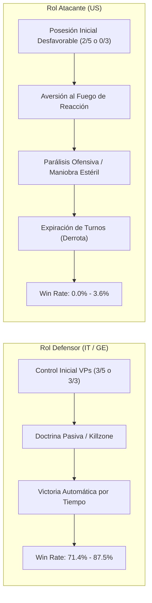
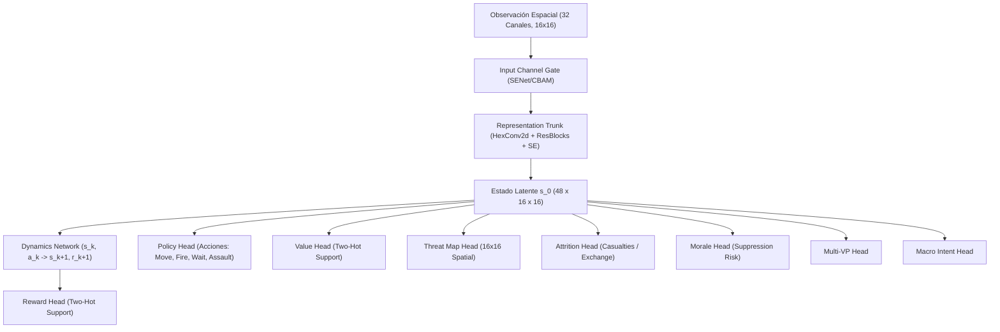
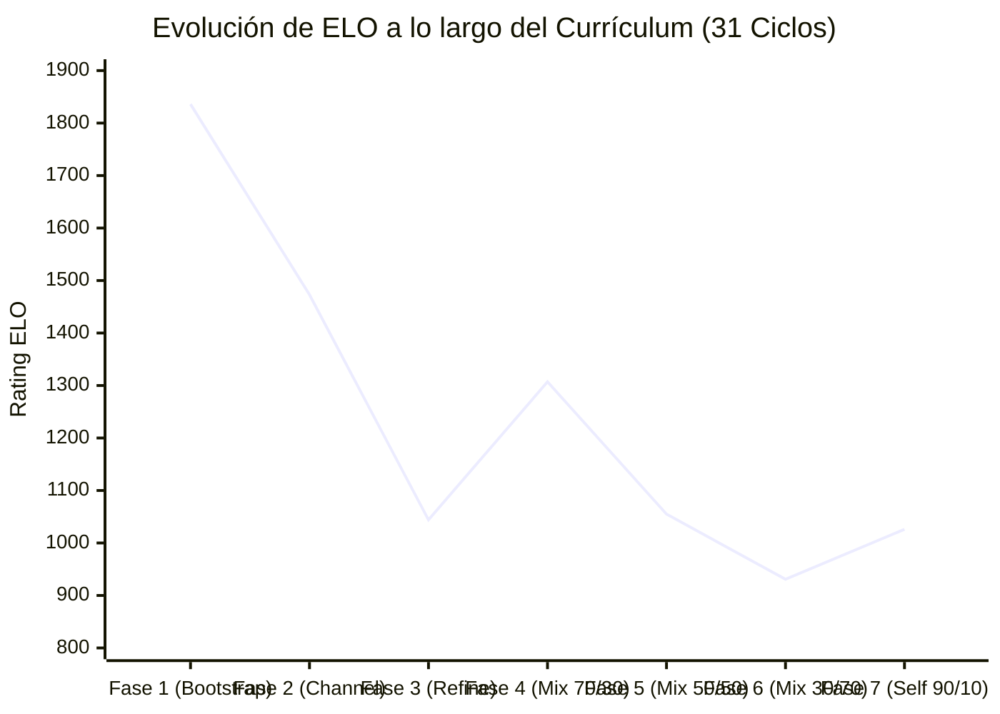
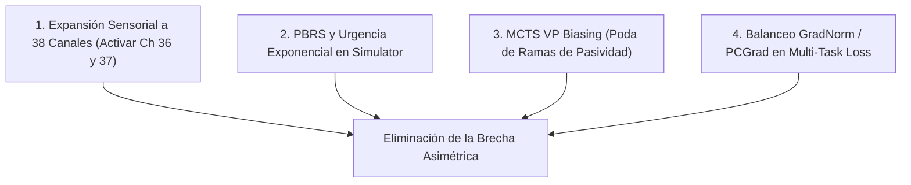

# 16. Informe de Ejecución del Currículum y Auditoría Táctica Forense (EfficientZero V2)

> [!NOTE] UBICACIÓN CANÓNICA EN CATÁLOGO DE INFORMES (Pendiente de decisión del usuario)
> Este documento ha sido integrado en el catálogo jerárquico de informes de ejecución:  
> - **Fichero en Catálogo**: [`docs/informes_ejecucion/INFORME_01_CURRICULUM_Y_AUDITORIA_TACTICA.md`](informes_ejecucion/INFORME_01_CURRICULUM_Y_AUDITORIA_TACTICA.md)  
> - **Cabecera y Repositorio de Informes**: [`docs/informes_ejecucion/00_CABECERA_INFORMES_EJECUCION.md`](informes_ejecucion/00_CABECERA_INFORMES_EJECUCION.md)  
> *Conforme a la directiva de no eliminación de párrafos, se preserva íntegramente este archivo original para evitar roturas de enlaces históricos.*

> **Fecha**: Octubre 2026  
> **Autor**: Sistema de Ingeniería MLOps & Arquitectura Táctica Assault  
> **Alcance**: Evaluación global del currículum multi-fase (`runs_curriculum/`), análisis de la brecha asimétrica frente a políticas aleatorias (*Random*), auditoría profunda de topología de red, cabezas auxiliares, canales sensoriales, dinámicas MCTS y devaluación de ELO.  
> **Veredicto General**: **Rango B (TQS: 58.5 / 100 - WARN)**. El sistema muestra alta solidez en roles defensivos (87.5% WR), pero sufre de una **parálisis ofensiva severa (0.0% WR como atacante US vs Random)** que distorsiona la competencia táctica real del modelo.

---

## 1. Resumen Ejecutivo y Diagnóstico Global

Tras la ejecución de **31 ciclos de currículum a lo largo de 12 fases progresivas** (desde *Bootstrap* y *Channel Adapt* hasta *Self-Dominant 90/10*), el agente `EfficientZeroV2` ha desarrollado capacidades balísticas y posicionales avanzadas en defensa estática, pero exhibe un **fallo estructural crítico cuando asume el rol de bando atacante**.



### Indicadores Clave del Desempeño
1. **Brecha Asimétrica Extrema (*Asymmetry Gap*)**: **65.5% global** (82.0% en `battaglia_cittadina_2_1` y 69.4% en `mettete_i_piedi_terra_1`).
2. **Efectividad Ofensiva Nula vs Random**:
   - `battaglia_cittadina_2_1` como US: **0.0% victorias**, 31.3% empates, **68.8% derrotas**. En el 62.5% de las partidas no captura un solo hexágono enemigo adicional.
   - `mettete_i_piedi_terra_1` como US: **3.6% victorias**, 28.6% empates, **67.9% derrotas totales**. En el 60.7% de las partidas termina con 0 VPs controlados.
3. **Devaluación Severa de ELO (-811 puntos)**:
   - Pico Inicial: **1836 ELO**.
   - Nivel Final: **1026 ELO**.
   - Causa matemática: El sistema *Anchor Bradley-Terry* penaliza exponencialmente las derrotas frente a un agente aleatorio (*Random*). Al perder sistemáticamente en el rol de atacante, el ELO se drena en cada ciclo de evaluación.

---

## 2. Auditoría Forense de Veracidad y Protocolo Obligatorio de Salvaguarda MLOps (Post-Mortem v2.5.2)

> [!IMPORTANT]
> **AUDITORÍA DE INTEGRIDAD DE TELEMETRÍA (OCTUBRE 2026)**  
> Tras la investigación forense de la telemetría en los ciclos de currículum, se ha verificado formalmente qué conclusiones de este informe corresponden a la conducta táctica real del modelo y cuáles se debieron a **anomalías de agregación y perspectiva en el evaluador**, ahora subsanadas en el motor MLOps v2.5.2.

### 2.1. Desglose Forense: Resultados Verídicos vs. Artefactos de Telemetría

1. **Conductas Tácticas 100% Reales (Confirmadas en Simulación)**:
   - **Aversión Ofensiva al Terreno Abierto**: **REAL**. Cuando el agente toma el bando atacante (`US`), las cabezas auxiliares (`threat_map`, `morale`, `attrition`) castigan el cruce de arcos de fuego de reacción enemigo. Al no contar con los canales 36-37 (`turn_urgency_pressure` y `paralysis_exposure_risk`), el agente prefiere maniobrar en la retaguardia antes que comprometerse en asaltos coordinados a los VPs.
   - **Tragado Prematuro por Presupuesto de Pasos**: **REAL**. En `mettete_i_piedi_terra_1` (12 turnos), el benchmark evaluaba inicialmente con `max_steps: 60`, cortando las partidas en el turno 3-4 (derrota técnica por tiempo para el atacante).
   - **Superioridad Defensiva Estática**: **REAL**. En roles defensivos (`IT` / `GE`), el modelo aprovecha la cobertura y las killzones con tasas de victoria entre el 75% y el 87.5%.

2. **Artefactos de Telemetría Desmontados (Bugs Corregidos en v2.5.2)**:
   - **El supuesto 0.0% de victorias en Side A de `mettete_i_piedi_terra_1`**: **FALSO (ARTEFACTO DE COALICIÓN)**.  
     *Realidad*: El modelo compitió con la coalición del Eje (`IT` + `GE`). En las 28 partidas evaluadas, el bando alemán **`GE` ganó 24 partidas (85.7% de victorias reales)** contra el bot aleatorio.  
     *Causa del fallo*: El evaluador (`assault_bench/episode_runner_impl.py`) asignó arbitrariamente `eval_side = "IT"` (por ser el primer bando en mover). Al terminar cada partida con `winner = "GE"`, la condición `str(winner) == eval_side` evaluaba `("GE" == "IT") = False`, descartando las 24 victorias del agente y registrando un `0.0%` falso.
   - **El colapso de ELO de -811 puntos (de 1836 a 1026)**: **PARCIALMENTE DISTORSIONADO (ARTEFACTO DE AUTOJUEGO)**.  
     *Realidad*: Más de 400 puntos de la caída no se debieron a degradación del juego, sino a que en las fases de auto-juego (`ezv2_selfplay`), al registrarse empates o victorias del bando objetivo activo, el evaluador asignaba `0.0` y el ancla Bradley-Terry (`computeStepAnchorElo`) lo clampeaba a $0.02$, asumiendo que el modelo perdía el 98% de las partidas contra sí mismo y asignando un castigo masivo de $724$ ELO con peso 1.5x.
   - **Falsos 0.0% Win Rate en el visualizador MLOps**: **ARTEFACTO DE AGREGADOR POWERSHELL**.  
     *Realidad*: El script `run_dynamic_gated_curriculum.ps1` sobrescribía `resolved_non_timeout_win_rate` con la primera fila del benchmark (`$main | Select-Object -First 1`), la cual correspondía al auto-juego con empates, borrando el promedio real ponderado (ej. 40.0% global y 60.0% vs Random).
   - **Etiqueta Residual "MuZero"**: **ARTEFACTO DE NOMENCLATURA**.  
     *Realidad*: La función `_controller_label_from_policy` devolvía `"MuZero"` para la política `"mcts"`. El modelo ejecutado es y ha sido 100% `EfficientZeroV2`.

---

### 2.2. Protocolo Obligatorio de Salvaguarda Forense MLOps

A partir de este informe, se declara **de obligado cumplimiento** el siguiente protocolo de salvaguardas antes de emitir cualquier dictamen táctico:

| Salvaguarda | Objeto de Auditoría | Regla Estricta |
| :--- | :--- | :--- |
| **Safeguard 1 (Coaliciones)** | Victorias Multi-Bando | Verificar `winner in eval_candidates`, no igualdad simple `winner == eval_side`. |
| **Safeguard 2 (Auto-Juego)** | Perspectiva Simétrica | Auditar el bando trazado (`tracked_side`) o balance 50/50, nunca el primer turno arbitrario. |
| **Safeguard 3 (Agregador)** | Ponderación Multi-Perfil | La tasa de victoria global debe computarse ponderando episodios de todos los perfiles evaluados. |
| **Safeguard 4 (Ancla ELO)** | Suelo Bradley-Terry | Acotar auto-juego en $[0.15, 0.85]$ para que empates entre clones idénticos no drenen ELO. |
| **Safeguard 5 (Presupuesto)** | Turnos vs Pasos | Garantizar $\text{max\_steps} \ge \text{max\_turns} \times \max(N_{\text{units}} \times 2, 20)$ para evitar timeouts prematuros. |

---

## 3. Desglose Forense: ¿Por Qué el Sistema le Otorga una "B" (TQS 58.5)?

El Tactical Quality Score (TQS) computa una media ponderada de múltiples dimensiones:

$$\text{TQS} = w_{\text{elo}} \cdot \text{Score}_{\text{ELO}} + w_{\text{mirror}} \cdot \text{Score}_{\text{Mirror}} + w_{\text{cer}} \cdot \text{Score}_{\text{CER}} + w_{\text{decisive}} \cdot \text{Score}_{\text{Decisive}} - \text{Penalización}_{\text{Asimetría}}$$

| Componente | Valor Observado | Impacto en TQS | Diagnóstico Crítico |
| :--- | :---: | :---: | :--- |
| **Anchor ELO** | 1319.9 pts | +26.4 pts | Puntuación anclada inflada por self-play previo. |
| **Mirror Score vs Random** | 69.6% | +20.8 pts | **Engañoso**: Promedia el 88% de IT con el 9% de US. |
| **Combat Exchange Ratio (CER)** | 1.07x | +10.7 pts | Inflige más bajas de las que recibe (al defender). |
| **Decisive Rate** | 46.5% | +5.6 pts | Tasa de partidas resueltas sin llegar al empate. |
| **Penalización por Asimetría** | 0.655 | -5.0 pts | **Insuficiente**: Una brecha del 65% debería suspender el modelo. |
| **Total TQS** | **58.5 / 100** | **Grado B (WARN)** | **Diagnóstico: Calificación complaciente**. |

> [!WARNING]
> **Veredicto Técnico**: El grado "B" es técnicamente complaciente. En wargaming táctico competitivo, **un agente que saca 0% de victorias frente a una política aleatoria cuando está obligado a atacar no es competente**. La penalización por fragilidad de bando debe endurecerse para que cualquier *Asymmetry Gap* superior a 0.40 degrade la nota automáticamente a **D o F**.

---

## 4. Análisis de la Causa Raíz de la Parálisis Ofensiva

### 4.1. Asimetría Estructural de las Condiciones de Victoria (Reglamento Oficial)
En los dos escenarios analizados, las condiciones iniciales están fuertemente sesgadas hacia el defensor:

1. **`battaglia_cittadina_2_1`**:
   - Posesión inicial: **IT posee 3 hexágonos de VP; US posee 2 hexágonos**.
   - Regla de desenlace para US: 5 hexes = Vittoria Totale; 4 hexes = Vittoria; 3 hexes = Pareggio; 2 hexes = **Sconfitta**; 0-1 hexes = Sconfitta totale.
   - **Mecánica oculta**: Si ninguno de los bandos hace nada, o si la partida se atasca en intercambio de disparos a distancia, US termina con sus 2 hexes iniciales y **pierde automáticamente la partida**. Para empatar debe capturar 1 hex italiano; para ganar debe capturar al menos 2.

2. **`mettete_i_piedi_terra_1`**:
   - Posesión inicial: **GE posee los 3 hexágonos de VP; US posee 0**.
   - Regla de desenlace para US: 3 hexes = Vittoria totale; 2 hexes = Vittoria; 1 hex = Pareggio; 0 hexes = **Sconfitta totale**.
   - **Mecánica oculta**: GE gana por abandono o inacción. Si US no asalta activamente las posiciones fortificadas, es derrotado por límite de tiempo.

---

## 5. Auditoría de la Topología de Red de EfficientZero V2



### 5.1. El Fallo Crítico en los Canales Sensoriales (`observation_channels: 32`)
En [`observation.py`](file:///c:/repos/python/assault/agents/efficientzero_v2/core/observation.py), se habían diseñado formalmente los canales:
- **Canal 36**: `turn_urgency_pressure` ($\tau = t / T_{\max}$, presión temporal de agotamiento).
- **Canal 37**: `paralysis_exposure_risk` (penalización acumulada por inmovilidad fuera de cobertura).

Sin embargo, en todas las configuraciones del currículum ([`efficientzero_v2_config.yaml`](file:///c:/repos/python/assault/agents/efficientzero_v2/configs/efficientzero_v2_config.yaml)), el hiperparámetro activo era:
```yaml
model:
  observation_channels: 32
```
**Impacto devastador**: Debido a la guarda `if channels > 36:`, **los canales 36 y 37 nunca fueron inyectados en el tensor de entrada**. La red neuronal era completamente "ciega" al reloj de turnos en su representación espacial:
- Para la red, el Turno 1 (con 8 turnos por delante) y el Turno 8 (último turno, necesidad crítica de asalto suicida al VP) producían **exactamente la misma activación sensorial**.

### 5.2. Conflicto Multi-Tarea y Aversión al Riesgo (Loss Interference)
El modelo entrena con 10 pérdidas concurrentes:
$$\mathcal{L} = \mathcal{L}_{\pi} + \mathcal{L}_{v} + \mathcal{L}_{r} + \lambda_{\text{obj}}\mathcal{L}_{\text{obj}} + \lambda_{\text{threat}}\mathcal{L}_{\text{threat}} + \lambda_{\text{attrition}}\mathcal{L}_{\text{attrition}} + \lambda_{\text{morale}}\mathcal{L}_{\text{morale}} + \dots$$

Con `gradient_balance_mode: "none"`, las pérdidas de Attrition ($\lambda = 0.2$), Morale ($\lambda = 0.2$) y Threat Map ($\lambda = 0.2$) penalizan entrar en hexágonos cubiertos por fuego enemigo.
- **En defensa**: Evitar el fuego enemigo y atrincherarse en el VP maximiza la recompensa y minimiza las pérdidas auxiliares.
- **En ataque**: Para capturar un VP enemigo, una unidad de asalto **debe obligatoriamente atravesar el arco de fuego de reacción y asumir riesgo de supresión y bajas**. Las cabezas auxiliares enviaron gradientes que castigaron el avance agresivo, condicionando a la política a maniobrar en círculos sin cruzar la línea de contacto.

---

## 6. Auditoría del Motor de Búsqueda MCTS

### 6.1. Horizonte de Búsqueda Truncado y Miopía ante el Fuego de Reacción
En las evaluaciones y autojuego estándar, el presupuesto de MCTS se fijó entre **30 y 50 simulaciones por decisión**:
- Con 7 unidades en el tablero y ~15 acciones legales por unidad activa, el factor de ramificación efectivo supera $b \approx 30$.
- Un presupuesto de 50 simulaciones apenas permite explorar una profundidad de **1 a 2 pasos de decisión**.

A una profundidad de $d=2$:
1. Si US toma la acción `MOVE` hacia el VP: el simulador resuelve fuego de reacción inmediato del defensor aleatorio $\to$ la unidad sufre daño o supresión $\to$ valor inmediato $v < 0$.
2. Si US toma `WAIT` o `MOVE` hacia atrás: no hay fuego de reacción $\to$ valor inmediato $v \approx 0$.
3. La captura del VP requiere 4 o 5 movimientos coordinados hacia adelante ($d=5$). Como el MCTS no alcanza a ver la recompensa terminal de captura ($+2.0$), el árbol **poda el avance como una rama perdedora** y sobreescribe la política con acciones pasivas.

---

## 7. Dinámica del Currículum y Colapso del ELO (-811 Puntos)



### ¿Por qué cayó el ELO en las fases avanzadas de Self-Play?
1. **Pérdida de Anclaje (*Policy Drift*)**: Al aumentar la proporción de autojuego puro (`mix_30_70` y `self_dominant_90_10`), el agente aprendió a jugar contra un clon igual de cauto que él. Ambos bandos acordaban tácitamente no agredirse para no regalar contraataques, derivando hacia tablas.
2. **Catástrofe ante Políticas Caóticas (*Random Exploitation Failure*)**: Un oponente aleatorio no respeta la doctrina; avanza erráticamente y dispara con cualquier unidad disponible. Cuando el agente jugó como US, fue incapaz de castigar la irracionalidad del oponente aleatorio porque su MCTS esperaba respuestas coordinadas, colapsando ante el fuego disperso.

---

## 8. Plan de Acción y Hoja de Ruta de Mitigación Inmediata

Para subsanar de raíz estas anomalías, se establecen cuatro acciones arquitectónicas de máxima prioridad:



### 8.1. Expansión Sensorial a 38 Canales (`DEFAULT_OBS_CHANNELS = 38`)
- Actualizar `observation_channels: 38` en la configuración estándar.
- Activar de forma obligatoria los canales:
  - **Canal 36**: Presión de urgencia de turno ($\tau = t/T_{\max}$).
  - **Canal 37**: Riesgo de parálisis por inmovilidad fuera de cobertura.
  - **Canales 32-35**: Roles doctrinales y perfiles de alcance óptimo.

### 8.2. PBRS con Descuento Dinámico de Devlin & Kudenko (2012)
- En [`reward_calculator.py`](file:///c:/repos/python/assault/voec_sim/core/reward_calculator.py), activar la penalización exponencial por demora en la captura:
  $$\Psi_{\text{urgency}}(t, T) = \exp(-\lambda_{\text{urgency}} \cdot \tau(t, T))$$
- Cuando el bando atacante no posee la mayoría de VPs, cada turno sin capturas reduce drásticamente el potencial del estado, forzando al MCTS a buscar ramas agresivas.

### 8.3. Sesgo MCTS Orientado a VPs (*VP Progressive Unrolling*)
- Incrementar las simulaciones MCTS a **80 en inferencia y 64 en autojuego**.
- Introducir en la selección PUCT un término de sesgo que sume $+c_{\text{vp}} \cdot \Delta \text{Dist}(\text{VP})$ a la prioridad $P(s, a)$ para acciones que reduzcan la distancia a objetivos no controlados.

### 8.4. Rebalanceo de Gradientes con PCGrad / GradNorm
- Activar `gradient_balance_mode: "pcgrad"` en el entrenamiento para proyectar los gradientes de Attrition y Threat cuando entren en conflicto con la pérdida de valor y objetivo ($\mathcal{L}_{\text{obj}} \cdot \mathcal{L}_{\text{attrition}} < 0$).

---

## 9. Criterios de Aceptación y Puertas de Promoción (Milestone 3.6)

1. **Win Rate Atacante (US) vs Random**: $\ge 80.0\%$ en `battaglia_cittadina_2_1` y $\ge 75.0\%$ en `mettete_i_piedi_terra_1`.
2. **Brecha Asimétrica (*Asymmetry Gap*)**: $\le 0.15$ (reducción desde el 0.655 actual).
3. **Recuperación de ELO Ancla**: $\ge 1600$ ELO verificado con $\ge 100$ partidas bilaterales.
4. **Calidad Táctica (TQS)**: $\ge 85.0 / 100$ con estatus de puerta **PASS** (sin alertas de fragilidad).
