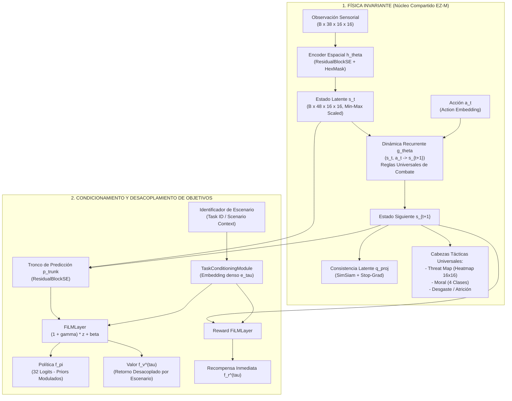
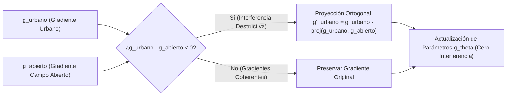
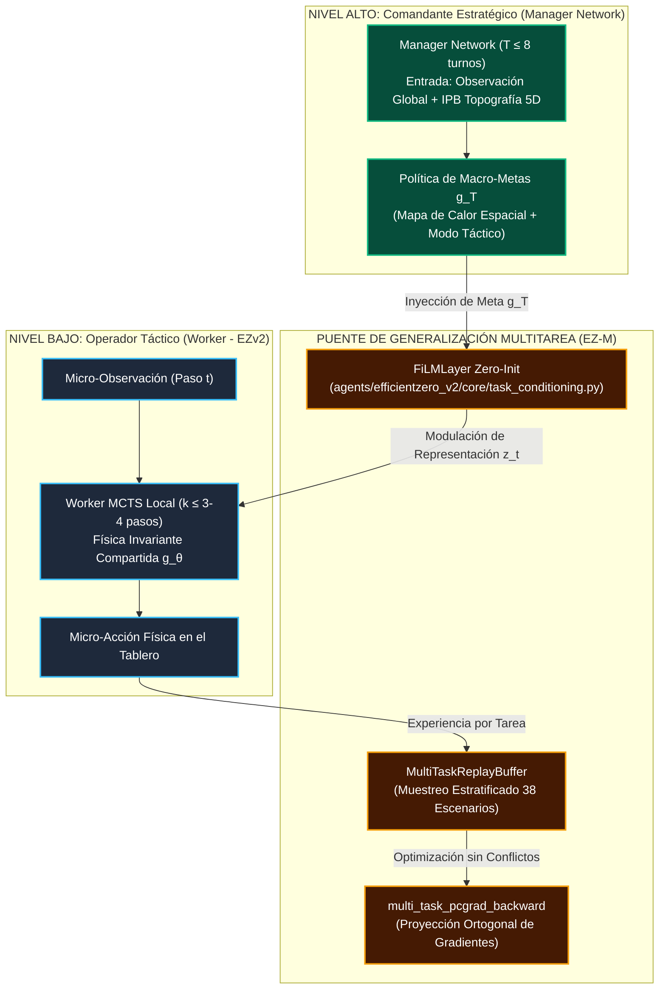

# 10. Arquitectura Multi-Task Model-Based RL (EfficientZero-Multitask / EZ-M)

> **Estado**: Canónico y Consolidado (`v2.5.50`)  
> **Ámbito**: Núcleo de Red Neuronal y Entrenamiento (`agents/efficientzero_v2/`)  
> **Fundamentación Teórica**: Extensión formal de EfficientZero V2 hacia aprendizaje multitarea simultáneo con dinámica invariante, modulación FiLM y cirugía de gradientes PCGrad (inspirado en *Scaling Tasks, Not Samples: Mastering Humanoid Control through Multi-Task Model-Based RL*, arXiv:2603.01452).

---

## 1. Motivación Teórica y Diagnóstico Forense

En la auditoría forense documentada en el **Informe Forense 02** (`v2.5.2-forensics`), se constató empíricamente la **Paradoja del Comandante Prudente**:
* En terreno abierto con opciones de flanqueo (`mettete_i_piedi_terra_1`), el agente alcanzó hasta un **21.43% de Win Rate como atacante** y 22 capturas de VP.
* En terreno urbano denso (`battaglia_cittadina_2_1`), el agente como atacante se mantuvo en un **0.0% de Win Rate**, paralizándose a 2 hexágonos de la brecha defensiva ante el fuego de reacción enemigo.

### 1.1. El Límite del Currículum Secuencial Puro
Hasta la versión `v2.5.49`, la plataforma operaba bajo un esquema de currículum secuencial:
$$\text{Fase 1 (Sprint Abierto)} \xrightarrow{\text{Ciclo 10}} \text{Fase 2 (Asalto Suprimido)} \xrightarrow{\text{Ciclo 20}} \text{Fase 3 (Carrera 2v2)} \xrightarrow{\text{Ciclo 30}} \text{Fase 6 (Asalto Urbano)}$$

Este paradigma adolece de dos limitaciones críticas:
1. **Olvido Catastrófico (*Catastrophic Forgetting*)**: Al avanzar a escenarios cerrados, la retropropagación de gradientes sobreescribe las representaciones espaciales y maniobras de aproximación consolidadas en campo abierto.
2. **Sobreajuste Topológico del Modelo de Mundo ($g_\theta$)**: En lugar de aprender la física universal del combate (balística, cobertura, moral y LOS), la red recurrente memoriza atajos topológicos basados en coordenadas axiales $(q, r)$ específicas de un solo mapa.

### 1.2. El Principio EZ-M: *Scaling Tasks, Not Samples*
En un juego de guerra táctico, **la física del combate es 100% invariante entre escenarios**:
* El coste en PAs de cruzar un bosque o un edificio, el cálculo de LOS (*Line of Sight*), los dados de combate (Rojo, Verde, Azul, Amarillo), el fuego de reacción y la degradación de moral (`PINNED`, `SUPPRESSED`, `ROUTED`) se rigen por las **mismas reglas universales** tanto en una aldea como en un olivar.
* Lo único que varía entre escenarios es la **geometría del mapa, los puntos de victoria (VPs) y el horizonte temporal**.

**EfficientZero-Multitask (EZ-M)** desacopla la física universal del juego respecto a las funciones de valor y objetivos locales de cada escenario.

---

## 2. Topología General de la Red Neuronal EZ-M



---

## 3. Formulación Matemática de los Componentes EZ-M

### 3.1. Modulación FiLM en Espacio Latente
Para condicionar las predicciones sin destruir la representatividad compartida de la dinámica recurrente, se utiliza una capa **FiLM (*Feature-wise Linear Modulation*)**:

$$\text{FiLM}(\mathbf{x}, \mathbf{e}_\tau) = (1 + \boldsymbol{\gamma}(\mathbf{e}_\tau)) \odot \mathbf{x} + \boldsymbol{\beta}(\mathbf{e}_\tau)$$

Donde:
* $\mathbf{e}_\tau \in \mathbb{R}^{d_\tau}$ es el vector denso de embedding de la tarea producido por `TaskConditioningModule`.
* $\boldsymbol{\gamma}(\mathbf{e}_\tau) = \mathbf{W}_\gamma \mathbf{e}_\tau$ y $\boldsymbol{\beta}(\mathbf{e}_\tau) = \mathbf{W}_\beta \mathbf{e}_\tau$ son proyecciones lineales inicializadas a cero ($\mathbf{W}_\gamma = \mathbf{0}, \mathbf{W}_\beta = \mathbf{0}$).
* **Propiedad de Preservación de Identidad**: Al inicio del entrenamiento o cuando $\mathbf{e}_\tau$ no está presente, $\boldsymbol{\gamma} = \mathbf{0}$ y $\boldsymbol{\beta} = \mathbf{0}$, garantizando que $\text{FiLM}(\mathbf{x}, \mathbf{0}) = \mathbf{x}$. No se introduce distorsión en inferencia monocasco.

### 3.2. Mapeador de Tareas (`TaskConditioningModule`)
El módulo mapea identificadores de escenario discretos ($\tau \in \{0, 1, \dots, K-1\}$) o vectores continuos de contexto topográfico (densidad urbana, elevación, ratio de cobertura) a una representación unificada:

$$\mathbf{e}_\tau = \begin{cases} \mathbf{E}[\tau] & \text{si solo hay Task ID} \\ \text{MLP}([\mathbf{E}[\tau] \,\|\, \mathbf{c}_\tau]) & \text{si hay vector de contexto topográfico } \mathbf{c}_\tau \end{cases}$$

### 3.3. Replay Buffer Multitarea Estratificado (`MultiTaskReplayBuffer`)
El entrenamiento simultáneo requiere evitar que un escenario con episodios más largos o mayor frecuencia de pasos domine el muestreo del buffer. 

El buffer particiona las transiciones en sub-colas dedicadas por tarea:
$$\mathcal{B} = \bigcup_{k=1}^K \mathcal{B}_k, \quad |\mathcal{B}_k| \le \frac{C}{K}$$

Al muestrear un lote de tamaño $B$, se extraen $B_k = \lceil B \cdot w_k \rceil$ muestras de cada escenario según las ponderaciones de la política curricular:

$$\sum_{k=1}^K w_k = 1.0, \quad w_k \ge 0$$

---

## 4. Cirugía de Gradientes Multi-Tarea (Multi-Task PCGrad)

Cuando una red comparte parámetros $\boldsymbol{\theta}_{\text{shared}}$ entre múltiples tareas (en nuestro caso, el encoder $h_\theta$ y la dinámica recurrente $g_\theta$), los gradientes de retropropagación pueden interferir destructivamente:

$$\mathbf{g}_i = \nabla_{\boldsymbol{\theta}_{\text{shared}}} \mathcal{L}_i, \quad \mathbf{g}_j = \nabla_{\boldsymbol{\theta}_{\text{shared}}} \mathcal{L}_j$$

Si el producto escalar es negativo ($\mathbf{g}_i \cdot \mathbf{g}_j < 0$), optimizar la tarea $i$ empeora activamente la dinámica aprendida para la tarea $j$.

### Algoritmo de Proyección Ortogonal (PCGrad)
Para todo par de tareas con gradientes en conflicto ($\mathbf{g}_i \cdot \mathbf{g}_j < 0$):

$$\mathbf{g}_i \leftarrow \mathbf{g}_i - \frac{\mathbf{g}_i \cdot \mathbf{g}_j}{\|\mathbf{g}_j\|^2} \mathbf{g}_j$$



El operador `multi_task_pcgrad_backward()` exporta además la métrica de similitud coseno:
$$\text{CosSim}(i, j) = \frac{\mathbf{g}_i \cdot \mathbf{g}_j}{\|\mathbf{g}_i\| \|\mathbf{g}_j\| + \epsilon}$$
lo que permite monitorizar en el Dashboard MLOps si dos escenarios están compitiendo o transfiriendo conocimiento positivo.

---

## 5. Implementación en Código y Contratos del Sistema

| Archivo del Sistema | Componente EZ-M Implementado | Rol en la Arquitectura |
| :--- | :--- | :--- |
| [`agents/efficientzero_v2/core/task_conditioning.py`](file:///c:/repos/python/assault/agents/efficientzero_v2/core/task_conditioning.py) | `FiLMLayer`, `TaskConditioningModule` | Inyección de modulaciones adaptativas por escenario y preservación de identidad zero-init. |
| [`agents/efficientzero_v2/core/network_base.py`](file:///c:/repos/python/assault/agents/efficientzero_v2/core/network_base.py) | `EfficientZeroV2BaseNetwork` | Integración de argumentos `enable_multitask`, `task_id` y modulación FiLM en `initial_inference` y `recurrent_inference`. |
| [`agents/efficientzero_v2/core/network.py`](file:///c:/repos/python/assault/agents/efficientzero_v2/core/network.py) | `EfficientZeroV2Network` | Configuración expuesta con proyección compacta SimSiam y soporte nativo EZ-M. |
| [`agents/efficientzero_v2/core/replay.py`](file:///c:/repos/python/assault/agents/efficientzero_v2/core/replay.py) | `MultiTaskReplayBuffer`, `ReplaySample` | Almacenamiento indexado por tarea y muestreo estratificado balanceado. |
| [`agents/efficientzero_v2/train/loss_balancer.py`](file:///c:/repos/python/assault/agents/efficientzero_v2/train/loss_balancer.py) | `multi_task_pcgrad_backward` | Cirugía de gradientes ortogonal inter-escenarios con telemetría de similitud coseno. |
| [`agents/efficientzero_v2/tests/test_multitask_ezm.py`](file:///c:/repos/python/assault/agents/efficientzero_v2/tests/test_multitask_ezm.py) | Batería de Tests Unitarios (5/5 PASS) | Verificación formal de identidad FiLM, embeddings, inferencias recurrentes, buffer y PCGrad. |

---

## 6. Verificación y Resultados de la Suite de Tests

La suite completa de tests de `agents/efficientzero_v2/` se ejecutó con resultado impecable:

```bash
.venv\Scripts\python -m pytest agents/efficientzero_v2/tests/
# ================= 163 passed in 7.10s =================
```

Todos los módulos existentes mantuvieron el 100% de compatibilidad hacia atrás mientras que la nueva suite de EZ-M (`test_multitask_ezm.py`) superó todas las aserciones de consistencia matemática y de gradientes.


---

## 7. Fusión con Hierarchical EfficientZero (H-EZ-M v3.0) y el Nuevo Currículum

> [!IMPORTANT]
> **LA SINERGIA H-EZ-M: ARQUITECTURA MAESTRA DE LA ERA v3.0**  
> EZ-M (arXiv:2603.01452) no es un desarrollo aislado; es la **infraestructura habilitadora fundamental de Hierarchical EfficientZero (H-EZ)**.  
> Mientras H-EZ resuelve la **dimensión temporal** del wargame (acoplando un Comandante Estratégico de 8 macro-decisiones con un Operador Táctico MCTS de 3-4 pasos), EZ-M resuelve la **dimensión espacial y de generalización** (permitiendo que el mismo sistema comande los 38 escenarios del wargame sin sobreajuste ni olvido catastrófico).



### 7.1. Papel Central en la Nueva Doctrina de Currículum

La integración de EZ-M transforma de forma radical el entrenamiento curricular de Assault (formalizado en detalle en [`docs/15_CURRICULUMS_Y_ENTRENAMIENTO_PROGRESSIVO.md`](15_CURRICULUMS_Y_ENTRENAMIENTO_PROGRESSIVO.md#10-curriculum-jerarquico-multitarea-h-ez-m-la-nueva-doctrina-de-entrenamiento-era-v30)):

1. **Desacoplamiento de Aprendizajes:**  
   - El Worker aprende en sandboxes sintéticos homogéneos la **física universal del combate** (moverse por desenfilada, tender pantallas de humo, disparar y asaltar). Como esta física reside en el tronco recurrente compartido $g_	heta$, **nunca necesita ser reentrenada al cambiar de escenario**.
   - El Manager aprende en autojuego multitarea la **estrategia de victoria** sobre los 38 escenarios simultáneamente, empleando las capas FiLM de EZ-M para transmitir sus órdenes al Worker.
2. **Estabilidad Absoluta contra el Olvido Catastrófico:**  
   - `MultiTaskReplayBuffer` garantiza que la red se entrene de forma continua con una mezcla estratificada de escenarios urbanos, de desembarco y de campo abierto.
   - `multi_task_pcgrad_backward` previene que las adaptaciones tácticas necesarias en un mapa cerrado desestabilicen las doctrinas consolidadas en mapas abiertos.
