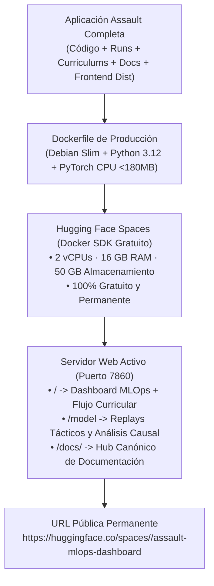

# Guía Maestra de Publicación en la Nube Gratuita del Dashboard MLOps (Assault Project)

> **Objetivo**: Publicar la aplicación completa existente de Assault (Dashboard MLOps, Visor Táctico de Replays, Hub de Documentación y todos los datos/ejecuciones de currículum) en un servidor en la nube 100% gratuito (Hugging Face Spaces), con URL pública permanente para compartir y explorar sin instalar nada en local.

---

## 1. Arquitectura de Despliegue de la Aplicación Completa

La plataforma ya cuenta con todo lo necesario empaquetado para operar en la nube de forma nativa:



---

## 2. Componentes Incluidos en el Paquete de Publicación

Al publicar la aplicación completa, el contenedor incluye directamente:

1. **Frontend MLOps Compilado (`mlops/reporting/viewer_frontend/dist/`)**:
   - Flujo de linaje curricular multi-escenario en tiempo real.
   - Catálogo de modelos y benchmarks ELO comparativos.
   - Visor de replays con mapa hexagonal, cartas de unidades y cabezas tácticas (Amenaza, Desgaste, Moral).
2. **Historial de Ejecuciones y Datos (`runs/` y `runs_curriculum/`)**:
   - Todas las fases curriculares ejecutadas.
   - Base de datos DuckDB optimizada (`runs_curriculum/experiments/reporting/reporting.duckdb`).
   - Replays de evaluación en formato JSON canónico.
3. **Hub de Documentación Canónica (`docs/` y `site/`)**:
   - Los 26 módulos técnicos y la Hoja de Ruta Evolutiva interactiva accesibles desde `/docs/`.
4. **Backend Ligero de Alto Rendimiento (`mlops/reporting/viewer.py`)**:
   - Servidor HTTP multi-hilo nativo con detección automática de variables de entorno (`PORT` y `HOST`).

---

## 3. Guía Paso a Paso para Publicar en Hugging Face Spaces (3 Pasos)

### Paso 1: Crear el Space en Hugging Face
1. Entra en [Hugging Face](https://huggingface.co/) con tu cuenta (o regístrate gratis).
2. Abre la página de creación: **[huggingface.co/new-space](https://huggingface.co/new-space)**.
3. Rellena los datos:
   - **Space name**: `assault-mlops-dashboard` (o el nombre que prefieras).
   - **License**: `mit` o `apache-2.0`.
   - **Select the Space SDK**: Elige **`Docker`** -> **`Blank`**.
   - **Space hardware**: `Free (2 vCPU · 16 GB RAM)`.
   - **Visibility**: `Public` (para que cualquiera pueda abrirlo con el enlace).
4. Pulsa en **Create Space**.

---

### Paso 2: Conectar y Subir la Aplicación Completa

Tienes dos opciones sumamente sencillas:

#### Opción A: Añadir el Remote de Hugging Face y hacer Push (Recomendada)
Desde la terminal en la raíz de tu proyecto `assault`:

```powershell
# 1. Añadir el repositorio de tu Space como remote
git remote add hf https://huggingface.co/spaces/<tu-usuario>/assault-mlops-dashboard

# 2. Subir la aplicación completa (el archivo .dockerignore filtrará automáticamente los temporales)
git push hf main
```

*(Si Hugging Face te solicita credenciales, introduce tu usuario de Hugging Face y tu **Access Token** con permisos de escritura, generado en [huggingface.co/settings/tokens](https://huggingface.co/settings/tokens))*.

#### Opción B: Clonar el Space y copiar los archivos
Si prefieres tener una carpeta separada para el despliegue:

```powershell
# 1. Clonar el repositorio vacío de tu Space
git clone https://huggingface.co/spaces/<tu-usuario>/assault-mlops-dashboard

# 2. Copiar los archivos esenciales del proyecto a la carpeta clonada:
# - Dockerfile
# - requirements-cloud.txt
# - README.md
# - assault_model/
# - agents/
# - mlops/
# - voec_sim/
# - assets/
# - curriculums/
# - docs/
# - site/
# - runs/
# - runs_curriculum/

# 3. Subir los cambios
cd assault-mlops-dashboard
git add .
git commit -m "Deploy Assault complete application"
git push
```

---

### Paso 3: Visualización en Vivo

Hugging Face Spaces detectará automáticamente el `Dockerfile`, instalará las dependencias en ~2 minutos y arrancará el servidor en el puerto 7860.

Tu aplicación completa estará inmediatamente disponible en:
👉 **`https://huggingface.co/spaces/<tu-usuario>/assault-mlops-dashboard`**

---

## 4. Comprobación y Ejecución en Local con Docker (Opcional)

Si deseas probar el contenedor localmente antes de publicarlo:

```powershell
# Compilar la imagen Docker
docker build -t assault-mlops .

# Ejecutar el contenedor mapeando el puerto 7860
docker run -p 7860:7860 assault-mlops
```

Y abrir `http://localhost:7860` en el navegador.
