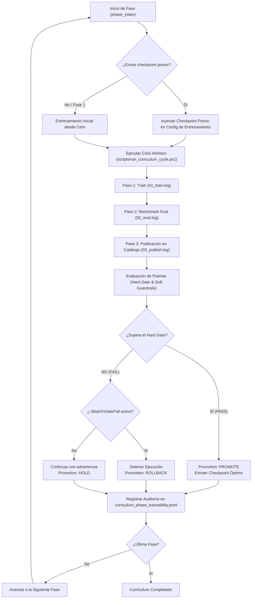

# Guía del Sistema de Currículum: Funcionamiento y Ejecución

Esta guía detalla la arquitectura, el funcionamiento interno, los criterios de puertas de pase (*gates*) y los procedimientos de ejecución del sistema de **Curriculum Learning** en el proyecto **Assault**.

---

## 1. Introducción y Filosofía del Currículum

El entrenamiento de agentes de Aprendizaje por Refuerzo profundo basados en búsqueda en árbol de Monte Carlo (como **EfficientZero V2** / **MuZero**) en juegos de simulación táctica con niebla de guerra presenta un reto fundamental:
- **Espacio de estados y acciones masivo**: Miles de combinaciones de movimientos, fuego y órdenes de unidad.
- **Recompensas ralas (*sparse rewards*)**: Si el modelo sólo aprende de la victoria/derrota al final de partidas largas, los gradientes son ruidosos y el modelo puede colapsar hacia políticas pasivas que agotan el tiempo (*timeouts*).

Para resolver esto, el sistema implementa un **Curriculum Progresivo**:
1. **Fase Bootstrap**: El modelo aprende primero los fundamentos del juego y la captura de Puntos de Victoria (**VP**) jugando con alta proporción contra oponentes heurísticos sencillos o aleatorios (*Random*).
2. **Fase de Adaptación y Refinamiento**: Se incrementa la dificultad de los oponentes y se introducen escenarios adicionales (ej. `battaglia_cittadina_2_1` + `mettete_i_piedi_terra_1`).
3. **Fase de Mezcla Progresiva**: Se varía gradualmente el peso del auto-juego (*Self-play*) frente al juego contra oponentes aleatorios (ej. ratios 70/30, 50/50, 30/70, 90/10).
4. **Fase de Estabilización**: Auto-juego puro (100% *Self-only*) para consolidar tácticas avanzadas y respuestas robustas contra su propia política.

---

## 2. Arquitectura y Estructura de Ficheros

El sistema de currículum se organiza de forma modular y versionada dentro del repositorio:

```
assault/
├── curriculums/                                # Definiciones versionadas de currículum
│   ├── self_vs_self_vs_random_2scenarios_v1/   # Currículum activo multiescenario
│   │   ├── curriculum.yaml                     # Definición de fases y gates
│   │   ├── run_all_phases.ps1                  # Script orquestador
│   │   ├── configs/                            # Configuraciones inmutables de entrenamiento
│   │   │   ├── efficientzero_v2.phase1_bootstrap.yaml
│   │   │   ├── efficientzero_v2.phase2_mix_70_30.yaml
│   │   │   └── ...
│   │   └── cycles/                             # Manifiestos de ciclo por fase
│   │       ├── phase1_bootstrap.cycle.json
│   │       └── ...
│   └── self_vs_self_vs_random_v1/              # Currículum base monoescenario
│       └── run_all_phases.ps1                  # Implementación base del motor orquestador
├── scripts/
│   └── run_curriculum_cycle.ps1                # Runner de bajo nivel para un ciclo atómico
└── runs_curriculum/                            # Salidas y telemetría de ejecución
    ├── experiments/
    │   ├── curriculum_cycles/                  # Historial de ciclos ejecutados (logs y hashes)
    │   │   └── <timestamp_curriculum_fase>/
    │   │       ├── meta/
    │   │       │   ├── manifest.lock.json      # Hashes SHA-256 de configs usadas
    │   │       │   └── status.json             # Estado final de ejecución
    │   │       └── logs/
    │   │           ├── 01_train.log            # Log de entrenamiento
    │   │           ├── 02_eval.log             # Log de evaluación de benchmark
    │   │           └── 03_publish.log          # Log de publicación de catálogo
    │   └── reporting/
    │       ├── curriculum_phase_traceability.jsonl         # Historial acumulado de fases
    │       └── curriculum_phase_traceability.latest.json   # Último estado registrado
    └── <run_id>/
        └── checkpoints/                        # Modelos entrenados (.pt)
```

---

## 3. Ciclo de Vida de una Fase (*Lifecycle*)

Cada fase del currículum sigue un flujo estricto e inmutable antes de permitir que el modelo avance a la siguiente fase:



---

## 4. Definición de Fases y Especificación de Gates (`curriculum.yaml`)

El archivo [curriculum.yaml](file:///c:/repos/python/assault/curriculums/self_vs_self_vs_random_2scenarios_v1/curriculum.yaml) especifica las transiciones y los requisitos cuantitativos para cada fase:

```yaml
name: self_vs_self_vs_random_2scenarios_v1
engine: efficientzero_v2
phases:
  - name: phase1_bootstrap
    train_config: curriculums/.../efficientzero_v2.phase1_bootstrap.yaml
    eval_config: assault_bench/configs/benchmark_config.curriculum_2scenarios_phase1_256_80_20.yaml
    gate:
      min_vp_capture_take_rate: 0.055       # Tasa mínima de toma/conversión de VP
      min_tracked_captured_avg: 2.35        # Promedio mínimo de VP capturados por bando US
      min_vp_net_avg_tracked_side: 0.30     # Diferencial neto mínimo de VP a favor
      profile_soft_guardrail:
        muzero_vs_random_side_b:
          severe_min_score: 0.03            # Suelo de seguridad para el bando vulnerable

  - name: phase2_mix_70_30
    train_config: curriculums/.../efficientzero_v2.phase2_mix_70_30.yaml
    eval_config: assault_bench/configs/benchmark_config.curriculum_2scenarios_phase2_320_50_50.yaml
    gate:
      no_regression_defeat_rate: true       # Prohibida la regresión en ratio de derrotas
      min_vp_capture_take_rate: 0.065
      min_tracked_captured_avg: 2.45
      min_vp_net_avg_tracked_side: 0.38
```

### Tipos de Criterios en los Gates:

1. **Hard Gates (Bloqueantes)**:
   - `min_tracked_captured_avg`: Promedio de puntos de victoria capturados por el bando evaluado.
   - `min_vp_capture_take_rate`: Frecuencia de acciones orientadas al objetivo de captura.
   - `min_vp_net_avg_tracked_side`: Balance neto de puntos de victoria entre ambos bandos.
   - `min_score`: Tasa de victorias ponderada global.
   - `no_regression_defeat_rate`: Asegura que el nuevo modelo no pierda más partidas que el de la fase anterior.

2. **Soft Guardrails (Por Perfil)**:
   - `severe_min_score`: Umbral mínimo para no sufrir colapso catastrófico en un emparejamiento o lado específico del tablero (ej. `muzero_vs_random_side_b`).
   - `max_score_drop_vs_prev`: Caída máxima tolerable respecto a la fase anterior.

3. **Métricas de Diagnóstico (Observabilidad, No Bloqueantes)**:
   - `timeout_rate`: Razón de partidas finalizadas por límite de turnos (se genera alerta `WARN` si supera el 85%, pero no invalida el pase si los objetivos tácticos de VP se alcanzaron).
   - `non_timeout_resolution_rate`: Porcentaje de partidas concluidas antes del agotamiento de tiempo.
   - `resolved_non_timeout_win_rate`: Tasa de victorias en partidas resueltas normalmente.

---

## 5. Cómo se Ejecuta el Currículum

Todos los comandos se ejecutan desde la raíz del proyecto (`C:\repos\python\assault`) utilizando PowerShell.

### A. Simulación / Validación Rápida (*Dry Run*)
Verifica que las rutas, configuraciones YAML y parámetros de todas las fases existen y son coherentes sin arrancar los entrenamientos pesados:

```powershell
powershell -ExecutionPolicy Bypass -File .\curriculums\self_vs_self_vs_random_2scenarios_v1\run_all_phases.ps1 -DryRun
```

### B. Ejecución Completa con Parada Estricta en Fallos (Recomendado)
Ejecuta secuencialmente todas las fases del currículum. Si una fase no supera su *Hard Gate* o produce un error de ejecución, el proceso se detiene inmediatamente protegiendo el último checkpoint válido:

```powershell
powershell -ExecutionPolicy Bypass -File .\curriculums\self_vs_self_vs_random_2scenarios_v1\run_all_phases.ps1 -StopOnGateFail -StopOnPhaseError
```

### C. Reanudar desde una Fase Específica o Checkpoint Previo
Si una fase falló o se interrumpió, se puede continuar a partir de esa fase utilizando el último checkpoint generado:

```powershell
# Reanudar desde la Fase 1 permitiendo carga de checkpoint existente
powershell -ExecutionPolicy Bypass -File .\curriculums\self_vs_self_vs_random_2scenarios_v1\run_all_phases.ps1 -StartPhase "phase1_bootstrap" -ContinueFromLatestCheckpoint -AllowPhase1Resume -StopOnGateFail

# Reanudar directamente en la Fase 2 continuando desde el mejor modelo de la Fase 1
powershell -ExecutionPolicy Bypass -File .\curriculums\self_vs_self_vs_random_2scenarios_v1\run_all_phases.ps1 -StartPhase "phase2_mix_70_30" -ContinueFromLatestCheckpoint -StopOnGateFail
```

### D. Ejecución Aislada de un Ciclo Individual (*Atomic Cycle*)
Para depurar o entrenar una única fase de forma manual mediante su manifiesto:

```powershell
powershell -ExecutionPolicy Bypass -File .\scripts\run_curriculum_cycle.ps1 -ManifestPath .\curriculums\self_vs_self_vs_random_2scenarios_v1\cycles\phase1_bootstrap.cycle.json
```

---

## 6. Monitoreo y Observabilidad

### En la Consola
Durante la ejecución, el runner imprime el progreso detallado:
```
[Cycle] Running phase: phase1_bootstrap
[Cycle] Created lock manifest: runs_curriculum\experiments\curriculum_cycles\...
[Bench] completed run_id=efficientzero_v2_06310a72 gate=PASS wall_s=1058.12
Gate PASS | score=0.556 timeout=0.744 loss=0.000 vp_take=0.065 tracked_cap=2.380
```

### En el Visor Web de Modelos (MLOps Viewer)
El estado y avance del currículum se monitorizan visualmente en tiempo real:
1. Asegurar que el visor está activo:
   ```powershell
   python -m mlops.reporting.viewer --repo-root . --host 127.0.0.1 --port 8778
   ```
2. Abrir en el navegador: `http://127.0.0.1:8778/`
3. En la barra superior, seleccionar la pestaña **Curriculum Traceability** o **Curriculum Compare**:
   - **Historial de Fases**: Muestra cada fase con sus insignias de estado (`HARD GATE: PASS/FAIL`, `DIAGNOSTIC: OK/WARN`).
   - **Decisión de Promoción**: Identifica si el modelo fue promocionado (`promote`), mantenido (`hold`) o revertido (`rollback`).
   - **Comparador de Métricas**: Muestra la evolución de capturas de VP, ratios de victoria y tiempos de resolución entre fases sucesivas.

---

## 7. Ficheros de Referencia

- [curriculum.yaml](file:///c:/repos/python/assault/curriculums/self_vs_self_vs_random_2scenarios_v1/curriculum.yaml): Especificación declarativa del currículum activo de 2 escenarios.
- [run_all_phases.ps1](file:///c:/repos/python/assault/curriculums/self_vs_self_vs_random_2scenarios_v1/run_all_phases.ps1): Orquestador del currículum activo.
- [run_curriculum_cycle.ps1](file:///c:/repos/python/assault/scripts/run_curriculum_cycle.ps1): Motor de ejecución atómica de un ciclo (Train + Eval + Publish con hash-lock).
- [curriculum_phase_traceability.latest.json](file:///c:/repos/python/assault/runs_curriculum/experiments/reporting/curriculum_phase_traceability.latest.json): Registro del último estado alcanzado.
