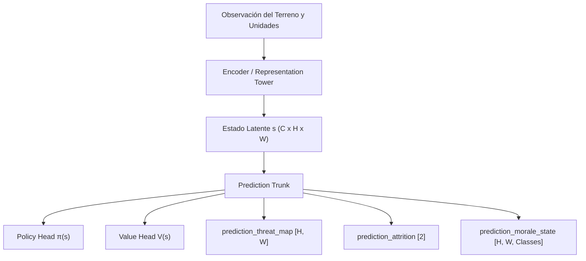

# Roadmap de Expansión de Cabezas y Mejoras Arquitectónicas (MuZero / EfficientZero V2)

Este documento detalla las **mejoras de red neuronal implementadas** y el **diseño técnico de las nuevas cabezas tácticas auxiliares** planificadas para el motor wargame *Assault / Close Combat*.

---

## 1. Mejoras Arquitectónicas Implementadas (Punto 3)

### 1.1. Soporte Discreto Two-Hot para Value y Reward
- **Ubicación:** [`agents/efficientzero_v2/core/support.py`](file:///c:/repos/python/assault/agents/efficientzero_v2/core/support.py)
- **Problema previo:** La regresión directa con MSE (`Linear(64, 1)`) sobre escalares desprotegidos sufre de colapso de gradientes, inestabilidad numérica ante recompensas dispersas y dificultad para calibrar distribuciones bimodales.
- **Solución implementada:**
  - **Transformación contractiva invertible:**
    $$h(x) = \text{sign}(x)(\sqrt{|x| + 1} - 1) + \epsilon x$$
    $$h^{-1}(y) \approx \text{inversa cuadrática exacta}$$
  - **Representación Two-Hot:** Mapea el valor escalar en una distribución de probabilidad sobre $2K+1$ átomos discretos en $[-K, +K]$ (por defecto $K=30$, 61 átomos).
  - **Decodificación transparente para MCTS:** Durante la inferencia, `support_to_scalar` transforma los logits directamente al escalar esperado por la búsqueda en árbol de Monte Carlo:
    $$\hat{v} = h^{-1}\left(\sum_{i=-K}^{K} i \cdot p_i\right)$$
  - **Pérdida Cross-Entropy:** En [`trainer_base.py`](file:///c:/repos/python/assault/agents/efficientzero_v2/train/trainer_base.py) y [`trainer.py`](file:///c:/repos/python/assault/agents/efficientzero_v2/train/trainer.py), cuando `support_size > 0`, se utiliza `cross_entropy_two_hot` en lugar de MSE.

### 1.2. Spatial Attention Bottleneck en Cabezas Convolucionales
- **Ubicación:** [`SpatialAttentionBlock`](file:///c:/repos/python/assault/agents/efficientzero_v2/core/network_base.py#L57-L77) en [`agents/efficientzero_v2/core/network_base.py`](file:///c:/repos/python/assault/agents/efficientzero_v2/core/network_base.py)
- **Problema previo:** El aplanado plano `Flatten(start_dim=1)` tras convolución 1x1 creaba vectores sobredimensionados ($C \times H \times W$) que perdían la relación topológica hexagonal y eran rígidos frente a escenarios de tamaños irregulares (ej. $18 \times 12$ vs $16 \times 16$).
- **Solución implementada:**
  - Proyección de canal $1 \times 1$ con `GroupNorm` y `SiLU`.
  - Mecanismo de compuerta espacial (*Spatial Gating*): `Conv2d(out_channels, 1, kernel_size=1) -> Sigmoid`.
  - Agrupación adaptable `AdaptiveAvgPool2d((4, 4))` antes del aplanado lineal.
  - Beneficios: Invarianza a dimensiones arbitrarias de mapa, reducción de parámetros y concentración en casillas clave bajo combate o con puntos de victoria.

### 1.3. Ponderación Adaptativa de Pérdidas y Mitigación de Conflicto de Gradientes
- **Ubicación:** [`agents/efficientzero_v2/train/loss_balancer.py`](file:///c:/repos/python/assault/agents/efficientzero_v2/train/loss_balancer.py)
- **Modos disponibles (`gradient_balance_mode`):**
  1. `"pcgrad"` (**Projecting Conflicting Gradients**):
     Si los gradientes de dos pérdidas entran en conflicto (producto escalar $\langle g_i, g_j \rangle < 0$), proyecta $g_i$ sobre el plano ortogonal a $g_j$:
     $$g_i = g_i - \frac{g_i \cdot g_j}{\|g_j\|^2} g_j$$
     Esto evita matemáticamente que una cabeza auxiliar deteriore los pesos del tronco común respecto a la política o el valor.
  2. `"adaptive"` (**AdaptiveLossScaler**):
     Modula dinámicamente el peso efectivo de la pérdida auxiliar basándose en el ratio entre la magnitud de la pérdida primaria y la auxiliar, evitando desbordamientos de gradiente sin intervención manual.

---

## 2. Especificación Técnica de Nuevas Cabezas Auxiliares (Punto 4)

Para dotar al modelo de comprensión táctica profunda en el wargame, se definen a continuación las 3 nuevas cabezas prioritarias para su integración futura:



---

### 2.1. `prediction_threat_map` (Mapa de Amenazas / Fuego Enemigo)

#### Propósito Táctico
Permite al agente predecir qué hexágonos del tablero están bajo línea de visión (LOS) o rango de fuego de unidades enemigas, facilitando maniobras de flanqueo cubiertas y evitando avances suicidas en campo abierto.

#### Especificación Técnica
- **Entrada:** Tensor latente predicho $s \in \mathbb{R}^{B \times C \times H \times W}$.
- **Arquitectura de la Cabeza:**
  ```python
  self.prediction_threat_map = nn.Sequential(
      nn.Conv2d(self.hidden_dim, 16, kernel_size=3, padding=1, bias=False),
      _make_group_norm(16),
      nn.SiLU(),
      nn.Conv2d(16, 1, kernel_size=1),  # Logits de amenaza por hexágono [B, 1, H, W]
  )
  ```
- **Salida:** Matriz 2D de probabilidades $M \in [0, 1]^{H \times W}$.
- **Ground Truth en Replay Buffer:**
  - Extraído de `assault_model/rules/movement_rules.py` y `assault_sim`: Matriz binaria donde cada celda vale `1.0` si está dentro del arco de fuego efectivo con LOS despejada de al menos una unidad enemiga no suprimida.
- **Función de Pérdida:**
  $$\mathcal{L}_{\text{threat}} = \text{BCEWithLogits}(M_{\text{pred}}, M_{\text{target}})$$
  Opcionalmente con *Focal Loss* $(\gamma=2.0)$ para compensar la dispersión territorial de las amenazas.

---

### 2.2. `prediction_attrition` (Balance de Bajas / Daño Táctico)

#### Propósito Táctico
Diferencia victorias pírricas (capturar una bandera perdiendo la infantería pesada) de victorias limpias con superioridad de fuego. Predice las bajas esperadas a $H$ turnos vista.

#### Especificación Técnica
- **Entrada:** Tensor latente $s$.
- **Arquitectura de la Cabeza:**
  ```python
  self.prediction_attrition = nn.Sequential(
      SpatialAttentionBlock(self.hidden_dim, 16, (4, 4)),
      nn.Flatten(start_dim=1),
      nn.Linear(16 * 4 * 4, 64),
      nn.SiLU(),
      nn.Linear(64, 2),  # [friendly_casualties_pred, enemy_casualties_pred]
  )
  ```
- **Salida:** Vector de 2 valores continuos normalizados $[c_{\text{friendly}}, c_{\text{enemy}}] \in [0, 1]^2$.
- **Ground Truth en Replay Buffer:**
  - Delta de puntos de fuerza (HP) o unidades destruidas en la ventana temporal de los siguientes $K$ pasos:
    $$c_{\text{friendly}} = \frac{\Delta \text{HP}_{\text{friendly}}}{\text{TotalHP}_{\text{friendly}}}, \quad c_{\text{enemy}} = \frac{\Delta \text{HP}_{\text{enemy}}}{\text{TotalHP}_{\text{enemy}}}$$
- **Función de Pérdida:**
  $$\mathcal{L}_{\text{attrition}} = \text{SmoothL1Loss}(C_{\text{pred}}, C_{\text{target}})$$

---

### 2.3. `prediction_morale_state` (Riesgo de Pánico y Supresión)

#### Propósito Táctico
Vinculado directamente con [`morale_system.md`](file:///c:/repos/python/assault/assault_model/roadmap/morale_system.md). Predice el riesgo de que las unidades activas colapsen a estados `PINNED`, `ROUTED` o `BROKEN` tras el combate.

#### Especificación Técnica
- **Entrada:** Tensor latente $s$.
- **Arquitectura de la Cabeza:**
  ```python
  # 4 clases: 0=NORMAL, 1=PINNED, 2=SUPPRESSED, 3=ROUTED/BROKEN
  self.prediction_morale = nn.Sequential(
      SpatialAttentionBlock(self.hidden_dim, 16, (4, 4)),
      nn.Flatten(start_dim=1),
      nn.Linear(16 * 4 * 4, 64),
      nn.SiLU(),
      nn.Linear(64, 4),  # Logits de distribución de moral más probable
  )
  ```
- **Salida:** Distribución de probabilidad discreta sobre los 4 estados de moral táctica.
- **Ground Truth en Replay Buffer:**
  - Estado de moral resultante registrado en `info["next_morale_state"]` tras las tiradas de resolución de fuego.
- **Función de Pérdida:**
  $$\mathcal{L}_{\text{morale}} = \text{CrossEntropyLoss}(logits, class\_target)$$

---

## 3. Plan de Integración en el Flujo de Datos

```
[1. Simulación / Self-Play]
   │ Extrae: threat_grid, hp_delta_window, morale_state_outcome
   ▼
[2. ReplayBuffer (ReplaySample.info)]
   │ info["threat_map_target"] = ndarray [H, W]
   │ info["attrition_target"] = [c_friendly, c_enemy]
   │ info["morale_target"] = int (0..3)
   ▼
[3. TrainerBatch (trainer.py)]
   │ aux_threat_loss = BCE(pred_threat, target_threat)
   │ aux_attrition_loss = SmoothL1(pred_attr, target_attr)
   │ aux_morale_loss = CE(pred_morale, target_morale)
   │ Balanceo con PCGrad / AdaptiveLossScaler
   ▼
[4. XAI / Decision Report (decision_report.py)]
   │ Enriquecer report["heads_analysis"]["auxiliary_heads"] con:
   │ - threat_coverage_ratio
   │ - predicted_exchange_ratio (attrition)
   │ - unit_suppression_risk (morale)
```

> [!NOTE]
> Gracias a la modularidad agregada en [`network_base.py`](file:///c:/repos/python/assault/agents/efficientzero_v2/core/network_base.py) con `SpatialAttentionBlock`, añadir cualquiera de estas 3 cabezas requiere menos de 15 líneas de código por cabeza, activándose mediante flags condicionales (ej. `enable_threat_head: bool = False`) para mantener retrocompatibilidad total.
