# Documentación Central del Proyecto Assault (Assault Wargame & AI)

Bienvenido a la documentación técnica oficial del proyecto **Assault**, una plataforma de simulación táctica militar por turnos sobre tablero hexagonal combinada con inteligencia artificial basada en **EfficientZero V2**.

> 🌐 **Centro de Documentación Interactivo**: Puedes abrir directamente [`docs/index.html`](index.html) en cualquier navegador o acceder desde el Visor MLOps en `http://127.0.0.1:8778/docs` para disfrutar de una experiencia navegable interactiva con gráficos SVG, fórmulas KaTeX y simuladores de combate y red neuronal.

---

## 📚 Estructura Jerárquica de la Documentación

La documentación se organiza en módulos canónicos exhaustivos, informes de ejecución y líneas estratégicas de la hoja de ruta:

```mermaid
graph TD
    DOC_ROOT["📚 Documentación Central (docs/)"]
    
    subgraph Fundamentos ["1. Fundamentos y Reglas"]
        P0["0. Premisas del Proyecto\n(00_PREMISAS_DEL_PROYECTO.md)"]
        P1["1. Arquitectura del Sistema\n(01_ARQUITECTURA_DEL_SISTEMA.md)"]
        P2["2. Modelo del Juego y Reglas Tácticas\n(02_MODELO_DEL_JUEGO_Y_REGLAS_TACTICAS.md)"]
    end

    subgraph IA ["2. Inteligencia Artificial y Modelos"]
        P3["3. Red Neuronal EfficientZero V2\n(03_RED_NEURONAL_EFFICIENTZERO_V2.md)"]
        P5["5. Auditoría Literatura Científica\n(06_LITERATURE_AUDIT_CHANNELS_HEADS_TACTICS.md)"]
        P6["6. Sistema RAG Copilot\n(06_SISTEMA_RAG_COPILOT.md)"]
    end

    subgraph Plataforma ["3. Plataforma MLOps y Servicios"]
        P4["4. Plataforma MLOps y Telemetría\n(04_PLATAFORMA_MLOPS_Y_TELEMETRIA.md)"]
        P7["7. Servicios Backend y Catálogo de APIs\n(07_SERVICIOS_BACKEND_Y_CATALOGO_APIS.md)"]
        P13["9. Inventario Jerárquico Canónico de Métricas\n(13_INVENTARIO_CANONICO_METRICAS.md)"]
    end

    subgraph WargameRules ["4. Fidelidad Militar y Perfilado"]
        P8["8. Auditoría Reglamento vs. Engine\n(08_AUDITORIA_REGLAMENTO_VS_ENGINE.md)"]
        P14["10. Plan Estratégico Perfilado de Unidades\n(14_PLAN_PERFILADO_UNIDADES_IA.md)"]
    end

    subgraph CurriculumsSection ["5. Currículums y Entrenamiento"]
        P15["11. Currículums y Entrenamiento Progresivo\n(15_CURRICULUMS_Y_ENTRENAMIENTO_PROGRESSIVO.md)"]
    end

    subgraph InformesSection ["6. Informes de Ejecución"]
        INF_HEAD["12. Cabecera y Catálogo de Informes\n(informes_ejecucion/00_CABECERA_INFORMES_EJECUCION.md)"]
        INF_01["12.1. Informe 01: Currículum y Auditoría\n(informes_ejecucion/INFORME_01_CURRICULUM_Y_AUDITORIA_TACTICA.md)"]
    end

    subgraph RoadmapSection ["7. Hoja de Ruta Evolutiva (Roadmap)"]
        L1["13.1. Línea 1: Observabilidad y Telemetría\n(roadmap/01_LINEA_1_OBSERVABILIDAD_Y_TELEMETRIA.md)"]
        L2["13.2. Línea 2: Captura de VPs y Paridad Humana\n(roadmap/02_LINEA_2_ACELERACION_CAPTURA_VPS.md)"]
        L3["13.3. Línea 3: Fidelidad Normativa y Wargame\n(roadmap/03_LINEA_3_FIDELIDAD_NORMATIVA_Y_REGLAMENTO.md)"]
        L4["13.4. Línea 4: Explicabilidad XAI e IPB\n(roadmap/04_LINEA_4_EXPLICABILIDAD_XAI_E_IPB.md)"]
        L5["13.5. Línea 5: Generalización Procedural\n(roadmap/05_LINEA_5_GENERALIZACION_PROCEDURAL.md)"]
        P9["13. Hoja de Ruta Evolutiva (Roadmap Maestro)\n(05_ROADMAP_EVOLUTIVO.md)"]
    end

    DOC_ROOT --> Fundamentos
    DOC_ROOT --> IA
    DOC_ROOT --> Plataforma
    DOC_ROOT --> WargameRules
    DOC_ROOT --> CurriculumsSection
    DOC_ROOT --> InformesSection
    DOC_ROOT --> RoadmapSection

    InformesSection --> INF_HEAD
    INF_HEAD --> INF_01

    RoadmapSection --> L1
    RoadmapSection --> L2
    RoadmapSection --> L3
    RoadmapSection --> L4
    RoadmapSection --> L5
    RoadmapSection --> P9
```

---

### Módulos Principales
- [00. Premisas del Proyecto y Gobernanza](00_PREMISAS_DEL_PROYECTO.md)
- [01. Arquitectura del Sistema](01_ARQUITECTURA_DEL_SISTEMA.md)
- [02. Modelo del Juego y Reglas Tácticas](02_MODELO_DEL_JUEGO_Y_REGLAS_TACTICAS.md)
- [03. Red Neuronal EfficientZero V2](03_RED_NEURONAL_EFFICIENTZERO_V2.md)
- [04. Plataforma MLOps y Telemetría](04_PLATAFORMA_MLOPS_Y_TELEMETRIA.md)
- [05. Auditoría Literatura Científica y Doctrinal](06_LITERATURE_AUDIT_CHANNELS_HEADS_TACTICS.md)
- [06. Sistema RAG Copilot](06_SISTEMA_RAG_COPILOT.md)
- [07. Servicios Backend y Catálogo de APIs](07_SERVICIOS_BACKEND_Y_CATALOGO_APIS.md)
- [08. Auditoría Reglamento vs. Engine](08_AUDITORIA_REGLAMENTO_VS_ENGINE.md)
- [09. Inventario Jerárquico Canónico de Métricas](13_INVENTARIO_CANONICO_METRICAS.md)
- [10. Plan Estratégico Perfilado de Unidades IA](14_PLAN_PERFILADO_UNIDADES_IA.md)
- [11. Currículums y Entrenamiento Progresivo](15_CURRICULUMS_Y_ENTRENAMIENTO_PROGRESSIVO.md)

### Informes de Ejecución
- 📋 [12. Cabecera y Catálogo de Informes de Ejecución](informes_ejecucion/00_CABECERA_INFORMES_EJECUCION.md)
- 📊 [12.1. Informe 01: Currículum y Auditoría Táctica Forense](informes_ejecucion/INFORME_01_CURRICULUM_Y_AUDITORIA_TACTICA.md)

### Hoja de Ruta Evolutiva (Roadmap 2026–2027)
- 🔴 [13.1. Línea 1: Observabilidad y Telemetría Forense](roadmap/01_LINEA_1_OBSERVABILIDAD_Y_TELEMETRIA.md)
- 🔴 [13.2. Línea 2: Aceleración de Captura de VPs y Paridad Humana](roadmap/02_LINEA_2_ACELERACION_CAPTURA_VPS.md)
- 🟢 [13.3. Línea 3: Fidelidad Normativa y Reglamento Oficial del Wargame](roadmap/03_LINEA_3_FIDELIDAD_NORMATIVA_Y_REGLAMENTO.md)
- 🟢 [13.4. Línea 4: Explicabilidad Máxima (XAI) e Inteligencia Táctica (IPB)](roadmap/04_LINEA_4_EXPLICABILIDAD_XAI_E_IPB.md)
- 🔵 [13.5. Línea 5: Generalización Procedural y Robustez en Terrenos Abiertos](roadmap/05_LINEA_5_GENERALIZACION_PROCEDURAL.md)
- 🗺️ [13. Hoja de Ruta Evolutiva (Roadmap Maestro y Changelog)](05_ROADMAP_EVOLUTIVO.md)
