# Documentación Central del Proyecto Assault (Assault Wargame & AI)

Bienvenido a la documentación técnica oficial del proyecto **Assault**, una plataforma de simulación táctica militar por turnos sobre tablero hexagonal combinada con inteligencia artificial basada en **EfficientZero V2**.

> 🌐 **Centro de Documentación Interactivo**: Puedes abrir directamente [`docs/index.html`](file:///c:/repos/python/assault/docs/index.html) en cualquier navegador o acceder desde el Visor MLOps en `http://127.0.0.1:8778/docs` para disfrutar de una experiencia navegable interactiva con gráficos SVG, fórmulas KaTeX y simuladores de combate y red neuronal.

---

## 📚 Estructura Canónica de la Documentación

La documentación se organiza en nueve módulos canónicos exhaustivos:

```mermaid
graph TD
    DOC_ROOT["📚 Documentación Central (docs/)"]
    
    P1["1. Arquitectura del Sistema\n(docs/01_ARQUITECTURA_DEL_SISTEMA.md)"]
    P2["2. Modelo del Juego y Reglas Tácticas\n(docs/02_MODELO_DEL_JUEGO_Y_REGLAS_TACTICAS.md)"]
    P3["3. Red Neuronal EfficientZero V2\n(docs/03_RED_NEURONAL_EFFICIENTZERO_V2.md)"]
    P4["4. Plataforma MLOps y Telemetría\n(docs/04_PLATAFORMA_MLOPS_Y_TELEMETRIA.md)"]
    P5["5. Auditoría Literatura Científica\n(docs/06_LITERATURE_AUDIT_CHANNELS_HEADS_TACTICS.md)"]
    P6["6. Sistema RAG Copilot\n(docs/06_SISTEMA_RAG_COPILOT.md)"]
    P7["7. Servicios Backend y Catálogo de APIs\n(docs/07_SERVICIOS_BACKEND_Y_CATALOGO_APIS.md)"]
    P8["8. Auditoría Reglamento vs. Engine\n(docs/08_AUDITORIA_REGLAMENTO_VS_ENGINE.md)"]
    P9["9. Hoja de Ruta Evolutiva (Roadmap)\n(docs/05_ROADMAP_EVOLUTIVO.md)"]
    
    DOC_ROOT --> P1
    DOC_ROOT --> P2
    DOC_ROOT --> P3
    DOC_ROOT --> P4
    DOC_ROOT --> P5
    DOC_ROOT --> P6
    DOC_ROOT --> P7
    DOC_ROOT --> P8
    DOC_ROOT --> P9
```

### 1. [Arquitectura del Sistema (`01_ARQUITECTURA_DEL_SISTEMA.md`)](file:///c:/repos/python/assault/docs/01_ARQUITECTURA_DEL_SISTEMA.md)
* Principios de diseño y desacoplamiento limpio entre subsistemas.
* Roles de `assault_model` (reglas puras), `voec_sim` (tensor sensorial), `agents/efficientzero_v2` (IA) y `mlops` (observabilidad).
* Ciclo de vida de auto-juego (*self-play*), inferencia y contratos de datos.

### 2. [Modelo del Juego y Reglas Tácticas (`02_MODELO_DEL_JUEGO_Y_REGLAS_TACTICAS.md`)](file:///c:/repos/python/assault/docs/02_MODELO_DEL_JUEGO_Y_REGLAS_TACTICAS.md)
* Geometría hexagonal, coordenadas axiales $(q, r)$ y distancias Manhattan hexagonal.
* Catálogo de terrenos (despejado, bosque, urbano, elevaciones, ríos) y modificadores de cobertura.
* Línea de Visión (LOS), algoritmo de trazado de rayos vectorizado y niebla de guerra (*Partial Observability* / POMDP).
* Sistema de combate a distancia, dados de batalla, tiradas de salvación y bajas.
* Cohesión y estados de moral de escuadra (`NORMAL`, `PINNED`, `SUPPRESSED`, `ROUTED`).
* Fuego de reacción (*Opportunity Fire*), asaltos cuerpo a cuerpo (*Close Combat*) y condiciones de victoria por Puntos de Victoria (VP).

### 3. [Red Neuronal y Algoritmo EfficientZero V2 (`03_RED_NEURONAL_EFFICIENTZERO_V2.md`)](file:///c:/repos/python/assault/docs/03_RED_NEURONAL_EFFICIENTZERO_V2.md)
* Modelo de mundo diferenciable: representación $h_\theta(o)$, espacio latente $s_t$, dinámica recurrente $g_\theta(s, a)$, predicción $f_\theta(s)$ y consistencia $q_\theta(s)$.
* Convoluciones con máscara hexagonal (`HexagonalMaskConv2d`) para anular distorsiones diagonales espurias.
* Cabezas tácticas auxiliares: mapa 2D de amenazas (`threat_map`), balance de bajas (`attrition`), cohesión (`morale`), niebla (`enemy_presence`) y victoria (`vp_outcome`).
* Representaciones de valor: Two-Hot, **HL-Gauss** (*Histogram Loss with Gaussian Targets*, DeepMind 2024) y compresión **Symlog** (DreamerV3).
* Planificador Macro Jerárquico HRL (Nivel 1): Selección de posturas (`ASSAULT_VP`, `DEFENSIVE_HOLD`, `ZONE_SUPPRESS`) y roles doctrinales de escuadra con modulación de priors MCTS (+35%).
* Búsqueda en árbol MCTS PUCT y Gumbel Search; mitigación de conflicto de gradientes mediante **PCGrad**.

### 4. [Plataforma MLOps, Telemetría y Reporting (`04_PLATAFORMA_MLOPS_Y_TELEMETRIA.md`)](file:///c:/repos/python/assault/docs/04_PLATAFORMA_MLOPS_Y_TELEMETRIA.md)
* Almacenamiento columnar en archivos Apache Parquet y base de datos analítica **DuckDB**.
* Puertas automáticas de promoción de modelos (*Promotion Gates*) para control de calidad.
* Guía del Visor Web (puerto `8778`): catálogo de modelos, topología dinámica con simulador de unroll, atribución de canales y reproductor hexagonal de partidas paso a paso (*Match Replay*) con streaming binario MessagePack.

### 5. [Auditoría Literatura Científica y Doctrinal (`06_LITERATURE_AUDIT_CHANNELS_HEADS_TACTICS.md`)](file:///c:/repos/python/assault/docs/06_LITERATURE_AUDIT_CHANNELS_HEADS_TACTICS.md)
* Estudio comparativo frente a Palma et al. (2025), DeepMind (2024), Sabatelli et al., Bohr et al., Willcox et al. y tratados doctrinales (*Understanding Wargames*, *MoD Wargaming Handbook*, *The Wargaming Compendium*).
* Desglose de los 55 canales de entrada, 7 cabezas multi-tarea y jerarquía HRL en 3 niveles.

### 6. [Sistema RAG Copilot y Explicabilidad Normativa (`06_SISTEMA_RAG_COPILOT.md`)](file:///c:/repos/python/assault/docs/06_SISTEMA_RAG_COPILOT.md)
* Ingesta y particionado: 114 chunks de reglamento y 24 chunks de catálogo técnico (`assault_rag/`).
* Recuperador híbrido con BM25, scoring por sección, expansión bilingüe y normalización de erratas.
* Servicios especializados: `rag_query` con memoria conversacional, `explain_action_short`, `explain_game_situation` (SitRep en vivo), `recommend_actions_advisory` y `analyze_training_level1`.
* Motor generativo dual: Integración con LLM local Ollama (`qwen2.5:14b`) y fallback extractivo determinista instantáneo.

### 7. [Servicios Backend y Catálogo de APIs (`07_SERVICIOS_BACKEND_Y_CATALOGO_APIS.md`)](file:///c:/repos/python/assault/docs/07_SERVICIOS_BACKEND_Y_CATALOGO_APIS.md)
* Enlaces directos de publicación interactiva: **Swagger UI** (`http://127.0.0.1:8001/docs`), **ReDoc** (`http://127.0.0.1:8001/redoc`) y **OpenAPI JSON**.
* Microservicio de Simulación Táctica y Sesión (`:8001`): ciclo de vida de partidas, acciones, combate, niebla y canal en tiempo real WebSocket (`/ws/game`) con streaming binario MessagePack (`?format=msgpack`).
* Microservicio RAG Copilot (`/api/rag/*`) y Microservicio de Telemetría MLOps y DuckDB (`:8778`).

### 8. [Auditoría Exhaustiva: Reglamento Oficial vs. Engine y Escenarios (`08_AUDITORIA_REGLAMENTO_VS_ENGINE.md`)](file:///c:/repos/python/assault/docs/08_AUDITORIA_REGLAMENTO_VS_ENGINE.md)
* Auditoría página a página de las 52 páginas del *Rulebook rev6* frente a `assault_model/`.
* Auditoría de los 38 escenarios oficiales del *Scenario Book* frente al catálogo JSON.

### 9. [Hoja de Ruta Evolutiva: Assault Architecture Roadmap (2024–2026) (`05_ROADMAP_EVOLUTIVO.md`)](file:///c:/repos/python/assault/docs/05_ROADMAP_EVOLUTIVO.md)
* **Punto único y final de consolidación de Roadmap:** Unifica todos los hitos completados (Fases 1–6, Motor Táctico 5.1–5.4, Optimización 6.1–6.6 y las 16 implementaciones de literatura científica/doctrinal) junto con la **Hoja de Ruta de Trabajo Pendiente Unificada** (Frontera IA & Currículum + Plan de Paridad 100% del Reglamento Oficial: Sección 6.4 y Fases A, B y C).

---

## 📂 Archivos y Recursos Históricos
* `docs/papers/`: Publicaciones científicas de referencia (incluyendo el trabajo de 2025 sobre wargames hexagonales con RL y RNNs).
* `docs/pdfs/`: Manuales de reglas oficiales y libros de campaña del juego.
