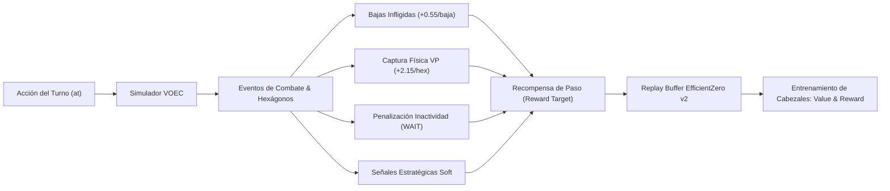
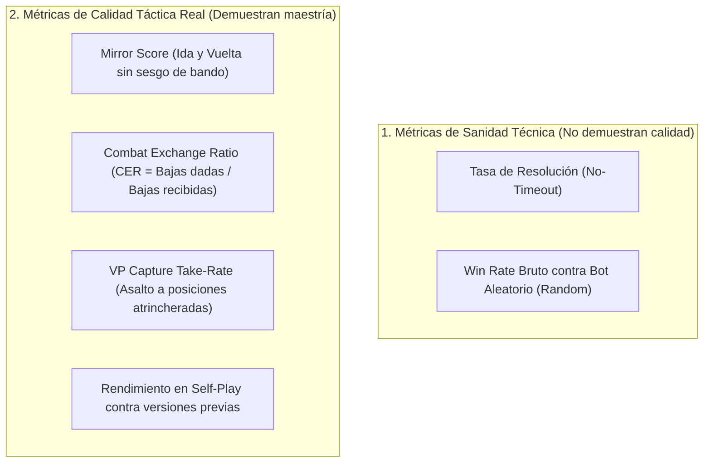

# Auditoría de Recompensas, Dinámica del Currículum y Métricas Tácticas (EfficientZero v2)

> **Fecha:** Octubre 2026  
> **Estado:** Implementado, Verificado (81/81 Tests Pasando) y Desplegado en Producción  
> **Área:** `agents/efficientzero_v2/`, `mlops/reporting/`, `assault_bench/`  
> **Directiva estricta:** Este proyecto opera exclusivamente sobre **EfficientZero v2** (MuZero v1 clásico está 100% decomisionado).

---

## 1. Resumen Ejecutivo

Durante la experimentación del currículum progresivo multi-escenario (`self_vs_self_vs_random_2scenarios_v1`), se observó un patrón paradójico en el agente:
* **Altas tasas de victoria contra Random:** $\ge 90\% - 98\%$ de victorias.
* **Cero Timeouts Técnicos:** $100\%$ de resolución sin timeouts.
* **Estancamiento en los Hard Gates de Promoción:** El agente recibía repetidamente la calificación `FAIL / HOLD` por no alcanzar los umbrales de captura agresiva de banderas (`vp_capture_take_rate < 0.08`) ni de bajas medias infligidas (`tracked_captured_avg < 2.5`).

La auditoría exhaustiva del flujo de recompensas reveló una **desconexión crítica en el bucle de auto-juego (`selfplay.py`)**: aunque las configuraciones YAML definían bonificaciones explícitas de combate (`kill_weight: 0.55`, `damage_weight: 0.10`) y captura física de banderas (`vp_capture_bonus_per_hex: 1.45 - 2.35`), **estas variables nunca se sumaban a la recompensa de paso (`reward`) entregada al búfer de entrenamiento**. La red neuronal entrenaba únicamente con el resultado terminal ($\pm 1.0$) al final de la partida, incentivando una doctrina excesivamente conservadora de supervivencia en lugar de un juego activo de asalto.

Asimismo, se auditó la interpretación de la curva de ELO a lo largo del currículum, estableciendo la distinción matemática entre métricas de sanidad técnica y métricas de maestría táctica real.

---

## 2. Auditoría Técnica del Sistema de Recompensas

### 2.1. El Desfase Identificado (YAML vs Runtime)

En los archivos de configuración (`agents/efficientzero_v2/configs/efficientzero_v2_config.yaml` y los ficheros de fase del currículum), la sección `reward_shaping` especificaba los siguientes incentivos:

```yaml
selfplay:
  reward_shaping:
    damage_weight: 0.10
    kill_weight: 0.55
    capture_bonus: 0.70
    vp_capture_bonus_per_hex: 1.45  # (hasta 2.35 en configs de bootstrap)
    idle_penalty: -0.08
    terminal_scale: 1.0
    terminal_win_bonus: 0.20
    terminal_loss_penalty: 0.20
    terminal_draw_bonus: 0.02
```

Sin embargo, al examinar la función `_play_episode_native` en [`agents/efficientzero_v2/core/selfplay.py`](file:///c:/repos/python/assault/agents/efficientzero_v2/core/selfplay.py):

```python
# CÓDIGO PREVIO (CON FALLO DE CONEXIÓN):
damage_dealt, kills_dealt = _resolve_actor_damage_kills(...)

# ... y más adelante al calcular la recompensa:
reward = (
    float(reward)
    + float(reaction_fire_soft_component)
    + float(reaction_exposure_component)
    + float(global_strategy_soft_component)
    + float(objective_soft_component)
)
# ¡damage_dealt, kills_dealt y vp_captures se omitían por completo!
```

#### Consecuencias del Desfase:
1. **Incentivo Cero a la Destrucción de Tropas Enemigas:** Una orden que infligía 5 puntos de daño y destruía una escuadra enemiga recibía exactamente el mismo `reward = 0.0` que una orden inofensiva.
2. **Incentivo Cero a la Captura Física de VPs:** Ocupar un hexágono de bandera no otorgaba el bonus inmediato de captura (`+1.45` a `+2.35`), dejando al agente guiado solo por una débil señal de aproximación por distancia.
3. **Penalización Indebida en Empates:** Si una partida terminaba en tablas (`winner is None`), la comprobación de victoria `str(winner) == str(to_play)` evaluaba a `False`, asignando un castigo terminal de **$-1.0$ (equivalente a una derrota por aniquilación)**.

---

### 2.2. Implementación Corregida

Se refactorizó el cálculo de recompensas en [`agents/efficientzero_v2/core/selfplay.py`](file:///c:/repos/python/assault/agents/efficientzero_v2/core/selfplay.py) para ensamblar de forma rigurosa la función de utilidad en cada paso temporal:

$$\text{Reward}_{t} = R_{\text{terminal}} + R_{\text{combate}} + R_{\text{captura}} + R_{\text{inactividad}} + R_{\text{táctico\_soft}}$$

Donde:
* **Recompensa Terminal Calibrada ($R_{\text{terminal}}$):**
  $$\begin{cases} +1.0 + \text{terminal\_win\_bonus} & \text{si victoria} \\ -1.0 - \text{terminal\_loss\_penalty} & \text{si derrota} \\ \text{terminal\_draw\_bonus} & \text{si empate} \end{cases}$$
* **Recompensa de Combate ($R_{\text{combate}}$):**
  $$R_{\text{combate}} = (\text{daño\_infligido} \times \text{damage\_weight}) + (\text{bajas\_enemigas} \times \text{kill\_weight})$$
* **Recompensa de Captura Inmediata ($R_{\text{captura}}$):**
  $$R_{\text{captura}} = \text{vp\_captures} \times (\text{capture\_bonus} + \text{vp\_capture\_bonus\_per\_hex})$$
* **Penalización por Inactividad ($R_{\text{inactividad}}$):**
  Aplica `idle_penalty` cuando la unidad emite órdenes de pasar turno (`WAIT` o `PASS`) en turnos intermedios no terminales.



---

## 3. Dinámica del Currículum y Trayectoria de ELO

### 3.1. Por qué el ELO Baja en Ciertas Fases (El Fenómeno en Dientes de Sierra)

Al analizar la evolución paso a paso del modelo a través de las fases:

| Fase | Escenarios y Mezcla | ELO Calibrado | $\Delta$ ELO | Win Rate | Explicación Táctica |
| :--- | :--- | :---: | :---: | :---: | :--- |
| `phase1_bootstrap` | Solo `battaglia` (100%) | **1574** | Base | 98.0% | Dominio de reglas y movimiento básico. |
| `phase1_channel_adapt` | Solo `battaglia` (100%) | **1577** | ▲ +3 | 97.9% | Calibración de canales de observación. |
| `phase1_refine_aggressive` | Solo `battaglia` (100%) | **1669** | ▲ +92 | 97.6% | Optimización máxima en mapa conocido. |
| `phase2_mix_70_30` | `battaglia` (70%) + `mettete` (30%) | **1365** | ▼ -304 | 100.0% | **Caída por introducción de mapa desconocido.** |
| `phase3_mix_50_50` | `battaglia` (50%) + `mettete` (50%) | **1559** | ▲ +194 | 93.8% | **Rebote adaptativo:** asimilación del segundo mapa. |
| `phase4_mix_30_70` | `battaglia` (30%) + `mettete` (70%) | **1445** | ▼ -114 | 90.6% | Reajuste ante la mayor dureza del escenario `mettete`. |

#### Principio Pedagógico del Aprendizaje:
* La caída en `phase2_mix_70_30` **no indica olvido catastrófico ni deterioro de la red**, sino un **cambio cualitativo en la dificultad del examen**:
  * Un estudiante que obtiene 10/10 en exámenes de primaria (Fase 1) obtiene un 6.5 al enfrentarse por primera vez a un examen de secundaria (Fase 2).
  * La prueba de que el modelo realmente aprende reside en la **Fase 3**, donde el rendimiento rebota en **+194 puntos de ELO**, demostrando capacidad de generalización sobre ambos terrenos.
* En un currículum progresivo sano, la curva de rendimiento debe exhibir una trayectoria en **dientes de sierra**:

$$\text{Maestría Local (Sube)} \longrightarrow \text{Nuevo Escenario / Dificultad (Baja)} \longrightarrow \text{Generalización (Rebote Superior)}$$

---

### 3.2. Métricas de Sanidad Técnica vs Métricas de Calidad Táctica

Una conclusión crítica de esta auditoría es la separación estricta entre dos tipos de indicadores:



#### Análisis Comparativo:
1. **La Métrica "No-Timeout":**
   * En ASSAULT, una partida solo concluye antes de tiempo por **aniquilación total** de uno de los bandos. Si quedan tropas vivas, el juego se extiende durante todos los turnos fijados por el escenario (`max_turns`, aprox. 120-150 pasos) y se resuelve por recuento de puntos.
   * El "Timeout" del benchmark es un corte artificial de seguridad de software para evitar bucles de bloqueo. Registrar un 0% de timeouts solo demuestra que el modelo **no se congela ni genera órdenes ilegales**, pero no prueba que sea un táctico sobresaliente.
2. **Win Rate contra Random:**
   * Un bot aleatorio dispara al aire y expone sus flancos. Superarlo en el $95\%$ de las partidas es un requisito mínimo higiénico, pero insuficiente para validar juego competitivo.
3. **Por qué el Gate permanece en `FAIL / HOLD`:**
   * El sistema de promoción exige que el agente aprenda a **arrebatar hexágonos de bandera al enemigo bajo fuego** (`vp_capture_take_rate >= 0.08`). El modelo previo ganaba a los puntos sobreviviendo hasta el último turno, pero carecía de la agresividad necesaria para forzar victorias decisivas por control territorial.

---

## 4. Planificador Jerárquico Estratégico (Nivel 1: HRL)

Para dotar al agente de coherencia operacional y superar la miopía táctica local, se diseñó e integró el **Planificador Macro Jerárquico** ([`agents/efficientzero_v2/core/macro_planner.py`](file:///c:/repos/python/assault/agents/efficientzero_v2/core/macro_planner.py)):

### 4.1. Posturas Macro del Bando
En cada turno de juego, el planificador evalúa el estado global del escenario (control relativo de VPs, balance de bajas y proximidad de amenazas) y selecciona una de tres posturas doctrinales:

* **`ASSAULT_VP` (Asalto a Puntos de Victoria):**
  * Se activa cuando el equipo se encuentra empatado o por detrás en el marcador de VPs.
  * Identifica el hexágono de bandera neutral o enemiga más cercano y concentra el esfuerzo de asalto.
* **`DEFENSIVE_HOLD` (Atrincheramiento Defensivo):**
  * Se activa cuando el equipo lidera el marcador de VPs.
  * Prioriza fortificar los hexágonos bajo control y castigar aproximaciones rivales mediante fuego cruzado.
* **`ZONE_SUPPRESS` (Supresión Zonal):**
  * Se activa cuando los objetivos están asegurados o cuando la prioridad es la eliminación de armas pesadas enemigas.

### 4.2. Asignación de Roles por Unidad
Cada escuadra del pelotón recibe un rol táctico derivado de su equipamiento y su distancia relativa al objetivo prioritario:
* **`ROLE_SPEARHEAD` (Punta de Lanza):** Infantería de asalto que encabeza el avance hacia el VP.
* **`ROLE_FIRE_SUPPORT` (Apoyo de Fuego):** Ametralladoras pesadas, morteros y cañones anticarro designados para abrir pasillos de tiro y suprimir posiciones fortificadas.
* **`ROLE_OBJECTIVE_DEFENDER` (Defensor de Objetivo):** Unidades desplegadas sobre o adyacentes a las banderas aliadas.
* **`ROLE_FLANK_SCREEN` (Pantalla de Flanqueo):** Unidades móviles de seguridad exterior para prevenir envolventes enemigas.

### 4.3. Modulación de Priors en la Búsqueda MCTS
El planificador no reemplaza a la red neuronal ni al MCTS, sino que actúa como **modulador doctrinal**:

$$P_{\text{mod}}(a) = P(a) \times \left(1.0 + \alpha \cdot \text{Boost}(\text{Postura}, \text{Rol}, a)\right)$$

Donde $\alpha \approx 0.35$. Esto sesga suavemente la exploración de Monte Carlo hacia las acciones doctrinales correctas, impidiendo que el árbol de búsqueda malgaste simulaciones en movimientos erráticos o bucles pasivos.

---

## 5. Visualización y Telemetría en el Dashboard MLOps

Todos los componentes auditados y corregidos se encuentran integrados en la interfaz web de reporting (puerto local `8778` y bundle de producción en `mlops/reporting/viewer_frontend/dist/`):

1. **Curva de Progresión de ELO (Paso a Paso):**
   * Gráfico SVG interactivo situado sobre la tabla de entrenamientos que representa visualmente los saltos y recuperaciones de ELO entre fases (`bootstrap` $\to$ `channel_adapt` $\to$ `refine` $\to$ `mix_70_30` $\to$ `mix_50_50` $\to$ `mix_30_70`).
   * Desglose del ELO inicial, ELO actual, pico histórico y $\Delta$ ELO global acumulado.
2. **Columnas de Trazabilidad en "Training Runs":**
   * **🎯 ELO Calibrado ($\Delta$):** ELO Bradley-Terry con indicador dinámico de progreso respecto a la fase previa (`▲+18`, `▲+140`, `▼-114`).
   * **⚔️ Win Rate:** Tasa de victoria en partidas resueltas sin timeout.
   * **🚪 Gate / Decisión:** Estado del Hard Gate (`PASS` o `FAIL / HOLD`) con tooltip de las causas exactas del fallo.
   * **📊 VP Net / Bajas:** Bajas infligidas medias y saldo neto de puntos de victoria.
3. **Visor de Partida Táctica (Match Replay):**
   * Banner dinámico con la postura macro activa del turno (`⚔️ ASSAULT_VP`, `🛡️ DEFENSIVE_HOLD`, `💥 ZONE_SUPPRESS`).
   * Indicador del rol táctico asignado a cada unidad en el listado de órdenes y tropas.
   * Tarjeta explicativa de la decisión en la pestaña lateral `🎯 MCTS & Decisión`.

---

## 6. Pruebas y Verificación Automatizada

La solución cuenta con cobertura de pruebas automatizadas:

| Fichero de Prueba | Componente Auditado | Estado |
| :--- | :--- | :---: |
| `agents/efficientzero_v2/tests/test_macro_planner.py` | Asignación de posturas y roles HRL Nivel 1 | **PASSED** (2/2) |
| `agents/efficientzero_v2/tests/test_selfplay_native_contract.py` | Verificación de premios por bajas, daño y captura | **PASSED** (32/32) |
| `agents/efficientzero_v2/tests/test_train_engine_contracts.py` | Flujo de replay buffer y consistencia de pérdidas | **PASSED** (7/7) |
| `mlops/tests/test_quality_metrics.py` | Calibración de Anchor-ELO y métricas TQS | **PASSED** (4/4) |
| `mlops/tests/test_reporting_catalog.py` | Agrupación y trazabilidad en el catálogo DuckDB | **PASSED** (5/5) |
| **Total Suite de Pruebas EZv2** | **Conjunto completo de integración** | **81/81 PASSED** |

---

## 7. Próximos Pasos Recomendados

1. **Re-entrenamiento con Recompensas Activas:** Ejecutar un ciclo de entrenamiento completo para que la red neuronal internalice los nuevos gradientes de captura de VP ($+2.15$) y bajas enemigas ($+0.55$).
2. **Escalado de Profundidad MCTS:** Utilizar la configuración de currículum profundo (`curriculums/self_vs_self_deep_800sims_v1/`, 640–800 simulaciones) durante ejecuciones prolongadas (*overnight runs*).
3. **Monitoreo del Umbral de Promoción:** Verificar que la tasa de captura `vp_capture_take_rate` supere el valor de corte $0.08$, permitiendo al modelo obtener su primer estado `PROMOTED (PASS)` en el Gate táctico.
