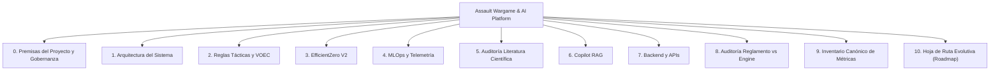

# Portal Canónico de Documentación — Assault Wargame & AI Platform

Bienvenido al portal oficial de documentación técnica del proyecto **Assault**, plataforma integral de simulación táctica militar por turnos sobre tablero hexagonal e inteligencia artificial militar basada en **EfficientZero V2**.

> [!NOTE]
> **Arquitectura Activa:** Todo el entrenamiento, autojuego, inferencia y MCTS operan exclusivamente sobre **EfficientZero V2** (`agents/efficientzero_v2/`). El stack legacy MuZero v1 se encuentra 100% decomisionado.

---

## 🗺️ Mapa de Navegación del Sistema

---

## 📚 Módulos Canónicos de Documentación

### 0. [Premisas del Proyecto: Diseño, Arquitectura y Gobernanza](00_PREMISAS_DEL_PROYECTO.md)
* **Marco Maestro de Diseño:** SSoT, decomisión estricta de MuZero, EfficientZero V2 como agente exclusivo.
* **Economía de Hardware:** Viabilidad en GPU doméstica mediante MCTS latente, reanálisis off-policy y AMP FP16.
* **Teoría de Palancas (Nudges):** Andamiaje conductual (*scaffolding*) sin anular la exploración ni la emergencia táctica.
* **Nivel 0 Estratégico:** Perfilado vectorial 5D de tropas (OOB) e inteligencia topográfica de chokepoints (IPB).
* **Instrumentación Fiel y Auditorías:** Manifiesto de cero invención en dashboards y protocolos de calidad anti-regresión.

### 1. [Arquitectura del Sistema](01_ARQUITECTURA_DEL_SISTEMA.md)
* **Principios de diseño:** Desacoplamiento estricto por contratos entre capas.
* **Subsistemas:** `assault_model` (reglas puras autoritativas), `voec_sim` (observación sensorial y simulación), `agents/efficientzero_v2` (red neuronal e inferencia MCTS) y `mlops` (telemetría y linaje).
* **Ciclo de vida:** Flujo de autojuego (*self-play*), reincorporación a buffer de repeticiones y entrenamiento distribuido.

### 2. [Modelo del Juego y Reglas Tácticas](02_MODELO_DEL_JUEGO_Y_REGLAS_TACTICAS.md)
* **Geometría hexagonal:** Coordenadas axiales $(q, r)$, métricas de distancia y adyacencia.
* **Terreno y balística:** Catálogo de terrenos, cobertura, cálculo 3D de Línea de Visión (LOS) y Niebla de Guerra (*POMDP*).
* **Mecánica de combate:** Dados de batalla (Rojo, Azul, Verde, Amarillo), tiradas de salvación y asignación de bajas.
* **Psicología militar:** Estados de cohesión y moral (`NORMAL`, `PINNED`, `SUPPRESSED`, `ROUTED`), fuego de reacción (*Opportunity Fire*) y combate cerrado (*Close Combat*).

### 3. [Red Neuronal y Algoritmo EfficientZero V2](03_RED_NEURONAL_EFFICIENTZERO_V2.md)
* **Modelo de mundo recurrente:** Funciones de representación $h_\theta$, dinámica $g_\theta$, predicción $f_\theta$ y consistencia temporal $q_\theta$.
* **Convoluciones hexagonales:** `HexagonalMaskConv2d` para eliminación de artefactos direccionales espurios.
* **Cabezas auxiliares:** Mapa 2D de amenazas (`threat_map`), balance de bajas (`attrition`) y estimación de cohesión (`morale`).
* **Representaciones de valor:** Two-Hot simétrico, **HL-Gauss** (*Histogram Loss with Gaussian Targets*, DeepMind 2024) y compresión **Symlog**.
* **HRL y optimización:** Planificador jerárquico Macro (Nivel 1), búsqueda MCTS PUCT / Gumbel y balanceo de gradientes mediante **PCGrad**.

### 4. [Plataforma MLOps, Telemetría y Reporting](04_PLATAFORMA_MLOPS_Y_TELEMETRIA.md)
* **Almacenamiento analítico:** Registro columnar de partidas en Apache Parquet y base de datos OLAP **DuckDB**.
* **Puertas de promoción:** Reglas automatizadas (*Promotion Gates*) para validación de checkpoints contra baselines.
* **Visor Web MLOps (Puerto 8778):** Catálogo de modelos, simulador de unroll del espacio latente, atribución de canales y reproductor paso a paso de partidas (*Match Replay*).

### 5. [Auditoría Científica: Hex-Wargame AI (Palma et al. 2025) vs. Assault](06_LITERATURE_AUDIT_CHANNELS_HEADS_TACTICS.md)
* **Estudio comparativo exhaustivo:** Evaluación frente al paper seminal de Palma et al. (Feb 2025 / arXiv:2502.13918v1), literatura SOTA (DeepMind, Sabatelli, Bohr, Willcox) y tratados doctrinales (*Understanding Wargames*, *Wargaming Handbook*, *The Wargaming Compendium*).
* **Módulo de aprendizaje:** Model-Based EfficientZero V2 vs. Model-Free AlphaZero con RNNs; análisis de muestra-eficiencia y ratios de convergencia.
* **Profundidad táctica:** Wargame militar VOEC (balística real, blindaje direccional, moral, supresión, overwatch) vs. Simple Conflict Simulation (SCS).

### 6. [Sistema RAG Copilot y Explicabilidad Normativa](06_SISTEMA_RAG_COPILOT.md)
* **Base de conocimiento unificada:** 114 fragmentos de reglamento y 24 fragmentos de catálogo técnico en `assault_rag/`.
* **Motor de búsqueda híbrido:** BM25 balanceado con scoring por relevancia de sección y normalización bilingüe.
* **Servicios tácticos:** Consultas normativas (`rag_query`), reporte de situación (`explain_game_situation` SitRep en vivo), recomendaciones tácticas consultivas y análisis de partidas.
* **Motor generativo dual:** Soporte para LLM local (Ollama `qwen2.5:14b`) con fallback extractivo instantáneo de alta precisión.

### 7. [Servicios Backend y Catálogo de APIs](07_SERVICIOS_BACKEND_Y_CATALOGO_APIS.md)
* **Documentación interactiva OpenAPI:** [Swagger UI](http://127.0.0.1:8001/docs) y [ReDoc](http://127.0.0.1:8001/redoc).
* **Servicio de Simulación Táctica (`:8001`):** Endpoints REST para ciclos de juego, combate y canal bidireccional WebSocket (`/ws/game`) con streaming binario MessagePack (`?format=msgpack`).
* **Servicio RAG Copilot (`/api/rag/*`):** Endpoints de asistencia, consulta normativa y estado del LLM.
* **Servicio de Telemetría MLOps (`:8778`):** DuckDB REST API, visor de métricas y servidor de documentación estática integrada.

### 8. [Auditoría Exhaustiva: Reglamento Oficial vs. Engine y Escenarios](08_AUDITORIA_REGLAMENTO_VS_ENGINE.md)
* **Auditoría página a página del Manual de Reglas:** 52 páginas del *Rulebook rev6* auditadas respecto a `assault_model/`.
* **Auditoría del Compendio de Escenarios:** Análisis de los 38 escenarios oficiales (26 de la Campaña de Gela + 12 Standalone) frente al catálogo modelado en JSON.

### 9. [Inventario Jerárquico Canónico de Métricas y Registro Experimental](13_INVENTARIO_CANONICO_METRICAS.md)
* **Taxonomía en 4 Niveles:** Desglose estricto de métricas del Motor, Búsqueda MCTS, Red Neuronal y Benchmarks MLOps.
* **Gobernanza Cero-Invención (Zero-Mock):** Definición matemática formal y origen unívoco para cada campo en Parquet y DuckDB.
* **Plan de Purgado de Redundancias:** Consolidación de campos duplicados y optimización de sobrecarga de sondas.

### 10. [Hoja de Ruta Evolutiva: Assault Architecture Roadmap (2024–2026)](05_ROADMAP_EVOLUTIVO.md)
* **Hitos consolidados (Fases 1–6):** Cimentación VOEC, cabezas auxiliares, HL-Gauss + Symlog, Macro-Planner HRL, motor de reglas completo (5.1–5.4), vectorización Numba/NumPy (`4,924 steps/s`), clonado transaccional Copy-on-Write (`109,626 clones/s`), telemetría binaria MessagePack y matriz de 16 contribuciones SOTA/Doctrinales completadas al 100%.
* **Hoja de Ruta de Trabajo Pendiente Unificada:** Punto único de verdad para las líneas abiertas de investigación IA (Currículum 5 etapas, Gumbel Search, Transformer World Model) y el Plan de Paridad 100% del Reglamento Oficial (Sección 6.4 y Fases A, B y C).

---

## 🚀 Servicios en Vivo y Puertos Locales

| Servicio | Puerto | Descripción | URL Directa |
| :--- | :---: | :--- | :--- |
| **Documentación Central** | `8778` | MkDocs Material Portal Canónico | [http://127.0.0.1:8778/docs/](http://127.0.0.1:8778/docs/) |
| **Visor Web MLOps** | `8778` | Dashboard de modelos, métricas y replays | [http://127.0.0.1:8778/](http://127.0.0.1:8778/) |
| **Backend Táctico FastAPI** | `8001` | API de simulación, combate y RAG | [http://127.0.0.1:8001/docs](http://127.0.0.1:8001/docs) |
| **Simulador UI (Vite / React)** | `5173` | Tablero hexagonal interactivo | [http://127.0.0.1:5173/](http://127.0.0.1:5173/) |
