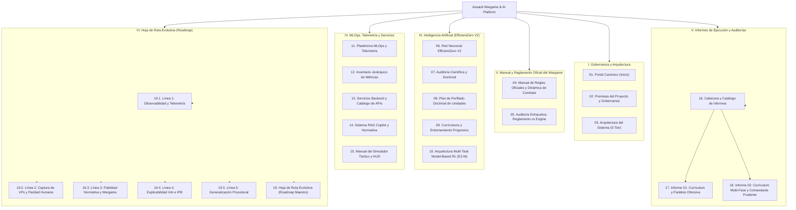

# Portal Canónico de Documentación — Assault Wargame & AI Platform

Bienvenido al portal oficial de documentación técnica del proyecto **Assault**, plataforma integral de simulación táctica militar por turnos sobre tablero hexagonal e inteligencia artificial militar basada en **EfficientZero V2**.

> [!NOTE]
> **Arquitectura Activa:** Todo el entrenamiento, autojuego, inferencia y MCTS operan exclusivamente sobre **EfficientZero V2** (`agents/efficientzero_v2/`). El stack legacy MuZero v1 se encuentra 100% decomisionado y obsoleto.

---

## 🎖️ Componentes y Activos Visuales Canónicos del Wargame Físico

La plataforma *Assault* reproduce fielmente el juego de mesa táctico sobre tablero hexagonal (*Assault: Sicily 1943*). Todos los modelos de redes neuronales, el motor autoritativo de reglas y los visualizadores operan sobre estos componentes reales:

  

    
    
🇺🇸 Tarjeta de Unidad: US Rangers 43 Perfil Balístico, Cohesión y Moral

  

  

    
    
🇩🇪 Tarjeta de Unidad: Fallschirmjäger Armas Combinadas y Trait TOUGH

  

  

    
    
🇮🇹 Tarjeta de Unidad: Breda Mod. 37 Ametralladora Pesada Colectiva

  

  

    
    
📜 Carta de Formación: US 1st Ranger Command Points (CP) y OOB Táctico

  

  

    
    
Ficha Hexagonal US Rangers 43

  

  

    
    
Ficha Hexagonal Panzer IV Ausf. G

  

  

    
    
Ficha Hexagonal Breda MMG

  

  

    
    
🔴 Dado Rojo Balística AT / HE

  

  

    
    
🟢 Dado Verde Fusilería Ligera

  

  

    
    
⚠️ Chevron Estado Status Suppressed

  

  

    
    
🔥 Marcador Acción firing.png

  

  

    
    
🗺️ Tablero Modular P1: Campo Abierto y Desembarco (mettete_i_piedi_terra_1)

  

  

    
    
🗺️ Tablero Modular P2: Asalto Urbano y Calles (battaglia_cittadina_2_1)

  

---

## 🗺️ Mapa Jerárquico de Navegación del Sistema

---

## 📚 Estructura Temática de Documentación Canónica

### I. Gobernanza y Arquitectura del Sistema
* 🏛️ [**01. Portal Canónico (Inicio)**](index.md): Mapa de navegación del sistema, índice general de módulos y catálogo de servicios activos.
* 📜 [**02. Premisas del Proyecto y Gobernanza**](00_PREMISAS_DEL_PROYECTO.md): Marco maestro de diseño: límites HW, economía de GPU, teoría de palancas (nudges) en RL, nivel 0 doctrinal, instrumentación y calidad.
* 🏗️ [**03. Arquitectura del Sistema (5-Tier)**](01_ARQUITECTURA_DEL_SISTEMA.md): Visión general desacoplada por contratos entre capas (`assault_model`, `voec_sim`, `agents/efficientzero_v2` y `mlops`).

### II. Manual y Reglamento Oficial del Wargame (Sound of Drums rev6)
* 🎲 [**04. Manual de Reglas Oficiales y Dinámica de Combate**](02_MODELO_DEL_JUEGO_Y_REGLAS_TACTICAS.md): Reglamento canónico oficial del wargame físico: geometría hexagonal, costes de terreno, intervisibilidad (LOS), dados de combate (Rojo, Azul, Verde, Amarillo), estados de moral, fuego de reacción, asalto, zapadores, catálogo de formaciones y retirada en desenfilada.
* ⚖️ [**05. Auditoría Exhaustiva: Reglamento Oficial vs. Engine**](08_AUDITORIA_REGLAMENTO_VS_ENGINE.md): Auditoría exhaustiva página a página del *Rulebook rev6* (52 páginas) y compendio oficial de 38 escenarios de combate.

### III. Inteligencia Artificial Militar (EfficientZero V2)
* 🧠 [**06. Red Neuronal EfficientZero V2**](03_RED_NEURONAL_EFFICIENTZERO_V2.md): Modelo de mundo recurrente ($h_\theta, g_\theta, f_\theta, q_\theta$), convoluciones hexagonales, cabezas tácticas auxiliares, Two-Hot, HL-Gauss, Symlog y PCGrad.
* 🔬 [**07. Auditoría Literatura Científica y Doctrinal**](06_LITERATURE_AUDIT_CHANNELS_HEADS_TACTICS.md): Comparativa Palma et al. (2025), literatura DeepMind (AlphaStar, AlphaZero), Clausewitz, Sun Tzu y análisis formal de la Paradoja del Comandante Prudente.
* 🎖️ [**08. Plan Estratégico de Perfilado Doctrinal de Unidades**](14_PLAN_PERFILADO_UNIDADES_IA.md): Arquitectura doctrinal 3 capas, mutación contextual adaptativa, OOB y observabilidad en MLOps.
* 🎯 [**09. Currículums y Entrenamiento Progresivo**](15_CURRICULUMS_Y_ENTRENAMIENTO_PROGRESSIVO.md): Currículum acelerado de VPs, currículum multi-escenario y puertas de calidad dinámicas (*Dynamic Gates*).
* 🌐 [**10. Arquitectura Multi-Task Model-Based RL (EZ-M)**](17_EFFICIENTZERO_MULTITASK_EZ_M_ARQUITECTURA.md): Extensión multitarea simultánea: dinámica recurrente invariante $g_\theta$, modulación FiLM por escenario, buffer estratificado y cirugía PCGrad.

### IV. MLOps, Telemetría y Servicios Backend
* 📊 [**11. Plataforma MLOps y Telemetría**](04_PLATAFORMA_MLOPS_Y_TELEMETRIA.md): Almacenamiento columnar Parquet, base de datos analítica DuckDB, Promotion Gates y visor web interactivo en puerto 8778.
* 📐 [**12. Inventario Jerárquico Canónico de Métricas**](13_INVENTARIO_CANONICO_METRICAS.md): Taxonomía estricta de 4 niveles, origen autoritativo, manifiesto cero-invención y plan de purgado de redundancias.
* ⚡ [**13. Servicios Backend y Catálogo de APIs**](07_SERVICIOS_BACKEND_Y_CATALOGO_APIS.md): Endpoints REST FastAPI (:8001), streaming WebSocket binario MessagePack y documentación interactiva [Swagger UI](http://127.0.0.1:8001/docs) y [ReDoc](http://127.0.0.1:8001/redoc).
* 🤖 [**14. Sistema RAG Copilot y Asistente Normativo**](06_SISTEMA_RAG_COPILOT.md): Base de conocimiento vectorial/BM25, SitRep en vivo, explicabilidad normativa y motor LLM local.
* 🕹️ [**15. Manual del Simulador Táctico y HUD (:5173)**](09_MANUAL_SIMULADOR_TACTICO_HUD.md): Arquitectura Modern Tactical Wargame HUD, mapa full-bleed 100%, barra de mando superior, carrusel OOB, cajón táctico lateral y modo inmersivo.

### V. Informes de Ejecución y Auditorías Forenses
* 📋 [**16. Informes de Ejecución: Cabecera y Catálogo**](informes_ejecucion/00_CABECERA_INFORMES_EJECUCION.md): Protocolo de auditoría forense, taxonomía TQS y repositorio centralizado de informes.
* 📑 [**17. Informe 01: Currículum y Diagnóstico de Parálisis Ofensiva**](informes_ejecucion/INFORME_01_CURRICULUM_Y_AUDITORIA_TACTICA.md): Auditoría de 31 ciclos, diagnóstico de aversión al riesgo en rol atacante, telemetría legacy y plan de mitigación.
* 📈 [**18. Informe 02: Currículum Multi-Fase y Comandante Prudente**](informes_ejecucion/INFORME_02_CURRICULUM_Y_AUDITORIA_TACTICA.md): Evaluación de 34 ejecuciones post-estandarización, primera victoria en campo abierto y caracterización formal de la Paradoja del Comandante Prudente.

### VI. Hoja de Ruta Evolutiva (Roadmap)
#### Líneas Estratégicas Modulares:
* 🔴 [**19.1. Línea 1: Garantía de Instrumentos y Observabilidad Fiel**](roadmap/01_LINEA_1_OBSERVABILIDAD_Y_TELEMETRIA.md): Conformidad de esquema, profiler de sondas zero-mock, validador E2E y depuración de redundancias.
* 🔴 [**19.2. Línea 2: Aceleración de Captura de VPs y Paridad Humana**](roadmap/02_LINEA_2_ACELERACION_CAPTURA_VPS.md): Recompensa por potencial radial a VP, sesgo prior MCTS, urgencia temporal, paquete de aceleración y currículum ofensivo.
* 🟢 [**19.3. Línea 3: Fidelidad Normativa y Reglamento Oficial del Wargame**](roadmap/03_LINEA_3_FIDELIDAD_NORMATIVA_Y_REGLAMENTO.md): Retirada en desenfilada 6.4, Dig-in, Humo, Transporte, formaciones combinadas y mitigación 3.6.
* 🟢 [**19.4. Línea 4: Explicabilidad Máxima (XAI), Perfilado Causal e IPB**](roadmap/04_LINEA_4_EXPLICABILIDAD_XAI_E_IPB.md): Atribución causal IGNH/GradCAM, perfilador forense, análisis de chokepoints IPB y perfilado doctrinal.
* 🔵 [**19.5. Línea 5: Generalización Procedural y Robustez en Terrenos Abiertos**](roadmap/05_LINEA_5_GENERALIZACION_PROCEDURAL.md): Mutación procedural con clumping geográfico y validación Zero-Shot en mapas 32x32 y 64x64.
* 📦 [**19.6. Historial de Versiones e Hitos Consolidados**](HISTORIAL_VERSIONES_COMPLETADAS.md): Registro oficial inmutable de entregas, changelog técnico cronológico por versiones (v1.0.0 a v2.5.3) y tareas consolidadas.

#### Documento Coordinador Maestro:
* 🗺️ [**19. Hoja de Ruta Evolutiva (Roadmap Maestro)**](05_ROADMAP_EVOLUTIVO.md): Visión ejecutiva, matriz maestra global, orden de ejecución inmediato y priorización evolutiva activa.

---

## 🚀 Servicios en Vivo y Puertos Locales

| Servicio | Puerto | Descripción | URL Directa |
| :--- | :---: | :--- | :--- |
| **Documentación Central** | `8778` | MkDocs Material Portal Canónico | [http://127.0.0.1:8778/docs/](http://127.0.0.1:8778/docs/) |
| **Visor Web MLOps** | `8778` | Dashboard de modelos, métricas y replays | [http://127.0.0.1:8778/](http://127.0.0.1:8778/) |
| **Backend Táctico FastAPI** | `8001` | API de simulación, combate y RAG | [http://127.0.0.1:8001/docs](http://127.0.0.1:8001/docs) |
| **Simulador UI (Vite / React)** | `5173` | Tablero hexagonal interactivo | [http://127.0.0.1:5173/](http://127.0.0.1:5173/) |
| **Prefect Orchestrator** | 4200 | Dashboard y panel de control de flujos Prefect | [http://127.0.0.1:4200/](http://127.0.0.1:4200/) |
| **Editor de Unidades** | `8780` | Editor GUI de cartas y atributos balísticos | [http://127.0.0.1:8780/](http://127.0.0.1:8780/) |
