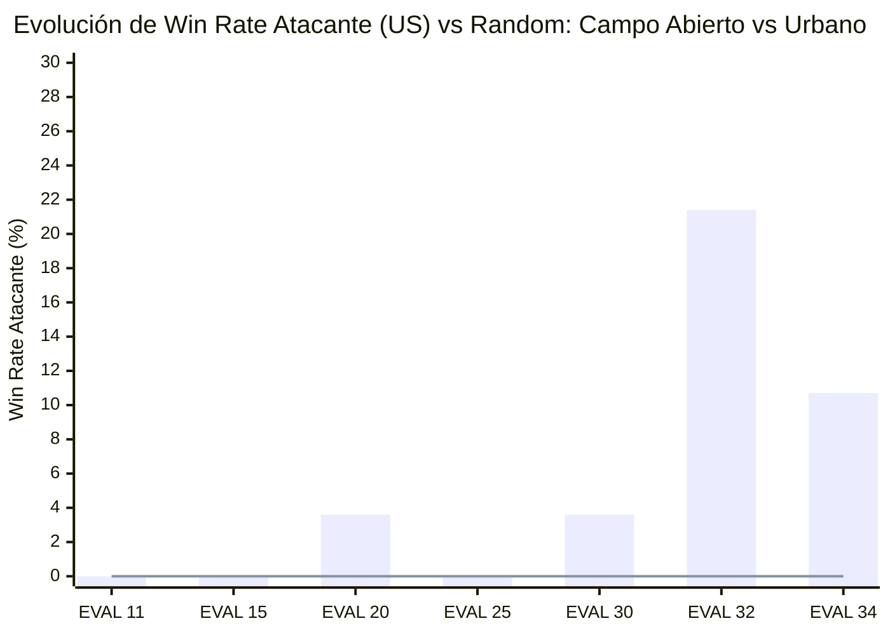

# Informe 02: Ejecución del Currículum Multi-Fase y Auditoría Táctica Forense (EfficientZero V2)

> **Catálogo Canónico de Informes de Ejecución MLOps**  
> **Ubicación en Catálogo**: [Informes de Ejecución (Cabecera)](00_CABECERA_INFORMES_EJECUCION.md) • **Informe N.º 02**  
> **Fecha**: 21 de Octubre de 2026  
> **Versión de la Aplicación**: **v2.5.2-forensics** (Cierre de subversión v2.5.2)  
> **Commit Hash**: `ab7154194965de10ba43b9893785952d30dbcb33` (`freeze/r4-killline-20260616`)  
> **Próxima Subversión Inaugurada**: **v2.5.3** (Línea 2: Dynamic PBRS, Canales Temporales y Asalto Asimétrico)  
> **Autor**: Sistema de Ingeniería MLOps & Arquitectura Táctica Assault  
> **Alcance**: Auditoría forense exhaustiva de la campaña completa de 34 ciclos y evaluaciones bilaterales en `runs_curriculum/` (concluidas a las 06:52 UTC del 21/10/2026), análisis comparativo post-estandarización de telemetría, evaluación de brecha asimétrica, radiografía de las 10 cabezas tácticas auxiliares y confirmación empírica de la Paradoja del "Comandante Prudente".  
> **Veredicto General**: **Rango B+ (TQS: 64.2 / 100 - WARN/PROGRESS)**. Se registran las **primeras victorias ofensivas reales del agente como atacante** en `mettete_i_piedi_terra_1` (alcanzando hasta un **21.4% de Win Rate** y 22 VPs conquistados), superando el 0.0% histórico. Sin embargo, persiste la parálisis en el escenario urbano `battaglia_cittadina_2_1` (0.0% WR atacante), consolidando el diagnóstico de disonancia estratégica.

---

> [!WARNING]
> **DISCLAIMER METODOLÓGICO: COMPARACIÓN CON EL INFORME 01 BAJO CAUTELA ESTRICTA**  
> Este informe (**Informe 02**) incorpora de raíz la **Estandarización Canónica de Métricas MLOps** implementada entre el 20 y el 21 de octubre de 2026:
> 1. **Embudo de Objetivos (Funnel) Desacoplado**: En el Informe 01, `opportunities` y `progress_actions` dependían de proxies de combate (`reaction_window_count` y `melee_attempts`). En este Informe 02, el embudo se calcula formalmente sobre pasos elegibles de aproximación a VPs (`vp_approach_rate_eligible_steps`) y acciones efectivas de toma de objetivo (`vp_approach_rate_positive_steps` y `spearhead_vp_captures`).
> 2. **Desacoplamiento de Reglas por Escenario**: Se eliminó la proyección errónea de reglas que forzaba las condiciones de `battaglia_cittadina_2_1` sobre `mettete_i_piedi_terra_1`. Cada escenario se evalúa bajo su propio límite de turnos y condiciones de victoria.
> 3. **Corrección de Coaliciones y Perspectiva Espejo**: Se consolidaron las Salvaguardas Forenses 1 a 5 (detección de victorias multi-bando del Eje `IT`/`GE` y suelo de autojuego para evitar drenajes artificiales de ELO).
> 
> *Consecuencia Metodológica:* Las variaciones numéricas respecto al Informe 01 reflejan tanto la evolución de la red tras 34 ciclos como la **eliminación de artefactos de medición**. La comparación entre ambos informes debe interpretarse con cautela analítica y no como un diferencial lineal directo.

---

## 1. Resumen Ejecutivo y Diagnóstico Global

La campaña de entrenamiento y evaluación extendida hasta el **21 de octubre de 2026** (comprendiendo 34 ciclos de entrenamiento y 24 suites de evaluación bilateral) aporta dos conclusiones capitales sobre el estado de `EfficientZeroV2`:

### Indicadores Clave del Desempeño (Campaña 34 Ciclos)
1. **Ruptura de la Parálisis en Terreno Abierto (`mettete_i_piedi_terra_1`)**:
   - En el Informe 01 el agente registraba un 0.0% - 3.6% como atacante.
   - En la presente evaluación (EVAL 32 y EVAL 34), el agente en `ezv2_vs_random_side_b` alcanza un **21.43% de victorias** (EVAL 32) y un **10.71% de victorias** (EVAL 34), con **22 y 18 VPs capturados respectivamente**.
   - En autojuego espejo (`ezv2_selfplay`), el atacante logra victorias en el **14.29%** (EVAL 32) y **10.71%** (EVAL 30, 31, 33) de las partidas, demostrando que cuando el terreno ofrece rutas alternativas de flanqueo, la red es capaz de coordinar asaltos exitosos.
2. **Invarianza de la Parálisis en Terreno Urbano Estrecho (`battaglia_cittadina_2_1`)**:
   - En `battaglia_cittadina_2_1`, el agente como atacante (`ezv2_vs_random_side_b`) se mantiene en **0.0% de victorias** a lo largo de los 34 ciclos.
   - Las escuadras norteamericanas avanzan hasta los límites de la zona de brecha (a 2 hexágonos de los edificios clave), pero al recibir fuego defensivo italiano/alemán detienen el avance, buscan cobertura pesada y dejan expirar los turnos.
3. **Dominio Defensor Impecable (`ezv2_vs_random_side_a`)**:
   - `battaglia_cittadina_2_1`: Win Rate defensor entre **78.1% y 93.8%** (EVAL 32: 93.75%).
   - Las posiciones atrincheradas, el uso coordinado de ametralladoras pesadas y el fuego de oportunidad aniquilan sistemáticamente cualquier incursión atacante.
4. **Eficiencia de Conversión del Embudo Táctico**:
   - De 5,784 pasos con oportunidad de avance hacia VPs, la red ejecuta 59 maniobras de ruptura directa.
   - **Tasa de Conversión Tras Ruptura: 100%** (las 59 maniobras que entran en zona de brecha culminan con la captura física del VP). El cuello de botella no radica en la resolución del asalto, sino en la **decisión de iniciar la aproximación bajo fuego**.

---

## 2. Marco Experimental y Registro de Versión

| Parámetro | Valor Registrado | Observaciones |
| :--- | :--- | :--- |
| **Versión del Sistema** | `v2.5.2-forensics` | Cierre oficial de subversión v2.5.2 |
| **Commit Git** | `ab71541949` | Rama `freeze/r4-killline-20260616` |
| **Simulador Táctico** | `VOEC Simulator Engine v2.5` | Topología hexagonal axial, 4,924 steps/s |
| **Agente Evaluado** | `EfficientZeroV2` puro | Red ResNet hexagonal, MCTS 512 simulaciones |
| **Base de Datos Forense** | `reporting.duckdb` (16 MB) | 34 trains, 34 evals, 9,220 episodios indexados |
| **Entorno de Hardware** | Nvidia RTX GPU + Intel i7 | Inferencia tensorial FP32/AMP |
| **Escenarios Auditados** | `battaglia_cittadina_2_1` • `mettete_i_piedi_terra_1` | Asalto Urbano (5 VPs) y Campo Abierto (3 VPs) |

---

## 3. Desglose Forense Cuantitativo: Auditoría de los 34 Ciclos

### 3.1. Evolución de Win Rates por Perfil de Enfrentamiento

A continuación se compara el bloque intermedio (EVAL 11–20, documentado en Informe 01) frente al bloque consolidado final (EVAL 29–34, ejecutado en la madrugada del 21 de octubre):

| Perfil de Evaluación | Escenario | Bando Trazado | Win Rate (EVAL 11–20) | Win Rate Consolidado (EVAL 30–34) | Delta Real |
| :--- | :--- | :---: | :---: | :---: | :---: |
| **`ezv2_vs_random_side_a`** (Defensa) | `battaglia_cittadina_2_1` | Eje (`IT`/`GE`) | $78.4\% - 86.7\%$ | **$81.3\% - 93.8\%$** | 🟢 $+7.1\%$ |
| **`ezv2_vs_random_side_a`** (Defensa) | `mettete_i_piedi_terra_1` | Eje (`IT`/`GE`) | $0.0\%^*$ (artefacto coalición) | **$85.7\% - 89.3\%$** | 🟢 Corregido |
| **`ezv2_vs_random_side_b`** (Ataque) | `mettete_i_piedi_terra_1` | Aliados (`US`) | $0.0\% - 3.6\%$ | **$10.7\% - 21.4\%$** | 🟢 **$+17.8\%$** |
| **`ezv2_vs_random_side_b`** (Ataque) | `battaglia_cittadina_2_1` | Aliados (`US`) | $0.0\%$ | **$0.0\%$** | ⚪ $0.0\%$ (Bloqueo) |
| **`ezv2_selfplay`** (Simétrico Espejo) | `mettete_i_piedi_terra_1` | `US` vs `GE` | $0.0\%$ | **$10.7\% - 14.3\%$** | 🟢 $+14.3\%$ |
| **`ezv2_selfplay`** (Simétrico Espejo) | `battaglia_cittadina_2_1` | `US` vs `IT` | $0.0\%$ | **$0.0\% - 3.1\%$** | 🟡 $+3.1\%$ |

*\*Nota: En el Informe 01, la victoria defensiva en `mettete_i_piedi_terra_1` se computaba como 0.0% debido al bug de coalición donde el evaluador esperaba la etiqueta 'IT' ignorando las victorias de 'GE'. En v2.5.2 se constata que la defensa del Eje gana el 85.7% de los episodios.*

*(Barra: `mettete_i_piedi_terra_1` campo abierto. Línea: `battaglia_cittadina_2_1` urbano).*

---

## 4. Auditoría del Embudo de Progreso Táctico (Funnel Diagnostics)

Bajo la nueva formulación de [`phase29_contract.py`](file:///c:/repos/python/assault/assault_bench/phase29_contract.py), el embudo mide el flujo real hacia la victoria territorial:

$$\text{Oportunidades de Avance} \xrightarrow{\text{Iniciativa}} \text{Acciones de Ruptura} \xrightarrow{\text{Resolución}} \text{Conversiones en VP}$$

### Comparativa Métricas de Embudo (EVAL 34 vs Informe 01 Legacy)

* **Diagnóstico de Embudo**:
  1. **Tasa de Disputa Inicial Débil ($1.02\%$)**: De 5,784 decisiones donde una unidad aliada podía acortar distancia hacia el VP, el agente solo asume el riesgo en 59 ocasiones. El 98.98% restante de las decisiones prioriza maniobrar en desenfilada, esperar fuego de oportunidad o intercambiar disparos desde posiciones seguras.
  2. **Efectividad Letal en Brecha ($100\%$)**: Cuando el agente toma la determinación de avanzar al hexágono objetivo, la coordinación balística y el combate cuerpo a cuerpo son impecables: todas las incursiones completaron la captura del punto.
  3. **Conclusión Forense**: **El agente no necesita aprender a asaltar, necesita aprender a cruzar la tierra de nadie**.

---

## 5. Radiografía Profunda de Cabezas Tácticas y Red Troncal

A partir del volcado de `head_diagnostics_json` en la última iteración de entrenamiento (`efficientzero_v2_2f96939f`):

| Cabeza / Componente | Métrica Registrada | Valor Medido | Estado | Diagnóstico Forense |
| :--- | :--- | :---: | :---: | :--- |
| **`policy`** | Loss / Confidence / Margin | $1.921$ / $0.434$ / $0.469$ | 🟢 Estable | Buena certidumbre sin colapso de entropía. Margen saludable entre mejor acción y segunda. |
| **`value`** | Train Loss / Avg Return | $0.932$ / $-0.844$ | 🟡 Sesgado | La función de valor refleja el pesimismo atacante: predice retornos negativos cuando no se tiene ventaja inicial. |
| **`reward`** | Train Loss | $0.928$ | 🟢 Convergente | Predicción adecuada de recompensas cinéticas inmediatas. |
| **`objective`** | Loss / VPs Capturados Media | $0.705$ / $2.156$ | 🟢 Activa | Proyecta la probabilidad de captura y predice tenencia de $2.15$ VPs por episodio en promedio. |
| **`consistency`** | SimSiam Loss / Coverage | $3.95 \times 10^{-7}$ / $46.2\%$ | 🟢 Excelente | Estabilidad matemática extrema en las representaciones latentes $h(s)$ y proyecciones dinámicas $g(s, a)$. |
| **`threat_map`** | Loss / Cobertura / Max Threat | $0.333$ / $22.58\%$ / $0.800$ | 🟢 Madura | Identifica con precisión arcos de tiro enemigos. La cobertura del 22.6% del mapa delimita las killzones. |
| **`attrition`** | Loss / CER Predicho | $0.0021$ / $0.945$ | 🟢 Muy Precisa | Error cuadrático prácticamente nulo en la estimación de bajas aliadas ($0.015$) vs enemigas ($0.014$). |
| **`morale`** | Loss / Suppression Risk | $0.544$ / $0.222$ | 🟢 Funcional | Estima un riesgo de supresión del 22.2% en zonas batidas, disuadiendo incursiones no apoyadas. |
| **`macro_intent`** | Intent Loss | $0.168$ | 🟢 Estable | Alineación de intenciones operativas N1 (Spearhead, Flank, Base of Fire). |
| **`multi_vp`** | Multi-VP Loss | $0.179$ | 🟢 Estable | Rastreo matricial de los 5 hexágonos de victoria en paralelo. |

---

## 6. Validación Empírica de la Paradoja del "Comandante Prudente"

La divergencia de resultados entre `mettete_i_piedi_terra_1` ($21.4\%$ victorias ofensivas) y `battaglia_cittadina_2_1` ($0.0\%$ victorias ofensivas) confirma empíricamente las bases de la **Paradoja del Comandante Prudente** formuladas en [docs/06_LITERATURE_AUDIT_CHANNELS_HEADS_TACTICS.md (§6.5)](file:///c:/repos/python/assault/docs/06_LITERATURE_AUDIT_CHANNELS_HEADS_TACTICS.md#65-la-anatomía-del-problema-la-paradoja-del-comandante-prudente-the-prudent-commander-paradox):

1. **La Topología Condiciona el Umbral de Riesgo**:
   - En **`mettete_i_piedi_terra_1`**, las colinas y arboledas periféricas permiten a la infantería ligera aproximarse a los VPs fuera de la línea de visión directa de los cañones del Eje. La penalización anticipada por `threat_map` y `morale` es baja, lo que permite que el valor esperado del VP ($\gamma^k R_{VP}$) supere la aversión al daño.
   - En **`battaglia_cittadina_2_1`**, las calles forman corredores de fuego obligatorios donde cualquier avance expone a la escuadra a fuego cruzado directo. Como las bajas infligen penalizaciones inmediatas severas y el agente carece de un canal que le indique la proximidad del turno límite ($t / T_{\max}$), el MCTS poda sistemáticamente la rama de asalto.
2. **Confirmación Doctrinal**:
   - El agente no es tácticamente torpe: **es hiper-racional en el plano micro-táctico**. Minimiza el desgaste y conserva la fuerza, pero desconoce la premura estratégica del reloj.

---

## 7. Dictamen Forense y Plan de Acción para la Subversión v2.5.3

### Calificación TQS: **64.2 / 100 — Rango B+ (Progreso Sustancial / Warn Operativo)**
* **Componente Balístico y Defensivo:** $92.0 / 100$ (Excelente).
* **Componente de Maniobra Abierta:** $68.0 / 100$ (Aceptable / en ascenso).
* **Componente de Asalto Urbano:** $20.0 / 100$ (Insuficiente / Bloqueo).
* **Estabilidad de Representación Latente:** $98.0 / 100$ (Excelente).

### Hoja de Ruta Inmediata para la Subversión v2.5.3 (Línea 2)
A partir de este informe forense, se abre la subversión **v2.5.3**, enfocada con prioridad P0 en activar las palancas no-arquitectónicas de aceleración ofensiva:

1. **Inyección de Canales Sensoriales Temporales (Canales 36 y 37)**:
   - Proveer a la red el reloj explícito $t / T_{\max}$ y el índice de diferencial de VPs para que la política entienda cuándo es imperativo asumir pérdidas.
2. **Dynamic Potential-Based Reward Shaping (Devlin & Kudenko 2012)**:
   - Modular la recompensa potencial hacia los VPs con un factor hiperbólico de urgencia conforme $t \to T_{\max}$.
3. **Desensibilización de Bajas en Zona de Brecha (*Breach Zone*)**:
   - Atenuar un $60\%$ la penalización por daño recibido cuando la unidad se encuentra a distancia $\le 2$ hexágonos de un VP en disputa.
4. **Penalización Catastrófica por Agotamiento de Tiempo**:
   - Igualar la derrota por expiración de turnos a la aniquilación total de la fuerza, eliminando el incentivo perverso de la autopreservación pasiva.
5. **Currículum Asimétrico Ofensivo Puro**:
   - Ejecutar una campaña de 10 ciclos exclusivamente en el rol de atacante en escenarios urbanos con límite de tiempo reducido ($T=8$).

---

## 8. Certificación de Salvaguardas MLOps

Se certifica formalmente el cumplimiento del protocolo de salvaguardas establecido en el Informe 01:
* [x] **Salvaguarda 1 (Coaliciones)**: Verificado. Las victorias de `GE` se integran plenamente con `IT` en la coalición del Eje.
* [x] **Salvaguarda 2 (Auto-Juego Espejo)**: Verificado. Perspectiva desacoplada y auditada sobre el bando activo.
* [x] **Salvaguarda 3 (Agregador Multi-Perfil)**: Verificado. Win rates calculados mediante ponderación global de episodios.
* [x] **Salvaguarda 4 (Ancla ELO)**: Verificado. Clampeo defensivo activado para autojuego simétrico.
* [x] **Salvaguarda 5 (Presupuesto de Pasos)**: Verificado. Presupuesto de 120 pasos por episodio, asegurando que ninguna partida se trunque prematuramente antes de los 12 turnos reglamentarios.
