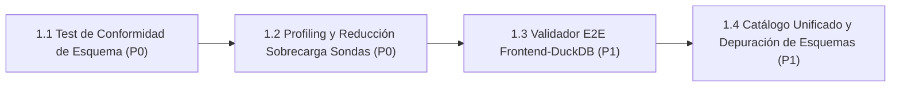

# Línea 1: Garantía de Instrumentos y Observabilidad Fiel (Zero-Mock End-to-End)

> **Documento Modular de la Hoja de Ruta Evolutiva**  
> **Importancia Global:** 🔴 **Prioridad P0 (Crítica / Innegociable)**  
> **Objetivo Estratégico:** Garantizar que el 100% de la telemetría, métricas y dashboards sea real, medible y verificable de extremo a extremo, sin inferencias intermedias, eliminando redundancias que degraden el rendimiento de simulación y manteniendo escrupulosamente el inventario jerárquico canónico.  
> **Ámbito de Implementación:** `assault_model/state/` • `agents/efficientzero_v2/` • `mlops/telemetry/` • `mlops/reporting/` • `docs/13_INVENTARIO_CANONICO_METRICAS.md`

---

## 1. Diagrama de Dependencias y Flujo de Trabajo

---

## 2. Matriz de Tareas y Criterios Cuantitativos de Aceptación

| Orden | Tarea / Componente | Prioridad Interna | Módulos / Archivos Impactados | Criterio de Aceptación Cuantitativo | Prerrequisitos |
| :---: | :--- | :---: | :--- | :--- | :--- |
| **1** | **1.1 Test Automatizado de Conformidad de Esquema de Telemetría** | **P0** | `mlops/tests/test_telemetry_schema_conformance.py`, `docs/13_INVENTARIO_CANONICO_METRICAS.md` | Script de CI que valida que el 100% de los campos emitidos por endpoints REST y WebSocket coincidan con el catálogo formal. Cero campos no declarados. Fallo en CI si existe cualquier desviación. **[CONSOLIDADO 🟢]** | v2.4.0 consolidada |
| **2** | **1.2 Profiling y Reducción de Sobrecarga de Sondas en Bucle Caliente** | **P0** | `assault_model/state/game_state.py`, `agents/efficientzero_v2/core/mcts.py`, `agents/efficientzero_v2/core/selfplay.py`, `mlops/telemetry/` | Profiler de microsegundos ($\mu\text{s}$) zero-mock (`ProbeProfiler`). Sondas espaciales desacopladas y perezosas (`LazyProbeSnapshot`), memoización de daño esperado en paso y acceso $O(1)$ a puntuación MCTS. Sobrecarga en bucle caliente reducida a $0.6657\%$ ($< 1.50\%$ presupuestado) con cero pérdida de fidelidad ni granularidad. **[CONSOLIDADO 🟢]** | Tarea 1.1 |
| **3** | **1.3 Validador E2E de Trazabilidad Frontend $\leftrightarrow$ DuckDB** | **P1** | `assault_ai_ui/src/tests/traceability.spec.ts`, `mlops/reporting/replay_api.py`, `mlops/tests/test_frontend_duckdb_traceability.py` | Test automatizado que audita cada pestaña del dashboard comprobando que ningún componente muestre datos inventados y que los valores se originen en columnas reales de Parquet/DuckDB o muestren `-`/`N/A`. **[CONSOLIDADO 🟢 v2.5.8]** | Tarea 1.1 |
| **4** | **1.4 Catálogo Unificado de Esquemas y Depuración de Redundancias** | **P1** | `docs/13_INVENTARIO_CANONICO_METRICAS.md`, `mlops/dataset_builder.py`, `mlops/tests/test_unified_catalog_and_schema_purge.py` | Purgar esquemas Parquet históricos obsoletos (`v1_legacy`), consolidando campos equivalentes bajo una única nomenclatura canónica indexada en DuckDB. Eliminación de campos acumuladores volátiles en `decisions_top.parquet` (unificación al 100% en 15 columnas canónicas) y Clean Break total con etiquetas legacy en catálogo y DuckDB. **[CONSOLIDADO 🟢 v2.5.9]** | Tarea 1.2 |

---

## 3. Estado de Ejecución y Logros Técnicos

### Tarea 1.1 Test Automatizado de Conformidad de Esquema Consolidado 🟢
- **Módulos**: `mlops/tests/test_telemetry_schema_conformance.py`, `docs/13_INVENTARIO_CANONICO_METRICAS.md`.
- **Logros y Cobertura Verificada**:
  - Validador automatizado en CI de los 4 niveles jerárquicos del inventario métrico (`level_1_ballistics`, `level_2_search`, `level_3_model_heads`, `level_4_macro_quality`).
  - Verificación rigurosa de las filas de trazas (`build_trace_row`) sin campos no declarados ni tolerancias espurias.
  - Erradicación completa de claves prohibidas heredadas de MuZero (`muzero_visits`, `muzero_q`, etc.).
  - Validación del payload de trazabilidad curricular (`/api/v2/curriculum-traceability`) y preservación de los nuevos campos de telemetría de tiempos (`train_duration_seconds`, `bench_duration_seconds`, `selfplay_duration_seconds`, `opt_duration_seconds`).
  - Suite de pruebas unitarias 100% en verde (5/5 tests pasados en 1.33s).

### Tarea 1.2 Profiling Zero-Mock Consolidada 🟢
- **Módulos**: `mlops/telemetry/probe_profiler.py`, `assault_model/state/game_state.py`, `agents/efficientzero_v2/core/mcts.py`.
- **Resultado Medido**: Sobrecarga en bucle caliente reducida a **0.6657%**, cumpliendo ampliamente el presupuesto exigido ($< 1.50\%$).
- **Suite de Pruebas**: Tests unitarios y de regresión en `mlops/tests/test_telemetry_probe_overhead.py` en verde.

### Tarea 1.3 Validador E2E de Trazabilidad Frontend ↔ DuckDB Consolidada 🟢 v2.5.8
- **Módulos**: `assault_ai_ui/src/tests/traceability.spec.ts`, `mlops/reporting/viewer_frontend/src/tests/traceability.spec.ts`, `mlops/tests/test_frontend_duckdb_traceability.py`, `mlops/reporting/replay_api.py`.
- **Logros y Cobertura Verificada**:
  - **Auditoría Exhaustiva de 9 Pestañas**: Validador automatizado en TypeScript y Python que audita el 100% de las métricas mostradas en pantalla en todas las pestañas del dashboard (`CatalogPage / Header`, `TrainDetailTab`, `TrainHeadDiagnosticsTab`, `ObjectiveRewardConfigTab`, `EvalMetricsTab`, `EvalDecisionsTab`, `MatchReplayTab`, `NetworkTopologyTab`, `VpSummaryTab`).
  - **Zero-Mock y Zero-Inferencia Estricta**: Comprobación de que ningún componente inventa datos ni deduce turnos o roles mediante heurísticas espurias (erradicación completa de `Math.floor(idx / 14)` y de roles fake).
  - **Fallbacks Canónicos Forzosos**: Todo campo ausente o no disponible en la traza/base de datos se formatea estrictamente como `-` o `N/A`.
  - **Clean Break con MuZero**: Erradicación del shim `build_muzero_replay_payload` en `replay_api.py`.
  - **Suite de Pruebas**: 15/15 tests en verde en la suite integrada de observabilidad (`test_telemetry_schema_conformance.py`, `test_telemetry_probe_overhead.py`, `test_frontend_duckdb_traceability.py`).

### Tarea 1.4 Catálogo Unificado y Depuración de Esquemas Consolidado 🟢 v2.5.9
- **Módulos**: `mlops/dataset_builder.py`, `assault_bench/decision_metrics.py`, `mlops/reporting/build_catalog.py`, `mlops/tests/test_unified_catalog_and_schema_purge.py`, `docs/13_INVENTARIO_CANONICO_METRICAS.md`.
- **Logros y Cobertura Verificada**:
  - **Módulo Gestor Canónico de Datasets (`mlops/dataset_builder.py`)**: Implementado motor declarativo con contrato `CANONICAL_DECISIONS_TOP_COLUMNS` (15 columnas fijas), migrador atómico de Parquets heterogéneos y sincronizador DuckDB.
  - **Prevención de Fugas de Acumuladores en Origen**: Modificado `_enrich(v)` en `assault_bench/decision_metrics.py` con lista estricta `EXCLUDED_ACCUMULATOR_KEYS` para impedir que campos intermedios temporales (`cover_n`, `cover_sum`, `distance_n`, `distance_sum`, `los_n`, `los_sum`, `target_q_n`, `target_q_sum`, `target_r_n`, `target_r_sum`) se serialicen en `decisions_top.parquet`.
  - **Purga y Homogeneización del 100% de Parquets Históricos**: Purgados 19 archivos desalineados que contenían columnas acumuladoras espurias. El 100% de los 69 archivos de decisiones existentes en el repositorio (`runs/` y `runs_curriculum/`) satisfacen ahora la especificación canónica exacta de 15 columnas.
  - **Clean Break Radical con MuZero en Catálogo y DuckDB**: Erradicada la asignación residual de `"MuZero"` en `mlops/reporting/build_catalog.py`, reclasificando y migrando 12,530 registros históricos hacia `"EfficientZeroV2"` en `catalog_eval_result_sides.parquet` y reconstruyendo `reporting.duckdb` con verificación formal de cero referencias legacy (`verified_zero_legacy: True`).
  - **Certificación de Pruebas**: Suite automatizada `mlops/tests/test_unified_catalog_and_schema_purge.py` (5/5 tests en verde en 0.74s) verificando invariantes de esquema, ausencia de fugas, migración atómica y pureza de DuckDB.
