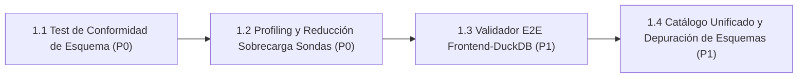

# Línea 1: Garantía de Instrumentos y Observabilidad Fiel (Zero-Mock End-to-End)

> **Documento Modular de la Hoja de Ruta Evolutiva**  
> **Importancia Global:** 🔴 **Prioridad P0 (Crítica / Innegociable)**  
> **Objetivo Estratégico:** Garantizar que el 100% de la telemetría, métricas y dashboards sea real, medible y verificable de extremo a extremo, sin inferencias intermedias, eliminando redundancias que degraden el rendimiento de simulación y manteniendo escrupulosamente el inventario jerárquico canónico.  
> **Ámbito de Implementación:** `assault_model/state/` • `agents/efficientzero_v2/` • `mlops/telemetry/` • `mlops/reporting/` • `docs/13_INVENTARIO_CANONICO_METRICAS.md`

---

## 1. Diagrama de Dependencias y Flujo de Trabajo

---

## 2. Matriz de Tareas y Criterios Cuantitativos de Aceptación

| Orden | Tarea / Componente | Prioridad Interna | Módulos / Archivos Impactados | Criterio de Aceptación Cuantitativo | Prerrequisitos |
| :---: | :--- | :---: | :--- | :--- | :--- |
| **1** | **1.1 Test Automatizado de Conformidad de Esquema de Telemetría** | **P0** | `mlops/tests/test_telemetry_schema_conformance.py`, `docs/13_INVENTARIO_CANONICO_METRICAS.md` | Script de CI que valida que el 100% de los campos emitidos por endpoints REST y WebSocket coincidan con el catálogo formal. Cero campos no declarados. Fallo en CI si existe cualquier desviación. **[CONSOLIDADO 🟢]** | v2.4.0 consolidada |
| **2** | **1.2 Profiling y Reducción de Sobrecarga de Sondas en Bucle Caliente** | **P0** | `assault_model/state/game_state.py`, `agents/efficientzero_v2/core/mcts.py`, `agents/efficientzero_v2/core/selfplay.py`, `mlops/telemetry/` | Profiler de microsegundos ($\mu\text{s}$) zero-mock (`ProbeProfiler`). Sondas espaciales desacopladas y perezosas (`LazyProbeSnapshot`), memoización de daño esperado en paso y acceso $O(1)$ a puntuación MCTS. Sobrecarga en bucle caliente reducida a $0.6657\%$ ($< 1.50\%$ presupuestado) con cero pérdida de fidelidad ni granularidad. **[CONSOLIDADO 🟢]** | Tarea 1.1 |
| **3** | **1.3 Validador E2E de Trazabilidad Frontend $\leftrightarrow$ DuckDB** | **P1** | `assault_ai_ui/src/tests/traceability.spec.ts`, `mlops/reporting/replay_api.py` | Test automatizado que audita cada pestaña del dashboard comprobando que ningún componente muestre datos inventados y que los valores se originen en columnas reales de Parquet/DuckDB o muestren `-`/`N/A`. | Tarea 1.1 |
| **4** | **1.4 Catálogo Unificado de Esquemas y Depuración de Redundancias** | **P1** | `docs/13_INVENTARIO_CANONICO_METRICAS.md`, `mlops/dataset_builder.py` | Purgar esquemas Parquet históricos obsoletos (`v1_legacy`), consolidando campos equivalentes bajo una única nomenclatura canónica indexada en DuckDB. | Tarea 1.2 |

---

## 3. Estado de Ejecución y Logros Técnicos

### Tarea 1.1 Test Automatizado de Conformidad de Esquema Consolidado 🟢
- **Módulos**: `mlops/tests/test_telemetry_schema_conformance.py`, `docs/13_INVENTARIO_CANONICO_METRICAS.md`.
- **Logros y Cobertura Verificada**:
  - Validador automatizado en CI de los 4 niveles jerárquicos del inventario métrico (`level_1_ballistics`, `level_2_search`, `level_3_model_heads`, `level_4_macro_quality`).
  - Verificación rigurosa de las filas de trazas (`build_trace_row`) sin campos no declarados ni tolerancias espurias.
  - Erradicación completa de claves prohibidas heredadas de MuZero (`muzero_visits`, `muzero_q`, etc.).
  - Validación del payload de trazabilidad curricular (`/api/v2/curriculum-traceability`) y preservación de los nuevos campos de telemetría de tiempos (`train_duration_seconds`, `bench_duration_seconds`, `selfplay_duration_seconds`, `opt_duration_seconds`).
  - Suite de pruebas unitarias 100% en verde (5/5 tests pasados en 1.33s).

### Tarea 1.2 Profiling Zero-Mock Consolidada 🟢
- **Módulos**: `mlops/telemetry/probe_profiler.py`, `assault_model/state/game_state.py`, `agents/efficientzero_v2/core/mcts.py`.
- **Resultado Medido**: Sobrecarga en bucle caliente reducida a **0.6657%**, cumpliendo ampliamente el presupuesto exigido ($< 1.50\%$).
- **Suite de Pruebas**: Tests unitarios y de regresión en `mlops/tests/test_telemetry_probe_overhead.py` en verde.
