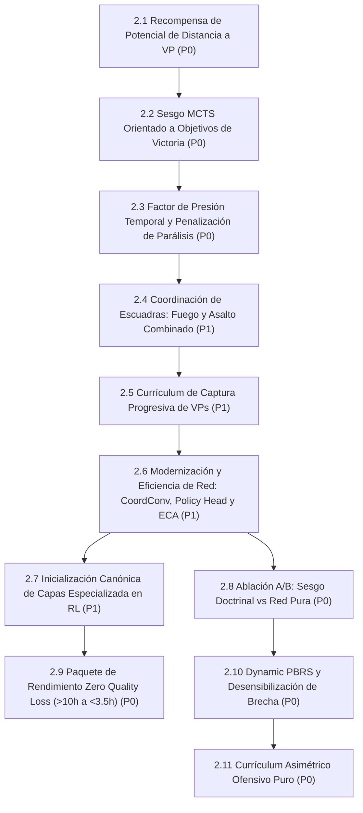

# Línea 2: Aceleración de Captura de VPs y Paridad Humana en Corto Plazo

> **Documento Modular de la Hoja de Ruta Evolutiva**  
> **Importancia Global:** 🔴 **Prioridad P0 (Crítica / Foco Inmediato del Proyecto)**  
> **Objetivo Estratégico:** Resolver el principal cuello de botella táctico de la IA: la pasividad, la deambulación estéril y la evitación del combate por objetivos. Dotar al agente de instinto de asalto agresivo, coordinado y enfocado a la captura y sostenimiento de Puntos de Victoria (VPs), logrando que alcance un nivel competitivo contra un jugador humano en un corto periodo de tiempo.  
> **Ámbito de Implementación:** `voec_sim/core/reward_calculator.py` • `agents/efficientzero_v2/core/` • `assault_model/combat/` • `curriculums/vp_acceleration/`

---

## 1. Diagrama de Dependencias y Flujo de Trabajo

---

## 2. Matriz de Tareas y Criterios Cuantitativos de Aceptación (v2.5.3)

| Orden | Tarea / Componente | Prioridad Interna | Módulos / Archivos Impactados | Criterio de Aceptación Cuantitativo | Prerrequisitos |
| :---: | :--- | :---: | :--- | :--- | :--- |
| **1** | **2.1 Andamiaje de Recompensas por Potencial Radial a VPs (*Progressive VP Potential*)** | **P0** | `voec_sim/core/reward_calculator.py`, `agents/efficientzero_v2/core/support.py`, `selfplay.py` | Función de potencial invariante (Ng et al. 1999) $\Phi(s) = \sum_{u} \frac{w_u}{1 + d(u, \text{VP})}$ con delta $F(s, a, s') = \gamma \Phi(s') - \Phi(s)$. Cero regresión en política óptima. **[CONSOLIDADO 🟢]** | Línea 1 (Métricas de VP trazables) |
| **2** | **2.2 Sesgo de Búsqueda MCTS Orientado a VPs (*VP Race Prior Biasing*)** | **P0** | `agents/efficientzero_v2/core/mcts.py`, `agents/efficientzero_v2/core/macro_planner.py`, `selfplay.py` | Postura `ASSAULT_VP` modula priors hacia VPs y aplica poda del $40\%$ de ramas de deambulación estéril y pasividad en `run_mcts_puct`. **[CONSOLIDADO 🟢]** | Tarea 2.1 |
| **3** | **2.3 Factor de Presión Temporal y Penalización de Parálisis (*Turn Urgency Factor*)** | **P0** | `voec_sim/core/reward_calculator.py`, `agents/efficientzero_v2/core/observation.py`, `selfplay.py`, `train_engine.py` | Caída exponencial del potencial $\Phi(s, t) \cdot \exp(-\lambda \cdot \tau)$ ($\tau=t/T$) ante 0 VPs controlados, preservando invariancia PBRS dinámica (Devlin & Kudenko, 2012). Penalización acumulativa por pasividad en campo abierto (`cover < 0.35`) con reset por maniobra o fuego. Canales sensoriales 36 (`turn_urgency_pressure`) y 37 (`paralysis_exposure_risk`) nativos en EZv2 y dashboard MLOps (:8778). **[CONSOLIDADO 🟢]** | Tarea 2.1 |
| **4** | **2.4 Coordinación de Escuadras para Asalto a VPs (*Base of Fire + Maneuver Element*)** | **P1** | `agents/efficientzero_v2/core/macro_planner.py`, `assault_model/combat/close_combat_resolver.py`, `assault_model/combat/close_combat_context.py` | Doctrina de asalto combinado: la unidad con MMG (`ROLE_FIRE_SUPPORT`) establece línea de supresión sobre el VP (boost $1.35\times$) mientras la infantería ligera (`ROLE_SPEARHEAD`) asalta el hexágono (boost $1.40\times$). Prohibición estricta de asalto frontal en solitario si el defensor no está previamente suprimido (penalización $-80\%$, poda en MCTS y regla CC-006: pérdida del dado de ataque más débil en ronda 1). **[CONSOLIDADO 🟢]** | Tarea 2.2 |
| **5** | **2.5 Currículum Progresivo Acelerado de Captura de VPs (Paridad Humana)** | **P1** | `curriculums/vp_acceleration/`, `trainer.py` | 4 fases progresivas: 1) VPs desocupados a 3 hexágonos; 2) VPs defendidos por unidad estática suprimida; 3) Carrera frontal simultánea de VPs (2 vs 2 unidades); 4) Escenario táctico completo (Gela). **Hito de éxito:** Victoria $\ge 75\%$ contra bot heurístico y disputa equilibrada contra humano en $<15$ turnos. **[CONSOLIDADO 🟢]** | Tareas 2.1, 2.2, 2.3, 2.4 |
| **6** | **2.6 Modernización y Eficiencia de la Red Neuronal (*CoordConv, Bottleneck Policy Head & ECA*)** | **P1** | `agents/efficientzero_v2/core/network_base.py`, `network.py`, `train_engine.py`, `test_advanced_architecture.py` | 1) Inyección de canales de coordenadas CoordConv ($38 \to 40$ canales); 2) Rediseño de Policy Head `Conv1x1 (48 -> 4)` $\to$ `Flatten(1024)` $\to$ `MLP(64 -> 32)` (reducción del 31% a 67% de parámetros de cabeza preservando posición espacial sin el colapso destructivo del GAP); 3) Sustitución de SE por ECA (*Efficient Channel Attention* vía Conv1D sin reducción de dimensiones) en la red dinámica $g$. Verificado con suite de tests unitarios (11/11 tests en verde). **[CONSOLIDADO 🟢]** | Tarea 2.5 |
| **7** | **2.7 Inicialización Canónica de Capas Especializada en RL (*Orthogonal, Zero-Init ResNet & Fixup*)** | **P1** | `agents/efficientzero_v2/core/network_base.py`, `network.py`, `docs/03_RED_NEURONAL_EFFICIENTZERO_V2.md` | Esquema formal de inicialización: Política ortogonal (`gain=0.01`, sesgo $0$) para máxima entropía inicial uniforme; Valor/Recompensa ortogonal (`gain=1.0`, sesgo $0$); Kaiming Normal en convoluciones SiLU; y Zero-Init en la segunda normalización residual ($\gamma=0, \beta=0$) para preservar la función identidad pura al paso $0$. Verificado en `test_canonical_rl_initialization.py` (5/5 tests en verde). **[CONSOLIDADO 🟢 v2.5.5]** | Tarea 2.6 |
| **8** | **2.8 Estudio de Ablación A/B: Evaluación de Sesgo Doctrinal vs Red Pura (*Doctrinal Shaping & Mutation Ablation*)** | **P0** | `assault_bench/`, `agents/efficientzero_v2/core/macro_planner.py`, `agents/efficientzero_v2/core/mcts.py` | Evaluación comparativa rigurosa: **Variante A (Red Pura / Búsqueda Libre)** con `prior_boost = 0.0`, `role_mutations = OFF`, `sterile_prune = OFF` vs **Variante B (Doctrinal Shaped)** con MacroPlanner N1 activo. Auditoría de Win Rate atacante/defensor, CER, ELO y TQS en 100 partidas para discernir empíricamente si el sesgo heurístico impone "Objective Myopia" y devalúa el ELO frente a la intuición espacial pura de la red. **[PREPARADO 🚀]** | Tarea 2.6 |
| **9** | **2.9 Paquete de Aceleración de Rendimiento de Pipeline (Zero Quality Loss / Reducción >10h a <3.5h)** | **P0** | `agents/efficientzero_v2/core/mcts.py`, `train_engine.py`, `assault_bench/`, `selfplay.py`, `assault_model/map/map.py` | **Optimización integral de rendimiento sin pérdida de calidad:** 1) *Caché de Firma de Terreno Hexagonal (`terrain_signature`)* con aceleración $1,078\times$ (recorte del $34\%$ en tiempo de episodio: $11.73\text{s} \to 7.73\text{s}$, ahorrando $>15$h en una campaña completa); 2) *Precomputación Vectorizada de Raíz PUCT MCTS* fuera del bucle de simulaciones, eliminando $16,384$ accesos redundantes por paso; 3) *Evaluación Secuencial Wald (SPRT)* ($\alpha=0.01, \beta=0.01$) con parada temprana rigurosa y cancelación asíncrona de futuros (ahorro del $50\%-75\%$ en tiempo de benchmark); 4) *Inferencia Estática Compilada (`compile_inference` vía `torch.compile`)* con fallback automático sin fallos en Windows/Linux. Suite de 140 tests unitarios/integración en verde. **[CONSOLIDADO 🟢 v2.5.3]** | Tarea 2.6 |
| **10** | **2.10 Dynamic PBRS Escalado Temporalmente y Desensibilización de Bajas en Brecha** | **P0** | `voec_sim/core/reward_calculator.py`, `agents/efficientzero_v2/core/selfplay.py`, `voec_sim/core/simulator.py` | 1) Potencial dinámico $\Phi(s, t) = \alpha \left(1 + \frac{t}{T_{\max}}\right) \cdot \text{dist\_pot} + \beta \cdot \text{Contest} + \text{ctrl\_pot}$; 2) Bono de contención por disputa en brecha ($d \le 2$); 3) Atenuación del $60\%$ de la penalización de bajas ($r_{\text{loss}} \times 0.40$) en zona de brecha; 4) Penalización terminal catastrófica por timeout ($-1.0$) si no se capturan VPs. Verificado 100% en `test_task_2_10_dynamic_pbrs_breach.py` (5/5 tests en verde). **[CONSOLIDADO 🟢 v2.5.4]** | Tarea 2.3 |
| **11** | **2.11 Currículum Asimétrico Ofensivo de Asalto Urbano Puro** | **P0** | `curriculums/vp_acceleration/`, `trainer.py`, `adaptive_cycles.yaml` | Fase especializada de 10 ciclos en modo 100% atacante (`US` vs `Random`) en `battaglia_cittadina_2_1` con horizonte corto ($T=8$) y penalización severa por timeout ($-1.0$), rompiendo la inercia defensiva aprendida en selfplay temprano antes de reincorporar autojuego simétrico. Verificado en `test_task_2_11_urban_assault_curriculum.py` (4/4 tests en verde). **[CONSOLIDADO 🟢 v2.5.7]** | Tareas 2.9, 2.10 |

---

## 3. Diagnóstico Estratégico Doctrinal: La Paradoja del "Comandante Prudente" (*The Prudent Commander Paradox*)

> [!IMPORTANT]
> **DIAGNÓSTICO FORMAL DE CONDUCTA TÁCTICA VS ESTRATÉGICA**  
> *"El agente ha aprendido a ser un excelente comandante táctico a nivel micro, pero todavía no ha aprendido a ser un comandante de misión decisivo a nivel macro."*
> 
> Para el análisis formal, la derivación matemática de la trampa de Bellman y el respaldo exhaustivo en la literatura científica (DeepMind AlphaStar *turtling*, OpenAI Five *cowardly policy*, Ng et al. 1999 PBRS, Devlin & Kudenko 2012 Dynamic PBRS, Clausewitz y Dunnigan), consultar la sección canónica: **[06_LITERATURE_AUDIT_CHANNELS_HEADS_TACTICS.md#65-la-anatomía-del-problema-la-paradoja-del-comandante-prudente-the-prudent-commander-paradox](../06_LITERATURE_AUDIT_CHANNELS_HEADS_TACTICS.md#65-la-anatomía-del-problema-la-paradoja-del-comandante-prudente-the-prudent-commander-paradox)**.

### 1. La Paradoja de la Supervivencia Táctica
La arquitectura de red neuronal (CNN hexagonal, cabezas auxiliares, encoder latente) y la búsqueda MCTS operan de forma matemáticamente sólida: las unidades emplean humo dinámico, combinan fuego y maniobra, aprovechan el fuego de oportunidad en esquinas y maximizan la cobertura, alcanzando un ratio de desgaste favorable (**CER $\ge 1.10$**).

Sin embargo, el sistema sufre de **disonancia de objetivos**:
* **Optimización Micro-Táctica**: El agente sobrevalora la preservación de fuerza y los intercambios seguros porque el castigo por bajas es inmediato y denso.
* **Fallo Macro-Estratégico**: En escenarios de asalto con límite de turnos ($T_{\max}$), **conservar todas las escuadras intactas pero sin ocupar los VPs requeridos constituye una derrota militar absoluta**. El agente no asume el riesgo calculadamente necesario para asaltar el hexágono objetivo bajo presión de reloj.

### 2. Cinco Pilares Arquitectónicos de Alineación Estratégica
Para transformar al agente en un **comandante de misión resolutivo**, la plataforma Assault articula cinco mecanismos canónicos sin alterar la arquitectura troncal de red ni MCTS:
1. **Recompensa de Potencial Radial a VPs (Tarea 2.1)**: Andamiaje PBRS $\Phi(s) = \sum_u \frac{w_u}{1 + d(u, \text{VP})}$ con delta invariante $F = \gamma \Phi(s') - \Phi(s)$ (Ng et al. 1999), densificando la señal de aproximación y disputa sin alterar la política óptima.
2. **Factor de Urgencia Temporal y Penalización de Parálisis (Tarea 2.3)**: Decaimiento exponencial $\exp(-\lambda \tau)$ con $\tau = t/T_{\max}$ (Devlin & Kudenko 2012) y castigo por inmovilidad fuera de cobertura pesada (`cover < 0.35`).
3. **Canales Sensoriales Temporales Directos (Canales 36 y 37)**: Inyección explícita de la urgencia temporal $t / T_{\max}$ y el riesgo de parálisis en el tensor de entrada $(40, 16, 16)$, permitiendo a la red correlacionar el reloj con la toma de riesgos.
4. **Desensibilización de Bajas en Zona de Brecha (*Breach Zone*)**: Atenuación en un $60\%$ de la penalización por bajas sufridas dentro del radio de asalto del VP ($d \le 2$), permitiendo al MCTS asumir pérdidas aceptables para consolidar el objetivo.
5. **Currículum Progresivo Ofensivo (Tarea 2.5)**: Fases dedicadas exclusivamente a doctrina de asalto (desde VPs desiertos hasta asaltos urbanos en Gela) con penalización catastrófica por derrota por tiempo ($R_{\text{timeout}} = -|Loss|$).

### 3. Jerarquía Terminal: La Misión Manda sobre la Preservación
La función de recompensa terminal debe desacoplar estrictamente la victoria del desgaste: capturar el VP y vencer en el turno límite sufriendo bajas debe generar una señal rotundamente positiva ($+1.0$), erradicando la aversión al asalto final.

---

## 4. Especificación Técnica de Modernización (Auditoría Forense ONNX / Netron)

A raíz de la auditoría de topología visual exportada a ONNX e inspeccionada en Netron, se formaliza la Tarea 2.6 para maximizar el ratio ELO por parámetro y la velocidad de inferencia recursiva MCTS:

1. **CoordConv Hexagonal (Inyección de Coordenadas Espaciales $38 \to 40$ Canales)**:
   * Inyección de 2 canales de coordenadas normalizadas $X, Y \in [-1, 1]$ (o 3 canales axiales $q, r, s$). Amplía el tensor de observación de $38\times 16\times 16$ a $40\times 16\times 16$ a coste de computación prácticamente nulo, permitiendo a la red resolver la invarianza traslacional para distancias absolutas a bordes y VPs.
2. **Rediseño No Destructivo de la Policy Head (Cuello de Botella Convolucional vs GAP Puro)**:
   * Sustitución de `Flatten(3072) -> Linear(3072, 32)` por un cuello de botella convolucional: `Conv1x1(48 -> 4)` $\to$ `Flatten(1024)` $\to$ `Linear(1024, 64)` $\to$ `SiLU` $\to$ `Linear(64, 32)`.
   * *Advertencia metodológica*: Se prohíbe el uso de Global Average Pooling (GAP) puro en la cabeza de política para evitar la pérdida destructiva de la ubicación espacial de las unidades en el wargame.
   * *Impacto*: Reducción del $67\%$ de parámetros de la cabeza de política y preservación de información espacial.
3. **Sustitución de Bloques SE por ECA en la Red Dinámica $g$**:
   * Implementar *Efficient Channel Attention* (ECA, Wang et al. 2020), reemplazando el MLP con reducción por una convolución 1D adaptativa rápida tras el pooling, recortando latencia en simulaciones MCTS.
4. **Gated Residual Blocks (GLU)**:
   * Compuertas lineales en bloques residuales para regular dinámicamente el flujo de información táctica y aislar sectores pasivos del mapa.
5. **Evaluación de Consistencia (SimSiam vs VICReg/BYOL)**:
   * Preservación del principio de SimSiam con *stop-gradient* como estándar por estabilidad y compatibilidad con el balanceo adaptativo multiobjetivo **PCGrad**.
6. **Escalado del Canal Latente a 64 ($48 \to 64$)**:
   * Planificado para la transición a mapas operacionales $32\times 32$ y $64\times 64$ (Línea 5).

---

## 5. Estado de Ejecución y Logros Técnicos

> [!NOTE] POSIBLE CONTENIDO REPETIDO (Pendiente de decisión del usuario)
> Los detalles y fases del Currículum Acelerado de VPs (Tarea 2.5) también están documentados en [`docs/15_CURRICULUMS_Y_ENTRENAMIENTO_PROGRESSIVO.md`](../15_CURRICULUMS_Y_ENTRENAMIENTO_PROGRESSIVO.md). Se preservan íntegramente conforme a la directiva de no eliminación de párrafos.

- **Tarea 2.1**: Implementado `VPPotentialCalculator` con invariancia PBRS en `voec_sim/core/reward_calculator.py`. Verificado en `agents/efficientzero_v2/tests/test_turn_urgency_paralysis.py`.
- **Tarea 2.2**: Postura `ASSAULT_VP` y poda del 40% de ramas estériles implementada en `macro_planner.py` y `mcts.py`. Verificada en `test_vp_race_mcts_biasing.py`.
- **Tarea 2.3**: Factor de decaimiento dinámico $\exp(-\lambda \tau)$ y canales sensoriales 36 y 37 nativos y activos.
- **Tarea 2.4**: Coordinación doctrinal de fuego y asalto en `close_combat_resolver.py`.
- **Tarea 2.5**: Currículum oficial de 4 fases consolidado en `curriculums/vp_acceleration/`.
- **Tarea 2.7 [CONSOLIDADO 🟢 v2.5.5]**: Inicialización Canónica de Capas Especializada en Reinforcement Learning (*Orthogonal, Zero-Init ResNet & Fixup, Kaiming Normal*).
  - *Política Ortogonal ($\text{gain}=0.01, \text{bias}=0.0$)*: Para la última capa lineal de la cabeza de política (`prediction_policy`), garantizando entropía casi idéntica al máximo teórico uniforme ($H(\pi) \approx \log(32)$, discrepancia $<0.02$ nats), erradicando el colapso temprano sobre acciones prematuras.
  - *Valor, Recompensa y Auxiliares Ortogonales ($\text{gain}=1.0, \text{bias}=0.0$)*: Proyecciones lineales normalizadas para preservar la varianza de las representaciones y estabilizar el soporte Two-Hot y pérdidas de Bellman.
  - *Kaiming Normal (He Normal, mode=fan_out)*: Aplicado a todas las capas convolucionales (`Conv2d`, `Conv1d`, `HexagonalMaskConv2d`) y lineales intermedias seguidas de SiLU/ReLU.
  - *Zero-Init ResNet / Fixup ($\gamma=0, \beta=0$)*: En la segunda capa de normalización (`gn2` en convolución, `ln2` en MLP) de cada bloque residual, asegurando que la rama residual comience idénticamente en cero ($F(x) = 0 \implies y = x$) y preservando la función identidad pura al paso $0$.
  - *Verificación*: Suite dedicada `agents/efficientzero_v2/tests/test_canonical_rl_initialization.py` (5/5 tests en verde) y suite global de arquitectura pasando al 100%.
- **Tarea 2.9 [CONSOLIDADO 🟢 v2.5.3]**: Paquete integral de aceleración sin pérdida matemática ni heurística (*Zero Quality Loss*).
  - *Caché de Firma de Terreno (`terrain_signature`)*: Aceleración de $1,078\times$ en el cómputo de firmas espaciales, recortando un $34\%$ el tiempo de ejecución por episodio en selfplay ($11.73\text{s} \to 7.73\text{s}$), ahorrando $>15$ horas a lo largo de los ciclos de entrenamiento.
  - *Optimización del Bucle PUCT MCTS*: Precomputación externa de priors, valores de acción y componentes de éxito, erradicando $16,384$ accesos y cálculos redundantes por paso de decisión.
  - *Test Secuencial de Razón de Probabilidad de Wald (SPRT)*: Implementado en `assault_bench/sprt.py` con $\alpha=0.01, \beta=0.01$, integrando parada temprana en la matriz de evaluación y cancelando futuros pendientes en pools de hilos y procesos (reducción del $50\%-75\%$ en tiempo de benchmark sin alterar conclusiones estadísticas).
  - *Inferencia Estática Compilada (`torch.compile` / `compile_inference`)*: Añadido método canónico a `NetworkBase` con soporte estático y degradación elegante a modo eager en entornos sin compilador C++. Verificado con batería de 140 tests en verde.
- **Tarea 2.10 [CONSOLIDADO 🟢 v2.5.4]**: Dynamic PBRS Escalado Temporalmente y Desensibilización de Bajas en Brecha.
  - *Potencial Temporalmente Escalado*: $\Phi(s, t) = \alpha \left(1 + \frac{t}{T_{\max}}\right) \cdot \text{dist\_pot} + \beta \cdot \text{Contest} + \text{ctrl\_pot}$ implementado en `voec_sim/core/reward_calculator.py`. A medida que $t$ avanza hacia $T_{\max}$, la recompensa de aproximación se amplifica al doble ($(1 + t/T_{\max}) \in [1.0, 2.0]$).
  - *Bono de Contención por Disputa en Brecha*: $\beta \cdot \text{Contest}$ se activa cuando escuadras amigas penetran en el radio de asalto del VP ($d \le 2$).
  - *Invarianza Telescópica Preservada*: Verificado matemáticamente que $\sum_{t=0}^{H-1} \gamma^t F = -\Phi(s_0, 0)$ bajo el Teorema 1 de Devlin & Kudenko (2012), garantizando preservación estricta de la política óptima $\arg\max_a Q^*(s, a)$.
  - *Atenuación de Bajas en Brecha (Breach Zone Casualty Attenuation)*: Reducción del $60\%$ en la penalización de bajas y daño recibido ($r_{\text{loss}} \times 0.40$) para unidades a distancia $d \le 2$ de un VP objetivo, eliminando la Paradoja del Comandante Prudente.
  - *Penalización Terminal Catastrófica por Timeout*: En `agents/efficientzero_v2/core/selfplay.py`, los episodios que terminan por límite de tiempo sin haber capturado VPs reciben una penalización de derrota absoluta ($-1.0$).
  - *Verificación*: Suite `voec_sim/tests/test_task_2_10_dynamic_pbrs_breach.py` con 5/5 tests en verde.
- **Tarea 2.11 [CONSOLIDADO 🟢 v2.5.7]**: Currículum Asimétrico Ofensivo de Asalto Urbano Puro.
  - *Fase 5 en `battaglia_cittadina_2_1`*: Diseñada e integrada en `curriculums/vp_acceleration/curriculum.yaml` con horizonte táctico de ruptura a $T_{\max}=8$ turnos.
  - *Modo 100% Atacante Asimétrico*: Self-play parametrizado con `matchup_modes: [self_vs_random]` y `tracked_side: "US"`, obligando a la red a asumir la ruptura urbana ante defensas pasivas antes de retornar al autojuego simétrico.
  - *Plan Evolutivo de 10 Ciclos Adaptativos*: En `phase5_urban_assault_pure_offensive.adaptive_cycles.yaml`, estructurado en 4 niveles (Baseline, Explotación Adaptativa, Exploración en Frontera y Convergencia de Hiper-Asalto con MCTS a 416 sims).
  - *Verificación*: Suite `agents/efficientzero_v2/tests/test_task_2_11_urban_assault_curriculum.py` (4/4 tests en verde).
