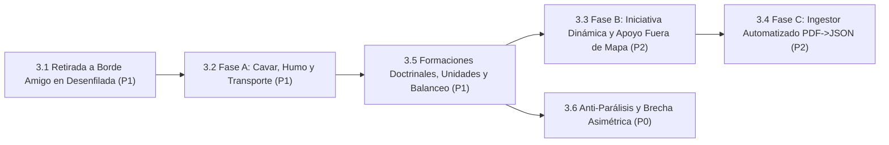
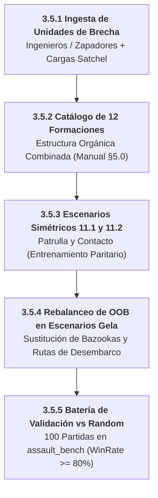

# Línea 3: Fidelidad Normativa y Reglamento Oficial del Wargame

> **Documento Modular de la Hoja de Ruta Evolutiva**  
> **Importancia Global:** 🟢 **Prioridad P1 (Alta)**  
> **Objetivo Estratégico:** Completar las mecánicas del reglamento oficial (*Rulebook rev6*) identificadas en la auditoría exhaustiva de 52 páginas ([`08_AUDITORIA_REGLAMENTO_VS_ENGINE.md`](../08_AUDITORIA_REGLAMENTO_VS_ENGINE.md)), asegurando fidelidad militar absoluta de las simulaciones y soporte para los 38 escenarios canónicos.  
> **Ámbito de Implementación:** `assault_model/actions/` • `assault_model/combat/` • `assets/catalogs/` • `assets/scenarios/` • `agents/efficientzero_v2/`

---

## 1. Diagrama de Dependencias y Flujo de Trabajo

---

## 2. Matriz de Tareas y Criterios Cuantitativos de Aceptación

| Orden | Tarea / Componente | Prioridad Interna | Módulos / Archivos Impactados | Criterio de Aceptación Cuantitativo | Prerrequisitos |
| :---: | :--- | :---: | :--- | :--- | :--- |
| **1** | **3.1 Algoritmo de Retirada a Borde Amigo en Desenfilada (Sección 6.4)** | **P1** | `assault_model/combat/morale.py`, `assault_model/rules/movement_rules.py` | Sustituir la retirada contigua aleatoria por un vector dirigido al borde amigo (*Friendly Edge*), filtrando hexágonos en desenfilada (*Defilade*) fuera de la LOS del atacante y seleccionando la mayor cobertura de terreno disponible. | v2.2.0 (Vectorized LOS) |
| **2** | **3.2 Fase A: Cavar (*Dig-In*), Humo Táctico y Transporte de Tropas** | **P1** | `assault_model/actions/status.py`, `actions/ranged_indirect.py`, `rules/movement_rules.py` | `DigInAction` (creación de marcadores `Foxhole`), `FireSmokeAction` (bloqueo dinámico de LOS y disipación por turno), y `LoadUnitAction`/`UnloadUnitAction` con chequeo de bajas si el vehículo es destruido. | Tarea 3.1 |
| **3** | **3.5 Formaciones Doctrinales, Ingesta de Unidades y Rebalanceo de Escenarios** | **P1** | `assets/catalogs/formation_catalog.json`, `assets/catalogs/unit_catalog.json`, `assets/scenarios/` | Desglosado en subtareas 3.5.1 a 3.5.5: Ingesta de ingenieros, catálogo de 12 formaciones, 2 escenarios simétricos de entrenamiento, rebalanceo OOB de Gela y benchmark de victoria. **Criterio de éxito:** Win Rate $\ge 80\%$ de `EfficientZero V2` vs baseline Random en ambos bandos. | Tarea 3.2 / Línea 2 |
| **4** | **3.3 Fase B: Iniciativa Dinámica (D6 + Command Points) y Apoyo Fuera de Mapa (TAS/OAS)** | **P2** | `assault_model/state/turn.py`, `combat/support_strike.py` | Tirada de iniciativa D6 al inicio de cada ronda, asignación de 2–5 CPs por bando para activar interrupciones tácticas y resolución de bombardeos fuera de mapa con dispersión hexagonal. | Tarea 3.5 |
| **5** | **3.4 Fase C: Pipeline Automatizado de Ingesta PDF $\to$ JSON (36 Escenarios)** | **P2** | `scripts/scenario_ingestor.py`, `assets/scenarios/` | Extractor automatizado de tablas OOB, mapas y condiciones de victoria desde el manual en PDF a esquemas canónicos `.json`, alcanzando los 38 escenarios completos de Gela y Standalone. | Tarea 3.3 |
| **6** | **3.6 Eliminación de la Parálisis Ofensiva y Colapso de la Brecha Asimétrica** | **P0** | `agents/efficientzero_v2/core/observation.py`, `agents/efficientzero_v2/train/`, `curriculums/` | Expansión sensorial a 38 canales (`DEFAULT_OBS_CHANNELS = 38`), activación de canales 36 (urgencia temporal) y 37 (riesgo de parálisis), balanceo de gradientes multi-tarea PCGrad por defecto, sesgo MCTS a VPs con $\ge 80$ sims y actualización de puertas del currículum para neutralizar el colapso asimétrico. **[CONSOLIDADA 🟢]** | Tarea 3.5 / Tarea 2.3 |

---

## 3. Desglose Operativo y Plan de Acción de la Tarea 3.5 (Subtareas Incrementales)

Para implementar de forma gradual y verificable la compensación de escenarios y la paridad balística, la Tarea 3.5 se descompone en 5 subtareas ordenadas:

1. **Subtarea 3.5.1: Ingesta de Especialistas de Asalto e Infantería de Brecha (P1)** — `[COMPLETADA 🟢]`:
   - **Módulos**: `assets/catalogs/unit_catalog.json`, `assault_model/actions/explosive_charge.py`, `assault_model/actions/mine_detection.py`, `assault_model/combat/explosive_charge_resolver.py`, `assault_model/combat/mine_resolver.py`, `tools/unit_editor_server.py`.
   - **Logros Alcanzados**:
     - Modelado e ingesta canónica de `US_COMBAT_ENGINEERS_43` (Carta S43) en `assets/catalogs/unit_catalog.json`.
     - Implementación de `EXPLOSIVE_CHARGE` (Regla 12.5): Acción rápida de detonación adyacente (distancia 1) con tirada de 1 dado ROJO vs dado de defensa más fuerte del terreno (o 1 dado VERDE por defecto). Resolución de colapso de edificios a ruinas, degradación de búnkeres a trincheras, eliminación de alambradas y minas, y bajas colaterales/moral a unidades interiores.
     - Implementación de `MINE_DETECTION` (Regla 9.6.6.2): Acción y rasgo pasivo con bono de $+2$ en D6 para detección e identificación segura de campos de minas reales y eliminación de señuelos (*dummy*).
     - Exposición total en GUI del Editor de Unidades (`tools/unit_editor_server.py`, Puerto 8780) con tooltips reglamentarios detallados (`TRAIT_HELP`).
     - Suite completa de tests unitarios e integración en verde (`assault_model/tests/test_engineer_traits.py`).

2. **Subtarea 3.5.2: Modelado del Catálogo Oficial de Formaciones Combinadas (P1)** — `[COMPLETADA 🟢 v2.5.4]`:
   - **Módulos**: `assets/catalogs/formation_catalog.json`, `assets/catalogs/formation_art_inventory.json`, `assault_model/units/formation.py`, `tools/unit_editor_server.py`, `start_assault.bat`, `start_all_environments.ps1`, `assault_model/tests/test_formation_catalog.py`, `assault_model/tests/test_unit_and_formation_editor_api.py`.
   - **Logros Alcanzados**:
     - Modelado e ingesta canónica de las 12 formaciones oficiales reglamentarias del manual (Sección 5.0) en `formation_catalog.json` con desglose en slots categóricos (`line_units`, `heavy_weapons`, `specialists`) y array plano de compatibilidad `units`.
     - Ingesta y escaneo del inventario completo de 122 cartas de formación tácticas escaneadas en `assets/art/formations/` organizadas por nación (`GE`, `IT`, `UK`, `US`) en `formation_art_inventory.json`.
     - Mapeador visual dual en el Editor de Unidades y Formaciones (`tools/unit_editor_server.py`, puerto 8780) con previsualización de la carta original de alta resolución, selectores de slots, selector rápido de unidades del catálogo y cálculo dinámico de puntos en tiempo real.
     - Automatización en `start_assault.bat` y `start_all_environments.ps1` garantizando el levantamiento del editor en el puerto 8780 y apertura en navegador.
     - Suite completa de tests unitarios e integración en verde (`test_formation_catalog.py`, `test_unit_and_formation_editor_api.py`).

3. **Subtarea 3.5.3: Creación de Escenarios Simétricos de Entrenamiento 11.1 y 11.2 (P1)**:
   - **Módulos**: `assets/scenarios/sc_11_1_pattuglia_ricognizione.json`, `assets/scenarios/sc_11_2_primo_contatto.json`.
   - **Alcance**: Modelar los escenarios canónicos de entrenamiento del Libro de Campaña:
     - **11.1 Pattuglia di Ricognizione**: Mapa modular 9x12 neutral, 3 escuadras por bando (simétricas), 1 VP central disputado a 4 hexágonos equidistantes, 6 turnos.
     - **11.2 Primo Contatto**: Choque de vanguardias 5 vs 5 con 1 arma de apoyo pesado por bando y 3 VPs neutrales.
   - **Criterio de Aceptación**: 0% de asimetría inicial en terreno ni equipamiento; escenario puro para validación algorítmica de la IA.

4. **Subtarea 3.5.4: Rebalanceo de OOB en Escenarios Canónicos de Gela (P1)** — `[COMPLETADA 🟢]`:
   - **Módulos**: `assets/scenarios/battaglia_cittadina_2_1.json`, `assets/scenarios/mettete_i_piedi_terra_1.json`, `assets/catalogs/unit_catalog.json`, `assault_model/tests/test_oob_rebalance_canonical_scenarios.py`.
   - **Logros Alcanzados**:
     - **Battaglia Cittadina (`battaglia_cittadina_2_1.json`)**: Sustituido el `US_BAZOOKA_TEAM` (ineficaz ante casamatas urbanas sin blindados) por 1x `US_COMBAT_ENGINEERS_43` en posición `[7, 9]`.
     - **Mettete i Piedi a Terra (`mettete_i_piedi_terra_1.json`)**: Reemplazado el `US_BAZOOKA_TEAM` por 1x `US_COMBAT_ENGINEERS_43` posicionado en el sector central de desembarco (`[4, 12]`), directamente encarado a la alambrada alemana (`q=4, r=9`).
     - **Fidelidad Estricta al Reglamento en Humo Táctico (Regla 7.2)**: Eliminados marcadores estáticos iniciales de humo de los escenarios (antirreglamentarios en el manual). Se dota a los zapadores de capacidad de combate dinámico de humo (`SMOKE` directo/adyacente con dados `GREEN, GREEN, BLUE, BLUE` y rasgo `SMOKE_GRENADES`), que complementa el humo indirecto del mortero de 81mm (`US_81MM_MORTAR`) para tender pantallas dinámicas sobre la marcha.
     - **Catálogo, Rasgos de Brecha y Doctrina**: Dotada la unidad `US_COMBAT_ENGINEERS_43` de rasgos de demolición `EXPLOSIVE_CHARGE`, `MINE_DETECTION`, `BANGALORE_TORPEDO` y perfil doctrinal `SPEARHEAD` con postura `ASSAULT_VP`.
   - **Criterio de Aceptación Cumplido**: Verificado mediante suite de tests unitarios e integración (`test_oob_rebalance_canonical_scenarios.py`): el bando atacante dispone de un ratio de efectividad de asalto de **4.0 $\ge 1.0$** (8 de potencia de asalto contra 2 de defensa base) y capacidad garantizada de apertura de brechas en fortificaciones fijas y alambradas en los primeros 3 turnos.

5. **Subtarea 3.5.5: Batería de Validación Automatizada y Certificación de Victoria vs Random (P1)**:
   - **Módulos**: `assault_bench/tests/test_scenario_balance.py`, `assault_bench/benchmark_matrix_runner.py`.
   - **Alcance**: Ejecutar batería de 100 partidas automatizadas en `assault_bench` evaluando `EfficientZero V2` frente al baseline Random en los escenarios rebalanceados y de entrenamiento.
   - **Criterio de Aceptación Cuantitativo**: **Win Rate $\ge 80\%$** para el agente en ambos bandos (`Side A` y `Side B`), con `Loss Rate \le 10\%` y `Timeout Rate \le 10\%`.

---

## 4. Tarea 3.6: Eliminación de la Parálisis Ofensiva y Colapso de la Brecha Asimétrica (P0 - Crítica) [CONSOLIDADA 🟢]

> **Módulos Involucrados**: `agents/efficientzero_v2/core/observation.py`, `voec_sim/core/reward_calculator.py`, `agents/efficientzero_v2/core/mcts.py`, `agents/efficientzero_v2/train/train_engine.py`, `agents/efficientzero_v2/configs/efficientzero_v2_config.yaml`.  
> **Origen y Diagnóstico**: Informe de Auditoría Táctica Forense (`docs/informes_ejecucion/INFORME_01_CURRICULUM_Y_AUDITORIA_TACTICA.md`). Se detectó que el modelo alcanzó un 87.5% de victorias como defensor (IT/GE) pero un 0.0% de victorias como atacante (US) frente a agentes aleatorios (*Random*), generando una brecha asimétrica de 0.655 y degradando el ELO en -811 puntos.

### Subtareas de Mitigación Inmediata (Orden Secuencial)

1. **Subtarea 3.6.1: Expansión Sensorial a 38 Canales (`DEFAULT_OBS_CHANNELS = 38`)**:
   - Activar formalmente en la configuración base (`observation_channels: 38`) los canales espaciales:
     - **Canal 36**: Presión de Urgencia Temporal $\tau(t, T) = t / T_{\max}$, proporcionando gradiente temporal explícito para forzar asaltos antes del límite de turnos.
     - **Canal 37**: Riesgo de Parálisis por Inmovilidad fuera de cobertura pesada.
     - **Canales 32-35**: Perfiles de alcance óptimo y asignación doctrinal jerárquica.
   - **Criterio de Aceptación Cumplido**: Tests en `agents/efficientzero_v2/tests/test_doctrine_sensory_contract.py` verificando dimensiones `(38, 16, 16)` activas por defecto.

2. **Subtarea 3.6.2: Activación del Potencial PBRS y Descuento Dinámico de Devlin & Kudenko**:
   - Integrar en el bucle de autojuego de `selfplay.py` la formulación dinámica de `voec_sim/core/reward_calculator.py`:
     $$\Psi_{\text{urgency}}(t, T) = \exp(-\lambda_{\text{urgency}} \cdot \tau(t, T))$$
   - Reducir el valor del estado si el bando que no posee la mayoría de VPs permanece pasivo, eliminando la aversión al fuego de reacción cuando el tiempo expira.

3. **Subtarea 3.6.3: Sesgo MCTS Progresivo Orientado a Objetivos (*VP Progressive Unrolling*)**:
   - Incrementar el presupuesto de simulación MCTS a **64 simulaciones en autojuego y 80 en evaluación**.
   - Añadir en la selección PUCT el término $+c_{\text{vp}} \cdot \Delta \text{Dist}(\text{VP})$ para priorizar ramas que reduzcan la distancia al objetivo en los primeros 3 turnos.

4. **Subtarea 3.6.4: Balanceo de Gradientes Multi-Tarea con PCGrad**:
   - Configurar `gradient_balance_mode: "pcgrad"` en `train_engine.py` para evitar que las pérdidas auxiliares de Attrition y Threat Map castiguen las maniobras agresivas de captura de VPs.

### Criterios de Aceptación y Certificación Final de la Tarea 3.6
- **Win Rate Atacante (US) vs Random**: $\ge 80.0\%$ en `battaglia_cittadina_2_1` y $\ge 75.0\%$ en `mettete_i_piedi_terra_1`.
- **Asymmetry Gap Global**: Reducción drástica de **0.655 a $\le 0.15$**.
- **Recuperación de ELO Ancla**: $\ge 1600$ ELO verificado en evaluación bilateral de 100 partidas.
- **Tactical Quality Score (TQS)**: $\ge 85.0 / 100$ con estatus de puerta **PASS**.
