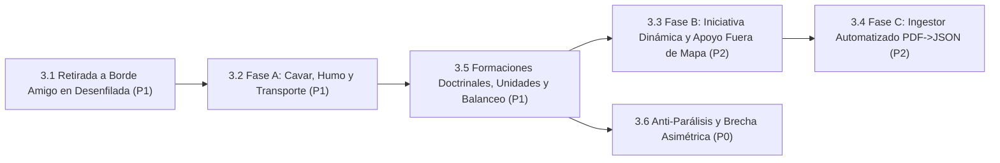
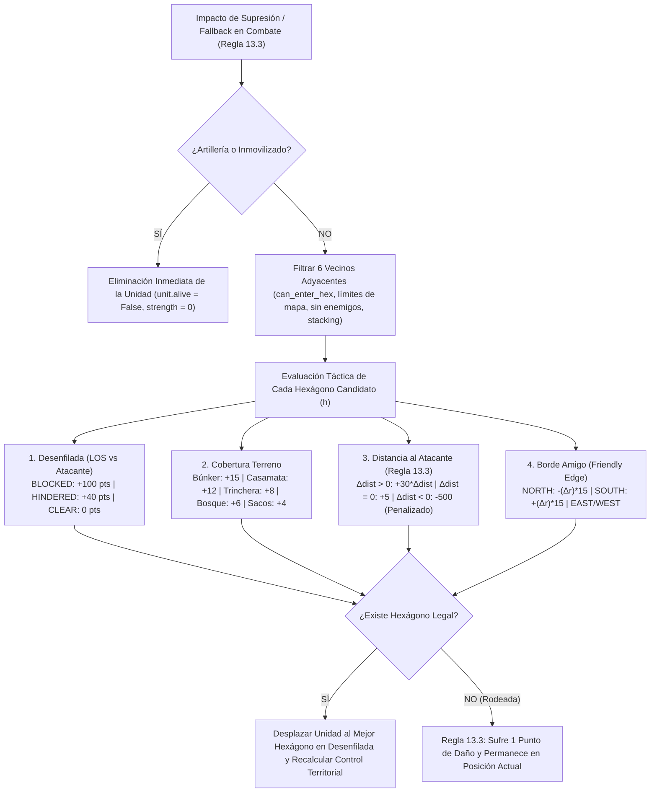
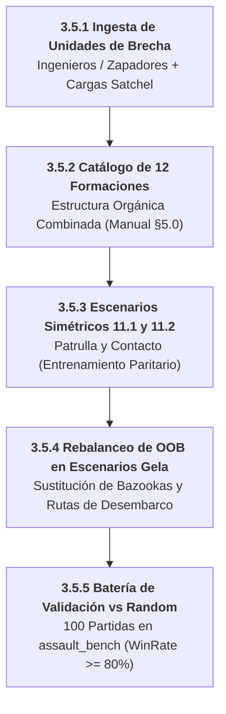

# Línea 3: Fidelidad Normativa y Reglamento Oficial del Wargame

> **Documento Modular de la Hoja de Ruta Evolutiva**  
> **Importancia Global:** 🟢 **Prioridad P1 (Alta)**  
> **Objetivo Estratégico:** Completar las mecánicas del reglamento oficial (*Rulebook rev6*) identificadas en la auditoría exhaustiva de 52 páginas ([`08_AUDITORIA_REGLAMENTO_VS_ENGINE.md`](../08_AUDITORIA_REGLAMENTO_VS_ENGINE.md)), asegurando fidelidad militar absoluta de las simulaciones y soporte para los 38 escenarios canónicos.  
> **Ámbito de Implementación:** `assault_model/actions/` • `assault_model/combat/` • `assets/catalogs/` • `assets/scenarios/` • `agents/efficientzero_v2/`

---

## 1. Diagrama de Dependencias y Flujo de Trabajo

---

## 2. Matriz de Tareas y Criterios Cuantitativos de Aceptación

| Orden | Tarea / Componente | Prioridad Interna | Módulos / Archivos Impactados | Criterio de Aceptación Cuantitativo | Prerrequisitos |
| :---: | :--- | :---: | :--- | :--- | :--- |
| **1** | **3.1 Algoritmo de Retirada a Borde Amigo en Desenfilada (Sección 6.4)** | **P1** | `assault_model/combat/morale.py`, `assault_model/rules/movement_rules.py`, `assault_model/tests/test_fallback_defilade_algorithm.py` | Algoritmo determinista de selección de hexágono de retirada priorizando desenfilada (LOS BLOCKED > HINDERED > CLEAR), mayor cobertura de terreno/fortificación, vector a Friendly Edge y aumento de distancia al atacante. Destrucción de artillería/inmóviles y daño por bloqueo (Regla 13.3). **[CONSOLIDADA 🟢 v2.5.11]** | v2.2.0 (Vectorized LOS) |
| **2** | **3.2 Fase A: Cavar (*Dig-In*), Humo Táctico y Transporte de Tropas** | **P1** | `assault_model/actions/status.py`, `actions/ranged_indirect.py`, `rules/movement_rules.py` | `DigInAction` (creación de marcadores `Foxhole`), `FireSmokeAction` (bloqueo dinámico de LOS y disipación por turno), y `LoadUnitAction`/`UnloadUnitAction` con chequeo de bajas si el vehículo es destruido. | Tarea 3.1 |
| **3** | **3.5 Formaciones Doctrinales, Ingesta de Unidades y Rebalanceo de Escenarios** | **P1** | `assets/catalogs/formation_catalog.json`, `assets/catalogs/unit_catalog.json`, `assets/scenarios/` | Desglosado en subtareas 3.5.1 a 3.5.5: Ingesta de ingenieros, catálogo de 12 formaciones, 2 escenarios simétricos de entrenamiento, rebalanceo OOB de Gela y benchmark de victoria. **Criterio de éxito:** Win Rate $\ge 80\%$ de `EfficientZero V2` vs baseline Random en ambos bandos. | Tarea 3.2 / Línea 2 |
| **4** | **3.3 Fase B: Iniciativa Dinámica (D6 + Command Points) y Apoyo Fuera de Mapa (TAS/OAS)** | **P2** | `assault_model/state/turn.py`, `combat/support_strike.py` | Tirada de iniciativa D6 al inicio de cada ronda, asignación de 2–5 CPs por bando para activar interrupciones tácticas y resolución de bombardeos fuera de mapa con dispersión hexagonal. | Tarea 3.5 |
| **5** | **3.4 Fase C: Pipeline Automatizado de Ingesta PDF $\to$ JSON (36 Escenarios)** | **P2** | `scripts/scenario_ingestor.py`, `assets/scenarios/` | Extractor automatizado de tablas OOB, mapas y condiciones de victoria desde el manual en PDF a esquemas canónicos `.json`, alcanzando los 38 escenarios completos de Gela y Standalone. | Tarea 3.3 |
| **6** | **3.6 Eliminación de la Parálisis Ofensiva y Colapso de la Brecha Asimétrica** | **P0** | `agents/efficientzero_v2/core/observation.py`, `agents/efficientzero_v2/train/`, `curriculums/` | Expansión sensorial a 38 canales (`DEFAULT_OBS_CHANNELS = 38`), activación de canales 36 (urgencia temporal) y 37 (riesgo de parálisis), balanceo de gradientes multi-tarea PCGrad por defecto, sesgo MCTS a VPs con $\ge 80$ sims y actualización de puertas del currículum para neutralizar el colapso asimétrico. **[CONSOLIDADA 🟢]** | Tarea 3.5 / Tarea 2.3 |

---

---

## 3. Tarea 3.1: Algoritmo de Retirada a Borde Amigo en Desenfilada (Sección 6.4 / Regla 13.3) [CONSOLIDADA 🟢 v2.5.11]

> **Módulos Involucrados**: `assault_model/rules/movement_rules.py`, `assault_model/combat/morale.py`, `assault_model/combat/ranged_combat_resolver.py`, `assault_model/runtime/execution_context.py`, `assault_model/tests/test_fallback_defilade_algorithm.py`.  
> **Reglamento Oficial**: *Rulebook rev6* §6.4 (*Action Phase*) y §13.3 (*Morale Status Markers - Fallback*).

### Especificación Operativa del Algoritmo de Retirada

Sustituye la primitiva aleatoria previa (`q - 1, r`) por un cálculo táctico determinista multinivel que emula la doctrina militar de repliegue bajo fuego:

### Formulación Matemática de Selección

Para cada hexágono legal adyacente $h \in \mathcal{N}(	ext{pos})$:
$$	ext{Score}(h) = 	ext{Score}_{	ext{defilade}}(h, 	ext{atk}) + 	ext{Score}_{	ext{cover}}(h) + 	ext{Score}_{	ext{dist}}(h, 	ext{atk}) + 	ext{Score}_{	ext{edge}}(h, 	ext{side})$$

* **Criterios de Desempate Determinista**: `(total_score, defilade_score, cover_score, cand_dist, -q, -r)`.
* **Suite de Verificación**: 7 tests específicos en `assault_model/tests/test_fallback_defilade_algorithm.py` cubriendo desenfilada, cobertura, orientación al borde amigo, penalización de avance hacia el atacante, eliminación de artillería/inmóviles y daño por bloqueo.

---

## 4. Desglose Operativo y Plan de Acción de la Tarea 3.5 (Subtareas Incrementales)

Para implementar de forma gradual y verificable la compensación de escenarios y la paridad balística, la Tarea 3.5 se descompone en 5 subtareas ordenadas:

1. **Subtarea 3.5.1: Ingesta de Especialistas de Asalto e Infantería de Brecha (P1)** — `[COMPLETADA 🟢]`:
   - **Módulos**: `assets/catalogs/unit_catalog.json`, `assault_model/actions/explosive_charge.py`, `assault_model/actions/mine_detection.py`, `assault_model/combat/explosive_charge_resolver.py`, `assault_model/combat/mine_resolver.py`, `tools/unit_editor_server.py`.
   - **Logros Alcanzados**:
     - Modelado e ingesta canónica de `US_COMBAT_ENGINEERS_43` (Carta S43) en `assets/catalogs/unit_catalog.json`.
     - Implementación de `EXPLOSIVE_CHARGE` (Regla 12.5): Acción rápida de detonación adyacente (distancia 1) con tirada de 1 dado ROJO vs dado de defensa más fuerte del terreno (o 1 dado VERDE por defecto). Resolución de colapso de edificios a ruinas, degradación de búnkeres a trincheras, eliminación de alambradas y minas, y bajas colaterales/moral a unidades interiores.
     - Implementación de `MINE_DETECTION` (Regla 9.6.6.2): Acción y rasgo pasivo con bono de $+2$ en D6 para detección e identificación segura de campos de minas reales y eliminación de señuelos (*dummy*).
     - Exposición total en GUI del Editor de Unidades (`tools/unit_editor_server.py`, Puerto 8780) con tooltips reglamentarios detallados (`TRAIT_HELP`).
     - Suite completa de tests unitarios e integración en verde (`assault_model/tests/test_engineer_traits.py`).

2. **Subtarea 3.5.2: Modelado del Catálogo Oficial de Formaciones Combinadas (P1)** — `[COMPLETADA 🟢 v2.5.4]`:
   - **Módulos**: `assets/catalogs/formation_catalog.json`, `assets/catalogs/formation_art_inventory.json`, `assault_model/units/formation.py`, `tools/unit_editor_server.py`, `start_assault.bat`, `start_all_environments.ps1`, `assault_model/tests/test_formation_catalog.py`, `assault_model/tests/test_unit_and_formation_editor_api.py`.
   - **Logros Alcanzados**:
     - Modelado e ingesta canónica de las 12 formaciones oficiales reglamentarias del manual (Sección 5.0) en `formation_catalog.json` con desglose en slots categóricos (`line_units`, `heavy_weapons`, `specialists`) y array plano de compatibilidad `units`.
     - Ingesta y escaneo del inventario completo de 122 cartas de formación tácticas escaneadas en `assets/art/formations/` organizadas por nación (`GE`, `IT`, `UK`, `US`) en `formation_art_inventory.json`.
     - Mapeador visual dual en el Editor de Unidades y Formaciones (`tools/unit_editor_server.py`, puerto 8780) con previsualización de la carta original de alta resolución, selectores de slots, selector rápido de unidades del catálogo y cálculo dinámico de puntos en tiempo real.
     - Automatización en `start_assault.bat` y `start_all_environments.ps1` garantizando el levantamiento del editor en el puerto 8780 y apertura en navegador.
     - Suite completa de tests unitarios e integración en verde (`test_formation_catalog.py`, `test_unit_and_formation_editor_api.py`).

3. **Subtarea 3.5.3: Escenario Individual de Entrenamiento de Infantería Pura 11.1 (Addestramento Fanteria) y 11.2 (P1)**:
   - **Módulos**: ssets/scenarios/draft_addestramento_fanteria_11_1.json, ssets/catalogs/map_piece_catalog.json (Pieza geomórfica S6 9x8), ssets/catalogs/unit_catalog.json (US_50CAL_HMG, GE_HEAVY_MG_42, US_RIFLES_43, GE_RIFLES_43), ssault_bench/configs/benchmark_config.addestramento_fanteria.yaml, curriculums/vp_acceleration/configs/efficientzero_v2.addestramento_fanteria.yaml.
   - **Naturaleza y Propósito Doctrinal (Sandbox Individual de Infantería)**:
     - Escenario individual y autónomo (*standalone*) del *Libro della Campagna* (pág. 79) concebido específicamente como **entorno de aprendizaje y maestría táctica de infantería pura a nivel de escuadra**.
     - **Cero Vehículos / Cero Artillería Pesada**: Elimina toda interferencia de blindados o cañones de campaña para aislar el aprendizaje de los fundamentos tácticos de infantería: establecimiento de base de fuego (*Base of Fire*) con ametralladoras pesadas HMG para supresión a media/larga distancia, maniobra de flanqueo y avance escalonado por saltos (*leapfrogging*) de las escuadras de fusileros bajo desenfilada rural, y asalto decisivo en combate cuerpo a cuerpo sobre el hexágono de victoria central.
     - **Simetría y Paridad Absoluta (0% Sesgo Inicial)**: Paridad estricta 3 vs 3 (2 fusileros + 1 HMG por bando: Wehrmacht vs US Army) disputando 1 VP central equidistante en un horizonte comprimido de 6 turnos ({\\max}=6$).
     - **Ultra Alta Velocidad de Simulación y Autojuego**: Al contar con únicamente 6 unidades en un mapa compacto de  \\times 8$ (72 hexágonos), el tiempo por episodio en self-play MCTS se reduce a **$< 0.15$ s por episodio** (más de **\\times$ más rápido que Gela**), permitiendo una convergencia de aprendizaje y calibración de hiperparámetros en minutos.
   - **Estado y Plan de Ejecución**:
     - [DRAFT GENERADO 🟡 v2.5.29]: Pieza geomórfica S6 ( \\times 8$) registrada en el catálogo de mapas, ametralladora US_50CAL_HMG promovida y sincronizada en catálogos de unidades, y archivo JSON canónico en borrador (ssets/scenarios/draft_addestramento_fanteria_11_1.json y ssets/scenarios/drafts/addestramento_fanteria_11_1.json) verificado con ScenarioLoader (72 hexágonos, 6 unidades, fortificaciones y VP en verde).
     - [FASE PENDIENTE - ENTRENAMIENTO Y BENCHMARK]: Integración del perfil de evaluación en ssault_bench (batería simétrica vs Random Side A/B y Selfplay) y configuración curricular en EfficientZeroV2 como etapa de pre-entrenamiento rápido de infantería antes de escenarios complejos de armas combinadas.

4. **Subtarea 3.5.4: Rebalanceo de OOB en Escenarios Canónicos de Gela (P1)** — `[COMPLETADA 🟢]`:
   - **Módulos**: `assets/scenarios/battaglia_cittadina_2_1.json`, `assets/scenarios/mettete_i_piedi_terra_1.json`, `assets/catalogs/unit_catalog.json`, `assault_model/tests/test_oob_rebalance_canonical_scenarios.py`.
   - **Logros Alcanzados**:
     - **Battaglia Cittadina (`battaglia_cittadina_2_1.json`)**: Sustituido el `US_BAZOOKA_TEAM` (ineficaz ante casamatas urbanas sin blindados) por 1x `US_COMBAT_ENGINEERS_43` en posición `[7, 9]`.
     - **Mettete i Piedi a Terra (`mettete_i_piedi_terra_1.json`)**: Reemplazado el `US_BAZOOKA_TEAM` por 1x `US_COMBAT_ENGINEERS_43` posicionado en el sector central de desembarco (`[4, 12]`), directamente encarado a la alambrada alemana (`q=4, r=9`).
     - **Fidelidad Estricta al Reglamento en Humo Táctico (Regla 7.2)**: Eliminados marcadores estáticos iniciales de humo de los escenarios (antirreglamentarios en el manual). Se dota a los zapadores de capacidad de combate dinámico de humo (`SMOKE` directo/adyacente con dados `GREEN, GREEN, BLUE, BLUE` y rasgo `SMOKE_GRENADES`), que complementa el humo indirecto del mortero de 81mm (`US_81MM_MORTAR`) para tender pantallas dinámicas sobre la marcha.
     - **Catálogo, Rasgos de Brecha y Doctrina**: Dotada la unidad `US_COMBAT_ENGINEERS_43` de rasgos de demolición `EXPLOSIVE_CHARGE`, `MINE_DETECTION`, `BANGALORE_TORPEDO` y perfil doctrinal `SPEARHEAD` con postura `ASSAULT_VP`.
   - **Criterio de Aceptación Cumplido**: Verificado mediante suite de tests unitarios e integración (`test_oob_rebalance_canonical_scenarios.py`): el bando atacante dispone de un ratio de efectividad de asalto de **4.0 $\ge 1.0$** (8 de potencia de asalto contra 2 de defensa base) y capacidad garantizada de apertura de brechas en fortificaciones fijas y alambradas en los primeros 3 turnos.

5. **Subtarea 3.5.5: Batería de Validación Automatizada y Certificación de Victoria vs Random (P1)**:
   - **Módulos**: `assault_bench/tests/test_scenario_balance.py`, `assault_bench/benchmark_matrix_runner.py`.
   - **Alcance**: Ejecutar batería de 100 partidas automatizadas en `assault_bench` evaluando `EfficientZero V2` frente al baseline Random en los escenarios rebalanceados y de entrenamiento.
   - **Criterio de Aceptación Cuantitativo**: **Win Rate $\ge 80\%$** para el agente en ambos bandos (`Side A` y `Side B`), con `Loss Rate \le 10\%` y `Timeout Rate \le 10\%`.

6. **Subtarea 3.5.6: Ingesta Fidedigna de Refuerzos, Soporte TA/OAS, Puntos de Mando y Status Moral en Escenarios Canónicos (Eliminación de la Inercia Defensiva en la Raíz Wargame)** — `[PLANIFICADA ⚪ v2.5.11]`:
   - **Módulos**: `assets/scenarios/battaglia_cittadina_2_1.json`, `assets/scenarios/mettete_i_piedi_terra_1.json`, `assault_model/core/scenario.py`, `assault_model/core/scenario_loader.py`, `assault_model/state/game_state.py`, `assault_model/combat/ranged_combat_resolver.py`.
   - **Diagnóstico y Origen**: Auditoría exhaustiva del *Libro della Campagna* (Págs. 18-21, §3.1 en `docs/08_AUDITORIA_REGLAMENTO_VS_ENGINE.md`). Se identificó que la IA atacante adopta una postura 100% defensiva porque los escenarios en el simulador carecen de las ventajas doctrinales de asalto que el reglamento otorga para romper posiciones fortificadas.
   - **Alcance Operativo**:
     1. **Refuerzos Programados (Turno 2, Fase de Organización)**: En `mettete_i_piedi_terra_1.json`, inyectar la 2.ª oleada de desembarco aliada con una formación adicional de infantería, duplicando la masa de asalto.
     2. **Puntos de Mando de Formación**: Modelar CPs en el escenario y `GameState` (+4 CPs para US y +2 CPs para IT en Battaglia Cittadina por ratio 2/40 vs 1/20).
     3. **Soporte Fuera de Mapa (TA / OAS)**: Asignar 3 cartas TA/OAS (3 re-rolls de ataque a distancia) para US en Battaglia Cittadina y 1 re-roll para US en Mettete.
     4. **Escala Autoritativa de Presión y Rendición (`Status delle Truppe`, §5.1)**: Modelar los umbrales de presión moral (12 bajas = +1 presión, pérdida de VP altera presión). Resolver chequeos D6 de *Rotta* (+1 VP extra al atacante) y *Resa* (rendición total y captura del 100% de los VPs del mapa).
     5. **Corrección Histórica de OOB en Desembarco**: Asignar defensores italianos de la XVIII Brigata Costiera en Mettete en lugar de tropas pesadas alemanas con MG42.
   - **Criterio de Aceptación Cuantitativo**: El atacante dispone de superioridad 2:1 en masa de maniobra, 3 re-rolls de ablandamiento y victoria anticipada por colapso moral enemigo. Eliminación de la inercia defensiva aprendida en autojuego, alcanzando $\ge 80\%$ de ratio de asaltos a VPs.

7. **Subtarea 3.5.7: Ingesta Canónica de Escenarios de Infantería Pura (Bunker Hill! y Elemento Sorpresa)** — [CONSOLIDADA 🟢 v3.0.0]:
   - **Módulos**: ssets/scenarios/bunker_hill_singolo.json, ssets/scenarios/elemento_sorpresa_singolo.json, ssets/catalogs/map_piece_catalog.json, ssault_model/tests/test_pure_infantry_scenarios.py.
   - **Alcance Operativo**:
     1. **Bunker Hill! (unker_hill_singolo.json, Pág. 81)**: Sector de asalto en colina con 4 casamatas de hormigón y estación de radio (4,3), enfrentando infantería del 16.º Regimiento US vs defensores de la Div. Livorno sin presencia de vehículos.
     2. **Elemento Sorpresa (elemento_sorpresa_singolo.json, Págs. 86-87)**: Cruce en Y de Priolo en pieza S3 con elevación de colina, 5 paracaidistas del 505.º PIR (HMG 0.30 y francotirador) asaltando posiciones fortificadas italianas con cañón AA Breda 20mm y morteros Brixia.
     3. **Elevaciones en Catálogo de Piezas**: Asignación de elevación elevation: 1 a la cresta de colina de la pieza S6 ((3,2), (4,3), (4,4), (5,2), (5,3)).
   - **Criterio de Aceptación Cuantitativo Cumplido**: Carga y ejecución autoritativa en VOECSimulator, generación de acciones legales, análisis topográfico IPB clasificando hexágonos objetivo como terreno clave y 100% de tests en verde en 	est_pure_infantry_scenarios.py.

---

## 5. Tarea 3.6: Eliminación de la Parálisis Ofensiva y Colapso de la Brecha Asimétrica (P0 - Crítica) [CONSOLIDADA 🟢]

> **Módulos Involucrados**: `agents/efficientzero_v2/core/observation.py`, `voec_sim/core/reward_calculator.py`, `agents/efficientzero_v2/core/mcts.py`, `agents/efficientzero_v2/train/train_engine.py`, `agents/efficientzero_v2/configs/efficientzero_v2_config.yaml`.  
> **Origen y Diagnóstico**: Informe de Auditoría Táctica Forense (`docs/informes_ejecucion/INFORME_01_CURRICULUM_Y_AUDITORIA_TACTICA.md`). Se detectó que el modelo alcanzó un 87.5% de victorias como defensor (IT/GE) pero un 0.0% de victorias como atacante (US) frente a agentes aleatorios (*Random*), generando una brecha asimétrica de 0.655 y degradando el ELO en -811 puntos.

### Subtareas de Mitigación Inmediata (Orden Secuencial)

1. **Subtarea 3.6.1: Expansión Sensorial a 38 Canales (`DEFAULT_OBS_CHANNELS = 38`)**:
   - Activar formalmente en la configuración base (`observation_channels: 38`) los canales espaciales:
     - **Canal 36**: Presión de Urgencia Temporal $\tau(t, T) = t / T_{\max}$, proporcionando gradiente temporal explícito para forzar asaltos antes del límite de turnos.
     - **Canal 37**: Riesgo de Parálisis por Inmovilidad fuera de cobertura pesada.
     - **Canales 32-35**: Perfiles de alcance óptimo y asignación doctrinal jerárquica.
   - **Criterio de Aceptación Cumplido**: Tests en `agents/efficientzero_v2/tests/test_doctrine_sensory_contract.py` verificando dimensiones `(38, 16, 16)` activas por defecto.

2. **Subtarea 3.6.2: Activación del Potencial PBRS y Descuento Dinámico de Devlin & Kudenko**:
   - Integrar en el bucle de autojuego de `selfplay.py` la formulación dinámica de `voec_sim/core/reward_calculator.py`:
     $$\Psi_{\text{urgency}}(t, T) = \exp(-\lambda_{\text{urgency}} \cdot \tau(t, T))$$
   - Reducir el valor del estado si el bando que no posee la mayoría de VPs permanece pasivo, eliminando la aversión al fuego de reacción cuando el tiempo expira.

3. **Subtarea 3.6.3: Sesgo MCTS Progresivo Orientado a Objetivos (*VP Progressive Unrolling*)**:
   - Incrementar el presupuesto de simulación MCTS a **64 simulaciones en autojuego y 80 en evaluación**.
   - Añadir en la selección PUCT el término $+c_{\text{vp}} \cdot \Delta \text{Dist}(\text{VP})$ para priorizar ramas que reduzcan la distancia al objetivo en los primeros 3 turnos.

4. **Subtarea 3.6.4: Balanceo de Gradientes Multi-Tarea con PCGrad**:
   - Configurar `gradient_balance_mode: "pcgrad"` en `train_engine.py` para evitar que las pérdidas auxiliares de Attrition y Threat Map castiguen las maniobras agresivas de captura de VPs.

### Criterios de Aceptación y Certificación Final de la Tarea 3.6
- **Win Rate Atacante (US) vs Random**: $\ge 80.0\%$ en `battaglia_cittadina_2_1` y $\ge 75.0\%$ en `mettete_i_piedi_terra_1`.
- **Asymmetry Gap Global**: Reducción drástica de **0.655 a $\le 0.15$**.
- **Recuperación de ELO Ancla**: $\ge 1600$ ELO verificado en evaluación bilateral de 100 partidas.
- **Tactical Quality Score (TQS)**: $\ge 85.0 / 100$ con estatus de puerta **PASS**.

---

## 6. Tarea 3.7: Modernización y Optimización Integral del Motor de Simulación (P1 - Alta)

> **Módulos Involucrados**: `assault_model/state/`, `assault_model/rules/`, `assault_model/combat/line_of_sight.py`, `voec_sim/core/simulator.py`, `assault_sim/`.  
> **Diagnóstico Empírico de Auditoría**: En 100 pasos de simulación (`battaglia_cittadina_2_1`), el motor realiza 3.68 millones de operaciones con una tasa base de 109 pasos/segundo. El 51% del tiempo de CPU se consume en `ActionCatalog.actions`, 22% en `update_spotting` (36,432 llamadas a LOS), 21% en la regeneración redundante de `spatial_features()` y se registran más de 1.08 millones de llamadas a `getattr`/`hasattr`.  
> **Directiva Primaria**: **Cero invención de mecánicas; 100% de apego al reglamento oficial de Sound of Drums rev6 (52 páginas)**.

### Subtareas y Plan de Acción en 4 Fases

1. **Subtarea 3.7.1: Aceleración de Rendimiento Inmediata del Motor [CONSOLIDADO 🟢 v2.5.29]**:
   - **Resultado Empírico**: Throughput de simulación incrementado de 428.8 a **719.7 pasos/s (+67.8%)** en acciones aleatorias y de 454.3 a **844.6 pasos/s (+86.0%)** en secuencia canónica.
   - **Intervenciones Realizadas**:
     - Cacheo inmutable de `_static_spatial_features` gobernado por `terrain_signature` en `VOECSimulator`, ahorrando 21% de tiempo de CPU por step.
     - Índices de ocupación O(1) por `state_version` en `MovementRules.get_legal_paths`, suprimiendo la reconstrucción local de listas.
     - Snapshot táctico reactivo y bypass de unidades `HIDDEN` en `update_spotting`.
     - Búsqueda O(1) de rasgos mediante `_trait_set` precompilado en `UnitType.has_trait`.
     - Filtrado temprano por avistamiento conjunto (`all_spotted`) en `ActionCatalog._ranged_fire_actions`.
   - **Certificación de Calidad**: 160/160 tests en motor (`assault_model` + `voec_sim`), 158/158 en `agents/efficientzero_v2` y 77/77 en `assault_bench` en verde estricto.

2. **Subtarea 3.7.2: Purga de Deuda Técnica y Descomisionamiento Legacy [CONSOLIDADO 🟢 v2.5.30]**:
   - **Unificación Canónica de Assets**: Erradicada la carpeta sombra `assault_sim/assets/`, fijando `assets/` (`assets/catalogs/`, `assets/scenarios/`, `assets/art/`) como la única fuente de verdad autoritativa del proyecto.
   - **Archivado de Pila Obsoleta PPO/SB3**: Trasladados scripts y binarios obsoletos (`assault_sim/train/`, `assault_sim/checkpoints/`, `grid_search_shaped.py`, `run_train_short.py`, `run_eval_short.py`, `run_eval_200.py`) al directorio `legacy_archive/`.
   - **Desacoplamiento de APIs**: Actualizado `mlops/reporting/replay_api.py` para resolver escenarios directamente desde la ruta canónica.
   - **Certificación de Suite**: Verificado el 100% de tests en verde en motor (160/160), EZv2 (158/158), backend (29/29) y benchmark (77/77).
   - Descomisionar la pila heredada de PPO/SB3 en `assault_sim/` (`training_env.py`, `sim_env.py`, `ppo_config.py`, checkpoints obsoletos).
   - Unificar `assets/scenarios/` y `assets/catalogs/` como fuente única de verdad, eliminando réplicas secundarias desincronizadas.

3. **Subtarea 3.7.3: Refactorización Canónica de Línea de Visión (Cube Coordinates Hex Math) [CONSOLIDADO 🟢 v2.5.52]**:
   - Migrado el cálculo de LOS desde interpolación flotante con píxeles UI (`_UI_HEX_SIZE = 30.0`) hacia raycasting exacto analítico en coordenadas cúbicas $(x, y, z)$ donde $x + y + z = 0$.
   - Resolución matemática exacta y determinista de aristas divisorias (*hex spines*) conforme a las Reglas 10.2 y 10.3 del reglamento oficial (*Sound of Drums rev6*): cuando la visual discurre por una costura entre hexágonos, si ambos bloquean la LOS queda bloqueada; si uno bloquea y otro dificulta es dificultada; y si cualquiera de los lados es despejado la visual se considera despejada ("el tirador ve a lo largo de la costura").
   - Reversibilidad espacial $100\%$ determinista garantizada entre origen y destino mediante ordenación canónica de pares $\{A, B\}$.
   - Erradicación definitiva de las constantes de dibujo 2D (`_UI_HEX_SIZE`, `_EDGE_EPS_SQ`) del núcleo táctico de reglas de combate.
   - Suite de verificación matemática exhaustiva en `assault_model/tests/test_vectorized_los_pathfinder_and_cow.py` (124/124 tests de motor en verde).

4. **Subtarea 3.7.4: Persistencia Resiliente y Tolerancia a Fallos en Artefactos de Evaluación de Benchmarks [CONSOLIDADO 🟢 v2.5.53]**:
   - Protección integral en `assault_bench/bench_io.py` contra fallos de I/O de disco (`FileNotFoundError`, permisos o carreras de borrado) durante la serialización de episodios de repetición (`bench_replay_episodes/episode_XXXX.json`) y resúmenes XAI (`bench_replay_index_latest.json`).
   - Creación defensiva y atómica de directorios contenedores (`target_path.parent.mkdir(parents=True, exist_ok=True)`) y captura no bloqueante de excepciones secundarias para garantizar que una ejecución curricular multietapa de varias horas jamás se aborte por la escritura de archivos de repetición optativos.
   - Suite de 77/77 tests pasando en verde en `assault_bench/tests/`.
   - Suite de pruebas unitarias 124/124 en verde (`test_section_6_1_canonical_cube_ray_properties_and_symmetry`, `test_section_6_1_rule_10_3_hex_side_exact_resolution`).

4. **Subtarea 3.7.4: Consolidación Normativa Fiel al Reglamento Oficial**:
   - Ciclo de vida canónico de humo (Regla 7.2): Dispersión progresiva y bloqueo de LOS durante 2 turnos.
   - Sistema de transporte y remolque (Regla 9.11): Capacidad de embarque/desembarque en semiorugas/camiones y remolque de piezas de artillería inmovilizadas.
   - Mazo de mando y tirada de iniciativa D6 con puntos CP (Reglas 4.9 y 6.1).
