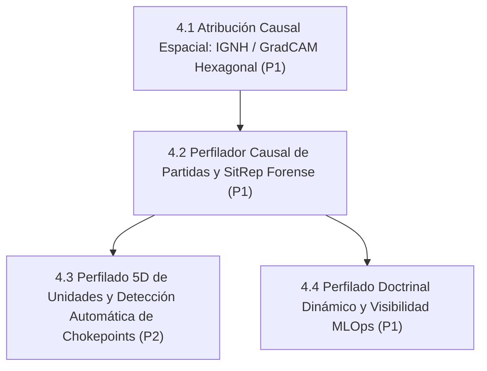

# Línea 4: Explicabilidad Máxima (XAI), Perfilado Causal e Inteligencia Táctica (IPB)

> **Documento Modular de la Hoja de Ruta Evolutiva**  
> **Importancia Global:** 🟢 **Prioridad P1 (Alta)**  
> **Objetivo Estratégico:** Proporcionar transparencia total sobre las decisiones de la IA conforme a la Sección 13 de las Premisas del Proyecto. Auditar por qué el agente ataca, defiende o se repliega, detectando chokepoints topográficos y correlacionando el plan macro con el desenlace del combate.  
> **Ámbito de Implementación:** `mlops/reporting/explainability_api.py` • `mlops/reporting/causal_profiler.py` • `assault_ai_ui/src/` • `agents/efficientzero_v2/core/macro_planner.py` • `assault_model/units/`

---

## 1. Diagrama de Dependencias y Flujo de Trabajo

---

## 2. Matriz de Tareas y Criterios Cuantitativos de Aceptación

| Orden | Tarea / Componente | Prioridad Interna | Módulos / Archivos Impactados | Criterio de Aceptación Cuantitativo | Prerrequisitos | Estado |
| :---: | :--- | :---: | :--- | :--- | :--- | :---: |
| **1** | **4.1 Atribución Causal Espacial Hexagonal (IGNH / GradCAM)** | **P1** | `mlops/reporting/explainability_api.py`, `assault_ai_ui/src/components/ExplainabilityModal.tsx`, `mlops/reporting/viewer_frontend/src/components/ExplainabilityModal.tsx` | Visualización en el visor MLOps de qué canales sensoriales (cobertura, LOS, amenaza, distancia a VP) determinaron la acción seleccionada en cada turno mediante Integrated Gradients para características heterogéneas (IGNH) y Grad-CAM sobre el `representation_tower`. Mapeo biyectivo de coordenadas de tablero y overlay hexagonal reactivo. | Línea 1 (Zero-Mock en UI) | 🟢 **Consolidado v2.5.10** |
| **2** | **4.2 Perfilador Causal de Partidas y SitRep Forense** | **P1** | `mlops/reporting/causal_profiler.py`, `assault_rag/` | Correlación causal automática entre las predicciones tácticas de las cabezas (`threat_map`, `morale_pred`, `objective_intent`) y el resultado de las capturas de VPs. Generación de informe narrativo forense por partida. | Tarea 4.1 | ⚪ Planificado |
| **3** | **4.3 Perfilado 5D de Unidades y Detección Automática de Chokepoints (IPB)** | **P2** | `assault_model/map/topography_analyzer.py`, `agents/efficientzero_v2/core/macro_planner.py` | Análisis topográfico previo a la partida (Turno 0) que clasifica hexágonos en *Defilade Corridors*, *Killzones* y *Key Terrain* (VPs), inyectando estos priors en el `MacroStrategyPlanner`. | Tarea 4.2 |
| **4** | **4.4 Perfilado Doctrinal Dinámico de Unidades y Visibilidad en MLOps** | **P1** | `assets/catalogs/unit_catalog.json`, `assault_model/units/unit_type.py`, `agents/efficientzero_v2/core/macro_planner.py`, `mlops/reporting/viewer_frontend/` | Jerarquía 3 capas (Balística, Roles, Emergente). Mutación dinámica contextual de roles (`SPEARHEAD`, `FIRE_SUPPORT`, `RECON`, `SCREEN`, `COMMAND`), modulación +35% de priors MCTS y badges visuales con telemetría forense de rol en Match Replay (:8778). | Tarea 4.2 / Línea 2 |

---

## 3. Estado de Ejecución y Logros Técnicos

> [!NOTE] POSIBLE CONTENIDO REPETIDO (Pendiente de decisión del usuario)
> La especificación exhaustiva de 5 fases de la Tarea 4.4 (Perfilado Doctrinal Dinámico) se encuentra detallada en [`docs/14_PLAN_PERFILADO_UNIDADES_IA.md`](../14_PLAN_PERFILADO_UNIDADES_IA.md). Se preserva íntegramente conforme a la directiva de no eliminación de párrafos.

- **Tarea 4.1 Consolidada 🟢 [v2.5.10]**: Atribución Causal Espacial Hexagonal (IGNH / Grad-CAM):
  - Backend: mlops/reporting/explainability_api.py implementando Integrated Gradients para características heterogéneas (compute_hex_attribution) y Grad-CAM sobre el 
epresentation_tower. Mapeo biyectivo de coordenadas de tablero (q, r).
  - Agrupación semántica canónica: 6 grupos tácticos (COVER_TERRAIN, LOS_VISIBILITY, THREAT_MAP, VP_PROXIMITY, DOCTRINE_ROLE, UNIT_STATE_TACTICAL) y síntesis en lenguaje natural de la justificación táctica de la decisión.
  - Endpoints MLOps: GET/POST /api/v2/replay/explain-step y /api/v2/explainability/attribution en mlops/reporting/viewer.py.
  - Frontend: ExplainabilityModal.tsx en mlops/reporting/viewer_frontend/src/components/ExplainabilityModal.tsx y ssault_ai_ui/src/components/ExplainabilityModal.tsx, integrado con botón 🧠 Explain (IGNH) en MatchReplayTab.tsx y overlay reactivo sobre el canvas hexagonal.
  - Tests: mlops/tests/test_explainability_api.py verificando propiedades matemáticas de completitud y ejecución contra checkpoints reales de EfficientZero V2.

- **Tarea 4.1.1 Consolidada 🟢 [v2.5.11]**: Capa Reactiva de Cabezas Auxiliares Tácticas (	hreat_map, morale_pred, ttrition_pred) en Match Replay (:8778):
  - Botón de capa directo 🎯 Threat Head en la barra de herramientas del mapa en MatchReplayTab.tsx.
  - Proyección de mapa de calor hexagonal en tiempo real con niveles de riesgo e intensidades numéricas calculadas directamente por la cabeza prediction_threat_map de la red neural (con fallback a canal sensorial 7).
  - Tarjeta forense de cabezas tácticas (Threat Max/Mean, Riesgo de Supresión Morale, Bajas Proyectadas Attrition) sincronizada al paso actual del replay bajo la decisión de política y valor (s,a)$.
  - Endpoints MLOps /api/v2/replay/tactical-heads y /api/v2/replay/step-heads en iewer.py y función compute_step_tactical_heads en explainability_api.py.
  - Suite de tests unitarios/integración en verde: mlops/tests/test_explainability_api.py (4/4 passed).

- **Tarea 4.4 Consolidada 🟢**: Fases 1 a 5 implementadas en v2.4.5:
  - F1: Esquema canónico en catálogo `unit_catalog.json` y contratos de tipos en `unit_type.py`.
  - F2: Expansión sensorial y canales doctrinales (32..35).
  - F3: Mutación dinámica de roles en `macro_planner.py` y modulación de priors MCTS.
  - F4: Telemetría forense en DuckDB/Parquet y visualización interactiva en dashboard MLOps (:8778).
  - F5: Suite de tests unitarios e integración en verde (`test_doctrine_sensory_contract.py`, `test_doctrine_telemetry_forensics.py`).
