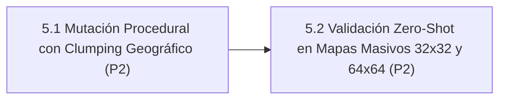

# Línea 5: Generalización Procedural y Robustez en Terrenos Abiertos

> **Documento Modular de la Hoja de Ruta Evolutiva**  
> **Importancia Global:** 🔵 **Prioridad P2 (Media)**  
> **Objetivo Estratégico:** Prevenir el sobreajuste a los mapas canónicos de Gela mediante mutación procedural con correlación espacial realista y validar la capacidad Zero-Shot de la red en escenarios de gran escala.  
> **Ámbito de Implementación:** `assault_model/core/procedural_mutator.py` • `agents/efficientzero_v2/tests/test_large_maps_zeroshot.py`

---

## 1. Diagrama de Dependencias y Flujo de Trabajo

---

## 2. Matriz de Tareas y Criterios Cuantitativos de Aceptación

| Orden | Tarea / Componente | Prioridad Interna | Módulos / Archivos Impactados | Criterio de Aceptación Cuantitativo | Prerrequisitos |
| :---: | :--- | :---: | :--- | :--- | :--- |
| **1** | **5.1 Mutador Procedural Asimétrico con Clumping Geográfico Natural** | **P2** | `assault_model/core/procedural_mutator.py` | Algoritmo de mutación de terreno con clumping espacial tipo Cellular Automata / Perlin, generando cadenas continuas de colinas, bosques densos y ríos correlacionados. Cero terrenos de ruido blanco espurio. | Línea 2 (Agente captura VPs consistentemente) |
| **2** | **5.2 Validación Zero-Shot en Tableros Masivos ($32\times 32$ y $64\times 64$)** | **P2** | `agents/efficientzero_v2/tests/test_large_maps_zeroshot.py` | Despliegue del agente entrenado en mapas $16\times 16$ sobre mapas de $32\times 32$ y $64\times 64$ sin modificar arquitectura ni pesos. Tasa de selección de acciones válidas del $100\%$ y convergencia a VPs distantes. | Tarea 5.1 |
